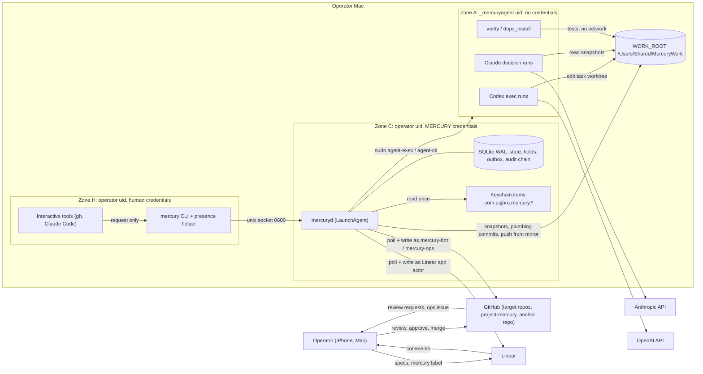
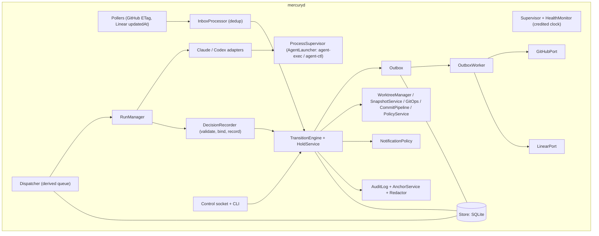
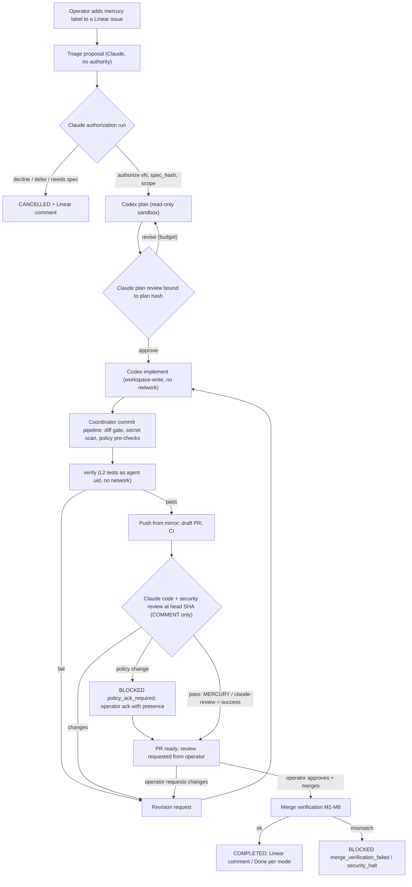
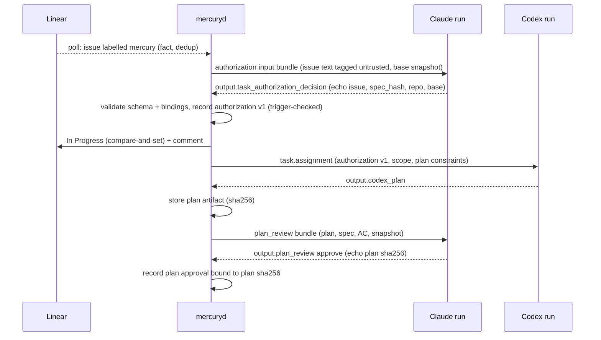
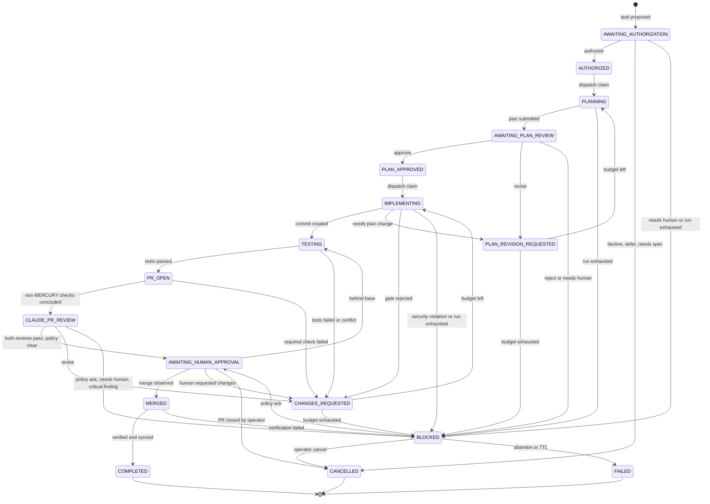
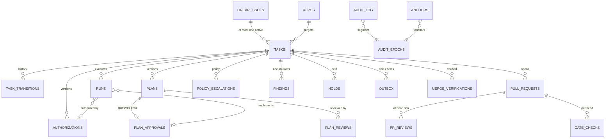
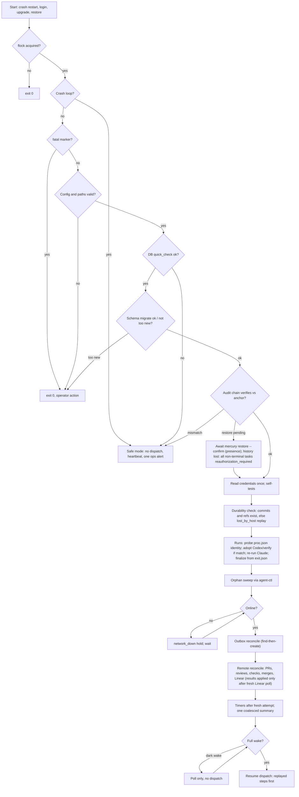

# Project MERCURY — Technical Design Document

| | |
|---|---|
| Document | `docs/mercury/TDD.md` (authoritative, navigable design; supporting specifications are linked per section) |
| Version | 1.0-rc (design for human review) |
| Date | 2026-10-12 |
| Design authority | Orchestrating session (Claude Code) integrating six specialized subagents (A–F) — see §31 |
| Status | **Conditionally ready for human review** — see §32. Not approved for implementation. |
| Scope | Design, specification, validation and implementation planning only. Nothing in this repository authorizes deployment, configuration changes on the Mac, Linear issue creation, or GitHub changes. All code and configuration snippets are examples for design review. |

**Reading guide.** Each section states the design decisions and the essential contracts, then links to the single supporting document that owns the detail. When this document and a supporting document disagree, the supporting document named as owner in the "Single-source rules" table below wins for detail, and the disagreement is a defect to report. Process records (discovery, agent reports, peer reviews, reconciliation decisions) are in [`reviews/`](reviews/).

**Single-source rules (no requirement or contract is defined twice).**

| Content | Sole owner |
|---|---|
| Requirement IDs (CON/FR/NFR/OPS), RTM, operator-decision register, DoR/DoD | [`planning/traceability.md`](planning/traceability.md) |
| Security requirement statements (SEC-xxx), permission matrix, risk register, SAC | [`security/threat-model.md`](security/threat-model.md) |
| Operational parameter values; filesystem layout; credential inventory | [`operations/macos-service.md`](operations/macos-service.md) §2, §7.1, §9.1 |
| States, transitions, guards, invariants (INV-nn), holds, block reasons, workflow-policy numbers | [`architecture/state-machine.md`](architecture/state-machine.md) |
| SQL DDL, triggers, component interfaces, CLI verbs, pseudocode | [`architecture/components.md`](architecture/components.md) |
| Message envelope, message and agent-output JSON Schemas | [`protocols/messages.md`](protocols/messages.md), [`protocols/schemas/`](protocols/schemas/) |
| Retry matrix, dedup-key catalogue, App permissions, ruleset JSON | [`integrations/github.md`](integrations/github.md) |
| Test cases and pass/fail criteria | [`testing/verification-plan.md`](testing/verification-plan.md) |
| Architecture decisions | [`architecture/decisions/`](architecture/decisions/README.md) (ADR-001…020) |

---

## Contents
1. [Executive Summary](#1-executive-summary) · 2. [Problem Statement](#2-problem-statement) · 3. [Goals and Non-Goals](#3-goals-and-non-goals) · 4. [Existing System Assessment](#4-existing-system-assessment) · 5. [Requirements](#5-requirements) · 6. [Architecture Principles](#6-architecture-principles) · 7. [Architecture Overview](#7-architecture-overview) · 8. [Component Design](#8-component-design) · 9. [Agent Responsibilities and Authority](#9-agent-responsibilities-and-authority) · 10. [Agent Communication Protocol](#10-agent-communication-protocol) · 11. [State Machine and Workflow Lifecycle](#11-state-machine-and-workflow-lifecycle) · 12. [Linear Integration Design](#12-linear-integration-design) · 13. [Codex Execution Design](#13-codex-execution-design) · 14. [Claude Review and Approval Design](#14-claude-review-and-approval-design) · 15. [GitHub Integration and Merge Governance](#15-github-integration-and-merge-governance) · 16. [Data Model and Persistence](#16-data-model-and-persistence) · 17. [API and Message Contracts](#17-api-and-message-contracts) · 18. [macOS Runtime and Service Management](#18-macos-runtime-and-service-management) · 19. [Security Architecture and Threat Model](#19-security-architecture-and-threat-model) · 20. [Reliability and Failure Recovery](#20-reliability-and-failure-recovery) · 21. [Logging, Monitoring, and Auditability](#21-logging-monitoring-and-auditability) · 22. [Testing and Verification](#22-testing-and-verification) · 23. [Performance and Resource Management](#23-performance-and-resource-management) · 24. [Deployment and Upgrade Strategy](#24-deployment-and-upgrade-strategy) · 25. [Alternatives and Tradeoffs](#25-alternatives-and-tradeoffs) · 26. [Architecture Decision Records](#26-architecture-decision-records) · 27. [Implementation Roadmap](#27-implementation-roadmap) · 28. [Issue Breakdown and Dependencies](#28-issue-breakdown-and-dependencies) · 29. [Requirements Traceability Matrix](#29-requirements-traceability-matrix) · 30. [Risks, Assumptions, and Open Questions](#30-risks-assumptions-and-open-questions) · 31. [Subagent Review Findings](#31-subagent-review-findings) · 32. [Final Design Validation and Sign-Off Status](#32-final-design-validation-and-sign-off-status)

---

## 1. Executive Summary

MERCURY replaces Slack as the coordination channel between Claude Code and OpenAI Codex CLI on the operator's Mac. It is a single, continuously running **local coordinator** (`mercuryd`, Node.js 24 LTS + TypeScript, SQLite in WAL mode, supervised by a per-user launchd LaunchAgent) that executes and tracks development tasks which **Claude has explicitly authorized**, runs Codex in isolated git worktrees to plan and implement them, routes every plan and pull request through Claude review, and hands the result to the **human operator, who alone approves and merges** in GitHub.

The responsibility boundary is preserved structurally:

| Role | Holds | Cannot |
|---|---|---|
| **Claude** (headless decision runs) | Decision authority: triage proposals, task authorization, plan approval, PR code and security review, revision instructions | Act on GitHub/Linear; execute code; widen its own scope (bindings are verified in code) |
| **MERCURY** (`mercuryd`) | The loop: scheduling, process supervision, git plumbing, PR creation, polling, notifications, durable state, audit | Decide what to build; start work from a Linear status change; approve, request changes, dismiss, or merge |
| **Codex** (`codex exec`) | Planning and implementation inside one task worktree | Commit, push, reach the network, read any credential, or run without a Claude-approved plan hash |
| **Operator** | Merge authority, eligibility (`mercury` label), escalations, policy acknowledgements | — |

Key design choices: hub-and-spoke communication through the coordinator with strict JSON Schemas (no direct agent-to-agent channel, no Slack, no MCP bus); polling of GitHub and Linear (no inbound network access); a 17-state task lifecycle with orthogonal **holds** so sleep, offline periods and spec edits never masquerade as failures; immutable, hash-bound authorization and approval records enforced by SQLite triggers; **agents run as a dedicated macOS uid (`_mercuryagent`)** through root-owned wrappers so no agent can read the operator's or MERCURY's credentials; and a GitHub ruleset (CODEOWNERS = operator, approval of the latest push, no bypass, two App-pinned required checks `MERCURY / claude-review` and `MERCURY / policy`) that makes the human approval boundary **independent of any prompt**.

**Status:** the design passed six independent peer reviews and a reconciliation round; all Critical and High design findings are resolved in the documents (§31). The design is **conditionally ready for human review** (§32): it depends on operator decisions (notably the GitHub organization move and the separate agent user), and on Phase 0 verification of ~90 assumptions about the Mac and the agent CLIs that could not be observed from the design environment.

## 2. Problem Statement

Today Claude and Codex coordinate through Slack (`#network-monitor`), repo shell scripts (`slack-notify.sh`, `create-gate.sh`, `approve-gate.sh`, …), gate files and `.ai/` state in `usjbro/network_monitor`, with Linear team `JAM` as the issue tracker ([discovery](reviews/01-discovery-integrations.md)). Observed failures:

1. **Lost or missed messages** — replies missed for hours, posts in the wrong thread, a failed notification (sandbox DNS) resent by hand.
2. **Unnoticed stalls** — a question unanswered for 14 h, a ~3.5 h wait for a plan; monitoring only works while a chat session is open.
3. **Human relays and unrecorded decisions** — the operator manually forwards content; decisions made in chat never reach the record.
4. **Identity confusion** — agents act under the operator's own GitHub (`usjbro`, admin), Linear and Slack identities; an agent approval cannot be distinguished from a human one, and an agent-opened PR cannot be approved by the human (GitHub forbids self-approval).
5. **Unsafe work queue** — agents treat "the next Todo" as their queue, so a status change effectively starts work.
6. **Credential hygiene** — a leaked bot token produced ~11 junk messages.

MERCURY must provide durable, ordered, auditable coordination that survives sleep and restarts, keeps decision authority with Claude, execution with Codex and merge authority with the human, and enforces that separation with technical controls.

## 3. Goals and Non-Goals

**Goals**
- G1 Durable, exactly-once-effect coordination of authorized tasks from Linear issue to verified merge, surviving crash, sleep, reboot and network loss.
- G2 Claude authorization (versioned, immutable) is required before any Codex run; Claude approval bound to the exact plan hash is required before implementation; Claude review bound to the exact head SHA is required before the PR reaches the human.
- G3 Human approval and merge authority enforced by GitHub and OS permissions, not prompts.
- G4 Notifications only through existing GitHub and Linear channels (iPhone via GitHub Mobile / Linear app), deduplicated and actionable.
- G5 Complete audit trail answering the ten audit questions of brief §I.
- G6 Incremental, test-first implementation with measurable acceptance criteria.

**Non-Goals**
- No new mobile app, dashboard, chat channel, or inbound network endpoint.
- No autonomous selection of work from Linear status alone; no auto-merge; no agent approvals.
- No multi-host or multi-operator operation; no cloud-hosted coordinator in v1.
- No resolution of escalations from the iPhone in v1 (CLI only; ADR-019, OD-12).
- No work while the Mac is asleep; no defeat of user-initiated sleep or lid close.
- No guarantee against a subtle backdoor that passes both Claude reviews and the human review (residual RISK-05).

## 4. Existing System Assessment

| Area | Observed | Source |
|---|---|---|
| Design environment | Linux cloud container; **the operator's Mac was not observable**. Claude Code 2.1.296 present in the container; Codex CLI absent | [01-discovery-local](reviews/01-discovery-local.md) |
| `project-mercury` repo | README only; personal account, public, no protection | [01-discovery-integrations](reviews/01-discovery-integrations.md) |
| Legacy workflow | `network_monitor` scripts, gate files, `.worktrees/<slug>`, Slack status templates (`awaiting-approval`, `started`, `feedback`, `pr-opened`, `done`, `idle`), review findings coded M1–M5/S1–S5 | same |
| Linear | One team `JAM-n`, 7 default states, specs in issue descriptions (Context/Scope/Security/Tests/AC checkboxes/Size), heavy blocks/blocked-by, GitHub integration moves issues to Done on merge; Linear "coding sessions" can start Claude/Codex on delegated issues | same; [02-discovery-platform](reviews/02-discovery-platform.md) |
| Claude Code | Headless `-p`/Agent SDK with structured output, `canUseTool`, hooks, budgets; **headless runs execute repo-provided hooks and `.mcp.json` unless isolated** | [02-discovery-agent-runtimes](reviews/02-discovery-agent-runtimes.md) |
| Codex CLI 0.162.x | `codex exec --json --output-schema`, approval policy fixed `never` in exec, sandbox mode is the control; `workspace-write` blocks network and protects `.git` (likely cannot commit); `codex mcp-server` removed | same |
| GitHub | Personal-account repos: every collaborator has write; bypass lists and push restrictions are org-only; rulesets readable with `metadata:read`; ETag 304s are free | [02-discovery-platform](reviews/02-discovery-platform.md) |
| macOS | LaunchAgent runs only while the user is logged in; monotonic clock **continues** during sleep; `caffeinate -i` prevents idle sleep only; TCC-protected folders must be avoided | same; [23-review-D](reviews/23-review-D-reliability.md) |

All Mac and agent-CLI behaviours are recorded as assumptions (`ASM-*`) linked to Phase 0 checks (`P0-nnn`), §30.

## 5. Requirements

The requirement set (CON, FR, NFR, OPS; SEC by reference) with statement, rationale, priority, measurable acceptance criterion, verification method and owning design section is maintained **only** in [`planning/traceability.md`](planning/traceability.md). Security requirements SEC-1xx…9xx are stated in [`security/threat-model.md` §5](security/threat-model.md).

Requirement areas and their anchors:

| Area | Examples (see traceability.md for the full text) |
|---|---|
| Constraints (CON) | No inbound network; Claude authorization before any Codex run; Linear status change never starts work; human-only merge authority; no work during sleep; secrets never in docs/logs |
| Orchestration (FR) | Eligibility = operator-added `mercury` label; versioned authorization; dependency resolution from Linear relations; concurrency limits; duplicate-execution prevention; cancel/resume |
| Communication (FR) | Versioned envelope; schemas for every message type in brief §B; correlation, causation, dedup |
| Lifecycle (FR) | 17 task states + issue-level `discovered`; transition authorization; bounded revision cycles; escalation |
| GitHub/Linear (FR) | Branch/commit/PR conventions; COMMENT-only reviews; required checks; merge verification; status modes |
| Reliability (NFR) | Restart-to-ready, reconcile time, zero duplicate side effects under crash injection, zero lost commits, sleep not counted against budgets |
| Security (SEC) | Agent uid isolation; endpoint allowlist; snapshot reviews; injection defences; audit chain and anchoring |
| Operations (OPS) | Install/upgrade/rollback/restore runbooks, liveness watchdog, `mercury doctor` |

Every brief requirement (operating model 1–15, hard constraints, content areas A–J, quality gates) maps to at least one requirement ID; the coverage matrix is in [`reviews/25-review-F-coverage.md` §3](reviews/25-review-F-coverage.md) and the RTM in §29.

## 6. Architecture Principles

1. **Authority is data, verified in code.** Every Codex run, implementation, PR hand-off and merge-completion step is gated by a guard that checks immutable, hash-bound records (authorization version + `spec_hash`; plan hash; head SHA) inside the same transaction that claims the work, and again when a result is applied.
2. **The human boundary does not depend on prompts.** Prompts are assumed to fail (threat-model L0); GitHub rulesets and OS uid separation carry the load.
3. **Hub-and-spoke.** Agents talk only to the coordinator, through files and strict schemas. No agent holds a GitHub or Linear credential.
4. **Untrusted by default.** Linear text, repository content, PR comments, CI logs and all agent output are data, delimited with provenance tags, never instructions to MERCURY.
5. **One writer, one transaction per transition.** State change, run claim, outbox effect and audit append commit atomically.
6. **Every external effect is idempotent and reconcilable** (find-then-create by natural key; outbox with idempotency keys).
7. **Fail closed, escalate once.** Unknown or unverifiable situations hold or block; each escalation produces one actionable notification.
8. **Sleep is normal.** Time budgets count credited awake time; holds, not failures, represent sleep, offline and rate limits.
9. **Single source of truth per fact** (see table at top); Linear owns intent, MERCURY owns execution and authority, GitHub owns code and human approval.
10. **Incremental and testable.** Ports-and-adapters with fakes for Claude, Codex, GitHub, Linear, clock and process control.

Full rationale: [`architecture/overview.md` §4](architecture/overview.md).

## 7. Architecture Overview

### 7.1 System context and trust zones



All traffic is outbound; the only listener is a 0600 Unix socket. Zones {H, C} ↔ A are OS-separated (uid); H ↔ C share the operator uid and are separated by code plus the human-presence tier (residual RISK-27; OD-36 decides a dedicated coordinator account before unattended operation). Detail: [`architecture/overview.md` §2, §5.3](architecture/overview.md); [`security/threat-model.md` §3](security/threat-model.md).

### 7.2 Component architecture



Ports-and-adapters layering, public TypeScript interfaces and dependency rules: [`architecture/components.md` §2–§4](architecture/components.md).

### 7.3 End-to-end task workflow



### 7.4 System of record

| Fact | Authoritative system | MERCURY's relation |
|---|---|---|
| Issue spec, AC, priority, relations, eligibility label | Linear | Polls; hashes spec (`spec_hash`); never edits spec |
| Authorization, plan approval, review verdicts, task state, runs, holds, audit | MERCURY SQLite | Owner |
| Code, branches, PRs, CI results, human approvals, merge | GitHub | Writes branches/PRs/COMMENT reviews/check runs; observes approval and merge |
| Linear workflow status | Mode-dependent (§12) | `In Progress` always; `Done` only in `mercury_owns_all` |

A Linear or GitHub change may stop or hold work but **never start it**. Conflict rules: [`architecture/overview.md` §9](architecture/overview.md), [ADR-009](architecture/decisions/ADR-009-system-of-record-split.md).

## 8. Component Design

| Component | Responsibility | Spec |
|---|---|---|
| Supervisor / HealthMonitor | Startup recovery order, tick loop, credited awake time, sleep/dark-wake detection, shutdown | components §4.2, §10.6, §10.10 |
| Store | SQLite access, single writer, migrations, triggers enforcing INV-nn | components §4.3, §6 |
| TransitionEngine + HoldService | Validates transitions against the table and guards; one transaction per transition; holds orthogonal to state | components §4.4, §10.2; state-machine §3, §5 |
| Dispatcher + RunManager | Derived queue, claim with lease and fencing token, concurrency/fairness, dependency guard | components §4.5, §7 |
| Claude / Codex adapters | Build input bundles, invoke via AgentLauncher, validate outputs (4 stages), wire-schema copies | components §4.6; integrations/claude.md, codex.md |
| ProcessSupervisor (AgentLauncher) | `agent-exec` spawn, `agent-ctl` signal/probe/stats/list/reap, adoption, supervisor lease | components §4.7, §8; macos-service §3 |
| DecisionRecorder | Records authority artifacts with hashes, bindings echo check, model-used check | components §4.8 |
| WorktreeManager / SnapshotService / GitOps / CommitPipeline / PolicyService | Mirror, worktrees, git-object snapshots, hardened plumbing commits, push from mirror, diff gate, secret scan, policy pre-checks | components §4.9–§4.10, §9 |
| GitHubPort / LinearPort | Endpoint allowlist, ETag polling, App tokens, Linear app actor | components §4.11–§4.12; integrations/github.md, linear.md |
| Pollers / InboxProcessor | Facts → dedup → transitions/holds | components §4.13, §10.9 |
| Outbox / OutboxWorker | Idempotent external effects, reconcile after crash | components §4.14, §10.7 |
| NotificationPolicy | Channel matrix, dedup, coalescing | components §4.15 |
| AuditLog / AnchorService / Redactor | Hash chain, epochs, off-host anchors, redaction on every sink | components §4.16 |
| Control socket + CLI | Principals `readonly`, `claude_session`, `operator`, `operator-presence` | components §5 |
| Other services | TimerService, MergeVerifier, RecoveryManager, TriageService, PresenceVerifier, CredentialBroker, ArtifactStore, Clock, PowerHelperClient | components §4.17 |

## 9. Agent Responsibilities and Authority

| Actor | Decision / action | Mechanism | Technical constraint |
|---|---|---|---|
| Claude `triage` | Ranked shortlist of eligible issues | Decision run, no tools | Output carries **no authority** |
| Claude `authorization` | `authorize` (scope, limits, plan constraints) / `decline` / `defer` / `needs_spec` / `needs_human` | Decision run over base snapshot | Echoes issue id, `spec_hash`, repo, base SHA; coordinator rejects scope widening |
| Claude `plan_review` | `approve` / `revise` / `reject` / `needs_human` with per-criterion results | Decision run, read-only snapshot tools | Approval bound to plan artifact SHA-256 |
| Claude `pr_code_review`, `pr_security_review` | `approve` / `revise` / `reject` / `needs_human`, findings | Two separate runs at exact head SHA | Bound to head SHA, diff hash, snapshot tree; posted as COMMENT |
| Claude `revision_request` | Codex instructions for non-Claude sources (CI, tests, human review, conflicts) | Decision run | Verbatim rendering used when source is a Claude review (RD-8) |
| Codex plan / implement / revise | Plan document; code changes in worktree | `codex exec` as `_mercuryagent` | Read-only (plan) / workspace-write no network (implement); cannot commit or push |
| MERCURY | Everything else in the loop | Deterministic code | No approve/merge/dismiss code path (SEC-102) |
| Operator | Eligibility, merge approval and merge, escalations, policy acks | GitHub, Linear, CLI with presence | Sole CODEOWNER |

"Claude is the primary orchestrator" is implemented as **decision authority at defined decision points** while `mercuryd` runs the loop (OD-17). An interactive Claude session may **request** an authorization or triage via `mercury request …` (principal `claude_session`); the request is executed as an isolated headless decision run and only that run's validated output carries authority. Detail: [ADR-004](architecture/decisions/ADR-004-claude-invocation-model.md), [ADR-011](architecture/decisions/ADR-011-authorization-records-and-verification.md), [`integrations/claude.md`](integrations/claude.md).

## 10. Agent Communication Protocol

**Mechanism evaluation (summary).** Structured JSON messages persisted in SQLite and exchanged with agents through per-run files on the agent uid's `WORK_ROOT/runs/<run_id>/{in,out}` were chosen over: Slack-like chat (the failure being replaced), MCP as a bus (`codex mcp-server` removed; adds a live channel and tool surface to injected agents), HTTP/IPC servers (inbound surface, no benefit on one host), and direct agent-to-agent calls (breaks authority mediation). Agent CLI execution is the transport; strict output schemas (`--json-schema` / SDK `outputFormat`; Codex `--output-schema`) are the contract. See [ADR-003](architecture/decisions/ADR-003-coordinator-mediated-agent-communication.md), [`architecture/overview.md` §7](architecture/overview.md).

**Envelope** (every persisted message; agents never write envelopes — the coordinator wraps validated agent output):

```json
{
  "schema": "mercury.plan.review.v1",
  "schema_version": 1,
  "message_id": "msg_01J...",
  "correlation_id": "tsk_01J...",
  "causation_id": "run_01J...",
  "dedup_key": "plan.review:tsk_01J...:pln_01J...:v3",
  "occurred_at": "2026-10-12T18:04:05.123Z",
  "issue": {"id": "uuid", "identifier": "JAM-204"},
  "repo": "usjbro/network_monitor",
  "task_id": "tsk_01J...",
  "run_id": "run_01J...",
  "producer": {"kind": "claude_run", "version": "mercuryd 1.0.0 / claude-code 2.x"},
  "payload": {}
}
```

**Message types** (schemas in [`protocols/schemas/`](protocols/schemas/)): task.authorization, task.assignment, plan, plan.review, plan.approval, plan.revision_request, implementation.progress, test.results, pr.created, code.review, security.findings, revision.request, policy.escalation, triage.result, task.completed, task.failed — plus eight strict agent-output contracts (`output.*`). Versioning: additive changes bump minor within `vN`; breaking changes create `vN+1`, readers accept N and N-1. Detail: [`protocols/messages.md`](protocols/messages.md).

### 10.1 Message sequence — authorization to plan approval



### 10.2 Message sequence — implementation to merge

```mermaid
sequenceDiagram
    participant MD as mercuryd
    participant CX as Codex run
    participant VR as verify run
    participant GH as GitHub
    participant CL as Claude runs
    participant OP as Operator
    MD->>CX: implement (approved plan text only, fresh thread)
    CX-->>MD: output.codex_implementation
    MD->>MD: diff gate, secret scan, policy pre-checks, plumbing commit
    MD->>VR: verify at commit SHA (no network)
    VR-->>MD: test.results pass
    MD->>GH: push mercury/jam-n-slug from mirror; draft PR; check runs pending
    GH-->>MD: poll: non-MERCURY CI concluded
    MD->>CL: code review + security review at head SHA (snapshot)
    CL-->>MD: verdicts pass (echo head SHA, diff hash)
    MD->>GH: COMMENT reviews; MERCURY / claude-review success; PR ready; request review
    GH-->>OP: review request (GitHub Mobile)
    OP->>GH: approve + merge
    GH-->>MD: poll: merged
    MD->>MD: merge verification M1-M8
    MD->>GH: verification comment
```

## 11. State Machine and Workflow Lifecycle

Owner: [`architecture/state-machine.md`](architecture/state-machine.md) (states, 40+ numbered transitions with initiator, guard, evidence, side effects, retry and timeout; global transitions; invariants INV-01…27; holds; block reasons; resume semantics; recovery per state). Pseudocode: [`components.md` §10](architecture/components.md).

### 11.1 Brief state names → design

| Brief state | Design | Note |
|---|---|---|
| Discovered | `linear_issues.mercury_status = discovered` | Issue-level, not a task (no authority-less task rows; INV one active task per issue) |
| Awaiting Claude authorization | `AWAITING_AUTHORIZATION` | |
| Authorized | `AUTHORIZED` (gate) | |
| Planning | `PLANNING` | |
| Awaiting Claude plan review | `AWAITING_PLAN_REVIEW` | |
| Plan revision requested | `PLAN_REVISION_REQUESTED` (decision point) | |
| Plan approved | `PLAN_APPROVED` (gate) | |
| Implementing | `IMPLEMENTING` | |
| Testing | `TESTING` | |
| Pull request opened | `PR_OPEN` | |
| Claude PR review | `CLAUDE_PR_REVIEW` | |
| Changes requested | `CHANGES_REQUESTED` (decision point) | |
| Awaiting human approval | `AWAITING_HUMAN_APPROVAL` | |
| Merged | `MERGED` (work: verification) | |
| Completed | `COMPLETED` (terminal) | |
| Failed | `FAILED` (terminal) | |
| Blocked | `BLOCKED` + reason code | Means **a human must act** |
| Cancelled | `CANCELLED` (terminal) | |
| — | **Holds** (not states): `paused`, `host_sleep_grace`, `network_down`, `rate_limited`, `spec_changed`, `dependency_unresolved`, `deprioritized`, `integrity_alert`, `security_halt`, `keychain_locked`, `config_fatal`… | Suspend dispatch without changing state; ageing escalates once |

### 11.2 State diagram



Global transitions G1–G7 (cancel, revoke, pause/hold, spec change, foreign push, PR closed unexpectedly, PR closed by operator → `CANCELLED`, integrity failure) apply from many states; cancel and revoke are refused in `MERGED` (merge verification decides): state-machine §2.2, §3.7.

### 11.3 Transition authorization (summary)

| Initiator class | May trigger | Evidence required |
|---|---|---|
| Claude decision run (validated output) | Authorization outcomes; plan approve/revise/reject; PR review pass/revise/needs_human; revision instructions | Output schema-valid; bindings echo (issue, `spec_hash`, plan SHA-256, head SHA, diff hash, scope version); model-used check |
| Codex run result | Plan submitted; implementation result | Run row with valid authorization/approval binding; output schema-valid; authorization guard re-checked at result application |
| Coordinator (deterministic) | Dispatch claims, commit, test outcome, push/PR, budget decisions, merge verification, holds | Guards per state-machine §8 |
| External fact (GitHub/Linear poll) | Merge observed, human changes requested, PR closed, CI concluded, spec changed (hold), dependency changed (hold) | Dedup-keyed inbox fact |
| Operator (CLI) | cancel, revoke, pause, request; ★ presence tier: grant, ack-merge, policy ack, security unhalt, adopt, retry, restore confirm, … (full list components §5.2) | Socket principal; presence assertion for ★ |

**Invariants (selection; full list INV-01…27):** no Codex run without a valid, unrevoked authorization whose `spec_hash` matches; no implementation run without an approval bound to the current plan hash; a new plan version or new head SHA invalidates the earlier approval/review (approval/review rows are bound, not updated); at most one active task per issue and one active run per task; terminal states have no outgoing transitions (DB trigger); MERCURY never records a human approval.

**Revision budgets and escalation** (OD-08 defaults): plan revisions 3, PR review revisions 3, test/CI fix cycles 3, human change requests 5; exhausting a budget → `BLOCKED(<kind>_revision_limit)` → notification `repeated_review_failure`; operator may `grant` (presence) or cancel. Authorization expiry 7 days. Timeouts are per-run deadlines and stall thresholds in awake time (macos-service §2.3); state-level reminder timers in state-machine §7.3 fire only after a fresh attempt post-wake.

## 12. Linear Integration Design

Owner: [`integrations/linear.md`](integrations/linear.md).
- **Identity:** Linear OAuth app with `actor=app` (client credentials); no human key (OD-05).
- **Polling:** GraphQL with `updatedAt` cursors and overlap window; complexity budget well under limits; no webhooks (inbound forbidden).
- **Eligibility:** issue in `Todo`/`Backlog` **and** label `mercury` added by the operator (verified from issue history actor) → `discovered`. Eligibility triggers only a triage proposal; **only a Claude authorization creates work** (CON: status change never starts work).
- **Reads:** title, description, AC checkboxes, labels, priority, relations (blocks/blocked-by), comments (untrusted data), delegate/agent sessions (detect Linear coding sessions → `BLOCKED(foreign_agent)`; refuse).
- **Writes:** `In Progress` (compare-and-set from Todo/Backlog), comments with deterministic v4-shaped ids (idempotent), label `mercury:needs-human` on BLOCKED, attachment links to PRs; in `mercury_owns_all` mode `In Review` and `Done` after verified merge.
- **Status modes (OD-06):** `integration_owns_done` (pilot default; branch carries issue id, Linear's GitHub integration moves In Review/Done; MERCURY comments verification) or `mercury_owns_all` (branch without issue id, non-closing PR phrasing; MERCURY sets Done only after merge verification). Linear `Done` is never merge proof.
- **Spec drift:** `spec_hash` = SHA-256 of normalized title + description + AC + eligibility labels; any change after authorization sets a `spec_changed` hold; runs finishing after the change are not applied; Claude re-authorizes (same scope / amend / revoke / needs human).
- **Dependencies:** a task dispatches only when every blocker is `Done` in Linear **and**, for MERCURY-managed blockers, `COMPLETED` in MERCURY.

## 13. Codex Execution Design

Owner: [`integrations/codex.md`](integrations/codex.md); isolation [`operations/macos-service.md` §3](operations/macos-service.md).
- **Invocation:** `codex exec --json --output-schema <wire-copy> -o <final.json> --cd <worktree>` spawned via `sudo -n -u _mercuryagent agent-exec --run-dir <dir>`; model key on fd 3; prompt file on fd 0; JSONL events to file (adoptable after coordinator restart).
- **Sandbox:** planning `read-only`; implementation and revision `workspace-write` with network off; per-task `CODEX_HOME` (coordinator-generated read-only `config.toml`, agent-writable `sessions/`); agent `HOME` holds caches only; env allowlist; pinned Codex version checked at startup.
- **Plan → implement binding:** implementation starts a **fresh thread** whose input is only the approved plan text (hash-checked) plus the authorization scope; revisions resume the per-task thread.
- **Commits:** Codex never commits. The coordinator's CommitPipeline: archive/inspect worktree diff → diff gate (scope, protected paths, size) → secret scan → policy pre-checks → plumbing commit against the mirror with trailers `Mercury-Task`, `Mercury-Run`, `Mercury-Authorization`, `Mercury-Plan`, `Linear-Issue` → fsync → DB record.
- **Tests:** Codex may run tests inside its sandbox; the authoritative gate is the coordinator-initiated `verify` run (agent uid, Seatbelt profile, no network) at the commit SHA; repository CI is the third gate. `deps_install` uses `--ignore-scripts` and a registry allowlist, only for lockfile changes acknowledged through `MERCURY / policy`.
- **Liveness and failure:** deadline and stall in awake time; liveness = output growth or process-group CPU progress; exit codes mapped to failure classes (state-machine §7.1); `lost_by_host` consumes no attempt.
- **Branch and worktree naming:** branch `mercury/jam-<n>-<slug>` (mode `integration_owns_done`) or `mercury/t-<task-ulid>-<slug>` (mode `mercury_owns_all`); worktree `WORK_ROOT/worktrees/<owner>__<repo>/<task_id>`.

## 14. Claude Review and Approval Design

Owner: [`integrations/claude.md`](integrations/claude.md); schemas `output.plan_review`, `output.code_review`, `output.security_review`.
- **Isolation:** Agent SDK pinned exactly; spawned through `agent-exec` as `_mercuryagent`; `settingSources: []`, no hooks, no MCP, explicit per-decision tool allowlist (none, or Read/Grep/Glob confined by realpath to the snapshot); no `fallbackModel` for authority decisions; model actually used recorded and checked. Fallback mechanism if the SDK cannot be spawned under the agent uid: Messages API with coordinator-implemented confined tools (ALT-B-1).
- **What Claude reads:** git-object snapshots (no `.git`, no gitattributes processing, symlinks as placeholders, read-only) at the base SHA (authorization, plan review) or head SHA (PR review) — never a Codex worktree (ADR-017).
- **Prompt envelope:** fixed system prompt + rubric; untrusted inputs wrapped in random-nonce provenance tags; instructions inside untrusted content are explicitly data.
- **Plan evaluation criteria** (exactly nine machine-readable items `criteria[] = {criterion, result ∈ pass|fail|concern|not_applicable, notes}`): Linear spec compliance; AC coverage (every AC mapped to plan steps and tests); architectural consistency; dependencies; security considerations; test strategy; scope control (no out-of-scope files/features); feasibility; maintainability. **Approval condition:** `decision = approve` only if no criterion is `fail`, no finding is `blocking`/`critical`/`high`, `binding.plan_sha256` matches the stored plan, and scope ⊆ authorization scope — enforced in code (messages.md §5.2 V4), not only in the prompt.
- **PR review:** separate code review and security review runs at the exact head SHA (`decision` ∈ approve/revise/reject/needs_human), bound to `diff_sha256` (normative definition: components.md) and snapshot tree; outputs posted as `COMMENT` reviews (never APPROVE/REQUEST_CHANGES); gate expressed by check run `MERCURY / claude-review` (success only when both pass for that SHA). Security findings: critical/high or outside-diff details withheld on public PRs (generic line + local report id).
- **Revision loops:** plan revision invalidates prior approval (approval bound to plan hash); new head SHA invalidates prior review; budgets per §11.3; escalation via `BLOCKED` + one notification.

## 15. GitHub Integration and Merge Governance

Owner: [`integrations/github.md`](integrations/github.md); [ADR-014](architecture/decisions/ADR-014-merge-actor-enforcement-and-required-checks.md), [ADR-008](architecture/decisions/ADR-008-agent-identities-and-merge-governance.md).

**Identities.** `mercury-bot` GitHub App on target repos: `contents:write`, `pull_requests:write`, `checks:write`, `statuses:read`, `metadata:read` (+ `statuses:write` only if Phase 0 shows pinning requires it); never `workflows`, `administration`, `actions` (OD-37 optional `actions:read`). `mercury-ops` App on `project-mercury` (`issues:write`: heartbeat, ops alerts) and a private anchor repo (`contents:write`); not installed on targets. Installation tokens (1 h) narrowed per purpose; App private keys in the login Keychain, read once at start. The operator's `usjbro` credentials are never used by MERCURY.

**Repository governance (every target repo; rulesets, not classic protection):** PR required; 1 approval; Code Owner review with CODEOWNERS = `@usjbro` only; require approval of most recent reviewable push; dismiss stale approvals; no bypass actors; block force-push and deletion; required checks = repo CI + `MERCURY / claude-review` + `MERCURY / policy`, both pinned to `mercury-bot`'s integration id; `allow_auto_merge=false`; Actions cannot approve PRs; target repos hold no PR-reachable secrets. Ruleset JSON: github.md.

**Merge-actor modes (OD-01):** **G-ORG** (organization; only the operator may merge/update `main`) — required before unattended operation; **G-DETECT** (personal repo; merge actor verified after the fact) — sandbox and supervised pilot with written risk acceptance; **G-SPLIT** — only if Phase 0 proves no MERCURY credential can merge.

**Endpoint allowlist (SEC-102):** MERCURY's GitHub client cannot call approve, request-changes, dismiss, merge, update-branch, enable auto-merge, or any settings/ruleset write.

**Conventions.** Branch per §13. Commits: Conventional Commits subject + MERCURY trailers. PR title `[JAM-123] <summary>`; body template: summary, Linear link (magic word per status mode), authorization/plan references, test evidence, risk/policy notes, `mercury:task` marker. PR opens as draft; target repo CI must run on drafts; PR becomes ready and the operator is requested as reviewer only when `MERCURY / claude-review` succeeds.

**Merge verification (M1–M8, github.md §8; numeric-id comparisons):** M1 merged with SHA set; M2 `merged_by` is the operator → else **global `security_halt`**; M3 operator `APPROVED` on the merged head with no later operator change request → else repo `integrity_alert`; M4 merged head = last Claude-reviewed head with `MERCURY / claude-review` success → else **policy notice** (not a security incident); M5 merge commit reachable from base → else **global `security_halt`**; M6 every required context (from `/rules/branches`) green at merge → else repo `integrity_alert`; M7 merge-commit tree = head tree → else repo `integrity_alert`; M8 no `mercury-bot` APPROVED/CHANGES_REQUESTED review on the PR → else **global `security_halt`**. Every failure → `BLOCKED(merge_verification_failed)`, exit only via `ack-merge` (presence) or re-verification. The base-commit audit and ruleset drift monitor are separate controls (github.md §9.6). Post-merge: Linear per mode; worktree archived and removed; branch kept (OD-32).

**MERCURY-down merge:** wait by default; emergency runbook RB-13 (audited ruleset edit, presence-confirmed).

## 16. Data Model and Persistence

Owner: [`architecture/components.md` §6](architecture/components.md) (DDL `0001_initial.sql`, triggers §6.4, retention §6.5).



- **Engine:** SQLite, WAL, `synchronous=FULL`, `fullfsync=ON`, `busy_timeout`, single writer (one process; `flock` single-instance guard), `node:sqlite` behind a Store port (fallback `better-sqlite3`).
- **Authority and evidence tables are append-only** (authorizations, plans, plan_reviews, plan_approvals, pr_reviews, task_transitions, audit_log, and the other evidence tables listed in INV-13 / components §6.4): UPDATE/DELETE blocked by triggers; `runs` insert triggers check authorization/approval bindings (INV-03/04).
- **Artifacts** content-addressed under `MERCURY_HOME/artifacts/<sha256>`; DB stores hash + path.
- **Outbox / inbox:** outbox rows with idempotency keys and leases; inbox facts with unique dedup keys (catalogue github.md §13).
- **Durability beyond SQLite:** git commit → fsync → DB transaction; `exit.json` written with fsync + rename.
- **Migrations:** `user_version`, forward-only expand/contract, backup before migrate.
- **Retention:** audit and artifacts ≥ 1 year; redacted transcripts and ops logs per macos-service §2.7; raw run streams deleted when the run is finalized (OD-15; SEC-505 alignment tracked in §32).

## 17. API and Message Contracts

| Contract | Owner |
|---|---|
| Message envelope + 16 message schemas + `common` | [`protocols/messages.md`](protocols/messages.md), [`protocols/schemas/`](protocols/schemas/) |
| Agent output contracts (strict, `additionalProperties:false`, all properties required) and wire-copy profiles `claude-sdk`, `anthropic-messages`, `codex-strict` | messages.md §5 |
| Internal control API (Unix socket, length-prefixed JSON-RPC-style methods, principals) and CLI verbs | components.md §5 |
| Component ports (TypeScript interfaces) | components.md §4 |
| `agent-exec` / `agent-ctl` grammar and `spec.json` | macos-service.md §3 |
| GitHub endpoints used, permissions, ruleset JSON, retry matrix, dedup keys | github.md |
| Linear GraphQL operations | linear.md |

Example agent-output contract (excerpt of `output.plan_review`; the schema file is normative): `decision` ∈ {approve, revise, reject, needs_human}; `binding.plan_sha256` (plus issue, `spec_sha256`, scope version) echo; `criteria[]` — exactly nine items `{criterion, result ∈ pass|fail|concern|not_applicable, notes}`; `required_changes[]`; `findings[]` with severity. All schemas pass metaschema and strict-subset validation (Agent C, `jsonschema` 4.26), re-verified in Phase 5: 26/26 metaschema, 153/153 `$ref`, 25/25 generated fixtures ([reviews/50](reviews/50-validation-C-feasibility.md) §5).

## 18. macOS Runtime and Service Management

Owner: [`operations/macos-service.md`](operations/macos-service.md) (parameter table §2 is normative for every value).
- **Service:** per-user LaunchAgent `com.usjbro.mercury` (ADR-010): absolute pinned Node path, `KeepAlive{SuccessfulExit:false}`, `RunAtLoad`, `ThrottleInterval` = `svc.throttle_interval_s`, `ExitTimeOut` = `svc.exit_timeout_s`, logs to `~/Library/Logs/Mercury`. Exit contract: lock held / fatal marker / schema too new → exit 0 (no restart loop); DB corruption → stay alive in safe mode; crash loop → safe mode.
- **Login session:** runs only while the operator is logged in; after reboot (FileVault) nothing runs until login; recovery then runs (§20).
- **Agent isolation:** `_mercuryagent` role account, group `mercury`; root-owned `agent-exec`/`agent-ctl` via a restricted sudoers drop-in; ACL-inherited `WORK_ROOT`; secrets on fd 3; toolchains provisioned by `mercury toolchain sync`. Every root step requires explicit operator consent — in Phase 0 setup and later (wrapper/helper upgrades, pin updates, repair, uninstall, new Mac; macos-service §6, §13.5–§13.6).
- **Layout:** `MERCURY_HOME = ~/Library/Application Support/Mercury` (0700); `WORK_ROOT = /Users/Shared/MercuryWork` (group `mercury`, ACLs); logs `~/Library/Logs/Mercury` (§7.1).
- **Sleep:** `caffeinate -i -w <pid>` holds an idle-sleep assertion only while runs are active, and the signed `mercury-power` helper reports will-sleep and full/dark wake; MERCURY never fights lid close or user sleep; credited awake time per tick = `min(Δmono, Δwall, 3×tick)`; sleep gaps not credited; no dispatch in dark wake; on wake: connectivity gate, reconcile, coalesced reminders.
- **Credentials:** Keychain items `com.usjbro.mercury.*` read once at start (and on `mercury reload-credentials`), held in memory; never in plist, env files or logs.
- **Graceful shutdown:** stop dispatch, interrupt non-adoptable runs, keep adoptable runs (supervisor lease bounds them), checkpoint, exit within `svc.shutdown_budget_s`.

## 19. Security Architecture and Threat Model

Owner: [`security/threat-model.md`](security/threat-model.md) (assets, actors, trust-boundary diagram, STRIDE per boundary, SEC requirements tagged [SW]/[GH]/[OS]/[POL], permission matrix, prompt-injection defences, risk register, SAC-01…20, security tests SEC-T-*). Phase 5 independent review: [`security/security-review.md`](security/security-review.md).

**Human approval boundary.** Invariant H: no agent- or coordinator-authored commit becomes reachable from a protected branch unless the operator approved the exact head after the last push. Defence layers: L1 uid isolation (OS), L1b presence tier, L2 network denial, L3 endpoint allowlist (SW), L3b policy check, L4 credential scopes (GH), L5 ruleset (GH), L6 G-ORG restrictions (GH), L7 detection (drift monitor, merge verification, anchored audit), L8 human review (POL). The path-by-path proof (threat-model §5.2.2) shows every path except N1 is blocked by a non-prompt control enforced by GitHub, the OS, or deterministic code.

**Software- vs policy-enforced controls (summary).**

| Enforced by | Controls |
|---|---|
| GitHub [GH] | Rulesets, CODEOWNERS, last-push approval, stale dismissal, App-pinned required checks, App permission scopes, no auto-merge, Actions cannot approve |
| OS [OS] | `_mercuryagent` uid separation, Seatbelt sandboxes (Codex, verify, deps), file modes/ACLs, sudoers grammar |
| Software [SW] | Endpoint allowlist; authorization/approval/review binding guards + DB triggers; schema validation; provenance tagging; diff gate; secret scan; policy pre-checks; git hardening (no worktree config, pointer verification, push from mirror); redaction; audit hash chain + anchors; presence tier |
| Policy [POL] | Operator reviews diffs; interactive agents barred from approving/merging (OD-E-02); 2FA; Linear coding sessions off; credential rotation; G-DETECT risk acceptance |

**Prompt-injection defences:** provenance tags with nonces; structured outputs with binding echoes validated in code; authority cannot be widened by Claude; Claude has no write/network tools; Codex outputs never become instructions without Claude mediation; deterministic pre-checks per SEC-310: `.github/**`, `.claude/**`, `.mcp.json`, `.codex/**`, `.agents/**` and editor/env auto-run files are **blocked** (never pushed); CODEOWNERS, lockfiles/manifests, build scripts, `.gitattributes`, `AGENTS*.md`, `CLAUDE.md` → policy acknowledgement; adversarial corpus ≥ 60 cases.

**Top residual risks:** RISK-05 subtle backdoor passes all reviews; RISK-27 coordinator compromise reaches human credentials (OD-36); RISK-28 operator's interactive agents can approve as the human (policy only); RISK-03 if SEC-201 fails on the real Mac (gated by SEC-T-20); RISK-09 workflow-file attacks (blocked pre-push); RISK-19 ruleset drift (monitored).

## 20. Reliability and Failure Recovery

Owner: [`operations/recovery.md`](operations/recovery.md) (principles, host-failure classes, outbox reconciliation, ordered 20-step startup recovery, failure-mode catalogue FM-nn, runbooks RB-01…18, "MERCURY is silent" tree); state-level recovery semantics: state-machine §10.



Key guarantees: recovery only removes authority, never grants it; adopted output is re-checked against the authorization guard before use; every external side effect is reconciled by natural key before retry (zero duplicate PRs/comments/reviews under crash injection); `lost_by_host` (reboot, power loss, supervisor lost) consumes no attempt but is capped per step (`run.lost_by_host_cap`) → `host_instability` hold + ops alert; network-class errors never consume attempts; backups restored only through a recorded, presence-confirmed restore epoch, and when a restore loses history (backup behind the last off-host anchor, or a new Mac) **every non-terminal task returns to `BLOCKED(reauthorization_required)`** so no revoked authorization, cancel, or exhausted budget is silently resurrected (VD-01).

## 21. Logging, Monitoring, and Auditability

- **Logs:** structured JSON lines (`mercuryd.jsonl`) with `ts`, `level`, `event`, `task_id`, `run_id`, `correlation_id`, `issue`, `repo`, `msg`; redaction on every sink; rotation and retention per macos-service §2.7 (`logs.*`).
- **Health:** `mercury status`, `mercury doctor`, heartbeat file; metrics logged every 5 min (no server).
- **Liveness watchdog (no inbound):** `mercury-ops` updates a heartbeat issue in `project-mercury`; a scheduled GitHub Actions workflow alerts (GitHub Mobile) when the heartbeat is stale beyond threshold (45 min awake / 12 h when the last heartbeat said `sleeping`) and work is pending; `doctor` checks that scheduled workflows are not auto-disabled.
- **Audit:** append-only, hash-chained `audit_log` with epochs; chain head anchored off-host daily and at completion (Linear completion comment, private anchor repo; never on public PRs); verification at startup.
- **The ten audit questions** are answered by `mercury trace <task>` using the query map in components §5.7 (issue → authorization → approved plan version → Codex run → tests → commits/PR → Claude reviews → security findings → merge approver → post-failure history).

**Notification matrix (brief §G; owner components §4.15, ADR-019).**

| Event | Channel | Dedup / rate |
|---|---|---|
| PR ready for human approval | GitHub review request on the PR | Once per head SHA |
| CI failure needing intervention (after fix budget) | GitHub PR comment @operator + Linear comment | Once per block |
| Repeated plan-review failure (budget exhausted) | Linear comment @operator + label `mercury:needs-human` | Once per block |
| Architecture/scope decision needing human judgement (`needs_human`) | Linear comment @operator | Once per decision |
| Security escalation, `security_halt`, merge verification failure | `mercury-ops` issue (security) + PR/Linear comment | Once per incident |
| Policy acknowledgement required | PR comment + Linear comment | Once per head SHA |
| Unrecoverable execution failure | Linear comment + ops issue if systemic | Once per block |
| Merge completion | Linear comment (verification) | Once |
| Daemon down / stale | Watchdog workflow (GitHub Mobile) | Hysteresis |
| Credentials, disk | Local macOS notification + ops issue | Hysteresis |

## 22. Testing and Verification

Owner: [`testing/verification-plan.md`](testing/verification-plan.md) (test levels, environments, TC-<LEVEL>-nnn catalogue, entry/exit criteria, measurable pass/fail).

| Level | Environment | Example pass/fail criterion |
|---|---|---|
| Unit | Fakes, FakeClock (both clock modes) | 100 % of guards and validators covered by positive and negative cases |
| State machine / property | Generated sequences | 0 invariant violations in 10,000 generated sequences |
| Contract | Schemas + fixtures + wire copies | Every schema validates fixtures; unknown fields rejected; wire copies accepted by pinned CLIs (Phase 0) |
| Crash injection | Fakes, every crash point | 0 duplicate PRs, comments, reviews or Linear writes across 1,000 randomized crash runs; final state equals no-crash run |
| Integration (GitHub/Linear) | Sandbox repo `mercury-sandbox` + Linear team `MSB` | Idempotent upsert, ETag behaviour, ruleset enforcement |
| E2E | Fakes then sandbox | Full lifecycle incl. revision loops; audit trace answers all 10 questions |
| Agent failure simulation | Scripted fake agents | Timeouts, stalls, schema violations, crashes classified correctly |
| Network interruption | Fault proxy | No attempts consumed by network loss; delivery resumes |
| Sleep / restart / power loss | Real Mac (T4); macOS guest VM for power loss | No run killed due to sleep; 0 lost commits after 50 forced VM stops |
| Concurrency | Load property tests | Limits never exceeded; no starvation beyond aging bound |
| Security boundary | Real Mac + sandbox | SEC-T-20 credential canaries unreadable from every agent kind; hook-planting; endpoint allowlist |
| Unauthorized merge attempts | Sandbox repo with production ruleset | Every MERCURY credential fails to approve, merge, bypass, or change rules |
| Prompt injection | Corpus ≥ 60 cases across Linear, repo files, PR comments, CI logs | 0 authority widenings; 0 unmediated instructions reaching Codex |

Results from fakes never count as verifying a sandbox- or Mac-level requirement.

## 23. Performance and Resource Management

- **Concurrency defaults (OD-07):** Codex 1 (2 after Phase 0 E6 passes), Claude 2, 1 active implementation per repo; admission check before every dispatch (CPU, memory, disk thresholds; macos-service §10).
- **Latency targets (while awake and online; measured from first awake-online instant):** authorization → Codex start, PR merge → verification, poll cadences — values in macos-service §2.5 and NFRs in traceability.md.
- **API budgets:** worst-case GitHub polling ≤ ~670 requests/h (ETag 304s free) against 5,000/h per installation; Linear complexity budget well under limits (github.md, linear.md).
- **SQLite:** backups/integrity checks in a worker thread; lease rows persisted ≥ 60 s to limit `F_FULLFSYNC` load.
- **Disk guard:** thresholds before worktree creation; worktree cleanup after merge/cancel; archives before destructive resets.
- **Cost:** per-decision budgets and a daily spend cap (`claude.daily_budget_usd`, macos-service §2.8); dedicated API keys with provider spend limits (OD-03/04).

## 24. Deployment and Upgrade Strategy

Owner: macos-service §13–§14; recovery RB-07/RB-08.
- **Release layout:** versioned install directories + `current` symlink; Node runtime pinned per release; agent CLI versions pinned and verified at startup (`config_fatal` hold on mismatch).
- **Upgrade (macos-service §13.2):** drain Claude runs (adoptable Codex/verify runs are kept unless the release is marked `requires-drain`) → backup (`VACUUM INTO` in a worker) → switch symlink → `launchctl kickstart -k` → **the new version migrates** (expand/contract) → verify ready within `upgrade.ready_max_min`, else automatic rollback. Wrapper and helper upgrades are **[ROOT — operator consent]** (`--upgrade-wrappers`, §13.6).
- **Rollback:** switch symlink back; expand/contract migrations make code rollback safe without data restore; data restore via restore epoch (presence-confirmed).
- **Backups:** online backup due after `backup.due_after_h` of **awake** time (checked hourly and at wake) + before every upgrade; retention; `integrity_check` periodically in worker; worktrees excluded from Time Machine.
- **CI/CD for MERCURY itself:** GitHub Actions on `project-mercury` (lint, typecheck, unit/property/contract tests, schema wire-copy generation check); no self-hosted runner on public repos. Target repos keep their own CI as required checks.
- **Migration from Slack:** stages MIG-0 (identities and governance) → MIG-1 shadow (MERCURY decides, legacy executes; compare) → MIG-2 supervised pilot (`mercury`-labelled issues only, concurrency 1) → MIG-3 cutover (Slack coordination off) → MIG-4 decommission scripts ([ADR-012](architecture/decisions/ADR-012-migration-from-slack-workflow.md)).

## 25. Alternatives and Tradeoffs

| Decision | Alternatives considered | Why rejected / tradeoff accepted |
|---|---|---|
| Node.js 24 + TS + SQLite daemon (score 4.40) | Python+SQLite (4.05); Go; Temporal; Redis/BullMQ; Actions-hosted coordinator; Claude-session loop; Linear as state store | Matches agent SDK ecosystem; no extra services; durable local state; Temporal/Redis add infrastructure; Actions/cloud need inbound or credentials off-host; a chat loop is the failure being replaced |
| Polling | Webhooks via relay (smee), self-hosted runner | Inbound access forbidden; relays add a third party; latency tradeoff accepted |
| Coordinator owns commits/PRs (deviation from brief step 9: "Codex … prepares a PR") | Codex commits/pushes | Codex sandbox protects `.git`; keeping GitHub credentials away from agents is a core control. Codex still prepares the change, tests and PR description content |
| Agents as `_mercuryagent` uid | Same uid + Seatbelt only; whole stack in a dedicated account (U2) | Seatbelt alone leaves credentials readable (RISK-03 Critical); U2 alone leaves MERCURY credentials readable by agents; U2 for the coordinator remains OD-36 |
| Holds + `BLOCKED`=human | BLOCKED with auto-resume; jobs table | Fewer notifications, no resume-target bookkeeping, single source of truth |
| Check runs as the review gate, COMMENT-only reviews | Bot `REQUEST_CHANGES`; statuses | Bot change requests can never be cleared by MERCURY and would block merges; check runs pin to the App |
| Git-object snapshots for Claude | Worktree checkouts | Checkouts expose `.git`, symlinks, gitattributes tricks and planted hooks |
| CLI-only escalation responses | GitHub/Linear comment commands | External text must never be a control input; iPhone limitation accepted (OD-12) |
| G-DETECT for pilot | Require org move first | Lets the pilot start; residual risk is timing-only once SEC-201 holds; G-ORG before unattended |

Full matrices: [`architecture/overview.md` §11, §14](architecture/overview.md).

## 26. Architecture Decision Records

Index with statuses: [`architecture/decisions/README.md`](architecture/decisions/README.md). ADR-001 runtime · 002 SQLite + derived queue · 003 coordinator-mediated communication · 004 Claude invocation · 005 Codex invocation · 006 coordinator owns git/PR · 007 polling · 008 identity inventory · 009 system of record · 010 LaunchAgent · 011 authorization records · 012 migration · 013 agent process isolation · 014 merge-actor enforcement and required checks · 015 task condition model · 016 filesystem layout · 017 Claude review snapshot · 018 audit integrity · 019 notifications, operator response, presence tier · 020 detached runs and adoption. All are Accepted (several pending operator decisions); none superseded as a whole.

## 27. Implementation Roadmap

Owner: [`planning/roadmap.md`](planning/roadmap.md). Phases: **P0** environment verification, identities and governance setup (P0a Mac and agent CLI checks; P0b agent-uid infrastructure and SEC-T-20; P0c identities, sandbox repo/team governance; P0d MERCURY repo CI) → **M1** core (DDL + all invariant triggers + audit chain, state machine + holds, derived queue, AgentLauncher, control socket/CLI, fakes, property suite) → **M2** read-only pollers + drift monitor → **M3** Claude adapter under agent uid, snapshot builder, authorization records → **M4** Codex planning, plan review loop → **M5** implementation, verify, git hardening, secret scan, policy pre-checks, PR (security gate before first sandbox push) → **M6** Claude code + security review, check runs, revision loops → **M7** merge verification, Linear per mode, notifications, audit trace and anchors, watchdog → **M8** hardening (crash injection, real-Mac sleep/restart, injection corpus, SAC) → **M9a** shadow → **M9b** supervised pilot (requires target-repo governance; G-DETECT risk acceptance or G-ORG) → **M9c** cutover. Unattended operation additionally requires G-ORG and a decision on OD-36.

**Effort (Agent F, Phase 4):** base 156 P50 / ~214 P90 engineer-days, +12/22 for conditional issues; ~7 months P50, 9–10 months P90 calendar for one engineer-equivalent. The critical path runs through P0 (operator time on the Mac and identity/governance setup) → M1 core → M3 → M4 → M5 security gates → M6 → M7 → M8. Delivery risks RISK-41…56 are in roadmap.md.

## 28. Issue Breakdown and Dependencies

Owner: [`planning/issue-breakdown.md`](planning/issue-breakdown.md) (80 proposed issues `MERC-nnn` in 13 epics, 3 conditional; epics → issues → subtasks with dependencies, requirement IDs, acceptance criteria, effort with uncertainty, critical path). These are proposals; **no Linear issues have been created**.

## 29. Requirements Traceability Matrix

Owner: [`planning/traceability.md`](planning/traceability.md): requirement → design section(s) → ADR(s) → test case(s) → milestone, with alias table (contributor IDs → registered IDs) and operator-decision register.

## 30. Risks, Assumptions, and Open Questions

**Risks.** Security risk register RISK-01…34 in threat-model §9; delivery risks in roadmap.md. Highest: RISK-05 (subtle backdoor), RISK-27 (coordinator in operator uid), RISK-28 (operator's interactive agents), RISK-03 (agent-uid isolation unverified on the Mac), late operator decisions, Phase 0 disproving a key assumption, fast-moving agent CLIs, operator review time as throughput limit.

**Assumptions.** Every unverified behaviour is an `ASM-<agent>-nn` linked to a Phase 0 check `P0-nnn` (D's P0-001…; B's P0-201…241; E's ASM-E-01…24). Most consequential: Codex cannot commit in a sandboxed worktree; the Agent SDK can spawn Claude through `agent-exec`; Seatbelt + uid prevent Keychain/credential reads (SEC-T-20); App-pinned required checks behave as documented; Linear `actor=app` client-credentials flow; `codex exec resume` re-applies sandbox; `ps`/`kill` behaviour across uids via `agent-ctl`; Power Nap / dark-wake behaviour; git `core.fsync` on APFS.

**Operator decisions (register OD-01…37 in traceability.md; defaults adopted by the design).**

| OD | Decision | Default | Needed by |
|---|---|---|---|
| OD-01 | Merge-actor mode | G-DETECT (sandbox/pilot, written acceptance); **G-ORG before unattended** | P0 / M9b |
| OD-03/04 | Claude / Codex billing and keys | Dedicated API keys with spend limits | P0 |
| OD-05 | Linear identity | OAuth app `actor=app` | P0 |
| OD-06 | Linear `Done` owner | `integration_owns_done` | M7 |
| OD-07 | Concurrency | Codex 1, Claude 2, 1/repo | M1 |
| OD-08 | Revision budgets, expiry | 3/3/3/5; 7 days | M4 |
| OD-09 | Codex network; deps scripts | Never; `--ignore-scripts` | M5 |
| OD-10 | Eligibility signal | Operator-added `mercury` label | M2 |
| OD-12 | Escalation response channel | Local CLI only | M7 |
| OD-17 | Meaning of "primary orchestrator" | Decision authority; daemon holds loop | P0 |
| OD-18 | Agents under separate uid | Yes | P0 |
| OD-19 | Root-owned managed settings | Yes (affects interactive Claude too) | M3 |
| OD-20 | `mercury-ops` App, HMAC position | Yes; HMAC SHOULD | P0 |
| OD-21 | Security findings on public PRs | Withhold critical/high/pre-existing | M6 |
| OD-35 | Policy checklist (2FA, no PATs, Linear coding sessions off, Actions settings, rotate leaked Slack token) | Do in P0 | P0 |
| **OD-36** | Dedicated macOS account for the coordinator (U2) | **Decide before unattended operation** | Unattended |
| OD-37 | `actions:read` for `mercury-bot` | Not granted | M6 |

**Open questions** (not blocking design approval): whether `statuses:write` is required for check pinning; strict-mode keyword support in provider structured outputs (mitigated by wire copies); whether a completed check run's conclusion can be changed (ASM-B-56); `k_auth` escrow vs re-authorization on a new Mac (OD-D-07).

## 31. Subagent Review Findings

**Delegation actually performed.** All six required subagents were created with Claude Code's Agent tool and delivered their assignments; delegation limitations are listed below.

| Agent | Phase 1 | Phase 2 deliverables | Phase 3 review | Phase 4 revision | Phase 5 |
|---|---|---|---|---|---|
| A Principal Architect | — | overview.md, ADR-001…012, [report](reviews/10-agent-A-report.md) | [20-review-A](reviews/20-review-A-architecture.md) (38 findings) | overview, ADR-001…020, [40-revision-A](reviews/40-revision-A.md) | — |
| B Solutions Architect | 3 discovery reports | integrations/*.md, [report](reviews/11-agent-B-report.md) | [21-review-B](reviews/21-review-B-interfaces.md) (27) | integrations, [41-revision-B](reviews/41-revision-B.md) | — |
| C Staff Engineer | — | components, state-machine, messages, schemas, [report](reviews/12-agent-C-report.md) | [22-review-C](reviews/22-review-C-implementability.md) (41) | all four, [42-revision-C](reviews/42-revision-C.md) | Implementation feasibility validation |
| D DevOps/Platform | discovery (platform, joint) | macos-service, recovery, [report](reviews/13-agent-D-report.md) | [23-review-D](reviews/23-review-D-reliability.md) (31) | both, [43-revision-D](reviews/43-revision-D.md) | Operational recoverability validation |
| E Security | — | threat-model, [report](reviews/14-agent-E-report.md) | [24-review-E](reviews/24-review-E-security.md) (29) | threat-model, [44-revision-E](reviews/44-revision-E.md) | Final security review |
| F TPM | — | traceability, verification-plan, [report](reviews/15-agent-F-report.md) | [25-review-F](reviews/25-review-F-coverage.md) (37) | traceability, verification plan, roadmap, issue breakdown, [45-revision-F](reviews/45-revision-F.md) | Traceability verification |

**Phase 3 totals:** 203 findings — Critical 3, High 52, Medium 118, Low 30. The three Critical findings (RF-01, RD-01, RE-01) shared one root cause: the separate agent uid required by SEC-201 was not implemented by any runtime design.

**Significant disagreements and their resolution** ([30-reconciliation.md](reviews/30-reconciliation.md), RD-1…RD-20 plus Addenda A–C):

| Disagreement | Positions | Decision |
|---|---|---|
| Process isolation | E: whole stack in a dedicated account (U2); A/B/C/D/F: agents as `_mercuryagent` via broker | Agents as `_mercuryagent` (RD-1); U2 for the coordinator → OD-36 before unattended (Addendum A, E objection) |
| BLOCKED auto-resume vs holds | A vs C | Holds; BLOCKED = human must act (RD-3) |
| Jobs table vs derived queue | A vs C | Derived queue (RD-3) |
| HMAC required vs optional | E vs A/C | Hash chain + anchoring MUST; HMAC SHOULD (RD-4) |
| Filesystem layout | five variants | Three roots, `/Users/Shared/MercuryWork` (RD-2) |
| Merge governance naming/policy | G-1/G-2 vs G-ORG/G-SPLIT/G-DETECT | E's names; G-ORG before unattended (RD-5) |
| Bot `REQUEST_CHANGES` | B (forbid) vs A/C/E/F | COMMENT only + check run (RD-5) |
| `revision_request` | B (always Claude run) vs C (verbatim) | Hybrid (RD-8) |
| Linear Done owner | B vs E | Both modes; pilot default integration-owned (RD-9) |
| ID schemes | four schemes | F registry; E SEC IDs; INV/PROP/TC (RD-10) |
| Sleep clock model | A/F (monotonic pauses) vs D (continues) | D, normative credited-time algorithm (RD-16) |
| Policy check conclusion | `neutral` vs `action_required` | `action_required` (Addendum C) |

**Delegation limitations recorded.** (1) The design environment is a Linux cloud container; no agent could inspect the Mac, its Claude/Codex configuration, Keychain, launchd, or sleep behaviour. (2) Codex CLI was not installed; Codex behaviour was established from source at release tag `rust-v0.162.1` and published packages. (3) Some vendor documentation hosts were blocked by the container proxy (developers.openai.com, docs.github.com, linear.app/developers, sqlite.org); agents used source repositories, SDK schemas and search excerpts and marked confidence accordingly. (4) Access to `usjbro/network_monitor` (the legacy workflow repo) was not in scope; the legacy workflow is known only from Linear issues and Slack. (5) Several subagent runs were interrupted by API session limits and were resumed with their prior context; no deliverable was lost (partial outputs were committed and completed). (6) Mermaid diagrams were syntax-checked by some agents with mermaid 10.9.1; not all were rendered.

## 32. Final Design Validation and Sign-Off Status

See Phase 5 results: [`security/security-review.md`](security/security-review.md) (Agent E), and the Phase 5 validation reports [`reviews/50-validation-C-feasibility.md`](reviews/50-validation-C-feasibility.md), [`reviews/51-validation-D-recoverability.md`](reviews/51-validation-D-recoverability.md), [`reviews/52-validation-F-traceability.md`](reviews/52-validation-F-traceability.md). The sign-off table below is completed by the orchestrator after Phase 5.

| Gate | Status | Evidence |
|---|---|---|
| _Completed after Phase 5_ | | |
