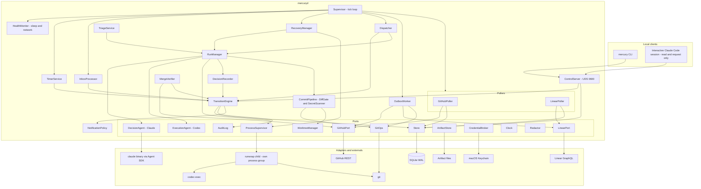
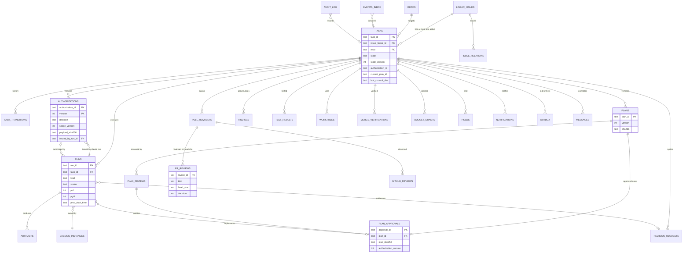

# MERCURY Coordinator (`mercuryd`) — Component Design

Owner: Agent C (Staff Engineer). Status: Phase 2 design proposal. Design only: the code, SQL and configuration below are specifications for review, not an implementation.

Related documents:

- `architecture/overview.md` (Agent A): boundaries, authority model, principles (AP-1 … AP-12), system-of-record split. This document refines its §5 component list into implementable modules.
- [`state-machine.md`](state-machine.md): states, transitions, guards, invariants, recovery per state. Referenced here as **SM §n**.
- [`../protocols/messages.md`](../protocols/messages.md): message envelope and schemas. Referenced as **MSG §n**.
- `integrations/claude.md`, `integrations/codex.md` (Agent B): agent invocation, prompts, validation pipeline V1–V4, failure classes. Referenced as **CL §n** and **CX §n**.
- `operations/*` (Agent D): launchd, paths, backup. `security/threat-model.md` (Agent E).

Assumptions are labelled `ASM-C-nn` and collected in [`../reviews/12-agent-C-report.md` §6](../reviews/12-agent-C-report.md#6-assumptions).

---

## Contents

1. [Runtime and technology decisions](#1-runtime-and-technology-decisions)
2. [Layering, source layout and dependency rules](#2-layering-source-layout-and-dependency-rules)
3. [Component diagram](#3-component-diagram)
4. [Component catalogue and public interfaces](#4-component-catalogue-and-public-interfaces)
5. [Internal control API and the `mercury` CLI](#5-internal-control-api-and-the-mercury-cli)
6. [Persistent data model](#6-persistent-data-model)
7. [Job queue and dispatch](#7-job-queue-and-dispatch)
8. [Process execution](#8-process-execution)
9. [Worktree management](#9-worktree-management)
10. [Pseudocode for critical workflows](#10-pseudocode-for-critical-workflows)
11. [Concurrency and locking rules](#11-concurrency-and-locking-rules)
12. [Retry, timeout and recovery tables](#12-retry-timeout-and-recovery-tables)
13. [Configuration](#13-configuration)
14. [Testability](#14-testability)

---

## 1. Runtime and technology decisions

| Decision | Choice | Justification | Fallback |
|---|---|---|---|
| Language | TypeScript 5.x, `strict: true`, `noUncheckedIndexedAccess`, ES modules | Agent SDK is TypeScript; one language for coordinator, CLI and schema-derived types; agrees with ADR-001 | — |
| Runtime | **Node.js 24 LTS**, exact version pinned (e.g. `24.21.0`); plan a move to 26 LTS after it is LTS (2026-10-28) and passes the contract suite | Active LTS; `node:sqlite` is RC (1.2) in 24 (`02-discovery-platform.md` §5.2) | Node 22 with `better-sqlite3` |
| Database | SQLite through **`node:sqlite`** (`DatabaseSync`), wrapped by the `Store` port; WAL, `synchronous=FULL`, `fullfsync=ON` | Zero native-addon supply chain; synchronous API matches the "no await inside a transaction" rule (§11) | `better-sqlite3` behind the same port (ASM-C-01) |
| Process model | **One process** (`mercuryd`), one event loop, one write connection. Agents and git run as child processes | AP-11; single writer removes lock contention | — |
| Schema validation | **Ajv 8** (`ajv/dist/2020` for message schemas, `ajv` draft-07 mode for agent output contracts, matching CL §6 V2) | Mature, supports both drafts, compiles to fast validators | — |
| HTTP clients | Built-in `fetch` (undici) with thin typed wrappers for GitHub REST and Linear GraphQL. No Octokit | Smaller dependency tree; ETag handling is explicit and testable | Octokit if pagination code grows |
| Config format | TOML (`smol-toml`, pinned), validated against a JSON Schema at load | Readable for the operator; comments allowed | JSON |
| IDs | ULID with a type prefix (baseline), generated by an in-repo 40-line monotonic ULID function | No dependency; monotonic within a millisecond keeps index order stable | — |
| Hashing / canonical JSON | SHA-256 (`node:crypto`), canonical JSON per **RFC 8785 (JCS)** implemented in-repo (≈80 lines) with a conformance test vector suite | Hash bindings must be reproducible across versions | — |
| Test stack | `node:test` or Vitest, `fast-check` for property tests, `dependency-cruiser` for layering rules | — | — |

Runtime dependencies are therefore limited to: `@anthropic-ai/claude-agent-sdk` (exact pin, per CL §8), `ajv`, `smol-toml`. Codex is an external binary, not an npm dependency of `mercuryd` (CX §13).

---

## 2. Layering, source layout and dependency rules

Ports-and-adapters (hexagonal). The domain core has no I/O. Application services orchestrate through ports. Adapters implement ports. `main.ts` is the only composition root.

```text
src/
  core/                    # pure domain, no I/O, no Date.now(), no randomness
    ids.ts                 # branded ID types, prefix validation
    states.ts              # TaskState, StateClass, terminal set
    transitions.ts         # TRANSITION_TABLE (data; SM §3)
    guards.ts              # pure guard functions over read models
    policies/              # revision budgets, priority score, severity policy, backoff
    evidence.ts            # evidence key catalogue per rule
    errors.ts
  app/                     # use-cases; depend on core + ports only
    supervisor.ts          # main loop orchestration (tick phases)
    transition-engine.ts
    dispatcher.ts
    decision-recorder.ts   # sole writer of authority records (overview §8.4)
    run-manager.ts         # run lifecycle: claim → start → monitor → finalize
    recovery-manager.ts
    inbox-processor.ts
    outbox-worker.ts
    timer-service.ts
    triage-service.ts
    merge-verifier.ts
    notification-policy.ts
    commit-pipeline.ts     # snapshot → diff gate → secret scan → commit (CX §9)
    control-service.ts     # handlers for control API methods
  ports/                   # TypeScript interfaces only (section 4)
  adapters/
    sqlite/                # Store implementation, migrations/*.sql
    process/               # ProcessSupervisor (spawn, runwrap, ps probing)
    claude/                # ClaudeAdapter (Agent SDK)
    codex/                 # CodexAdapter (codex exec)
    git/                   # GitOps, WorktreeManager
    github/                # GitHubAdapter (REST)
    linear/                # LinearAdapter (GraphQL)
    notify/                # channel adapters (GitHub mention, Linear comment, macOS local)
    fs/                    # ArtifactStore
    keychain/              # CredentialBroker
    clock/                 # SystemClock
    control/               # UDS server
  schemas/                 # generated .d.ts from protocols/schemas (json-schema-to-typescript, build step)
  bin/
    mercuryd.ts            # composition root (main.ts)
    mercury.ts             # CLI
    runwrap.ts             # process wrapper (section 8.2)
```

Dependency rules (enforced by `dependency-cruiser` in CI; a violation fails the build):

| Rule | From | May import | Must not import |
|---|---|---|---|
| D1 | `core/**` | `core/**` | anything else, including `node:*` |
| D2 | `app/**` | `core/**`, `ports/**`, `schemas/**` | `adapters/**`, `node:child_process`, `node:net`, `node:sqlite` |
| D3 | `adapters/**` | `ports/**`, `core/**` (types only), `schemas/**`, `node:*` | `app/**`, other adapters (except `adapters/process` used by `claude`, `codex`, `git` through the `ProcessSupervisor` port) |
| D4 | `bin/**` | everything | — |
| D5 | any | — | direct `process.env` reads outside `adapters/keychain` and `bin/` |
| D6 | `adapters/github/**` | — | string literals matching `/merge`, `event: 'APPROVE'`, `/dismissals`, `/protection` (lint rule; I9) |

---

## 3. Component diagram

Names map to Agent A's components (`overview.md` §5.1) as shown in §4.0.



Dependency direction: arrows from `app` components go only into ports; adapters sit behind ports. No adapter calls an application service; adapters return values or emit typed events that the Supervisor routes.

---

## 4. Component catalogue and public interfaces

### 4.0 Name mapping to `overview.md`

| This document (module) | `overview.md` §5 component | Notes |
|---|---|---|
| `Supervisor` | (main loop, §6) | Tick orchestration |
| `Store` (+ repositories) | Store | — |
| `TransitionEngine` | Workflow Engine | — |
| `Dispatcher` + `RunManager` | Scheduler and Lease Manager | No separate `jobs` table: the queue is derived from task state (§7.1) |
| `DecisionRecorder` | Decision Recorder | Identical role |
| `ClaudeAdapter` (`DecisionAgent` port) | Decision Gateway | — |
| `CodexAdapter` (`ExecutionAgent` port) | Execution Gateway | — |
| `ProcessSupervisor` | Process Supervisor | Process columns live on `runs` (no `processes` table) |
| `WorktreeManager` | Workspace Manager | Bare mirror instead of a full clone (§9) |
| `GitOps` + `CommitPipeline` + `OutboxWorker` (git ops) | Git Publisher | — |
| `GitHubPoller`, `LinearPoller` + `InboxProcessor` | GitHub Sync, Linear Sync | Observations go through `events_inbox` |
| `OutboxWorker` | Outbox Effect Executor | — |
| `NotificationPolicy` + `Notifier` | Notification Policy | — |
| `ArtifactStore` | Artifact Store | — |
| `AuditLog` | Audit Log | — |
| `CredentialBroker` | Credential Broker | — |
| `HealthMonitor` | Health and Wake Monitor | — |
| `ControlServer` + `ControlService` + CLI | Control API and `mercury` CLI | — |
| `Redactor`, `ConfigLoader`, `TimerService`, `RecoveryManager`, `MergeVerifier`, `TriageService`, `CommitPipeline` | (implicit) | Added for testability and single responsibility |

### 4.1 Shared types (core)

```ts
// core/ids.ts
type Brand<T, B extends string> = T & { readonly __brand: B };
export type TaskId = Brand<string, "tsk">;          // tsk_<ULID>
export type RunId = Brand<string, "run">;           // run_<ULID>
export type AuthorizationId = Brand<string, "auth">;
export type PlanId = Brand<string, "pln">;
export type ReviewId = Brand<string, "rev">;
export type ApprovalId = Brand<string, "apr">;
export type ArtifactId = Brand<string, "art">;
export type MessageId = Brand<string, "msg">;
export type EventId = Brand<string, "evt">;
export type OutboxId = Brand<string, "obx">;
export type Sha256 = Brand<string, "sha256">;      // 64 lowercase hex
export type GitSha = Brand<string, "gitsha">;      // 40 lowercase hex
export type RepoName = Brand<string, "repo">;      // owner/name
export type IssueIdentifier = Brand<string, "issue">; // JAM-204 (prefix never hard-coded)

// core/states.ts
export const TASK_STATES = [
  "AWAITING_AUTHORIZATION", "AUTHORIZED", "PLANNING", "AWAITING_PLAN_REVIEW",
  "PLAN_REVISION_REQUESTED", "PLAN_APPROVED", "IMPLEMENTING", "TESTING", "PR_OPEN",
  "CLAUDE_PR_REVIEW", "CHANGES_REQUESTED", "AWAITING_HUMAN_APPROVAL", "MERGED",
  "BLOCKED", "COMPLETED", "FAILED", "CANCELLED",
] as const;
export type TaskState = (typeof TASK_STATES)[number];
export type StateClass = "work" | "gate" | "decision_point" | "human_wait" | "terminal";
export type Initiator =
  | { kind: "claude"; runId: RunId }
  | { kind: "codex_result"; runId: RunId }
  | { kind: "coordinator"; rule: string }
  | { kind: "operator"; controlRequestId: string }
  | { kind: "github"; eventId: EventId }
  | { kind: "linear"; eventId: EventId };

export type RunKind =
  | "claude_triage" | "claude_authorize" | "codex_plan" | "claude_plan_review"
  | "claude_revision_request" | "deps_install" | "codex_implement" | "codex_revise"
  | "verify" | "claude_code_review" | "claude_security_review" | "git_step"
  | "claude_failure_triage";
export type RunStatus = "starting" | "running" | "stopping" | "succeeded" | "failed"
  | "timed_out" | "stalled" | "cancelled" | "lost" | "output_invalid" | "rejected_by_gate";
export type FailureClass = "transient_api" | "network_down" | "rate_limited" | "agent_auth_failed"
  | "budget_exceeded" | "output_invalid" | "timeout" | "stalled" | "crash" | "config_fatal"
  | "lost_by_coordinator_crash" | "cancelled_by_coordinator" | "semantic_invalid" | "policy_violation";
```

### 4.2 Supervisor (`app/supervisor.ts`)

Responsibilities: owns the tick loop; orders the phases; never contains business logic; catches and logs phase errors so one failing phase cannot stop the loop; drives graceful shutdown.

```ts
export interface Supervisor {
  start(): Promise<void>;                 // runs startup sequence (§10.6) then the loop
  requestTick(reason: string): void;      // coalesced wake-up (e.g. after an inbox insert or control command)
  shutdown(signal: "SIGTERM" | "SIGINT", budgetMs: number): Promise<ShutdownReport>;
}
export interface TickPhase {
  readonly name: "health" | "timers" | "inbox" | "runs" | "dispatch" | "outbox" | "polls" | "housekeeping";
  run(tick: TickContext): Promise<void>;  // must be re-entrant-safe; never awaits inside a Store.write
}
export interface TickContext { readonly seq: number; readonly wallNow: Date; readonly monoMs: number;
  readonly creditedMs: number; readonly sleepGapDetected: boolean; }
```

Tick interval 2 s when any run is active, 5 s otherwise (agrees with `overview.md` §6 default of 5 s). Phases run sequentially in the order listed. Pollers run on their own schedules but are invoked from the `polls` phase so that all DB writes stay on one logical thread.

Graceful shutdown (SIGTERM from launchd; `ExitTimeOut` owned by Agent D, assumed ≥ 30 s):

1. Stop accepting control requests that mutate; stop dispatch (in-memory flag).
2. Flush heartbeats and run progress to the DB.
3. **Do not kill adoptable runs** (Codex, `verify`, `deps_install`): they continue in their own process groups and are adopted on restart (§8.6). Interrupt non-adoptable Claude runs (`interrupt()`), then SIGTERM their groups; mark them `lost` with `cancelled_by_coordinator` (no attempt consumed).
4. Release the daemon lease (set `expires_at = now`), write `daemon_instances.stopped_at`, `PRAGMA wal_checkpoint(TRUNCATE)`, close the DB, exit 0.

If the logout is real (session ending), launchd may still kill the adoptable runs; recovery handles them as `crash` (SM §10).

### 4.3 Store (`ports/store.ts`)

Responsibilities: only module that opens the DB file (overview §5.2); transactions; migrations; integrity checks; backup. Exposes typed repositories, not SQL, to the application layer.

```ts
export interface Store {
  /** BEGIN IMMEDIATE … COMMIT. `fn` must be synchronous; returning a Promise throws StoreMisuseError. */
  write<T>(fn: (tx: WriteTx) => T): T;
  /** Read snapshot (BEGIN DEFERRED). Synchronous. */
  read<T>(fn: (tx: ReadTx) => T): T;
  migrate(target?: number): MigrationReport;          // takes a backup first (Agent D)
  quickCheck(): IntegrityReport;                       // at startup
  integrityCheck(): IntegrityReport;                   // daily, before migrations
  backup(destPath: string): Promise<BackupReport>;     // node:sqlite backup() API
  close(): void;
}
export interface ReadTx {
  tasks: TaskReader; runs: RunReader; authorizations: AuthorizationReader; plans: PlanReader;
  planReviews: PlanReviewReader; planApprovals: PlanApprovalReader; pullRequests: PullRequestReader;
  prReviews: PrReviewReader; findings: FindingReader; linearIssues: LinearIssueReader;
  issueRelations: IssueRelationReader; worktrees: WorktreeReader; holds: HoldReader;
  outbox: OutboxReader; inbox: InboxReader; cursors: CursorReader; artifacts: ArtifactReader;
  budgetGrants: BudgetGrantReader; messages: MessageReader;
}
export interface WriteTx extends ReadTx {
  tasks: TaskWriter; runs: RunWriter; /* … writer counterparts … */
  audit: AuditAppender;     // hash-chained append inside the same transaction
  now(): string;            // RFC 3339 UTC captured once per transaction (from Clock)
}
```

Connection settings at open (adapter):

```sql
PRAGMA journal_mode = WAL;
PRAGMA synchronous = FULL;
PRAGMA fullfsync = ON;
PRAGMA checkpoint_fullfsync = ON;
PRAGMA foreign_keys = ON;
PRAGMA busy_timeout = 5000;          -- also node:sqlite `timeout` option
PRAGMA trusted_schema = OFF;
PRAGMA cell_size_check = ON;
PRAGMA wal_autocheckpoint = 1000;
```

Read-only connections (CLI offline mode, §5.6) open with `file:<path>?mode=ro` and `PRAGMA query_only = ON`.

### 4.4 TransitionEngine (`app/transition-engine.ts`)

Responsibilities: the only code path that changes `tasks.state`; applies `TRANSITION_TABLE` (SM §11); guards, evidence, initiator checks (I19); writes transition, messages, outbox, holds, audit rows in one transaction; optimistic concurrency on `tasks.state_version`.

```ts
export interface TransitionEngine {
  /** Opens its own write transaction. */
  apply(cmd: TransitionCommand): TransitionOutcome;
  /** For callers that must combine the transition with other rows (DecisionRecorder, RunManager). */
  applyInTx(tx: WriteTx, cmd: TransitionCommand): TransitionOutcome;
  /** Dry-run guard evaluation for `mercury status --why` and the dispatcher's pre-filter. */
  explain(tx: ReadTx, taskId: TaskId, ruleId: string): GuardReport;
}
export interface TransitionCommand {
  taskId: TaskId | null;                 // null only for task creation (T01)
  expectedStateVersion: number | null;   // null only for creation
  event: { type: string; ruleHint?: string };
  initiator: Initiator;
  evidence: Record<string, string | number | boolean | null>;
  messages?: OutgoingMessage[];          // envelopes are completed by the engine (ids, hashes)
  outbox?: OutboxSpec[];
  holds?: HoldSpec[];
  counters?: Partial<Record<CounterName, 1>>;
  blocked?: { reason: BlockReason; resumeState: TaskState };
}
export type TransitionOutcome =
  | { ok: true; transitionId: string; from: TaskState | null; to: TaskState; stateVersion: number;
      messageIds: MessageId[]; outboxIds: OutboxId[] }
  | { ok: false; code: "stale_version" | "no_rule" | "initiator_not_allowed" | "guard_failed"
      | "guard_hold" | "evidence_missing" | "terminal"; detail: GuardReport | string };
```

### 4.5 Dispatcher and RunManager

Dispatcher responsibilities: compute the required next action per task (§7.1), filter by holds and limits, order by priority (§7.4), claim (§7.2) and hand the claimed run to the RunManager. RunManager responsibilities: build run specs through the agent adapters, start processes, monitor events and deadlines, classify results, finalize (artifacts, DecisionRecorder or CommitPipeline, transition).

```ts
export interface Dispatcher {
  tick(ctx: TickContext): Promise<DispatchReport>;      // §10.1
}
export interface RunManager {
  startClaimed(claim: ClaimedRun): Promise<void>;        // spawn after the claim committed
  monitor(ctx: TickContext): Promise<void>;              // credits awake time, checks deadlines and caps
  cancel(runId: RunId, reason: CancelReason): Promise<KillReport>;
  finalize(runId: RunId, exit: ExitInfo): Promise<FinalizeOutcome>;   // idempotent on run_id
  adoptOrReap(run: RunRow): Promise<AdoptionOutcome>;    // used by RecoveryManager
}
export interface ClaimedRun {
  runId: RunId; taskId: TaskId | null; kind: RunKind; attempt: number; fencingToken: number;
  stateVersionAtClaim: number | null; context: RunContextRef;   // ids of authorization, plan, approval, revision request, worktree
}
```

### 4.6 Agent adapters (`ports/agents.ts`)

The coordinator never parses free text from agents. Each adapter returns a typed, validated result or a classified failure.

```ts
export interface DecisionAgent {                         // ClaudeAdapter (CL §2–§10)
  readonly agent: "claude";
  prepare(input: DecisionInput): Promise<PreparedDecision>;      // writes inputs dir, prompt; computes input_digest
  run(prepared: PreparedDecision, run: RunContext): Promise<DecisionResult>;
  selfTest(): Promise<SelfTestReport>;                    // CL §8
}
export type DecisionKind = "triage" | "authorization" | "plan_review" | "pr_code_review"
  | "pr_security_review" | "revision_request" | "failure_triage";
export interface DecisionInput {
  kind: DecisionKind; taskId: TaskId | null; runId: RunId;
  trusted: Record<string, unknown>;                       // coordinator facts: ids, hashes, limits, AC ids
  untrusted: Array<{ name: string; artifactId: ArtifactId; sha256: Sha256 }>;   // quoted as data
  readableRoots: string[];                                // reference or review checkout + inputs dir
  outputSchemaId: string;                                 // e.g. mercury.output.plan_review.v1
}
export type DecisionResult =
  | { ok: true; output: unknown; outputSha256: Sha256; sessionId: string; usage: AgentUsage;
      permissionDenials: number; transcriptArtifact: ArtifactId }
  | { ok: false; failure: FailureClass; detail: string; usage?: AgentUsage; validationStage?: "V1" | "V2" | "V3" | "V4" };

export interface ExecutionAgent {                        // CodexAdapter (CX §2–§13)
  readonly agent: "codex";
  buildSpec(input: ExecutionInput): Promise<RunSpec>;     // argv, env allowlist, CODEX_HOME, output schema path
  parseEvent(line: string): AgentEvent | null;            // JSONL → heartbeat / progress / security signal
  finalize(runDir: string, exit: ExitInfo): Promise<ExecutionResult>;   // reads final.json, validates
  selfTest(): Promise<SelfTestReport>;
}
export interface ExecutionInput {
  kind: "codex_plan" | "codex_implement" | "codex_revise"; runId: RunId; taskId: TaskId;
  worktreePath: string; sandbox: "read-only" | "workspace-write"; resumeThreadId: string | null;
  promptArtifact: ArtifactId;                              // envelope built by the coordinator (CX §4)
  outputSchemaId: "mercury.output.codex_plan.v1" | "mercury.output.codex_implementation.v1";
  limits: { maxAwakeMs: number; stallMs: number; maxTokens: number };
}
export type ExecutionResult =
  | { ok: true; output: unknown; outputSha256: Sha256; threadId: string | null; usage: AgentUsage }
  | { ok: false; failure: FailureClass; detail: string; threadId: string | null };
export type AgentEvent =
  | { t: "heartbeat" } | { t: "thread"; id: string } | { t: "usage"; inTok: number; outTok: number }
  | { t: "command"; command: string; exitCode: number | null } | { t: "file_change"; paths: string[] }
  | { t: "progress"; done: number; total: number } | { t: "security"; signal: "mcp_tool_call" | "web_search" | "path_escape" }
  | { t: "error"; message: string };
```

The Claude adapter supplies the SDK option `spawnClaudeCodeProcess` with a function that delegates to `ProcessSupervisor.start()`, so the Claude binary also runs in its own process group with recorded pid, pgid and start time (ASM-C-06). If the pinned SDK does not expose that hook usably, the adapter falls back to the CLI form (CL §2.2) run through `runwrap`.

### 4.7 ProcessSupervisor (`ports/process.ts`)

```ts
export interface RunSpec {
  runId: RunId; argv: readonly string[]; cwd: string;
  env: Readonly<Record<string, string>>;                  // complete environment; nothing inherited
  stdin: { kind: "file"; path: string } | { kind: "pipe" } | { kind: "none" };
  stdio: "files" | "pipes";                               // files ⇒ adoptable
  runDir: string;
  limits: { maxAwakeMs: number; stallMs: number; stdoutCapBytes: number; stderrCapBytes: number };
  cancel: { soft: "SIGINT" | "sdk_interrupt" | "none"; softGraceMs: number; termGraceMs: number };
  sandboxProfile?: string;                                // sandbox-exec profile path for verify/deps_install
}
export interface ProcessIdentity { pid: number; pgid: number; startTime: string; fingerprint: Sha256; runId: RunId; }
export interface ProcessSupervisor {
  start(spec: RunSpec): Promise<ProcessHandle>;
  probe(id: ProcessIdentity): Promise<"alive_match" | "alive_mismatch" | "dead">;
  adopt(spec: RunSpec, id: ProcessIdentity): Promise<ProcessHandle>;     // files-mode only
  signalGroup(id: ProcessIdentity, sig: "SIGINT" | "SIGTERM" | "SIGKILL"): Promise<boolean>;
  killGroup(id: ProcessIdentity, plan: RunSpec["cancel"]): Promise<KillReport>;
  listMarked(): Promise<ProcessIdentity[]>;               // ps scan for --mercury-run markers
}
export interface ProcessHandle {
  readonly identity: ProcessIdentity;
  readonly events: AsyncIterable<string>;                 // raw stdout lines (tail of stdout file)
  readonly exit: Promise<ExitInfo>;
}
export interface ExitInfo { code: number | null; signal: string | null; endedAt: string;
  source: "waitpid" | "exit_file" | "inferred_dead"; stdoutBytes: number; stderrBytes: number; }
```

### 4.8 DecisionRecorder (`app/decision-recorder.ts`)

The only writer of authority records (overview §8.4 control 1; I18). Called by the RunManager with a validated `DecisionResult`; writes records and performs the transition in one transaction.

```ts
export interface DecisionRecorder {
  recordTriage(run: RunRow, out: TriageProposalV1): TriageOutcome;
  recordAuthorization(run: RunRow, out: TaskAuthorizationDecisionV1): TransitionOutcome;   // T02/T03/T04, T37, G1a, G4
  recordPlanReview(run: RunRow, out: PlanReviewV1): TransitionOutcome;                     // T09/T10/T11
  recordPrReview(run: RunRow, out: CodeReviewV1 | SecurityReviewV1): TransitionOutcome | null; // T24/T25/T26 when both present
  recordRevisionRequest(run: RunRow, out: RevisionRequestV1): TransitionOutcome;           // T12/T13/T28/T29/T30
}
```

### 4.9 WorktreeManager and GitOps (`ports/git.ts`)

```ts
export interface WorktreeManager {
  ensureMirror(repo: RepoName): Promise<MirrorInfo>;
  fetch(repo: RepoName): Promise<{ defaultBranchSha: GitSha }>;
  ensureTaskWorktree(task: TaskRef): Promise<WorktreeRow>;               // idempotent
  ensureReferenceCheckout(repo: RepoName, baseSha: GitSha): Promise<WorktreeRow>;
  ensureReviewCheckout(task: TaskRef, headSha: GitSha): Promise<WorktreeRow>;
  inspect(wt: WorktreeRow): Promise<{ head: GitSha; dirty: boolean; untracked: number; branch: string | null }>;
  resetTo(wt: WorktreeRow, sha: GitSha): Promise<{ archivedPatch: ArtifactId | null }>;   // archives first
  archive(wt: WorktreeRow): Promise<ArtifactId>;
  remove(wt: WorktreeRow): Promise<void>;                                  // refuses unless status = archived (I14)
  diskReport(): Promise<DiskReport>;
}
export interface GitOps {
  snapshot(wt: WorktreeRow): Promise<ChangeSnapshot>;                      // status --porcelain=v2 -z, diff --binary
  commit(wt: WorktreeRow, msg: CommitMessage): Promise<{ sha: GitSha; created: boolean }>;   // idempotent via Mercury-Run trailer
  push(repo: RepoName, wt: WorktreeRow, branch: string, sha: GitSha): Promise<PushResult>;   // fast-forward only
  remoteHead(repo: RepoName, branch: string): Promise<GitSha | null>;      // ls-remote
  diffArtifact(wt: WorktreeRow, base: GitSha, head: GitSha): Promise<ArtifactId>;
}
export type PushResult = { kind: "pushed" | "already_there"; sha: GitSha } | { kind: "rejected_non_ff"; remote: GitSha };
```

### 4.10 CommitPipeline (`app/commit-pipeline.ts`)

Runs CX §9 steps: snapshot → DiffGate → SecretScanner → commit. Pure gate logic lives in `core/policies/diff-gate.ts`.

```ts
export interface DiffGate { evaluate(s: ChangeSnapshot, policy: EffectiveRepoPolicy, plan: CodexPlanV1, auth: AuthorizationPayload): GateReport; }
export interface SecretScanner { scan(diffPath: string): Promise<{ hits: Array<{ ruleId: string; path: string }> }>; }   // never returns secret text
export interface GateReport { verdict: "pass" | "reject_revisable" | "reject_security";
  rules: Array<{ ruleId: string; path: string; detail: string }>; changedLines: number; outOfPlanPaths: string[]; }
```

### 4.11 GitHubPort (`ports/github.ts`)

```ts
export interface Conditional<T> { status: 200 | 304; etag: string | null; body: T | null; }
export interface GitHubPort {
  getPull(repo: RepoName, n: number, etag?: string): Promise<Conditional<PullSnapshot>>;
  findPullByHead(repo: RepoName, headBranch: string): Promise<PullSnapshot | null>;
  listReviews(repo: RepoName, n: number, etag?: string): Promise<Conditional<ReviewSnapshot[]>>;
  listCheckRuns(repo: RepoName, sha: GitSha, etag?: string): Promise<Conditional<CheckRunSnapshot[]>>;
  getCombinedStatus(repo: RepoName, sha: GitSha, etag?: string): Promise<Conditional<CombinedStatus>>;
  compareCommits(repo: RepoName, base: string, head: string): Promise<CompareResult>;
  listIssueComments(repo: RepoName, n: number, sinceIso?: string): Promise<IssueComment[]>;
  listIssueEvents(repo: RepoName, n: number): Promise<IssueEvent[]>;       // closed_by
  createPull(repo: RepoName, req: CreatePullRequest): Promise<PullSnapshot>;
  updatePull(repo: RepoName, n: number, patch: { title?: string; body?: string; state?: "open" }): Promise<PullSnapshot>;
  setDraft(repo: RepoName, n: number, draft: boolean): Promise<void>;     // GraphQL mutations
  createReview(repo: RepoName, n: number, req: { commitId: GitSha; event: "COMMENT" | "REQUEST_CHANGES"; body: string;
                comments?: ReviewComment[] }): Promise<{ id: number }>;
  createIssueComment(repo: RepoName, n: number, body: string): Promise<{ id: number }>;
  requestReviewers(repo: RepoName, n: number, logins: string[]): Promise<void>;
  addLabels(repo: RepoName, n: number, labels: string[]): Promise<void>;
  rateLimit(): RateLimitState;
  // Intentionally absent (I9): merge, mergeAsync, APPROVE reviews, dismissReview, branch protection, rulesets, delete base branch.
}
```

### 4.12 LinearPort (`ports/linear.ts`)

```ts
export interface LinearPort {
  issuesUpdatedSince(teamKey: string, cursorIso: string, after?: string): Promise<Page<IssueSnapshot>>;
  getIssue(id: string): Promise<IssueSnapshot>;                // description, labels, state, delegate, relations
  createComment(input: { id: string /* UUIDv5(idempotency_key) */; issueId: string; body: string }): Promise<{ id: string; created: boolean }>;
  updateIssueState(issueId: string, stateId: string): Promise<void>;     // idempotent by nature
  findCommentByMarker(issueId: string, marker: string): Promise<string | null>;
  workflowStates(teamKey: string): Promise<Array<{ id: string; name: string; type: string }>>;
  rateLimit(): RateLimitState;
}
```

### 4.13 Pollers and InboxProcessor

Pollers convert external state into **facts** (inbox rows). They never call the TransitionEngine directly.

```ts
export interface Poller { readonly name: string; due(now: Date): boolean; poll(ctx: TickContext): Promise<PollReport>; }
export interface InboxProcessor { drain(maxEvents: number): Promise<number>; }   // §10.9
```

| Poller | Schedule | Requests | Facts emitted (`events_inbox.kind`, dedup key) |
|---|---|---|---|
| `LinearPoller` | 60 s (300 s when no active tasks); full relation refresh every 15 min | `issues(filter: updatedAt > cursor − 2 min overlap)` per team | `linear.issue_changed` (`issue:<id>:<updatedAt>`), `linear.spec_changed` (`spec:<id>:<sha>`), `linear.state_changed` (`state:<id>:<stateId>:<updatedAt>`), `linear.delegate_changed`, `linear.label_changed`, `linear.relation_changed` (`rel:<a>:<b>:<present>`) |
| `GitHubPoller` | 30 s per open MERCURY PR while a run or CI is pending; 60 s in `AWAITING_HUMAN_APPROVAL`; 15 min full reconcile; immediately after wake | `GET pulls/{n}` (ETag), `GET pulls/{n}/reviews` (ETag), `GET commits/{sha}/check-runs` (ETag) | `github.pr_head_changed` (`pr:<repo>#<n>:head:<sha>`), `github.ci_concluded` (`ci:<repo>@<sha>:<digest>`), `github.review_submitted` (`review:<id>`), `github.pr_merged` (`merged:<repo>#<n>:<merge_sha>`), `github.pr_closed` (`closed:<repo>#<n>:<closed_at>`), `github.mergeable_changed` |

### 4.14 OutboxWorker

```ts
export interface OutboxWorker { drain(ctx: TickContext, budget: { maxItems: number; maxMs: number }): Promise<OutboxReport>; }
export interface EffectHandler<P> {
  readonly op: string;                              // e.g. "github.pr.upsert"
  /** Must be idempotent given the idempotency key: find-existing, then create. */
  execute(payload: P, key: string, ctx: EffectContext): Promise<EffectResult>;
}
export type EffectResult = { kind: "done"; externalRef: string; result: unknown }
  | { kind: "retry"; after: Date; error: string } | { kind: "dead"; error: string };
```

Effect catalogue (payload schemas live with the handlers; markers per overview §9.2):

| `op` | Idempotency strategy | Ordering |
|---|---|---|
| `git.push` | Compare remote branch SHA first (`ls-remote`); `already_there` is success; fast-forward only | first in the task's PR chain |
| `github.pr.upsert` | `findPullByHead(branch)`; create only if none; body contains `<!-- mercury:task=<task_id> -->` | after `git.push` |
| `github.pr.set_draft` / `github.pr.labels` | Set-to semantics | after upsert |
| `github.review.post` | List reviews by the App identity; skip if one exists whose body contains `<!-- mercury:review=<review_id> -->` | after upsert |
| `github.comment.post` | List recent comments; skip if marker `<!-- mercury:idem=<key> -->` exists | — |
| `github.request_reviewers` | Set-to semantics (already requested ⇒ success) | after review post |
| `linear.comment.create` | Client-supplied `id = UUIDv5(namespace, key)`; on "already exists" treat as success; also marker in body | — |
| `linear.issue.set_state` | Set-to; skip if the observed state is already at or ahead of the target (monotonic projection, overview §9.1) | — |
| `notify.local` | Dedup by `notifications.dedup_key` | — |

### 4.15 NotificationPolicy and Notifier

```ts
export interface NotificationPolicy {
  /** Decides whether to notify; returns outbox specs; never sends directly. Called inside the transition transaction. */
  onEvent(tx: WriteTx, e: NotifiableEvent): OutboxSpec[];
}
export type NotificationKind = "pr_ready_for_approval" | "decision_needed" | "repeated_review_failure"
  | "security_escalation" | "unrecoverable_failure" | "ci_intervention_needed" | "merge_completed"
  | "coordinator_downtime" | "agent_auth_failed" | "budget_exhausted" | "task_abandoned" | "reminder";
```

Dedup key: `ntf:<task_id|global>:<kind>:<reason>:<epoch>` (unique in `notifications`). Channels (Agent B and D decide final mapping; overview §5.2 forbids new channels without an ADR): GitHub review request (PR ready), GitHub PR comment with `@operator` mention (escalations on tasks with a PR), Linear comment (escalations before a PR exists, completion), optional macOS local notification (`osascript`) for global host conditions.

### 4.16 AuditLog and Redactor

```ts
export interface AuditAppender {
  append(entry: { actorKind: ActorKind; actorRef: string; action: string; taskId?: TaskId;
                  subjectKind?: string; subjectId?: string; data: unknown }): { seq: number; hash: Sha256 };
}
export interface AuditVerifier { verify(fromSeq?: number): { ok: boolean; firstBadSeq?: number; headHash: Sha256 }; }

export interface Redactor {
  redactText(s: string): { text: string; hits: number };
  redactJson<T>(v: T): { value: T; hits: number };
  registerSecret(value: string, label: string): void;   // exact-match redaction of loaded secrets
}
```

Audit hash: `hash_n = sha256( prev_hash_{n-1} ‖ 0x0A ‖ JCS(entry_n without hash) )`, genesis `prev_hash = 64 × "0"`. The insert trigger verifies `prev_hash` equals the previous row's `hash` and `seq` is contiguous (§6.4). Data is redacted **before** hashing, so the chain never contains secrets.

Redaction applies to: audit `data`, `runs.error_summary`, every outbox payload (before it is written), `control_requests.params_json`, log lines. Patterns: exact values registered by the CredentialBroker; regexes for GitHub tokens (`gh[pousr]_…`, `github_pat_…`), Anthropic (`sk-ant-…`), OpenAI (`sk-…`), Linear (`lin_api_…`), AWS (`AKIA…`), PEM blocks, JWT-shaped strings, `Authorization:` headers, URLs with userinfo. Raw run logs (`runs/<run_id>/stdout.jsonl`) are stored unredacted locally with mode 0600 for 14 days for debugging and are **never** sent externally (Agent E to confirm).

### 4.17 Other components (brief)

| Component | Interface (summary) | Responsibility |
|---|---|---|
| `ArtifactStore` | `put(bytes, kind, meta): {artifactId, sha256}`; `read(id): Bytes` (verifies hash on read); `path(id)` | Content-addressed files under `artifacts/sha256/<2>/<62>`, written to a temp file, `fsync`, `rename`, then `chmod 0400` |
| `CredentialBroker` | `githubInstallationToken(repo)`, `linearToken()`, `claudeEnv()`, `codexEnv(task)` | Keychain reads (`security find-generic-password … -w` via stdin-less spawn), App JWT minting, in-memory cache with expiry; registers each secret with the Redactor |
| `HealthMonitor` | `tick(): {creditedMs, sleepGap, network}` | Wall vs monotonic comparison (§10.10), connectivity probes, disk free (`fs.statfs`), holds |
| `TimerService` | `due(now): TimerFire[]` | State timers (SM §7.3) computed from `tasks.state_entered_at` and config, never from in-memory `setTimeout` |
| `RecoveryManager` | `recover(): RecoveryReport` | §10.6 |
| `MergeVerifier` | `verify(task): VerificationOutcome` | SM §8.5 |
| `TriageService` | `maybeRunTriage(ctx)` | Debounced triage (CL §3), shortlist → T01 for top *k* by free capacity |
| `ConfigLoader` | `load(path): EffectiveConfig` | TOML → JSON Schema validation → clamp limits → `config_sha256` recorded per instance and per run |
| `ControlServer` / `ControlService` | §5 | Local control API |

---

## 5. Internal control API and the `mercury` CLI

### 5.1 Decision: Unix domain socket to the daemon; no CLI writes to SQLite

| Option | Assessment |
|---|---|
| **A. UDS, JSON lines, socket 0600 in a 0700 directory (chosen)** | Single writer preserved (P1 in discovery). All mutations go through the TransitionEngine and its guards, so the CLI cannot bypass invariants. The daemon wakes immediately (`requestTick`). The CLI never needs the schema or migrations, so CLI and daemon versions can drift by one minor version safely (`v` field). Errors are returned with the failing guard |
| B. CLI writes directly to SQLite (`BEGIN IMMEDIATE`) | Two writers; `SQLITE_BUSY` handling in two programs; guards would have to be duplicated or shared as a library, and a CLI built from a different version could write rows the daemon's invariants do not expect. Changes would not be noticed until the next tick. Rejected |
| C. CLI writes a "command file" the daemon picks up | Durable when the daemon is down, but racy, needs its own dedup, and gives no synchronous feedback. Rejected |
| D. Loopback HTTP | Opens a TCP listener (any local process, including sandboxed ones with loopback network, could connect). Rejected (overview §2: only listener is the UDS) |

When the daemon is down, read commands work against a **read-only** SQLite connection (`mercury status --offline`, automatic fallback with a banner). Mutating commands fail with exit code 3 and a hint to start the service (`launchctl kickstart`, Agent D).

### 5.2 Socket and access control

- Path: `<MERCURY_HOME>/run/mercuryd.sock` (Agent D owns `MERCURY_HOME`; default `~/Library/Application Support/Mercury`). macOS limits `sun_path` to 104 bytes (ASM-C-11); the daemon refuses to start and reports if the path is longer, and config allows an override.
- Creation: `run/` directory mode 0700; `process.umask(0o077)` before `listen()`, then `chmod 0600` (no window where the socket is group- or world-accessible); stale socket file removed only after confirming no live daemon holds the lock (§11, L1).
- **Principals** (tokens are 32 random bytes, base64url, files mode 0600 under `run/tokens/`, regenerated at install):

| Principal | Token file | Allowed methods |
|---|---|---|
| `operator` | `operator.token` | All methods |
| `claude_session` | `claude_session.token` | Read methods; `request.authorize`, `request.triage`, `request.reauth` (requests enqueue a normal Claude decision run; they never create an authorization; overview §8.1) |
| `readonly` | `readonly.token` | Read methods only |

- Honesty about strength: all three files belong to the same macOS user. Principal separation is **policy-enforced** for the operator's own processes (an interactive Claude Code session is configured with permission rules that allow `Bash(mercury --as claude-session *)` and deny other `mercury` invocations; CL/E own the exact rules). It is **software-enforced** against Codex: Codex's environment has no token, Codex's Seatbelt profile has no network and is assumed to deny `connect()` to UNIX sockets outside its writable roots (ASM-C-03), and the token files are outside every writable root. Agent E should add `run/` to Codex's read-deny list if the sandbox profile allows it.
- Every request is recorded in `control_requests` (principal, method, redacted params, result) and in the audit log.

### 5.3 Wire protocol

Newline-delimited JSON over the stream socket; one request per line; max 1 MiB per line; requests are processed in order per connection.

```json
{"v":1,"id":"c1","auth":"<token>","method":"task.cancel","params":{"task":"tsk_01JA…","reason":"spec obsolete"}}
{"v":1,"id":"c1","ok":true,"result":{"task":"tsk_01JA…","from":"IMPLEMENTING","to":"CANCELLED","transition":"trn_01JA…"}}
{"v":1,"id":"c2","ok":false,"error":{"code":"guard_failed","message":"resume_state PLANNING: authorization expired","detail":{"guard":"authorization","reason":"authorization_expired"}}}
```

Error codes: `unauthenticated`, `forbidden` (principal), `bad_request`, `not_found`, `conflict` (stale state version; retry), `guard_failed`, `daemon_busy`, `internal`. Server-side timeouts: 10 s per request (mutations are a single transaction; long operations return an accepted ticket and the CLI polls `request.status`).

### 5.4 Methods

| Method | Principal | Effect |
|---|---|---|
| `status.summary` | any | Counts by state, holds, active runs, outbox backlog, last poll times, daemon health |
| `task.list {state?, repo?, issue?}` | any | Task rows |
| `task.show {task}` | any | Task, current authorization, plan, reviews, runs, PR, holds, `explain` of the next guard |
| `task.trace {task}` | any | Audit trail joined with transitions and messages: answers the brief's §I questions |
| `run.logs {run, stream, tail}` | operator, readonly | Tail of run stdout/stderr (redacted on the fly) |
| `request.authorize {issue, note}` | operator, claude_session | T01 with `proposal_source = operator_request`; note stored as **untrusted** context for Claude |
| `request.triage {}` | operator, claude_session | Triggers a triage cycle now (debounce bypass) |
| `request.reauth {task}` | operator, claude_session | Enqueues a Claude `authorization` run in `reauthorize` mode (T37 path) |
| `task.cancel {task, reason}` | operator | G1b |
| `task.revoke {task, reason}` | operator | Operator revocation row + G1a |
| `task.resume {task, action, to?}` | operator | T36 (actions per SM §6.1), including `--adopt` / `--reset` for `foreign_push` |
| `task.grant {task, counter, extra, reason}` | operator | `budget_grants` row (extra ≤ 5 per grant) |
| `task.abandon {task, reason}` | operator | T39 |
| `task.ack_merge {task, reason}` | operator | T40 |
| `run.cancel {run, reason}` | operator | Cancel one run (`cancelled_by_coordinator`, no attempt consumed); task stays in its state |
| `pause {scope, ref?, reason}` / `resume {scope, ref?}` | operator | `operator_pause` hold |
| `outbox.list {status}` / `outbox.retry {id}` | operator | Inspect; move a `dead` item back to `pending` (new attempt budget) |
| `audit.verify {}` | any | Hash-chain verification |
| `doctor {recheck}` | operator | Self-tests (agents, GitHub App, Linear, disk, clocks), clears `agent_auth_failed` / `config_fatal` holds on success |
| `db.backup {}` | operator | Online backup (Agent D sets schedule) |
| `daemon.shutdown {}` | operator | Graceful shutdown |

There is deliberately **no** method to approve a plan, approve a PR, merge, create an authorization, or edit a counter directly.

### 5.5 CLI surface

```text
mercury status [--offline] [--json]
mercury tasks [--state S] [--repo R]
mercury show <task|issue>            mercury trace <task>        mercury logs <run> [--stderr] [-n 200]
mercury request authorize <issue> [--note TEXT]     mercury request triage     mercury request reauth <task>
mercury cancel <task> --reason TEXT  mercury revoke <task> --reason TEXT
mercury resume <task> [--action resume|retry|adopt|reset|reopen] [--to STATE]
mercury grant <task> --counter plan|pr|verify|human --extra N --reason TEXT
mercury abandon <task> --reason TEXT mercury ack-merge <task> --reason TEXT
mercury cancel-run <run>             mercury pause [--task T|--repo R|--all] --reason TEXT    mercury unpause [...]
mercury outbox [--dead] [--retry ID] mercury audit verify     mercury doctor [--recheck]
mercury --as operator|claude-session|readonly <command>   (default: operator when run from a TTY, readonly otherwise)
```

Exit codes: 0 success; 1 internal error; 2 usage; 3 daemon unavailable (mutation); 4 rejected (forbidden or guard failed); 5 not found; 6 conflict (retry).

### 5.6 Offline read mode

`mercury status --offline` opens the DB read-only (`mode=ro`, `query_only`). It never holds a transaction longer than one statement batch, so it cannot block checkpoints for long. It prints `daemon: not running (last heartbeat <ts>)`.

---

## 6. Persistent data model

### 6.1 Identifier prefixes

Baseline prefixes plus the additions needed for tables introduced here. All IDs are `<prefix>_<ULID>` (26 Crockford base-32 characters).

| Prefix | Entity | Prefix | Entity |
|---|---|---|---|
| `tsk_` | task | `apr_` | plan approval *(new)* |
| `auth_` | authorization lineage (versions share the id) | `art_` | artifact *(new)* |
| `run_` | run | `trn_` | task transition *(new)* |
| `pln_` | plan version | `prq_` | pull request record *(new)* |
| `rev_` | review (plan, code, security) | `fnd_` | finding *(new)* |
| `evt_` | inbox event | `rrq_` | revision request *(new)* |
| `msg_` | message | `tst_` | test result *(new)* |
| `obx_` | outbox item *(new)* | `wt_` | worktree *(new)* |
| `ntf_` | notification *(new)* | `hld_` | hold *(new)* |
| `grt_` | budget grant *(new)* | `ctl_` | control request *(new)* |
| `mvf_` | merge verification *(new)* | `ins_` | daemon instance *(new)* |
| `orv_` | operator revocation *(new)* | `aud_` | audit entry *(new)* |

### 6.2 Entity-relationship diagram



### 6.3 DDL (migration `0001_initial.sql`)

All timestamps are RFC 3339 UTC text with millisecond precision (`2026-10-12T14:03:05.123Z`), produced by the Clock port, so lexical order equals time order. JSON columns carry `CHECK (json_valid(...))`.

```sql
-- ============ meta ============
CREATE TABLE schema_migrations (
  version      INTEGER PRIMARY KEY,
  name         TEXT NOT NULL,
  checksum     TEXT NOT NULL,                 -- sha256 of the migration file
  app_version  TEXT NOT NULL,
  applied_at   TEXT NOT NULL
);

CREATE TABLE daemon_instances (
  instance_id        TEXT PRIMARY KEY CHECK (instance_id GLOB 'ins_*'),
  pid                INTEGER NOT NULL,
  app_version        TEXT NOT NULL,
  config_sha256      TEXT NOT NULL,
  started_at         TEXT NOT NULL,
  last_heartbeat_at  TEXT NOT NULL,
  stopped_at         TEXT,
  stop_reason        TEXT
);

CREATE TABLE leases (
  name               TEXT PRIMARY KEY,         -- 'daemon' | 'triage' | 'mirror:<owner/name>'
  owner_instance_id  TEXT NOT NULL REFERENCES daemon_instances(instance_id),
  fencing_token      INTEGER NOT NULL,         -- strictly increasing per name
  acquired_at        TEXT NOT NULL,
  expires_at         TEXT NOT NULL
);

CREATE TABLE host_events (
  id          INTEGER PRIMARY KEY,
  kind        TEXT NOT NULL CHECK (kind IN ('startup','shutdown','sleep_gap','wake','network_down','network_up',
                                            'self_test_passed','self_test_failed','low_disk','clock_jump')),
  at          TEXT NOT NULL,
  detail_json TEXT NOT NULL DEFAULT '{}' CHECK (json_valid(detail_json))
);

-- ============ external mirrors ============
CREATE TABLE repos (
  repo            TEXT PRIMARY KEY CHECK (repo GLOB '?*/?*'),
  default_branch  TEXT NOT NULL,
  mirror_path     TEXT NOT NULL UNIQUE,
  enabled         INTEGER NOT NULL DEFAULT 1 CHECK (enabled IN (0,1)),
  policy_sha256   TEXT NOT NULL,
  created_at      TEXT NOT NULL,
  updated_at      TEXT NOT NULL
);

CREATE TABLE linear_issues (
  linear_id                    TEXT PRIMARY KEY,
  identifier                   TEXT NOT NULL UNIQUE,
  team_key                     TEXT NOT NULL,
  title                        TEXT NOT NULL,
  state_id                     TEXT NOT NULL,
  state_name                   TEXT NOT NULL,
  state_type                   TEXT NOT NULL CHECK (state_type IN ('triage','backlog','unstarted','started','completed','canceled','duplicate')),
  priority                     INTEGER,
  labels_json                  TEXT NOT NULL CHECK (json_valid(labels_json)),
  repo                         TEXT REFERENCES repos(repo),
  delegate_json                TEXT CHECK (delegate_json IS NULL OR json_valid(delegate_json)),
  description_sha256           TEXT NOT NULL,
  latest_snapshot_artifact_id  TEXT,
  linear_updated_at            TEXT NOT NULL,
  eligible                     INTEGER NOT NULL CHECK (eligible IN (0,1)),
  eligibility_reason           TEXT NOT NULL,
  mercury_status               TEXT NOT NULL DEFAULT 'discovered'
                               CHECK (mercury_status IN ('discovered','ineligible','task_open','task_closed')),
  cooldown_until               TEXT,
  cooldown_spec_sha256         TEXT,
  first_seen_at                TEXT NOT NULL,
  last_polled_at               TEXT NOT NULL
);
CREATE INDEX ix_linear_issues_eligible ON linear_issues(eligible, mercury_status, priority);

CREATE TABLE issue_relations (                 -- cache; rows deleted when the relation disappears
  blocker_linear_id  TEXT NOT NULL,
  blocked_linear_id  TEXT NOT NULL,
  observed_at        TEXT NOT NULL,
  PRIMARY KEY (blocker_linear_id, blocked_linear_id)
);
CREATE INDEX ix_issue_relations_blocked ON issue_relations(blocked_linear_id);

-- ============ tasks ============
CREATE TABLE tasks (
  task_id                     TEXT PRIMARY KEY CHECK (task_id GLOB 'tsk_*'),
  issue_linear_id             TEXT NOT NULL REFERENCES linear_issues(linear_id),
  issue_identifier            TEXT NOT NULL,
  repo                        TEXT NOT NULL REFERENCES repos(repo),
  base_branch                 TEXT NOT NULL,
  base_sha                    TEXT,
  branch_name                 TEXT NOT NULL,
  state                       TEXT NOT NULL CHECK (state IN (
                                'AWAITING_AUTHORIZATION','AUTHORIZED','PLANNING','AWAITING_PLAN_REVIEW',
                                'PLAN_REVISION_REQUESTED','PLAN_APPROVED','IMPLEMENTING','TESTING','PR_OPEN',
                                'CLAUDE_PR_REVIEW','CHANGES_REQUESTED','AWAITING_HUMAN_APPROVAL','MERGED',
                                'BLOCKED','COMPLETED','FAILED','CANCELLED')),
  state_version               INTEGER NOT NULL CHECK (state_version >= 1),
  state_entered_at            TEXT NOT NULL,
  proposal_source             TEXT NOT NULL CHECK (proposal_source IN ('triage','operator_request','claude_session_request')),
  proposal_ref                TEXT NOT NULL,
  issue_snapshot_artifact_id  TEXT NOT NULL,
  authorization_id            TEXT,
  current_authorization_version INTEGER,
  current_plan_id             TEXT,
  last_commit_sha             TEXT,
  last_pushed_sha             TEXT,
  priority                    INTEGER NOT NULL DEFAULT 3 CHECK (priority BETWEEN 1 AND 4),
  plan_revision_count         INTEGER NOT NULL DEFAULT 0,
  pr_review_cycle_count       INTEGER NOT NULL DEFAULT 0,
  verify_fix_count            INTEGER NOT NULL DEFAULT 0,
  human_change_count          INTEGER NOT NULL DEFAULT 0,
  codex_awake_ms_total        INTEGER NOT NULL DEFAULT 0,
  codex_home_path             TEXT,
  codex_plan_thread_id        TEXT,
  codex_impl_thread_id        TEXT,
  next_action_at              TEXT,
  blocked_reason              TEXT,
  blocked_from_state          TEXT,
  resume_state                TEXT,
  blocked_since               TEXT,
  block_epoch                 INTEGER NOT NULL DEFAULT 0,
  cancel_reason               TEXT,
  terminal_at                 TEXT,
  created_at                  TEXT NOT NULL,
  updated_at                  TEXT NOT NULL,
  CHECK ((state = 'BLOCKED') = (blocked_reason IS NOT NULL)),
  CHECK ((state IN ('COMPLETED','FAILED','CANCELLED')) = (terminal_at IS NOT NULL)),
  CHECK (state IN ('AWAITING_AUTHORIZATION','BLOCKED','CANCELLED','FAILED') OR authorization_id IS NOT NULL)
);
CREATE UNIQUE INDEX ux_tasks_active_issue  ON tasks(issue_linear_id) WHERE state NOT IN ('COMPLETED','FAILED','CANCELLED');  -- I1
CREATE UNIQUE INDEX ux_tasks_active_branch ON tasks(repo, branch_name) WHERE state NOT IN ('COMPLETED','FAILED','CANCELLED');
CREATE INDEX ix_tasks_dispatch ON tasks(state, priority, next_action_at, created_at);

CREATE TABLE task_transitions (
  transition_id      TEXT PRIMARY KEY CHECK (transition_id GLOB 'trn_*'),
  task_id            TEXT NOT NULL REFERENCES tasks(task_id),
  seq                INTEGER NOT NULL CHECK (seq >= 1),
  rule_id            TEXT NOT NULL,             -- 'T09', 'G1a', …
  from_state         TEXT,                      -- NULL only for creation (seq = 1)
  to_state           TEXT NOT NULL,
  event              TEXT NOT NULL,
  initiator_kind     TEXT NOT NULL CHECK (initiator_kind IN ('claude','codex_result','coordinator','operator','github','linear')),
  initiator_ref      TEXT NOT NULL,
  evidence_json      TEXT NOT NULL CHECK (json_valid(evidence_json)),
  guard_report_json  TEXT NOT NULL CHECK (json_valid(guard_report_json)),
  message_ids_json   TEXT NOT NULL DEFAULT '[]' CHECK (json_valid(message_ids_json)),
  instance_id        TEXT NOT NULL,
  occurred_at        TEXT NOT NULL,
  UNIQUE (task_id, seq),
  CHECK ((from_state IS NULL) = (seq = 1))
);

-- ============ authority records ============
CREATE TABLE authorizations (
  authorization_id      TEXT NOT NULL CHECK (authorization_id GLOB 'auth_*'),
  version               INTEGER NOT NULL CHECK (version >= 1),
  task_id               TEXT NOT NULL REFERENCES tasks(task_id),
  issue_linear_id       TEXT NOT NULL,
  repo                  TEXT NOT NULL,
  decision              TEXT NOT NULL CHECK (decision IN ('authorize','amend','revoke')),
  amendment_kind        TEXT CHECK (amendment_kind IN ('limits','scope')),
  scope_version         INTEGER NOT NULL CHECK (scope_version >= 1),
  issue_snapshot_sha256 TEXT NOT NULL,
  expires_at            TEXT,                    -- NULL only for revoke
  payload_json          TEXT NOT NULL CHECK (json_valid(payload_json)),
  payload_sha256        TEXT NOT NULL,           -- sha256(JCS(payload_json))
  previous_sha256       TEXT,
  issued_by_run_id      TEXT NOT NULL,
  source_output_sha256  TEXT NOT NULL,
  message_id            TEXT NOT NULL,
  record_mac            TEXT,                    -- optional HMAC (overview §8.4 control 4)
  created_at            TEXT NOT NULL,
  PRIMARY KEY (authorization_id, version),
  UNIQUE (task_id, version),
  CHECK ((decision = 'amend') = (amendment_kind IS NOT NULL)),
  CHECK ((version = 1) = (previous_sha256 IS NULL)),
  CHECK ((decision = 'authorize') = (version = 1)),
  CHECK ((decision = 'revoke') = (expires_at IS NULL))
);

CREATE TABLE operator_revocations (
  revocation_id       TEXT PRIMARY KEY CHECK (revocation_id GLOB 'orv_*'),
  task_id             TEXT NOT NULL REFERENCES tasks(task_id),
  control_request_id  TEXT NOT NULL,
  reason              TEXT NOT NULL,
  created_at          TEXT NOT NULL
);

CREATE TABLE plans (
  plan_id               TEXT PRIMARY KEY CHECK (plan_id GLOB 'pln_*'),
  task_id               TEXT NOT NULL REFERENCES tasks(task_id),
  version               INTEGER NOT NULL CHECK (version >= 1),
  artifact_id           TEXT NOT NULL,
  sha256                TEXT NOT NULL,
  authorization_id      TEXT NOT NULL,
  authorization_version INTEGER NOT NULL,
  scope_version         INTEGER NOT NULL,
  base_sha              TEXT NOT NULL,
  produced_by_run_id    TEXT NOT NULL,
  supersedes_plan_id    TEXT REFERENCES plans(plan_id),
  revision_request_id   TEXT,
  message_id            TEXT NOT NULL,
  created_at            TEXT NOT NULL,
  UNIQUE (task_id, version)
);

CREATE TABLE plan_reviews (
  review_id            TEXT PRIMARY KEY CHECK (review_id GLOB 'rev_*'),
  task_id              TEXT NOT NULL REFERENCES tasks(task_id),
  plan_id              TEXT NOT NULL REFERENCES plans(plan_id),
  plan_sha256          TEXT NOT NULL,
  run_id               TEXT NOT NULL UNIQUE,
  decision             TEXT NOT NULL CHECK (decision IN ('approve','revise','reject','needs_human')),
  input_digest         TEXT NOT NULL,
  artifact_id          TEXT NOT NULL,
  sha256               TEXT NOT NULL,
  injection_suspected  INTEGER NOT NULL CHECK (injection_suspected IN (0,1)),
  message_id           TEXT NOT NULL,
  created_at           TEXT NOT NULL
);

CREATE TABLE plan_approvals (
  approval_id            TEXT PRIMARY KEY CHECK (approval_id GLOB 'apr_*'),
  task_id                TEXT NOT NULL REFERENCES tasks(task_id),
  plan_id                TEXT NOT NULL UNIQUE REFERENCES plans(plan_id),          -- I5
  plan_sha256            TEXT NOT NULL,
  review_id              TEXT NOT NULL UNIQUE REFERENCES plan_reviews(review_id),
  authorization_id       TEXT NOT NULL,
  authorization_version  INTEGER NOT NULL,
  scope_version          INTEGER NOT NULL,
  conditions_json        TEXT NOT NULL CHECK (json_valid(conditions_json)),
  message_id             TEXT NOT NULL,
  created_at             TEXT NOT NULL
);

-- ============ runs ============
CREATE TABLE runs (
  run_id                 TEXT PRIMARY KEY CHECK (run_id GLOB 'run_*'),
  task_id                TEXT REFERENCES tasks(task_id),
  kind                   TEXT NOT NULL CHECK (kind IN ('claude_triage','claude_authorize','codex_plan','claude_plan_review',
                            'claude_revision_request','deps_install','codex_implement','codex_revise','verify',
                            'claude_code_review','claude_security_review','git_step','claude_failure_triage')),
  agent                  TEXT NOT NULL CHECK (agent IN ('claude','codex','coordinator')),
  lane                   TEXT NOT NULL CHECK (lane IN ('mutating','readonly')),
  mode                   TEXT,                       -- 'initial' | 'revision' | 'reauthorize' | …
  attempt                INTEGER NOT NULL CHECK (attempt >= 1),
  consumes_attempt       INTEGER NOT NULL DEFAULT 1 CHECK (consumes_attempt IN (0,1)),
  task_state_at_claim    TEXT,
  task_state_version_at_claim INTEGER,
  status                 TEXT NOT NULL CHECK (status IN ('starting','running','stopping','succeeded','failed','timed_out',
                            'stalled','cancelled','lost','output_invalid','rejected_by_gate')),
  failure_class          TEXT,
  authorization_id       TEXT,
  authorization_version  INTEGER,
  plan_id                TEXT,
  approval_id            TEXT,
  revision_request_id    TEXT,
  base_sha               TEXT,
  head_sha               TEXT,
  commit_sha             TEXT,
  worktree_id            TEXT,
  input_digest           TEXT,
  input_artifact_id      TEXT,
  output_artifact_id     TEXT,
  output_sha256          TEXT,
  agent_version          TEXT,
  model                  TEXT,
  session_id             TEXT,                       -- Claude session UUID or Codex thread id
  config_sha256          TEXT NOT NULL,
  owner_instance_id      TEXT NOT NULL REFERENCES daemon_instances(instance_id),
  fencing_token          INTEGER NOT NULL,
  lease_expires_at       TEXT NOT NULL,
  run_dir                TEXT NOT NULL,
  pid                    INTEGER,
  pgid                   INTEGER,
  proc_start_time        TEXT,
  cmd_fingerprint        TEXT,
  adoptable              INTEGER NOT NULL CHECK (adoptable IN (0,1)),
  max_awake_ms           INTEGER NOT NULL,
  stall_ms               INTEGER NOT NULL,
  awake_ms               INTEGER NOT NULL DEFAULT 0,
  idle_awake_ms          INTEGER NOT NULL DEFAULT 0,
  last_event_at          TEXT,
  events_count           INTEGER NOT NULL DEFAULT 0,
  stdout_bytes           INTEGER NOT NULL DEFAULT 0,
  stderr_bytes           INTEGER NOT NULL DEFAULT 0,
  tokens_in              INTEGER,
  tokens_out             INTEGER,
  cost_usd               REAL,
  exit_code              INTEGER,
  exit_signal            TEXT,
  error_summary          TEXT,                       -- redacted
  created_at             TEXT NOT NULL,
  started_at             TEXT,
  ended_at               TEXT,
  FOREIGN KEY (authorization_id, authorization_version) REFERENCES authorizations(authorization_id, version),
  CHECK (kind NOT IN ('codex_plan','codex_implement','codex_revise')
         OR (task_id IS NOT NULL AND authorization_id IS NOT NULL AND authorization_version IS NOT NULL)),   -- I3
  CHECK (kind NOT IN ('codex_implement','codex_revise') OR (approval_id IS NOT NULL AND plan_id IS NOT NULL)),  -- I4
  CHECK (kind <> 'codex_revise' OR revision_request_id IS NOT NULL),
  CHECK (kind NOT IN ('claude_code_review','claude_security_review') OR head_sha IS NOT NULL),
  CHECK (kind <> 'verify' OR commit_sha IS NOT NULL),
  CHECK (kind = 'claude_triage' OR task_id IS NOT NULL),
  CHECK (status NOT IN ('running','stopping') OR pid IS NOT NULL),
  CHECK ((agent = 'codex') = (kind IN ('codex_plan','codex_implement','codex_revise'))),
  CHECK ((lane = 'mutating') = (kind IN ('codex_plan','codex_implement','codex_revise','deps_install','verify','git_step')))
);
CREATE UNIQUE INDEX ux_runs_active_mutating ON runs(task_id)
  WHERE lane = 'mutating' AND status IN ('starting','running','stopping');                    -- I2
CREATE UNIQUE INDEX ux_runs_active_kind ON runs(task_id, kind)
  WHERE task_id IS NOT NULL AND status IN ('starting','running','stopping');                  -- I2
CREATE UNIQUE INDEX ux_runs_active_triage ON runs(kind)
  WHERE kind = 'claude_triage' AND status IN ('starting','running','stopping');
CREATE UNIQUE INDEX ux_runs_attempt ON runs(task_id, kind, task_state_version_at_claim, attempt)
  WHERE task_id IS NOT NULL;                                                                    -- no duplicate claim
CREATE INDEX ix_runs_active ON runs(status, kind) WHERE status IN ('starting','running','stopping');
CREATE INDEX ix_runs_task ON runs(task_id, created_at);

-- ============ PRs, reviews, findings ============
CREATE TABLE pull_requests (
  pr_id            TEXT PRIMARY KEY CHECK (pr_id GLOB 'prq_*'),
  task_id          TEXT NOT NULL REFERENCES tasks(task_id),
  repo             TEXT NOT NULL,
  number           INTEGER NOT NULL,
  url              TEXT NOT NULL,
  head_branch      TEXT NOT NULL,
  base_branch      TEXT NOT NULL,
  head_sha         TEXT NOT NULL,              -- last observed
  local_head_sha   TEXT NOT NULL,              -- last pushed by the coordinator
  base_sha         TEXT,
  state            TEXT NOT NULL CHECK (state IN ('open','closed','merged')),
  draft            INTEGER NOT NULL CHECK (draft IN (0,1)),
  mergeable        TEXT,
  ci_status        TEXT NOT NULL DEFAULT 'pending' CHECK (ci_status IN ('pending','success','failure','timed_out','none')),
  ci_digest        TEXT,
  merged_by        TEXT,
  merged_at        TEXT,
  merge_commit_sha TEXT,
  closed_by        TEXT,
  etag_pull        TEXT,
  etag_reviews     TEXT,
  etag_checks      TEXT,
  observed_at      TEXT NOT NULL,
  created_at       TEXT NOT NULL,
  updated_at       TEXT NOT NULL,
  UNIQUE (repo, number)
);
CREATE UNIQUE INDEX ux_pr_task_open ON pull_requests(task_id) WHERE state = 'open';

CREATE TABLE pr_reviews (
  review_id               TEXT PRIMARY KEY CHECK (review_id GLOB 'rev_*'),
  task_id                 TEXT NOT NULL REFERENCES tasks(task_id),
  pr_id                   TEXT NOT NULL REFERENCES pull_requests(pr_id),
  kind                    TEXT NOT NULL CHECK (kind IN ('code','security')),
  head_sha                TEXT NOT NULL,
  base_sha                TEXT NOT NULL,
  run_id                  TEXT NOT NULL UNIQUE,
  decision                TEXT NOT NULL CHECK (decision IN ('approve','revise','reject','needs_human')),
  input_digest            TEXT NOT NULL,
  artifact_id             TEXT NOT NULL,
  sha256                  TEXT NOT NULL,
  injection_suspected     INTEGER NOT NULL CHECK (injection_suspected IN (0,1)),
  github_review_outbox_id TEXT,
  message_id              TEXT NOT NULL,
  created_at              TEXT NOT NULL
);
CREATE INDEX ix_pr_reviews_binding ON pr_reviews(task_id, kind, head_sha, created_at);

CREATE TABLE github_reviews (                  -- observed reviews (all authors), mirror
  github_review_id  INTEGER PRIMARY KEY,
  pr_id             TEXT NOT NULL REFERENCES pull_requests(pr_id),
  user_login        TEXT NOT NULL,
  user_type         TEXT NOT NULL,             -- User | Bot
  state             TEXT NOT NULL CHECK (state IN ('APPROVED','CHANGES_REQUESTED','COMMENTED','DISMISSED','PENDING')),
  commit_id         TEXT NOT NULL,
  submitted_at      TEXT,
  is_operator       INTEGER NOT NULL CHECK (is_operator IN (0,1)),
  is_mercury_bot    INTEGER NOT NULL CHECK (is_mercury_bot IN (0,1)),
  body_sha256       TEXT,
  observed_at       TEXT NOT NULL
);

CREATE TABLE findings (
  finding_id       TEXT PRIMARY KEY CHECK (finding_id GLOB 'fnd_*'),
  task_id          TEXT NOT NULL REFERENCES tasks(task_id),
  source_kind      TEXT NOT NULL CHECK (source_kind IN ('plan_review','code_review','security_review','local_tests','ci',
                                                        'human_review','diff_gate','secret_scan','merge_conflict')),
  source_ref       TEXT NOT NULL,              -- review_id, run_id, test_result_id or github review id
  local_id         TEXT NOT NULL,              -- 'M1', 'C3', 'SEC2', rule id
  plan_id          TEXT,
  head_sha         TEXT,
  severity         TEXT NOT NULL CHECK (severity IN ('blocking','critical','high','medium','low','info')),
  category         TEXT NOT NULL,
  cwe              TEXT,
  path             TEXT,
  line             INTEGER,
  title            TEXT NOT NULL,
  detail           TEXT NOT NULL,              -- redacted
  required_change  TEXT,
  created_at       TEXT NOT NULL,
  UNIQUE (source_ref, local_id)
);
CREATE INDEX ix_findings_task ON findings(task_id, head_sha, severity);

CREATE TABLE finding_resolutions (             -- later reviews' judgement on earlier findings
  finding_id        TEXT NOT NULL REFERENCES findings(finding_id),
  judged_by_ref     TEXT NOT NULL,             -- review_id
  status            TEXT NOT NULL CHECK (status IN ('resolved','unresolved','partially_resolved','disputed')),
  note              TEXT,
  created_at        TEXT NOT NULL,
  PRIMARY KEY (finding_id, judged_by_ref)
);

CREATE TABLE revision_requests (
  revision_request_id  TEXT PRIMARY KEY CHECK (revision_request_id GLOB 'rrq_*'),
  task_id              TEXT NOT NULL REFERENCES tasks(task_id),
  kind                 TEXT NOT NULL CHECK (kind IN ('plan','code')),
  source               TEXT NOT NULL CHECK (source IN ('claude_plan_review','claude_code_review','claude_security_review',
                          'local_tests','ci','diff_gate','merge_conflict','human_review','codex_deviation',
                          'authorization_amended','claude_revision_request')),
  source_ref           TEXT NOT NULL,
  counter              TEXT NOT NULL CHECK (counter IN ('plan_revision_count','pr_review_cycle_count','verify_fix_count','human_change_count')),
  cycle                INTEGER NOT NULL,
  status               TEXT NOT NULL CHECK (status IN ('awaiting_instruction','ready','escalated','consumed','superseded')),
  action               TEXT CHECK (action IN ('revise','replan','escalate')),
  instruction_run_id   TEXT,                   -- Claude revision_request run, when needed
  artifact_id          TEXT,
  sha256               TEXT,
  plan_id              TEXT,
  head_sha             TEXT,
  message_id           TEXT,
  created_at           TEXT NOT NULL,
  updated_at           TEXT NOT NULL,
  CHECK (status <> 'ready' OR (artifact_id IS NOT NULL AND sha256 IS NOT NULL AND action IS NOT NULL))
);
CREATE INDEX ix_revreq_task ON revision_requests(task_id, status);

CREATE TABLE test_results (
  test_result_id  TEXT PRIMARY KEY CHECK (test_result_id GLOB 'tst_*'),
  task_id         TEXT NOT NULL REFERENCES tasks(task_id),
  run_id          TEXT,
  source          TEXT NOT NULL CHECK (source IN ('local_verify','codex_self_report','ci')),
  commit_sha      TEXT NOT NULL,
  passed          INTEGER NOT NULL CHECK (passed IN (0,1)),
  summary_json    TEXT NOT NULL CHECK (json_valid(summary_json)),
  artifact_id     TEXT NOT NULL,
  sha256          TEXT NOT NULL,
  message_id      TEXT NOT NULL,
  created_at      TEXT NOT NULL
);

CREATE TABLE merge_verifications (
  verification_id                 TEXT PRIMARY KEY CHECK (verification_id GLOB 'mvf_*'),
  task_id                         TEXT NOT NULL REFERENCES tasks(task_id),
  pr_id                           TEXT NOT NULL REFERENCES pull_requests(pr_id),
  merge_commit_sha                TEXT NOT NULL,
  head_sha_at_merge               TEXT NOT NULL,
  merged_by                       TEXT NOT NULL,
  merged_by_is_operator           INTEGER NOT NULL,
  operator_approval_on_head       INTEGER NOT NULL,
  merge_commit_on_base            INTEGER NOT NULL,
  required_checks_passed          INTEGER NOT NULL,
  claude_reviews_valid_for_head   INTEGER NOT NULL,
  result                          TEXT NOT NULL CHECK (result IN ('passed','failed')),
  artifact_id                     TEXT NOT NULL,
  waived_by_control_request_id    TEXT,
  created_at                      TEXT NOT NULL
);

CREATE TABLE budget_grants (
  grant_id            TEXT PRIMARY KEY CHECK (grant_id GLOB 'grt_*'),
  task_id             TEXT NOT NULL REFERENCES tasks(task_id),
  counter             TEXT NOT NULL CHECK (counter IN ('plan_revision_count','pr_review_cycle_count','verify_fix_count','human_change_count','run_attempts')),
  extra               INTEGER NOT NULL CHECK (extra BETWEEN 1 AND 5),
  control_request_id  TEXT NOT NULL,
  reason              TEXT NOT NULL,
  created_at          TEXT NOT NULL
);

-- ============ artifacts, messages, events, effects ============
CREATE TABLE artifacts (
  artifact_id  TEXT PRIMARY KEY CHECK (artifact_id GLOB 'art_*'),
  sha256       TEXT NOT NULL CHECK (length(sha256) = 64),
  kind         TEXT NOT NULL,
  media_type   TEXT NOT NULL,
  size_bytes   INTEGER NOT NULL CHECK (size_bytes >= 0),
  rel_path     TEXT NOT NULL,                  -- 'sha256/ab/cdef…'
  task_id      TEXT,
  run_id       TEXT,
  redacted     INTEGER NOT NULL DEFAULT 0 CHECK (redacted IN (0,1)),
  created_at   TEXT NOT NULL
);
CREATE INDEX ix_artifacts_sha  ON artifacts(sha256);
CREATE INDEX ix_artifacts_task ON artifacts(task_id, kind);

CREATE TABLE messages (
  message_id      TEXT PRIMARY KEY CHECK (message_id GLOB 'msg_*'),
  schema          TEXT NOT NULL,
  schema_version  TEXT NOT NULL,
  correlation_id  TEXT NOT NULL,
  causation_id    TEXT,
  dedup_key       TEXT NOT NULL UNIQUE,
  task_id         TEXT,
  run_id          TEXT,
  issue           TEXT,
  repo            TEXT,
  producer_kind   TEXT NOT NULL,
  payload_sha256  TEXT NOT NULL,
  envelope_json   TEXT NOT NULL CHECK (json_valid(envelope_json)),
  occurred_at     TEXT NOT NULL,
  recorded_at     TEXT NOT NULL
);
CREATE INDEX ix_messages_corr ON messages(correlation_id, recorded_at);

CREATE TABLE events_inbox (
  event_id        TEXT PRIMARY KEY CHECK (event_id GLOB 'evt_*'),
  source          TEXT NOT NULL CHECK (source IN ('github','linear','control','timer','host')),
  dedup_key       TEXT NOT NULL,
  kind            TEXT NOT NULL,
  task_id         TEXT,
  subject         TEXT,
  payload_json    TEXT NOT NULL CHECK (json_valid(payload_json)),
  payload_sha256  TEXT NOT NULL,
  occurred_at     TEXT,
  observed_at     TEXT NOT NULL,
  status          TEXT NOT NULL DEFAULT 'pending' CHECK (status IN ('pending','processed','ignored','failed')),
  attempts        INTEGER NOT NULL DEFAULT 0,
  processed_at    TEXT,
  outcome         TEXT,
  error           TEXT,
  UNIQUE (source, dedup_key)                                                                   -- I12
);
CREATE INDEX ix_inbox_pending ON events_inbox(observed_at) WHERE status = 'pending';

CREATE TABLE outbox (
  outbox_id             TEXT PRIMARY KEY CHECK (outbox_id GLOB 'obx_*'),
  task_id               TEXT,
  target                TEXT NOT NULL CHECK (target IN ('github','linear','git','notify')),
  op                    TEXT NOT NULL,
  idempotency_key       TEXT NOT NULL UNIQUE,                                                  -- I11
  payload_json          TEXT NOT NULL CHECK (json_valid(payload_json)),
  payload_sha256        TEXT NOT NULL,
  depends_on_outbox_id  TEXT REFERENCES outbox(outbox_id),
  status                TEXT NOT NULL DEFAULT 'pending'
                        CHECK (status IN ('pending','in_flight','retry_wait','done','dead','cancelled')),
  attempts              INTEGER NOT NULL DEFAULT 0,
  max_attempts          INTEGER NOT NULL DEFAULT 10,
  next_attempt_at       TEXT NOT NULL,
  lease_owner           TEXT,
  lease_expires_at      TEXT,
  fencing_token         INTEGER,
  task_state_version    INTEGER,
  causation_message_id  TEXT,
  last_error            TEXT,                  -- redacted
  external_ref          TEXT,
  result_json           TEXT CHECK (result_json IS NULL OR json_valid(result_json)),
  created_at            TEXT NOT NULL,
  updated_at            TEXT NOT NULL,
  completed_at          TEXT
);
CREATE INDEX ix_outbox_due ON outbox(target, next_attempt_at) WHERE status IN ('pending','retry_wait');
CREATE INDEX ix_outbox_task ON outbox(task_id, status);

CREATE TABLE cursors (
  name                  TEXT PRIMARY KEY,       -- 'linear:team:JAM:issues' | 'github:<repo>#<n>:pull' | …
  value                 TEXT,
  etag                  TEXT,
  last_success_at       TEXT,
  last_attempt_at       TEXT,
  consecutive_failures  INTEGER NOT NULL DEFAULT 0
);

-- ============ local resources ============
CREATE TABLE worktrees (
  worktree_id          TEXT PRIMARY KEY CHECK (worktree_id GLOB 'wt_*'),
  task_id              TEXT REFERENCES tasks(task_id),
  repo                 TEXT NOT NULL,
  kind                 TEXT NOT NULL CHECK (kind IN ('task','review','reference')),
  path                 TEXT NOT NULL UNIQUE,
  branch               TEXT,
  base_sha             TEXT NOT NULL,
  head_sha             TEXT,
  status               TEXT NOT NULL CHECK (status IN ('creating','ready','in_use','quarantined','archiving','archived',
                                                        'removing','removed','error')),
  lock_owner           TEXT,                    -- run_id or 'gitops:<op>:<id>'
  lock_acquired_at     TEXT,
  size_bytes           INTEGER,
  size_measured_at     TEXT,
  archive_artifact_id  TEXT,
  cleanup_due_at       TEXT,
  created_at           TEXT NOT NULL,
  updated_at           TEXT NOT NULL,
  removed_at           TEXT,
  CHECK ((kind = 'task') = (branch IS NOT NULL)),
  CHECK (kind = 'reference' OR task_id IS NOT NULL)
);
CREATE UNIQUE INDEX ux_wt_task_active ON worktrees(task_id) WHERE kind = 'task' AND status NOT IN ('archived','removing','removed');
CREATE UNIQUE INDEX ux_wt_review      ON worktrees(task_id, head_sha) WHERE kind = 'review' AND status <> 'removed';
CREATE UNIQUE INDEX ux_wt_reference   ON worktrees(repo, base_sha) WHERE kind = 'reference' AND status <> 'removed';

CREATE TABLE holds (
  hold_id          TEXT PRIMARY KEY CHECK (hold_id GLOB 'hld_*'),
  scope            TEXT NOT NULL CHECK (scope IN ('global','repo','agent','integration','task')),
  scope_ref        TEXT NOT NULL DEFAULT '',
  kind             TEXT NOT NULL,
  reason           TEXT NOT NULL,
  created_by_kind  TEXT NOT NULL,
  created_by_ref   TEXT NOT NULL,
  created_at       TEXT NOT NULL,
  until            TEXT,
  released_at      TEXT,
  released_by      TEXT
);
CREATE UNIQUE INDEX ux_holds_active ON holds(scope, scope_ref, kind) WHERE released_at IS NULL;

CREATE TABLE notifications (
  notification_id    TEXT PRIMARY KEY CHECK (notification_id GLOB 'ntf_*'),
  task_id            TEXT,
  kind               TEXT NOT NULL,
  severity           TEXT NOT NULL CHECK (severity IN ('info','action','security')),
  dedup_key          TEXT NOT NULL UNIQUE,
  channel            TEXT NOT NULL,
  outbox_id          TEXT,
  suppressed_reason  TEXT,
  created_at         TEXT NOT NULL
);

CREATE TABLE control_requests (
  control_request_id  TEXT PRIMARY KEY CHECK (control_request_id GLOB 'ctl_*'),
  principal           TEXT NOT NULL CHECK (principal IN ('operator','claude_session','readonly','offline_cli')),
  method              TEXT NOT NULL,
  params_json         TEXT NOT NULL CHECK (json_valid(params_json)),   -- redacted
  params_sha256       TEXT NOT NULL,
  result              TEXT NOT NULL CHECK (result IN ('accepted','rejected','error')),
  result_detail       TEXT,
  created_at          TEXT NOT NULL
);

CREATE TABLE audit_log (
  seq          INTEGER PRIMARY KEY,           -- contiguous 1..n (trigger)
  audit_id     TEXT NOT NULL UNIQUE CHECK (audit_id GLOB 'aud_*'),
  occurred_at  TEXT NOT NULL,
  instance_id  TEXT NOT NULL,
  actor_kind   TEXT NOT NULL CHECK (actor_kind IN ('coordinator','claude','codex','operator','github','linear','system')),
  actor_ref    TEXT NOT NULL,
  action       TEXT NOT NULL,
  task_id      TEXT,
  subject_kind TEXT,
  subject_id   TEXT,
  data_json    TEXT NOT NULL CHECK (json_valid(data_json)),     -- redacted before hashing
  prev_hash    TEXT NOT NULL,
  hash         TEXT NOT NULL UNIQUE
);
CREATE INDEX ix_audit_task ON audit_log(task_id, seq);
```

Foreign keys between `artifacts`, `runs`, `plans`, `revision_requests` and `worktrees` that would form cycles at insert time are enforced by the triggers below and by the application inside the same transaction, instead of declared `REFERENCES`, to avoid ordering problems with SQLite's immediate FK checks.

### 6.4 Triggers that enforce invariants

```sql
-- Append-only tables (I13). One pair per table; shown once, generated by the migration for:
-- authorizations, operator_revocations, plans, plan_reviews, plan_approvals, pr_reviews, task_transitions,
-- messages, artifacts, audit_log, test_results, merge_verifications, budget_grants, findings, finding_resolutions,
-- control_requests, host_events.
CREATE TRIGGER trg_authorizations_no_update BEFORE UPDATE ON authorizations
BEGIN SELECT RAISE(ABORT, 'I13: authorizations is append-only'); END;
CREATE TRIGGER trg_authorizations_no_delete BEFORE DELETE ON authorizations
BEGIN SELECT RAISE(ABORT, 'I13: authorizations is append-only'); END;

-- I8: terminal states are final
CREATE TRIGGER trg_tasks_terminal_final BEFORE UPDATE OF state ON tasks
WHEN OLD.state IN ('COMPLETED','FAILED','CANCELLED')
BEGIN SELECT RAISE(ABORT, 'I8: terminal state is final'); END;

-- I7: a state or version change requires the matching transition row (inserted first, same transaction)
CREATE TRIGGER trg_tasks_requires_transition BEFORE UPDATE OF state, state_version ON tasks
WHEN NEW.state_version <> OLD.state_version AND NOT EXISTS (
  SELECT 1 FROM task_transitions tt
   WHERE tt.task_id = NEW.task_id AND tt.seq = NEW.state_version
     AND tt.from_state = OLD.state AND tt.to_state = NEW.state)
BEGIN SELECT RAISE(ABORT, 'I7: state change without transition row'); END;

CREATE TRIGGER trg_tasks_state_needs_version BEFORE UPDATE OF state ON tasks
WHEN NEW.state <> OLD.state AND NEW.state_version <> OLD.state_version + 1
BEGIN SELECT RAISE(ABORT, 'I7: state change must increment state_version by 1'); END;

CREATE TRIGGER trg_transitions_sequence BEFORE INSERT ON task_transitions
WHEN NEW.seq > 1 AND NOT EXISTS (
  SELECT 1 FROM tasks t WHERE t.task_id = NEW.task_id AND t.state = NEW.from_state AND t.state_version + 1 = NEW.seq)
BEGIN SELECT RAISE(ABORT, 'I7: transition out of sequence'); END;

-- I18: authorization rows only from a succeeded Claude authorization run with matching output hash
CREATE TRIGGER trg_auth_requires_claude_run BEFORE INSERT ON authorizations
WHEN NOT EXISTS (
  SELECT 1 FROM runs r WHERE r.run_id = NEW.issued_by_run_id AND r.agent = 'claude'
     AND r.kind = 'claude_authorize' AND r.status = 'succeeded' AND r.output_sha256 = NEW.source_output_sha256
     AND r.task_id = NEW.task_id)
BEGIN SELECT RAISE(ABORT, 'I18: authorization requires a succeeded Claude authorize run'); END;

CREATE TRIGGER trg_auth_chain BEFORE INSERT ON authorizations
WHEN NEW.version > 1 AND NOT EXISTS (
  SELECT 1 FROM authorizations p WHERE p.authorization_id = NEW.authorization_id
     AND p.version = NEW.version - 1 AND p.payload_sha256 = NEW.previous_sha256 AND p.decision <> 'revoke')
BEGIN SELECT RAISE(ABORT, 'I13: authorization version chain broken or revoked'); END;

-- plans come only from a succeeded Codex planning run of the same task
CREATE TRIGGER trg_plans_require_run BEFORE INSERT ON plans
WHEN NOT EXISTS (SELECT 1 FROM runs r WHERE r.run_id = NEW.produced_by_run_id AND r.kind = 'codex_plan'
                   AND r.status = 'succeeded' AND r.task_id = NEW.task_id)
BEGIN SELECT RAISE(ABORT, 'plan requires a succeeded codex_plan run'); END;

-- plan reviews only from a succeeded Claude plan-review run bound to the same plan hash
CREATE TRIGGER trg_plan_reviews_require_run BEFORE INSERT ON plan_reviews
WHEN NOT EXISTS (SELECT 1 FROM runs r JOIN plans p ON p.plan_id = NEW.plan_id
                  WHERE r.run_id = NEW.run_id AND r.kind = 'claude_plan_review' AND r.status = 'succeeded'
                    AND r.output_sha256 = NEW.sha256 AND r.plan_id = NEW.plan_id AND p.sha256 = NEW.plan_sha256)
BEGIN SELECT RAISE(ABORT, 'I18: plan review requires matching Claude run and plan hash'); END;

-- I5: approval binds the reviewed plan hash and an approving review
CREATE TRIGGER trg_plan_approvals_binding BEFORE INSERT ON plan_approvals
WHEN NOT EXISTS (SELECT 1 FROM plan_reviews rv JOIN plans p ON p.plan_id = rv.plan_id
                  WHERE rv.review_id = NEW.review_id AND rv.decision = 'approve' AND rv.plan_id = NEW.plan_id
                    AND rv.plan_sha256 = NEW.plan_sha256 AND p.sha256 = NEW.plan_sha256
                    AND p.authorization_id = NEW.authorization_id)
BEGIN SELECT RAISE(ABORT, 'I5: plan approval must bind an approving review of the same plan hash'); END;

-- I4: implementation runs require a matching approval
CREATE TRIGGER trg_runs_impl_binding BEFORE INSERT ON runs
WHEN NEW.kind IN ('codex_implement','codex_revise') AND NOT EXISTS (
  SELECT 1 FROM plan_approvals a JOIN plans p ON p.plan_id = a.plan_id
   WHERE a.approval_id = NEW.approval_id AND a.plan_id = NEW.plan_id AND a.task_id = NEW.task_id
     AND a.plan_sha256 = p.sha256 AND a.authorization_id = NEW.authorization_id)
BEGIN SELECT RAISE(ABORT, 'I4: implementation run without matching plan approval'); END;

-- I3 (partial, structural): Codex runs require a non-revoke authorization version of the same task
CREATE TRIGGER trg_runs_codex_auth BEFORE INSERT ON runs
WHEN NEW.agent = 'codex' AND NOT EXISTS (
  SELECT 1 FROM authorizations a WHERE a.authorization_id = NEW.authorization_id AND a.version = NEW.authorization_version
     AND a.task_id = NEW.task_id AND a.decision <> 'revoke'
     AND NOT EXISTS (SELECT 1 FROM authorizations b WHERE b.authorization_id = a.authorization_id AND b.version > a.version))
BEGIN SELECT RAISE(ABORT, 'I3: Codex run requires the latest non-revoked authorization version'); END;

-- PR reviews only from a succeeded Claude review run bound to the same head SHA
CREATE TRIGGER trg_pr_reviews_require_run BEFORE INSERT ON pr_reviews
WHEN NOT EXISTS (SELECT 1 FROM runs r WHERE r.run_id = NEW.run_id AND r.status = 'succeeded'
                   AND r.kind = CASE NEW.kind WHEN 'code' THEN 'claude_code_review' ELSE 'claude_security_review' END
                   AND r.head_sha = NEW.head_sha AND r.output_sha256 = NEW.sha256)
BEGIN SELECT RAISE(ABORT, 'I18: PR review requires matching Claude run at the same head sha'); END;

-- I14: removal only after archive and only for terminal tasks
CREATE TRIGGER trg_worktree_remove_guard BEFORE UPDATE OF status ON worktrees
WHEN NEW.status = 'removing' AND NEW.kind = 'task' AND (
  OLD.status <> 'archived' OR NEW.archive_artifact_id IS NULL OR NOT EXISTS (
    SELECT 1 FROM tasks t WHERE t.task_id = NEW.task_id AND t.state IN ('COMPLETED','FAILED','CANCELLED')))
BEGIN SELECT RAISE(ABORT, 'I14: worktree removal requires archive and terminal task'); END;

-- audit chain linkage (hash itself is computed in the application)
CREATE TRIGGER trg_audit_chain BEFORE INSERT ON audit_log
WHEN NEW.seq <> COALESCE((SELECT MAX(seq) FROM audit_log), 0) + 1
  OR NEW.prev_hash <> COALESCE((SELECT hash FROM audit_log ORDER BY seq DESC LIMIT 1),
                               '0000000000000000000000000000000000000000000000000000000000000000')
BEGIN SELECT RAISE(ABORT, 'audit chain broken'); END;
```

Triggers are a second line of defence; the TransitionEngine guards remain the primary check and give better error messages. A contract test inserts a violating row for every trigger and expects `ABORT` (§14.3).

### 6.5 Retention and size

| Data | Retention | Mechanism |
|---|---|---|
| Authority tables, transitions, messages, audit log, merge verifications | Forever (small: kilobytes per task) | — |
| Artifacts referenced by authority rows | Forever | — |
| Run stdout/stderr (raw, local) | 14 days after task terminal, then deleted; transcript hashes remain | Housekeeping phase |
| Worktree archives | 30 days after terminal | Housekeeping |
| `events_inbox` processed rows | 30 days | Housekeeping (delete allowed: not append-only) |
| `outbox` done rows | 90 days | Housekeeping |
| `host_events` | 90 days | Exception to append-only: deletion by age only, via a dedicated trigger-exempt maintenance statement executed with `PRAGMA recursive_triggers=OFF`, recorded in the audit log |

---

## 7. Job queue and dispatch

### 7.1 The queue is derived from task state

There is no separate `jobs` table (difference from `overview.md` §6, which mentions `claimDueJobs`; the semantics are identical). For each non-terminal task the pure function `nextAction(task, facts)` in `core/` returns the single required action:

| State | `nextAction` |
|---|---|
| `AWAITING_AUTHORIZATION` | `run claude_authorize` |
| `AUTHORIZED` | `claim codex_plan` (T05) |
| `PLANNING` | `run codex_plan` (retry) if no active mutating run and backoff elapsed |
| `AWAITING_PLAN_REVIEW` | `run claude_plan_review` |
| `PLAN_REVISION_REQUESTED`, `CHANGES_REQUESTED` | `run claude_revision_request` if the revision request is `awaiting_instruction`; else `transition` (T12/T13/T28/T29) |
| `PLAN_APPROVED` | `claim deps_install or codex_implement` (T14) |
| `IMPLEMENTING` | next step of `deps_install → codex_implement|codex_revise → git_step(commit)` |
| `TESTING` | `run verify` |
| `PR_OPEN` | outbox-driven; `none` for the dispatcher (poller drives T22/T23) |
| `CLAUDE_PR_REVIEW` | `run claude_code_review` and `run claude_security_review` (read-only lane: both may run in parallel), both at current head SHA; ensure review checkout first |
| `MERGED` | `verify_merge` (MergeVerifier, not a process run) |
| `AWAITING_HUMAN_APPROVAL`, `BLOCKED` | `none` |

A "job" is therefore `(task_id, action)`; claiming it creates a `runs` row with a lease and fencing token. Duplicate claims are prevented by `ux_runs_active_mutating`, `ux_runs_active_kind` and `ux_runs_attempt`.

### 7.2 Claim protocol

Single process, but lease rows make crashes recoverable and fence late writers:

1. **Pre-claim I/O (outside any transaction):** ensure mirror fetched (if older than 10 min), ensure worktree / reference / review checkout exists (idempotent), read and hash artifacts needed by guards (plan bytes). Record results in memory.
2. **Claim transaction (`BEGIN IMMEDIATE`, synchronous):**
   1. Re-read the task; compare `state_version` with the value seen when the candidate was selected; abort on mismatch.
   2. Re-check holds and concurrency counts (from `runs` active rows, not memory).
   3. Evaluate guards (SM §8); compare artifact hashes computed in step 1 with stored values.
   4. If the action leaves a gate state, apply the transition (T05/T14/T12/T28) via `TransitionEngine.applyInTx`.
   5. `UPDATE leases SET fencing_token = fencing_token + 1 WHERE name = 'daemon' AND owner_instance_id = :me` and read it back. The token is stored on the run.
   6. `INSERT INTO runs (... status='starting', lease_expires_at = now + 120 s ...)`; set `worktrees.lock_owner = run_id` for mutating runs.
   7. Audit row. Commit.
3. **Spawn (after commit):** `RunManager.startClaimed()` builds the spec, spawns, then a short transaction sets `pid`, `pgid`, `proc_start_time`, `cmd_fingerprint`, `status='running'`, `started_at`. If the spawn fails, the run becomes `failed` with `crash` (or `config_fatal` for missing binaries).
4. **Lease renewal:** every tick, active runs' `lease_expires_at` is extended (batched in one transaction). Leases matter only across restarts: a run whose `owner_instance_id` differs from the current instance is a recovery candidate (§10.6).
5. **Fencing:** finalization writes (`runs` result, artifacts, transitions) include `WHERE run_id = ? AND fencing_token = ? AND status IN ('running','stopping')`. A finalizer that lost the run (e.g. recovery already marked it `lost`) changes zero rows and discards its result.

### 7.3 Concurrency limits

Counted from `runs` rows in `starting/running/stopping` inside the claim transaction.

| Limit | Default | Config key | Rationale |
|---|---|---|---|
| Global active runs (all kinds) | 4 | `limits.max_runs` | Laptop CPU and thermals |
| Codex runs (`codex_*`) | 1 | `limits.max_codex_runs` | Per-task `CODEX_HOME` removes the shared-state race (CX §5), but CPU, tokens and review throughput dominate; raise to 2 after Phase 1 rollout |
| Claude runs | 2 | `limits.max_claude_runs` | Read-only; cost-bound (daily budget CL §3.1) |
| Coordinator process runs (`verify`, `deps_install`) | 1 | `limits.max_local_runs` | Test suites are heavy |
| Per repo, mutating runs | 1 | `repos.<r>.max_mutating_runs` | Mirror fetch and push serialization; avoids two tasks fighting over shared caches |
| Per task | 1 mutating + 1 per read-only kind | DB indexes | I2 |
| Active tasks (non-terminal, beyond `AWAITING_AUTHORIZATION`) | 4 | `limits.max_active_tasks` | WIP limit for the human reviewer's attention; triage proposes only up to free capacity |
| Tasks in `AWAITING_HUMAN_APPROVAL` | 3 | `limits.max_awaiting_human` | When reached, `AUTHORIZED → PLANNING` claims pause (new work does not start while the human has a queue) |
| Git mutating operations | 1 per repo | in-process mutex | L7 (§11) |

### 7.4 Priority and fairness

Candidates for each lane are ordered by a score computed in `core/policies/priority.ts`:

```text
score(task) = 1000 × phaseRank(state)                      # drain work in progress before starting new work
            +  100 × (5 − effectivePriority(task))           # Claude-assigned priority 1 (highest) … 4
            +   10 × min(ageHoursInState / 24, 5)            # aging: +10 per day waiting, capped
            −   50 × recentDispatchesOfRepo(last 1 h)        # repo fairness
phaseRank: MERGED 7, CLAUDE_PR_REVIEW 6, CHANGES_REQUESTED 5, TESTING 5, IMPLEMENTING 4,
           AWAITING_PLAN_REVIEW 3, PLAN_REVISION_REQUESTED 3, PLAN_APPROVED 2, PLANNING 1,
           AWAITING_AUTHORIZATION 1, AUTHORIZED 0
effectivePriority = authorization.priority (1..4); Linear priority is used only as a tie-breaker
```

Ties break by `created_at` (FIFO), then `task_id`. Claude reviews are favoured over Codex starts because they unblock queued work. Starvation is bounded by the aging term and the WIP limit.

### 7.5 Dependency resolution

- Source: Linear `blocks`/`blockedBy` relations cached in `issue_relations` (incremental from the issue poll, plus a full relation refresh every 15 min because relation edits may not bump the blocked issue's `updatedAt`, ASM-C-14).
- Rule (SM §8.4): every blocker must be Linear `completed`, and if the blocker has a MERCURY task it must be `COMPLETED` (merge verified). Cancelled or duplicate blockers and cycles escalate to `BLOCKED(external_state_conflict)` because only the human can decide whether work should proceed.
- Checked before planning (T05). Triage receives the dependency status so Claude does not shortlist blocked issues; the authorization decision may still authorize a blocked issue, which then waits in `AUTHORIZED` with a `dependency_unresolved` hold.
- Prose references to old GitHub issue numbers (`#154`) are not dependencies; Claude may flag them in its authorization rationale (discovery: integrations §Linear).

### 7.6 Backoff

- Run retries: SM §7.1 formula; `tasks.next_action_at` stores the earliest retry time; `waiting_retry` is implicit (no hold row needed).
- External APIs: honour `retry-after` and `x-ratelimit-reset`; otherwise exponential `2^n × 1 s` capped at 15 min with ±20 % jitter; GitHub mutations spaced ≥ 1 s apart (`02-discovery-platform.md` E1).
- Outbox: per item `next_attempt_at = now + min(30 s × 2^(attempts−1), 30 min) × U(0.8,1.2)`; `dead` after `max_attempts` (10) or a non-retryable 4xx (422 validation, 403 permission), which raises a notification and, for PR chain items, `BLOCKED(run_exhausted)`.

---

## 8. Process execution

### 8.1 Run directory

```text
<MERCURY_HOME>/runs/<run_id>/            mode 0700
  spec.json          redacted argv, env keys (not values), cwd, limits, versions, config sha
  prompt.md          envelope given to the agent (also stored as an artifact)
  inputs/            files for Claude (0444): issue.md, plan.md, diff.patch, ci-logs/…, test-report.json
  stdout.jsonl       agent event stream (Codex JSONL, Claude CLI stream-json, or SDK messages serialized by the adapter)
  stderr.log
  proc.json          written by runwrap: {wrapper_pid, child_pid, pgid, start_time, argv_sha256, run_id}
  exit.json          written by runwrap on child exit: {code, signal, ended_at, rusage}
  final.json         Codex -o output / Claude structured_output copy
```

### 8.2 Spawning: `runwrap` and process groups

All processes the coordinator starts for runs (Codex, `verify`, `deps_install`, git with network, and the Claude binary when spawned through `spawnClaudeCodeProcess`) are started through a small Node script, `runwrap`, so that the exit status survives a coordinator crash.

```text
mercuryd ── spawn(node runwrap.js --mercury-run=<run_id> --dir <run_dir> -- <argv…>,
                  { detached: true, stdio: ['ignore' | stdinFd, stdoutFd, stderrFd], env: spec.env, cwd })
            │   detached ⇒ setsid(): runwrap is leader of a new session and process group (pgid = runwrap pid)
            └── runwrap ── spawn(argv, { stdio: inherit (the same stdout/stderr file fds), env, cwd })   # same pgid
                           writes proc.json (fsync) → waits for child → writes exit.json (temp+rename) → exits with child code
```

- stdout and stderr are **file descriptors** opened by `mercuryd` with `O_WRONLY|O_APPEND|O_CREAT`, mode 0600, so the child keeps writing even if `mercuryd` dies (ASM-C-15). There is no pipe in the data path for adoptable runs.
- For the Claude Agent SDK, the SDK needs stdin/stdout pipes to the binary. Such runs are spawned through `runwrap` with `stdio: 'pipes'` and are **not adoptable** (§8.6).
- `--mercury-run=<run_id>` in `runwrap`'s argv is the marker used by orphan scans. `cmd_fingerprint = sha256(JCS({argv, cwd, run_id}))`.
- `spec.env` is complete: nothing is inherited from `mercuryd`'s environment (CL §7.2, CX §6). `PATH` is explicit.
- Coordinator-run commands (`verify`, `deps_install`) are wrapped in the sandbox profile (`sandbox-exec -f <profile>` or `codex sandbox macos --`, CX §10, ASM-C-12).
- While at least one run is active, `mercuryd` holds an idle-sleep assertion (`caffeinate -i -w <mercuryd pid>` started once and stopped when no runs remain). It is never relied upon for correctness (`02-discovery-platform.md` M4).

### 8.3 Identity capture and orphan detection

Process identity = `(pid, pgid, start_time, fingerprint)`.

- After spawn, `mercuryd` reads `proc.json` (poll up to 2 s) and also runs `ps -o pid=,pgid=,lstart=,command= -p <pid>`; both must agree (ASM-C-05).
- `probe(identity)`: `ps -o pgid=,lstart=,command= -p <pid>`. `alive_match` requires the same `lstart`, the same pgid and `command` containing `--mercury-run=<run_id>`. A reused PID fails the `lstart` or marker check (`alive_mismatch`, treated as dead for this run and never signalled).
- `listMarked()`: `ps -axo pid=,pgid=,lstart=,command=` filtered by `--mercury-run=`. Used at startup (§10.6): a marked process whose run is not `starting/running/stopping` in the DB, or whose identity does not match, is an **orphan** and its group is killed (SIGTERM, 10 s, SIGKILL), with an audit entry.

### 8.4 Heartbeats, caps and deadlines

- `RunManager.monitor()` tails `stdout.jsonl` for each active run (file position kept in memory; re-scanned from the persisted `stdout_bytes` after restart). Each complete line is passed to the adapter's `parseEvent`. Any event resets `idle_awake_ms`; `thread` events persist `session_id` immediately (Codex resume, CX §3.5); `usage` events accumulate tokens; `security` events kill the run and raise T19.
- Lines longer than 1 MiB are truncated for parsing and flagged (CX §8).
- Persistence: heartbeat fields are flushed to SQLite every 15 s per run (batched), on phase changes, and at exit.
- Caps: `stdout_bytes > stdoutCapBytes` (default 256 MiB Codex, 64 MiB Claude, 128 MiB verify) or `stderr_bytes > 32 MiB` → cancel with failure class `crash` (`output_cap_exceeded` detail). A full disk sets the `low_disk` hold earlier.
- Deadlines: SM §7.2. Credited awake time is computed once per tick by the HealthMonitor and added to every active run in one batched update.

### 8.5 Cancellation

```text
cancelRun(run, reason):
  tx: UPDATE runs SET status='stopping' WHERE run_id=? AND status IN ('starting','running')
  if run.agent == 'claude' and in-process query handle exists: query.interrupt(); wait ≤ 15 s for result
  else if spec.cancel.soft == 'SIGINT': kill(-pgid, SIGINT); wait ≤ softGraceMs (Codex 15 s: turn ends as Interrupted, CX §12)
  if group alive: kill(-pgid, SIGTERM); wait ≤ termGraceMs (10 s)
  if group alive: kill(-pgid, SIGKILL); wait ≤ 2 s
  verify: no process with this pgid and matching lstart remains (ps scan); otherwise record kill_failed + security event
  tx: UPDATE runs SET status = <cancelled|timed_out|stalled>, failure_class=?, ended_at=? WHERE run_id=? AND fencing_token=?
```

`kill(-pgid, …)` is used only after `probe()` returned `alive_match` in the same tick, so a reused PGID is never signalled. Grandchildren that called `setsid()` themselves escape the group; the post-kill `ps` scan for the marker cannot see them (no marker), so the sandbox profiles must forbid `setsid`-style daemonization where possible (Agent E), and the Seatbelt profile's process restrictions are the backstop (ASM-C-16).

### 8.6 Restart, adoption and resumption policy

| Run kind | Adoptable? | On coordinator restart with process alive (`alive_match`) | Process dead, `exit.json` present | Process dead, no `exit.json` |
|---|---|---|---|---|
| `codex_plan`, `codex_implement`, `codex_revise` | Yes (stdout to files) | Adopt: resume tailing from `stdout_bytes`; deadlines continue from persisted `awake_ms` | Finalize normally (validate `final.json`) | `crash`; retry per SM §7.1 (resume thread if `session_id` known, else fresh) |
| `verify`, `deps_install` | Yes | Adopt | Finalize | `crash`; retry (no attempt consumed if the previous instance shut down cleanly) |
| Claude runs (SDK) | No | Kill group; status `lost`, class `cancelled_by_coordinator`, attempt not consumed; re-dispatch | If the adapter had already written a validated `final.json` and `output_sha256` before the crash: finalize via the DecisionRecorder (idempotent on `run_id`) | `lost`; re-dispatch |
| `git_step` | No (short) | Kill; re-run the idempotent step | Re-run idempotent step | Re-run idempotent step |
| Status `starting`, `pid` NULL | — | — | — | `lost` (`lost_by_coordinator_crash`, attempt not consumed); re-dispatch |

Adoption limits: a run adopted after more than `max_awake_ms` of credited time is cancelled immediately as `timed_out`. Exit codes of adopted runs come from `exit.json` (`source = exit_file`); if `runwrap` itself was killed, the outcome is `inferred_dead` and classified as `crash`.

---

## 9. Worktree management

### 9.1 Layout

Paths are defaults; Agent D owns the final layout and `MERCURY_HOME`. All are outside TCC-protected folders (`02-discovery-platform.md` M6). Working directories for agents **must not contain spaces** (some repository build scripts break on them), so they live under `~/MercuryWork` (same as `overview.md` §5.4) rather than under `~/Library/Application Support`.

```text
~/MercuryWork/                                   0700
  mirrors/<owner>/<repo>.git                     bare repository (coordinator-owned; never the operator's clone)
  worktrees/<owner>__<repo>/<issue-lower>-<ulid8>/    task worktree, branch mercury/<issue-lower>-<slug>
  reference/<owner>__<repo>/<base_sha12>/        detached, read-only reference checkout (plan/authorization review)
  reviews/<task_id>/<head_sha12>/                detached review checkout (PR reviews), one per head SHA
  codex-home/<task_id>/                          per-task CODEX_HOME (CX §5)
  archive/<task_id>/                             bundles and patches before upload to the artifact store
```

Agent B's `integrations/claude.md` §3.2 places reference and review checkouts under `~/Library/Application Support/Mercury/checkouts/…`; this document recommends `~/MercuryWork/` for the space reason above (to reconcile in Phase 4).

### 9.2 Mirror

- Created with `git clone --bare --filter=blob:none <https-url> mirrors/<owner>/<repo>.git` (partial clone keeps it small; ASM-C-17), then `git config remote.origin.fetch '+refs/heads/*:refs/remotes/origin/*'`, `core.hooksPath=/dev/null`, `gc.auto=0` (gc run by housekeeping under the mirror lock), `fetch.prune=true`.
- Credentials: a short-lived GitHub App installation token supplied per command through `GIT_ASKPASS` pointing to a coordinator helper that reads the token from an inherited file descriptor; never in the URL, the config or argv (Agent B/E own details).
- `fetch(repo)` runs under the repo mutex (L7) with `GIT_CONFIG_GLOBAL=/dev/null`, `GIT_CONFIG_NOSYSTEM=1`, `GIT_TERMINAL_PROMPT=0`.

### 9.3 Task worktree lifecycle

```text
ensureTaskWorktree(task):
  row = worktrees.active(task)                         # ux_wt_task_active
  if row.status == 'ready' and exists(row.path) and inspect(row).head in {task.base_sha, task.last_commit_sha}: return row
  if row is null:
     tx: insert worktrees(status='creating', path, branch = task.branch_name, base_sha = task.base_sha)
  with repoMutex(task.repo):
     fetch(repo) if mirror older than 10 min
     if path exists and is a registered worktree of the mirror: verify branch and HEAD
     else: git -C <mirror> worktree add --no-track -b <branch> <path> <base_sha>
            (if the branch exists from a previous crashed attempt: worktree add <path> <branch>)
     git -C <path> config core.hooksPath /dev/null
     git -C <mirror> worktree lock --reason "mercury task <task_id>" <path>
  tx: update worktrees set status='ready', head_sha=…
```

- `base_sha` is fixed at authorization time (`authorization.repo_binding.base_sha_at_authorization`) or at T05 if absent, and recorded on the task; later rebases are not automatic (a merge conflict at PR time is a `CHANGES_REQUESTED(merge_conflict)` cycle, where Codex resolves it on a coordinator-performed `git merge origin/<base>` attempt; Agent B to confirm the rebase-versus-merge policy).
- **Locking:** `worktrees.lock_owner` is set in the claim transaction for mutating runs and for git steps; the in-process async mutex per worktree path guards I/O ordering; `git worktree lock` prevents `git worktree prune` from removing it.
- Codex writes only inside the worktree path (`--cd <path>`, workspace-write). The worktree's `.git` is a file pointing into the mirror's `worktrees/<name>` directory, which is outside Codex's writable roots (ASM-C-10).

### 9.4 Reference and review checkouts

- Reference: `git worktree add --detach reference/<…>/<base_sha12> <base_sha>`; shared across tasks with the same base SHA; files made read-only (`chmod -R a-w`); removed when no non-terminal task references the SHA and it is older than 24 h.
- Review: `git worktree add --detach reviews/<task_id>/<head_sha12> <head_sha>` after the coordinator's push; read-only; removed when the task leaves `CLAUDE_PR_REVIEW` for a later state and a newer review checkout exists, or at task terminal.

### 9.5 Archive and cleanup policy

Cleanup never runs for a non-terminal task (I14, trigger). For terminal tasks:

```text
archiveWorktree(wt):
  tx: status = 'archiving'
  s = inspect(wt)
  bundle = git -C <mirror> bundle create archive/<task>/<branch>.bundle <base_sha>..<branch>   (if commits exist)
  patch  = git -C <wt> diff --binary HEAD  + untracked files tarball (excluding ignored paths)   (if dirty)
  manifest = {head, dirty, untracked, bundle_sha, patch_sha, sizes}
  artifact = ArtifactStore.put(tar(manifest, bundle, patch), kind='worktree_archive')
  tx: status = 'archived', archive_artifact_id = artifact, cleanup_due_at = now + retention
removeWorktree(wt):   # housekeeping, after cleanup_due_at (default: COMPLETED 1 d, CANCELLED/FAILED 7 d)
  tx: status = 'removing'                               # trigger enforces archived + terminal
  git -C <mirror> worktree unlock <path>; git -C <mirror> worktree remove --force <path>
  delete branch locally only if merged (COMPLETED) or archived (others)
  remove per-task CODEX_HOME after archiving its sessions/ (CX §5)
  tx: status = 'removed', removed_at = now
```

A worktree in `quarantined` status (security violation) is never removed automatically; the operator decides via `mercury resume --discard-worktree-changes` or `abandon`.

### 9.6 Disk quotas

| Check | Default | Action |
|---|---|---|
| Free space on the volume of `~/MercuryWork` (`fs.statfs`) | < 10 GB | `low_disk` hold (no new mutating runs); notification once |
| Free space | < 3 GB | Cancel active `deps_install`/`verify` runs; Codex runs continue (they write little); notification |
| Total size of `~/MercuryWork/worktrees` (measured hourly with `du -sk`, low priority) | > 40 GB | Accelerate cleanup of terminal-task worktrees (retention → 0 after archive); notify if still above |
| Single task worktree | > 5 GB | Notification; Claude review receives the size as context; no automatic action |
| Artifact store | > 20 GB | Notification; prune run logs past retention first |

---

## 10. Pseudocode for critical workflows

All pseudocode follows the rules in §11: transactions are synchronous `store.write(tx => …)` blocks with no `await` inside; I/O happens before or after them.

### 10.1 Dispatcher tick

```text
dispatcherTick(ctx):
  if globalHold(ctx) in {operator_pause(global), config_fatal, low_disk, host_sleep_grace, network_down}: return
  candidates = store.read(tx =>
      tx.tasks.nonTerminal()
        .map(t => ({ t, action: nextAction(t, tx.facts(t)) }))
        .filter(c => c.action.kind != 'none' and not tx.holds.blocks(c.t, c.action) and c.t.next_action_at <= now)
        .sortBy(c => -score(c.t)))
  slots = remainingSlots(store.read(tx => tx.runs.activeCountsByLane()))
  for c in candidates:
     if not slots.allows(c.action): continue
     prep = await prepareIO(c)               # worktree/checkouts, mirror fetch, artifact hashing; may fail → classify
     if prep.failed: handlePrepFailure(c, prep); continue
     claim = store.write(tx => {
        t = tx.tasks.get(c.t.task_id)
        if t.state_version != c.t.state_version: return STALE
        if tx.holds.blocks(t, c.action): return HELD
        if not remainingSlots(tx.runs.activeCountsByLane()).allows(c.action): return NO_SLOT
        g = guardsFor(c.action).evaluate(tx, t, prep.hashes, now)
        if g.hold: tx.holds.ensure(g.hold); return HELD
        if g.fail: te.applyInTx(tx, blockCommand(t, g)); return BLOCKED
        if c.action.leavesGate: o = te.applyInTx(tx, claimTransition(t, c.action, g.evidence)); assert o.ok
        token = tx.leases.bumpFencing('daemon', me)
        run = tx.runs.insert({ kind: c.action.runKind, status: 'starting', attempt: nextAttempt(tx, t, c.action),
                               fencing_token: token, lease_expires_at: now + 120 s, bindings: g.bindings, ... })
        if run.lane == 'mutating': tx.worktrees.lock(prep.worktree, run.run_id)
        tx.audit.append({ action: 'run.claimed', ... })
        return run })
     if claim is a run:
        slots.consume(claim)
        runManager.startClaimed(claim)       # not awaited for completion; errors handled inside
  for t in tasksInDecisionPoints(): evaluateDecisionPoint(t)     # T12/T13/T28/T29 when instruction ready
```

### 10.2 Transition Engine

```text
applyInTx(tx, cmd):
  if cmd.taskId == null: return createTask(tx, cmd)                 # T01 only
  t = tx.tasks.get(cmd.taskId) or return fail('not_found')
  if t.state in TERMINAL: return fail('terminal')
  if cmd.expectedStateVersion != t.state_version: return fail('stale_version')
  rule = TRANSITION_TABLE.match(t.state, cmd.event.type, cmd.event.ruleHint) or return fail('no_rule')
  if cmd.initiator.kind not in rule.initiators: return fail('initiator_not_allowed')   # I19
  report = []
  for gid in rule.guards:
      r = GUARDS[gid](tx, t, cmd)                                  # pure over tx reads + cmd evidence
      report.push(r)
      if r.hold: tx.holds.ensure(r.hold); return fail('guard_hold', report)
      if r.fail: return fail('guard_failed', report)               # caller decides to block (G2) with this report
  for key in rule.evidence: if cmd.evidence[key] is undefined: return fail('evidence_missing', key)
  to = rule.to == 'RESUME_STATE' ? t.resume_state : rule.to
  seq = t.state_version + 1
  msgIds = cmd.messages.map(m => tx.messages.insert(completeEnvelope(m, t, seq)))   # MSG §2; dedup_key unique
  tx.transitions.insert({ task_id: t.task_id, seq, rule_id: rule.id, from_state: t.state, to_state: to,
                          event: cmd.event.type, initiator_kind, initiator_ref, evidence_json, guard_report_json: report,
                          message_ids_json: msgIds, instance_id: me, occurred_at: tx.now() })
  patch = { state: to, state_version: seq, state_entered_at: tx.now(), updated_at: tx.now() }
  patch += counterIncrements(cmd.counters)                        # checked against limits by guards already
  patch += blockedFields(cmd.blocked, t.state)                     # sets or clears blocked_* and block_epoch
  if to in TERMINAL: patch.terminal_at = tx.now(); tx.linearIssues.setStatus(t.issue, 'task_closed')
  tx.tasks.update(t.task_id, patch, where: { state_version: t.state_version })     # trigger I7 checks row exists
  outIds = (cmd.outbox + projectionEffects(t.state, to) + notificationPolicy.onEvent(tx, …))
             .map(o => tx.outbox.insertIgnoreDuplicate(o))          # idempotency_key unique (I11)
  tx.audit.append({ actor: initiator, action: 'task.transition', task_id, data: { rule: rule.id, from, to, evidence } })
  return ok({ transitionId, from: t.state, to, stateVersion: seq, messageIds: msgIds, outboxIds: outIds })

apply(cmd): return store.write(tx => applyInTx(tx, cmd))
```

Any exception inside `store.write` rolls back the whole transaction (messages, outbox, audit, counters included).

### 10.3 Authorization verification and recording

Guard: SM §8.1. Recording a Claude authorization decision:

```text
onClaudeAuthorizeRunFinished(run, result):            # called by RunManager after V1–V4 passed (CL §6)
  out = result.output                                 # mercury.output.task_authorization_decision.v1
  ctx = loadTrustedContext(run)                       # the facts given to Claude: task_id, issue snapshot sha, AC ids, policy template
  require out.binding.task_id == run.task_id and out.binding.input_digest == run.input_digest
  require out.binding.issue_snapshot_sha256 == ctx.issue_snapshot_sha256
  store.write(tx => {
    tx.runs.finish(run.run_id, run.fencing_token, { status: 'succeeded', output_sha256: result.outputSha256, ... })
    t = tx.tasks.get(run.task_id)
    if t.state_version != run.task_state_version_at_claim and run.mode != 'reauthorize': return discard('stale')
    switch out.decision:
      'authorize':
         payload = buildAuthorizationPayload(out, ctx, clampLimits(out.limits, config))  # scope ∩ repo policy template
         version = (t.authorization_id ? latest.version + 1 : 1)
         decision = version == 1 ? 'authorize' : 'amend'
         amendment_kind = version == 1 ? null : (scopeEqual(payload.scope, latest.scope) ? 'limits' : 'scope')
         scope_version = version == 1 ? 1 : (amendment_kind == 'scope' ? latest.scope_version + 1 : latest.scope_version)
         row = { authorization_id: t.authorization_id ?? newId('auth'), version, decision, amendment_kind, scope_version,
                 issue_snapshot_sha256: ctx.issue_snapshot_sha256, expires_at: payload.limits.expires_at,
                 payload_json: payload, payload_sha256: sha256(JCS(payload)), previous_sha256: latest?.payload_sha256 ?? null,
                 issued_by_run_id: run.run_id, source_output_sha256: result.outputSha256, record_mac: hmac?(…) }
         tx.authorizations.insert(row)                  # triggers: I18 run check, chain check
         msg = envelope('mercury.task.authorization.v1', payload + ids)
         if version == 1: te.applyInTx(tx, T02 with evidence {run_id, output_sha256, authorization_id, version, payload_sha256})
         else if amendment_kind == 'scope': te.applyInTx(tx, G4 …)       # re-plan
         else: tx.holds.release(task, 'spec_changed'); tx.messages.insert(msg)   # limits-only: no state change
      'decline' | 'defer' | 'needs_spec':
         if version == 1: te.applyInTx(tx, T03 …)
         else: revoke: insert authorizations(decision='revoke', …) then G1a
      'needs_human': te.applyInTx(tx, T04 or G2 …)
  })
```

### 10.4 Plan approval binding

```text
onPlanReviewFinished(run, result):
  out = result.output                                    # mercury.output.plan_review.v1, V1–V4 passed
  store.write(tx => {
    tx.runs.finish(run, succeeded, output_sha256)
    t = tx.tasks.get(run.task_id); p = tx.plans.get(run.plan_id)
    if t.current_plan_id != p.plan_id: return discard('superseded_plan')    # a newer plan exists: review is moot
    require out.binding.plan_sha256 == p.sha256 == run.bound_plan_sha256
    art = artifact(result.output)                        # already stored before the transaction
    rv = tx.planReviews.insert({ review_id: newId('rev'), plan_id: p.plan_id, plan_sha256: p.sha256, run_id: run.run_id,
                                 decision: out.decision, input_digest: run.input_digest, artifact_id: art.id,
                                 sha256: result.outputSha256, injection_suspected: out.injection_suspected })   # trigger checks run
    tx.findings.insertAll(out.findings → rows with source_ref = rv.review_id)
    tx.findingResolutions.insertAll(out.prior_findings)
    effectiveDecision = severityPolicy(out)              # approve with blocking/critical/high ⇒ invalid (rejected at V4 already)
    if out.injection_suspected: return te.applyInTx(tx, T11{reason: injection_suspected})
    switch effectiveDecision:
      'approve':
         a = tx.authorizations.latest(t)
         ap = tx.planApprovals.insert({ approval_id: newId('apr'), plan_id: p.plan_id, plan_sha256: p.sha256,
                                        review_id: rv.review_id, authorization_id: a.authorization_id,
                                        authorization_version: a.version, scope_version: a.scope_version,
                                        conditions_json: out.approval_conditions })    # trigger I5
         te.applyInTx(tx, T09 with evidence {review_id, review_sha256, plan_id, plan_sha256, authorization_id, version},
                      messages [plan.review, plan.approval], outbox [linear.comment.create(summary)])
      'revise':
         rr = tx.revisionRequests.insert({ kind: 'plan', source: 'claude_plan_review', source_ref: rv.review_id,
                                           counter: 'plan_revision_count', cycle: t.plan_revision_count + 1,
                                           status: 'ready', action: 'revise', artifact: renderVerbatim(out.findings) })
         te.applyInTx(tx, T10 …, messages [plan.review, plan.revision_request])
      'reject' | 'needs_human':
         te.applyInTx(tx, T11 …)
  })
```

### 10.5 PR review binding to head SHA

```text
onPrReviewFinished(run, result):                         # code or security review
  out = result.output                                    # V1–V4 passed; out.binding.head_sha == run.head_sha
  pr = github.getPull(repo, n)                           # fresh observation BEFORE the transaction (no ETag shortcut)
  store.write(tx => {
    tx.runs.finish(run, succeeded, output_sha256)
    tx.pullRequests.observe(pr)                          # updates head_sha, observed_at
    rv = tx.prReviews.insert({ kind, head_sha: run.head_sha, run_id, decision: out.decision, ... })   # trigger checks
    tx.findings.insertAll(out.findings with head_sha)
    t = tx.tasks.get(run.task_id)
    if t.state != 'CLAUDE_PR_REVIEW': return                          # e.g. moved to BLOCKED(foreign_push) meanwhile
    if pr.head_sha != run.head_sha: return te.applyInTx(tx, G5 …)     # foreign push during review
    other = tx.prReviews.latest(t, kind == 'code' ? 'security' : 'code', head_sha = run.head_sha)
    if other == null and tx.runs.active(t, otherKind): return         # wait for the second review
    if other == null: return                                          # dispatcher will start the missing review
    pair = { code, security }
    if anyCriticalSecurity(pair) or anyDecision(pair, ['reject','needs_human']) or anyInjection(pair):
        return te.applyInTx(tx, T26 …)
    if bothApprove(pair) and noOpenSevere(tx, t, run.head_sha):
        return te.applyInTx(tx, T24 with evidence {code_review_id, security_review_id, head_sha, sha256s},
                            outbox [github.review.post(COMMENT, commit_id = head_sha, marker = review ids),
                                    github.pr.set_draft(false), github.request_reviewers([operator]),
                                    linear.comment.create(ready)])
    rr = revisionRequest(kind='code', source = code.decision=='revise' ? 'claude_code_review' : 'claude_security_review',
                         counter='pr_review_cycle_count', status='ready', action='revise',
                         artifact = renderVerbatim(required_changes of both reviews))
    te.applyInTx(tx, T25 …, outbox [github.review.post(REQUEST_CHANGES, commit_id = head_sha)])
  })
```

`github.review.post` always passes `commit_id = head_sha`, so the GitHub review is anchored to the reviewed commit even if the outbox delivers it after a newer push; the review body states the SHA explicitly.

### 10.6 Startup recovery

```text
startup():
  acquire flock(<MERCURY_HOME>/run/mercuryd.lock, LOCK_EX|LOCK_NB) or exit(75)          # L1; launchd retries
  store.open(); r = store.quickCheck(); if !r.ok: refuse to start, write report, notify via local channel (Agent D: restore)
  store.migrate()                                                                         # backup first
  cfg = configLoader.load(); selfTests = runSelfTests()                                   # set config_fatal / agent_auth_failed holds
  me = store.write(tx => tx.instances.insert(...); tx.leases.takeOver('daemon', me))      # fencing_token++
  prev = previous instance row; if prev.last_heartbeat_at < now − 60 min: enqueue coordinator_downtime notification
  hostEvents.record('startup')

  # 1. Processes
  marked = processSupervisor.listMarked()
  for run in store.read(tx => tx.runs.active()):                     # starting|running|stopping, any owner
     if run.status == 'starting' and run.pid == null: markLost(run, 'lost_by_coordinator_crash', consumes=0); continue
     id = run.identity(); p = await processSupervisor.probe(id)
     if p == 'alive_match' and run.adoptable: runManager.adopt(run)                   # re-own: owner_instance_id = me
     else if p == 'alive_match': await processSupervisor.killGroup(id, run.cancelPlan); markLost(run, 'cancelled_by_coordinator', consumes=0)
     else:                                                            # dead or mismatch
        exit = readExitFile(run.run_dir)
        if exit: runManager.finalize(run, exit)                       # normal finalize path (validates outputs)
        else: markFailed(run, 'crash')                                # retry policy decides
  for proc in marked where proc.runId not in adopted: killGroup(proc) + audit('orphan_killed')

  # 2. Outbox and inbox
  store.write(tx => tx.outbox.resetInFlight())                        # in_flight → pending (handlers are idempotent)
  inboxProcessor.drain(all)

  # 3. Worktrees
  for wt in worktrees where status in ('creating','archiving','removing'): resume that step idempotently
  for wt in worktrees where status in ('ready','in_use') and lock_owner set and owner run not active: clear lock

  # 4. Tasks (SM §10 table)
  for t in nonTerminal tasks: recoveryRule[t.state](t)                # mostly "let the dispatcher/pollers re-evaluate"
  if dbRestoredFromBackup(): for t in nonTerminal: if !authorityVerifiable(t): block(t, 'reauthorization_required')

  # 5. External reconcile
  githubPoller.fullReconcile(); linearPoller.fullReconcile()          # ETags make this cheap
  supervisor.loop()
```

### 10.7 Outbox delivery with idempotency

```text
outboxDrain(ctx, budget):
  for target in ['git','github','linear','notify']:                  # per-target serialization (L8)
    if holds.blocks(target): continue
    item = store.write(tx => {
        i = tx.outbox.nextDue(target, now)                          # pending|retry_wait, next_attempt_at <= now,
                                                                     # depends_on done (or null), ordered by created_at
        if !i: return null
        if i.task_id and taskTerminalOrCancelled(i) and i.op not in ALLOWED_AFTER_TERMINAL: tx.outbox.cancel(i); return null
        tx.outbox.update(i, { status: 'in_flight', lease_owner: me, lease_expires_at: now + 5 min,
                              attempts: i.attempts + 1 })
        return i })
    if !item: continue
    handler = HANDLERS[item.op]
    try   res = await handler.execute(item.payload, item.idempotency_key, ctx)      # find-existing-then-create
    catch e res = classifyError(e)                                     # network → retry; 401 → hold; 422 → dead
    store.write(tx => {
        cur = tx.outbox.get(item.outbox_id)
        if cur.status != 'in_flight' or cur.lease_owner != me: return            # recovered/cancelled meanwhile
        switch res.kind:
          'done':  tx.outbox.update(item, { status: 'done', external_ref: res.externalRef, result_json: res.result,
                                            completed_at: now })
                   onEffectDone(tx, item, res)                         # e.g. upsert pull_requests row; may enable T22 later
          'retry': tx.outbox.update(item, { status: item.attempts >= item.max_attempts ? 'dead' : 'retry_wait',
                                            next_attempt_at: res.after ?? backoff(item.attempts), last_error: redact(res.error) })
          'dead':  tx.outbox.update(item, { status: 'dead', last_error: redact(res.error) }); onEffectDead(tx, item)
        tx.audit.append(...) })
```

Handler example (`github.pr.upsert`):

```text
execute(p, key):
  existing = github.findPullByHead(p.repo, p.head_branch)
  if existing and existing.body contains '<!-- mercury:task=' + p.task_id + ' -->':
      if existing.title != p.title or bodyHash(existing.body) != p.body_sha256: github.updatePull(...)
      return done(existing.number)
  if existing: return dead('foreign PR on task branch')               # someone else opened a PR from our branch
  created = github.createPull({ head: p.head_branch, base: p.base_branch, title: p.title, body: p.body, draft: true })
  return done(created.number)
```

The window "request succeeded but the response was lost" is closed by the find-existing step on the next attempt. For Linear, `commentCreate` with a client-supplied `id = UUIDv5(MERCURY_NS, idempotency_key)` makes the retry a no-op (ASM-C-18: Linear rejects duplicate ids with a recognisable error).

### 10.8 Merge verification

SM §8.5 gives the checks. Driver:

```text
mergedTick(task):                                   # nextAction for MERGED
  v = await mergeVerifier.verify(task)              # all GitHub reads fresh
  if v.kind == 'not_yet_available': task.next_action_at = now + backoff; return
  store.write(tx => {
    art = tx.artifacts.insert(v.report)             # stored before (I/O), id here
    tx.mergeVerifications.insert({ ...v.values, result: v.passed ? 'passed' : 'failed', artifact_id: art })
    if !v.passed: return te.applyInTx(tx, T35 …)
    ensure outbox [linear.issue.set_state(Done), linear.comment.create(completion with merge sha)]
    if tx.outbox.allDone(task, ops = POST_MERGE): te.applyInTx(tx, T34 …)   # otherwise next tick re-checks
  })
```

### 10.9 Inbox processing (poll facts → transitions)

```text
inboxDrain(max):
  for e in store.read(tx => tx.inbox.pending(limit=max)):          # FIFO by observed_at
    store.write(tx => {
      cur = tx.inbox.get(e.event_id); if cur.status != 'pending': return
      outcome = route(tx, e)                                        # pure dispatch on e.kind; may call te.applyInTx
      tx.inbox.update(e, { status: outcome.ignored ? 'ignored' : 'processed', processed_at: now, outcome: outcome.code })
    })                                                               # exception → attempts++, status failed after 5
route examples:
  github.pr_merged       → applyInTx(T31 or G3)
  github.pr_head_changed → if newSha == pr.local_head_sha: update observation; else applyInTx(G5)
  github.ci_concluded    → if state == PR_OPEN and sha == local_head_sha: T22 or T23
  github.review_submitted→ insert github_reviews; if operator and CHANGES_REQUESTED and state == AWAITING_HUMAN_APPROVAL: T32 path
  linear.state_changed   → canceled/duplicate: G1c; backlog/label removed: hold deprioritized; never forward progress (I17)
  linear.spec_changed    → hold spec_changed (+ reauthorize run) for non-terminal tasks before MERGED
  linear.delegate_changed→ foreign agent: G2(foreign_agent)
```

Pollers write facts with `INSERT … ON CONFLICT(source, dedup_key) DO NOTHING`, so repeated observations after restarts or overlapping cursor windows are harmless (duplicate-event tests, §14).

### 10.10 Sleep detection and credited time (HealthMonitor tick)

```text
healthTick():
  wall = clock.wallNow(); mono = clock.monoNowMs()
  dWall = wall − last.wall; dMono = mono − last.mono; last = {wall, mono}
  expected = tickInterval
  gap = max(dWall, dMono)
  sleepGap = (dWall − dMono > 5 s) or (gap > 6 × expected)          # works whether mono pauses in sleep or not (ASM-C-02)
  if dWall < −2 s or dWall − dMono > 24 h: record clock_jump; treat as sleepGap   # manual clock change
  credited = sleepGap ? 0 : min(dMono, dWall, 3 × expected)
  if sleepGap:
     hostEvents.record('sleep_gap', {dWall, dMono}); holds.ensure(global, host_sleep_grace, until = wall + 120 s)
     poller.scheduleImmediateFullReconcile()
  network = await probe(api.github.com, api.linear.app) at most every 30 s (HEAD with 5 s timeout)
  update holds network_down accordingly; disk check every 5 min
  return { creditedMs: credited, sleepGap }
```

---

## 11. Concurrency and locking rules

| ID | Rule | Why |
|---|---|---|
| L1 | Exactly one `mercuryd`: exclusive non-blocking `flock` on `run/mercuryd.lock` held for the process lifetime, plus the `leases('daemon')` row with a fencing token taken over at startup | Two coordinators would double-dispatch. `flock` is released by the kernel on crash, so no stale-lock problem |
| L2 | Single writer: only `mercuryd` opens the DB read-write; the CLI writes only through the control socket; offline CLI is read-only | Avoids `SQLITE_BUSY` storms and invariant bypass |
| L3 | **No `await` inside a transaction.** `Store.write` takes a synchronous function and throws if it returns a Promise | Guarantees atomicity relative to all other in-process logic; prevents holding the write lock across network I/O |
| L4 | Every state change is one transaction containing the transition row, task update, messages, outbox items, holds, counters and audit row | AP-4 "durable before effect" |
| L5 | Decisions made from data read before an `await` are re-validated inside the write transaction (`state_version`, run `fencing_token`, outbox `lease_owner`) | Optimistic concurrency across async gaps |
| L6 | External side effects happen only after commit, only through the outbox (or the run-start path for processes) | No effect without a durable record |
| L7 | Per-repository async mutex for mirror operations (`fetch`, `worktree add/remove`, `gc`, push); per-worktree async mutex for git operations in that worktree; `worktrees.lock_owner` for cross-restart visibility | `git` is not safe for concurrent ref updates in one repository |
| L8 | OutboxWorker processes at most one in-flight item per target; GitHub mutations spaced ≥ 1 s | GitHub secondary rate limits; ordering per PR |
| L9 | Lock order: repo mutex → worktree mutex → (DB transaction, innermost and synchronous). Never acquire a mutex while inside a transaction | Deadlock freedom |
| L10 | Pollers never call the TransitionEngine; they insert inbox facts. Only the InboxProcessor, TimerService, Dispatcher/RunManager, DecisionRecorder, MergeVerifier and ControlService call it | One routing point for external facts; deterministic replay in tests |
| L11 | Claude review runs may run in parallel for the same task (read-only lane, separate checkouts); Codex and coordinator mutating runs are exclusive per task and per repo (limits in §7.3) | I2 |
| L12 | All "now" values inside a transaction come from `tx.now()` captured once | Consistent timestamps within a transition |

---

## 12. Retry, timeout and recovery tables

Run retries and state timers are in SM §7. External integrations:

| Operation | Timeout | Retryable errors | Max attempts | Backoff | Non-retryable → action |
|---|---|---|---|---|---|
| GitHub REST GET (poll) | 15 s | network, 5xx, 403/429 secondary limit | unbounded (poll loop) | `retry-after` or 2^n s (cap 15 min) + `rate_limited` hold | 401 → `agent_auth_failed`-like hold `github_auth`; 404 on a tracked PR → reconcile (deleted repo/PR → `BLOCKED(external_state_conflict)`) |
| GitHub REST mutation (outbox) | 30 s | network, 5xx, 403/429 with `retry-after` | 10 | 30 s × 2^n (cap 30 min) | 422 → `dead` + notification; 403 permission → `dead` + `config_fatal(github)` hold |
| `git fetch` / `ls-remote` | 120 s | network, 5xx-like messages | 5 | 30 s × 2^n | auth failure → `github_auth` hold |
| `git push` | 120 s | network | 5 | 30 s × 2^n | non-fast-forward → G5 analysis (foreign push) |
| Linear GraphQL query | 20 s | network, 5xx, `RATELIMITED` | unbounded (poll) | reset header or 2^n s (cap 15 min) | auth → `linear_auth` hold |
| Linear mutation (outbox) | 20 s | network, 5xx, `RATELIMITED` | 10 | 30 s × 2^n | validation error → `dead` + notification |
| Keychain read | 5 s | `-25308` interaction not allowed (locked) | unbounded every 60 s | fixed | — (hold `keychain_locked`, Agent D) |
| Agent self-test | per CL §8 / CX §13 | — | every 30 min while held | fixed | `config_fatal` hold |

Recovery per task state: SM §10. Recovery per component: §10.6.

---

## 13. Configuration

Illustrative `config/mercury.toml` (no secrets; Agent D owns location; values are defaults proposed here). The loader validates against `config.schema.json` (to be written with the implementation) and clamps every limit to the hard caps in code.

```toml
[operator]
github_login = "usjbro"                 # the only identity whose approval/merge counts
linear_user_id = "<uuid>"

[daemon]
tick_ms_active = 2000
tick_ms_idle = 5000
wake_grace_s = 120

[limits]
max_runs = 4
max_codex_runs = 1
max_claude_runs = 2
max_local_runs = 1
max_active_tasks = 4
max_awaiting_human = 3
blocked_ttl_days = 30

[budgets.defaults]                      # Claude may propose lower; never higher than [budgets.caps]
max_plan_revisions = 3
max_pr_revisions = 3
max_verify_fix_cycles = 3
max_human_change_cycles = 5
max_codex_awake_minutes = 120
authorization_ttl_days = 7

[budgets.caps]
max_plan_revisions = 5
max_pr_revisions = 5
max_verify_fix_cycles = 6
max_codex_awake_minutes = 240

[triage]
auto = true                             # operator decision OD-C-01
min_interval_minutes = 30
debounce_minutes = 2

[linear]
teams = ["JAM"]
eligibility_label = "mercury"           # OD-A-02
exclude_labels = ["Not Speced"]
poll_seconds = 60
cancel_on_issue_cancel = true

[repos."usjbro/network_monitor"]
base_branch = "main"
branch_prefix = "mercury/"
required_checks = ["ci / test", "CodeQL"]    # cross-checked against observed check runs
ci_wait_minutes = 90
test_timeout_minutes = 20
setup_commands = [["npm", "ci", "--ignore-scripts"]]
test_commands = [["npm", "test"]]
max_mutating_runs = 1

[disk]
min_free_gb = 10
worktrees_max_gb = 40
```

---

## 14. Testability

Agent F owns the verification plan and pass/fail criteria; this section lists the seams and the tests this design **requires**.

### 14.1 Dependency-injection boundaries

Every port in §4 has an in-memory fake in `test/fakes/`. The composition root is the only place that picks real adapters, so the whole coordinator can run in-process against fakes.

| Port | Fake | Capabilities required |
|---|---|---|
| `Clock` | `FakeClock` | Independent control of wall and monotonic clocks: `advance(ms)`, `sleep(ms)` (wall advances, mono does not), `suspend(ms)` (both advance, simulating `SIGSTOP`), `jumpWall(ms)` |
| `ProcessSupervisor` | `FakeProcessSupervisor` | Scripted processes: emit JSONL lines on a schedule, hang, exit with code/signal, ignore SIGINT, survive SIGTERM, write or omit `exit.json`, PID reuse with different `lstart`, orphan processes |
| `DecisionAgent` | `FakeClaude` | Fixture outputs per decision kind; invalid schema; `approve` with blocking finding (V4); hallucinated paths; `injection_suspected`; auth failure; budget exceeded; slow responses |
| `ExecutionAgent` | `FakeCodex` | Fixture plans/results; writes files into a temp worktree; `needs_plan_change`; protected-path write; secret in diff; `mcp_tool_call` event; thread id events; exit 1 classes |
| `GitHubPort` | `FakeGitHub` | In-memory repo/PR model: ETags and 304s, reviews with `commit_id`, check runs per SHA, merges by different users, pushes by other users, closes, 422/403/429/5xx injection, response-lost-after-success injection |
| `LinearPort` | `FakeLinear` | Issues with `updatedAt`, relation edits without `updatedAt` bump, state changes, delegate set, rate limits, duplicate-id errors |
| `GitOps` / `WorktreeManager` | Real git on temp dirs (fast enough) plus a `FaultyGit` wrapper for injected failures | — |
| `Store` | Real SQLite on a temp file (`:memory:` is not WAL) | — |
| `CredentialBroker` | Static fake secrets that the Redactor must catch | — |
| Crash injection | `CrashPoints` interface called at named points; tests make it throw `ProcessExit` and restart a new coordinator instance on the same DB and fake world | Points: `after_claim_commit_before_spawn`, `after_spawn_before_pid_recorded`, `after_run_exit_before_finalize`, `after_artifact_write_before_tx`, `after_outbox_send_before_done`, `after_commit_before_push`, `after_push_before_pr`, `mid_migration`, `during_archive` |

### 14.2 State-machine tests (required)

| ID | Test |
|---|---|
| SMT-01 | Table completeness: for every `(state, event)` pair, either a rule exists or the engine returns `no_rule`; the table in SM §3 is generated from `TRANSITION_TABLE` and diffed (doc drift) |
| SMT-02 | Every rule's initiator restriction is enforced (I19): fuzz all initiators against all rules |
| SMT-03 | Property test (fast-check): random sequences of events from all sources, with random crashes and restarts, never violate I1–I8, I11–I15, I17; terminal states never change |
| SMT-04 | No Linear event sequence can reach `AUTHORIZED`, `PLANNING`, `PLAN_APPROVED` or `IMPLEMENTING` (I17) |
| SMT-05 | Plan revision invalidates approval: approve v1 → revise → v2 submitted → implementation dispatch is refused until v2 has its own approval; identical bytes re-submitted still need a new approval |
| SMT-06 | Review bound to head SHA: review at S1, push S2 (foreign) → `BLOCKED(foreign_push)`; review at S1 recorded after the head moved does not enable T24 |
| SMT-07 | Revision budgets: N/M/K/H exhaustion each lead to `BLOCKED` with exactly one notification; a grant allows exactly `extra` more cycles |
| SMT-08 | Scope amendment re-plans; limits-only amendment does not |
| SMT-09 | Recovery per state (SM §10): for each state × {live adoptable run, live non-adoptable run, dead with exit file, dead without exit file}, restart yields the specified outcome |
| SMT-10 | Hold semantics: holds never change state; releasing them resumes without operator action; `operator_pause` stops dispatch but not active runs |

### 14.3 Data-model and contract tests (required)

| ID | Test |
|---|---|
| DBT-01 | Each trigger in §6.4 aborts a violating insert/update (one negative test per trigger) and accepts the valid case |
| DBT-02 | Partial unique indexes: second active task per issue, second active mutating run per task, duplicate outbox key, duplicate inbox fact all fail |
| DBT-03 | Migration forward-only from every released schema version; `quick_check` and `foreign_key_check` clean afterwards |
| DBT-04 | Audit chain: tampering with any field of any row is detected by `audit verify` at that `seq` |
| CT-01 | Every fixture message validates against its schema in `protocols/schemas` (Ajv 2020); every output-contract fixture validates in draft-07 mode and in the OpenAI-strict subset checker (MSG §5) |
| CT-02 | Schema compatibility: each new minor version validates all fixtures of the previous minor version (MSG §6) |
| CT-03 | Adapter contract tests against recorded JSONL/stream-json from the pinned Codex and Claude versions (CX §13, CL §8) |
| CT-04 | GitHub adapter never calls merge, approve, dismiss or protection endpoints (static scan + runtime fake asserts) |
| CT-05 | Canonical JSON (JCS) conformance vectors; hashes stable across Node versions |

### 14.4 Runtime behaviour tests (required)

| ID | Test |
|---|---|
| RT-01 | Crash at every `CrashPoint` → restart → no duplicate run, PR, review, comment or Linear write; final state equals the no-crash run |
| RT-02 | Duplicate and reordered poll observations produce one transition |
| RT-03 | Sleep simulation (wall advances, mono does not, and the inverse) → no run times out because of sleep; stall timers frozen during grace |
| RT-04 | Network loss during outbox delivery and during agent runs → no attempt consumed for `network_down`; delivery resumes |
| RT-05 | Cancellation escalates SIGINT → SIGTERM → SIGKILL and verifies the group is gone; PID reuse never signals a foreign process |
| RT-06 | Orphan sweep kills marked processes without a live run and leaves unmarked processes alone |
| RT-07 | Output caps and line-length caps enforced; secret-like strings in agent output never reach audit, outbox payloads or logs (Redactor) |
| RT-08 | Concurrency limits respected under load (property test with many tasks); fairness: no task waits longer than the aging bound when slots free up |
| RT-09 | Control API: principal restrictions; socket mode 0600; requests rejected without token; no method exists for approval or merge |
| RT-10 | Worktree cleanup refuses non-terminal tasks and un-archived dirty worktrees; archive restores to an identical tree |
