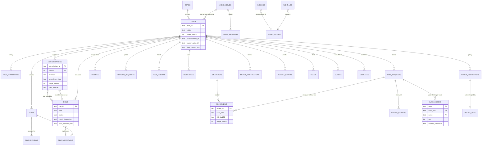

# MERCURY Coordinator (`mercuryd`) — Component Design

Owner: Agent C (Staff Engineer). Status: **Phase 4 revision** implementing `reviews/30-reconciliation.md` (RD-1, RD-3, RD-4, RD-5, RD-7, RD-11, RD-12, RD-13, RD-15, RD-16, RD-17, RD-18). Design only: the code, SQL and configuration below are specifications, not an implementation.

Related documents and what this document defers to them (single source of truth):

| Topic | Owner document | Cited as |
|---|---|---|
| States, transitions, guards, holds, block reasons, invariants `INV-nn` | [`state-machine.md`](state-machine.md) | **SM §n** |
| Message envelope, message and agent-output schemas | [`../protocols/messages.md`](../protocols/messages.md) | **MSG §n** |
| Agent invocation, prompts, validation V1–V4, per-agent deadlines and failure tables | `integrations/claude.md`, `integrations/codex.md` | **CL §n**, **CX §n** |
| GitHub posting mechanics, merge verification M1–M8 and scope (§8), ruleset, **retry matrix** (§15), **dedup key catalogue** (§13) | `integrations/github.md` | **GH §n**, **GH §15**, **GH-DEDUP** (= GH §13) |
| `spec_hash`, Linear status modes | `integrations/linear.md` | **LN §n** |
| **Operational parameter values** (wake grace, dark-wake threshold, stall thresholds, lease interval, disk thresholds, shutdown budget, watchdog, downtime notice) | Parameter table, `operations/macos-service.md` §2 (cited by parameter name, e.g. `run.codex_plan.*`, `wake.grace_s`) | **MS-PARAM** |
| **Filesystem layout** (`MERCURY_HOME`, `WORK_ROOT`, run-directory layout, modes, ACLs), `agent-exec`/`agent-ctl` installation, sudoers | `operations/macos-service.md` §7.1 (layout), §3.4–§3.8 (wrappers, `agent-exec` grammar, fd-3 hand-off, `agent-ctl` grammar, adoption), §9.5 (presence helper), §8.6 (power helper) | **MS §7.1**, **MS §3.5** etc. |
| Startup/exit contract of the LaunchAgent, backups schedule, restore runbooks | `operations/macos-service.md`, `operations/recovery.md` | **MS**, **REC** |
| SEC requirement text | `security/threat-model.md` | **SEC-nnn** |
| Requirement IDs, operator decisions, test IDs | `planning/traceability.md`, `testing/verification-plan.md` | `FR-`, `OD-`, `TC-` |
| ADRs | `architecture/decisions/` | ADR-013 isolation, ADR-014 merge governance, ADR-015 holds, ADR-016 layout, ADR-017 snapshots, ADR-018 audit integrity, ADR-019 presence tier and notifications, ADR-020 crash adoption |

Assumptions are labelled `ASM-C-nn`, each linked to a Phase 0 check in `planning/traceability.md`.

---

## Contents

1. [Runtime and technology decisions](#1-runtime-and-technology-decisions)
2. [Layering, source layout and dependency rules](#2-layering-source-layout-and-dependency-rules)
3. [Component diagram](#3-component-diagram)
4. [Component catalogue and public interfaces](#4-component-catalogue-and-public-interfaces)
5. [Internal control API and the `mercury` CLI](#5-internal-control-api-and-the-mercury-cli)
6. [Persistent data model](#6-persistent-data-model)
7. [Job queue and dispatch](#7-job-queue-and-dispatch)
8. [Process execution](#8-process-execution)
9. [Worktrees, snapshots and git hardening](#9-worktrees-snapshots-and-git-hardening)
10. [Pseudocode for critical workflows](#10-pseudocode-for-critical-workflows)
11. [Concurrency and locking rules](#11-concurrency-and-locking-rules)
12. [Retry, timeout and recovery tables](#12-retry-timeout-and-recovery-tables)
13. [Configuration](#13-configuration)
14. [Testability](#14-testability)

---

## 1. Runtime and technology decisions

| Decision | Choice | Justification | Fallback |
|---|---|---|---|
| Language | TypeScript 5.x, `strict: true`, `noUncheckedIndexedAccess`, ES modules | Agent SDK is TypeScript; one language for coordinator, CLI and schema-derived types (ADR-001) | — |
| Runtime | **Node.js 24 LTS**, exact version pinned; move to 26 LTS after it passes the contract suite | Active LTS; `node:sqlite` is RC (1.2) in 24 | Node 22 with `better-sqlite3` |
| Database | SQLite through **`node:sqlite`** (`DatabaseSync`) behind the `Store` port; WAL, `synchronous=FULL`, `fullfsync=ON` | No native-addon supply chain; synchronous API matches "no `await` inside a transaction" (L3) | `better-sqlite3` behind the same port (ASM-C-01) |
| Process model | **One coordinator process** (`mercuryd`, a LaunchAgent in the operator's GUI session, operator uid; ADR-010), one event loop, one write connection. Backups and `integrity_check` run in a `worker_thread` with its own read connection (RD-11). **All model-directed and repository-derived code runs as `_mercuryagent`** through the root-owned `agent-exec`/`agent-ctl` wrappers (RD-1, ADR-013, INV-24) | Single writer; OS-enforced separation of agents from MERCURY's and the operator's credentials | Same-uid launcher only with fakes and the sandbox repo (M1–M4 gate, SEC-T-20) |
| Schema validation | **Ajv 8**: `ajv/dist/2020` for message schemas; draft-07 mode for the **canonical** agent output contracts (full validation incl. lengths and bounds). Agents receive a CI-generated **wire copy** per provider profile (`claude-sdk`, `anthropic-messages`, `codex-strict`; CL/CX) restricted to that provider's subset (RD-15, MSG §5.3) | Providers enforce a subset; the coordinator enforces the full contract | — |
| HTTP clients | Built-in `fetch` (undici) with thin typed wrappers; no Octokit. The GitHub wrapper holds an **endpoint allowlist** (SEC-102) | Small dependency tree; explicit ETag handling | Octokit if pagination grows |
| Config | TOML (`smol-toml`, pinned), validated against a JSON Schema at load | Readable, commented | JSON |
| IDs | ULID with type prefix, in-repo monotonic generator | No dependency | — |
| Hashing / canonical JSON | SHA-256, RFC 8785 JCS in-repo with conformance vectors | Reproducible bindings | — |
| Test stack | `node:test` or Vitest, `fast-check`, `dependency-cruiser` | — | — |

Runtime npm dependencies: `@anthropic-ai/claude-agent-sdk` (exact pin), `ajv`, `smol-toml`. Codex, `agent-exec` and `agent-ctl` are external binaries.

---

## 2. Layering, source layout and dependency rules

Ports-and-adapters. The domain core has no I/O; application services orchestrate through ports; adapters implement ports; `bin/mercuryd.ts` is the only composition root.

```text
src/
  core/                    # pure domain, no I/O, no Date.now(), no randomness
    ids.ts  states.ts  transitions.ts (TRANSITION_TABLE, HOLD_RULES; SM §3, §5)  guards.ts
    policies/              # revision budgets, priority, severity, backoff, diff gate, policy rules, credited time
    vocab.ts               # canonical vocabularies (block reasons, hold kinds, sources, failure classes)
    evidence.ts  errors.ts
  app/                     # use-cases; depend on core + ports only
    supervisor.ts  transition-engine.ts  hold-service.ts  dispatcher.ts  run-manager.ts
    decision-recorder.ts   # sole writer of authority records (INV-18)
    recovery-manager.ts  inbox-processor.ts  outbox-worker.ts  timer-service.ts  triage-service.ts
    merge-verifier.ts  notification-policy.ts  commit-pipeline.ts  policy-service.ts
    snapshot-service.ts  anchor-service.ts  control-service.ts
  ports/                   # TypeScript interfaces only (§4)
  adapters/
    sqlite/                # Store, migrations/*.sql, worker-thread backup
    process/               # ProcessSupervisor: AgentExecSupervisor (sudo agent-exec / agent-ctl), SameUidLauncher
    claude/  codex/  git/  github/  linear/  notify/  fs/  keychain/  clock/  control/  presence/
  schemas/                 # generated .d.ts from protocols/schemas; wire copies under schemas/wire/ (CI-generated)
  bin/
    mercuryd.ts            # composition root
    mercury.ts             # CLI
scripts/
  gen-wire-schemas.ts      # canonical output contract → wire copy per profile (claude-sdk, anthropic-messages, codex-strict) + sha256 manifest (MSG §5.3)
```

`runwrap` no longer exists: its role (detached session, `proc.json`/`exit.json`, exit status surviving a coordinator crash) is part of `agent-exec` (RD-1; MS §3.4–§3.8).

| Rule | From | May import | Must not import |
|---|---|---|---|
| D1 | `core/**` | `core/**` | anything else, including `node:*` |
| D2 | `app/**` | `core/**`, `ports/**`, `schemas/**` | `adapters/**`, `node:child_process`, `node:net`, `node:sqlite` |
| D3 | `adapters/**` | `ports/**`, `core/**` (types), `schemas/**`, `node:*` | `app/**`; other adapters except `adapters/process` through the `ProcessSupervisor` port |
| D4 | `bin/**` | everything | — |
| D5 | any | — | direct `process.env` reads outside `adapters/keychain` and `bin/` |
| D6 | `adapters/github/**` | — | string literals or routes matching `/merge`, `/merges`, `update-branch`, `auto-merge`/`enablePullRequestAutoMerge`, `/dismissals`, `/protection`, `/rulesets` (write), `event: 'APPROVE'`, `REQUEST_CHANGES` (lint rule; INV-09). Runtime: requests outside the endpoint allowlist throw before sending (SEC-102) |
| D7 | `app/**` except `transition-engine.ts` and `hold-service.ts` | — | constructing `github.check.*` outbox specs (INV-21) |

---

## 3. Component diagram

```mermaid
flowchart TB
    subgraph CLI_SIDE["Local clients - operator uid"]
        CLI["mercury CLI"]
        PH["mercury-presence helper - LocalAuthentication"]
        CS["Interactive Claude Code session - request only"]
    end

    subgraph MD["mercuryd - LaunchAgent, operator uid"]
        CTRL["ControlServer - UDS 0600"]
        SUPV["Supervisor - tick loop"]
        HM["HealthMonitor - credited time, dark wake, network"]
        TS["TimerService"]
        INB["InboxProcessor"]
        DSP["Dispatcher"]
        RM["RunManager"]
        TE["TransitionEngine"]
        HS["HoldService"]
        DR["DecisionRecorder"]
        CP["CommitPipeline - diff gate, secret scan"]
        PS["PolicyService - pre-checks and acks"]
        SNP["SnapshotService"]
        MV["MergeVerifier"]
        NP["NotificationPolicy"]
        OBW["OutboxWorker"]
        REC["RecoveryManager"]
        AN["AnchorService"]
        TRI["TriageService"]
        subgraph PORTS["Ports"]
            P_ST["Store"]
            P_PS["ProcessSupervisor"]
            P_CL["DecisionAgent - Claude"]
            P_CX["ExecutionAgent - Codex"]
            P_WT["WorktreeManager"]
            P_GIT["GitOps"]
            P_GH["GitHubPort"]
            P_LN["LinearPort"]
            P_AS["ArtifactStore"]
            P_CB["CredentialBroker"]
            P_CLK["Clock"]
            P_PV["PresenceVerifier"]
        end
        subgraph POLL["Pollers"]
            GHP["GitHubPoller"]
            LNP["LinearPoller"]
        end
    end

    subgraph AGENTUID["_mercuryagent uid"]
        AE["agent-exec - root-owned wrapper"]
        CLB["claude binary via Agent SDK"]
        CXB["codex exec"]
        VER["verify and deps_install under Seatbelt"]
    end

    subgraph ADP["Externals"]
        SQL[("SQLite WAL")]
        ACTL["agent-ctl - signal ps stats purge"]
        GITB["git - mirror plumbing"]
        GHA["GitHub REST"]
        LNA["Linear GraphQL"]
        KC["Login Keychain"]
        FS["Artifact files"]
    end

    CLI --> CTRL
    PH --> CLI
    CS --> CTRL
    CTRL --> P_PV
    CTRL --> TE
    CTRL --> HS
    SUPV --> HM
    SUPV --> TS
    SUPV --> INB
    SUPV --> REC
    SUPV --> DSP
    SUPV --> OBW
    SUPV --> POLL
    GHP --> P_GH
    LNP --> P_LN
    GHP --> P_ST
    LNP --> P_ST
    INB --> TE
    INB --> HS
    TS --> TE
    TS --> HS
    DSP --> TE
    DSP --> RM
    DSP --> SNP
    TRI --> RM
    RM --> P_CL
    RM --> P_CX
    RM --> P_PS
    RM --> DR
    RM --> CP
    CP --> PS
    CP --> P_GIT
    SNP --> P_GIT
    DR --> TE
    MV --> P_GH
    MV --> TE
    MV --> HS
    TE --> P_ST
    TE --> NP
    HS --> P_ST
    OBW --> P_GH
    OBW --> P_LN
    OBW --> P_GIT
    AN --> P_ST
    REC --> RM
    REC --> P_PS
    P_ST --> SQL
    P_PS --> AE
    P_PS --> ACTL
    AE --> CXB
    AE --> CLB
    AE --> VER
    P_GIT --> GITB
    P_GH --> GHA
    P_LN --> LNA
    P_CB --> KC
    P_AS --> FS
```



Arrows from `app` components go only into ports. No adapter calls an application service.

---

## 4. Component catalogue and public interfaces

### 4.0 Name mapping to `overview.md`

| This document | `overview.md` §5 component | Notes |
|---|---|---|
| `Supervisor` | main loop | Tick orchestration |
| `Store` | Store | — |
| `TransitionEngine` + `HoldService` | Workflow Engine | Holds are orthogonal to state (ADR-015) |
| `Dispatcher` + `RunManager` | Scheduler and Lease Manager | Queue derived from task state (§7.1); no `jobs` table |
| `DecisionRecorder` | Decision Recorder | — |
| `ClaudeAdapter` (`DecisionAgent`) / `CodexAdapter` (`ExecutionAgent`) | Decision / Execution Gateway | — |
| `ProcessSupervisor` (`AgentLauncher` + control) | Process Supervisor | `agent-exec` / `agent-ctl` adapter (RD-1) |
| `WorktreeManager`, `SnapshotService` | Workspace Manager | Snapshots replace review/reference checkouts (RD-7) |
| `GitOps` + `CommitPipeline` + `OutboxWorker` | Git Publisher | Plumbing against the mirror; push from the mirror (RD-17) |
| `PolicyService` | (new) | Deterministic pre-checks, PL check, acknowledgements (RD-14) |
| `GitHubPoller`, `LinearPoller`, `InboxProcessor` | GitHub Sync, Linear Sync | — |
| `NotificationPolicy` | Notification Policy | Channel matrix §4.15 (ADR-019) |
| `AuditLog`, `AnchorService` | Audit Log | Chain + anchors + epochs (ADR-018) |
| `PresenceVerifier` | (new) | Operator-presence tier (ADR-019) |
| `CredentialBroker` | Credential Broker | Read once at start and on `reload-credentials` (RD-18) |
| `HealthMonitor` | Health and Wake Monitor | Credited time §10.10 |

### 4.1 Shared types (core)

```ts
// core/ids.ts
type Brand<T, B extends string> = T & { readonly __brand: B };
export type TaskId = Brand<string, "tsk">;          // tsk_<ULID>
export type RunId = Brand<string, "run">;
export type AuthorizationId = Brand<string, "auth">;
export type PlanId = Brand<string, "pln">;  export type ReviewId = Brand<string, "rev">;
export type ApprovalId = Brand<string, "apr">;  export type ArtifactId = Brand<string, "art">;
export type MessageId = Brand<string, "msg">;  export type EventId = Brand<string, "evt">;
export type OutboxId = Brand<string, "obx">;  export type HoldId = Brand<string, "hld">;
export type EscalationId = Brand<string, "pex">;  export type SnapshotId = Brand<string, "snp">;
export type Sha256 = Brand<string, "sha256">;  export type GitSha = Brand<string, "gitsha">;
export type RepoName = Brand<string, "repo">;  export type IssueIdentifier = Brand<string, "issue">;

// core/states.ts
export const TASK_STATES = [
  "AWAITING_AUTHORIZATION", "AUTHORIZED", "PLANNING", "AWAITING_PLAN_REVIEW",
  "PLAN_REVISION_REQUESTED", "PLAN_APPROVED", "IMPLEMENTING", "TESTING", "PR_OPEN",
  "CLAUDE_PR_REVIEW", "CHANGES_REQUESTED", "AWAITING_HUMAN_APPROVAL", "MERGED",
  "BLOCKED", "COMPLETED", "FAILED", "CANCELLED",
] as const;
export type TaskState = (typeof TASK_STATES)[number];
export type Initiator =
  | { kind: "claude"; runId: RunId } | { kind: "codex_result"; runId: RunId }
  | { kind: "coordinator"; rule: string }
  | { kind: "operator"; controlRequestId: string }
  | { kind: "operator_presence"; controlRequestId: string; assertionSha256: Sha256 }   // RD-12
  | { kind: "github"; eventId: EventId } | { kind: "linear"; eventId: EventId };

export type RunKind =
  | "claude_triage" | "claude_authorize" | "codex_plan" | "claude_plan_review"
  | "claude_revision_request" | "deps_install" | "codex_implement" | "codex_revise"
  | "verify" | "claude_code_review" | "claude_security_review" | "git_step";
  // claude_failure_triage removed (RA-11): no contract in v1; exhausted failures go to BLOCKED(run_exhausted)
export type RunStatus = "starting" | "running" | "stopping" | "succeeded" | "failed" | "timed_out"
  | "stalled" | "cancelled" | "lost" | "output_invalid" | "rejected_by_gate" | "superseded";
export type ResultDisposition = "pending" | "applied" | "deferred" | "discarded";   // INV-23

// core/vocab.ts — canonical vocabularies (SM §5.1, §6.1, §7.1). Stored as TEXT validated against the
// `vocab` table (§6.3), so adding a value is an additive migration (RC-29).
export type FailureClass =
  | "network_down" | "rate_limited" | "host_sleep" | "transient_api" | "cancelled_by_coordinator"
  | "lost_by_coordinator_crash" | "lost_by_host"                          // never consume attempts
  | "crash" | "timeout" | "stalled" | "output_invalid" | "incomplete"      // consume run attempts
  | "config_fatal" | "policy_violation" | "semantic_invalid" | "budget_exceeded" | "auth_failed";
export type HoldKind = "operator_pause" | "operator_hold" | "host_sleep_grace" | "network_down"
  | "rate_limited" | "circuit_open" | "integration_auth_failed" | "keychain_locked" | "agent_auth_failed"
  | "budget_exhausted" | "config_fatal" | "low_disk" | "integrity_check_failed" | "security_halt"
  | "integrity_alert" | "spec_changed" | "authorization_expired" | "dependency_unresolved"
  | "deprioritized" | "host_instability";
export type BlockReason = "needs_human_decision" | "decision_run_failed" | "run_exhausted" | "plan_rejected"
  | "plan_revision_limit" | "pr_revision_limit" | "verify_fix_limit" | "human_change_limit"
  | "policy_ack_required" | "security_policy_violation" | "security_escalation" | "injection_suspected"
  | "foreign_push" | "foreign_agent" | "pr_closed_unexpectedly" | "merge_verification_failed"
  | "reauthorization_required" | "guard_integrity_failure" | "external_state_conflict";   // 404 and ruleset push rejections map to external_state_conflict (GH §15.2)
```

### 4.2 Supervisor (`app/supervisor.ts`)

Owns the tick loop and phase order; contains no business logic; isolates phase errors; drives shutdown.

```ts
export interface Supervisor {
  start(): Promise<void>;                 // startup sequence (§10.6) then the loop
  requestTick(reason: string): void;
  shutdown(signal: "SIGTERM" | "SIGINT"): Promise<ShutdownReport>;   // budget: MS-PARAM
}
export interface TickPhase {
  readonly name: "health" | "timers" | "inbox" | "runs" | "dispatch" | "outbox" | "polls" | "housekeeping";
  run(tick: TickContext): Promise<void>;
}
export interface TickContext { readonly seq: number; readonly wallNow: Date; readonly monoMs: number;
  readonly creditedMs: number; readonly sleepGap: boolean; readonly fullWake: boolean; }
```

Tick interval is `clock.tick_active_ms` / `clock.tick_idle_ms` (MS-PARAM). Every `supervisor.alive_touch_s` the Supervisor touches `WORK_ROOT/ctl/coordinator.alive` (operator-owned 0640, group-readable; Addendum B §3); `agent-exec` reads its mtime for the **supervisor lease** (§8.4).

Shutdown on SIGTERM (RD-11; `svc.shutdown_budget_s`, MS §12): (1) stop dispatch and mutating control requests; (2) interrupt non-adoptable runs (Claude) and mark them `lost`/`cancelled_by_coordinator` (no attempt); (3) **keep adoptable runs** (Codex, `verify`, `deps_install`), which continue under `agent-exec` and its supervisor lease; (4) checkpoint run progress, release the daemon lease, `wal_checkpoint(TRUNCATE)`, exit 0 within the budget. Adoptable runs are **not** kept if safe mode or a `security_halt` is active: they are interrupted first.

### 4.3 Store (`ports/store.ts`)

Only module that opens the DB read-write (L2).

```ts
export interface Store {
  write<T>(fn: (tx: WriteTx) => T): T;                 // BEGIN IMMEDIATE … COMMIT; fn must be synchronous
  read<T>(fn: (tx: ReadTx) => T): T;
  open(): void;                                        // connection settings below; flock is taken earlier by the Supervisor (L1)
  migrate(target?: number): MigrationReport;           // backup first; sets user_version + schema_meta (RC-29)
  quickCheck(): IntegrityReport;                       // startup, main connection (fast)
  integrityCheckInWorker(): Promise<IntegrityReport>;  // daily; worker_thread with its own read connection (RD-11)
  backupInWorker(destPath: string): Promise<BackupReport>;   // VACUUM INTO / backup() in the worker thread
  close(): void;
}
```

`ReadTx`/`WriteTx` expose typed repositories for every table in §6.3 (`tasks`, `runs`, `authorizations`, `plans`, `planReviews`, `planApprovals`, `pullRequests`, `prReviews`, `githubReviews`, `findings`, `linearIssues`, `issueRelations`, `worktrees`, `snapshots`, `holds`, `outbox`, `inbox`, `cursors`, `artifacts`, `budgetGrants`, `messages`, `policyEscalations`, `policyAcks`, `mergeVerifications`, `anchors`, `auditEpochs`, `orphans`, `vocab`, `transitions` (`task_transitions`), `operatorRevocations`, `revisionRequests`, `testResults`, `gateChecks`, `controlRequests`, `notifications`, `hostEvents`, `observationSeqs`, `instances` (`daemon_instances`), `leases`, `schemaMeta`), plus `audit: AuditAppender`, `facts(task)` (the task's level snapshots: PR, reviews, checks, Linear issue) and `now()` (captured once per transaction). Repository methods used in §10 (`get`, `insert`, `update`, `latest`, `openFor`, `nextDue`, `setDisposition`, `discardDeferred`, `insertIgnoreDuplicate`, …) are thin typed wrappers over single statements on these tables.

Connection settings: `journal_mode=WAL`, `synchronous=FULL`, `fullfsync=ON`, `checkpoint_fullfsync=ON`, `foreign_keys=ON`, `busy_timeout=5000`, `trusted_schema=OFF`, `cell_size_check=ON`. Read-only connections (CLI offline mode, worker thread) open `mode=ro` with `query_only=ON`.

**Write-frequency rule (RD-11, RD-17).** Authority and state changes commit immediately. Run progress (credited time, byte counters) is kept in memory and flushed on phase changes, at exit and every `db.progress_flush_s`; lease rows are persisted no more often than `db.lease_persist_s` (≥ 60 s). The `flock` (L1) is the real single-instance guard.

### 4.4 TransitionEngine and HoldService

The TransitionEngine is the only code path that changes `tasks.state`. The HoldService is the only code path that inserts or releases `holds`. Both write outbox items through `outbox.insertIgnoreDuplicate` inside the caller's transaction (INV-11), so a hold can update a check run or the PR draft state (SM §5 H1).

```ts
export interface TransitionEngine {
  apply(cmd: TransitionCommand): TransitionOutcome;
  applyInTx(tx: WriteTx, cmd: TransitionCommand): TransitionOutcome;
  explain(tx: ReadTx, taskId: TaskId, ruleId: string): GuardReport;
}
export interface TransitionCommand {
  taskId: TaskId | null; expectedStateVersion: number | null;
  event: { type: string; ruleHint?: string }; initiator: Initiator;
  evidence: Record<string, string | number | boolean | null>;
  messages?: OutgoingMessage[]; outbox?: OutboxSpec[]; counters?: Partial<Record<CounterName, 1 | 2>>;
  blocked?: { reason: BlockReason; resumeState: TaskState };
  applyingRunId?: RunId;                 // set for result-consuming rules: enables AG@apply and result_disposition
}
export type TransitionOutcome =
  | { ok: true; transitionId: string; from: TaskState | null; to: TaskState; stateVersion: number;
      messageIds: MessageId[]; outboxIds: OutboxId[] }
  | { ok: false; code: "stale_version" | "no_rule" | "initiator_not_allowed" | "guard_failed"
      | "guard_hold" | "evidence_missing" | "terminal"; detail: GuardReport | string };

export interface HoldService {
  /** Idempotent on (scope, scope_ref, kind) while active. Runs HOLD_RULES[kind].onSet effects. */
  setInTx(tx: WriteTx, spec: { kind: HoldKind; scope: HoldScope; scopeRef: string; reason: string;
          by: Initiator; until?: string }): HoldId;
  /** Refuses unless the initiator matches HOLD_RULES[kind].clearsVia (INV-26). Runs onRelease effects. */
  releaseInTx(tx: WriteTx, kind: HoldKind, scope: HoldScope, scopeRef: string, by: Initiator): void;
  ageingTick(tx: WriteTx, creditedNow: number): AgeingAction[];    // SM §5 H4, once per hold epoch
  /** Convenience wrappers: open their own store.write transaction and call setInTx / releaseInTx (used in §10.6, §10.10). */
  set(spec: Parameters<HoldService["setInTx"]>[1]): HoldId;
  release(kind: HoldKind, scope: HoldScope, scopeRef: string, by: Initiator): void;
}
```

### 4.5 Dispatcher and RunManager

```ts
export interface Dispatcher { tick(ctx: TickContext): Promise<DispatchReport>; }        // §10.1
export interface RunManager {
  startClaimed(claim: ClaimedRun): Promise<void>;
  monitor(ctx: TickContext): Promise<void>;          // credits time, stdout growth + CPU progress (agent-ctl stats)
  cancel(runId: RunId, reason: CancelReason): Promise<KillReport>;
  finalize(runId: RunId, exit: ExitInfo): Promise<FinalizeOutcome>;   // idempotent on run_id; applies via AG@apply
  adoptOrReap(run: RunRow): Promise<AdoptionOutcome>;
  applyDeferred(taskId: TaskId): FinalizeOutcome[];  // after a same-scope re-authorization (SM §8.1.1)
  markDeferredReady(tx: WriteTx, taskId: TaskId): void;   // flags deferred runs so the next tick calls applyDeferred
}
```

### 4.6 Agent adapters (`ports/agents.ts`)

The coordinator never parses free text from agents.

```ts
export interface DecisionAgent {                         // ClaudeAdapter (CL)
  readonly agent: "claude";
  prepare(input: DecisionInput): Promise<PreparedDecision>;      // writes run inputs; computes input_digest
  run(prepared: PreparedDecision, run: RunContext): Promise<DecisionResult>;
  selfTest(): Promise<SelfTestReport>;
}
export type DecisionKind = "triage" | "authorization" | "plan_review" | "pr_code_review"
  | "pr_security_review" | "revision_request";                    // canonical list (RA-11)
export interface DecisionInput {
  kind: DecisionKind; mode: "initial" | "reauthorize" | null; taskId: TaskId | null; runId: RunId;
  trusted: Record<string, unknown>;                       // ids, hashes, limits, AC ids
  untrusted: Array<{ name: string; artifactId: ArtifactId; sha256: Sha256 }>;   // quoted as data
  snapshot: { snapshotId: SnapshotId; treeSha: GitSha; path: string } | null;  // RD-7: never a worktree
  outputSchemaId: string;                                 // canonical id; the adapter sends the wire copy
}
export type DecisionResult =
  | { ok: true; output: unknown; outputSha256: Sha256; sessionId: string; usage: AgentUsage;
      modelsUsed: string[]; wireSchemaSha256: Sha256; permissionDenials: number; transcriptArtifact: ArtifactId }
  | { ok: false; failure: FailureClass; detail: string; usage?: AgentUsage; validationStage?: "V1" | "V2" | "V3" | "V4" };

export interface ExecutionAgent {                        // CodexAdapter (CX)
  readonly agent: "codex";
  buildSpec(input: ExecutionInput): Promise<AgentRunSpec>;   // argv per agent-exec grammar, env allowlist, CODEX_HOME
  parseEvent(line: string): AgentEvent | null;
  finalize(runDir: string, exit: ExitInfo): Promise<ExecutionResult>;   // reads out/final.json, validates (canonical)
  selfTest(): Promise<SelfTestReport>;
}
export interface ExecutionInput {
  kind: "codex_plan" | "codex_implement" | "codex_revise"; runId: RunId; taskId: TaskId;
  worktreePath: string; sandbox: "read-only" | "workspace-write";
  resumeThreadId: string | null;           // null whenever the worktree was reset since the thread ran (§9.4)
  codexHome: string;                       // per task, WORK_ROOT path from MS §7.1 (RD-15)
  promptArtifact: ArtifactId;
  outputSchemaId: "mercury.output.codex_plan.v1" | "mercury.output.codex_implementation.v1";
  limits: { maxAwakeMs: number; stallMs: number; maxTokens: number };
}
```

Rules:

- **Claude runs** use the Agent SDK with a custom spawn (`spawnClaudeCodeProcess`) that calls `ProcessSupervisor.start` with `kind = claude`, i.e. `sudo -n -C 4 -u _mercuryagent -g mercury agent-exec --run-dir <run_dir>` with `spec.json` kind `claude` with SDK pipes preserved, the key on fd 3 and a per-run config dir under the run directory (RD-1). If the Phase 0 spawn test fails, the adapter switches to B's ALT-B-1 (Messages API with coordinator-implemented, realpath-confined Read/Grep/Glob over the snapshot), removing the Claude subprocess.
- **Authority decisions** (authorization, plan review, PR code/security review, revision request) run with **no `fallbackModel`**; a result produced by a model other than the requested one is `output_invalid`. `modelsUsed` is recorded on the run and on the authority row (RD-18, RB-19).
- **Wire schemas.** The adapter sends the wire copy of `outputSchemaId` for its provider profile (`claude-sdk` for SDK `outputFormat`, `anthropic-messages` for the ALT-B-1 path, `codex-strict` for `--output-schema`) and records its `wireSchemaSha256`; a provider `invalid_json_schema` rejection is `config_fatal` (RD-15). Full validation uses the canonical schema.

### 4.7 ProcessSupervisor (`ports/process.ts`): AgentLauncher and process control

One port, two adapters (RD-1):

- **`AgentExecSupervisor`** (production): spawns `sudo -n -C 4 -u _mercuryagent -g mercury /usr/local/libexec/mercury/agent-exec --run-dir <run_dir>` (the kind and argv are in the operator-owned `spec.json`, MS §3.2/§3.5); controls through `sudo -n -u _mercuryagent /usr/local/libexec/mercury/agent-ctl <subcommand>` (exact paths, sudoers drop-in and argv grammar: MS §3.4–§3.8).
- **`SameUidLauncher`**: the same contract implemented in-process for fakes and the sandbox repository only. The composition root refuses it unless every enabled repo is flagged `sandbox = true` (INV-24).

```ts
export interface AgentRunSpec {
  runId: RunId; kind: "codex_plan" | "codex_implement" | "codex_revise" | "verify" | "deps_install" | "claude";
  runDir: string;                                        // WORK_ROOT/runs/<run_id> (MS §7.1)
  argv: readonly string[]; cwd: string;                  // validated again by agent-exec against its grammar
  envAllowlist: Readonly<Record<string, string>>;        // complete; nothing inherited; no secrets
  secretFd3: { label: string } | null;                   // model key delivered once on fd 3 by the adapter
  stdio: "files" | "pipes";                              // files ⇒ adoptable (Codex, verify, deps_install)
  limits: { maxAwakeMs: number; stallMs: number; stdoutCapBytes: number; stderrCapBytes: number;
            rlimits: Record<string, number> };
  cancel: { soft: "SIGINT" | "sdk_interrupt" | "none"; softGraceMs: number; termGraceMs: number };
  sandboxProfile: string | null;                         // Seatbelt profile for verify/deps_install (RD-17); Codex uses its own
}
export interface ProcessIdentity { runId: RunId; pid: number; pgid: number; startTime: string; bootSessionUuid: string; }
export interface ProcessSupervisor {
  start(spec: AgentRunSpec): Promise<ProcessHandle>;     // writes spec.json, opens stdout/stderr (operator-owned 0640), spawns
  probe(id: ProcessIdentity): Promise<"alive_match" | "alive_mismatch" | "dead">;   // agent-ctl probe --run; EPERM never means dead
  adopt(spec: AgentRunSpec, id: ProcessIdentity): Promise<ProcessHandle>;           // files mode only
  signalGroup(id: ProcessIdentity, sig: "INT" | "TERM" | "KILL"): Promise<"signalled" | "not_running" | "identity_mismatch">;  // agent-ctl signal --run --sig
  kill(id: ProcessIdentity, plan: AgentRunSpec["cancel"]): Promise<KillReport>;     // INT → TERM → KILL ladder
  listMarked(): Promise<Array<{ pid: number; pgid: number; startTime: string; cwd: string; runId: RunId | null }>>;   // agent-ctl list
  reap(pid: number, startTime: string): Promise<void>;   // agent-ctl reap (orphans that escaped their group)
  stats(id: ProcessIdentity): Promise<{ rssBytes: number; cpuTimeMs: number; processes: number }>;   // agent-ctl stats --run
  purge(path: string): Promise<void>;                    // agent-ctl purge --path (WORK_ROOT/{worktrees,runs,codex-home,snapshots})
  fixAcl(path: string): Promise<void>;                   // agent-ctl fix-acl --path
}
export interface ExitInfo { code: number | null; signal: string | null; endedAt: string;
  reason: "exited" | "deadline" | "supervisor_lost" | "exec_failed" | "rejected";   // ctl/exit.json or ctl/reject.json (exit 125 ⇒ config_fatal)
  source: "waitpid" | "exit_file" | "inferred_dead"; stdoutBytes: number; stderrBytes: number; }
```

`git_step` runs and the SnapshotService are **coordinator-uid** processes started directly by the git adapter: they never execute repository code (hooks, filters and fsmonitor are disabled; §9.6).

### 4.8 DecisionRecorder (`app/decision-recorder.ts`)

The only writer of authority records (INV-18). Records and performs the transition in one transaction.

```ts
export interface DecisionRecorder {
  recordTriage(run: RunRow, out: TriageProposalV1): TriageOutcome;
  recordAuthorization(run: RunRow, out: TaskAuthorizationDecisionV1): TransitionOutcome;   // T02/T03/T04, T37, G1a, G4, SM §8.1.1
  recordPlanReview(run: RunRow, out: PlanReviewV1): TransitionOutcome;                     // T09/T10/T11
  recordPrReview(run: RunRow, out: CodeReviewV1 | SecurityReviewV1): TransitionOutcome | null; // T24/T24p/T25/T25c/T26
  recordRevisionRequest(run: RunRow, out: RevisionRequestV1): TransitionOutcome;           // T12/T13/T28/T29/T30
}
```

### 4.9 WorktreeManager, SnapshotService and GitOps (`ports/git.ts`)

```ts
export interface WorktreeManager {
  ensureMirror(repo: RepoName): Promise<MirrorInfo>;
  fetch(repo: RepoName): Promise<{ defaultBranchSha: GitSha }>;
  ensureTaskWorktree(task: TaskRef): Promise<WorktreeRow>;               // idempotent; applies group ACLs (MS §7.1)
  inspect(wt: WorktreeRow): Promise<{ head: GitSha; dirty: boolean; untracked: number; instructionHashes: Record<string, Sha256> }>;
  reset(wt: WorktreeRow, policy: ResetRequest): Promise<{ archivedPatch: ArtifactId | null; resetEpoch: number }>;  // §9.4
  archive(wt: WorktreeRow): Promise<ArtifactId>;
  quarantine(wt: WorktreeRow): Promise<void>;                            // chmod 000 + move under quarantine/ (RE-13)
  remove(wt: WorktreeRow): Promise<void>;                                // refuses unless archived (INV-14); agent-ctl purge fallback
}
export interface SnapshotService {                                       // RD-7, ADR-017, SEC-205
  ensure(repo: RepoName, commit: GitSha, purpose: "base" | "head"): Promise<SnapshotRow>;   // keyed by tree sha; shared
  release(snapshotId: SnapshotId, holder: string): Promise<void>;
}
export interface GitOps {                                                 // hardened invocation, §9.6
  snapshotChanges(wt: WorktreeRow): Promise<ChangeSnapshot>;            // worktree read as data
  commit(wt: WorktreeRow, msg: CommitMessage): Promise<{ sha: GitSha; created: boolean; durable: true }>;  // plumbing, fsync, INV-25
  mergeBase(wt: WorktreeRow, baseSha: GitSha): Promise<{ sha: GitSha } | { conflict: ArtifactId }>;     // T41
  push(repo: RepoName, branch: string, sha: GitSha): Promise<PushResult>;   // from the mirror, fast-forward only
  remoteHead(repo: RepoName, branch: string): Promise<GitSha | null>;
  exists(repo: RepoName, sha: GitSha): Promise<boolean>;                    // git cat-file -e (INV-25 recovery)
  diffArtifact(repo: RepoName, base: GitSha, head: GitSha): Promise<{ artifact: ArtifactId; diffSha256: Sha256 }>;
}
export type PushResult = { kind: "pushed" | "already_there"; sha: GitSha } | { kind: "rejected_non_ff"; remote: GitSha }
  | { kind: "rejected_ruleset"; detail: string };
```

### 4.10 CommitPipeline and PolicyService

The CommitPipeline runs CX §9 in order: change snapshot → instruction-file check (SM §8.8) → DiffGate → SecretScanner → pre-push checks (bidi/zero-width/mixed-script scan, `..`/case-collision/symlink checks, `O_NOFOLLOW` reads; SEC-312, SEC-403, SEC-404) → **PolicyService report** → commit by plumbing against the mirror → fsync → DB (INV-25). Pure gate logic lives in `core/policies/`.

```ts
export interface DiffGate { evaluate(s: ChangeSnapshot, policy: EffectiveRepoPolicy, plan: CodexPlanV1, auth: AuthorizationPayload): GateReport; }
export interface GateReport { verdict: "pass" | "reject_revisable" | "reject_security";
  rules: Array<{ ruleId: string; path: string; detail: string }>; changedLines: number; outOfPlanPaths: string[]; }
export interface SecretScanner { scan(diffPath: string): Promise<{ hits: Array<{ ruleId: string; path: string }> }>; }   // never returns secret text
export interface PolicyService {
  report(s: ChangeSnapshot, auth: AuthorizationPayload): PolicyReport;   // deterministic (SEC-309, OD-35)
  ackRequired(tx: ReadTx, task: TaskId, head: GitSha, r: PolicyReport): { required: boolean; carriedFromAck: string | null };
}
export interface PolicyReport { ruleIds: string[]; protectedPaths: string[]; protectedBlobDigest: Sha256;
  needsAck: boolean; withinEscalateAllowance: boolean; }        // outside allowance ⇒ reject_security (SM T19)
```

### 4.11 GitHubPort (`ports/github.ts`)

```ts
export interface Conditional<T> { status: 200 | 304; etag: string | null; body: T | null; }
export interface GitHubPort {
  getPull(repo: RepoName, n: number, etag?: string): Promise<Conditional<PullSnapshot>>;
  /** GET /pulls?head=<owner>:<branch>&state=all (RB-23). Returns only PRs authored by the mercury-bot App user id. */
  findPullsByHead(repo: RepoName, headBranch: string): Promise<PullSnapshot[]>;
  listReviews(repo: RepoName, n: number, etag?: string): Promise<Conditional<ReviewSnapshot[]>>;
  listCheckRuns(repo: RepoName, sha: GitSha, etag?: string): Promise<Conditional<CheckRunSnapshot[]>>;
  getBranchRules(repo: RepoName, branch: string, etag?: string): Promise<Conditional<BranchRule[]>>;   // required contexts (RD-18)
  compareCommits(repo: RepoName, base: string, head: string): Promise<CompareResult>;
  listIssueComments(repo: RepoName, n: number, sinceIso?: string): Promise<IssueComment[]>;
  listIssueEvents(repo: RepoName, n: number): Promise<IssueEvent[]>;        // closed_by, labeled (actor id)
  createPull(repo: RepoName, req: CreatePullRequest): Promise<PullSnapshot>;          // always draft: true
  updatePull(repo: RepoName, n: number, patch: { title?: string; body?: string; state?: "open" }): Promise<PullSnapshot>;
  setDraft(repo: RepoName, n: number, draft: boolean): Promise<void>;
  createReview(repo: RepoName, n: number, req: { commitId: GitSha; event: "COMMENT"; body: string;
                comments?: ReviewComment[] }): Promise<{ id: number }>;            // COMMENT only (RD-5, INV-09)
  createCheckRun(repo: RepoName, req: { name: GateCheckName; headSha: GitSha; externalId: string;
                 status: "queued" | "in_progress" | "completed"; conclusion?: CheckConclusion; output: CheckOutput }): Promise<{ id: number }>;
  updateCheckRun(repo: RepoName, id: number, req: { status: "in_progress" | "completed"; conclusion?: CheckConclusion; output: CheckOutput }): Promise<void>;
  findCheckRun(repo: RepoName, headSha: GitSha, name: GateCheckName, externalId: string): Promise<CheckRunSnapshot | null>;  // App-authored only
  createIssueComment(repo: RepoName, n: number, body: string): Promise<{ id: number }>;
  requestReviewers(repo: RepoName, n: number, logins: string[]): Promise<void>;
  setLabels(repo: RepoName, n: number, add: string[], remove: string[]): Promise<void>;
  rateLimit(): RateLimitState;
  // Intentionally absent (INV-09, SEC-102): merge, auto-merge enable, update-branch, APPROVE and REQUEST_CHANGES
  // reviews, dismissReview, branch protection and ruleset writes, base-branch deletion.
}
export type GateCheckName = "MERCURY / claude-review" | "MERCURY / policy";
export type CheckConclusion = "success" | "failure" | "action_required";   // never neutral/skipped: they count as passing (GH §6, Addendum C)
```

Ownership of every found object (PR, review, comment, check run) is decided by **author = the `mercury-bot` App user id** plus, for PRs, the head branch; the body marker only selects among the App's own objects (RC-36, RB-23). Polling uses one long-lived `read`-purpose installation token per installation so ETags survive (RB-21).

### 4.12 LinearPort (`ports/linear.ts`)

```ts
export interface LinearPort {
  issuesUpdatedSince(teamKey: string, cursorIso: string, after?: string): Promise<Page<IssueSnapshot>>;
  getIssue(id: string): Promise<IssueSnapshot>;          // description, labels (with actor), state, delegate, relations (with ids)
  createComment(input: { id: string /* deterministic v4-shaped UUID, §10.7 */; issueId: string; body: string }): Promise<{ id: string; created: boolean }>;
  updateIssueState(issueId: string, expectedStateId: string, stateId: string): Promise<"updated" | "skipped_not_expected">;  // compare-and-set
  setLabels(issueId: string, add: string[], remove: string[]): Promise<void>;     // mercury:needs-human
  findCommentByMarker(issueId: string, marker: string): Promise<string | null>;   // app-actor comments only
  workflowStates(teamKey: string): Promise<Array<{ id: string; name: string; type: string }>>;
  rateLimit(): RateLimitState;
}
```

### 4.13 Pollers and InboxProcessor

Pollers convert external state into **facts** (inbox rows); they never call the TransitionEngine. Fact dedup keys use the **GH-DEDUP** catalogue verbatim; C adds no private formats. Two rules apply to every value-keyed fact (RD-18, RB-11):

- **Observation sequence.** Value-keyed facts carry `obs:<seq>` from `observation_seqs` (GH §13.2), incremented in the same transaction as the inbox insert when the value changes, so A → B → A is three facts, not two. Version-keyed facts (Linear `updatedAt`, ids) need none.
- **Level snapshots.** Pollers also upsert the current level (PR head, relations, labels) into the mirror tables; the InboxProcessor diffs a fact against stored state, so a dropped edge cannot leave stale state.

Ingestion filters (RE-21, SEC-313): human review comments and reviews are ingested as *actionable* only when `user.id ∈ operator.github_user_ids`; the `mercury:revise` and `mercury:hold` labels count only when the label-event actor is the operator. Everything else is recorded as untrusted context only.

| Poller | Cadence | Requests | Facts |
|---|---|---|---|
| `LinearPoller` | per LN §3 (overlap windows from GH-DEDUP/LN; widened after restart or wake) | issues updated since cursor − overlap; full relation refresh | `linear.issue_changed`, `linear.spec_changed` (B's `spec_hash`), `linear.state_changed`, `linear.delegate_changed`, `linear.label_changed`, `linear.relation_changed` |
| `GitHubPoller` | B's tapered cadence (GH §7); immediately after wake | `GET pulls/{n}`, `pulls/{n}/reviews`, `commits/{sha}/check-runs` (ETag), `rules/branches/{base}` at each T22/T34 evaluation | `github.pr_head_changed`, `github.ci_concluded`, `github.review_submitted`, `github.pr_merged`, `github.pr_closed`, `github.mergeable_changed` (incl. `behind`), `github.label_changed` |

### 4.14 OutboxWorker

```ts
export interface OutboxWorker { drain(ctx: TickContext, budget: { maxItems: number; maxMs: number }): Promise<OutboxReport>; }
export interface EffectHandler<P> {
  readonly op: string;
  /** Natural-key lookup of the remote object (RC-10). Runs before every attempt after the first and for every
   *  in_flight item at startup ("reconcile before retry"). */
  reconcile(payload: P, key: string, ctx: EffectContext): Promise<{ exists: false } | { exists: true; externalRef: string; result: unknown }>;
  execute(payload: P, key: string, ctx: EffectContext): Promise<EffectResult>;
}
export type EffectResult = { kind: "done"; externalRef: string; result: unknown }
  | { kind: "retry"; after: Date; error: string; errorClass: FailureClass } | { kind: "dead"; error: string };
```

Idempotency keys come from **GH-DEDUP**. Effect catalogue (C owns op names and ordering; payload schemas live with the handlers):

| `op` | Reconcile (natural key) | Ordering / producer |
|---|---|---|
| `git.push` | `ls-remote` of the branch: `already_there` is success; fast-forward only; from the mirror (RD-17) | first in the PR chain (T20, T41, G5 `--reset`) |
| `github.pr.upsert` | `findPullsByHead(branch)` with `state=all`, App-authored; a closed MERCURY PR goes to SM G6 handling, never a second create; always created as draft | after `git.push` |
| `github.pr.set_draft` | set-to | T24, T42, spec hold effects, cancel protocol |
| `github.pr.labels` | set-to | T20, T42, BLOCKED projection |
| `github.check.upsert{gate, head_sha, status, conclusion, output}` | `findCheckRun(head, name, external_id = <task_id>:<head_sha>:<gate>)`, App-authored; `PATCH` if found, else create (if GitHub refuses to change a completed run's conclusion, create a new run with external_id suffix `:<n>`, GH §6, ASM-B-56) | Transitions: T20 (CR `queued`, PL `success`/`action_required`), T22 (CR `in_progress`), T24/T24p (CR `success`), T25 (CR `failure`), T26 and every BLOCKED-with-PR (CR `action_required`), T42 (PL `success`), G5 (CR `action_required` on the foreign head), cancel protocol (CR `action_required`). **Hold effects** (H1): `spec_changed`, `integrity_alert`, `security_halt` set → CR `action_required`; release → CR restored from current valid reviews |
| `github.review.post` | App-authored reviews with marker `<!-- mercury:review=<review_id> -->`; **event `COMMENT` only** | after the CR conclude |
| `github.comment.post` | App-authored comments with marker | — |
| `github.request_reviewers` | set-to | after undraft |
| `linear.comment.create` | client-supplied deterministic v4-shaped id; on "already exists" success; fallback `findCommentByMarker` | — |
| `linear.issue.set_state` | compare-and-set; skipped when the observed state is at or past the target; mode-dependent (SM §1.2) | — |
| `linear.labels` | set-to | BLOCKED/terminal projection |
| `audit.anchor.commit` | anchor repo file path + line (`mercury-ops` App) | AnchorService (§4.16) |
| `notify.local` / `ops.issue.comment` | `notifications.dedup_key` / marker on the ops issue | NotificationPolicy |
| `ops.heartbeat` | set-to on the heartbeat issue body (`mercury-ops`); key `out:ops:heartbeat:<period>` | Supervisor, every heartbeat period (MS-PARAM) |

The PR body key `out:gh:pr:body:<task_id>:<body_sha256>` (GH-DEDUP) is used by `github.pr.upsert` when it updates title or body; there is no separate body op.

Successive desired states on the same head (success → action_required → success under a spec hold) get distinct keys through GH-DEDUP's `<cause>` component: the `task_transitions.transition_id` or `holds.hold_id` (+ `set`/`release`) that enqueued the item; `gate_checks.seq` is kept locally only for ordering and diagnostics.

**Attempt accounting (RD-18, GH §15).** A `retry` whose `errorClass` is network-class (`network_down`, DNS, connect/TLS failure, 5xx during an open `network_down` hold, or any error followed by a failed connectivity probe within 60 s) does not increment `outbox.attempts`; it increments `network_class_failures` only. Rate-limit retries honour the reset header and do not count. Only non-network errors count toward `dead`. Mutation budgets per target and hour (SEC-705) are enforced before `execute`.

### 4.15 NotificationPolicy and channel matrix

`NotificationPolicy.onEvent(tx, e)` runs inside the causing transaction and returns outbox specs; it never sends. Channels and responses follow ADR-019 / RD-19: responses are **CLI only** in v1; GitHub and Linear text is never a control input.

| Kind | Scope | Channel(s) | Dedup key | Reminders |
|---|---|---|---|---|
| `pr_ready_for_approval` | task with PR | GitHub review request (T24/T42) | `ntf:<task>:pr_ready:<head_sha>` | per SM §7.3 human-wait schedule |
| `ci_intervention_needed` | task with PR | GitHub PR comment @operator | `ntf:<task>:ci:<head_sha>` | none |
| `decision_needed` (incl. policy ack, hold ageing) | task before PR | Linear comment | `ntf:<task>:decision:<reason>:<block_epoch>` | `BLOCKED` reminder schedule |
| `decision_needed` | task with PR | GitHub PR comment @operator | same | same |
| `repeated_review_failure` | task | Linear comment (pre-PR) or PR comment | `ntf:<task>:repeat:<counter>:<block_epoch>` | `BLOCKED` schedule |
| `security_escalation` | task | PR comment (generic text on public repos, OD-21) + `mercury-ops` issue + local notification | `ntf:<task>:security:<reason>:<block_epoch>` | `BLOCKED` schedule |
| `security_halt`, `integrity_alert`, safe mode | global / repo | `mercury-ops` issue (GitHub Mobile push) + local notification | `ntf:global:<kind>:<hold_id>` | daily while active |
| `unrecoverable_failure`, `task_abandoned` | task | Linear comment | `ntf:<task>:<kind>:<block_epoch>` | `BLOCKED` schedule |
| `merge_completed` | task | Linear comment | `ntf:<task>:<kind>` | none |
| `policy_notice` (M4 `merged_unreviewed_head`) | task | PR comment @operator + Linear comment | `ntf:<task>:policy_notice:<block_epoch>` | `BLOCKED` schedule |
| `coordinator_downtime`, `host_instability`, `circuit_open`, hold digest | global | `mercury-ops` issue | `ntf:global:<kind>:<epoch>` | none |
| `credentials`, `low_disk`, `keychain_locked` | global | local macOS notification (+ ops issue if > 24 h) | `ntf:global:<kind>:<hold_id>` | none |
| wake summary (INV-20 d) | global | one `mercury-ops` comment listing coalesced reminders | `ntf:global:wake:<wake_seq>` | none |

TC-DUP and SEC-T tests use this table as the oracle (RF-21).

### 4.16 AuditLog, AnchorService and Redactor

```ts
export interface AuditAppender {
  append(entry: { actorKind: ActorKind; actorRef: string; action: string; taskId?: TaskId;
                  subjectKind?: string; subjectId?: string; data: unknown }): { seq: number; hash: Sha256 };
}
export interface AuditVerifier {
  /** Verifies the chain from the latest verified anchor (or genesis) to the head, accepting a divergence
   *  only at a recorded audit epoch boundary (RD-4). */
  verify(opts?: { fromSeq?: number }): { ok: boolean; firstBadSeq?: number; headSeq: number; headHash: Sha256; epoch: number };
}
export interface AnchorService {
  anchorDue(tx: ReadTx): boolean;                       // daily, and per task completion
  enqueueAnchor(tx: WriteTx, target: "check_run_summary" /* private repos only */ | "linear_completion" | "anchor_repo"): void;
}
```

- **Chain.** `hash_n = sha256(prev_hash ‖ 0x0A ‖ JCS(entry_n without hash))`; genesis `prev_hash = 64 × "0"`; epoch boundaries start a new genesis-linked segment whose first row records the restore (below). Data is redacted before hashing.
- **Anchors (MUST before unattended operation, M7).** The chain head `(epoch, seq, hash)` is written into artifacts MERCURY already posts: the Linear completion comment and a daily anchor commit in the private anchor repo through `mercury-ops` (`audit.anchor.commit`); the CR check-run summary is a carrier **only on private repositories** (Addendum B §2, OD-24). Each enqueued anchor is an `anchors` row; delivery status comes from the outbox. Overdue anchoring raises an ops alert but never halts work.
- **Epochs.** `mercury restore <backup>` (daemon stopped, MS §14.4) writes `run/restore.json`; at the next start the daemon waits in `awaiting_restore_confirmation` until `mercury restore --confirm` (★ control method `audit.restore_confirm`, Addendum B §5) records the operator-initiated `audit.restore_epoch` event `{backup_seq, backup_hash, last_anchor_seq, last_anchor_hash, reason}` as epoch + 1, anchored immediately.
- **Startup verification.** The chain is verified from the last anchor at every start; a failure not explained by a matching `restore.json` → global `integrity_check_failed` hold (safe mode, no dispatch) + one SECURITY notification (RD-4, MS §5.2).
- **HMAC (SHOULD).** `record_mac` on authority rows is computed with a Keychain-held key when available; verification mismatches after a restore map to `reauthorization_required` (SM §8.1).

Redaction applies to audit `data`, `runs.error_summary`, outbox payloads, `control_requests.params_json`, log lines and notification bodies. Patterns: registered secret values; GitHub, Anthropic, OpenAI, Linear, AWS token shapes; PEM; JWT; `Authorization:` headers; URLs with userinfo. **Agent-authored text at public sinks** (PR body, review body, comments, Linear) goes through the `NeutralisedText` renderer: quote block, `@`-mention and closing-keyword/Linear-magic-word neutralisation, HTML comment and `<details>` stripping, length cap; sinks accept only `Redacted<NeutralisedText>` (RE-12, SEC-304, SEC-501). Raw agent stdout exists only until the run is finalized; afterwards only a redacted copy is kept (SEC-505, retention per SEC-606).

### 4.17 Other components (brief)

| Component | Interface (summary) | Responsibility |
|---|---|---|
| `ArtifactStore` | `put(bytes, kind, meta)`, `read(id)` (verifies hash), `path(id)` | Content-addressed files under `MERCURY_HOME` (MS §7.1); temp file, `fsync`, rename, dir `fsync`, `chmod 0400` |
| `CredentialBroker` | `loadOnce()`, `reload()`, `githubInstallationToken(repo, purpose)`, `opsToken()`, `linearToken()`, `modelKeyFd(agent)` | Reads Keychain items `com.usjbro.mercury.*` **once at start and on `mercury reload-credentials`**, holds them in memory (RD-18); registers each with the Redactor |
| `HealthMonitor` | `tick(): {creditedMs, sleepGap, fullWake, network}` | §10.10; authenticated ETag probe; disk thresholds (MS-PARAM) |
| `PresenceVerifier` | `confirm(method, scope, paramsSha256): Promise<Assertion>` | Spawns `mercury-presence` (§5.2, MS §9.5) |
| `TimerService` | `due(now): TimerFire[]` | SM §7.3 under INV-20; coalesces wake summaries |
| `RecoveryManager` | `recover()` | §10.6 |
| `MergeVerifier` | `verify(task)` | GH §8 predicate, SM §8.5 scoping |
| `TriageService` | `maybeRunTriage(ctx)` | Shortlist → T01 within free WIP |
| `ConfigLoader` | `load(path)` | TOML → schema → clamp → `config_sha256` |
| `Clock` | `wallNow(): Date`, `monoNowMs(): number`, `kernWakeTime(): string` | Only source of time in `app/**` (D1/D2); `FakeClock` in §14.1 |
| `GitHubPoller`, `LinearPoller` | `poll(ctx)`, `fullReconcile(): Promise<void>`, `scheduleImmediateFullReconcile(): void` | §4.13 cadence; full reconcile at startup (§10.6) and after a sleep gap (§10.10) |
| `InboxProcessor` | `drain(max \| 'all')` | §10.9 |
| `PowerHelperClient` | `events(): PowerEvent[]` (`did_wake full\|dark`, `will_sleep`), `reportedAwakeThroughout(from, to): boolean`, `holdAssertion(on)` | Client of `mercury-power` (MS §8.6); `FakeClock` simulates its events |
| `Supervisor` internals | `loop()`, `loopSafe()` (safe mode: heartbeat, alerts, read methods only) | §4.2, §10.6 |

---

## 5. Internal control API and the `mercury` CLI

### 5.1 Decision: Unix domain socket to the daemon; no CLI writes to SQLite

| Option | Assessment |
|---|---|
| **A. UDS, JSON lines, socket 0600 in a 0700 directory (chosen)** | Single writer preserved; all mutations go through the TransitionEngine/HoldService and their guards; the daemon wakes immediately; CLI and daemon may differ by one minor version (`v` field) |
| B. CLI writes directly to SQLite | Two writers, duplicated guards. Rejected |
| C. Command files | Racy, no synchronous feedback. Rejected |
| D. Loopback HTTP | Opens a TCP listener. Rejected |

When the daemon is down, read commands use a read-only connection (`--offline`); mutating commands exit 3.

### 5.2 Socket, principals and the operator-presence tier

- Path: `MERCURY_HOME/run/mercuryd.sock` (MS §7.1). `MERCURY_HOME` is operator-owned 0700 and outside `WORK_ROOT`, so the agent uid cannot reach the socket or the token files (INV-10, OS-enforced by RD-1). The daemon refuses to start if the path exceeds the 104-byte `sun_path` limit.
- Creation: `run/` 0700; `umask(0o077)` before `listen()`, then `chmod 0600`.
- **Principals** (RD-12, ADR-019). Tokens are 32 random bytes in 0600 files under `run/tokens/`.

| Principal | Credential | Allowed methods |
|---|---|---|
| `readonly` | `readonly.token` | Read methods |
| `claude_session` | `claude_session.token` | Read methods; `request.authorize`, `request.triage`, `request.reauth` (executed as isolated headless decision runs, RD-20) |
| `operator` | `operator.token` | Read, request, and **non-relaxing** mutations: `pause`, `unpause` (non-security holds), `cancel`, `revoke`, `abandon`, `cancel-run`, `policy reject`, `resume` for non-★ reasons, `outbox retry` (non-security items), `reload-credentials`, `doctor`, `db backup`, `shutdown` |
| `operator_presence` | `operator.token` **plus** a presence assertion | Every ★ method (§5.4): `ack-merge`, `security unhalt`, `unpause --safe-mode`, `policy ack`, `grant`, `resume --adopt`/`--reopen`/`--discard-worktree-changes`, `resume` of `security_escalation`/`injection_suspected`/`run_exhausted` (retry grant), `outbox retry` of security items, `orphan adopt`, `restore --confirm`, ruleset-emergency acknowledgement (REC runbook) |

**Presence assertion (MS §9.5).** For a ★ method, `mercuryd` itself spawns the signed `mercury-presence` helper (hardened runtime, no `get-task-allow`) with a fixed reason template (`"MERCURY: <method> <task or scope>"`, never free text from GitHub or Linear) and a fresh single-use nonce bound to `(method, params_sha256, control_request_id)`. The helper runs `LAContext.evaluatePolicy(.deviceOwnerAuthentication)` (Touch ID or login password). Only an `ok` with the matching nonce on the stdout of the child that `mercuryd` spawned authorizes the method; `PresenceVerifier` records `presence_assertion_sha256 = sha256(nonce ‖ method ‖ params_sha256 ‖ result)` in `control_requests` (INV-22). A process running as the operator, including the interactive Claude Code session, can therefore *request* but never *complete* the confirmation. Without an Aqua session the method fails with `presence_unavailable`. If Phase 0 (P0-045) rejects the helper, the fallback is a TTY-bound typed nonce, recorded as policy-enforced (RA-09).

- Every request is recorded in `control_requests` (principal, method, redacted params, result) and in the audit log.

### 5.3 Wire protocol

Newline-delimited JSON; one request per line; max 1 MiB; processed in order per connection.

```json
{"v":1,"id":"c1","auth":"<token>","method":"task.cancel","params":{"task":"tsk_01JA…","reason":"spec obsolete"}}
{"v":1,"id":"c2","auth":"<token>","method":"policy.ack","params":{"task":"tsk_01JA…","head":"9f2c…","reason":"lockfile bump reviewed"}}
{"v":1,"id":"c2","ok":true,"result":{"presence":"confirmed","transition":"trn_01JA…","to":"AWAITING_HUMAN_APPROVAL"}}
```

Error codes: `unauthenticated`, `forbidden`, `presence_denied`, `presence_unavailable`, `bad_request`, `not_found`, `conflict`, `guard_failed`, `daemon_busy`, `internal`.

### 5.4 Methods

★ = operator-presence tier.

| Method | Principal | Effect |
|---|---|---|
| `status.summary`, `task.list`, `task.show`, `task.trace`, `issue.list` | any | Read models; `task.show` includes the `explain` of the next guard and hold ages; `issue.list` shows `mercury_status` (FR-007) |
| `run.logs {run, stream, tail}` | operator, readonly | Redacted tail |
| `request.authorize {issue, note}` | operator, claude_session | T01 (`proposal_source = operator_request / claude_session_request`); note is untrusted context |
| `request.triage {}` | operator, claude_session | Triage now |
| `request.reauth {task}` | operator, claude_session | `mode = reauthorize` Claude run (SM §8.1.1) |
| `task.cancel`, `task.revoke`, `task.abandon` | operator | G1b, G1a, T39 |
| `task.resume {task, action, to?}` | operator or ★ per SM §6.1 | T36 |
| `task.grant {task, counter, extra, reason}` | ★ | `budget_grants` row |
| `task.ack_merge {task, reason}` | ★ | T40 |
| `policy.ack {task, head, reason}` | ★ | T42 |
| `policy.reject {task, reason}` | operator | T43 |
| `security.unhalt {scope, ref?, reason}` | ★ | Release `security_halt` (INV-26) |
| `run.cancel {run, reason}` | operator | Cancel one run (`cancelled_by_coordinator`) |
| `pause {scope, ref?, reason}` / `unpause {scope, ref?, kind?}` | operator; ★ for `integrity_check_failed` (`--safe-mode`) | `operator_pause` / `host_instability` holds; security holds are refused here (use `security.unhalt`, `task.ack_merge`) |
| `outbox.list`, `outbox.retry {id}` | operator; ★ for security-related items | Inspect; `dead` → `pending` |
| `orphan.list`, `orphan.adopt {pr}` ★, `orphan.close {pr}` | operator / ★ | SM §10 orphan rule |
| `audit.verify {}` | any | Chain + anchors |
| `audit.restore_confirm {restore_json_sha256}` | ★ | Confirms a pending restore and records the restore epoch (RD-4, MS §14.4) |
| `credentials.reload {}` | operator | Re-read Keychain items (RD-18) |
| `doctor {recheck}` | operator | Self-tests incl. agent-uid setup (MS §3.4–§3.8); clears `agent_auth_failed`/`config_fatal` on success |
| `db.backup {}` | operator | Worker-thread backup |
| `daemon.shutdown {}` | operator | Graceful shutdown |

There is deliberately **no** method to approve a plan, approve or merge a PR, create an authorization, or edit a counter.

### 5.5 CLI surface (single source for CLI verbs, RF-31)

```text
mercury status [--offline] [--json] [--issues]
mercury tasks [--state S] [--repo R]          mercury show <task|issue>      mercury trace <task>
mercury logs <run> [--stderr] [-n 200]
mercury request authorize <issue> [--note TEXT]    mercury request triage    mercury request reauth <task>
mercury cancel <task> --reason TEXT          mercury revoke <task> --reason TEXT     mercury abandon <task> --reason TEXT
mercury resume <task> [--action resume|retry|adopt|reset|reopen|discard-worktree-changes] [--to STATE]   (★ per reason)
mercury grant <task> --counter plan|pr|verify|human|run --extra N --reason TEXT                         (★)
mercury ack-merge <task> --reason TEXT                                                                   (★)
mercury policy ack <task> --head SHA --reason TEXT                                                       (★)
mercury policy reject <task> --reason TEXT
mercury security unhalt [--repo R] --reason TEXT                                                         (★)
mercury pause [--task T|--repo R|--all] --reason TEXT      mercury unpause [--task T|--repo R|--all] [--safe-mode (★)]
mercury cancel-run <run>                     mercury outbox [--dead] [--retry ID]
mercury orphan list|adopt <pr> (★)|close <pr>
mercury audit verify                         mercury restore <backup> [--reason new_host] (daemon stopped)   mercury restore --confirm (★)
mercury clear-fatal                          mercury toolchain sync       mercury stop                 (owned by MS; listed for completeness)
mercury reload-credentials                   mercury doctor [--recheck]       mercury db backup
mercury --as operator|claude-session|readonly <command>
```

`resume` acts on `BLOCKED` tasks; `unpause` releases non-security holds; security holds are released only by `security unhalt`, `ack-merge` and `unpause --safe-mode` (★). Exit codes: 0 success; 1 internal; 2 usage; 3 daemon unavailable; 4 rejected (forbidden, guard failed, presence refused); 5 not found; 6 conflict.

### 5.6 Offline read mode

`mercury status --offline` opens the DB read-only (`mode=ro`, `query_only`), never holds a transaction beyond one statement batch, and prints `daemon: not running (last heartbeat <ts>)`.

### 5.7 Audit questions → query map (brief §I; oracle for TC-E2E-010, RF-35)

`mercury trace <task>` answers each question from these sources:

| # | Question | Tables and columns | Artifact |
|---|---|---|---|
| 1 | Which Linear issue started the task? | `tasks.issue_linear_id`, `issue_identifier`, `proposal_source`, `proposal_ref`; `task_transitions` rule T01 | issue snapshot (`tasks.issue_snapshot_artifact_id`) |
| 2 | Which Claude authorization permitted Codex? | `runs.authorization_id/version` of each Codex run → `authorizations` (decision, `spec_sha256`, `scope_version`, `issued_by_run_id`, `models_used_json`) | authorization payload (`messages` `task.authorization`) |
| 3 | Which plan version was approved? | `plan_approvals` → `plans` (`version`, `sha256`) → `plan_reviews` | plan artifact, review artifact |
| 4 | Which Codex run produced code? | `runs` (kind `codex_implement`/`codex_revise`, `approval_id`, `commit_sha`) + commit trailer `Mercury-Run` | run transcript (redacted), result artifact |
| 5 | What tests ran, with what results? | `test_results` (`source`, `commit_sha`, `passed`) | test report artifact |
| 6 | Which commits and PR? | `tasks.last_commit_sha`, `pull_requests`, `outbox` (`git.push`, `github.pr.upsert`) | diff artifact |
| 7 | What did Claude review? | `pr_reviews` (`head_sha`, `diff_sha256`, `snapshot_tree_sha`, `scope_version`) → `snapshots` | review artifacts; snapshot tree sha |
| 8 | Which security findings? | `findings` (`source_kind = security_review`, severity) + `finding_resolutions`; `policy_escalations` / `policy_acks` | security review artifact |
| 9 | Who approved the merge? | `merge_verifications` (`merged_by_user_id`, `operator_approval_on_head`, `result`, `control_kind`), `github_reviews` (`user_id`, `state`, `commit_id`) | verification artifact |
| 10 | What happened after a failure or restart? | `task_transitions`, `runs` (`failure_class`, `result_disposition`), `holds`, `host_events`, `audit_log` (`run.adopted`, `restore_epoch`), `daemon_instances` | recovery report |

---

## 6. Persistent data model

### 6.1 Identifier prefixes

All IDs are `<prefix>_<ULID>`.

| Prefix | Entity | Prefix | Entity |
|---|---|---|---|
| `tsk_` | task | `apr_` | plan approval |
| `auth_` | authorization lineage | `art_` | artifact |
| `run_` | run | `trn_` | task transition |
| `pln_` | plan version | `prq_` | pull request record |
| `rev_` | review (plan, code, security) | `fnd_` | finding |
| `evt_` | inbox event | `rrq_` | revision request |
| `msg_` | message | `tst_` | test result |
| `obx_` | outbox item | `wt_` | worktree |
| `ntf_` | notification | `hld_` | hold |
| `grt_` | budget grant | `ctl_` | control request |
| `mvf_` | merge verification | `ins_` | daemon instance |
| `orv_` | operator revocation | `aud_` | audit entry |
| `pex_` | policy escalation *(new)* | `pak_` | policy acknowledgement *(new)* |
| `snp_` | snapshot *(new)* | `anc_` | anchor *(new)* |
| `orp_` | orphan remote object *(new)* | | |

### 6.2 Entity-relationship diagram



### 6.3 DDL (migration `0001_initial.sql`)

All timestamps are RFC 3339 UTC text with millisecond precision. JSON columns carry `CHECK (json_valid(...))`. **Vocabulary rule (RC-29):** CHECK constraints are used only for invariant-bearing, stable sets (task states, lanes, authority decisions, check names). Evolving vocabularies (block reasons, hold kinds, revision sources, failure classes, finding sources, run modes) are TEXT validated by triggers against the `vocab` table, which later migrations extend additively; readers map unknown values to "unknown → needs human".

```sql
-- ============ meta ============
CREATE TABLE schema_migrations (
  version INTEGER PRIMARY KEY, name TEXT NOT NULL, checksum TEXT NOT NULL,   -- sha256 of the migration file
  app_version TEXT NOT NULL, applied_at TEXT NOT NULL
);
CREATE TABLE schema_meta (                       -- D's compatibility marker; PRAGMA user_version mirrors max(version)
  key TEXT PRIMARY KEY CHECK (key IN ('min_reader_version','min_writer_version')), value TEXT NOT NULL
);
CREATE TABLE vocab (
  domain TEXT NOT NULL CHECK (domain IN ('block_reason','hold_kind','revision_source','failure_class',
                                         'finding_source','run_mode','notification_kind','host_event')),
  value  TEXT NOT NULL,
  introduced_in INTEGER NOT NULL,
  PRIMARY KEY (domain, value)
);
-- populated by each migration with the values listed in SM §5.1, §6.1, §7.1 and §4.1/§4.15 of this document

CREATE TABLE daemon_instances (
  instance_id TEXT PRIMARY KEY CHECK (instance_id GLOB 'ins_*'),
  pid INTEGER NOT NULL, app_version TEXT NOT NULL, config_sha256 TEXT NOT NULL,
  boot_session_uuid TEXT NOT NULL,               -- kern.bootsessionuuid (RC-39)
  started_at TEXT NOT NULL, last_heartbeat_at TEXT NOT NULL, stopped_at TEXT, stop_reason TEXT
);
CREATE TABLE leases (                            -- fencing only; flock is the single-instance guard (RD-11)
  name TEXT PRIMARY KEY,                         -- 'daemon' | 'triage' | 'mirror:<owner/name>'
  owner_instance_id TEXT NOT NULL REFERENCES daemon_instances(instance_id),
  fencing_token INTEGER NOT NULL, acquired_at TEXT NOT NULL,
  expires_at TEXT NOT NULL                       -- persisted at most every db.lease_persist_s (>= 60 s)
);
CREATE TABLE host_events (                       -- NOT append-only (RC-33): age-based retention
  id INTEGER PRIMARY KEY,
  kind TEXT NOT NULL,                            -- vocab 'host_event': startup, shutdown, sleep_gap, wake, full_wake,
                                                 -- dark_wake, loop_stall, network_down, network_up, clock_jump, low_disk, ...
  at TEXT NOT NULL, detail_json TEXT NOT NULL DEFAULT '{}' CHECK (json_valid(detail_json))
);

-- ============ external mirrors ============
CREATE TABLE repos (
  repo TEXT PRIMARY KEY CHECK (repo GLOB '?*/?*'),
  default_branch TEXT NOT NULL,
  mirror_path TEXT NOT NULL UNIQUE,
  enabled INTEGER NOT NULL DEFAULT 1 CHECK (enabled IN (0,1)),
  sandbox INTEGER NOT NULL DEFAULT 0 CHECK (sandbox IN (0,1)),          -- same-uid launcher allowed only if 1 (INV-24)
  governance_mode TEXT NOT NULL CHECK (governance_mode IN ('G-ORG','G-SPLIT','G-DETECT')),   -- RD-5, OD-01
  risk_acceptance_ref TEXT,                                              -- required for G-DETECT (written acceptance)
  app_integration_id INTEGER NOT NULL,                                   -- mercury-bot App id (check pinning)
  ci_runs_on_draft INTEGER NOT NULL CHECK (ci_runs_on_draft IN (0,1)),  -- onboarding check (RD-18, RB-09)
  policy_sha256 TEXT NOT NULL,
  created_at TEXT NOT NULL, updated_at TEXT NOT NULL,
  CHECK (governance_mode <> 'G-DETECT' OR risk_acceptance_ref IS NOT NULL)
);
CREATE TABLE linear_issues (
  linear_id TEXT PRIMARY KEY, identifier TEXT NOT NULL UNIQUE, team_key TEXT NOT NULL, title TEXT NOT NULL,
  state_id TEXT NOT NULL, state_name TEXT NOT NULL,
  state_type TEXT NOT NULL CHECK (state_type IN ('triage','backlog','unstarted','started','completed','canceled','duplicate')),
  priority INTEGER, labels_json TEXT NOT NULL CHECK (json_valid(labels_json)),
  repo TEXT REFERENCES repos(repo), delegate_json TEXT CHECK (delegate_json IS NULL OR json_valid(delegate_json)),
  spec_sha256 TEXT NOT NULL,                     -- B's spec_hash (LN §5, RD-13)
  latest_snapshot_artifact_id TEXT, linear_updated_at TEXT NOT NULL,
  eligible INTEGER NOT NULL CHECK (eligible IN (0,1)), eligibility_reason TEXT NOT NULL,
  mercury_status TEXT NOT NULL DEFAULT 'discovered'
    CHECK (mercury_status IN ('discovered','ineligible','shortlisted','task_open','task_closed')),   -- RD-14, FR-007
  cooldown_until TEXT, cooldown_spec_sha256 TEXT,
  first_seen_at TEXT NOT NULL, last_polled_at TEXT NOT NULL
);
CREATE INDEX ix_linear_issues_eligible ON linear_issues(eligible, mercury_status, priority);
CREATE TABLE issue_relations (                   -- level snapshot; edges keyed by Linear relation id (RB-11)
  relation_id TEXT PRIMARY KEY, blocker_linear_id TEXT NOT NULL, blocked_linear_id TEXT NOT NULL,
  observed_at TEXT NOT NULL
);
CREATE INDEX ix_issue_relations_blocked ON issue_relations(blocked_linear_id);

-- ============ tasks ============
CREATE TABLE tasks (
  task_id TEXT PRIMARY KEY CHECK (task_id GLOB 'tsk_*'),
  issue_linear_id TEXT NOT NULL REFERENCES linear_issues(linear_id),
  issue_identifier TEXT NOT NULL,
  repo TEXT NOT NULL REFERENCES repos(repo),
  base_branch TEXT NOT NULL, base_sha TEXT, branch_name TEXT NOT NULL,
  state TEXT NOT NULL CHECK (state IN (
    'AWAITING_AUTHORIZATION','AUTHORIZED','PLANNING','AWAITING_PLAN_REVIEW','PLAN_REVISION_REQUESTED',
    'PLAN_APPROVED','IMPLEMENTING','TESTING','PR_OPEN','CLAUDE_PR_REVIEW','CHANGES_REQUESTED',
    'AWAITING_HUMAN_APPROVAL','MERGED','BLOCKED','COMPLETED','FAILED','CANCELLED')),
  state_version INTEGER NOT NULL CHECK (state_version >= 1),
  state_entered_at TEXT NOT NULL,
  proposal_source TEXT NOT NULL CHECK (proposal_source IN ('triage','operator_request','claude_session_request','orphan_adoption')),
  proposal_ref TEXT NOT NULL,
  issue_snapshot_artifact_id TEXT NOT NULL,
  authorization_id TEXT, current_authorization_version INTEGER, current_plan_id TEXT,
  last_commit_sha TEXT,                          -- the single checkpoint (RC-06); pushed SHA lives in pull_requests.local_head_sha
  pending_merge_base TEXT,                       -- T41
  priority INTEGER NOT NULL DEFAULT 3 CHECK (priority BETWEEN 1 AND 4),
  plan_revision_count INTEGER NOT NULL DEFAULT 0, pr_review_cycle_count INTEGER NOT NULL DEFAULT 0,
  verify_fix_count INTEGER NOT NULL DEFAULT 0, human_change_count INTEGER NOT NULL DEFAULT 0,
  codex_awake_ms_total INTEGER NOT NULL DEFAULT 0,
  codex_home_path TEXT,                          -- per task (RD-15), WORK_ROOT path (MS §7.1)
  codex_plan_thread_id TEXT, codex_plan_thread_reset_epoch INTEGER,
  codex_impl_thread_id TEXT, codex_impl_thread_reset_epoch INTEGER,   -- resume only if equal to worktrees.reset_epoch (§9.4)
  next_action_at TEXT,
  blocked_reason TEXT, blocked_from_state TEXT, resume_state TEXT, blocked_since TEXT,
  block_epoch INTEGER NOT NULL DEFAULT 0,
  cancel_reason TEXT, terminal_at TEXT, created_at TEXT NOT NULL, updated_at TEXT NOT NULL,
  CHECK ((state = 'BLOCKED') = (blocked_reason IS NOT NULL)),
  CHECK ((state IN ('COMPLETED','FAILED','CANCELLED')) = (terminal_at IS NOT NULL)),
  CHECK (state IN ('AWAITING_AUTHORIZATION','BLOCKED','CANCELLED','FAILED') OR authorization_id IS NOT NULL)
);
CREATE UNIQUE INDEX ux_tasks_active_issue  ON tasks(issue_linear_id) WHERE state NOT IN ('COMPLETED','FAILED','CANCELLED');  -- INV-01
CREATE UNIQUE INDEX ux_tasks_active_branch ON tasks(repo, branch_name) WHERE state NOT IN ('COMPLETED','FAILED','CANCELLED');
CREATE INDEX ix_tasks_dispatch ON tasks(state, priority, next_action_at, created_at);

CREATE TABLE task_transitions (
  transition_id TEXT PRIMARY KEY CHECK (transition_id GLOB 'trn_*'),
  task_id TEXT NOT NULL REFERENCES tasks(task_id), seq INTEGER NOT NULL CHECK (seq >= 1),
  rule_id TEXT NOT NULL, from_state TEXT, to_state TEXT NOT NULL, event TEXT NOT NULL,
  initiator_kind TEXT NOT NULL CHECK (initiator_kind IN ('claude','codex_result','coordinator','operator',
                                                          'operator_presence','github','linear')),
  initiator_ref TEXT NOT NULL,
  evidence_json TEXT NOT NULL CHECK (json_valid(evidence_json)),
  guard_report_json TEXT NOT NULL CHECK (json_valid(guard_report_json)),
  message_ids_json TEXT NOT NULL DEFAULT '[]' CHECK (json_valid(message_ids_json)),
  instance_id TEXT NOT NULL, occurred_at TEXT NOT NULL,
  UNIQUE (task_id, seq), CHECK ((from_state IS NULL) = (seq = 1))
);

-- ============ authority records ============
CREATE TABLE authorizations (
  authorization_id TEXT NOT NULL CHECK (authorization_id GLOB 'auth_*'),
  version INTEGER NOT NULL CHECK (version >= 1),
  task_id TEXT NOT NULL REFERENCES tasks(task_id), issue_linear_id TEXT NOT NULL, repo TEXT NOT NULL,
  mode TEXT NOT NULL CHECK (mode IN ('initial','reauthorize')),
  decision TEXT NOT NULL CHECK (decision IN ('authorize','amend','revoke')),
  amendment_kind TEXT CHECK (amendment_kind IN ('limits','spec_confirm','scope')),    -- SM §8.1.1
  trigger TEXT CHECK (trigger IN ('spec_changed','authorization_expired','restore','operator_request','claude_session_request')),
  scope_version INTEGER NOT NULL CHECK (scope_version >= 1),
  spec_sha256 TEXT NOT NULL,                     -- B's spec_hash this version was judged against
  expires_at TEXT,                               -- NULL only for revoke
  payload_json TEXT NOT NULL CHECK (json_valid(payload_json)),
  payload_sha256 TEXT NOT NULL, previous_sha256 TEXT,
  issued_by_run_id TEXT NOT NULL, source_output_sha256 TEXT NOT NULL,
  models_used_json TEXT NOT NULL CHECK (json_valid(models_used_json)),   -- RD-18: model actually used
  message_id TEXT NOT NULL,
  record_mac TEXT,                               -- HMAC SHOULD (RD-4); nullable
  created_at TEXT NOT NULL,
  PRIMARY KEY (authorization_id, version), UNIQUE (task_id, version),
  CHECK ((decision = 'amend') = (amendment_kind IS NOT NULL)),
  CHECK ((version = 1) = (previous_sha256 IS NULL)),
  CHECK ((decision = 'authorize') = (version = 1)),
  CHECK ((mode = 'initial') = (version = 1)),
  CHECK ((decision = 'revoke') = (expires_at IS NULL))
);
CREATE TABLE operator_revocations (
  revocation_id TEXT PRIMARY KEY CHECK (revocation_id GLOB 'orv_*'),
  task_id TEXT NOT NULL REFERENCES tasks(task_id), control_request_id TEXT NOT NULL,
  reason TEXT NOT NULL, created_at TEXT NOT NULL
);
CREATE TABLE plans (
  plan_id TEXT PRIMARY KEY CHECK (plan_id GLOB 'pln_*'),
  task_id TEXT NOT NULL REFERENCES tasks(task_id), version INTEGER NOT NULL CHECK (version >= 1),
  artifact_id TEXT NOT NULL, sha256 TEXT NOT NULL,
  authorization_id TEXT NOT NULL, authorization_version INTEGER NOT NULL, scope_version INTEGER NOT NULL,
  base_sha TEXT NOT NULL, produced_by_run_id TEXT NOT NULL, supersedes_plan_id TEXT REFERENCES plans(plan_id),
  revision_request_id TEXT, message_id TEXT NOT NULL, created_at TEXT NOT NULL,
  UNIQUE (task_id, version)
);
CREATE TABLE plan_reviews (
  review_id TEXT PRIMARY KEY CHECK (review_id GLOB 'rev_*'),
  task_id TEXT NOT NULL REFERENCES tasks(task_id), plan_id TEXT NOT NULL REFERENCES plans(plan_id),
  plan_sha256 TEXT NOT NULL, run_id TEXT NOT NULL UNIQUE,
  decision TEXT NOT NULL CHECK (decision IN ('approve','revise','reject','needs_human')),
  input_digest TEXT NOT NULL, artifact_id TEXT NOT NULL, sha256 TEXT NOT NULL,
  spec_sha256 TEXT NOT NULL, snapshot_tree_sha TEXT NOT NULL, models_used_json TEXT NOT NULL CHECK (json_valid(models_used_json)),
  injection_suspected INTEGER NOT NULL CHECK (injection_suspected IN (0,1)),
  message_id TEXT NOT NULL, created_at TEXT NOT NULL
);
CREATE TABLE plan_approvals (
  approval_id TEXT PRIMARY KEY CHECK (approval_id GLOB 'apr_*'),
  task_id TEXT NOT NULL REFERENCES tasks(task_id),
  plan_id TEXT NOT NULL UNIQUE REFERENCES plans(plan_id),          -- INV-05
  plan_sha256 TEXT NOT NULL, review_id TEXT NOT NULL UNIQUE REFERENCES plan_reviews(review_id),
  authorization_id TEXT NOT NULL, authorization_version INTEGER NOT NULL, scope_version INTEGER NOT NULL,
  spec_sha256 TEXT NOT NULL,                     -- informational; validity is via scope_version + current authorization (SM §8.2)
  conditions_json TEXT NOT NULL CHECK (json_valid(conditions_json)),
  record_mac TEXT, message_id TEXT NOT NULL, created_at TEXT NOT NULL
);

-- ============ runs ============
CREATE TABLE runs (
  run_id TEXT PRIMARY KEY CHECK (run_id GLOB 'run_*'),
  task_id TEXT REFERENCES tasks(task_id),
  kind TEXT NOT NULL CHECK (kind IN ('claude_triage','claude_authorize','codex_plan','claude_plan_review',
       'claude_revision_request','deps_install','codex_implement','codex_revise','verify',
       'claude_code_review','claude_security_review','git_step')),
  agent TEXT NOT NULL CHECK (agent IN ('claude','codex','coordinator')),
  exec_uid TEXT NOT NULL CHECK (exec_uid IN ('agent','coordinator','same_uid_dev')),    -- INV-24
  lane TEXT NOT NULL CHECK (lane IN ('mutating','readonly')),
  mode TEXT,                                     -- vocab 'run_mode': initial | reauthorize | revision | merge_base | reset | snapshot | commit
  attempt INTEGER NOT NULL CHECK (attempt >= 1), -- increments on every claim (RC-34)
  consumes_attempt INTEGER NOT NULL DEFAULT 1 CHECK (consumes_attempt IN (0,1)),   -- budget usage = count(consumes_attempt = 1)
  task_state_at_claim TEXT, task_state_version_at_claim INTEGER,
  status TEXT NOT NULL CHECK (status IN ('starting','running','stopping','succeeded','failed','timed_out',
       'stalled','cancelled','lost','output_invalid','rejected_by_gate','superseded')),
  failure_class TEXT,                            -- vocab 'failure_class' (SM §7.1)
  result_disposition TEXT NOT NULL DEFAULT 'pending'
    CHECK (result_disposition IN ('pending','applied','deferred','discarded')),        -- INV-23
  authorization_id TEXT, authorization_version INTEGER, plan_id TEXT, approval_id TEXT, revision_request_id TEXT,
  base_sha TEXT, head_sha TEXT, commit_sha TEXT, worktree_id TEXT, snapshot_id TEXT,
  input_digest TEXT, input_artifact_id TEXT, output_artifact_id TEXT, output_sha256 TEXT,
  schema_id TEXT, schema_sha256 TEXT,            -- canonical schema id + sha256 of the wire copy sent (RD-15)
  system_prompt_sha256 TEXT, agent_version TEXT, model_requested TEXT,
  models_used_json TEXT CHECK (models_used_json IS NULL OR json_valid(models_used_json)),
  session_id TEXT,                               -- Claude session or Codex thread id
  config_sha256 TEXT NOT NULL,
  owner_instance_id TEXT NOT NULL REFERENCES daemon_instances(instance_id),
  fencing_token INTEGER NOT NULL, lease_expires_at TEXT NOT NULL,
  run_dir TEXT NOT NULL,                         -- WORK_ROOT/runs/<run_id> (MS §7.1)
  pid INTEGER, pgid INTEGER, proc_start_time TEXT, boot_session_uuid TEXT,   -- identity triple (RD-11)
  adoptable INTEGER NOT NULL CHECK (adoptable IN (0,1)),
  max_awake_ms INTEGER NOT NULL, stall_ms INTEGER NOT NULL,
  awake_ms INTEGER NOT NULL DEFAULT 0, idle_awake_ms INTEGER NOT NULL DEFAULT 0, sleep_gap_ms INTEGER NOT NULL DEFAULT 0,
  last_progress_at TEXT, last_cpu_time_ms INTEGER,
  stdout_bytes INTEGER NOT NULL DEFAULT 0, stderr_bytes INTEGER NOT NULL DEFAULT 0,
  tokens_in INTEGER, tokens_out INTEGER, cost_usd REAL, num_turns INTEGER, result_subtype TEXT,
  validation_stage_failed TEXT CHECK (validation_stage_failed IN ('V1','V2','V3','V4')),
  exit_code INTEGER, exit_signal TEXT, exit_reason TEXT,          -- exit_reason from ctl/exit.json (e.g. supervisor_lost)
  run_meta_json TEXT CHECK (run_meta_json IS NULL OR json_valid(run_meta_json)),   -- permission_denials, tool_calls, …
  error_summary TEXT,                            -- redacted
  created_at TEXT NOT NULL, started_at TEXT, ended_at TEXT,
  FOREIGN KEY (authorization_id, authorization_version) REFERENCES authorizations(authorization_id, version),
  CHECK (kind NOT IN ('codex_plan','codex_implement','codex_revise')
         OR (task_id IS NOT NULL AND authorization_id IS NOT NULL AND authorization_version IS NOT NULL)),   -- INV-03
  CHECK (kind NOT IN ('codex_implement','codex_revise') OR (approval_id IS NOT NULL AND plan_id IS NOT NULL)),  -- INV-04
  CHECK (kind <> 'codex_revise' OR revision_request_id IS NOT NULL),
  CHECK (kind NOT IN ('claude_code_review','claude_security_review') OR (head_sha IS NOT NULL AND snapshot_id IS NOT NULL)),
  CHECK (kind <> 'verify' OR commit_sha IS NOT NULL),
  CHECK (kind = 'claude_triage' OR task_id IS NOT NULL),
  CHECK (status NOT IN ('running','stopping') OR pid IS NOT NULL),
  CHECK ((agent = 'codex') = (kind IN ('codex_plan','codex_implement','codex_revise'))),
  CHECK ((agent = 'coordinator') = (kind IN ('deps_install','verify','git_step'))),
  CHECK ((exec_uid = 'coordinator') = (kind = 'git_step')),                                          -- INV-24
  CHECK ((lane = 'mutating') = (kind IN ('codex_plan','codex_implement','codex_revise','deps_install','verify','git_step')))
);
CREATE UNIQUE INDEX ux_runs_active_mutating ON runs(task_id)
  WHERE lane = 'mutating' AND status IN ('starting','running','stopping');                  -- INV-02
CREATE UNIQUE INDEX ux_runs_active_kind ON runs(task_id, kind)
  WHERE task_id IS NOT NULL AND status IN ('starting','running','stopping');                -- INV-02
CREATE UNIQUE INDEX ux_runs_active_triage ON runs(kind) WHERE kind = 'claude_triage' AND status IN ('starting','running','stopping');
CREATE UNIQUE INDEX ux_runs_attempt ON runs(task_id, kind, task_state_version_at_claim, attempt) WHERE task_id IS NOT NULL;
CREATE INDEX ix_runs_active ON runs(status, kind) WHERE status IN ('starting','running','stopping');
CREATE INDEX ix_runs_deferred ON runs(task_id) WHERE result_disposition = 'deferred';
CREATE INDEX ix_runs_task ON runs(task_id, created_at);

-- ============ snapshots (RD-7, ADR-017) ============
CREATE TABLE snapshots (
  snapshot_id TEXT PRIMARY KEY CHECK (snapshot_id GLOB 'snp_*'),
  repo TEXT NOT NULL, commit_sha TEXT NOT NULL, tree_sha TEXT NOT NULL,
  path TEXT NOT NULL UNIQUE,                     -- WORK_ROOT/snapshots/<tree_sha>/ (MS §7.1); dirs 0555, files 0444
  status TEXT NOT NULL CHECK (status IN ('building','ready','removing','removed','error')),
  manifest_sha256 TEXT,                          -- file list with blob shas; symlinks/submodules as placeholders
  holders_json TEXT NOT NULL DEFAULT '[]' CHECK (json_valid(holders_json)),
  created_at TEXT NOT NULL, last_used_at TEXT NOT NULL
);
CREATE UNIQUE INDEX ux_snapshots_tree ON snapshots(repo, tree_sha) WHERE status <> 'removed';

-- ============ PRs, gate checks, reviews, findings ============
CREATE TABLE pull_requests (
  pr_id TEXT PRIMARY KEY CHECK (pr_id GLOB 'prq_*'),
  task_id TEXT NOT NULL REFERENCES tasks(task_id), repo TEXT NOT NULL, number INTEGER NOT NULL, url TEXT NOT NULL,
  author_user_id INTEGER NOT NULL,               -- must equal the mercury-bot App user id (RC-36)
  head_branch TEXT NOT NULL, base_branch TEXT NOT NULL,
  head_sha TEXT NOT NULL,                        -- last observed
  local_head_sha TEXT NOT NULL,                  -- last pushed by the coordinator
  base_sha TEXT, state TEXT NOT NULL CHECK (state IN ('open','closed','merged')),
  draft INTEGER NOT NULL CHECK (draft IN (0,1)), mergeable TEXT, mergeable_state TEXT,
  ci_status TEXT NOT NULL DEFAULT 'pending' CHECK (ci_status IN ('pending','success','failure','timed_out','none')),
  ci_digest TEXT, required_contexts_sha256 TEXT,  -- from GET /rules/branches/{base} at the last evaluation
  merged_by_user_id INTEGER, merged_at TEXT, merge_commit_sha TEXT, closed_by_user_id INTEGER,
  first_observed_head_at TEXT,                   -- INV-20(c) timer origin
  etag_pull TEXT, etag_reviews TEXT, etag_checks TEXT, observed_at TEXT NOT NULL,
  created_at TEXT NOT NULL, updated_at TEXT NOT NULL,
  UNIQUE (repo, number)
);
CREATE UNIQUE INDEX ux_pr_task_open ON pull_requests(task_id) WHERE state = 'open';

CREATE TABLE gate_checks (                       -- desired state of MERCURY's own check runs (RC-02, RD-5)
  repo TEXT NOT NULL, head_sha TEXT NOT NULL,
  name TEXT NOT NULL CHECK (name IN ('MERCURY / claude-review','MERCURY / policy')),
  task_id TEXT NOT NULL REFERENCES tasks(task_id),
  external_id TEXT NOT NULL,                     -- <task_id>:<head_sha>:<cr|pl>
  seq INTEGER NOT NULL,                          -- increments on every desired-state change; part of the outbox key
  desired_status TEXT NOT NULL CHECK (desired_status IN ('queued','in_progress','completed')),
  desired_conclusion TEXT CHECK (desired_conclusion IN ('success','failure','action_required')),   -- never neutral/skipped
  github_check_run_id INTEGER, last_outbox_id TEXT, updated_at TEXT NOT NULL,
  PRIMARY KEY (repo, head_sha, name),
  CHECK ((desired_status = 'completed') = (desired_conclusion IS NOT NULL))
);

CREATE TABLE pr_reviews (
  review_id TEXT PRIMARY KEY CHECK (review_id GLOB 'rev_*'),
  task_id TEXT NOT NULL REFERENCES tasks(task_id), pr_id TEXT NOT NULL REFERENCES pull_requests(pr_id),
  kind TEXT NOT NULL CHECK (kind IN ('code','security')),
  head_sha TEXT NOT NULL, base_sha TEXT NOT NULL, diff_sha256 TEXT NOT NULL,          -- SEC-308
  snapshot_tree_sha TEXT NOT NULL,                                                    -- RF-05
  authorization_id TEXT NOT NULL, scope_version INTEGER NOT NULL, spec_sha256 TEXT NOT NULL,
  run_id TEXT NOT NULL UNIQUE,
  decision TEXT NOT NULL CHECK (decision IN ('approve','revise','reject','needs_human')),
  input_digest TEXT NOT NULL, artifact_id TEXT NOT NULL, sha256 TEXT NOT NULL,
  models_used_json TEXT NOT NULL CHECK (json_valid(models_used_json)),
  injection_suspected INTEGER NOT NULL CHECK (injection_suspected IN (0,1)),
  record_mac TEXT, github_review_outbox_id TEXT, message_id TEXT NOT NULL, created_at TEXT NOT NULL
);
CREATE INDEX ix_pr_reviews_binding ON pr_reviews(task_id, kind, head_sha, scope_version, created_at);

CREATE TABLE github_reviews (                    -- observed reviews (all authors)
  github_review_id INTEGER PRIMARY KEY, pr_id TEXT NOT NULL REFERENCES pull_requests(pr_id),
  user_id INTEGER NOT NULL, user_login TEXT NOT NULL, user_type TEXT NOT NULL,      -- ids, not logins (RC-16)
  state TEXT NOT NULL CHECK (state IN ('APPROVED','CHANGES_REQUESTED','COMMENTED','DISMISSED','PENDING')),
  commit_id TEXT NOT NULL, submitted_at TEXT,
  is_operator INTEGER NOT NULL CHECK (is_operator IN (0,1)), is_mercury_bot INTEGER NOT NULL CHECK (is_mercury_bot IN (0,1)),
  body_sha256 TEXT, observed_at TEXT NOT NULL
);

CREATE TABLE policy_escalations (                -- RD-14, SEC-309/310; append-only
  escalation_id TEXT PRIMARY KEY CHECK (escalation_id GLOB 'pex_*'),
  task_id TEXT NOT NULL REFERENCES tasks(task_id), head_sha TEXT NOT NULL,
  rule_ids_json TEXT NOT NULL CHECK (json_valid(rule_ids_json)),
  protected_blob_digest TEXT NOT NULL, report_artifact_id TEXT NOT NULL, report_sha256 TEXT NOT NULL,
  carried_from_ack_id TEXT,                      -- non-null ⇒ born acknowledged (identical protected content)
  message_id TEXT NOT NULL, created_at TEXT NOT NULL,
  UNIQUE (task_id, head_sha)
);
CREATE TABLE policy_acks (                       -- append-only; one per escalation
  ack_id TEXT PRIMARY KEY CHECK (ack_id GLOB 'pak_*'),
  escalation_id TEXT NOT NULL UNIQUE REFERENCES policy_escalations(escalation_id),
  control_request_id TEXT NOT NULL, presence_assertion_sha256 TEXT NOT NULL,       -- INV-22
  reason TEXT NOT NULL, created_at TEXT NOT NULL
);

CREATE TABLE findings (
  finding_id TEXT PRIMARY KEY CHECK (finding_id GLOB 'fnd_*'),
  task_id TEXT NOT NULL REFERENCES tasks(task_id),
  source_kind TEXT NOT NULL,                     -- vocab 'finding_source'
  source_ref TEXT NOT NULL, local_id TEXT NOT NULL, plan_id TEXT, head_sha TEXT,
  severity TEXT NOT NULL CHECK (severity IN ('blocking','critical','high','medium','low','info')),
  category TEXT NOT NULL, cwe TEXT, path TEXT, line INTEGER,
  title TEXT NOT NULL, detail TEXT NOT NULL, required_change TEXT,
  identity_sha256 TEXT NOT NULL,                 -- sha256(category ‖ path ‖ normalized title): SM §9 R5
  withheld_publicly INTEGER NOT NULL DEFAULT 0 CHECK (withheld_publicly IN (0,1)),   -- OD-21
  created_at TEXT NOT NULL, UNIQUE (source_ref, local_id)
);
CREATE INDEX ix_findings_task ON findings(task_id, head_sha, severity);
CREATE INDEX ix_findings_identity ON findings(task_id, identity_sha256);
CREATE TABLE finding_resolutions (
  finding_id TEXT NOT NULL REFERENCES findings(finding_id), judged_by_ref TEXT NOT NULL,
  status TEXT NOT NULL CHECK (status IN ('resolved','unresolved','partially_resolved','disputed')),
  note TEXT, created_at TEXT NOT NULL, PRIMARY KEY (finding_id, judged_by_ref)
);

CREATE TABLE revision_requests (
  revision_request_id TEXT PRIMARY KEY CHECK (revision_request_id GLOB 'rrq_*'),
  task_id TEXT NOT NULL REFERENCES tasks(task_id),
  kind TEXT NOT NULL CHECK (kind IN ('plan','code')),
  source TEXT NOT NULL,                          -- vocab 'revision_source' (SM §3, §9)
  source_ref TEXT NOT NULL,
  producer_kind TEXT NOT NULL CHECK (producer_kind IN ('verbatim_render','claude_revision_request')),   -- RD-8
  template_sha256 TEXT,                          -- verbatim_render: hash of the fixed render template
  source_review_ids_json TEXT NOT NULL DEFAULT '[]' CHECK (json_valid(source_review_ids_json)),
  source_sha256s_json TEXT NOT NULL DEFAULT '[]' CHECK (json_valid(source_sha256s_json)),
  counter TEXT NOT NULL CHECK (counter IN ('plan_revision_count','pr_review_cycle_count','verify_fix_count','human_change_count')),
  cycle INTEGER NOT NULL,
  status TEXT NOT NULL CHECK (status IN ('awaiting_instruction','ready','escalated','consumed','superseded')),
  action TEXT CHECK (action IN ('revise','replan','escalate')),
  instruction_run_id TEXT, artifact_id TEXT, sha256 TEXT, plan_id TEXT, head_sha TEXT, message_id TEXT,
  created_at TEXT NOT NULL, updated_at TEXT NOT NULL,
  CHECK (status <> 'ready' OR (artifact_id IS NOT NULL AND sha256 IS NOT NULL AND action IS NOT NULL)),
  CHECK ((producer_kind = 'verbatim_render') = (template_sha256 IS NOT NULL)),
  CHECK (producer_kind = 'claude_revision_request' OR status <> 'ready' OR instruction_run_id IS NULL)
);
CREATE INDEX ix_revreq_task ON revision_requests(task_id, status);

CREATE TABLE test_results (
  test_result_id TEXT PRIMARY KEY CHECK (test_result_id GLOB 'tst_*'),
  task_id TEXT NOT NULL REFERENCES tasks(task_id), run_id TEXT,
  source TEXT NOT NULL CHECK (source IN ('local_verify','codex_self_report','ci')),
  commit_sha TEXT NOT NULL, passed INTEGER NOT NULL CHECK (passed IN (0,1)),
  summary_json TEXT NOT NULL CHECK (json_valid(summary_json)),
  artifact_id TEXT NOT NULL, sha256 TEXT NOT NULL, message_id TEXT NOT NULL, created_at TEXT NOT NULL
);

CREATE TABLE merge_verifications (               -- append-only; predicate and scope = GH §8 M1–M8; mapping = SM §8.5
  verification_id TEXT PRIMARY KEY CHECK (verification_id GLOB 'mvf_*'),
  task_id TEXT NOT NULL REFERENCES tasks(task_id), pr_id TEXT NOT NULL REFERENCES pull_requests(pr_id),
  merge_commit_sha TEXT NOT NULL, head_sha_at_merge TEXT NOT NULL, head_sha_reviewed TEXT,
  merged_by_user_id INTEGER NOT NULL,
  m2_merged_by_operator INTEGER NOT NULL, m3_operator_approval_on_head INTEGER NOT NULL,
  m4_claude_check_success_on_head INTEGER NOT NULL, m5_merge_commit_on_base INTEGER NOT NULL,
  m6_required_checks_passed INTEGER NOT NULL, m7_merge_content_matches_review INTEGER NOT NULL,
  m8_no_mercury_review_state INTEGER NOT NULL,
  extra_checks_json TEXT NOT NULL DEFAULT '{}' CHECK (json_valid(extra_checks_json)),   -- checks GH §8 may add later
  control_kind TEXT NOT NULL CHECK (control_kind IN ('preventive','detective')),       -- from repos.governance_mode
  result TEXT NOT NULL CHECK (result IN ('passed','failed','waived')),
  scope_action TEXT NOT NULL CHECK (scope_action IN ('none','notice','repo_integrity_alert','global_security_halt')),
  waived_by_control_request_id TEXT, artifact_id TEXT NOT NULL, created_at TEXT NOT NULL,
  CHECK ((result = 'waived') = (waived_by_control_request_id IS NOT NULL))
);

CREATE TABLE budget_grants (
  grant_id TEXT PRIMARY KEY CHECK (grant_id GLOB 'grt_*'),
  task_id TEXT NOT NULL REFERENCES tasks(task_id),
  counter TEXT NOT NULL CHECK (counter IN ('plan_revision_count','pr_review_cycle_count','verify_fix_count','human_change_count','run_attempts')),
  extra INTEGER NOT NULL CHECK (extra BETWEEN 1 AND 5),
  control_request_id TEXT NOT NULL, presence_assertion_sha256 TEXT NOT NULL,        -- ★ (INV-22)
  reason TEXT NOT NULL, created_at TEXT NOT NULL
);

-- ============ artifacts, messages, events, effects ============
CREATE TABLE artifacts (
  artifact_id TEXT PRIMARY KEY CHECK (artifact_id GLOB 'art_*'),
  sha256 TEXT NOT NULL CHECK (length(sha256) = 64), kind TEXT NOT NULL, media_type TEXT NOT NULL,
  size_bytes INTEGER NOT NULL CHECK (size_bytes >= 0), rel_path TEXT NOT NULL,
  task_id TEXT, run_id TEXT, redacted INTEGER NOT NULL DEFAULT 0 CHECK (redacted IN (0,1)), created_at TEXT NOT NULL
);
CREATE INDEX ix_artifacts_sha  ON artifacts(sha256);
CREATE INDEX ix_artifacts_task ON artifacts(task_id, kind);

CREATE TABLE messages (
  message_id TEXT PRIMARY KEY CHECK (message_id GLOB 'msg_*'),
  schema TEXT NOT NULL, schema_version TEXT NOT NULL, correlation_id TEXT NOT NULL, causation_id TEXT,
  dedup_key TEXT NOT NULL UNIQUE, task_id TEXT, run_id TEXT, issue TEXT, repo TEXT,
  producer_kind TEXT NOT NULL, payload_sha256 TEXT NOT NULL,
  envelope_json TEXT NOT NULL CHECK (json_valid(envelope_json)),
  occurred_at TEXT NOT NULL, recorded_at TEXT NOT NULL
);
CREATE INDEX ix_messages_corr ON messages(correlation_id, recorded_at);

CREATE TABLE events_inbox (                      -- canonical name (alias: inbound_events)
  event_id TEXT PRIMARY KEY CHECK (event_id GLOB 'evt_*'),
  source TEXT NOT NULL CHECK (source IN ('github','linear','control','timer','host')),
  dedup_key TEXT NOT NULL,                       -- GH-DEDUP format
  kind TEXT NOT NULL, task_id TEXT, subject TEXT,
  payload_json TEXT NOT NULL CHECK (json_valid(payload_json)), payload_sha256 TEXT NOT NULL,
  occurred_at TEXT, observed_at TEXT NOT NULL,
  status TEXT NOT NULL DEFAULT 'pending' CHECK (status IN ('pending','processed','ignored','failed')),
  attempts INTEGER NOT NULL DEFAULT 0, processed_at TEXT, outcome TEXT, error TEXT,
  UNIQUE (source, dedup_key)                                                                   -- INV-12
);
CREATE INDEX ix_inbox_pending ON events_inbox(observed_at) WHERE status = 'pending';

CREATE TABLE outbox (                            -- canonical name (aliases: outbound_ops, side_effects)
  outbox_id TEXT PRIMARY KEY CHECK (outbox_id GLOB 'obx_*'),
  task_id TEXT, hold_id TEXT,                    -- producer: transition (task) or hold effect (hold_id)
  target TEXT NOT NULL CHECK (target IN ('github','linear','git','notify','ops')),
  op TEXT NOT NULL,
  idempotency_key TEXT NOT NULL UNIQUE,                                                        -- INV-11; GH-DEDUP
  credential_profile TEXT NOT NULL DEFAULT 'default',                                          -- e.g. G-SPLIT push credential
  payload_json TEXT NOT NULL CHECK (json_valid(payload_json)), payload_sha256 TEXT NOT NULL,
  depends_on_outbox_id TEXT REFERENCES outbox(outbox_id),
  status TEXT NOT NULL DEFAULT 'pending'          -- recovery.md aliases: failed = dead, abandoned = cancelled
    CHECK (status IN ('pending','in_flight','retry_wait','done','dead','cancelled')),
  attempts INTEGER NOT NULL DEFAULT 0,           -- non-network errors only (RD-18)
  network_class_failures INTEGER NOT NULL DEFAULT 0,
  max_attempts INTEGER NOT NULL,                 -- per op class (GH §15)
  next_attempt_at TEXT NOT NULL, lease_owner TEXT, lease_expires_at TEXT, fencing_token INTEGER,
  task_state_version INTEGER, causation_message_id TEXT,
  last_error TEXT, last_error_class TEXT, reconciled_at TEXT,
  external_ref TEXT, result_json TEXT CHECK (result_json IS NULL OR json_valid(result_json)),
  created_at TEXT NOT NULL, updated_at TEXT NOT NULL, completed_at TEXT
);
CREATE INDEX ix_outbox_due ON outbox(target, next_attempt_at) WHERE status IN ('pending','retry_wait');
CREATE INDEX ix_outbox_task ON outbox(task_id, status);

CREATE TABLE cursors (
  name TEXT PRIMARY KEY, value TEXT, etag TEXT, last_success_at TEXT, last_attempt_at TEXT,
  consecutive_failures INTEGER NOT NULL DEFAULT 0
);
CREATE TABLE observation_seqs (                  -- GH §13.2: per entity (e.g. 'gh:pr:<repo>#<n>:head'), updated with the inbox insert
  entity TEXT PRIMARY KEY, seq INTEGER NOT NULL, value_sha256 TEXT NOT NULL, updated_at TEXT NOT NULL
);

-- ============ local resources ============
CREATE TABLE worktrees (                         -- task worktrees only; review/reference checkouts replaced by snapshots
  worktree_id TEXT PRIMARY KEY CHECK (worktree_id GLOB 'wt_*'),
  task_id TEXT NOT NULL REFERENCES tasks(task_id), repo TEXT NOT NULL,
  path TEXT NOT NULL UNIQUE, branch TEXT NOT NULL, base_sha TEXT NOT NULL, head_sha TEXT,
  status TEXT NOT NULL CHECK (status IN ('creating','ready','in_use','quarantined','archiving','archived',
                                          'removing','removed','error')),
  reset_epoch INTEGER NOT NULL DEFAULT 0,        -- incremented by every WorktreeResetPolicy run (§9.4)
  lock_owner TEXT, lock_acquired_at TEXT, size_bytes INTEGER, size_measured_at TEXT,
  archive_artifact_id TEXT, cleanup_due_at TEXT, created_at TEXT NOT NULL, updated_at TEXT NOT NULL, removed_at TEXT
);
CREATE UNIQUE INDEX ux_wt_task_active ON worktrees(task_id) WHERE status NOT IN ('archived','removing','removed');

CREATE TABLE holds (
  hold_id TEXT PRIMARY KEY CHECK (hold_id GLOB 'hld_*'),
  scope TEXT NOT NULL CHECK (scope IN ('global','repo','agent','integration','task')),
  scope_ref TEXT NOT NULL DEFAULT '',
  kind TEXT NOT NULL,                            -- vocab 'hold_kind' (SM §5.1)
  reason TEXT NOT NULL,
  clears_via TEXT NOT NULL CHECK (clears_via IN ('auto','operator','presence','authorization')),   -- INV-26
  stop_runs INTEGER NOT NULL CHECK (stop_runs IN (0,1)),
  created_by_kind TEXT NOT NULL, created_by_ref TEXT NOT NULL, created_at TEXT NOT NULL,
  first_observed_awake_ms INTEGER NOT NULL,      -- credited-time origin for ageing (INV-20)
  aged_action_at TEXT, until TEXT,
  released_at TEXT, released_by_kind TEXT, released_by_ref TEXT
);
CREATE UNIQUE INDEX ux_holds_active ON holds(scope, scope_ref, kind) WHERE released_at IS NULL;

CREATE TABLE notifications (
  notification_id TEXT PRIMARY KEY CHECK (notification_id GLOB 'ntf_*'),
  task_id TEXT, kind TEXT NOT NULL,              -- vocab 'notification_kind' (§4.15)
  severity TEXT NOT NULL CHECK (severity IN ('info','action','security')),
  dedup_key TEXT NOT NULL UNIQUE, channel TEXT NOT NULL, outbox_id TEXT, suppressed_reason TEXT,
  created_at TEXT NOT NULL
);

CREATE TABLE control_requests (
  control_request_id TEXT PRIMARY KEY CHECK (control_request_id GLOB 'ctl_*'),
  principal TEXT NOT NULL CHECK (principal IN ('operator','operator_presence','claude_session','readonly','offline_cli')),
  method TEXT NOT NULL, params_json TEXT NOT NULL CHECK (json_valid(params_json)), params_sha256 TEXT NOT NULL,
  presence_assertion_sha256 TEXT,                -- required when principal = operator_presence (INV-22)
  result TEXT NOT NULL CHECK (result IN ('accepted','rejected','error')), result_detail TEXT,
  created_at TEXT NOT NULL,
  CHECK ((principal = 'operator_presence') = (presence_assertion_sha256 IS NOT NULL))
);

CREATE TABLE orphan_remote_objects (             -- RC-07
  orphan_id TEXT PRIMARY KEY CHECK (orphan_id GLOB 'orp_*'),
  repo TEXT NOT NULL, kind TEXT NOT NULL CHECK (kind IN ('branch','pull_request')),
  ref TEXT NOT NULL, marker_task_id TEXT,
  status TEXT NOT NULL CHECK (status IN ('reported','adopted','closed','ignored')),
  resolved_by_control_request_id TEXT, created_at TEXT NOT NULL, updated_at TEXT NOT NULL,
  UNIQUE (repo, kind, ref)
);

-- ============ audit integrity (RD-4, ADR-018) ============
CREATE TABLE audit_epochs (
  epoch INTEGER PRIMARY KEY,                     -- 1 at install
  started_at TEXT NOT NULL,
  reason TEXT NOT NULL CHECK (reason IN ('install','restore','new_mac')),
  restored_from_backup_sha256 TEXT, backup_last_seq INTEGER, backup_last_hash TEXT,
  last_anchored_seq INTEGER, last_anchored_hash TEXT,       -- the off-host anchor the restored chain is behind
  control_request_id TEXT, presence_assertion_sha256 TEXT,
  CHECK (reason = 'install' OR presence_assertion_sha256 IS NOT NULL)
);
CREATE TABLE audit_log (
  seq INTEGER PRIMARY KEY,                       -- contiguous within the database (trigger)
  epoch INTEGER NOT NULL REFERENCES audit_epochs(epoch),
  audit_id TEXT NOT NULL UNIQUE CHECK (audit_id GLOB 'aud_*'),
  occurred_at TEXT NOT NULL, instance_id TEXT NOT NULL,
  actor_kind TEXT NOT NULL CHECK (actor_kind IN ('coordinator','claude','codex','operator','github','linear','system')),
  actor_ref TEXT NOT NULL, action TEXT NOT NULL, task_id TEXT, subject_kind TEXT, subject_id TEXT,
  data_json TEXT NOT NULL CHECK (json_valid(data_json)),     -- redacted before hashing
  prev_hash TEXT NOT NULL, hash TEXT NOT NULL UNIQUE
);
CREATE INDEX ix_audit_task ON audit_log(task_id, seq);
CREATE TABLE anchors (
  anchor_id TEXT PRIMARY KEY CHECK (anchor_id GLOB 'anc_*'),
  epoch INTEGER NOT NULL REFERENCES audit_epochs(epoch), seq INTEGER NOT NULL, hash TEXT NOT NULL,
  target TEXT NOT NULL CHECK (target IN ('check_run_summary','linear_completion','anchor_repo')),
  outbox_id TEXT NOT NULL, external_ref TEXT, created_at TEXT NOT NULL,
  UNIQUE (target, epoch, seq)
);
```

Foreign keys that would form cycles at insert time (`artifacts`, `runs`, `plans`, `revision_requests`, `worktrees`) are enforced by the triggers below and by the application inside the same transaction.

### 6.4 Triggers that enforce invariants

```sql
-- INV-13 append-only. One pair per table, generated by the migration for:
-- authorizations, operator_revocations, plans, plan_reviews, plan_approvals, pr_reviews, policy_escalations,
-- policy_acks, task_transitions, messages, artifacts, audit_log, audit_epochs, anchors (except external_ref fill-in,
-- below), test_results, merge_verifications, budget_grants, findings, finding_resolutions, control_requests.
CREATE TRIGGER trg_authorizations_no_update BEFORE UPDATE ON authorizations
BEGIN SELECT RAISE(ABORT, 'INV-13: authorizations is append-only'); END;
CREATE TRIGGER trg_authorizations_no_delete BEFORE DELETE ON authorizations
BEGIN SELECT RAISE(ABORT, 'INV-13: authorizations is append-only'); END;
CREATE TRIGGER trg_anchors_ref_only BEFORE UPDATE ON anchors
WHEN OLD.external_ref IS NOT NULL OR NEW.anchor_id <> OLD.anchor_id OR NEW.seq <> OLD.seq OR NEW.hash <> OLD.hash
  OR NEW.epoch <> OLD.epoch OR NEW.target <> OLD.target
BEGIN SELECT RAISE(ABORT, 'INV-13: anchors may only receive external_ref once'); END;

-- host_events: deletion only of rows older than the retention window (RC-33, RE-27)
CREATE TRIGGER trg_host_events_retention BEFORE DELETE ON host_events
WHEN OLD.at > strftime('%Y-%m-%dT%H:%M:%fZ','now','-90 days')
BEGIN SELECT RAISE(ABORT, 'host_events: only rows older than retention may be deleted'); END;

-- vocabulary membership (RC-29); one trigger pair per column, generated for:
-- tasks.blocked_reason ('block_reason'), holds.kind ('hold_kind'), revision_requests.source ('revision_source'),
-- runs.failure_class ('failure_class'), runs.mode ('run_mode'), findings.source_kind ('finding_source'),
-- notifications.kind ('notification_kind'), host_events.kind ('host_event')
CREATE TRIGGER trg_vocab_holds_kind BEFORE INSERT ON holds
WHEN NOT EXISTS (SELECT 1 FROM vocab v WHERE v.domain = 'hold_kind' AND v.value = NEW.kind)
BEGIN SELECT RAISE(ABORT, 'vocab: unknown hold kind'); END;

-- INV-26: security holds clear only through the presence tier
CREATE TRIGGER trg_holds_security_clear BEFORE UPDATE OF released_at ON holds
WHEN NEW.released_at IS NOT NULL AND OLD.clears_via = 'presence' AND NEW.released_by_kind <> 'operator_presence'
BEGIN SELECT RAISE(ABORT, 'INV-26: security hold requires operator presence'); END;
CREATE TRIGGER trg_holds_security_kind BEFORE INSERT ON holds
WHEN NEW.kind IN ('security_halt','integrity_alert','integrity_check_failed') AND NEW.clears_via <> 'presence'
BEGIN SELECT RAISE(ABORT, 'INV-26: security holds must clear via presence'); END;

-- INV-08: terminal states are final
CREATE TRIGGER trg_tasks_terminal_final BEFORE UPDATE OF state ON tasks
WHEN OLD.state IN ('COMPLETED','FAILED','CANCELLED')
BEGIN SELECT RAISE(ABORT, 'INV-08: terminal state is final'); END;

-- INV-07: a state or version change requires the matching transition row (inserted first, same transaction)
CREATE TRIGGER trg_tasks_requires_transition BEFORE UPDATE OF state, state_version ON tasks
WHEN NEW.state_version <> OLD.state_version AND NOT EXISTS (
  SELECT 1 FROM task_transitions tt WHERE tt.task_id = NEW.task_id AND tt.seq = NEW.state_version
     AND tt.from_state = OLD.state AND tt.to_state = NEW.state)
BEGIN SELECT RAISE(ABORT, 'INV-07: state change without transition row'); END;
CREATE TRIGGER trg_tasks_state_needs_version BEFORE UPDATE OF state ON tasks
WHEN NEW.state <> OLD.state AND NEW.state_version <> OLD.state_version + 1
BEGIN SELECT RAISE(ABORT, 'INV-07: state change must increment state_version by 1'); END;
CREATE TRIGGER trg_transitions_sequence BEFORE INSERT ON task_transitions
WHEN NEW.seq > 1 AND NOT EXISTS (
  SELECT 1 FROM tasks t WHERE t.task_id = NEW.task_id AND t.state = NEW.from_state AND t.state_version + 1 = NEW.seq)
BEGIN SELECT RAISE(ABORT, 'INV-07: transition out of sequence'); END;

-- INV-18: authorization rows only from a succeeded Claude authorization run with matching output hash
CREATE TRIGGER trg_auth_requires_claude_run BEFORE INSERT ON authorizations
WHEN NOT EXISTS (
  SELECT 1 FROM runs r WHERE r.run_id = NEW.issued_by_run_id AND r.agent = 'claude' AND r.kind = 'claude_authorize'
     AND r.status = 'succeeded' AND r.output_sha256 = NEW.source_output_sha256 AND r.task_id = NEW.task_id
     AND COALESCE(r.mode, 'initial') = NEW.mode)
BEGIN SELECT RAISE(ABORT, 'INV-18: authorization requires a succeeded Claude authorize run'); END;
CREATE TRIGGER trg_auth_chain BEFORE INSERT ON authorizations
WHEN NEW.version > 1 AND NOT EXISTS (
  SELECT 1 FROM authorizations p WHERE p.authorization_id = NEW.authorization_id AND p.version = NEW.version - 1
     AND p.payload_sha256 = NEW.previous_sha256 AND p.decision <> 'revoke'
     AND (NEW.amendment_kind = 'scope' AND NEW.scope_version = p.scope_version + 1
          OR COALESCE(NEW.amendment_kind, '') <> 'scope' AND NEW.scope_version = p.scope_version))
BEGIN SELECT RAISE(ABORT, 'INV-13: authorization version chain broken, revoked, or scope_version inconsistent'); END;

-- plans only from a succeeded Codex planning run of the same task
CREATE TRIGGER trg_plans_require_run BEFORE INSERT ON plans
WHEN NOT EXISTS (SELECT 1 FROM runs r WHERE r.run_id = NEW.produced_by_run_id AND r.kind = 'codex_plan'
                   AND r.status = 'succeeded' AND r.task_id = NEW.task_id)
BEGIN SELECT RAISE(ABORT, 'plan requires a succeeded codex_plan run'); END;

-- INV-18: plan reviews only from a succeeded Claude plan-review run bound to the same plan hash
CREATE TRIGGER trg_plan_reviews_require_run BEFORE INSERT ON plan_reviews
WHEN NOT EXISTS (SELECT 1 FROM runs r JOIN plans p ON p.plan_id = NEW.plan_id
                  WHERE r.run_id = NEW.run_id AND r.kind = 'claude_plan_review' AND r.status = 'succeeded'
                    AND r.output_sha256 = NEW.sha256 AND r.plan_id = NEW.plan_id AND p.sha256 = NEW.plan_sha256)
BEGIN SELECT RAISE(ABORT, 'INV-18: plan review requires matching Claude run and plan hash'); END;

-- INV-05: approval binds the reviewed plan hash, an approving review, and the plan's scope_version
CREATE TRIGGER trg_plan_approvals_binding BEFORE INSERT ON plan_approvals
WHEN NOT EXISTS (SELECT 1 FROM plan_reviews rv JOIN plans p ON p.plan_id = rv.plan_id
                  WHERE rv.review_id = NEW.review_id AND rv.decision = 'approve' AND rv.plan_id = NEW.plan_id
                    AND rv.plan_sha256 = NEW.plan_sha256 AND p.sha256 = NEW.plan_sha256
                    AND p.authorization_id = NEW.authorization_id AND p.scope_version = NEW.scope_version)
BEGIN SELECT RAISE(ABORT, 'INV-05: plan approval must bind an approving review of the same plan hash'); END;

-- INV-04: implementation runs require a matching approval at the current scope_version
CREATE TRIGGER trg_runs_impl_binding BEFORE INSERT ON runs
WHEN NEW.kind IN ('codex_implement','codex_revise') AND NOT EXISTS (
  SELECT 1 FROM plan_approvals a JOIN plans p ON p.plan_id = a.plan_id
           JOIN authorizations z ON z.authorization_id = NEW.authorization_id AND z.version = NEW.authorization_version
   WHERE a.approval_id = NEW.approval_id AND a.plan_id = NEW.plan_id AND a.task_id = NEW.task_id
     AND a.plan_sha256 = p.sha256 AND a.authorization_id = NEW.authorization_id AND a.scope_version = z.scope_version)
BEGIN SELECT RAISE(ABORT, 'INV-04: implementation run without matching plan approval'); END;

-- INV-03 (structural): Codex runs require the latest non-revoked authorization version of the same task
CREATE TRIGGER trg_runs_codex_auth BEFORE INSERT ON runs
WHEN NEW.agent = 'codex' AND NOT EXISTS (
  SELECT 1 FROM authorizations a WHERE a.authorization_id = NEW.authorization_id AND a.version = NEW.authorization_version
     AND a.task_id = NEW.task_id AND a.decision <> 'revoke'
     AND NOT EXISTS (SELECT 1 FROM authorizations b WHERE b.authorization_id = a.authorization_id AND b.version > a.version))
BEGIN SELECT RAISE(ABORT, 'INV-03: Codex run requires the latest non-revoked authorization version'); END;

-- INV-24: agent-executed kinds never run with the coordinator uid; same_uid_dev only for sandbox repos
CREATE TRIGGER trg_runs_exec_uid BEFORE INSERT ON runs
WHEN NEW.exec_uid = 'same_uid_dev' AND NOT EXISTS (
  SELECT 1 FROM tasks t JOIN repos r ON r.repo = t.repo WHERE t.task_id = NEW.task_id AND r.sandbox = 1)
  AND NEW.kind <> 'claude_triage'
BEGIN SELECT RAISE(ABORT, 'INV-24: same-uid execution only for sandbox repositories'); END;

-- INV-18: PR reviews only from a succeeded Claude review run bound to the same head SHA and snapshot
CREATE TRIGGER trg_pr_reviews_require_run BEFORE INSERT ON pr_reviews
WHEN NOT EXISTS (SELECT 1 FROM runs r JOIN snapshots s ON s.snapshot_id = r.snapshot_id
                  WHERE r.run_id = NEW.run_id AND r.status = 'succeeded'
                    AND r.kind = CASE NEW.kind WHEN 'code' THEN 'claude_code_review' ELSE 'claude_security_review' END
                    AND r.head_sha = NEW.head_sha AND r.output_sha256 = NEW.sha256 AND s.tree_sha = NEW.snapshot_tree_sha)
BEGIN SELECT RAISE(ABORT, 'INV-18: PR review requires matching Claude run at the same head sha'); END;

-- INV-21: a PL success requires no unacknowledged escalation for that head
CREATE TRIGGER trg_gate_policy_success BEFORE UPDATE OF desired_conclusion ON gate_checks
WHEN NEW.name = 'MERCURY / policy' AND NEW.desired_conclusion = 'success' AND EXISTS (
  SELECT 1 FROM policy_escalations e WHERE e.task_id = NEW.task_id AND e.head_sha = NEW.head_sha
     AND e.carried_from_ack_id IS NULL
     AND NOT EXISTS (SELECT 1 FROM policy_acks k WHERE k.escalation_id = e.escalation_id))
BEGIN SELECT RAISE(ABORT, 'INV-21: policy check success with an open escalation'); END;

-- INV-22: presence-tier rows carry an assertion; policy acks and grants reference a presence control request
CREATE TRIGGER trg_policy_ack_presence BEFORE INSERT ON policy_acks
WHEN NOT EXISTS (SELECT 1 FROM control_requests c WHERE c.control_request_id = NEW.control_request_id
                   AND c.principal = 'operator_presence' AND c.presence_assertion_sha256 = NEW.presence_assertion_sha256)
BEGIN SELECT RAISE(ABORT, 'INV-22: policy ack requires operator presence'); END;
CREATE TRIGGER trg_budget_grant_presence BEFORE INSERT ON budget_grants
WHEN NOT EXISTS (SELECT 1 FROM control_requests c WHERE c.control_request_id = NEW.control_request_id
                   AND c.principal = 'operator_presence' AND c.presence_assertion_sha256 = NEW.presence_assertion_sha256)
BEGIN SELECT RAISE(ABORT, 'INV-22: budget grant requires operator presence'); END;
CREATE TRIGGER trg_mvf_waiver_presence BEFORE INSERT ON merge_verifications
WHEN NEW.result = 'waived' AND NOT EXISTS (SELECT 1 FROM control_requests c
                   WHERE c.control_request_id = NEW.waived_by_control_request_id AND c.principal = 'operator_presence')
BEGIN SELECT RAISE(ABORT, 'INV-22: merge verification waiver (T40) requires operator presence'); END;

-- INV-14: removal only after archive and only for terminal tasks
CREATE TRIGGER trg_worktree_remove_guard BEFORE UPDATE OF status ON worktrees
WHEN NEW.status = 'removing' AND (OLD.status <> 'archived' OR NEW.archive_artifact_id IS NULL OR NOT EXISTS (
    SELECT 1 FROM tasks t WHERE t.task_id = NEW.task_id AND t.state IN ('COMPLETED','FAILED','CANCELLED')))
BEGIN SELECT RAISE(ABORT, 'INV-14: worktree removal requires archive and terminal task'); END;

-- audit chain linkage within the database (hash computed in the application; epochs start a new segment)
CREATE TRIGGER trg_audit_chain BEFORE INSERT ON audit_log
WHEN NEW.seq <> COALESCE((SELECT MAX(seq) FROM audit_log), 0) + 1
  OR NEW.epoch <> (SELECT MAX(epoch) FROM audit_epochs)
  OR NEW.prev_hash <> COALESCE((SELECT hash FROM audit_log ORDER BY seq DESC LIMIT 1),
                               '0000000000000000000000000000000000000000000000000000000000000000')
BEGIN SELECT RAISE(ABORT, 'audit chain broken'); END;
```

Triggers are the second line of defence; TransitionEngine guards and the HoldService are primary. Contract test DBT-01 inserts a violating row for every trigger.

### 6.5 Retention and size

| Data | Retention | Mechanism |
|---|---|---|
| Authority tables, transitions, messages, audit log, epochs, anchors, merge verifications, policy rows | Forever | — |
| Artifacts referenced by authority rows | Forever | — |
| Raw agent stdout/stderr | Until the run is finalized; then only the redacted copy (SEC-505; retention per SEC-606, E) | Finalizer |
| Worktree archives, Codex `sessions/` archives, run dirs | `runs.retention_d` (MS-PARAM) / SEC-606 | Housekeeping |
| `events_inbox` processed rows | 30 days | Housekeeping (not append-only) |
| `outbox` done rows | 90 days | Housekeeping |
| `host_events` | 90 days | `DELETE … WHERE at < now − 90 d` (allowed by `trg_host_events_retention`), audited |

---

## 7. Job queue and dispatch

### 7.1 The queue is derived from task state

There is no `jobs` table (ADR-015). For each non-terminal task the pure function `nextAction(task, facts)` returns the single required action:

| State | `nextAction` |
|---|---|
| `AWAITING_AUTHORIZATION` | `run claude_authorize (mode initial)` |
| any state with an active `spec_changed` / `authorization_expired` hold | `run claude_authorize (mode reauthorize)` only |
| `AUTHORIZED` | `claim codex_plan` (T05) |
| `PLANNING` | `run codex_plan` (retry) if no active mutating run and backoff elapsed |
| `AWAITING_PLAN_REVIEW` | `ensure snapshot(base_sha)`, `run claude_plan_review` |
| `PLAN_REVISION_REQUESTED`, `CHANGES_REQUESTED` | `run claude_revision_request` if the revision request is `awaiting_instruction`; else `transition` (T12/T13/T28/T29/T30) |
| `PLAN_APPROVED` | `claim deps_install or codex_implement` (T14) |
| `IMPLEMENTING` | next step of `deps_install → codex_implement|codex_revise → git_step(commit)` |
| `TESTING` | `git_step(merge_base)` if `pending_merge_base`; else `run verify` |
| `PR_OPEN` | outbox-driven; pollers drive T22/T23 |
| `CLAUDE_PR_REVIEW` | `ensure snapshot(head_sha)`; `run claude_code_review` and `run claude_security_review` (read-only lane, may run in parallel) |
| `MERGED` | `verify_merge` (MergeVerifier) |
| `AWAITING_HUMAN_APPROVAL`, `BLOCKED` | `none` (deferred results: `applyDeferred` after a hold release) |

A "job" is `(task_id, action)`; claiming creates a `runs` row with a lease and fencing token. Duplicate claims are prevented by `ux_runs_active_mutating`, `ux_runs_active_kind` and `ux_runs_attempt`.

### 7.2 Claim protocol

1. **Pre-claim I/O (outside any transaction):** mirror fetch if stale; ensure worktree or snapshot; read and hash artifacts needed by guards (plan bytes, instruction-file hashes, policy report). Results kept in memory.
2. **Claim transaction (`BEGIN IMMEDIATE`, synchronous):** re-read the task and compare `state_version`; re-check holds (incl. INV-27 global holds) and concurrency counts from `runs`; evaluate guards (SM §8) comparing the step-1 hashes; apply the leaving-gate transition via `applyInTx`; bump the daemon fencing token; insert `runs(status = starting, attempt = previous + 1, consumes_attempt per class)`; lock the worktree for mutating runs; audit; commit.
3. **Spawn (after commit):** `RunManager.startClaimed()` writes `spec.json`, spawns through the ProcessSupervisor, reads `ctl/proc.json`, then a short transaction records `pid`, `pgid`, `proc_start_time`, `boot_session_uuid`, `status = running`. A wrapper rejection (exit 125, `ctl/reject.json`) is `config_fatal`.
4. **Lease persistence:** run `lease_expires_at` and the daemon lease are persisted at most every `db.lease_persist_s`; the `flock` is the real guard (RD-11).
5. **Fencing:** finalization writes include `WHERE run_id = ? AND fencing_token = ? AND status IN ('running','stopping')`; a finalizer that lost the run changes zero rows.

### 7.3 Concurrency limits

Counted from `runs` rows in `starting/running/stopping` inside the claim transaction. Values are OD-07 defaults in MS-PARAM §2.6 (`limits.max_runs`, `limits.max_codex_runs`, `limits.max_claude_runs`, `limits.max_runs_per_repo`, `limits.max_active_tasks`) plus the admission checks of MS §10.2 (load, memory pressure, disk). Per task: 1 mutating run + 1 per read-only kind (INV-02). `limits.max_awaiting_human` (config, C-owned workflow policy, default 3) pauses `AUTHORIZED → PLANNING` claims while the human has a queue. Git mutating operations: 1 per repo (L7).

### 7.4 Priority and fairness

```text
score(task) = 1000 × phaseRank(state)                      # drain work in progress first
            +  100 × (5 − effectivePriority(task))           # Claude-assigned priority 1..4
            +   10 × min(ageHoursInState / 24, 5)            # aging
            −   50 × recentDispatchesOfRepo(last 1 h)        # repo fairness
phaseRank: MERGED 7, CLAUDE_PR_REVIEW 6, CHANGES_REQUESTED 5, TESTING 5, IMPLEMENTING 4,
           AWAITING_PLAN_REVIEW 3, PLAN_REVISION_REQUESTED 3, PLAN_APPROVED 2, PLANNING 1,
           AWAITING_AUTHORIZATION 1, AUTHORIZED 0
```

Ties break by `created_at`, then `task_id`. Re-authorization runs share the phase rank of the task's state.

### 7.5 Dependency resolution

Blockers come from `issue_relations` (level snapshot by relation id, refreshed per `linear.relation_refresh_min`). Rule: SM §8.4. Checked at T05 (hold) and passed to Claude as authorization context; not a creation guard (RA-21).

### 7.6 Backoff

- Run retries: SM §7.1 (workflow policy); `tasks.next_action_at` stores the earliest retry.
- External APIs and outbox: the **GH §15 retry matrix** (single source, RD-18). C implements it with these rules: network-class failures never consume run or outbox attempts while `network_down` is held or the probe fails within `net.error_probe_window_s` of the error; rate-limit waits honour reset headers; only non-network errors count toward `dead`; `dead` for a PR-chain item raises a notification and `BLOCKED(run_exhausted)`; `BLOCKED(network)` does not exist.

---

## 8. Process execution

All agent processes run as `_mercuryagent` through `agent-exec` (RD-1, ADR-013, INV-24). The wrapper's grammar, validation steps, fd-3 secret hand-off, rlimits and file modes are owned by MS §3.4–§3.8; this section states the coordinator side of the contract.

### 8.1 Run directory

`WORK_ROOT/runs/<run_id>/` (layout and modes: MS §7.1): `spec.json` (operator-owned 0640, written by `mercuryd`), `stdout.jsonl` and `stderr.log` (operator-owned 0640, opened by `mercuryd` and passed as fds 1/2 for adoptable runs), `in/` (prompt envelope, **wire-copy** output schema, Claude `settings.json`), `ctl/` (`proc.json`, `exit.json`, `reject.json` written by `agent-exec` with fsync + rename + dir fsync), `tmp/`, `out/` (`final.json`), `claude-config/`. At finalization the coordinator copies `out/final.json` into the artifact store and validates its own copy (MS §7.3 residual risk).

### 8.2 Spawning

```text
mercuryd ── spawn('sudo', ['-n','-C','4','-u','_mercuryagent','-g','mercury',
                            '/usr/local/libexec/mercury/agent-exec','--run-dir', runDir],
                  { detached: true, stdio: [stdin|ignore, stdoutFd|pipe, stderrFd, secretPipeRead|closed] })
            └── agent-exec (as _mercuryagent): validates spec + argv grammar → setsid → ctl/proc.json →
                fork/exec child in the same pgid → supervises (credited time, hard deadline, supervisor lease) →
                ctl/exit.json → exits with the child's status
```

- **Adoptable runs** (Codex, `verify`, `deps_install`): stdio are files; there is no pipe in the data path.
- **Claude runs**: the SDK's `spawnClaudeCodeProcess` hook returns this child with stdin/stdout pipes; they are **not adoptable** (§8.6).
- **Secrets** only on fd 3, length-prefixed, once; `verify`/`deps_install` get none.
- `spec.envAllowlist` is complete; `HOME=/Users/_mercuryagent`; `CODEX_HOME` = the task's `WORK_ROOT/codex-home/<task_id>/` whose `config.toml` is regenerated and byte-verified before every run (RD-15).
- `verify` and `deps_install` run under the pinned Seatbelt profiles named in their `spec.json` argv; `verify` has no network; `deps_install` uses ignore-scripts, the registry allowlist and only acknowledged lockfiles (RD-17).
- While runs are active, `mercuryd` holds an idle-sleep assertion (`caffeinate -i -w <pid>`); never relied upon for correctness.

### 8.3 Identity and orphans

Identity triple (RD-11) = `run_id` marker (from `ctl/proc.json`), process start time, `kern.bootsessionuuid`. `probe` = `agent-ctl probe --run`; a cross-uid `EPERM` never counts as "dead". The orphan sweep at startup uses `agent-ctl list`: an agent process whose `run_id` is not active in the DB, or whose identity does not match, is killed (`agent-ctl signal` for a known group, `agent-ctl reap` otherwise) and audited (`orphan_killed`).

### 8.4 Liveness, caps and deadlines

- `RunManager.monitor()` tails `stdout.jsonl` (offset kept in memory, flushed every `db.progress_flush_s`) and samples `agent-ctl stats` every `run.liveness_poll_s`. **Liveness = stdout growth or group CPU-time progress** (RD-15). `stalled` requires both flat for `run.<kind>.stall` (effective `max(stall, repo.test_timeout_min)` while a Codex command runs).
- Caps: `run.stdout_cap_mib`, `resources.max_run_rss_gib` → cancel with class `crash` (detail recorded).
- Deadlines: credited awake time (§10.10) vs `run.<kind>.deadline`; the coordinator cancels at 100 %, `agent-exec` enforces `run.hard_deadline_margin_pct` above it.
- **Supervisor lease:** `agent-exec` ends the run with `exit.json{reason: supervisor_lost}` when `WORK_ROOT/ctl/coordinator.alive` is older than `supervisor.lease_stale_min` of credited time; recovery classifies it `lost_by_host`.
- `security` events from `parseEvent` (`mcp_tool_call`, `web_search`, path escape) cancel the run and raise T19.

### 8.5 Cancellation

```text
cancelRun(run, reason):
  tx: UPDATE runs SET status='stopping' WHERE run_id=? AND status IN ('starting','running')
  if claude and SDK handle exists: query.interrupt(); wait ≤ soft grace
  else ladder via agent-ctl signal --run <id> --sig INT → TERM → KILL   (supervisor.kill_ladder_s)
  verify via agent-ctl probe: not_running; otherwise record kill_failed + SECURITY event
  tx: UPDATE runs SET status = <cancelled|timed_out|stalled>, failure_class=?, ended_at=? WHERE run_id=? AND fencing_token=?
```

`agent-ctl signal` verifies the identity before signalling and never signals on mismatch, so a reused pgid is never hit.

### 8.6 Restart, adoption and resumption policy

| Run kind | Adoptable? | Alive (`alive_match`) at restart | Dead, `exit.json` present | Dead, no `exit.json` |
|---|---|---|---|---|
| `codex_*` | Yes | Adopt: tail from the persisted offset; deadlines continue from persisted `awake_ms` | `reason = exited`: finalize (also after a reboot); `supervisor_lost`: `lost_by_host` | Boot session changed: `lost_by_host`; same boot: `crash` |
| `verify`, `deps_install` | Yes | Adopt | Same | Same |
| Claude runs | No | `agent-ctl signal` ladder; `lost` / `cancelled_by_coordinator` (no attempt); re-dispatch with the same `input_digest` | A validated persisted output is recorded by the DecisionRecorder (idempotent on `run_id`) | `lost`; re-dispatch |
| `git_step` | No | n/a (coordinator child dies with it) | — | Re-run the idempotent step (INV-25 check first) |
| `starting`, `pid` NULL | — | — | — | `lost_by_coordinator_crash` (no attempt); re-dispatch |

- Before any adopted or finalized output is applied, the authorization guard runs at application time (AG@apply, INV-23).
- Adopted runs are **not kept** while safe mode or a `security_halt` in scope is active: they are signalled first.
- A run adopted with `awake_ms ≥ max_awake_ms` is cancelled as `timed_out`.
- **Thread resume rule (RC-06):** a Codex thread id is resumable only if `tasks.codex_*_thread_reset_epoch = worktrees.reset_epoch`; after any reset a fresh thread starts with the approved plan and the revision instruction.

### 8.7 Crash-point registry (RC-31)

`CrashPoints` names one point per transaction boundary and per outbox before/after call. Tests (RT-01) crash at each and restart on the same DB and fake world:

`after_claim_commit_before_spawn` · `after_spawn_before_pid_recorded` · `after_run_exit_before_finalize` · `after_artifact_write_before_tx` · `after_git_commit_before_fsync` · `after_fsync_before_db_record` · `after_result_tx_before_transition` (deferred path) · `after_hold_set_before_outbox` · `after_outbox_send_before_done` (per op incl. `github.check.*`) · `after_push_before_pr` · `after_policy_ack_tx` · `mid_migration` · `during_archive` · `during_reset` · `during_snapshot_build`.

Definitions: **duplicate execution** = two concurrently active runs violating INV-02, or a second run for the same (task, kind, binding) after a validated result was recorded and applied. **Re-execution after loss** (`lost`, `lost_by_host`, `cancelled_by_coordinator`) is intended and counted separately.

---

## 9. Worktrees, snapshots and git hardening

### 9.1 Layout

All paths are MS §7.1 (ADR-016): mirrors, task worktrees, snapshots, per-task `CODEX_HOME`, run directories, quarantine and archive live under `WORK_ROOT`; the DB, artifacts and socket under `MERCURY_HOME`. Paths come from `core/paths.ts` only.

### 9.2 Mirror

- `git clone --bare --filter=blob:none` into `WORK_ROOT/mirrors/<owner>__<repo>.git`; `core.sharedRepository=0640`, `core.hooksPath=/dev/null`, `core.fsync=committed,reference`, `core.fsyncMethod=fsync` (RD-11), `gc.auto=0` (housekeeping runs gc under the mirror lock), `fetch.prune=true`.
- Credentials: a short-lived installation token via `GIT_ASKPASS` reading it from an inherited fd (single mechanism, RD-17). Never in URL, config or argv.

### 9.3 Task worktree lifecycle

```text
ensureTaskWorktree(task):
  row = worktrees.active(task)
  if row.status == 'ready' and verifyGitPointer(row) and inspect(row).head in {task.base_sha, task.last_commit_sha}: return row
  if row is null: tx: insert worktrees(status='creating', path, branch = task.branch_name, base_sha = task.base_sha)
  with repoMutex(task.repo):
     fetch(repo) if stale
     hardenedGit(mirror, ['worktree','add','--no-track','-b', branch, path, base_sha])   (or attach existing branch)
     hardenedGit(mirror, ['worktree','lock','--reason','mercury task '+task.task_id, path])
     set mode 2770 + group ACL (MS §7.3)
  tx: update worktrees set status='ready', head_sha=…
```

`base_sha` is fixed at authorization or T05. Base movement after approval is T41 (coordinator merge commit; never `update-branch`). Codex writes only inside the worktree; the worktree's `.git` pointer file targets mirror-owned admin data the agent can only read.

### 9.4 WorktreeResetPolicy (normative)

The single definition used by T16, T17, T30, G4, SM §10 recovery and `resume --discard-worktree-changes` (RD-11, RD-04):

1. **Archive** uncommitted changes: tracked `diff --binary` against HEAD plus a tarball of untracked non-ignored files (read as data with `O_NOFOLLOW`) → artifact `worktree_patch` (never destroy evidence).
2. **Reset** `--hard` to `tasks.last_commit_sha`, or `base_sha` if none, using hardened git (§9.6).
3. **Clean** `-ffd`; add `-x` **only** when `deps_install` is re-queued in the same step. Files the coordinator cannot remove via the group ACL are removed by `agent-ctl purge`; an ACL-stripped tree is `policy_violation` (MS §7.3).
4. Increment `worktrees.reset_epoch`; previously recorded Codex threads become non-resumable (§8.6).

There are no "checkpoint commits": the only commits are the coordinator's pipeline commits after the gates.

### 9.5 Snapshots (RD-7, ADR-017, SEC-205)

Every tree Claude reads (authorization and plan review at `base_sha`, PR review at `head_sha`) is built by the SnapshotService from git objects in the mirror (`ls-tree -r` + `cat-file --batch`). The build is **atomic** (Phase 5 VD-06): it writes into `WORK_ROOT/snapshots/.tmp-<tree_sha>-<ulid>/`, fsyncs, computes `manifest_sha256` over (path, mode, blob sha) and `rename`s to the final path, and only then is the row set `ready`. A reused snapshot (`ensure` hitting an existing tree SHA) is re-verified against `ls-tree` and its manifest; a mismatch or a leftover `.tmp-*` directory is purged (`agent-ctl purge`) and rebuilt. Snapshot properties: no `.git`, gitattributes not applied (export-ignore cannot hide files, no filters or `export-subst`), symlinks and submodules rendered as placeholder files, files 0444, dirs 0555, under `WORK_ROOT/snapshots/<tree_sha>/`, shared by tree SHA, readable by the agent uid. `snapshots.manifest_sha256` and the tree SHA are recorded on review rows. Claude never runs inside a Codex worktree. Snapshots are removed when no holder remains and they are older than one day.

### 9.6 Git hardening (RD-17)

The coordinator never runs git with configuration from an agent-writable directory:

- Every invocation: `GIT_CONFIG_NOSYSTEM=1`, `GIT_CONFIG_GLOBAL=/dev/null`, `GIT_TERMINAL_PROMPT=0`, `-c core.hooksPath=/dev/null -c core.fsmonitor= -c protocol.allow=never -c protocol.https.allow=always (network ops only) -c core.symlinks=true -c safe.directory=<path>`, and `GIT_DIR` pointing into the mirror (or the mirror's `worktrees/<name>` admin dir) — never discovered from the worktree.
- Before each invocation the worktree's `.git` pointer file is read with `O_NOFOLLOW` and must name the expected admin dir.
- Commits are created by **plumbing** against the mirror: a coordinator-owned temporary index (`GIT_INDEX_FILE`), `GIT_WORK_TREE=<worktree>` read as data, `write-tree`, `commit-tree` with trailers `Mercury-Task`, `Mercury-Run`, `Mercury-Plan`, `Mercury-Authorization` (and `Mercury-Merge-Base` for T41), `update-ref`; then fsync (MS §14.2); then the DB transaction (INV-25).
- **Pushes happen from the mirror**, fast-forward only.

### 9.7 Archive, quarantine and cleanup

Cleanup never runs for a non-terminal task (INV-14). Archive = bundle of `base_sha..branch` + patch of uncommitted changes + manifest → artifact `worktree_archive`; Codex `sessions/` archived with it. Removal after `runs.retention_d` via `git worktree remove` under the repo mutex, with `agent-ctl purge` as fallback. **Quarantine** (security violations, RE-13): `chmod 000` and move under `WORK_ROOT/quarantine/<task_id>/`; inspection only through `mercury show --diff`; never removed automatically.

### 9.8 Disk guard

Thresholds are MS-PARAM §2.6 (`disk.dispatch_hold_gib`/`_pct` → `low_disk` hold; `disk.interrupt_local_gib` → interrupt `verify`/`deps_install`; `disk.interrupt_codex_gib` → interrupt Codex; `resources.worktree_*`, `resources.worktrees_total_max_gib`). Measurement is on the `WORK_ROOT` volume.

---

## 10. Pseudocode for critical workflows

All transactions are synchronous `store.write(tx => …)` blocks with no `await` inside (L3); I/O happens before or after.

### 10.1 Dispatcher tick

```text
dispatcherTick(ctx):
  if anyActiveGlobalHold(['operator_pause','config_fatal','low_disk','host_sleep_grace','network_down',
                          'integrity_check_failed','security_halt']): return                       # INV-27
  candidates = store.read(tx => tx.tasks.nonTerminal()
        .map(t => ({ t, action: nextAction(t, tx.facts(t)) }))
        .filter(c => c.action.kind != 'none' and not tx.holds.blocks(c.t, c.action) and c.t.next_action_at <= now)
        .sortBy(c => -score(c.t)))
  for c in candidates:
     if not slots.allows(c.action) or not admission.ok(): continue                 # MS §10.2
     prep = await prepareIO(c)            # worktree/snapshot, mirror fetch, plan + instruction-file hashes, policy report
     if prep.failed: handlePrepFailure(c, prep); continue
     claim = store.write(tx => {
        t = tx.tasks.get(c.t.task_id)
        if t.state_version != c.t.state_version: return STALE
        if tx.holds.blocks(t, c.action) or not remainingSlots(tx).allows(c.action): return HELD
        g = guardsFor(c.action).evaluate(tx, t, prep.hashes, 'dispatch', now)
        if g.hold: holdService.setInTx(tx, g.hold); return HELD
        if g.fail: te.applyInTx(tx, blockCommand(t, g)); return BLOCKED
        if c.action.leavesGate: assert te.applyInTx(tx, claimTransition(t, c.action, g.evidence)).ok
        token = tx.leases.bumpFencing('daemon', me)
        run = tx.runs.insert({ kind, mode, status: 'starting', attempt: lastAttempt(tx, t, kind) + 1,
                               exec_uid: launcherFor(t.repo), fencing_token: token, bindings: g.bindings, ... })
        if run.lane == 'mutating': tx.worktrees.lock(prep.worktree, run.run_id)
        tx.audit.append({ action: 'run.claimed', ... }); return run })
     if claim is a run: runManager.startClaimed(claim)
  for t in tasksInDecisionPoints(): evaluateDecisionPoint(t)
```

### 10.2 Transition Engine

```text
applyInTx(tx, cmd):
  if cmd.taskId == null: return createTask(tx, cmd)                      # T01
  t = tx.tasks.get(cmd.taskId) or fail('not_found'); if t.state in TERMINAL: fail('terminal')
  if cmd.expectedStateVersion != t.state_version: fail('stale_version')
  rule = TRANSITION_TABLE.match(t.state, cmd.event.type, cmd.event.ruleHint) or fail('no_rule')
  if cmd.initiator.kind not in rule.initiators: fail('initiator_not_allowed')        # INV-19 (operator vs operator_presence)
  report = []
  for gid in rule.guards:                                                # includes AG@apply for result-consuming rules
      r = GUARDS[gid](tx, t, cmd); report.push(r)
      if r.hold:
          holdService.setInTx(tx, r.hold)
          if cmd.applyingRunId: tx.runs.setDisposition(cmd.applyingRunId, 'deferred')    # INV-23
          return fail('guard_hold', report)
      if r.discard: tx.runs.setDisposition(cmd.applyingRunId, 'discarded'); return fail('guard_failed', report)
      if r.fail: return fail('guard_failed', report)
  for key in rule.evidence: require cmd.evidence[key] defined
  to = rule.to == 'RESUME_STATE' ? t.resume_state : rule.to; seq = t.state_version + 1
  msgIds = cmd.messages.map(m => tx.messages.insert(completeEnvelope(m, t, seq)))
  tx.transitions.insert({...}); tx.tasks.update(t.task_id, patch(to, seq, cmd), where: { state_version: t.state_version })
  if cmd.applyingRunId: tx.runs.setDisposition(cmd.applyingRunId, 'applied')
  effects = cmd.outbox + RULE_EFFECTS[rule.id](tx, t, cmd)               # incl. github.check.* via gateCheckSpec(), INV-21
          + projectionEffects(t, to, linearMode(t)) + notificationPolicy.onEvent(tx, …)
  outIds = effects.map(o => tx.outbox.insertIgnoreDuplicate(o))          # INV-11
  tx.audit.append({ actor: cmd.initiator, action: 'task.transition', task_id, data: { rule: rule.id, from, to, evidence } })
  return ok(...)

gateCheckSpec(tx, task, head, name, status, conclusion):                 # only from rule/hold effects (lint D7)
  gc = tx.gateChecks.upsert({ repo, head_sha: head, name, task_id, external_id: task+':'+head+':'+short(name),
                              desired_status: status, desired_conclusion: conclusion, seq: prev.seq + 1 })   # trigger INV-21
  return { op: 'github.check.upsert',
           key: GH_DEDUP.check(task, head, gate(name), statusOrConclusion, cause /* transition_id | hold_id:set|release */), payload: gc }
```

### 10.3 Authorization recording (initial and reauthorize)

```text
onClaudeAuthorizeRunFinished(run, result):            # V1–V4 passed (CL §6); binding echo incl. mode, spec_sha256
  out = result.output; ctx = loadTrustedContext(run)
  require out.binding.task_id == run.task_id and out.binding.input_digest == run.input_digest
      and out.binding.spec_sha256 == ctx.spec_sha256 and out.binding.mode == run.mode
  require result.modelsUsed == [run.model_requested]                     # no fallback model (RD-18)
  store.write(tx => {
    tx.runs.finish(run.run_id, run.fencing_token, { status: 'succeeded', output_sha256: result.outputSha256, models_used })
    t = tx.tasks.get(run.task_id)
    if run.mode == 'initial':
       if t.state_version != run.task_state_version_at_claim: return discard('stale')
       switch out.decision:
         'authorize':  insertAuthorization(tx, version 1, decision 'authorize', scope_version 1, spec_sha256 = ctx.spec_sha256)
                       te.applyInTx(tx, T02 …)
         'decline' | 'defer' | 'needs_spec': te.applyInTx(tx, T03 …)
         'needs_human': te.applyInTx(tx, T04 …)
    else:                                               # mode reauthorize (SM §8.1.1)
       latest = tx.authorizations.latest(t)
       switch out.decision:
         'reauthorize_same_scope':
            insertAuthorization(tx, latest.version + 1, 'amend', kind = specChanged(ctx, latest) ? 'spec_confirm' : 'limits',
                                scope_version = latest.scope_version, spec_sha256 = ctx.spec_sha256)
            holdService.releaseInTx(tx, 'spec_changed' | 'authorization_expired', 'task', t.task_id, initiator=claude)   # H1 effects
            if t.state == 'BLOCKED' and t.blocked_reason in ('reauthorization_required', 'needs_human_decision'): te.applyInTx(tx, T37 …)
            runManager.markDeferredReady(tx, t)        # applied on the next tick via applyDeferred
         'amend_scope':
            insertAuthorization(tx, latest.version + 1, 'amend', 'scope', scope_version = latest.scope_version + 1, …)
            tx.runs.discardDeferred(t); holdService.releaseInTx(tx, …)
            if t.state in POSTPLAN: te.applyInTx(tx, G4 …)              # AWAITING_PLAN_REVIEW, PLAN_APPROVED … AWAITING_HUMAN_APPROVAL (SM §8.1.1)
            elif t.state == 'BLOCKED' and atOrAfter(t.blocked_from_state, 'AWAITING_PLAN_REVIEW'): t.resume_state = 'PLAN_REVISION_REQUESTED'
         'revoke': insertAuthorization(tx, latest.version + 1, 'revoke', …); te.applyInTx(tx, G1a …)
         'needs_human': te.applyInTx(tx, block(needs_human_decision, resume_state = t.state))
  })
```

`insertAuthorization` computes `payload_sha256 = sha256(JCS(payload))`, `previous_sha256`, `record_mac` (if the key is available) and writes msg `task.authorization`; triggers enforce INV-18 and the chain.

### 10.4 Plan approval binding

```text
onPlanReviewFinished(run, result):
  out = result.output                                    # V1–V4 passed; binding plan_sha256, spec_sha256
  store.write(tx => {
    tx.runs.finish(run, succeeded, output_sha256)
    t = tx.tasks.get(run.task_id); p = tx.plans.get(run.plan_id)
    if t.current_plan_id != p.plan_id: return tx.runs.setDisposition(run, 'discarded')     # superseded plan
    rv = tx.planReviews.insert({ …, plan_sha256: p.sha256, spec_sha256: out.binding.spec_sha256,
                                 snapshot_tree_sha: run.snapshot.tree_sha, models_used })
    tx.findings.insertAll(out.findings with identity_sha256)
    if out.injection_suspected: return te.applyInTx(tx, T11{injection_suspected}, applyingRunId = run)
    switch out.decision:
      'approve': a = tx.authorizations.latest(t)
                 tx.planApprovals.insert({ plan_id, plan_sha256, review_id: rv, authorization_id: a.id,
                                           authorization_version: a.version, scope_version: a.scope_version,
                                           spec_sha256: a.spec_sha256, record_mac })                 # trigger INV-05
                 te.applyInTx(tx, T09 …, applyingRunId = run)                                       # AG@apply first
      'revise':  rr = revisionRequest(kind 'plan', source 'claude_plan_review', producer_kind 'verbatim_render',
                                      template_sha256 = RENDER_TEMPLATE_SHA, source_review_ids [rv], source_sha256s [rv.sha256],
                                      status 'ready', artifact = renderVerbatim(out.findings))
                 te.applyInTx(tx, T10 …, applyingRunId = run)
      'reject' | 'needs_human': te.applyInTx(tx, T11 …, applyingRunId = run)
  })
```

The recorder evaluates AG@apply (`te.explain(tx, task, 'T09')`) **before** inserting the approval: on a hold it commits only the run finish, the review and finding rows, the hold and `result_disposition = deferred`; `applyDeferred` later re-enters this function from the approval step. The approval row therefore exists only when T09 is applied.

### 10.5 PR review binding to head SHA

```text
onPrReviewFinished(run, result):                         # code or security review
  out = result.output                                    # binding: head_sha, base_sha, diff_sha256, spec_sha256, plan
  pr = github.getPull(repo, n)                           # fresh observation BEFORE the transaction
  store.write(tx => {
    tx.runs.finish(run, succeeded, output_sha256); tx.pullRequests.observe(pr)
    a  = tx.authorizations.get(run.authorization_id, run.authorization_version)     # recorded on the review run at claim (§10.1 bindings)
    rv = tx.prReviews.insert({ kind, head_sha: run.head_sha, diff_sha256: out.binding.diff_sha256,
                               snapshot_tree_sha, scope_version: a.scope_version, spec_sha256, ... })   # trigger INV-18
    tx.findings.insertAll(out.findings with head_sha, identity_sha256, withheld_publicly per OD-21)
    t = tx.tasks.get(run.task_id)
    if t.state != 'CLAUDE_PR_REVIEW': return
    if pr.head_sha != run.head_sha: return te.applyInTx(tx, G5 …)
    other = tx.prReviews.latest(t, otherKind, head_sha = run.head_sha, scope_version = a.scope_version)
    if other == null: return                                          # wait for (or dispatch) the second review
    pair = { code, security }
    if anyCriticalSecurity(pair) or anyDecision(pair, ['reject','needs_human']) or anyInjection(pair):
        return te.applyInTx(tx, T26 …)                                # CR action_required + COMMENT review
    if bothApprove(pair) and noOpenSevere(tx, t, run.head_sha):
        return te.applyInTx(tx, policyGuard(tx, t, head).ok ? T24 : T24p, …)   # CR success; T24 also undraft + request
    if requiredChangesConflict(pair) or anyNeedsPlanChange(pair): return te.applyInTx(tx, T25c …)
    rr = revisionRequest(kind 'code', source = …, producer_kind 'verbatim_render', template_sha256, source_review_ids [code, security],
                         status 'ready', action 'revise', artifact = renderVerbatim(required_changes of both reviews))
    te.applyInTx(tx, T25 …)                                           # CR failure + github.review.post(COMMENT)
  })
```

`github.review.post` always passes `commit_id = head_sha` and event `COMMENT`. Security findings of severity high or critical, and pre-existing findings, are withheld from public repositories (generic line + local report id, RD-18, OD-21).

### 10.6 Startup recovery

Implements the ordered procedure of REC §4, which is normative (MS §5.2). Step numbers in the comments are REC §4 step numbers. Exit codes 75/78 are never used.

```text
startup():
  if not flock(MERCURY_HOME/run/mercuryd.lock, LOCK_EX|LOCK_NB): log('daemon.duplicate'); exit(0)        # 1
  aliveToucher.start()                                    # 1: touch WORK_ROOT/ctl/coordinator.alive from now on
  mode = crashLoopGuard(run/starts.log)                   # 2: BEFORE the DB is opened or migrated (VD-04)
  if exists(run/fatal.json): exit(0)                      # 3
  cfg = configLoader.load(); paths.verifyAndTighten()     # 4: fatal → fatal.json, exit 0
  store.open(); r = store.quickCheck()                    # 5
  if !r.ok: enterSafeMode(noDbWrites = true); return supervisor.loopSafe()   # FM-09: reap every agent process, direct ops alert
  if schema_meta.min_reader_version > APP: writeFatal('schema_too_new'); exit(0)     # 6
  store.migrate()                                          # 6: backup first
  me = store.write(tx => tx.instances.insert({..., boot_session_uuid}); tx.leases.takeOver('daemon', me))
  if mode == 'crash_loop':                                 # VD-04: ops notice, not a SECURITY incident
     holdService.set({ kind: 'integrity_check_failed', scope: 'global', reason: 'crash_loop', … })   # cleared by ★ unpause --safe-mode
     notify ops('crash_loop')

  v = auditVerifier.verify({ fromSeq: lastVerifiedAnchor() })                          # 7
  if !v.ok and matchingRestoreJson(): mode = 'awaiting_restore_confirmation'          # until ★ audit.restore_confirm
  else if !v.ok: holdService.set(global 'integrity_check_failed', reason 'audit_chain'); notify SECURITY once

  credentialBroker.loadOnce()                              # 8: keychain_locked hold if locked; missing → config_fatal
  selfTests()                                              # 9: CLI pins, agent-uid infrastructure, helpers → config_fatal (agents)

  rebooted = lastInstance.boot_session_uuid != currentBootSession()                  # 10: durability (INV-25)
  for t in nonTerminal with last_commit_sha: if !gitOps.exists(repo, sha): lostByHostReplay(t)

  for run in store.read(tx => tx.runs.active()):                                       # 11
     if run.status == 'starting' and run.pid == null:
        id = readProcJson(run.run_dir)                     # VD-02: crash after spawn, before the pid was recorded
        if id == null: markLost(run, 'lost_by_coordinator_crash', consumes=0); continue
        run = withIdentity(run, id)                        # then fall through: never re-dispatch while it may be alive
     if safeModeOrSecurityHalt(run): processSupervisor.kill(run.identity()); markLost(run, 'cancelled_by_coordinator', 0); continue
     p = await processSupervisor.probe(run.identity())
     if p == 'alive_match' and run.adoptable: runManager.adopt(run); audit('run.adopted')
     else if p == 'alive_match': await processSupervisor.kill(...); markLost(run, 'cancelled_by_coordinator', 0)
     else:
        exit = readExitFile(run.run_dir)
        if exit and exit.reason == 'exited': runManager.finalize(run, exit, { deferUntilLinearRefresh: true })   # VD-03
        else if exit?.reason == 'supervisor_lost' or run.boot_session_uuid != currentBootSession(): markLost(run, 'lost_by_host', 0)
        else: markFailed(run, 'crash')
  for proc in processSupervisor.listMarked() where proc.runId not adopted: kill or reap + audit('orphan_killed')   # 12
  worktreeHygiene()                                        # 13: resume creating/archiving/removing; stale locks; quarantine strays
  surfaces.start()                                         # 14: heartbeat, control socket, power helper; safe mode stops here
  await connectivityGate()                                 # 15: network_down hold until probes pass
  for i in outbox where status = 'in_flight': i.status = 'pending'                     # 16: handlers reconcile before retry
  githubPoller.fullReconcile(); linearPoller.fullReconcile()                           # 17: facts via the inbox; inboxProcessor.drain(all)
  if restoreEpochJustConfirmed():                          # 17: RD-4, VD-01
     lost = restore.backup_audit_head_seq < lastAnchor.seq or restore.reason == 'new_host'
     for t in nonTerminal: if lost or !authorityVerifiable(t): block(t, 'reauthorization_required')
     recordOrphanRemoteObjects()
  runManager.applyDeferredAfterLinearRefresh()             # VD-03: AG@apply against the fresh spec_sha256
  timerService.coalescedAfterStart()                       # 18
  dispatchGate.awaitFullWake(); supervisor.loop()          # 19–20: replayed steps first
```

### 10.7 Outbox delivery with idempotency

```text
outboxDrain(ctx, budget):
  for target in ['git','github','linear','ops','notify']:                 # per-target serialization (L8)
    if holds.blocks(target) or mutationBudgetExceeded(target): continue   # SEC-705
    item = store.write(tx => {
        i = tx.outbox.nextDue(target, now)                               # depends_on done, ordered by created_at
        if !i: return null
        if i.task_id and taskTerminal(i) and i.op not in ALLOWED_AFTER_TERMINAL:
           if i.attempts == 0: tx.outbox.cancel(i); return null
           i.mode = 'reconcile_then_cancel'                              # RC-41
        tx.outbox.update(i, { status: 'in_flight', lease_owner: me, lease_expires_at: now + 5 min })
        return i })
    if !item: continue
    h = HANDLERS[item.op]
    if item.attempts > 0 or item.network_class_failures > 0 or item.mode == 'reconcile_then_cancel':
       rc = await h.reconcile(item.payload, item.idempotency_key, ctx)   # reconcile before retry (RC-10)
       if rc.exists: res = done(rc) else if item.mode == 'reconcile_then_cancel': res = cancelled()
    res ??= await tryCatch(() => h.execute(item.payload, item.idempotency_key, ctx), classifyError)
    networkClass = res.kind == 'retry' and (isNetworkClass(res.errorClass) or holds.active('network_down')
                                             or await probeFailsWithin(net.error_probe_window_s))
    store.write(tx => {
        cur = tx.outbox.get(item.outbox_id); if cur.status != 'in_flight' or cur.lease_owner != me: return
        switch res.kind:
          'done':  update(done, external_ref, result_json); onEffectDone(tx, item, res)   # e.g. gate_checks.github_check_run_id
          'retry': if networkClass: update(retry_wait, network_class_failures + 1, next_attempt_at = res.after)
                   else: attempts = cur.attempts + 1
                         update(attempts >= cur.max_attempts ? 'dead' : 'retry_wait', last_error_class, …)
          'dead':  update(dead); onEffectDead(tx, item)                   # PR chain → BLOCKED(run_exhausted)
          'cancelled': update(cancelled); enqueueCancelProtocolFor(tx, item)
        tx.audit.append(...) })
```

`github.pr.upsert` handler:

```text
execute(p, key):
  prs = github.findPullsByHead(p.repo, p.head_branch)        # state=all, owner: prefix, App-authored only
  open = prs.find(pr => pr.state == 'open'); closed = prs.find(pr => pr.state == 'closed' and markerTask(pr) == p.task_id)
  if open and markerTask(open) == p.task_id: update title/body if hash differs; return done(open.number)
  if closed: return done(closed.number, { closed: true })    # inbox routes to G6 / T33; never a second create
  created = github.createPull({ head, base, title, body: neutralised(p.body), draft: true })
  return done(created.number)
```

A PR on the task branch not authored by the App is never adopted; it is reported as a `foreign PR` notification and the item is `dead`. **Linear comment ids** are deterministic **v4-shaped** UUIDs: `b = sha256(MERCURY_NS ‖ idempotency_key)[0..16]`, `b[6] = (b[6] & 0x0f) | 0x40`, `b[8] = (b[8] & 0x3f) | 0x80` (RB-13); fallback idempotency by `findCommentByMarker`.

### 10.8 Merge verification

```text
mergedTick(task):
  v = await mergeVerifier.verify(task)                    # GH §8 M1–M8, fresh reads, numeric user ids; required
                                                          # contexts from GET /rules/branches/{base}
  if v.kind == 'not_yet_available': task.next_action_at = now + backoff; return
  store.write(tx => {
    cls = classify(v)                                      # GH §8 scope column: security | integrity | notice | pass
    tx.mergeVerifications.insert({ ...v.values, control_kind: controlKind(repo),
                                   result: cls == 'pass' ? 'passed' : 'failed', scope_action: scopeAction(cls) })
    switch cls:
      'security':  holdService.setInTx(tx, global 'security_halt'); te.applyInTx(tx, T35 …)           # M2, M5, M8
      'integrity': holdService.setInTx(tx, repo 'integrity_alert', repo); te.applyInTx(tx, T35 …)     # M3, M6, M7
      'notice':    te.applyInTx(tx, T35 { notification: 'policy_notice' } …)                          # M4 only, no hold
      'pass':
         ensure outbox per linear mode [mercury_owns_all: linear.issue.set_state(Done)], linear.comment.create(verification),
                anchorService.enqueueAnchor(tx, 'linear_completion')
         if tx.outbox.allDone(task, POST_MERGE): te.applyInTx(tx, T34 …)
  })
```

### 10.9 Inbox processing (facts → transitions and holds)

```text
inboxDrain(max):
  for e in store.read(tx => tx.inbox.pending(limit=max)):
    store.write(tx => {
      cur = tx.inbox.get(e.event_id); if cur.status != 'pending': return
      outcome = route(tx, e)
      tx.inbox.update(e, { status: outcome.ignored ? 'ignored' : 'processed', processed_at: now, outcome: outcome.code }) })
route:
  github.pr_merged        → T31 or G3
  github.pr_head_changed  → if newSha == pr.local_head_sha: observe
                            elif pendingPush(task).intended_sha == newSha: reconcile that git.push item to done;
                                 pr.local_head_sha = newSha (RC-28)
                            else: G5
  github.ci_concluded     → state PR_OPEN and sha == local_head_sha: evaluate required contexts (rules API, excluding
                            the MERCURY App's own) → T22 / T23 / wait
  github.mergeable_changed→ behind + strict policy + AWAITING_HUMAN_APPROVAL: T41; conflict in PR_OPEN: T23
  github.review_submitted → insert github_reviews (user_id); operator CHANGES_REQUESTED on head in AWAITING_HUMAN_APPROVAL: T32
  github.label_changed    → mercury:revise by operator actor: T32 path; other actors: ignored (recorded)
  github.pr_closed        → closed by operator id: T33 (AWAITING_HUMAN_APPROVAL) or G7; else G6
  linear.state_changed    → canceled/duplicate: G1c; backlog: hold deprioritized; never forward progress (INV-17)
  linear.label_changed    → mercury removed: hold deprioritized; mercury:hold by operator: hold operator_hold; reverse: release
  linear.spec_changed     → spec_sha256 != current authorization spec_sha256 and task before COMPLETED: hold spec_changed (H1 effects)
  linear.delegate_changed → foreign agent: G2(foreign_agent)
```

Pollers write facts with `INSERT … ON CONFLICT(source, dedup_key) DO NOTHING` and update level snapshots in the same transaction.

### 10.10 Sleep detection and credited time (normative, RD-16)

```text
healthTick():                                            # every clock.tick_active_ms / tick_idle_ms
  wall = clock.wallNow(); mono = clock.monoNowMs(); wake = sysctl('kern.waketime')
  dWall = wall − last.wall; dMono = mono − last.mono
  blockedMs = measuredBlockingSince(last)                # fsync commits, worker joins, GC pauses recorded by the loop
  gap = max(dWall, dMono) − blockedMs
  slept = (wake != last.wake) or (gap > clock.sleep_gap_s and not powerHelper.reportedAwakeThroughout(last, now))
  if slept:
     credited = 0; hostEvents.record('sleep_gap', {dWall, dMono, wakeChanged})
     holdService.set(global, 'host_sleep_grace'); fullWake = false; continuousAwake = 0
     pollers.scheduleImmediateFullReconcile()
  else:
     credited = min(dMono, dWall, 3 × tick)              # never more than 3 ticks per tick; works whether mono pauses or not
     if gap > clock.sleep_gap_s: hostEvents.record('loop_stall', {gap, blockedMs})      # not credited beyond the cap
     if abs(dWall − dMono) > clock.wall_jump_s: hostEvents.record('clock_jump', {dWall, dMono})
     continuousAwake += credited
  if powerHelper.event == 'did_wake' : fullWake = (wake_type == 'full'); hostEvents.record(fullWake ? 'full_wake' : 'dark_wake')
  if hold(host_sleep_grace) and elapsed ≥ wake.grace_s and (fullWake or continuousAwake ≥ wake.dark_wake_min_awake_s)
       and connectivityProbe.ok: holdService.release(host_sleep_grace)                  # no dispatch during dark wake
  network: authenticated ETag-conditional probe every net.probe_interval_offline_s while offline; passive (last
           successful authenticated poll) otherwise; network_down set/released with net.stability_s
  last = {wall, mono, wake}
  return { creditedMs: credited, sleepGap: slept, fullWake }
```

Requirements state the behaviour ("sleep gaps are not credited to run budgets"); this algorithm is the mechanism. `agent-exec` uses the same algorithm for its own deadline and lease (MS §3.5). FakeClock supports both monotonic modes, and every sleep test runs in both (§14.1).

### 10.11 Policy acknowledgement (T42)

```text
policyAck(ctl, task, head, reason):                      # principal operator_presence (INV-22)
  assertion = await presenceVerifier.confirm('policy.ack', task, sha256(params))   # spawns mercury-presence (MS §9.5)
  store.write(tx => {
    ctlRow = tx.controlRequests.insert({ principal: 'operator_presence', presence_assertion_sha256: assertion.sha, … })
    e = tx.policyEscalations.openFor(task, head) or reject('no open escalation for this head')
    tx.policyAcks.insert({ escalation_id: e.id, control_request_id: ctlRow.id, presence_assertion_sha256: assertion.sha, reason })
    te.applyInTx(tx, T42 { initiator: operator_presence }, outbox via RULE_EFFECTS: PL success, labels, undraft, request reviewers)
  })
```

---

## 11. Concurrency and locking rules

| ID | Rule | Why |
|---|---|---|
| L1 | Exactly one `mercuryd`: non-blocking `flock` on `MERCURY_HOME/run/mercuryd.lock` for the process lifetime (primary); lock held → log and **exit 0** (MS §5.2). The `leases('daemon')` row only provides fencing tokens | Kernel releases the lock on crash; no restart loop |
| L2 | Single writer: only `mercuryd` opens the DB read-write; the worker thread and CLI offline mode are read-only | No invariant bypass |
| L3 | No `await` inside a transaction | Atomicity; no write lock across I/O |
| L4 | Every state change or hold change is one transaction containing its rows, outbox items and audit row | Durable before effect |
| L5 | Decisions made from data read before an `await` are re-validated inside the write transaction | Optimistic concurrency |
| L6 | External side effects only after commit, only through the outbox (or the run-start path) | No effect without a record |
| L7 | Per-repository async mutex for mirror operations; per-worktree mutex for git in that worktree; `worktrees.lock_owner` for cross-restart visibility | git ref safety |
| L8 | One in-flight outbox item per target; GitHub mutations spaced `github.mutation_spacing_s` | Secondary rate limits; ordering |
| L9 | Lock order: repo mutex → worktree mutex → DB transaction (innermost, synchronous) | Deadlock freedom |
| L10 | Pollers never call the TransitionEngine or HoldService; only InboxProcessor, TimerService, Dispatcher/RunManager, DecisionRecorder, MergeVerifier, HealthMonitor and ControlService do | One routing point |
| L11 | Claude review runs may run in parallel per task; mutating runs exclusive per task and per repo | INV-02 |
| L12 | All "now" values in a transaction come from `tx.now()` | Consistent timestamps |
| L13 | Durability order: git objects/refs → fsync → DB transaction recording the SHA (INV-25) | No DB pointer to a lost commit |
| L14 | Backups, `VACUUM INTO` and `integrity_check` run in a `worker_thread` with its own read-only connection; the main loop measures its own blocking operations for §10.10 | Event loop never blocks for seconds (RD-11, RD-17) |

---

## 12. Retry, timeout and recovery tables

- **External API failures:** GH §15 is the single retry matrix (classes, backoff, breakers); this document only maps its outcomes to holds and block reasons: 401 after re-mint → `integration_auth_failed`; breaker → `circuit_open`; 403 permission → `config_fatal` (operation type); 404 confirmed or ruleset push rejection → `BLOCKED(external_state_conflict)`; network/DNS → `network_down` (no attempts counted); locked Keychain → `keychain_locked`.
- **Run retries and state timers:** SM §7.
- **Recovery per task state:** SM §10. Per component: §10.6. Runbooks: REC.

---

## 13. Configuration

`MERCURY_HOME/config/mercury.toml` (MS §7.1). The loader validates it against `config.schema.json` and clamps every limit to the hard caps in code. **Operational values** (tick, wake grace, stall, disk, concurrency, cadences) are MS-PARAM names and are not repeated here. C-owned keys:

```toml
[operator]
github_user_ids = [1234567]             # numeric ids; the only identities whose approval/merge/labels count (RC-16, RE-21)
linear_user_id = "<uuid>"

[limits]                                 # workflow policy (C); concurrency values are MS-PARAM limits.*
max_awaiting_human = 3
blocked_ttl_days = 30

[budgets.defaults]                       # OD-08; Claude may propose lower, never higher than [budgets.caps]
max_plan_revisions = 3
max_pr_revisions = 3
max_verify_fix_cycles = 3
max_human_change_cycles = 5
authorization_ttl_days = 7

[budgets.caps]
max_plan_revisions = 5
max_pr_revisions = 5
max_verify_fix_cycles = 6
max_human_change_cycles = 10

[triage]
auto = true
min_interval_minutes = 30

[linear]
teams = ["JAM"]
eligibility_label = "mercury"            # added by the operator (OD-10)
exclude_labels = ["Not Speced"]
status_mode = "integration_owns_done"    # or "mercury_owns_all" (RD-9, OD-06), per team

[repos."usjbro/network_monitor"]
base_branch = "main"
branch_prefix = "mercury/"
governance_mode = "G-DETECT"             # pilot only, with risk_acceptance_ref; G-ORG before unattended use (OD-01)
risk_acceptance_ref = "docs/ops/risk-acceptance-2026-10.md"
sandbox = false
expected_required_contexts = ["test"]    # drift monitor only; T22/T34 use GET /rules/branches/{base} (RD-18)
ci_runs_on_draft = true                  # onboarding check (RD-18); repo refused if false
ci_wait_minutes = 90
test_timeout_min = 20
setup_commands = [["npm", "ci", "--ignore-scripts"]]
test_commands = [["npm", "test"]]
policy_rules = "default"                 # protected paths, manifests, build scripts (SEC-309, OD-35)
```

---

## 14. Testability

Agent F owns the verification plan, test IDs (`TC-<LEVEL>-nnn`) and pass criteria; the local IDs below are aliases F maps in `planning/traceability.md`.

### 14.1 Dependency-injection boundaries

| Port | Fake | Capabilities required |
|---|---|---|
| `Clock` | `FakeClock` | Independent wall/monotonic control **in both modes** (`monoPausesInSleep: true/false`); `sleep(ms)`, `suspend(ms)`, `jumpWall(ms)`, `kern.waketime` changes, power-helper `did_wake full/dark` |
| `ProcessSupervisor` | `FakeProcessSupervisor` (and `SameUidLauncher` on temp dirs) | Scripted processes; `ctl/exit.json` reasons incl. `supervisor_lost`; `reject.json`; boot-session change; EPERM probes; PID reuse; orphans; CPU progress without stdout |
| `DecisionAgent` | `FakeClaude` | Fixture outputs per kind and mode; schema-invalid; V4 violations; hallucinated paths; `injection_suspected`; fallback-model result; `invalid_json_schema` |
| `ExecutionAgent` | `FakeCodex` | Plans/results; `partial`, `blocked`, `needs_plan_change`; protected-path write within/outside allowance; secret in diff; instruction-file edit; `mcp_tool_call`; ACL strip |
| `GitHubPort` | `FakeGitHub` | PR/review/check-run model with App ids; rules API; ETags/304; merges by other user ids; foreign pushes; behind-base; 4xx/5xx/429 injection; response-lost-after-success |
| `LinearPort` | `FakeLinear` | `updatedAt`, relation ids, label actors, state changes, delegate, duplicate comment ids |
| `PresenceVerifier` | `FakePresence` | confirm, deny, unavailable |
| Git, Store | Real git and real SQLite on temp dirs | — |
| Crash injection | `CrashPoints` (§8.7) | — |

### 14.2 State-machine tests (required)

| ID | Test |
|---|---|
| SMT-01 | Table completeness and doc drift (SM §3 generated from `TRANSITION_TABLE` and `HOLD_RULES`) |
| SMT-02 | Initiator restrictions incl. `operator` vs `operator_presence` (INV-19, INV-22) |
| SMT-03 | Property test: random event sequences with crashes never violate INV-01…08, INV-11…15, INV-17, INV-21, INV-23, INV-26 |
| SMT-04 | No Linear event sequence reaches `AUTHORIZED`/`PLANNING`/`PLAN_APPROVED`/`IMPLEMENTING` (INV-17) |
| SMT-05 | Plan revision invalidates approval; identical bytes still need a new approval |
| SMT-06 | Review bound to head SHA and `scope_version`; foreign push → `BLOCKED(foreign_push)` |
| SMT-07 | Budgets incl. repeat-finding double count; grants require presence |
| SMT-08 | Re-authorization outcomes (SM §8.1.1): same scope keeps approvals and applies deferred results; amend scope re-plans and discards them |
| SMT-09 | Recovery per state × {adopted, Claude killed, dead with exit file, `supervisor_lost`, boot changed} |
| SMT-10 | Holds never change state; security holds refuse non-presence release; ageing escalates once |
| SMT-11 | Spec drift during a running Codex run: result `deferred`, never applied before re-authorization (RD-13, RE-14) |
| SMT-12 | Policy escalation: T24p → `BLOCKED(policy_ack_required)`; ack (presence) → PL success, undraft, review request; carry-forward only on identical protected digest |
| SMT-13 | Merge verification scoping: M2/M5/M8 → global halt; M3/M6/M7 → repo alert; M4 only → `BLOCKED` with policy notice and no hold; merged while asleep > 24 h is verified, not blocked (RD-16) |
| SMT-14 | Gate checks: CR success only via T24/T24p or same-scope release; T22 never waits on MERCURY's own contexts |

### 14.3 Data-model and contract tests (required)

| ID | Test |
|---|---|
| DBT-01 | Each trigger in §6.4 aborts a violating write and accepts the valid case |
| DBT-02 | Partial unique indexes reject duplicates |
| DBT-03 | Forward migration from every released version; `vocab` additive; `user_version` and `schema_meta` set |
| DBT-04 | Audit chain tamper detection; restore epoch accepted only with a presence-confirmed epoch row; anchors verify |
| CT-01 | Message fixtures validate (Ajv 2020); output fixtures validate against canonical (draft-07) **and** every wire copy passes its profile's linter (`claude-sdk`, `anthropic-messages`, `codex-strict`); wire copy sha256 manifest matches (MSG §5.3) |
| CT-02 | Schema minor-version compatibility |
| CT-03 | Adapter contract tests on recorded agent streams; Phase 0 wire-schema acceptance probe per pinned CLI (RB-01) |
| CT-04 | GitHub adapter never calls merge, auto-merge, update-branch, APPROVE or REQUEST_CHANGES reviews, dismissals, protection/ruleset writes (static lint D6 + runtime allowlist + fake asserts); sandbox test proves an App `COMMENT` review never blocks the merge box |
| CT-05 | JCS conformance vectors |
| CT-06 | Deterministic v4-shaped Linear ids: version/variant bits; duplicate-id behaviour (integration test) |

### 14.4 Runtime behaviour tests (required)

| ID | Test |
|---|---|
| RT-01 | Crash at every `CrashPoint` → restart → no duplicate execution (§8.7), PR, review, check run, comment or Linear write |
| RT-02 | Duplicate and reordered observations produce one transition; A → B → A heads produce three facts |
| RT-03 | Sleep cases in both FakeClock modes: (both clocks advance, no ticks), (mono pauses), (wall step), (dark wake: no dispatch before `wake.dark_wake_min_awake_s`), (long loop stall from a measured fsync: no false sleep) |
| RT-04 | Network loss and flapping links (GitHub up / Linear down and reverse): 0 attempts consumed, 0 `dead` from network-class errors |
| RT-05 | Cancellation ladder via `agent-ctl`; identity mismatch never signals |
| RT-06 | Orphan sweep via `agent-ctl list`/`reap` |
| RT-07 | Output/RSS caps; Redactor and `NeutralisedText` at every sink |
| RT-08 | Concurrency limits and fairness |
| RT-09 | Control API: principals, presence tier refusal without assertion, socket mode, no approval/merge methods |
| RT-10 | WorktreeResetPolicy archives before reset; `-x` only with re-queued `deps_install`; thread not resumed after reset |
| RT-11 | Durability: power-loss VM cycles; recorded SHA missing → `lost_by_host` replay (INV-25) |
| RT-12 | Supervisor lease: coordinator stopped → run ends with `supervisor_lost` after `supervisor.lease_stale_min` credited |
