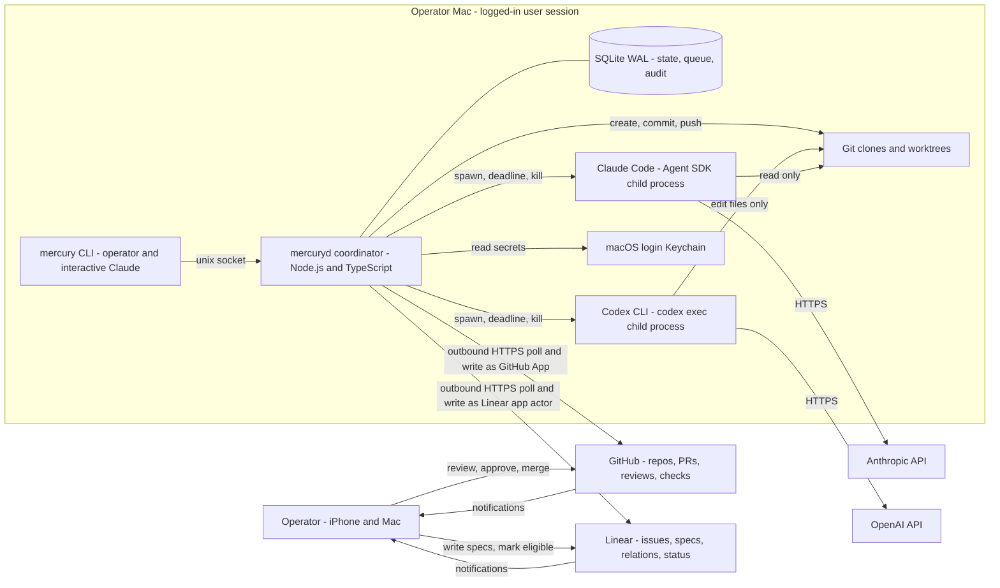
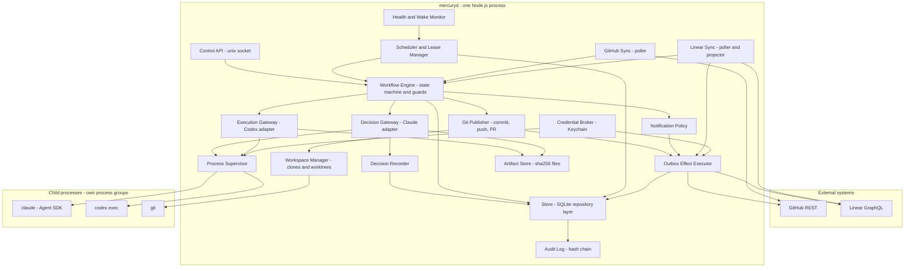
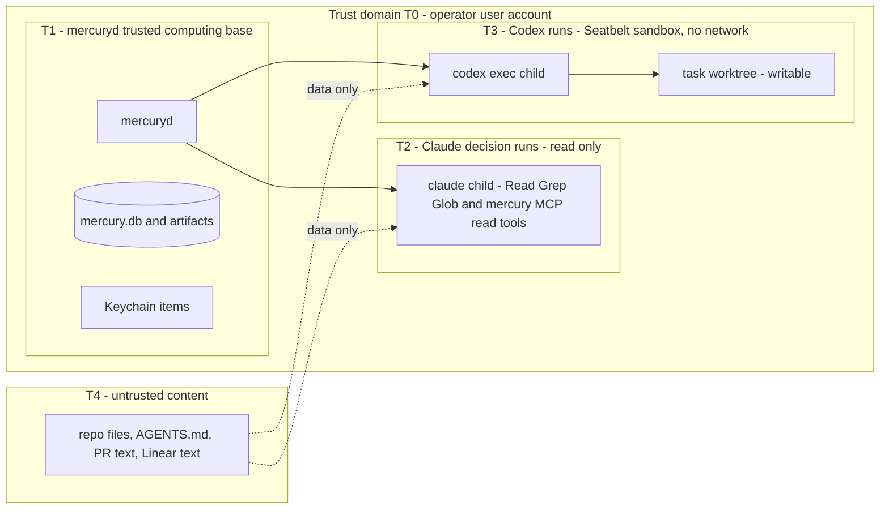
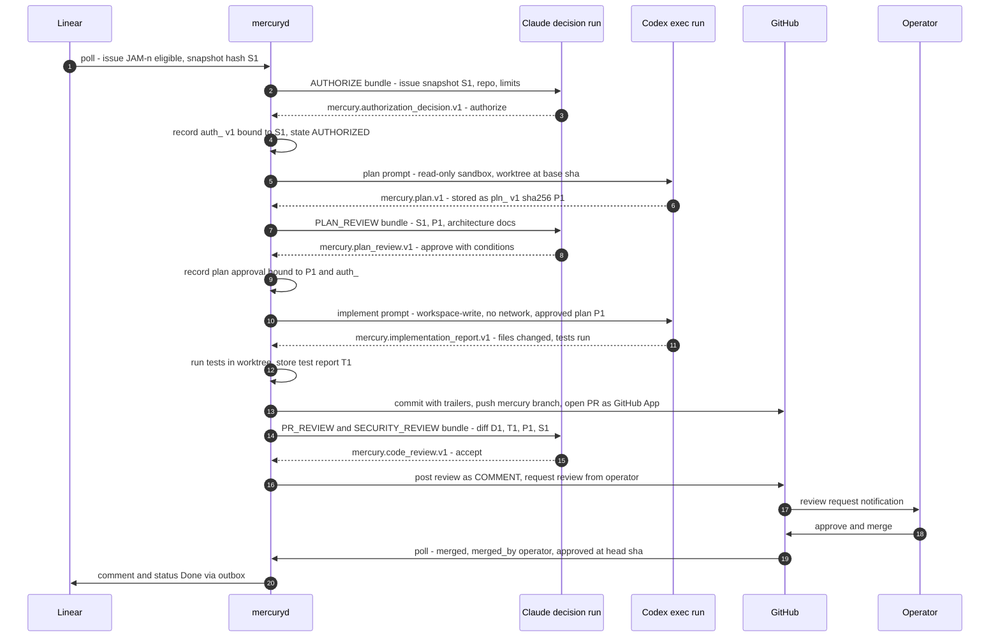

# MERCURY Architecture Overview

| | |
|---|---|
| Owner | Agent A (Principal AI Systems Architect) |
| Status | Phase 2 proposal. Input to TDD §6, §7, §25 and §26. Not yet reconciled with Agents B to F. |
| Date | 2026-10-12 |
| Related | [ADR index](#15-adr-index), `reviews/10-agent-A-report.md`, `reviews/03-design-baseline.md` |

Vocabulary follows `reviews/03-design-baseline.md`: state names, ID prefixes (`tsk_`, `auth_`, `run_`, `pln_`, `rev_`, `evt_`, `msg_`) and the message envelope. Agent C owns the detailed component design, state machine and message schemas. Agent B owns the per-integration contracts. Agent D owns launchd and recovery. Agent E owns the threat model. This document fixes the **boundaries, authority model and cross-cutting decisions** those documents refine.

Assumptions that depend on unverified Mac or tool behaviour are tagged `ASM-A-nn` and listed in [§16](#16-assumptions). Each needs a Phase 0 check.

---

## 1. Purpose and scope

MERCURY replaces the Slack channel `#network-monitor` and the shell scripts in `usjbro/network_monitor/coordination/scripts/` as the coordination layer between Claude Code and the Codex CLI. It runs on the operator's Mac as one supervised process, `mercuryd`.

The core boundary, from the brief, shapes every decision in this document:

| Role | Decides | Executes | Holds credentials for |
|---|---|---|---|
| **Claude** (decision role) | Which eligible issue to work on, whether to authorize it, whether a plan is acceptable, whether a PR is acceptable, security findings | Nothing outside its own read-only review session | Its own model API key only |
| **MERCURY** (`mercuryd`) | Nothing about *what* to build. It decides only *when* to ask, by following deterministic rules | Scheduling, process supervision, git, GitHub/Linear writes, audit | GitHub App key, Linear app token, agent API keys (brokered) |
| **Codex** (execution role) | How to implement an approved plan | Planning and code edits inside one sandboxed worktree | Its own model API key only |
| **Operator** (human) | Merge to protected branches; escalations; policy and limits | Merge clicks; configuration | Their own GitHub/Linear accounts. Never shared with MERCURY |

---

## 2. System context



Context rules:

1. **All network traffic is outbound** from the Mac. Nothing listens on a non-loopback interface. The only listener is a Unix domain socket with mode `0600` for the local CLI.
2. **The operator interacts only through GitHub and Linear**, plus the optional local CLI. MERCURY adds no dashboard and no new notification app (brief). GitHub review requests, @mentions and Linear notifications reach the iPhone through those vendors' apps.
3. **Agents never talk to GitHub or Linear.** Agent processes get no GitHub or Linear credentials. Every external write is made by `mercuryd` under a non-human app identity ([ADR-008](decisions/ADR-008-agent-identities-and-merge-governance.md)).

---

## 3. Architecture at a glance

| # | Decision | ADR |
|---|---|---|
| 1 | One long-running local daemon, Node.js 24 LTS + TypeScript, single OS process, single SQLite writer | [ADR-001](decisions/ADR-001-coordinator-runtime-and-language.md) |
| 2 | SQLite (WAL, `synchronous=FULL`, `fullfsync=ON`) is both the state store and the job queue. No broker | [ADR-002](decisions/ADR-002-sqlite-store-and-queue.md) |
| 3 | Hub-and-spoke: agents never communicate directly. The coordinator mediates every hand-off through versioned, content-hashed artifacts | [ADR-003](decisions/ADR-003-coordinator-mediated-agent-communication.md) |
| 4 | Claude is invoked by the coordinator as a **headless decision service** at defined decision points. It is not a long-running session driving the daemon | [ADR-004](decisions/ADR-004-claude-invocation-model.md) |
| 5 | Codex is invoked as a supervised `codex exec` subprocess: read-only sandbox for planning, workspace-write for implementation (provisional; Agent B owns detail) | [ADR-005](decisions/ADR-005-codex-invocation-model.md) |
| 6 | The coordinator, not Codex, performs `git commit`, `git push` and PR creation | [ADR-006](decisions/ADR-006-coordinator-owns-git-and-pr.md) |
| 7 | GitHub and Linear are polled (ETag, `updatedAt` cursors). No webhooks, no inbound ports | [ADR-007](decisions/ADR-007-polling-over-webhooks.md) |
| 8 | A dedicated GitHub App and a Linear `actor=app` app are the only agent identities. Human approval is enforced by CODEOWNERS + last-push approval. Org migration is the operator's choice | [ADR-008](decisions/ADR-008-agent-identities-and-merge-governance.md) |
| 9 | Linear is the system of record for **intent and specification**. The coordinator is the system of record for **execution state and authority**. GitHub is the system of record for **code and human approval** | [ADR-009](decisions/ADR-009-system-of-record-split.md) |
| 10 | `mercuryd` runs as a per-user launchd LaunchAgent (provisional; Agent D owns detail) | [ADR-010](decisions/ADR-010-launchd-launchagent.md) |
| 11 | Authorizations and approvals are immutable, hash-bound records that only a recorded Claude decision run can produce. Every dispatch re-verifies them | [ADR-011](decisions/ADR-011-authorization-records-and-verification.md) |
| 12 | Migration from the Slack workflow uses shadow mode, then an opt-in label pilot, then cutover. The two systems never manage the same issue | [ADR-012](decisions/ADR-012-migration-from-slack-workflow.md) |

---

## 4. Architectural principles

Each principle is testable. The verification column names the check that proves it holds. Agent F should map these to requirement IDs.

| ID | Principle | What it means in practice | Verification |
|---|---|---|---|
| **AP-1** | **Decide vs. execute separation** | Only Claude produces decisions (authorize, approve plan, accept PR). `mercuryd` contains no code path that creates a decision record without a matching successful Claude decision run. Codex never sees the decision interface | DB triggers reject a decision insert with no matching run ([§8.4](#84-authorization-record-integrity)); unit test greps that no module except `DecisionRecorder` imports the insert statement |
| **AP-2** | **Least authority per process** | Each child process gets the minimum: Claude has read-only tools and no shell; Codex has a sandboxed worktree and no network; neither has GitHub or Linear tokens | Contract tests: planted hook does not run; `env` of each child contains no `GITHUB_*` / `LINEAR_*` / app keys |
| **AP-3** | **Human approval is enforced by GitHub, not by MERCURY** | MERCURY never calls a merge endpoint, and GitHub protections make an agent `APPROVE` ineffective. MERCURY *detects* merges by anyone other than the operator | No `merge` function exists in the GitHub client (static test); merge-verification test with a forged `merged_by` raises a security alert |
| **AP-4** | **Durable before effect** | Every state transition is committed to SQLite **before** the side effect it triggers. Every external side effect goes through an outbox row with an idempotency key | Kill -9 at each step of the E2E test never yields a duplicate PR, comment or Codex run |
| **AP-5** | **Level-triggered reconciliation** | Control logic compares desired state (DB) with observed state (process table, git, GitHub, Linear) on every tick. It does not depend on catching individual events. Missed polls, sleep and restart are all handled by the same code | Recovery tests: restart at each state; sleep simulation |
| **AP-6** | **Immutable, content-addressed artifacts** | Plans, reviews, diffs, test reports and transcripts are stored once, named by SHA-256, and never changed. Approvals bind to hashes | Approval with a mismatched plan hash is rejected by the dispatch guard |
| **AP-7** | **External text is data, never instruction or authority** | Linear comments, issue bodies, PR comments, repository files and agent output are passed to agents as quoted, delimited data. No external text can change state except through a typed, validated field | Prompt-injection suite (Agent E) |
| **AP-8** | **Sleep is a pause, not a failure** | Agent-run deadlines use monotonic awake time. Human waits use wall clock. After wake, the coordinator reconciles before acting | Sleep-gap simulation test |
| **AP-9** | **Fail closed, escalate once** | Any unverifiable guard (missing record, hash mismatch, unknown external state) moves the task to `BLOCKED` with a reason code and produces exactly one human notification | Guard-failure tests; notification dedup test |
| **AP-10** | **Reconstructable, not re-derivable, authority** | GitHub and Linear carry back-references (`Mercury-Task`, `Mercury-Authorization` trailers and comment markers) so an observer can rebuild *what happened* if the DB is lost. Authority (authorizations, approvals) can never be rebuilt from them; after DB loss every in-flight task needs fresh Claude authorization | DB-loss drill |
| **AP-11** | **Boring, local, few moving parts** | One process, one file database, no broker, no container runtime, no inbound network. Each added component needs an ADR | Architecture review gate |
| **AP-12** | **Pinned, verified toolchain** | Node, Claude Code / Agent SDK, Codex and SQLite versions are pinned. `mercuryd` refuses to start dispatching if a startup self-test of required flags fails | Startup self-test in CI on the pinned versions |

---

## 5. Component architecture

### 5.1 Diagram



### 5.2 Component boundaries

Agent C owns the detailed interfaces in `architecture/components.md`. The boundary rules below are architectural and should not change without an ADR.

| Component | Responsibility | Owns (writes) | Must not |
|---|---|---|---|
| **Store** | Repository layer over SQLite. Transactions (`BEGIN IMMEDIATE`), migrations, integrity checks, backup | All tables | Be bypassed. No other module opens the DB file |
| **Workflow Engine** | Applies state transitions from the transition table. Evaluates guards. Writes the transition event and enqueues effects in **one transaction** | `tasks.state`, `events`, `jobs`, `outbox` | Call external APIs or spawn processes directly |
| **Scheduler and Lease Manager** | Ticks every 5 s (configurable). Claims due jobs with leases and fencing tokens. Enforces concurrency limits | `jobs.lease_*` | Make decisions; dispatch without a guard pass |
| **Decision Gateway** | Builds the context bundle for a Claude decision. Runs Claude through the Process Supervisor with the isolated profile. Validates `structured_output` against the schema | `agent_runs` (Claude), artifacts | Write decision records itself |
| **Decision Recorder** | The **only** writer of `authorizations`, `plan_approvals`, `reviews`. Creates them only from a validated, completed Claude decision run | Decision tables | Accept input from anywhere except Decision Gateway results |
| **Execution Gateway** | Builds the Codex prompt bundle. Runs `codex exec` for planning (read-only) and implementation (workspace-write). Parses JSONL. Stores plan, diff and test artifacts | `agent_runs` (Codex), artifacts | Run without a passing dispatch guard ([§8.5](#85-dispatch-guard)) |
| **Process Supervisor** | Spawns children detached in their own process group with a minimal `env`. Records pid, pgid and start time. Enforces deadlines (SIGINT → SIGTERM → SIGKILL). Reaps orphans at startup. Holds a `caffeinate -i -w` assertion while runs are active | `processes` | Pass secrets on argv |
| **Workspace Manager** | Maintains coordinator-owned clones and creates and removes linked worktrees per task. Runs diff guards (instruction files, protected paths, lockfiles) | Worktree directories | Touch the operator's own working clones |
| **Git Publisher** | Stages and commits Codex changes with trailers. Pushes with a short-lived App installation token. Opens and updates PRs. Requests the operator's review | Through Outbox | Merge; force-push to anything but `mercury/*` task branches |
| **GitHub Sync** | Polls PRs, reviews, checks, merge state with ETags. Turns observations into typed facts for the Workflow Engine | `gh_observations`, ETag cache | Write to GitHub |
| **Linear Sync** | Polls issues by `updatedAt` cursor. Snapshots specs (hash). Detects eligibility, edits, cancellation, foreign delegation. Projects coarse status and comments through the Outbox | `linear_issues`, `issue_snapshots`, cursors | Treat any Linear change as authorization |
| **Outbox Effect Executor** | Executes external writes at-least-once with idempotency keys and deterministic IDs. Records responses | `outbox.status`, `external_refs` | Run an effect whose task fence token is stale |
| **Notification Policy** | Decides *whether* to tell the human, deduplicated by `(task, kind, subject_version)`. Uses GitHub review requests and mentions and Linear comments as channels | `notifications` | Add a new channel without an ADR |
| **Artifact Store** | Writes immutable files under `artifacts/sha256/ab/cdef…`. Records metadata rows | `artifacts` | Overwrite |
| **Audit Log** | Appends a hash-chained record of every transition, decision, run, effect and operator command | `audit_log` | Allow update or delete (DB triggers) |
| **Credential Broker** | Reads secrets from the Keychain on demand. Mints GitHub App installation tokens (1 h). Hands each child only the variables it needs | In-memory only | Log, persist or pass secrets via argv |
| **Health and Wake Monitor** | Heartbeat row every tick. Detects sleep gaps (wall clock vs. monotonic). Checks network reachability. Triggers full reconcile after wake or restart | `heartbeats` | Fail tasks because of a gap |
| **Control API and `mercury` CLI** | Status queries, operator commands (pause, resume, cancel, retry, raise limits), and *requests* for Claude decisions | `operator_commands` | Create authorizations or approvals |

### 5.3 Process and trust domains



T1 is the trusted computing base. It is the same OS user as the operator ([§8.6](#86-how-much-does-authorization-integrity-matter)). T2 and T3 are constrained by tool allowlists (Claude) and Seatbelt (Codex). T4 content is never trusted.

### 5.4 Filesystem layout (provisional; Agent D owns)

All paths are outside TCC-protected folders (ASM-A-01).

```
~/Library/Application Support/Mercury/
  mercury.db, mercury.db-wal, mercury.db-shm        # 0600
  artifacts/sha256/<2>/<62>                         # immutable, 0400 once written
  runs/<run_id>/{prompt.md,input.json,output.json,events.jsonl,stderr.log}
  backups/mercury-<ts>.db
  run/mercuryd.sock                                 # 0600
  config/mercury.toml                               # no secrets
~/MercuryWork/
  clones/<owner>/<repo>/                            # coordinator-owned clone (not the operator's)
  worktrees/<repo>/<task_id>/                       # one linked worktree per task
~/Library/Logs/Mercury/mercuryd.jsonl
```

---

## 6. Process model and main loop

`mercuryd` is a single Node.js process with one event loop. Decision runs and execution runs are child processes. There is one SQLite connection for writes. Read-only connections are allowed for the CLI.

```text
every tick (5 s awake; immediately after wake or start):
  1. heartbeat(); if wakeGapDetected: mark "reconcile_full" due now
  2. reconcileProcesses()        # live pids vs processes table; orphans -> kill; dead runs -> RUN_LOST
  3. applyDueObservations()      # GitHub/Linear facts -> WorkflowEngine.apply(fact) (transactional)
  4. for job in claimDueJobs(limit by concurrency class):   # lease 120 s, fencing token++
       guard = WorkflowEngine.guard(job)                    # re-verify authority, hashes, deps, limits
       if !guard.ok: WorkflowEngine.block(job.task, guard.reason); continue
       start job (decision run | codex run | git publish | sync poll)
  5. drainOutbox(maxPerTick)    # idempotent external effects, honours retry-after
  6. enforceDeadlines()         # monotonic awake time for runs; wall clock for human waits
```

Concurrency classes and defaults (Agent C and D may tune):

| Class | Default max | Rationale |
|---|---|---|
| `codex_implement` | 1 | Shared `CODEX_HOME` safety unverified (ASM-A-05); laptop CPU and thermals |
| `codex_plan` | 1 | Same |
| `claude_decision` | 2 | Read-only, cheap to run in parallel |
| `git_publish` | 1 per repo | Serialised pushes per repo |
| `poll` | 1 per integration | GitHub guidance: serialise requests |
| per task | 1 active run of any kind | Duplicate prevention ([§10](#10-nonfunctional-requirements), NFR-REL-03) |

---

## 7. Agent communication pattern

### 7.1 Options evaluated

| Pattern | How it would work | Verdict | Reason |
|---|---|---|---|
| **Coordinator-mediated hub-and-spoke** (SQLite queue + subprocess calls + artifact files) | `mercuryd` invokes each agent with an input bundle and a JSON Schema for its output. It validates and stores the output as an artifact and decides the next step from the state machine | **Chosen** | One authoritative state per task; every hand-off is durable, typed, hashed and audited; agents need no credentials or knowledge of each other; works with the agents' most stable headless interfaces ([02-discovery-agent-runtimes §5](../reviews/02-discovery-agent-runtimes.md)) |
| Direct agent-to-agent via MCP | Claude calls Codex as an MCP tool, or the reverse | Rejected | `codex mcp-server` no longer exists in 0.162.1. `codex app-server` is experimental. `claude mcp serve` exposes tools, not Claude's judgement. Direct calls would also bypass the dispatch guard (AP-1) |
| MCP as a *read-only* lookup surface for Claude | In-process SDK MCP server `mercury` exposing `get_task`, `get_issue_snapshot`, `get_plan`, `get_diff_summary`, `get_test_report` | **Adopted as a sub-mechanism** inside decision runs | Lets Claude pull context on demand without filesystem access to the DB. Tools are read-only, so there is no write path |
| Shared files as the signal | Agents drop `plan.md` or gate files in the worktree and the other side polls for them | Rejected as a control channel; kept as artifact transport | This is today's failure mode: the 3.5 h "no plan received" gap, plans as "a file in a worktree mentioned in Slack" ([01-discovery-integrations](../reviews/01-discovery-integrations.md)). Files written by Codex are untrusted input until hashed and registered by the coordinator |
| Slack-like message bus (Slack, Matrix, local NATS or Redis pub/sub) | Agents publish and subscribe | Rejected | Recreates every documented Slack pain: lost replies, identity confusion, no single state. A bus adds a service without adding authority control |
| Local HTTP between agents | Each agent exposes an endpoint | Rejected | Agents are batch CLIs, not servers. Adds listeners for no gain |
| Linear comments as the channel | Agents talk through Linear comments | Rejected | Comments are writable by the human identity, the integration and Linear Agent. They cannot carry authority (AP-7). Rate limits apply |

**There is no direct agent-to-agent communication in MERCURY.** Claude and Codex never run in the same session, never share a tool, and never see each other's credentials. Codex receives Claude's plan-review findings and PR-review findings only as a coordinator-rendered, schema-validated revision request inside its next prompt.

### 7.2 Message flow

Every hand-off is a message with the baseline envelope (`schema`, `message_id`, `correlation_id`=`task_id`, `causation_id`, `dedup_key`, `occurred_at`, `issue`, `repo`, `run_id`). Messages are rows in `messages`, written in the same transaction as the state transition that produced them (transactional outbox). Agent C owns the schemas in `protocols/`.



---

## 8. Claude decision model and authorization integrity

### 8.1 Decision: coordinator invokes Claude as a headless decision service

The brief makes Claude the "primary orchestrator", and the coordinator the "continuously running" executor. These two statements conflict if "orchestrator" means "the process in charge of the loop". The discovery evidence settles which role can hold the loop:

- A Claude session cannot run through sleep, restart or logout. It also loses detail through context compaction, and the Slack workflow failed precisely because monitoring happened "only while a chat session is open" (discovery fact 12).
- A long-running Claude session driving the coordinator through a CLI or MCP tool surface would need **write tools** (authorize, dispatch). Claude would then be both decider and executor in one session that also reads untrusted repository content. Prompt injection could then cause dispatch.

**Decision ([ADR-004](decisions/ADR-004-claude-invocation-model.md)):** Claude holds the **authority**, `mercuryd` holds the **loop**. At each decision point the coordinator starts a fresh, isolated, schema-constrained Claude run with a complete context bundle. Claude's verdict is the only input that can move a task across a decision boundary. The coordinator never substitutes its own judgement: when a decision is needed and Claude cannot be reached, the task waits (and escalates after a timeout). It never proceeds.

An interactive Claude Code session that the operator has open may use the `mercury` CLI to **read** status and to **request** a decision (`mercury request authorize JAM-123 --note "…"`). The request enqueues a normal decision run. The interactive session itself cannot create an authorization. This keeps the conversational experience without a second authority path.

### 8.2 Decision points

| Decision kind | Trigger (deterministic) | Input bundle (all hashed) | Output schema | Effect if accepted |
|---|---|---|---|---|
| `TRIAGE` | Eligible set changed (debounced 2 min) **and** free capacity | Eligible issue summaries, relations, labels, in-flight tasks | `mercury.triage.v1`: ranked shortlist + reasons; no authority | Enqueue `AUTHORIZE` for the top *k* (k = free slots) |
| `AUTHORIZE` | Shortlisted by triage, or operator request through CLI | Full issue snapshot (spec, AC, comments as quoted data), relations, repo facts, policy limits | `mercury.authorization_decision.v1`: `authorize` / `decline` / `needs_spec` + scope + limits | `authorizations` row v*n*; task → `AUTHORIZED` |
| `PLAN_REVIEW` | Plan artifact registered | Snapshot, plan, architecture and security docs at base SHA, prior reviews | `mercury.plan_review.v1`: `approve` / `revise` / `escalate`, findings, conditions | `plan_approvals` row bound to plan hash, or revision request |
| `PR_REVIEW` | PR opened or updated, local checks done | Snapshot, approved plan, diff, test report, CI results | `mercury.code_review.v1` | Review posted as `COMMENT`/`REQUEST_CHANGES`; human review requested or revision request |
| `SECURITY_REVIEW` | `Security` label, or diff touches security-sensitive paths, or PR_REVIEW flags it | Same as PR_REVIEW + security checklist | `mercury.security_review.v1` | Findings; `critical` → escalate to human |
| `FAILURE_TRIAGE` | Run failed after automatic retries, or guard block with recoverable reason | Failure evidence | `mercury.failure_decision.v1`: `retry` / `replan` / `escalate` / `cancel` (`retry` cannot raise limits) | Corresponding transition |

### 8.3 Authorization record

Owned conceptually here, schema detail by Agent C. Every field is immutable. Revocation and supersession are new rows.

```ts
interface AuthorizationRecord {
  auth_id: string;                 // auth_<ULID>
  version: number;                 // 1..n per task; v(n+1) supersedes v(n)
  supersedes?: string;             // previous auth_id
  task_id: string;                 // tsk_<ULID>
  issue: { id: string; identifier: string; snapshot_sha256: string; updated_at: string };
  repo: { full_name: string; base_branch: string; base_sha_at_auth: string };
  scope: {
    phases: Array<"plan" | "implement">;   // both by default
    out_of_scope?: string[];                // Claude-written constraints, rendered to Codex as data
    requires_security_review: boolean;
  };
  limits: {
    max_plan_revisions: number;      // default 3
    max_pr_revisions: number;        // default 3
    max_codex_awake_minutes: number; // per run, default 60
    max_codex_tokens?: number;
    expires_at: string;              // wall clock; default authorized_at + 7 d
  };
  decision: {
    run_id: string;                  // Claude decision run that produced it
    claude_session_id: string;
    model: string;
    prompt_template: { id: string; sha256: string };
    input_bundle_sha256: string;
    output_sha256: string;           // sha256 of the validated structured_output
    transcript_sha256: string;       // sha256 of events.jsonl
    rationale_summary: string;
  };
  recorded_at: string;
  record_mac: string;                // HMAC-SHA256 over canonical JSON (key in Keychain)
}
```

Plan approvals have the same `decision` block and bind to `{ auth_id, plan_id, plan_sha256 }`. A plan revision creates a new `pln_` version with a new hash, so an earlier approval can never match it (brief hard constraint).

### 8.4 Authorization record integrity

Layered controls against a fabricated or mismatched authorization. They are ordered by what they defend against.

| # | Control | Defends against | Enforcement |
|---|---|---|---|
| 1 | **Single writer module.** Only `DecisionRecorder.recordFrom(run)` can insert into `authorizations` and `plan_approvals` | Code bugs that create records on other paths | Code structure + lint rule + unit test |
| 2 | **SQLite triggers** reject an insert unless a row in `agent_runs` exists with `agent='claude'`, matching `decision_kind`, `status='succeeded'`, and `output_sha256` equal to the record's. Triggers reject `UPDATE` and `DELETE` on decision tables | Bugs in any module, including the Recorder | Database (software) |
| 3 | **Hash binding.** Records carry the issue snapshot, plan, input bundle, output and transcript hashes. Artifacts are immutable files | Silent mismatch between what Claude saw and what runs | Dispatch guard re-hashes |
| 4 | **HMAC** with a Keychain-held key over canonical JSON | Other local processes that can write the DB file but cannot read the Keychain item (e.g. a sandboxed Codex that escaped its worktree but not Seatbelt) | Crypto (software); ASM-A-06 |
| 5 | **Hash-chained audit log**: each entry stores `prev_hash`. Daily verification and on startup | After-the-fact tampering with history | Detective |
| 6 | **Back-references outside the Mac**: PR body and commit trailers carry `auth_id`, `pln_` hash, `run_id`; a Linear comment records the authorization summary | Rewriting local history without trace | Detective (external copy) |
| 7 | **Filesystem placement**: DB and artifacts outside every Codex writable root; Claude has no write tools | Agent tampering | Seatbelt + tool allowlist |

### 8.5 Dispatch guard

Executed inside the transaction that claims a Codex job (pseudocode; Agent C owns the full guard catalogue).

```text
guardCodexDispatch(task, job):
  a = latestActiveAuthorization(task)               # not revoked, not superseded
  require a and a.task_id == task.id and a.repo == task.repo
  require now_wall < a.limits.expires_at
  require verifyHmac(a) and triggerChainOk(a.decision.run_id)
  require sha256(issueSnapshot(a.issue.snapshot_sha256)) == a.issue.snapshot_sha256
  require linearLatestSnapshotHash(task) == a.issue.snapshot_sha256   else BLOCKED(spec_changed)
  require job.phase in a.scope.phases
  if job.phase == "implement":
     p = planApproval(task, job.plan_id)
     require p and p.auth_id == a.auth_id and p.plan_sha256 == sha256(artifact(job.plan_id))
  require noActiveRun(task)                          # also a unique partial index
  require dependenciesSatisfied(task)                # Linear blockedBy all Done or verified merged
  require revisionCount(task, job.phase) <= limit    else BLOCKED(revision_limit) -> escalate
```

### 8.6 How much does authorization integrity matter?

`mercuryd`, the operator's shell and the DB file all live in one OS user account. Anything that can run arbitrary code as that user can also edit `mercuryd`'s code, read the Keychain item after unlock, and forge a record. Cryptography inside one trust domain **cannot** stop a compromised coordinator. The design states this honestly and puts the weight elsewhere:

1. **The real backstop is GitHub.** Even a forged authorization only leads to code on a `mercury/*` branch and a PR. Nothing reaches a protected branch without the operator's code-owner approval of the latest push ([§12](#12-github-governance-for-a-personal-account)). The worst case of a forged authorization is wasted compute and an unwanted PR, not unreviewed code on `main`.
2. **The integrity controls target the realistic failures**: coordinator bugs (a second start path such as "Linear moved to Todo → dispatch"), a confused-deputy agent writing files, and audit questions ("which authorization permitted this run?"). Controls 1 to 3 in [§8.4](#84-authorization-record-integrity) are cheap and handle these fully.
3. **HMAC (control 4) is optional hardening.** It is worth adding only because the Keychain read is already needed for other secrets. Recommend implementing it in Milestone 2, not the MVP, and dropping it if ASM-A-06 shows Codex's Seatbelt profile cannot write outside the worktree anyway.
4. **Stronger separation is possible but not recommended now**: running `mercuryd` under a separate macOS user would put the DB out of reach of the operator account's other processes, but it loses the login Keychain and GUI-session LaunchAgent semantics (ASM-A-02). Record as a future option.

---

## 9. System of record and reconciliation

### 9.1 System-of-record table

| Data | System of record | Copies held by | Sync direction | Who may write the SoR |
|---|---|---|---|---|
| Issue existence, title, description/spec, AC checkboxes, labels, priority, project | **Linear** | Coordinator: hashed snapshots per authorization | Linear → coordinator (poll) | Operator. Claude may *propose* spec edits only as a comment through the outbox (`needs_spec` decision) |
| Issue relations (`blocks`/`blockedBy`, parent) | **Linear** | Coordinator dependency cache | Linear → coordinator | Operator |
| Eligibility signal (human intent to have MERCURY consider an issue) | **Linear** (state `Todo` + label `mercury`, without `Not Speced`) | Coordinator `eligible` flag | Linear → coordinator | Operator |
| Authorization, scope, limits, revocation | **Coordinator** | Linear comment + PR trailer (reference only) | Coordinator → Linear/GitHub (one-way, informational) | Claude decision run via Decision Recorder; revocation also by operator CLI |
| Task workflow state (18 states), runs, retries, leases, deadlines | **Coordinator** | Linear coarse status projection; PR labels | Coordinator → Linear | Workflow Engine |
| Plan versions, plan approvals, Claude reviews, security findings, test reports, transcripts | **Coordinator** (artifact store) | PR review comment text; Linear summary comment | Coordinator → GitHub/Linear | Decision Recorder / Execution Gateway |
| Code, branches, commits | **GitHub** (remote) | Coordinator clones and worktrees | Bidirectional: coordinator pushes `mercury/*` branches; observes everything else | Coordinator (task branches only); operator (anything) |
| PR existence, metadata, check results, mergeability | **GitHub** | Coordinator observation cache | GitHub → coordinator, except coordinator creates and updates its PRs | Coordinator via App; GitHub Actions; operator |
| Human approval and merge | **GitHub** (review `APPROVED` by operator at head SHA; `merged_by`) | Coordinator merge verification record | GitHub → coordinator only | **Operator only** |
| Linear status of MERCURY-managed issues | **Coordinator** (projection owner) | — | Coordinator → Linear; Linear changes are *observed as signals* | Coordinator; operator overrides are signals ([§9.3](#93-conflict-handling)) |
| Operator commands (pause, cancel, limits) | **Coordinator** (`operator_commands`) | Audit log | CLI → coordinator | Operator via local socket |
| Secrets | **macOS Keychain** | Coordinator memory only | — | Operator at setup |

Linear status projection (Agent B owns final mapping):

| Coordinator states | Linear state |
|---|---|
| DISCOVERED, AWAITING_AUTHORIZATION | unchanged (`Todo`) |
| AUTHORIZED … CHANGES_REQUESTED, BLOCKED | `In Progress` |
| AWAITING_HUMAN_APPROVAL | `In Review` |
| MERGED → COMPLETED | `Done` (after merge verification) |
| CANCELLED | unchanged; comment only. MERCURY never cancels a Linear issue |
| FAILED | `In Progress` kept; escalation comment |

Linear's native GitHub integration also moves status on PR events. MERCURY's projection is **idempotent and monotonic**: it never moves an issue backwards, and it treats the integration's `In Review`/`Done` writes as consistent if they are "ahead" of its own view. Verification is still the coordinator's job ([ADR-009](decisions/ADR-009-system-of-record-split.md)). Use the non-closing PR phrase `Part of JAM-n` so that the coordinator, not the integration, closes the issue after verification (ASM-A-07).

### 9.2 Reconciliation rules

1. **Inbound only changes facts, never authority.** Linear and GitHub observations update caches and can *stop*, *pause* or *invalidate* work. They can never *start* or *approve* it.
2. **Outbound is a projection.** Coordinator writes to Linear and GitHub are idempotent (deterministic IDs, comment markers `<!-- mercury:{dedup_key} -->`), retried by the outbox, and compared after write.
3. **Full reconcile** runs at startup, after a wake gap > 60 s, and every 15 minutes. It re-reads every non-terminal task's external objects with ETags.
4. **No silent overwrite of human edits.** If the operator changed something MERCURY projects, MERCURY records the conflict, does not revert it, and takes the action in §9.3.

### 9.3 Conflict handling

| # | Disagreement | Detection | Resolution |
|---|---|---|---|
| C1 | Spec changed after authorization (snapshot hash differs) | Linear Sync | Before the next phase boundary: task → `BLOCKED(spec_changed)`, enqueue `AUTHORIZE` with the diff. Claude re-authorizes (new version, supersedes) or declines. A running Codex run finishes but its output is not acted on until re-authorized |
| C2 | Issue moved to `Canceled` or `Duplicate` | Linear Sync | Cancel: SIGTERM active runs, task → `CANCELLED`, PR left open with a comment for the operator to close. Status changes can always *stop* work |
| C3 | Issue moved back to `Backlog` or `Todo` while in flight, or `mercury` label removed | Linear Sync | Treat as pause: task holds at the next phase boundary in `BLOCKED(deprioritized)`. One notification. Resume needs the label back plus `mercury resume` or Claude re-authorization if expired |
| C4 | Linear shows `Done` but the coordinator has not verified a merge | Linear Sync + GitHub Sync | Verify on GitHub. If merged: proceed to merge verification. If not: record conflict, do not revert, task → `BLOCKED(external_state_conflict)`, one notification |
| C5 | A new blocker relation added to an authorized task | Linear Sync | Hold before the next dispatch in `BLOCKED(dependency)`. Auto-resume when the blocker is Done and merge-verified |
| C6 | PR closed without merge | GitHub Sync | If closed by the operator: task → `CANCELLED` (reason `pr_closed_by_human`). If closed by anyone else: `BLOCKED(security_review)` + security notification |
| C7 | Commits pushed to the task branch by anyone other than the coordinator (head SHA ≠ last pushed SHA) | GitHub Sync | Prior Claude review invalidated. Task → `BLOCKED(foreign_push)`. Operator chooses via CLI: adopt (Claude re-reviews) or reset (force-push the coordinator's SHA to the `mercury/*` branch) |
| C8 | PR merged by an identity other than the operator, or without the operator's approval at the merged head | Merge verification | `MERGED` with `verification=failed`, security notification at highest priority, Linear not moved to Done by MERCURY |
| C9 | Linear-native delegation or a Coding session started on a MERCURY-managed issue (`delegate` set to a non-MERCURY agent) | Linear Sync | Task → `BLOCKED(foreign_agent)`. MERCURY refuses to dispatch until the delegation is removed. One notification |
| C10 | Coordinator DB lost or corrupt | Startup integrity check | Restore the latest backup (≤ 24 h old). Reconcile forward from GitHub/Linear back-references. Every in-flight task whose authority cannot be verified from the restored DB → `BLOCKED(reauthorization_required)` (AP-10) |

---

## 10. Nonfunctional requirements

Targets apply when the Mac is awake, the operator is logged in, and the network is up, unless stated. Agent F assigns final requirement IDs; these IDs are proposals.

| ID | Category | Requirement | Target | How measured |
|---|---|---|---|---|
| NFR-LAT-01 | Latency | Claude authorization recorded → Codex planning process started | p95 ≤ 30 s, max ≤ 120 s (slot free, clone exists) | `agent_runs.started_at − authorizations.recorded_at` |
| NFR-LAT-02 | Latency | Plan approval recorded → Codex implementation started | p95 ≤ 30 s, max ≤ 120 s | Same method |
| NFR-LAT-03 | Latency | Issue becomes eligible in Linear → detected by MERCURY | p95 ≤ 2 min, max ≤ 5 min | `linear_issues.observed_at − updatedAt` |
| NFR-LAT-04 | Latency | Claude PR acceptance → operator review requested on GitHub | max ≤ 2 min | outbox completion − review recorded |
| NFR-LAT-05 | Latency | Human merge → merge verified and Linear updated | p95 ≤ 5 min | `verified_at − merged_at` |
| NFR-REL-01 | Recovery | `mercuryd` crash → scheduler running with all non-terminal tasks reconciled | ≤ 60 s for ≤ 50 non-terminal tasks (launchd throttle 10 s included) | Fault-injection test |
| NFR-REL-02 | Recovery | Login after reboot or wake from sleep → full reconcile done | ≤ 2 min after network reachable | Health monitor log |
| NFR-REL-03 | Duplicates | Duplicate executions: two concurrently active agent runs for one task, or two runs with the same `(task, phase, attempt)` | **0** under any crash, restart, sleep or duplicate-event sequence | Unique partial index + chaos test of 1,000 randomized kill points |
| NFR-REL-04 | Duplicates | Duplicate external side effects (PRs per task, comments per `dedup_key`, review requests per head SHA) | **0** | Same chaos test, external fakes count writes |
| NFR-REL-05 | Durability | Committed state transitions lost after power loss or kernel panic | **0** (`synchronous=FULL`, `fullfsync=ON`) | Power-cut simulation in Phase 0 hardware test (ASM-A-03) |
| NFR-REL-06 | Stall detection | Run exceeding its awake-time deadline, or task in a non-human-wait state with no progress, is detected | within 2 ticks (≤ 10 s) of the deadline | Deadline test |
| NFR-REL-07 | Sleep | Tasks failed solely because the Mac slept | **0** | Sleep simulation (clock skew injection) |
| NFR-AUD-01 | Audit | Codex runs traceable to an authorization version, a Linear snapshot hash and (for implement) an approved plan hash | **100 %** | Nightly audit query; must return zero orphans |
| NFR-AUD-02 | Audit | State transitions with an audit entry containing actor, cause, evidence refs | **100 %**; hash chain verifies | Startup + daily chain check |
| NFR-AUD-03 | Audit | The 10 audit questions in brief §I answerable from DB + artifacts by one CLI command (`mercury trace <task>`) | All 10 | Acceptance test |
| NFR-AUD-04 | Retention | Audit log and decision artifacts retained | ≥ 1 year; transcripts ≥ 90 days | Retention job |
| NFR-SEC-01 | Security | Secrets in logs, artifacts, argv, plist | **0** occurrences (redaction scanner over all outputs in CI) | Canary-secret test |
| NFR-SEC-02 | Security | Agent child processes holding GitHub or Linear credentials | **0** | `env` assertion test per spawn |
| NFR-SEC-03 | Security | Merges to a protected branch without operator approval at the merged head | **0 possible** (preventive); 100 % of non-operator merges alerted within 5 min (detective) | Unauthorized-merge test on a sandbox repo |
| NFR-NOT-01 | Notifications | Duplicate human notifications for the same `(task, kind, subject_version)` | **0** | Dedup test |
| NFR-NOT-02 | Notifications | Human-facing notifications per task, happy path | ≤ 2 (review request; merge done) | E2E count |
| NFR-RES-01 | Resources | `mercuryd` idle footprint | RSS ≤ 200 MB, CPU < 1 % average | Activity Monitor sampling |
| NFR-RES-02 | API budget | GitHub non-304 requests | ≤ 1,500/h (30 % of 5,000) | Rate-limit header logging |
| NFR-RES-03 | API budget | Linear requests | ≤ 500/h (20 % of current API-key limit) | Same |
| NFR-AVL-01 | Availability | `mercuryd` up while user logged in and awake | ≥ 99.5 % | Heartbeat gaps not explained by sleep |
| NFR-MNT-01 | Maintainability | Pinned-toolchain self-test runtime at startup | ≤ 15 s | Startup log |
| NFR-COST-01 | Cost | Per-task agent spend capped | Claude: `maxBudgetUsd` per decision (default 5 USD); Codex: token cap per run. Exceeding → `BLOCKED(budget)` | Run records |

---

## 11. Technology selection matrix

### 11.1 Criteria and weights

| Code | Criterion | Weight | Why this weight |
|---|---|---|---|
| C1 | Fit with the agent SDKs (official Claude Agent SDK, Codex SDK/JSONL types) | 15 | The Claude Agent SDK gives the strongest in-process controls (`canUseTool`, hooks, `outputFormat`, `interrupt`) and is TypeScript- and Python-only |
| C2 | Durability and crash-recovery semantics | 15 | Restart recovery and zero duplicates are hard requirements |
| C3 | Operational footprint on one Mac (processes, services, upgrades) | 15 | Single operator, laptop, no ops team |
| C4 | Fit with no-inbound, sleep-prone, local-first operation | 10 | Hard constraint |
| C5 | Security and enforceability of the authority model | 15 | Hard constraints on authorization and approval |
| C6 | Testability and determinism (state machine, fakes, chaos) | 10 | Brief §J |
| C7 | Implementability and maintainability (by the operator and coding agents) | 10 | MERCURY will itself be built by Claude and Codex |
| C8 | Supply-chain surface | 5 | Security |
| C9 | GitHub and Linear client ecosystem | 5 | Integration effort |

### 11.2 Scores (1 = poor, 5 = excellent)

| Option | C1 | C2 | C3 | C4 | C5 | C6 | C7 | C8 | C9 | **Weighted (max 5.00)** |
|---|---|---|---|---|---|---|---|---|---|---|
| **A. Node.js 24 + TypeScript daemon, SQLite** | 5 | 4 | 5 | 5 | 4 | 4 | 4 | 3 | 5 | **4.40** |
| B. Python 3.12 daemon, SQLite | 4 | 4 | 4 | 5 | 4 | 4 | 4 | 3 | 4 | 4.05 |
| C. Go single binary, SQLite | 2 | 4 | 5 | 5 | 4 | 4 | 3 | 4 | 3 | 3.80 |
| D. Temporal (self-hosted) + TS worker | 5 | 5 | 2 | 3 | 3 | 4 | 2 | 2 | 5 | 3.50 |
| E. Redis + BullMQ + Node | 5 | 3 | 3 | 4 | 3 | 2 | 3 | 3 | 5 | 3.40 |
| F. GitHub-Actions-hosted coordinator | 3 | 3 | 4 | 1 | 2 | 3 | 3 | 3 | 5 | 2.90 |
| G. Linear as the state store (stateless coordinator) | 4 | 2 | 4 | 3 | 1 | 2 | 3 | 4 | 4 | 2.85 |
| H. Claude-session-driven loop, no daemon | 4 | 1 | 5 | 2 | 1 | 1 | 4 | 4 | 4 | 2.75 |

Weighted = Σ(weight × score) / 100.

### 11.3 Notes per option

| Option | Deciding factors |
|---|---|
| A | Native, typed Claude Agent SDK; Codex SDK `.d.ts` usable as the JSONL contract; `node:sqlite` built in (RC in Node 24, wrap behind an interface with `better-sqlite3` fallback). One runtime for coordinator, CLI and tests. Weakness: npm supply chain (mitigate with lockfile, `npm ci --ignore-scripts` where possible, pinned versions, minimal dependencies) |
| B | Python Agent SDK exists and SQLite is in the standard library. Loses on Mac runtime management (venv, Python version drift under launchd) and on a slightly thinner GitHub/Linear typed-client story. A close second; choose B only if the operator strongly prefers Python |
| C | Best footprint (one static binary, no runtime). No official Claude Agent SDK, so Claude would be driven through `claude -p` only and lose `canUseTool` and in-process hooks. Revisit if the SDK advantage proves unnecessary in Phase 0 |
| D | Excellent durable-execution semantics, but a Temporal server (plus its persistence) is a second long-running service on a laptop, and the workflow determinism rules add a learning burden. Durable timers do not help while the Mac sleeps, since workers are suspended anyway. Over-engineered for ≤ 3 concurrent tasks |
| E | Two stores (Redis for the queue, something else for audit) break single-transaction "state + effect" semantics. Redis durability needs `appendfsync always` tuning. Adds a service |
| F | Inverts locality: Actions runners cannot reach the Mac, so agents would run in GitHub's cloud with secrets in a **public** repo's Actions. Scheduled workflows are best-effort. Violates "locally hosted" |
| G | Linear has no transactions, leases or compare-and-swap. Its fields are writable by the operator identity, the GitHub integration and Linear Agent, so authorizations stored there are forgeable. Rate limits make tight loops impossible |
| H | Reproduces the Slack-era failure: progress only while a session is open. Claude would need execution tools and credentials, merging decide and execute. No durable state machine |

**Sensitivity.** If C1 drops to weight 5 (say Phase 0 shows the CLI is enough for Claude) and the result is renormalised, A scores 4.33, B 4.06 and C 4.00. A still leads. Python (B) stays within 0.4 of A under every weighting tried; it is the recommended fallback.

---

## 12. GitHub governance for a personal account

Discovery fact 4: target repositories belong to the personal account `usjbro`. Collaborators always have write. Push restrictions and bypass lists are organization-only. Full analysis in [ADR-008](decisions/ADR-008-agent-identities-and-merge-governance.md).

| Option | "Human approves" | "Only human merges" | Cost | Recommendation |
|---|---|---|---|---|
| **G-1. Stay personal; GitHub App identity; protections** (PR required, ≥ 1 approval, Code Owner review with `CODEOWNERS: * @usjbro`, approval of most recent push, dismiss stale approvals, strict required checks, no force push, "Do not allow bypassing", Actions-approve OFF) | **Preventive** (software-enforced) | **Detective**: the App holds `contents:write` and could merge after the human approves. Merge verification alerts within 5 min. `mercuryd` has no merge function | Lowest; one App to create | **MVP default** |
| **G-2. Transfer target repos to a free GitHub organization** + G-1 + "Restrict who can push to matching branches" = operator only (merges count as pushes) | Preventive | **Preventive** | Org admin surface; repo transfer (redirects keep URLs working; Linear integration must be re-pointed: ASM-A-08) | **Recommended target** before running unattended overnight on repos with sensitive code |
| G-3. Machine-user collaborator instead of App | Preventive only with CODEOWNERS + last-push | Detective | Needs a classic PAT (fine-grained PATs do not cover collaborator repos); second account | Reject |
| G-4. Human's own token for MERCURY | **None**: agent PRs authored as the human cannot be approved by the human, and the token can merge as admin | None | — | Reject (this is today's state and must end) |

Residual risk under G-1: a compromised `mercuryd` could merge **only a PR the operator already approved at its current head SHA**. The impact is timing, not content. That is acceptable for the MVP if the operator agrees (operator decision OD-A-01).

---

## 13. Migration from the Slack and script workflow

Summary; detail in [ADR-012](decisions/ADR-012-migration-from-slack-workflow.md).

| Stage | MERCURY does | Slack/scripts do | Exit criteria |
|---|---|---|---|
| M0 Inventory | Phase 0 reads `network_monitor` scripts, gate formats, `.ai/` state, `AGENTS.md` (read-only) | Unchanged | Inventory documented; conventions to keep listed |
| M1 Shadow | Polls Linear and GitHub, runs `TRIAGE` and `AUTHORIZE` in **dry-run** (records `would_authorize`, no Codex, no external writes) | Unchanged; remain authoritative | 2 weeks; ≥ 90 % agreement between Claude dry-run decisions and actual gate approvals; zero crashes |
| M2 Pilot | Manages only issues labelled `mercury` in one repo; full lifecycle | Must not touch `mercury` issues: MERCURY refuses an issue with an existing `.worktrees/<slug>`, gate or open non-`mercury/*` PR | 10 tasks completed; 0 duplicates; 0 unauthorized runs; operator satisfied with notification volume |
| M3 Cutover | All eligible issues in the team; `mercury` label becomes the default eligibility marker | Slack posting disabled; Slack bot token revoked and rotated (it has leaked before); scripts kept for manual use only | 30 days stable |
| M4 Decommission | — | Scripts removed via a PR in `network_monitor`; channel archived | — |

Rollback at any stage: `mercury pause --all` stops new dispatch; in-flight tasks finish or block; the Slack workflow resumes on non-`mercury` issues. The two systems never manage the same issue.

---

## 14. Key tradeoffs

| # | Chose | Over | Gain | Give up |
|---|---|---|---|---|
| T1 | Claude as per-decision headless service | Long-running Claude session as orchestrator | Works through sleep and restart; least privilege; each decision fully recorded and reproducible | Claude has no conversational memory across decisions; context must be rebuilt (more tokens per decision) |
| T2 | Polling | Webhooks via relay | No inbound surface, no third party | Up to ~60 s latency; API budget used |
| T3 | Coordinator does git and PR | Codex commits and opens PRs | Agents hold no GitHub credentials; consistent trailers; works with Codex `.git` protection | More coordinator code; Codex cannot create granular commits (one commit per implementation round) |
| T4 | SQLite as queue | Broker or workflow engine | Single-transaction state + effect; one file to back up | Single host, single writer; no horizontal scale (not needed) |
| T5 | Personal-account G-1 for MVP | Mandatory org migration | Faster start; no repo transfer | "Human clicks merge" is detective until G-2 |
| T6 | One daemon process | Separate worker processes | Simpler supervision and locking | A coordinator bug can stall everything; mitigated by launchd restart and per-run child isolation |
| T7 | Fresh Claude session per decision | Resumed Claude session per task | Isolation from prior injected content; reproducible input bundle | Re-reads context each time (cost) |
| T8 | Linear projection monotonic and lenient | Coordinator forces Linear to mirror exactly | No fights with the operator or the GitHub integration | Linear can briefly show a status the coordinator has not verified |

---

## 15. ADR index

| ADR | Title | Status |
|---|---|---|
| [ADR-001](decisions/ADR-001-coordinator-runtime-and-language.md) | Coordinator runtime and language: Node.js 24 LTS + TypeScript | Proposed |
| [ADR-002](decisions/ADR-002-sqlite-store-and-queue.md) | SQLite as durable store and job queue | Proposed |
| [ADR-003](decisions/ADR-003-coordinator-mediated-agent-communication.md) | Coordinator-mediated agent communication; no direct agent-to-agent channel | Proposed |
| [ADR-004](decisions/ADR-004-claude-invocation-model.md) | Claude invoked as a headless decision service | Proposed |
| [ADR-005](decisions/ADR-005-codex-invocation-model.md) | Codex invoked as supervised `codex exec` (provisional) | Proposed |
| [ADR-006](decisions/ADR-006-coordinator-owns-git-and-pr.md) | Coordinator owns commit, push and PR creation | Proposed |
| [ADR-007](decisions/ADR-007-polling-over-webhooks.md) | Outbound polling instead of webhooks | Proposed |
| [ADR-008](decisions/ADR-008-agent-identities-and-merge-governance.md) | Agent identities and merge governance | Proposed |
| [ADR-009](decisions/ADR-009-system-of-record-split.md) | Linear for spec and intent; coordinator for execution and authority; GitHub for code and approval | Proposed |
| [ADR-010](decisions/ADR-010-launchd-launchagent.md) | launchd per-user LaunchAgent (provisional) | Proposed |
| [ADR-011](decisions/ADR-011-authorization-records-and-verification.md) | Immutable, hash-bound authorization and approval records | Proposed |
| [ADR-012](decisions/ADR-012-migration-from-slack-workflow.md) | Migration from the Slack and script workflow | Proposed |

---

## 16. Assumptions

| ID | Assumption | Verify in Phase 0 by |
|---|---|---|
| ASM-A-01 | The operator's repositories and MERCURY's paths can live outside `~/Documents`, `~/Desktop`, `~/Downloads`, so no TCC prompts occur for a LaunchAgent `node` | Check repo locations; run a LaunchAgent test job writing to `~/MercuryWork` |
| ASM-A-02 | A per-user LaunchAgent can read Keychain items created with `-T` for the `node` binary or `/usr/bin/security` without prompts after login | Test `security find-generic-password` from a LaunchAgent |
| ASM-A-03 | `PRAGMA fullfsync=ON` with `synchronous=FULL` gives acceptable write latency (< 20 ms per commit) on the operator's SSD | Benchmark 1,000 small transactions |
| ASM-A-04 | `process.hrtime` (monotonic) does not advance during macOS sleep, so awake-time deadlines can be measured with it | Sleep the Mac 5 min while logging both clocks |
| ASM-A-05 | Concurrent `codex exec` runs sharing one `CODEX_HOME` are unsafe or unproven; default concurrency 1 | Agent B Phase 0 test |
| ASM-A-06 | Codex in `workspace-write` cannot write to `~/Library/Application Support/Mercury/` | Seatbelt write probe from a Codex run |
| ASM-A-07 | Linear's GitHub integration with the non-closing phrase `Part of JAM-n` does not move the issue to `Done` on merge, while branch-name linking still attaches the PR | Test on a scratch Linear issue |
| ASM-A-08 | Transferring a repo to an organization keeps the Linear GitHub integration and existing PR links working after re-authorizing the integration | Linear docs + scratch transfer |
| ASM-A-09 | A GitHub App can be installed on a personal account for selected repositories with `contents:write`, `pull_requests:write`, `checks:read`, `statuses:read`, `issues:write`, without `administration` | Create the App on a scratch repo |
| ASM-A-10 | `claude` (Agent SDK) runs in a LaunchAgent with API-key auth through `apiKeyHelper` without needing an interactive login | Phase 0 dry run |
| ASM-A-11 | Linear `actor=app` OAuth install works for a single-user workspace without webhooks, and writes are attributed to the app user | Create the OAuth app in Linear |

## 17. Open decisions for the operator

| ID | Decision | Options | Architect's recommendation |
|---|---|---|---|
| OD-A-01 | Merge governance for target repos | G-1 (personal, detective merge) / G-2 (org, preventive) | G-1 for MVP; G-2 before unattended overnight operation |
| OD-A-02 | Eligibility marker | `Todo` + `mercury` label / a new Linear state "Ready for MERCURY" | `Todo` + label (no workspace change; removable per issue) |
| OD-A-03 | Who closes Linear issues after merge | Coordinator after verification (non-closing PR phrase) / Linear integration | Coordinator |
| OD-A-04 | Claude and Codex billing mode | API keys / subscription tokens | API keys (works with `--bare`; avoids unattended token expiry) |
| OD-A-05 | Default authorization expiry and revision limits | — | 7 days; 3 plan revisions; 3 PR revisions |
