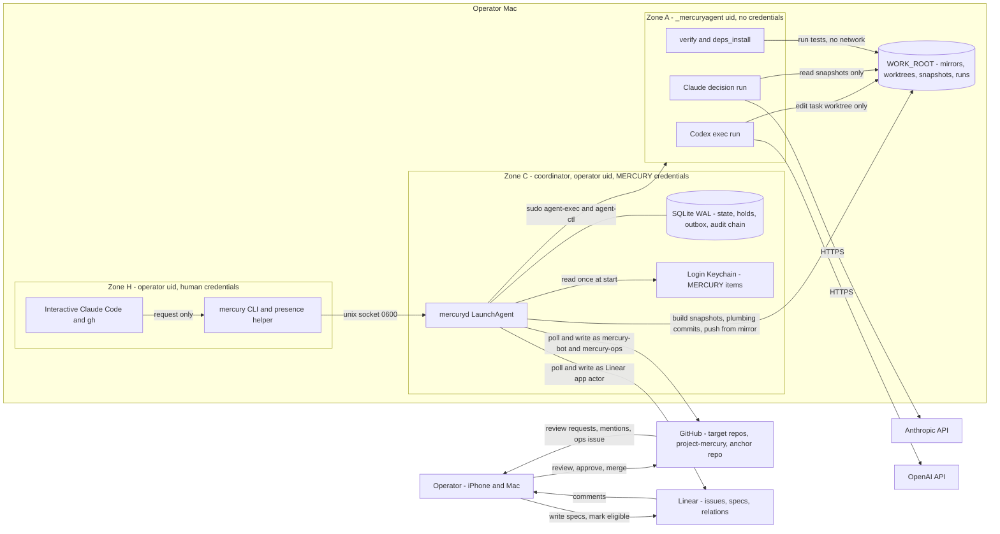
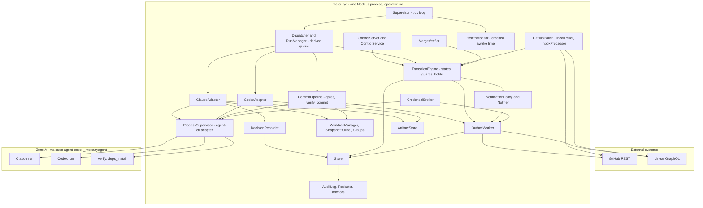
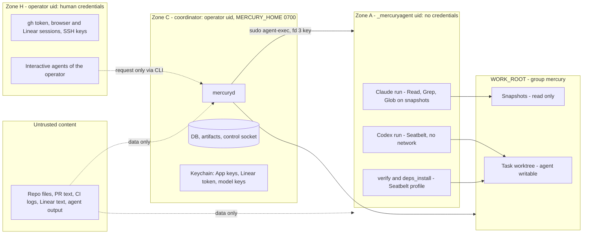
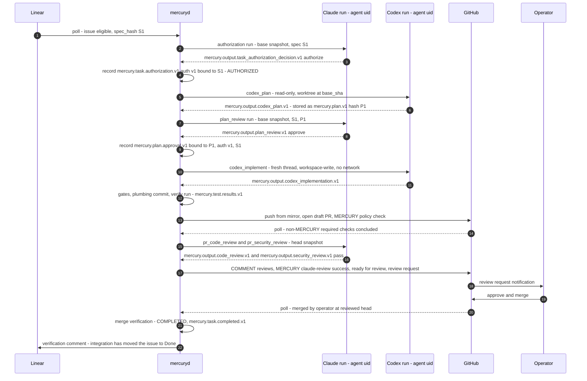

# MERCURY Architecture Overview

| | |
|---|---|
| Owner | Agent A (Principal AI Systems Architect) |
| Status | **Phase 4 revision.** Reconciled with the binding decisions RD-1…RD-20 in [`reviews/30-reconciliation.md`](../reviews/30-reconciliation.md). Input to TDD §6, §7, §25 and §26 |
| Date | 2026-10-12 |
| Related | [ADR index](decisions/README.md), [`reviews/40-revision-A.md`](../reviews/40-revision-A.md) (disposition of Phase 3 findings), [`reviews/03-design-baseline.md`](../reviews/03-design-baseline.md) |

This document fixes the **boundaries, authority model, trust zones and cross-cutting decisions**. It does not restate contracts owned elsewhere. Single sources of truth:

| Topic | Owner and location |
|---|---|
| Task states, transitions, guards, holds, block reasons, invariants (`INV-nn`), timers | Agent C, [`state-machine.md`](state-machine.md) |
| Components, ports, SQL DDL and triggers, control API, queue, process execution | Agent C, [`components.md`](components.md) |
| Message catalogue and schemas | Agent C, [`../protocols/messages.md`](../protocols/messages.md), [`../protocols/schemas/`](../protocols/schemas/) |
| Claude, Codex, GitHub and Linear contracts; retry matrix (`github.md` Part B) | Agent B, [`../integrations/`](../integrations/) |
| launchd, filesystem layout (§7.1), credentials, **operational parameter table**, recovery | Agent D, [`../operations/macos-service.md`](../operations/macos-service.md), [`../operations/recovery.md`](../operations/recovery.md) |
| Threat model and `SEC-nnn` statements | Agent E, [`../security/threat-model.md`](../security/threat-model.md) |
| Requirement IDs (`CON`, `FR`, `NFR`, `OPS`), operator decision register (`OD-nn`), assumption → Phase 0 map | Agent F, [`../planning/traceability.md`](../planning/traceability.md) |
| Decisions | Agent A, [`decisions/`](decisions/README.md) (ADR-001…ADR-020) |

Assumptions specific to this document are tagged `ASM-A-nn` ([§16](#16-assumptions)).

---

## 1. Purpose and scope

MERCURY replaces the Slack channel `#network-monitor` and the shell scripts in `usjbro/network_monitor/coordination/scripts/` as the coordination layer between Claude and the Codex CLI. It runs on the operator's Mac as one supervised coordinator process, `mercuryd`, plus short-lived agent processes under a separate macOS user.

The core boundary from the brief shapes every decision:

| Role | Decides | Executes | Holds credentials for |
|---|---|---|---|
| **Claude** (decision role) | Which eligible issue to work on; whether to authorize, re-authorize, amend or revoke; whether a plan is acceptable; whether a PR is acceptable; security findings; revision instructions for non-Claude feedback | Nothing outside its own read-only decision run over immutable snapshots, as the agent uid | Nothing persistent. A model key is handed to each run on fd 3 |
| **MERCURY** (`mercuryd`) | Nothing about *what* to build. It decides only *when* to ask Claude and whether deterministic guards pass | Scheduling, process supervision through `agent-exec`/`agent-ctl`, git, GitHub and Linear writes, audit | `mercury-bot` and `mercury-ops` App keys, Linear app token, model keys (all in the operator's login Keychain, [ADR-008](decisions/ADR-008-agent-identities-and-merge-governance.md)) |
| **Codex** (execution role) | How to implement an approved plan | Planning and code edits inside one sandboxed worktree, as the agent uid, no network | Nothing persistent. A model key is handed to each run on fd 3 |
| **Operator** (human) | Merge to protected branches; acknowledging escalations; policy and limits | Approve and merge in GitHub; CLI commands, with a presence confirmation for safety-relaxing ones | Their own GitHub and Linear accounts, never shared with MERCURY |

"Claude is the primary orchestrator" means Claude holds **decision authority** at defined decision points while `mercuryd` holds the loop (RD-20, OD-17).

---

## 2. System context



Context rules:

1. **All network traffic is outbound.** Nothing listens on a non-loopback interface. The only listener is the 0600 Unix socket for the local CLI (CON-002).
2. **The operator interacts through GitHub, Linear and the local CLI** (CON-011). Notification channels are fixed by [ADR-019](decisions/ADR-019-notifications-and-operator-presence.md).
3. **Agents never talk to GitHub or Linear and hold no credentials** beyond a per-run model key on fd 3. Every external write is made by `mercuryd` under a non-human identity ([ADR-008](decisions/ADR-008-agent-identities-and-merge-governance.md)).
4. **Agents run as `_mercuryagent`** and cannot read the operator's home, `MERCURY_HOME` or any Keychain ([ADR-013](decisions/ADR-013-agent-process-isolation.md)).

---

## 3. Architecture at a glance

| # | Decision | ADR |
|---|---|---|
| 1 | One long-running local coordinator, Node.js 24 LTS + TypeScript, one process, one SQLite writer | [ADR-001](decisions/ADR-001-coordinator-runtime-and-language.md) |
| 2 | SQLite (WAL, `synchronous=FULL`, `fullfsync=ON`) is the store; the queue is derived from task state | [ADR-002](decisions/ADR-002-sqlite-store-and-queue.md) |
| 3 | Hub-and-spoke: agents never communicate directly; no MCP in v1; revision instructions are Claude's words | [ADR-003](decisions/ADR-003-coordinator-mediated-agent-communication.md) |
| 4 | Claude is a headless decision service with six decision types | [ADR-004](decisions/ADR-004-claude-invocation-model.md) |
| 5 | Codex runs as supervised `codex exec` under the agent uid; fresh implementation thread; per-task `CODEX_HOME` | [ADR-005](decisions/ADR-005-codex-invocation-model.md) |
| 6 | The coordinator commits (plumbing, against the mirror), pushes from the mirror and opens PRs; reviews are `COMMENT` only | [ADR-006](decisions/ADR-006-coordinator-owns-git-and-pr.md) |
| 7 | GitHub and Linear are polled; no webhooks, no inbound ports | [ADR-007](decisions/ADR-007-polling-over-webhooks.md) |
| 8 | Identity inventory: `mercury-bot`, `mercury-ops`, Linear `actor=app`, dedicated model keys, `_mercuryagent` | [ADR-008](decisions/ADR-008-agent-identities-and-merge-governance.md) |
| 9 | Linear owns intent and spec; the coordinator owns execution and authority; GitHub owns code and human approval | [ADR-009](decisions/ADR-009-system-of-record-split.md) |
| 10 | The coordinator is a per-user LaunchAgent | [ADR-010](decisions/ADR-010-launchd-launchagent.md) |
| 11 | Authority records are immutable and hash-bound, verified at dispatch and at result application | [ADR-011](decisions/ADR-011-authorization-records-and-verification.md) |
| 12 | Migration partitions issues between MERCURY and the legacy workflow | [ADR-012](decisions/ADR-012-migration-from-slack-workflow.md) |
| 13 | Agent processes run as a dedicated macOS uid through root-owned wrappers | [ADR-013](decisions/ADR-013-agent-process-isolation.md) |
| 14 | Merge-actor modes G-ORG/G-SPLIT/G-DETECT; required `MERCURY / claude-review` and `MERCURY / policy` check runs | [ADR-014](decisions/ADR-014-merge-actor-enforcement-and-required-checks.md) |
| 15 | States record phase; holds suspend dispatch; `BLOCKED` means a human must act | [ADR-015](decisions/ADR-015-task-condition-model.md) |
| 16 | Three filesystem roots: `MERCURY_HOME`, `WORK_ROOT`, logs | [ADR-016](decisions/ADR-016-filesystem-layout.md) |
| 17 | Claude reads git-object snapshots, never checkouts | [ADR-017](decisions/ADR-017-claude-review-snapshot.md) |
| 18 | Hash-chained audit log, off-host anchors, HMAC on authority rows (SHOULD) | [ADR-018](decisions/ADR-018-audit-integrity.md) |
| 19 | Fixed notification channels; CLI-only responses; human-presence tier for safety-relaxing commands | [ADR-019](decisions/ADR-019-notifications-and-operator-presence.md) |
| 20 | Codex and `verify` runs are detached and adopted after a restart; Claude runs are re-run | [ADR-020](decisions/ADR-020-detached-runs-and-adoption.md) |

---

## 4. Architectural principles

Each principle is testable. Requirement IDs are F's.

| ID | Principle | What it means in practice | Verification |
|---|---|---|---|
| **AP-1** | **Decide vs. execute separation** | Only Claude produces decisions. `mercuryd` has no code path that creates an authority record without a matching validated Claude decision run. Codex never sees the decision interface | DB triggers reject a decision insert with no matching run (`components.md` §6.4); only `DecisionRecorder` holds the insert statements (CON-003) |
| **AP-2** | **Least authority per process** | Agents run as `_mercuryagent` with no credentials except a per-run model key on fd 3; Claude has read-only tools over snapshots; Codex has a sandboxed worktree and no network | SEC-T-20 credential canaries; per-spawn env assertion (SEC-202) |
| **AP-3** | **Human approval is enforced by GitHub** | MERCURY never approves, requests changes, dismisses, merges or enables auto-merge. The ruleset requires the operator's code-owner approval of the latest push plus the App-pinned MERCURY checks | Endpoint allowlist test (SEC-102); merge-verification tests (FR-181, FR-182) |
| **AP-4** | **Durable before effect** | Every transition commits before the side effect it triggers; every external effect goes through an outbox row with an idempotency key; git objects are flushed before the DB records their SHA | Crash-injection suite (NFR-001, NFR-050) |
| **AP-5** | **Level-triggered reconciliation** | Control logic compares the DB with observed processes, git, GitHub and Linear every tick; missed polls, sleep and restarts are handled by the same code | Recovery tests (NFR-020, NFR-021) |
| **AP-6** | **Immutable, content-addressed artifacts** | Plans, reviews, diffs, test reports, snapshots and transcripts are stored once, named by SHA-256, never changed; authority binds to hashes | Binding guards (`state-machine.md` §8) |
| **AP-7** | **External text is data, never instruction or authority** | Linear, GitHub, repository files and agent output reach agents only as delimited data; nothing in that text can change state except through a typed, validated field (FR-203) | Prompt-injection corpus (`threat-model.md`) |
| **AP-8** | **Sleep is a pause, not a failure** | Sleep gaps are not credited to run budgets or state timers; timers fire only after an attempt made since the latest wake (RD-14, RD-16) | Sleep tests in both clock modes (CON-009, NFR-021) |
| **AP-9** | **Fail closed, escalate once** | An unverifiable guard holds or blocks the task with a reason code and produces at most one notification per epoch; security conditions never auto-clear ([ADR-015](decisions/ADR-015-task-condition-model.md)) | Guard-failure and notification-dedup tests (FR-221) |
| **AP-10** | **Reconstructable, not re-derivable, authority** | GitHub and Linear back-references let an observer rebuild *what happened*; authority can never be rebuilt from them; after DB loss unverifiable authority needs fresh Claude re-authorization | DB-loss and restore drill (NFR-022) |
| **AP-11** | **Boring, local, few moving parts** | One coordinator process, one file database, two small root-owned wrappers, no broker, no container runtime, no inbound network. Each added component needs an ADR | Architecture review gate |
| **AP-12** | **Pinned, verified toolchain** | Node, Agent SDK, Codex, SQLite and the wrappers are pinned and hash-checked; dispatch is refused if the startup self-test fails | NFR-090, NFR-093, NFR-095 |
| **AP-13** | **Stopping is cheap; relaxing safety needs a present human** | Pause, cancel and revoke need only the operator socket token; acknowledging, granting, adopting or un-halting needs a presence confirmation ([ADR-019](decisions/ADR-019-notifications-and-operator-presence.md)) | Control-API principal tests |
| **AP-14** | **One source of truth per contract** | Each value, schema, ID and path is defined in exactly one document and referenced elsewhere (CON-017) | Documentation review |

---

## 5. Component architecture

### 5.1 Diagram

Module names follow `components.md` §4 (its §4.0 maps them to the Phase 2 names).



### 5.2 Component boundaries

C owns the interfaces in `components.md`. These boundary rules are architectural and change only through an ADR.

| Component | Responsibility | Must not |
|---|---|---|
| **Store** | Repository layer over SQLite; `BEGIN IMMEDIATE` transactions; migrations; integrity checks | Be bypassed: no other module opens the DB |
| **TransitionEngine** | Applies transitions from the table; evaluates guards; writes transition, audit entry and outbox rows in one transaction; sets and clears holds (which may also emit outbox rows) | Call external APIs or spawn processes |
| **Dispatcher and RunManager** | Derive the next action per task from state, holds and leases; claim a run with a lease and fencing token; enforce concurrency classes | Decide anything; dispatch without a guard pass |
| **ClaudeAdapter** | Build the decision bundle and snapshots; start the Claude run through `ProcessSupervisor`; validate output against the canonical schema | Write authority records itself |
| **DecisionRecorder** | The only writer of authorizations, plan approvals and review verdicts, from validated Claude runs only | Accept input from anywhere else |
| **CodexAdapter** | Build the Codex prompt from artifact bytes; start planning and implementation runs; parse JSONL; register plan and output artifacts | Run without a passing authorization guard |
| **ProcessSupervisor** | Spawn through `sudo agent-exec`; signal, probe, list and sample through `agent-ctl`; adopt runs after restart ([ADR-020](decisions/ADR-020-detached-runs-and-adoption.md)) | Spawn agent code as the operator uid (outside the sandbox-only interim gate, [ADR-013](decisions/ADR-013-agent-process-isolation.md)); pass secrets on argv or env |
| **WorktreeManager, SnapshotBuilder, GitOps** | Maintain mirrors and task worktrees; build read-only snapshots ([ADR-017](decisions/ADR-017-claude-review-snapshot.md)); run hardened git ([ADR-006](decisions/ADR-006-coordinator-owns-git-and-pr.md)) | Run git with configuration from an agent-writable directory; touch the operator's clones |
| **CommitPipeline** | Diff gate, protected-path and secret checks, `MERCURY / policy` inputs, `verify` run, plumbing commit, push request | Commit unreadable or unverified content |
| **GitHubPoller, LinearPoller, InboxProcessor** | Poll with ETags and cursors; turn observations into typed, deduplicated facts | Write to GitHub or Linear |
| **OutboxWorker** | Execute external writes at-least-once with idempotency keys; reconcile by natural keys; follow the retry matrix | Run an effect with a stale fencing token; call a non-allowlisted GitHub endpoint |
| **NotificationPolicy and Notifier** | Decide whether and where to tell the human ([ADR-019](decisions/ADR-019-notifications-and-operator-presence.md)) | Add a channel without an ADR |
| **ArtifactStore** | Write immutable, content-addressed files in `MERCURY_HOME` | Overwrite |
| **AuditLog** | Append the hash chain; produce anchors ([ADR-018](decisions/ADR-018-audit-integrity.md)) | Allow update or delete |
| **CredentialBroker** | Read Keychain items once at start and on reload; mint per-purpose installation tokens; hand a model key to one run on fd 3 | Log, persist or place secrets on argv or env |
| **HealthMonitor** | Heartbeat; credited awake time and sleep detection (`components.md` §10.10); connectivity probe | Fail tasks because of a sleep gap |
| **MergeVerifier** | Run the single merge-verification recipe (`state-machine.md` §8.5) | Treat Linear `Done` as merge proof |
| **ControlServer and ControlService** | Status, operator commands, decision *requests*; presence-tier verification | Create authorizations or approvals |

### 5.3 Trust zones

Three zones on the Mac (E's zones H, C and A, RD-1), plus untrusted content. Zone definitions and attack paths are in `threat-model.md` §3; isolation mechanics in [ADR-013](decisions/ADR-013-agent-process-isolation.md).



| Boundary | Enforced by | Strength |
|---|---|---|
| Zone A → Zones H and C (read credentials, DB, socket) | Separate uid, 0700 homes and `MERCURY_HOME`, no Keychain for the agent uid ([ADR-013](decisions/ADR-013-agent-process-isolation.md)) | OS (preventive) |
| Zone A → outside its writable paths | Group ACLs on `WORK_ROOT` plus Seatbelt ([ADR-016](decisions/ADR-016-filesystem-layout.md)) | OS + sandbox (preventive) |
| Untrusted content → decisions and execution | Delimited data, schemas, deterministic gates, required checks | Software + GitHub |
| Zone H → Zone C | **Same uid in v1.** Processes running as the operator can request but not clear escalations (presence tier, [ADR-019](decisions/ADR-019-notifications-and-operator-presence.md)); tampering is detected by the anchored audit chain ([ADR-018](decisions/ADR-018-audit-integrity.md)); policy OD-35 restricts interactive agents. A dedicated coordinator account (U2) is OD-36 | Software + detective |
| Zone C → `main` | GitHub ruleset and required checks ([ADR-014](decisions/ADR-014-merge-actor-enforcement-and-required-checks.md)) | GitHub (preventive for approval; for merge actor, preventive only in G-ORG) |

### 5.4 Filesystem layout

Three roots, `MERCURY_HOME`, `WORK_ROOT` and logs ([ADR-016](decisions/ADR-016-filesystem-layout.md)). The full layout, modes and ACLs are defined only in `operations/macos-service.md` §7.1–§7.2. No other document restates paths.

---

## 6. Process model and main loop

`mercuryd` is one Node.js process with one event loop and one SQLite write connection. Agent work runs as separate processes under the agent uid; git runs as coordinator child processes. Backups and `integrity_check` run in a worker thread with their own read connection (RD-11).

```text
every tick (and immediately after start or detected wake):
  1. heartbeat(); creditAwakeTime()            # C §10.10: min(Δmono, Δwall, 3×tick); gaps are not credited
     if sleepGapDetected: set host_sleep_grace hold; schedule full reconcile
  2. reconcileRuns()                           # agent-ctl ps + proc.json/exit.json: adopt, finish, or lost_by_host
  3. applyObservations()                       # InboxProcessor facts -> TransitionEngine (transactional)
  4. applyFinishedRuns()                       # re-run authorization guard, then record and transition
  5. for task in derivedReadyTasks():          # state + holds + leases + next_action_at; no jobs table
       claim run in one transaction (lease, fencing token, guards)
       if guard fails: hold or block with reason code; continue
       spawn via sudo agent-exec (agent kinds) or run coordinator step
  6. drainOutbox()                             # idempotent effects, retry matrix, natural-key reconcile
  7. fireTimers()                              # state timers (RD-14 rule), hold ageing, reminders
```

- **Concurrency classes** (Codex, Claude, per repository, per integration) are defined in `components.md` §7.3; defaults are operator decision OD-07 and live in D's parameter table.
- **Duplicate prevention:** at most one active *mutating* run per task and at most one active run per (task, run kind); read-only Claude code and security reviews may overlap. Enforced by indexes and invariants in `components.md` §6 and `state-machine.md` §4.
- **Single instance:** `flock` on a lock file in `MERCURY_HOME/run/`; the startup and exit contract is in [ADR-010](decisions/ADR-010-launchd-launchagent.md).

---

## 7. Agent communication pattern

### 7.1 Options evaluated

| Pattern | How it would work | Verdict | Reason |
|---|---|---|---|
| **Coordinator-mediated hub-and-spoke** (SQLite + subprocess runs + artifact files) | `mercuryd` invokes each agent with an input bundle and an output schema, validates and stores the output, and decides the next step from the state machine | **Chosen** ([ADR-003](decisions/ADR-003-coordinator-mediated-agent-communication.md)) | One authoritative state per task; every hand-off is durable, typed, hashed and audited; agents need no credentials or knowledge of each other |
| Direct agent-to-agent via MCP | Claude calls Codex as a tool, or the reverse | Rejected | `codex mcp-server` no longer exists; `app-server` is experimental; direct calls would bypass the dispatch guard (AP-1) |
| MCP as a read-only lookup surface for Claude | In-process MCP server exposing task, plan and diff lookups | **Rejected for v1** | A second confinement mechanism next to realpath-confined file tools, with no capability the bundle files lack (RA-12) |
| Shared files as the signal | Agents drop plan or gate files and the other side polls | Rejected as a control channel; kept as artifact transport | Today's failure mode (3.5 h "no plan received"). Files written by Codex are untrusted until registered |
| Message bus (Slack, Matrix, NATS, Redis) | Agents publish and subscribe | Rejected | Recreates lost replies and identity confusion; adds a service without authority control |
| Local HTTP between agents | Each agent exposes an endpoint | Rejected | Agents are batch CLIs; adds listeners |
| Linear comments as the channel | Agents talk through comments | Rejected | Writable by the human identity and integrations; cannot carry authority (AP-7) |

There is no direct agent-to-agent communication. Codex receives Claude's findings only as a revision request: Claude's `required_change` items verbatim when the source is a validated Claude review, otherwise the output of a Claude `revision_request` run (RD-8).

### 7.2 Message flow (happy path, default Linear mode `integration_owns_done`)

Message IDs are from `protocols/messages.md`. Every hand-off is written in the same transaction as the transition that produced it.



---

## 8. Claude decision model and authority integrity

### 8.1 Coordinator invokes Claude as a headless decision service

A Claude session cannot run through sleep, restart or logout, and a session driving the loop would need write tools in the same context that reads untrusted text. Therefore **Claude holds the authority and `mercuryd` holds the loop** ([ADR-004](decisions/ADR-004-claude-invocation-model.md)). At each decision point the coordinator starts a fresh, isolated, schema-constrained Claude run as the agent uid. When a decision is needed and Claude cannot be reached, the task waits and escalates once; the coordinator never substitutes its own judgement.

An interactive Claude Code session may use the `mercury` CLI to read status and to *request* a decision. The request starts a normal decision run whose output carries the authority. The interactive session cannot create authority and cannot clear escalations ([ADR-019](decisions/ADR-019-notifications-and-operator-presence.md)).

### 8.2 Decision points

The six decision types (`triage`; `authorization` in `initial` and `reauthorize` modes; `plan_review`; `pr_code_review`; `pr_security_review`; `revision_request`) are fixed by [ADR-004](decisions/ADR-004-claude-invocation-model.md). Triggers, inputs, readable roots and limits per type are in `integrations/claude.md` §3–§4; output schemas in `protocols/schemas/output.*`. A security review runs on every PR. There is no failure-triage decision in v1 (OD-29).

### 8.3 Authority records

Authorizations, plan approvals and review verdicts are immutable, versioned records produced only by the `DecisionRecorder` from validated Claude runs ([ADR-011](decisions/ADR-011-authorization-records-and-verification.md)). Their bindings are:

| Record | Binds |
|---|---|
| Authorization version | Task, issue, repository and base branch, `spec_hash`, scope and `scope_version`, limits, expiry, and the decision provenance (run, model, prompt template hash, input digest, output and transcript hashes) |
| Plan approval | Authorization version, plan version and `plan_sha256`, `spec_hash` |
| Review verdict | Head SHA, `snapshot_tree_sha`, approved plan hash, authorization version |

Field lists are defined only in `protocols/schemas/` and the DDL in `components.md` §6. Supersession and revocation are new rows.

### 8.4 Integrity controls

| # | Control | Defends against | Enforcement |
|---|---|---|---|
| 1 | Single writer module (`DecisionRecorder`) | Coordinator bugs that open a second authority path | Code structure, lint rule, tests |
| 2 | Provenance and immutability triggers | Bugs in any module | Database |
| 3 | Hash binding to snapshots, plans, specs and head SHAs | Silent mismatch between what Claude saw and what runs or merges | Guards at dispatch **and at result application** |
| 4 | Agent uid cannot open `MERCURY_HOME` | Agent tampering with state or credentials | OS ([ADR-013](decisions/ADR-013-agent-process-isolation.md)) |
| 5 | Hash-chained audit log, verified at startup | After-the-fact history edits | Detective; failure → safe mode ([ADR-018](decisions/ADR-018-audit-integrity.md)) |
| 6 | Off-host anchors of the chain head | Consistent rewrite of the whole local chain by a same-uid process | Detective, off-host (MUST before unattended operation) |
| 7 | HMAC on authority rows | Restored or tampered backups | Crypto (SHOULD) |
| 8 | Presence tier for safety-relaxing commands | Same-uid processes clearing human escalations | LocalAuthentication helper ([ADR-019](decisions/ADR-019-notifications-and-operator-presence.md)) |
| 9 | Back-references in trailers, PR bodies and Linear comments | Rewriting local history without trace | Detective, external copy |

### 8.5 Guards

The authorization guard, plan-approval binding guard, review binding guard, dependency guard and merge verification are specified only in `state-machine.md` §8. Architecturally: the authorization guard runs inside the claim transaction for every Codex dispatch, **and again before any run result is applied**, including adopted runs after a restart. A result produced under a since-changed `spec_hash`, a revoked or expired authorization, or a superseded plan approval is stored but not acted on.

### 8.6 Where the security weight sits

1. **GitHub is the preventive backstop for approval.** Nothing reaches a protected branch without the operator's code-owner approval of the latest push and the App-pinned MERCURY checks ([ADR-014](decisions/ADR-014-merge-actor-enforcement-and-required-checks.md)). In G-ORG this also holds for the merge actor; in G-DETECT the merge actor is verified after the fact.
2. **The agent uid protects both the human's and MERCURY's credentials** from code that agents run. This is what keeps a hostile agent from impersonating the human or forging the MERCURY checks ([ADR-013](decisions/ADR-013-agent-process-isolation.md)).
3. **The coordinator shares the operator's uid in v1.** Software controls (single writer, triggers, guards) handle bugs completely. A malicious same-uid process is handled by the presence tier (cannot clear escalations), the anchored audit chain (tampering is detectable), and GitHub (cannot merge unreviewed code). A dedicated coordinator account is a recorded future option (OD-36).

---

## 9. System of record and reconciliation

### 9.1 System-of-record table

| Data | System of record | Copies held by | Sync direction | Who may write the system of record |
|---|---|---|---|---|
| Issue content: title, description, acceptance criteria, labels, priority, project | **Linear** | Coordinator: `spec_hash` and snapshot per authorization | Linear → coordinator (poll) | Operator. Claude may propose spec changes only as a comment (`needs_spec`) |
| Issue relations (`blocks`, `blockedBy`, parent) | **Linear** | Coordinator dependency cache | Linear → coordinator | Operator |
| Eligibility signal | **Linear** (operator-added label, OD-10) | Issue-level `mercury_status` (including `discovered`) | Linear → coordinator | Operator |
| Authorization, scope, limits, revocation | **Coordinator** | Linear comment and PR trailers (reference only) | Coordinator → Linear and GitHub (informational) | Claude decision run via `DecisionRecorder`; revocation also by operator CLI |
| Task workflow state (17 task states), holds, runs, leases, timers | **Coordinator** | Coarse Linear status; PR draft state and check runs | Coordinator → Linear and GitHub | `TransitionEngine` |
| Plans, approvals, Claude reviews, security findings, test reports, snapshots manifests, transcripts | **Coordinator** (artifact store) | PR `COMMENT` reviews; Linear summary comments | Coordinator → GitHub and Linear | `DecisionRecorder`, adapters |
| Audit chain | **Coordinator** | Anchors in check-run summaries, Linear completion comments and the private anchor repository | Coordinator → GitHub and Linear | `AuditLog` |
| Code, branches, commits | **GitHub** | Coordinator mirrors and worktrees | Coordinator pushes `mercury/*` branches from the mirror; observes everything else | Coordinator (task branches only); operator |
| PR existence, metadata, CI results, mergeability | **GitHub** | Coordinator observation cache | GitHub → coordinator, except the coordinator's own PR writes and check runs | Coordinator via `mercury-bot`; CI; operator |
| `MERCURY / claude-review` and `MERCURY / policy` | **GitHub** (as the enforcement point), computed from coordinator state | — | Coordinator → GitHub | `mercury-bot` only (App-pinned) |
| Human approval and merge | **GitHub** | Coordinator merge verification record | GitHub → coordinator | **Operator only** |
| Linear status of MERCURY-managed issues | Mode-dependent (OD-06): in `integration_owns_done` the integration owns In Review and Done and MERCURY writes `In Progress`; in `mercury_owns_all` MERCURY writes all, `Done` only after verification | — | Both | See [ADR-009](decisions/ADR-009-system-of-record-split.md). Linear `Done` is never merge proof |
| Operator commands | **Coordinator** (control requests, with presence evidence where required) | Audit log | CLI → coordinator | Operator via the local socket |
| Secrets | **macOS login Keychain** | Coordinator memory; one model key per run on fd 3 | — | Operator at setup |

The Linear projection mapping per state and mode is defined only in `integrations/linear.md` §6.

### 9.2 Reconciliation rules

1. **Inbound only changes facts, never authority.** Observations can *stop*, *pause* or *invalidate* work; they can never *start* or *approve* it (CON-004, FR-203).
2. **Outbound is a projection.** Writes are idempotent (deterministic IDs and markers), retried by the outbox, and reconciled by natural key.
3. **Full reconcile** runs at startup, after wake and on a fixed cadence (values in D's parameter table and `github.md`, `linear.md`).
4. **No silent overwrite of human edits.** If the operator changed something MERCURY projects, MERCURY records the conflict, does not revert it, and takes the action in §9.3.

### 9.3 Conflict handling

Hold kinds and block reason codes are C's (`state-machine.md` §5, §6.1).

| # | Disagreement | Detection | Resolution |
|---|---|---|---|
| C1 | Spec changed after authorization (`spec_hash` differs) | LinearPoller | `spec_changed` hold. Claude `authorization` run in `reauthorize` mode with the diff. Results of runs finishing after the change are not applied until re-authorized. At PR stage, `MERCURY / claude-review` shows an action-required failure; the PR stays open. Hold ageing escalates once ([ADR-009](decisions/ADR-009-system-of-record-split.md), [ADR-015](decisions/ADR-015-task-condition-model.md)) |
| C2 | Issue moved to `Canceled` or `Duplicate` | LinearPoller | Cancel protocol (`state-machine.md` §8.6): stop runs, `CANCELLED`, PR converted to draft with a comment; MERCURY never closes the PR |
| C3 | Eligibility label removed or issue moved back to `Backlog`; `mercury:hold` label added | LinearPoller | `deprioritized` or `operator_hold` hold; one notification; ageing per [ADR-015](decisions/ADR-015-task-condition-model.md) |
| C4 | Linear shows `Done` but no verified merge exists | LinearPoller + GitHubPoller | Verify on GitHub. If merged: run merge verification. If not: record the conflict, do not revert, `BLOCKED(external_state_conflict)` |
| C5 | New blocker relation on an authorized task | LinearPoller | `dependency_unresolved` hold; clears when the blocker is resolved per the dependency guard (MERCURY-managed blockers need a MERCURY `COMPLETED`) |
| C6 | PR closed without merge | GitHubPoller | Closed by the operator: `CANCELLED`. Closed by anyone else: `BLOCKED(pr_closed_unexpectedly)` |
| C7 | Commits pushed to the task branch by anyone but the coordinator | GitHubPoller | Prior review invalidated; `BLOCKED(foreign_push)`. Operator chooses `resume --adopt` (presence tier; Claude re-reviews) or `resume --reset` |
| C8 | Merge verification fails | MergeVerifier | `BLOCKED(merge_verification_failed)`, scoped: wrong merge actor or merge commit not on base → global `security_halt`; approval, content or review-ordering mismatch → repo `integrity_alert` hold; operator merged before review → policy notice ([ADR-014](decisions/ADR-014-merge-actor-enforcement-and-required-checks.md)) |
| C9 | Linear-native delegation or coding session on a managed issue | LinearPoller | `BLOCKED(foreign_agent)`; no dispatch until the delegation is removed |
| C10 | Coordinator DB lost or corrupt | Startup integrity check | Safe mode; restore per `operations/recovery.md`; restore epoch recorded; unverifiable authority → `BLOCKED(reauthorization_required)` ([ADR-018](decisions/ADR-018-audit-integrity.md)) |
| C11 | Target-repo ruleset drift (a required rule relaxed) | Drift monitor via `mercury-ops` (SEC-108) | Ops alert; new dispatch for that repository stops until the ruleset is restored (OPS-003) |

---

## 10. Nonfunctional requirements

**This section defines no requirement IDs and no targets.** Requirement IDs, targets and acceptance criteria live only in `planning/traceability.md`; operational values live only in D's parameter table in `operations/macos-service.md`. Latency and availability are measured from the first awake-and-online instant after the triggering event (RD-16); the measurement rule is F's.

The table maps each quality attribute to F's registered requirements and to the architectural mechanism that delivers it.

| Quality attribute | Requirements (F) | Architectural mechanism | ADR |
|---|---|---|---|
| Exactly-once external effects | NFR-001 | Transactional outbox, idempotency keys, natural-key reconcile, fencing tokens | 002, 006 |
| Restart and recovery | NFR-002, NFR-020, NFR-021, NFR-025, NFR-027 | LaunchAgent with `KeepAlive`, `flock`, safe mode, level-triggered reconcile, run adoption | 010, 020 |
| Stall and dead-run detection | NFR-003, NFR-006 | Credited awake time, CPU-or-output liveness, `agent-exec` deadlines and supervisor lease | 005, 020 |
| Availability and downtime awareness | NFR-004, NFR-007 | Heartbeat, sleep heartbeat, external watchdog | 010, 019 |
| No missed durable events | NFR-005, NFR-040, NFR-041 | Polling with cursors and ETags, level-triggered observations | 007 |
| Graceful shutdown; lost agent work | NFR-024, NFR-026 | SIGTERM keeps adoptable runs; `lost_by_host` consumes no attempt | 010, 020 |
| Dispatch and hand-off latency | NFR-042, NFR-043, NFR-044, NFR-045 | Per-tick dispatch; outbox drain; draft-to-ready on `MERCURY / claude-review` | 002, 014 |
| Durability | NFR-050, NFR-051, NFR-052 | WAL + `fullfsync`; atomic artifact writes; git fsync before DB commit | 002, 020 |
| Auditability and retention | NFR-060, NFR-061, NFR-062 | Hash chain, anchors, `mercury trace`, redaction | 018 |
| Notification volume | NFR-063; FR-221 | `NotificationPolicy` dedup, hold-ageing digests, wake coalescing | 015, 019 |
| Operability | NFR-070, NFR-071, NFR-072, NFR-073 | Install script, `mercury doctor` and `health`, runbooks | 010, 013 |
| Resources and cost | NFR-080, NFR-081, NFR-082, NFR-083, NFR-084 | Single process, concurrency classes, disk thresholds, per-run limits, spend-capped keys | 001, 005, 008 |
| Portability and pinning | NFR-090, NFR-091, NFR-092, NFR-093, NFR-094, NFR-095 | Pinned toolchain and wrappers; `Store` port; TCC-free paths; startup self-test | 001, 013, 016 |
| Testability | NFR-100, NFR-101 | Ports with fakes; deterministic simulation; FakeClock in both sleep modes | 001, 002 |
| Security quantities | SEC-202, SEC-108, CON-014 | Agent env allowlist; drift monitor; merge verification latency | 008, 013, 014 |

Requirement IDs NFR-006, NFR-007, NFR-025, NFR-026, NFR-027, NFR-045, NFR-063, NFR-084 and NFR-095 are new IDs registered by F in Phase 4 (resolution table in `reviews/25-review-F-coverage.md` §6.4). The Phase 2 aliases `NFR-LAT-*`, `NFR-REL-*`, `NFR-AUD-*`, `NFR-SEC-*`, `NFR-NOT-*`, `NFR-RES-*`, `NFR-AVL-*`, `NFR-MNT-*` and `NFR-COST-*` are retired; the alias map is in `planning/traceability.md`.

---

## 11. Technology selection matrix

### 11.1 Criteria and weights

| Code | Criterion | Weight | Why this weight |
|---|---|---|---|
| C1 | Fit with the agent SDKs (Claude Agent SDK, Codex JSONL types) | 15 | The Agent SDK gives the strongest in-process controls and a custom spawner, and is TypeScript- and Python-only |
| C2 | Durability and crash-recovery semantics | 15 | Restart recovery and zero duplicates are hard requirements |
| C3 | Operational footprint on one Mac | 15 | Single operator, laptop, no ops team |
| C4 | Fit with no-inbound, sleep-prone, local-first operation | 10 | Hard constraint |
| C5 | Security and enforceability of the authority model | 15 | Hard constraints on authorization and approval |
| C6 | Testability and determinism | 10 | Brief §J |
| C7 | Implementability and maintainability by the operator and coding agents | 10 | MERCURY will be built by Claude and Codex |
| C8 | Supply-chain surface | 5 | Security |
| C9 | GitHub and Linear client ecosystem | 5 | Integration effort |

### 11.2 Scores (1 = poor, 5 = excellent)

| Option | C1 | C2 | C3 | C4 | C5 | C6 | C7 | C8 | C9 | **Weighted (max 5.00)** |
|---|---|---|---|---|---|---|---|---|---|---|
| **A. Node.js 24 + TypeScript daemon, SQLite** | 5 | 4 | 5 | 5 | 4 | 4 | 4 | 3 | 5 | **4.40** |
| B. Python 3.12 daemon, SQLite | 4 | 4 | 4 | 5 | 4 | 4 | 4 | 3 | 4 | 4.05 |
| C. Go single binary, SQLite | 2 | 4 | 5 | 5 | 4 | 4 | 3 | 4 | 3 | 3.80 |
| D. Temporal (self-hosted) + TS worker | 5 | 5 | 2 | 3 | 3 | 4 | 2 | 2 | 5 | 3.50 |
| E. Redis + BullMQ + Node | 5 | 3 | 3 | 4 | 3 | 2 | 3 | 3 | 5 | 3.40 |
| F. GitHub-Actions-hosted coordinator | 3 | 3 | 4 | 1 | 2 | 3 | 3 | 3 | 5 | 2.90 |
| G. Linear as the state store | 4 | 2 | 4 | 3 | 1 | 2 | 3 | 4 | 4 | 2.85 |
| H. Claude-session-driven loop, no daemon | 4 | 1 | 5 | 2 | 1 | 1 | 4 | 4 | 4 | 2.75 |

Weighted = Σ(weight × score) / 100.

### 11.3 Notes per option

| Option | Deciding factors |
|---|---|
| A | Native, typed Agent SDK with a custom spawner (needed for the agent uid); Codex `.d.ts` usable as the JSONL contract; `node:sqlite` built in behind a port with a `better-sqlite3` fallback; three runtime dependencies ([ADR-001](decisions/ADR-001-coordinator-runtime-and-language.md)). Weakness: npm supply chain |
| B | Python Agent SDK exists and SQLite is in the standard library. Loses on runtime management under launchd and on typed clients. The recommended fallback |
| C | Best footprint, but no official Agent SDK: Claude only through `claude -p`, losing `canUseTool`, hooks and the spawner |
| D | Excellent durable execution, but a second service and its persistence on a laptop; durable timers do not help while the Mac sleeps |
| E | Two stores break single-transaction "state plus effect"; adds a service |
| F | Runners cannot reach the Mac; secrets in a public repository's Actions; violates "locally hosted" |
| G | No transactions, leases or compare-and-swap; fields writable by the human identity and integrations, so authority would be forgeable |
| H | Progress only while a session is open (the Slack-era failure); Claude would need execution tools and credentials |

**Sensitivity.** If C1 drops to weight 5 and the result is renormalised, A scores 4.33, B 4.06 and C 4.00. A still leads. Python stays within 0.4 of A under every weighting tried.

---

## 12. GitHub governance

Target repositories belong to the personal account `usjbro` (discovery fact 4). The decision is [ADR-014](decisions/ADR-014-merge-actor-enforcement-and-required-checks.md); identities are in [ADR-008](decisions/ADR-008-agent-identities-and-merge-governance.md); the ruleset content is in `integrations/github.md` §9.

| Mode | Human approves | Only the human merges | Use (OD-01 default) |
|---|---|---|---|
| **G-ORG** (organization; updates of `main` restricted to the operator) | Preventive | **Preventive** | **Required before unattended or overnight operation** on target repositories |
| **G-SPLIT** (no MERCURY credential can merge) | Preventive | Preventive | Only if Phase 0 verifies its preconditions |
| **G-DETECT** (personal repository) | Preventive | Detective (merge verification) | Sandbox and supervised pilot, with written operator risk acceptance |

In every mode the ruleset requires the operator's code-owner approval of the most recent push and the two App-pinned check runs `MERCURY / claude-review` and `MERCURY / policy`. MERCURY posts `COMMENT` reviews only. When MERCURY is down, MERCURY PRs wait; an emergency merge uses the audited runbook in `operations/recovery.md`.

---

## 13. Migration from the Slack and script workflow

Partition rules are in [ADR-012](decisions/ADR-012-migration-from-slack-workflow.md); stage criteria and durations only in `planning/roadmap.md` (OD-16).

| Stage | Milestone | Summary |
|---|---|---|
| MIG-0 Inventory | Phase 0 | Read-only inventory of the legacy scripts, gate formats and conventions |
| MIG-1 Shadow | M9a | Dry-run triage and authorization; no Codex runs, no external writes |
| MIG-2 Supervised pilot | M9b | Full lifecycle for MERCURY-eligible issues only; requires target-repo governance per OD-01 |
| MIG-3 Cutover | M9c | All eligible issues; Slack coordination off; bot token revoked |
| MIG-4 Decommission | after M9c | Scripts removed; channel archived |

The two systems never manage the same issue. Rollback at any stage is a global `mercury pause`.

---

## 14. Key tradeoffs

| # | Chose | Over | Gain | Give up |
|---|---|---|---|---|
| T1 | Claude as a per-decision headless service | A long-running Claude session as orchestrator | Works through sleep and restart; least privilege; each decision recorded and reproducible | No conversational memory across decisions; more tokens per decision |
| T2 | Polling | Webhooks via a relay | No inbound surface, no third party | Poll-interval latency; API budget used |
| T3 | Coordinator does git and PRs | Codex commits and opens PRs | Agents hold no GitHub credentials; consistent trailers | More coordinator code; one commit per implementation round |
| T4 | SQLite with a derived queue | Broker or workflow engine | Single-transaction state plus effect; one file to back up | Single host, single writer |
| T5 | G-DETECT with written acceptance for sandbox and pilot, G-ORG before unattended | Mandatory organization from day one | Faster start | Merge actor detective during the supervised stages |
| T6 | One coordinator process | Separate worker processes | Simpler supervision and locking | A coordinator bug can stall everything; mitigated by launchd restart and run adoption |
| T7 | Fresh Claude session per decision | Resumed session per task | Isolation from earlier injected content; reproducible input | Re-reads context each time |
| T8 | Linear status ownership by mode, with the integration owning `Done` by default | MERCURY always owns Linear status | Keeps the operator's branch convention and Linear automation | Linear can show `Done` before MERCURY verifies the merge |
| T9 | Agent uid via sudo wrappers, coordinator as the operator | A dedicated logged-in account for all of MERCURY (U2) | Protects both human and MERCURY credentials from agents; keeps the login Keychain | One-time root setup; coordinator still shares the operator's uid (OD-36) |
| T10 | Required MERCURY check runs | Advisory bot reviews | "Only Claude-reviewed SHAs merge" becomes preventive | MERCURY PRs cannot merge while MERCURY is down |
| T11 | Presence tier for safety-relaxing commands | Socket token for everything | Same-uid agents cannot clear human escalations | Escalations are resolved only at the Mac |

---

## 15. ADR index

The index, statuses and supersession links are maintained in [`decisions/README.md`](decisions/README.md).

---

## 16. Assumptions

Each assumption is linked to a Phase 0 check. Check IDs (`P0-nnn`) are assigned in F's unified register in `planning/traceability.md`; where D has already numbered the check it is cited.

| ID | Assumption | Status | Phase 0 check |
|---|---|---|---|
| ASM-A-01 | MERCURY's paths (`MERCURY_HOME`, `WORK_ROOT` under `/Users/Shared`, logs) are outside TCC-protected folders, so no TCC prompts occur for the LaunchAgent or the agent uid | Open | LaunchAgent and agent-uid probe writing to each root (F register) |
| ASM-A-02 | A per-user LaunchAgent can read MERCURY's Keychain items without prompts after login | Open | `security find-generic-password` from a probe LaunchAgent (F register) |
| ASM-A-03 | `fullfsync=ON` with `synchronous=FULL` gives acceptable commit latency on the operator's SSD | Open | 1,000-transaction benchmark (F register) |
| ASM-A-04 | ~~The monotonic clock pauses during sleep~~ | **Refuted** (macOS `mach_continuous_time` continues during sleep, RD-16). Replaced by C's credited-awake-time algorithm, which works in both modes | — |
| ASM-A-05 | ~~Concurrent Codex runs sharing one `CODEX_HOME` are unsafe~~ | **Superseded** by per-task `CODEX_HOME` ([ADR-005](decisions/ADR-005-codex-invocation-model.md)); the remaining parallel-run question is B's | — |
| ASM-A-06 | ~~Codex `workspace-write` cannot write to `MERCURY_HOME`~~ | **Superseded** by the agent uid: the agent cannot open `MERCURY_HOME` at all | P0-27 (credential and `MERCURY_HOME` canaries; SEC-T-20) |
| ASM-A-07 | ~~`Part of JAM-n` prevents the integration from closing the issue~~ | **Withdrawn** (branch names with the identifier are closing links, RA-10). Replaced by the two Linear modes ([ADR-009](decisions/ADR-009-system-of-record-split.md)) | — |
| ASM-A-08 | Transferring a repository to an organization (G-ORG) keeps the Linear GitHub integration and existing PR links working after re-authorizing the integration | Open | Scratch repository transfer (F register) |
| ASM-A-09 | `mercury-bot` can be installed on a personal account for selected repositories with exactly `contents:write`, `pull_requests:write`, `checks:write`, `metadata:read`, and its check runs can be required and pinned by integration id in a ruleset | Open | Scratch App and ruleset (F register; B's pinning test RB-05) |
| ASM-A-10 | The Agent SDK can spawn Claude through `sudo -n -u _mercuryagent agent-exec --kind claude` with the key on fd 3 from a LaunchAgent, without an interactive login | Open | P0-26 plus the SDK spawn test; fallback ALT-B-1 ([ADR-004](decisions/ADR-004-claude-invocation-model.md)) |
| ASM-A-11 | Linear `actor=app` OAuth works for a single-user workspace without webhooks, and writes are attributed to the app user | Open | Create the OAuth app (F register) |
| ASM-A-12 | A small signed LocalAuthentication helper can obtain a Touch ID or password confirmation when invoked from the `mercury` CLI in a Terminal session, and its result can be verified by `mercuryd` | Open | Helper prototype (F register); fallback TTY nonce ([ADR-019](decisions/ADR-019-notifications-and-operator-presence.md)) |

## 17. Operator decisions referenced by this document

The register (options, defaults, needed-by milestone) is F's in `planning/traceability.md`. This document depends on: OD-01 (governance mode, [ADR-014](decisions/ADR-014-merge-actor-enforcement-and-required-checks.md)), OD-02 to OD-05 and OD-20 (identities, [ADR-008](decisions/ADR-008-agent-identities-and-merge-governance.md)), OD-06 (Linear status owner, [ADR-009](decisions/ADR-009-system-of-record-split.md)), OD-07 (concurrency), OD-08 (budgets and expiry), OD-10 (eligibility), OD-12 (response channel, [ADR-019](decisions/ADR-019-notifications-and-operator-presence.md)), OD-16 (migration), OD-17 (orchestrator meaning, [ADR-004](decisions/ADR-004-claude-invocation-model.md)), OD-18 (agent uid, [ADR-013](decisions/ADR-013-agent-process-isolation.md)), OD-29 (failure triage deferred), OD-35 (policy checklist), OD-36 (dedicated coordinator account, [ADR-010](decisions/ADR-010-launchd-launchagent.md)). The Phase 2 IDs OD-A-01…OD-A-05 are retired (OD-A-03 withdrawn; the others map to OD-01, OD-10, OD-03/04 and OD-08).
