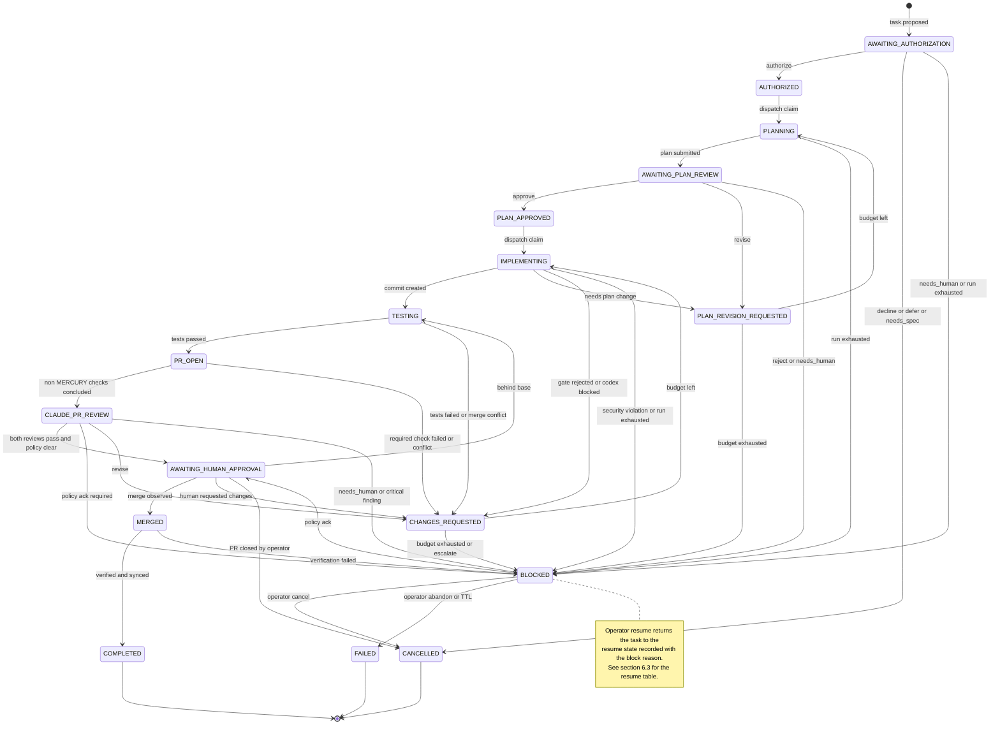
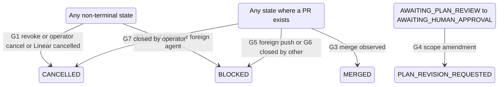
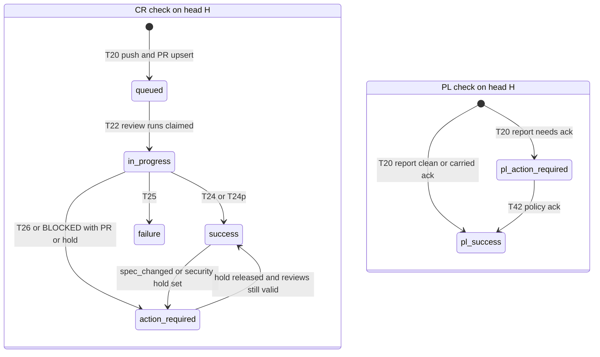

# MERCURY Task State Machine

Owner: Agent C (Staff Engineer). Status: **Phase 4 revision** (implements `reviews/30-reconciliation.md` RD-3, RD-5, RD-8, RD-9, RD-11, RD-13, RD-14, RD-16, RD-18). Design only.

This document is the **single source of truth** for task states, transitions, guards, holds, block reasons, invariants (`INV-nn`) and per-state recovery semantics. It refines `architecture/overview.md` §8–§9 (Agent A) and implements ADR-015 (holds vs `BLOCKED`).

What this document does **not** restate (single source of truth elsewhere):

| Topic | Owner document |
|---|---|
| SQL DDL for every table named here | [`components.md` §6](components.md#6-persistent-data-model) |
| Message and agent-output schemas | [`../protocols/messages.md`](../protocols/messages.md), [`../protocols/schemas/`](../protocols/schemas/) |
| Operational parameter values (run deadlines and stall thresholds `run.<kind>.*`, wake grace, lease interval, disk thresholds, watchdog, shutdown budget, dark-wake threshold). Workflow policy (attempts, backoff, revision budgets, reminder timers) stays here (Addendum B) | Parameter table, [`../operations/macos-service.md` §2](../operations/macos-service.md#2-operational-parameter-table-normative), cited here as **MS-PARAM** (parameter names such as `wake.grace_s`) |
| Filesystem layout (`MERCURY_HOME`, `WORK_ROOT`, run directories) | `operations/macos-service.md` §7.1 |
| API retry matrix and failure-class accounting for external calls | `integrations/github.md` Part B §15 (**GH §15**) |
| Dedup key formats | `integrations/github.md` §13 (**GH-DEDUP**) |
| Merge verification checks M1–M8 and their failure scope | `integrations/github.md` §8 (**GH §8**) |
| `spec_hash` definition | `integrations/linear.md` §5 |
| Agent invocation, prompts, deadlines per agent | `integrations/claude.md` (**CL**), `integrations/codex.md` (**CX**) |
| SEC requirement text | `security/threat-model.md` |
| Requirement IDs, operator decisions (`OD-nn`) | `planning/traceability.md` |

Conventions:

- State names are `UPPER_SNAKE`. Event names are `lower.dotted`.
- *Initiator* is the authority whose output or action causes the transition. Exactly one of: **Claude** (a validated Claude decision run), **Codex-result** (a validated Codex run result; Codex never decides a transition, the coordinator classifies its result), **Coordinator** (deterministic rule), **Operator** (human via the `mercury` CLI over the control socket; **Operator★** marks commands that require the operator-presence tier, RD-12, [`components.md` §5.2](components.md#52-socket-principals-and-the-operator-presence-tier)), **GitHub** (polled observation), **Linear** (polled observation).
- *Evidence* is what the transition row stores in `task_transitions.evidence_json`: IDs and SHA-256 hashes. A transition without its required evidence is rejected by the Transition Engine.
- `spec_sha256` everywhere in this document means B's `spec_hash` (RD-13), stored in `linear_issues.spec_sha256` and echoed in Claude bindings as `binding.spec_sha256`.
- The two MERCURY gate checks are `MERCURY / claude-review` (**CR check**) and `MERCURY / policy` (**PL check**), created by the `mercury-bot` App (RD-5, RD-6). Posting mechanics are in GH §6.
- Assumptions are `ASM-C-nn`, linked to Phase 0 checks in `planning/traceability.md`.

---

## 1. Design decisions on the state list

The brief listed 18 candidate states. This design keeps **17 task states** and moves one to the issue level (RD-14).

| Brief name | Design | Reason |
|---|---|---|
| `Discovered` | **Issue-level status** `linear_issues.mercury_status ∈ {discovered, ineligible, shortlisted, task_open, task_closed}`. Not a task state | A task is a unit of authorized-or-being-authorized work bound to one issue. Hundreds of backlog issues are "discovered"; making each a task would fill the task table with rows that have no authority and would make INV-01 meaningless. `mercury status --issues` shows the issue-level statuses (FR-007) |
| `Awaiting authorization` | `AWAITING_AUTHORIZATION` | Where the Claude `authorization` decision run executes and the audit trail begins |
| `Authorized` | `AUTHORIZED` | — |
| `Planning` | `PLANNING` | — |
| `Awaiting plan review` | `AWAITING_PLAN_REVIEW` | — |
| `Plan revision requested` | `PLAN_REVISION_REQUESTED` | — |
| `Plan approved` | `PLAN_APPROVED` | — |
| `Implementing` | `IMPLEMENTING` | — |
| `Testing` | `TESTING`, a distinct state | Different executor (L2 `verify` as the agent uid, not Codex), different evidence (authoritative `test.results` bound to a commit SHA), different failure route (test failure is a revision cycle; a Codex failure is a run retry) |
| `PR open` | `PR_OPEN` | Push, PR upsert (draft) and waiting for non-MERCURY required checks on the head SHA |
| `Claude PR review` | `CLAUDE_PR_REVIEW` | — |
| `Changes requested` | `CHANGES_REQUESTED` | — |
| `Awaiting human approval` | `AWAITING_HUMAN_APPROVAL` | — |
| `Merged` | `MERGED` | Durable checkpoint "code is on the base branch; verification and post-merge effects pending" |
| `Completed` | `COMPLETED` | Terminal: verification passed and every post-merge outbox item is done |
| `Blocked` | `BLOCKED`: **a human must act**, always with a reason code (§6.1) | Separates "needs a person" from "waiting for the machine" (RD-3, ADR-015) |
| `Failed` | `FAILED` (terminal) | Operator abandoned, or `BLOCKED` past the abandonment TTL |
| `Cancelled` | `CANCELLED` (terminal) | Work stopped deliberately |
| *(paused, sleeping, offline, rate-limited, spec changed, …)* | **Holds** (§5), orthogonal to state | Conditions that suspend dispatch without changing the workflow phase. A hold never needs a resume target because the state never changed |

### 1.1 State classes

| Class | Meaning | States |
|---|---|---|
| **Work** | The coordinator must execute runs or steps. The dispatcher starts the next required action when no active run exists, no hold applies and a slot is free | `AWAITING_AUTHORIZATION`, `PLANNING`, `AWAITING_PLAN_REVIEW`, `IMPLEMENTING`, `TESTING`, `PR_OPEN`, `CLAUDE_PR_REVIEW`, `MERGED` |
| **Gate** | Ready, waiting for a slot and guards. Leaving a gate is the dispatcher's claim | `AUTHORIZED`, `PLAN_APPROVED` |
| **Decision point** | Transient; the coordinator checks the revision budget and obtains or forwards the revision instruction | `PLAN_REVISION_REQUESTED`, `CHANGES_REQUESTED` |
| **Human wait** | Waiting for the operator in GitHub or on the CLI | `AWAITING_HUMAN_APPROVAL`, `BLOCKED` |
| **Terminal** | No outgoing transitions (DB trigger, INV-08) | `COMPLETED`, `FAILED`, `CANCELLED` |

### 1.2 State list and Linear projection

The Linear projection depends on the team's status mode (RD-9, OD-06; `linear.md` §6). In both modes Linear `Done` is never merge proof (INV-17).

| # | State | Class | `integration_owns_done` (pilot default): MERCURY writes | `mercury_owns_all`: MERCURY writes | Required action / what is awaited |
|---|---|---|---|---|---|
| 1 | `AWAITING_AUTHORIZATION` | Work | nothing | nothing | Claude `authorization` run |
| 2 | `AUTHORIZED` | Gate | `In Progress` (compare-and-set from Todo/Backlog only) | `In Progress` | Dependencies, Codex slot, worktree |
| 3 | `PLANNING` | Work | — | — | Codex planning run |
| 4 | `AWAITING_PLAN_REVIEW` | Work | — | — | Claude `plan_review` run |
| 5 | `PLAN_REVISION_REQUESTED` | Decision point | — | — | Budget check; Claude `revision_request` run for non-review sources |
| 6 | `PLAN_APPROVED` | Gate | — | — | Approval binding re-check, Codex slot |
| 7 | `IMPLEMENTING` | Work | — | — | `deps_install` (if configured), Codex implementation, coordinator commit pipeline |
| 8 | `TESTING` | Work | — | — | Optional `git_step(merge_base)`; L2 `verify` on the commit SHA; policy pre-checks |
| 9 | `PR_OPEN` | Work | — (integration may move `In Review`) | — | Push, PR upsert (draft), PL check, non-MERCURY required checks |
| 10 | `CLAUDE_PR_REVIEW` | Work | — | — | Claude `pr_code_review` and `pr_security_review` at the exact head SHA |
| 11 | `CHANGES_REQUESTED` | Decision point | — | — | Budget check; instruction (verbatim render or Claude `revision_request`, RD-8) |
| 12 | `AWAITING_HUMAN_APPROVAL` | Human wait | — (observed) | `In Review` | Operator approves and merges in GitHub |
| 13 | `MERGED` | Work | — (integration writes `Done`; observed) | — until verified | Merge verification (§8.5), post-merge outbox |
| 14 | `BLOCKED` | Human wait | label `mercury:needs-human` + escalation comment | same | Operator command |
| 15 | `COMPLETED` | Terminal | verification comment | `Done` + verification comment | — |
| 16 | `FAILED` | Terminal | label removed + comment | same | — |
| 17 | `CANCELLED` | Terminal | comment (MERCURY never cancels a Linear issue) | same | — |

MERCURY never writes any Linear workflow state after `MERGED` in `integration_owns_done` mode, and never moves an issue backwards (compare-and-set, `linear.md` §6).

---

## 2. State diagrams

### 2.1 Main lifecycle



### 2.2 Global transitions (apply from many states)



### 2.3 Gate checks per head SHA

Both checks are created by the `mercury-bot` App on every head SHA MERCURY pushes; they are required by the ruleset and pinned to the App's integration id (RD-5). A head that MERCURY did not push never gets them, so GitHub refuses to merge it.



---

## 3. Transition table

"Outbox" means rows in `outbox` written in the same transaction as the transition (executed later, idempotently; op names in [`components.md` §4.14](components.md#414-outboxworker)). "Msg" means a row in `messages` (schema in `protocols/`). Every transition also writes one `task_transitions` row and one `audit_log` row, updates `tasks.state`, `state_version`, `state_entered_at`, and enqueues the Linear projection item of §1.2 when it changes. Those common effects are not repeated per row. **Every transition into `BLOCKED` for a task with an open PR** also enqueues `github.check.upsert(CR, action_required)` on the current head with the reason code and clearing command (GH §6.1).

**Result-application guard (RD-13, RD-11).** Every transition that *applies a run result* (T06, T09, T15, T20, T24, T25, T26 and the decision-point transitions fed by a `revision_request` run) evaluates the authorization guard (§8.1) **at application time**, including the `spec_sha256` comparison. If the guard returns a hold, the result stays stored (`runs.result_disposition = deferred`) and is applied when the hold is released by a same-scope re-authorization, or discarded (`discarded`) if the re-authorization amends scope or revokes. Guard failures that are not holds go to G2. This rule is written once here and is part of every guard list below as **AG@apply**.

### 3.1 Creation and authorization

| ID | From → To | Event | Initiator | Guards | Required evidence | Persistent side effects |
|---|---|---|---|---|---|---|
| T01 | ∅ → `AWAITING_AUTHORIZATION` | `task.proposed` | Coordinator (validated triage proposal) or Operator (`mercury request authorize <issue>`) or Claude-session request (`request.authorize`, executed as a normal decision run, RD-20) | Issue `eligible` (team allowed, `mercury` label added by the operator per OD-10, no `Not Speced` label, repo mapping resolves, no foreign `delegate`); no non-terminal task for the issue (INV-01); issue not in decline cool-down; **free WIP** (`limits.max_active_tasks`). Dependencies are *not* a creation guard: they are checked at T05 and given to Claude as context (RA-21) | `issue_snapshot` artifact id + sha256, `spec_sha256`; triage run id + proposal sha (or `control_request_id`) | Insert `tasks`; `linear_issues.mercury_status = task_open`. First message is `task.authorization` (T02) or `task.failed` (T03/T04) |
| T02 | `AWAITING_AUTHORIZATION` → `AUTHORIZED` | `authorization.granted` | Claude | Run `succeeded`; output passed V1–V4 (CL §6); `mode = initial`; `decision = authorize`; scope narrows the repo policy template only; limits clamped to config maxima; `binding.spec_sha256` = current `linear_issues.spec_sha256` | `run_id`, output sha256, `authorization_id`, `version = 1`, `payload_sha256`, `spec_sha256`, model actually used (RD-18) | Insert `authorizations` v1 (Decision Recorder only, INV-18); msg `task.authorization`; outbox Linear comment "authorized" |
| T03 | `AWAITING_AUTHORIZATION` → `CANCELLED` | `authorization.declined` | Claude | `mode = initial`; `decision ∈ {decline, defer, needs_spec}` | `run_id`, output sha256, decision | `cancel_reason`; `linear_issues.cooldown_until` (decline: until `spec_sha256` changes; defer: `defer_until_hours` from output, capped by config); outbox Linear comment (rationale or spec questions); msg `task.failed{outcome: cancelled}` |
| T04 | `AWAITING_AUTHORIZATION` → `BLOCKED` | `authorization.needs_human` / `run.exhausted` | Claude / Coordinator | `decision = needs_human`; or `claude_authorize` attempts exhausted | `run_id`(s), failure classes | `blocked_reason = needs_human_decision / decision_run_failed`, `resume_state = AWAITING_AUTHORIZATION`; notification `decision_needed`; msg `task.failed{outcome: blocked}` |

### 3.2 Planning and plan review

| ID | From → To | Event | Initiator | Guards | Required evidence | Persistent side effects |
|---|---|---|---|---|---|---|
| T05 | `AUTHORIZED` → `PLANNING` | `dispatch.claimed` | Coordinator | Authorization guard (§8.1); dependencies resolved (§8.4); no blocking hold; Codex slot free; task worktree `ready` at `base_sha`; snapshot of `base_sha` exists (RD-7); instruction files pristine (§8.8) | `authorization_id`, `version`, `payload_sha256`; `base_sha`; `worktree_id`; snapshot tree sha | Insert `runs(kind = codex_plan)`, worktree lock; per-task `CODEX_HOME` config regenerated (RD-15); msg `task.assignment` |
| T06 | `PLANNING` → `AWAITING_PLAN_REVIEW` | `plan.submitted` | Codex-result | **AG@apply**; run `succeeded`; `final.json` valid against `mercury.output.codex_plan.v1` (canonical schema, Ajv); worktree unchanged (no tracked or untracked changes, HEAD = `base_sha`) | `run_id`, `plan_id`, `plan_version`, plan artifact sha256 | Insert `artifacts`, `plans`; `tasks.current_plan_id`; release worktree lock; msg `plan` |
| T07 | `PLANNING` → `PLANNING` | `run.retry_scheduled` | Coordinator | Failure class consumes an attempt and attempts < max, or class does not consume (§7.1) | failed `run_id`, class | Run row terminal; `tasks.next_action_at` = backoff |
| T08 | `PLANNING` → `BLOCKED` | `run.exhausted` | Coordinator | Attempts exhausted, or non-retryable class (`config_fatal` excluded: a global hold) | all attempt `run_id`s | `blocked_reason = run_exhausted`, `resume_state = PLANNING`; notification `unrecoverable_failure` |
| T09 | `AWAITING_PLAN_REVIEW` → `PLAN_APPROVED` | `plan_review.approved` | Claude | **AG@apply**; V1–V4; `binding.plan_sha256` = `plans.sha256` of `tasks.current_plan_id` = sha256 recomputed from the artifact; `decision = approve` with no `blocking`/`critical`/`high` finding; AC coverage complete | `review_id`, review sha256, `plan_id`, `plan_sha256`, `authorization_id`, `version`, `scope_version`, `spec_sha256`, snapshot tree sha | Insert `plan_reviews`, `findings`, `plan_approvals` (binds plan sha, authorization id and `scope_version`); msgs `plan.review`, `plan.approval`; outbox Linear summary comment |
| T10 | `AWAITING_PLAN_REVIEW` → `PLAN_REVISION_REQUESTED` | `plan_review.revise` | Claude | **AG@apply**; V1–V4; `decision = revise`; ≥ 1 `required_change` | `review_id`, sha256, finding ids | Insert `plan_reviews`, `findings`, `revision_requests(kind = plan, source = claude_plan_review, producer_kind = verbatim_render)` (RD-8); msgs `plan.review`, `plan.revision_request` |
| T11 | `AWAITING_PLAN_REVIEW` → `BLOCKED` | `plan_review.escalated` | Claude / Coordinator | `decision ∈ {reject, needs_human}`, or `injection_suspected`, or review attempts exhausted | `review_id` or run ids | `blocked_reason = plan_rejected / needs_human_decision / injection_suspected / run_exhausted`; notification |
| T12 | `PLAN_REVISION_REQUESTED` → `PLANNING` | `revision.dispatched` | Coordinator | `plan_revision_count + 1 ≤ limit + grants` (§9); a `ready` `revision_requests` row for this cycle; authorization guard; Codex slot; instruction files pristine | `revision_request_id`, artifact sha; authorization ids | `plan_revision_count += 1` (or += 2 under the repeat rule, §9); insert `runs(kind = codex_plan, revision_request_id)`; resume the planning thread only if the worktree was not reset since (components §9.4); msg `task.assignment` |
| T13 | `PLAN_REVISION_REQUESTED` → `BLOCKED` | `revision.limit_exceeded` / `revision_request.escalate` | Coordinator / Claude | Budget exhausted, or Claude `revision_request.action = escalate` | counters; run id | `blocked_reason = plan_revision_limit / needs_human_decision`; notification `repeated_review_failure` |

### 3.3 Implementation, commit and local tests

| ID | From → To | Event | Initiator | Guards | Required evidence | Persistent side effects |
|---|---|---|---|---|---|---|
| T14 | `PLAN_APPROVED` → `IMPLEMENTING` | `dispatch.claimed` | Coordinator | Approval binding guard (§8.2) + authorization guard (§8.1); no hold; Codex slot; worktree `ready`, HEAD = `tasks.last_commit_sha` or `base_sha`, no uncommitted changes; instruction files pristine | `approval_id`, `plan_id`, `plan_sha256`, `authorization_id`, `version` | Insert `runs(kind = deps_install)` if configured, else `runs(kind = codex_implement)`; worktree lock; msg `task.assignment` |
| T15 | `IMPLEMENTING` → `TESTING` | `implementation.committed` | Codex-result + Coordinator | **AG@apply**; Codex run `succeeded`, output valid, `status = completed`; commit pipeline passed: diff gate, secret scan, instruction-file check, pre-push policy pre-checks (RD-17; CX §9); protected-path changes are allowed only within the authorization's `escalate` allowance (they open a policy escalation at T20, RF-26); non-empty diff; commit created by plumbing against the mirror and **fsynced before** the DB records it (INV-25) | `run_id`, result sha256, `commit_sha`, diff sha256, gate report sha256, policy report sha256 | `tasks.last_commit_sha`; artifacts; msg `implementation.progress{phase: finished}` |
| T16 | `IMPLEMENTING` → `IMPLEMENTING` | `run.retry_scheduled` | Coordinator | Retry permitted (§7.1); for `incomplete` (Codex `status = partial`): exactly one resume attempt | run id, class | Backoff; worktree handled by **WorktreeResetPolicy** ([`components.md` §9.4](components.md#94-worktreeresetpolicy-normative)) when the retry is fresh; a thread is resumed only if no reset happened |
| T17 | `IMPLEMENTING` → `PLAN_REVISION_REQUESTED` | `implementation.needs_plan_change` | Codex-result | **AG@apply**; output `status = needs_plan_change` with `deviations[]` | run id, output sha | WorktreeResetPolicy; `revision_requests(kind = plan, source = codex_deviation)` awaiting a Claude `revision_request` run; the current approval no longer applies to the next plan version |
| T18 | `IMPLEMENTING` → `CHANGES_REQUESTED` | `gate.rejected` / `implementation.blocked` / `implementation.incomplete` | Coordinator / Codex-result | Diff gate rejected a **non-security** rule; or Codex `status = blocked` (RC-13); or Codex `status = partial` after its one resume attempt | gate report sha or run id + output sha | `revision_requests(kind = code, source = diff_gate / codex_deviation / codex_incomplete)` (Codex `blocked` maps to `codex_deviation`, GH/CX) awaiting a Claude `revision_request` run (RD-8: never verbatim); archive rejected diff |
| T19 | `IMPLEMENTING` → `BLOCKED` | `policy.violation` / `run.exhausted` | Coordinator | Secret-scan hit; symlink escape; instruction-file modification; protected-path change **outside** the `escalate` allowance; forbidden event (`mcp_tool_call`, `web_search`); worktree unreadable to the coordinator (ACL stripped); or attempts exhausted | evidence ids (rule ids only, never secret content) | `blocked_reason = security_policy_violation / run_exhausted`; SECURITY notification for violations; worktree `quarantined` |
| T20 | `TESTING` → `PR_OPEN` | `verify.passed` | Coordinator | **AG@apply**; `verify` (agent uid, no network, RD-17) on `commit_sha = tasks.last_commit_sha` exited 0 for every required command; `git cat-file -e` of the commit in the mirror succeeds | `test_result_id`, artifact sha256, `commit_sha`, policy report sha256 | Insert `test_results(source = local_verify)`; msg `test.results`; if the policy report has ack-required rules and no carried acknowledgement: insert `policy_escalations` (status `open`) + msg `policy.escalation{event: opened}`; outbox (ordered): `git.push` → `github.pr.upsert(draft)` → `github.check.upsert(CR, queued)` → `github.check.upsert(PL, success | action_required)` → `github.pr.labels` (`mercury:needs-human-security-review` when an escalation is open) |
| T21 | `TESTING` → `CHANGES_REQUESTED` | `verify.failed` / `merge_base.conflict` | Coordinator | A required command failed or timed out (after one infra retry); or the `git_step(merge_base)` of T41 hit a conflict | `test_result_id`, sha256, or conflict report sha | `test_results`; msg `test.results`; `revision_requests(kind = code, source = local_tests / merge_conflict)` awaiting a Claude `revision_request` run |

### 3.4 Pull request, Claude review, human approval

| ID | From → To | Event | Initiator | Guards | Required evidence | Persistent side effects |
|---|---|---|---|---|---|---|
| T22 | `PR_OPEN` → `CLAUDE_PR_REVIEW` | `ci.concluded` | GitHub (poll) + Coordinator | Outbox `git.push`, `github.pr.upsert` and the PL check upsert are `done`; observed head = `tasks.last_commit_sha` = `pull_requests.local_head_sha`; **every required context returned by `GET /rules/branches/{base}` at this evaluation, excluding contexts owned by the MERCURY App** (RD-5, RD-18), concluded `success`/`neutral`/`skipped` on that SHA; **or** the CI wait expired (timer rule INV-20) with `ci_status = timed_out` | `pr_number`, `head_sha`, required-context list sha, check summary sha256 | `pull_requests.ci_status`; msg `pr.created` (first confirmation per head); snapshot of `head_sha` scheduled; outbox `github.check.upsert(CR, in_progress)` |
| T23 | `PR_OPEN` → `CHANGES_REQUESTED` | `ci.failed` / `pr.conflict` | GitHub + Coordinator | A non-MERCURY required context concluded `failure`/`timed_out`/`cancelled`/`action_required`; or `mergeable = false` because of a base conflict | head sha, failing check ids, summary sha | `revision_requests(kind = code, source = ci / merge_conflict)` awaiting a Claude `revision_request` run (CI logs are untrusted and never reach Codex without Claude mediation, RD-8) |
| T24 | `CLAUDE_PR_REVIEW` → `AWAITING_HUMAN_APPROVAL` | `pr_review.passed` | Claude | **AG@apply**; review binding guard (§8.3); **policy guard (§8.7) clear** | both `review_id`s, sha256s, `head_sha`, `spec_sha256`, `scope_version` | Insert `pr_reviews`, `findings`; msgs `code.review`, `security.findings`; outbox (ordered): `github.check.upsert(CR, success)`, `github.review.post(COMMENT)`, `github.pr.set_draft(false)`, `github.request_reviewers(operator)`, Linear comment; notification `pr_ready_for_approval` |
| T24p | `CLAUDE_PR_REVIEW` → `BLOCKED` | `pr_review.passed` | Claude | As T24, but the policy guard (§8.7) reports an open escalation for `head_sha` (RD-14) | as T24 + `escalation_id` | As T24 **except** no undraft and no reviewer request; `blocked_reason = policy_ack_required`, `resume_state = AWAITING_HUMAN_APPROVAL`; notification `decision_needed` (kind `policy_ack`) |
| T25 | `CLAUDE_PR_REVIEW` → `CHANGES_REQUESTED` | `pr_review.revise` | Claude | **AG@apply**; code review `decision = revise`, or security review has a `high` finding (or `revise`); the two reviews' `required_change` texts do not conflict | review ids, sha256s, head sha | `pr_reviews`, `findings`; `revision_requests(kind = code, source = claude_code_review / claude_security_review, producer_kind = verbatim_render)`; outbox `github.check.upsert(CR, failure)`, `github.review.post(COMMENT)` (**never `REQUEST_CHANGES`**, INV-09, RD-5); msgs `code.review`, `security.findings`, `revision.request` |
| T25c | `CLAUDE_PR_REVIEW` → `CHANGES_REQUESTED` | `pr_review.revise_conflicting` / `pr_review.needs_plan_change` | Claude | As T25 but the `required_change` items conflict (same path, incompatible instructions), or a review flags a needed plan change | review ids | As T25 but `source = conflicting_reviews / review_needs_plan_change`, status `awaiting_instruction`: a Claude `revision_request` run consolidates (RD-8) |
| T26 | `CLAUDE_PR_REVIEW` → `BLOCKED` | `pr_review.escalated` | Claude / Coordinator | Any `critical` security finding; `decision ∈ {reject, needs_human}`; `injection_suspected`; review attempts exhausted | review ids or run ids | `blocked_reason = security_escalation / needs_human_decision / injection_suspected / run_exhausted`; outbox `github.check.upsert(CR, action_required)`, `github.review.post(COMMENT)` (findings withheld per RD-18 / OD-21 on public repos); notification |
| T27 | `CLAUDE_PR_REVIEW` → `CLAUDE_PR_REVIEW` | `pr.head_changed_by_coordinator` | Coordinator | Only when recovery re-issued the same push; otherwise G5 applies | old/new head sha | Abort review runs bound to the old SHA; old reviews stay stored and simply stop being valid (derived validity, INV-06) |
| T28 | `CHANGES_REQUESTED` → `IMPLEMENTING` | `revision.dispatched` | Coordinator | Counter for the source (§9) + increment ≤ limit + grants; a `ready` `revision_requests` row with `action = revise`; approval binding guard; authorization guard; Codex slot; instruction files pristine | `revision_request_id`, sha256, approval id | Counter increment; insert `runs(kind = codex_revise, approval_id, revision_request_id)`; msg `task.assignment` |
| T29 | `CHANGES_REQUESTED` → `BLOCKED` | `revision.limit_exceeded` / `revision_request.escalate` | Coordinator / Claude | Budget exhausted, or Claude `revision_request.action = escalate`, or `replan` with no plan budget left | counters, run ids | `blocked_reason = pr_revision_limit / verify_fix_limit / human_change_limit / needs_human_decision`; notification |
| T30 | `CHANGES_REQUESTED` → `PLAN_REVISION_REQUESTED` | `revision_request.needs_plan_change` | Claude | `revision_request.action = replan`; plan budget remains | run id, sha | `revision_requests(kind = plan, source = claude_revision_request)`; WorktreeResetPolicy |
| T31 | `AWAITING_HUMAN_APPROVAL` → `MERGED` | `pr.merged` | GitHub | Poll shows `merged = true` with `merge_commit_sha` | PR snapshot sha256 (`merged_by.id`, `merged_at`, `merge_commit_sha`, head sha) | `pull_requests` merge fields |
| T32 | `AWAITING_HUMAN_APPROVAL` → `CHANGES_REQUESTED` | `human_review.changes_requested` | GitHub (operator identity) | A review with `state = CHANGES_REQUESTED` whose `user.id ∈ operator.github_user_ids`, on the current head; or a `mercury:revise` label whose label-event actor id is the operator (RE-21). Evaluated on each such fact **and once on entering this state** (T24, T42) against stored `github_reviews` on the current head (VC-07) | GitHub review id or label event id, snapshot sha | `github_reviews`; `revision_requests(kind = code, source = human_review)` awaiting a Claude `revision_request` run (human text passed as quoted data) |
| T33 | `AWAITING_HUMAN_APPROVAL` → `CANCELLED` | `pr.closed_by_operator` | GitHub | PR closed, not merged, closed by an operator user id (issue events API) | PR snapshot sha | `cancel_reason = pr_closed_by_human`; cancel protocol without PR comment |
| T41 | `AWAITING_HUMAN_APPROVAL` → `TESTING` | `pr.behind_base` | Coordinator (from GitHub observation) | `mergeable_state = behind` and the ruleset requires up-to-date branches (`strict_required_status_checks_policy`); no hold; repo mutating slot | head sha, base sha | `tasks.pending_merge_base = base_sha`; the dispatcher's first action in `TESTING` is `git_step(merge_base)`, a coordinator merge commit with trailer `Mercury-Merge-Base` (never GitHub `update-branch`, INV-09); then `verify`, push, new PL check and a full Claude re-review of the new head. The operator's approval is dismissed by GitHub on push and must be given again |

### 3.5 Merge verification and completion

| ID | From → To | Event | Initiator | Guards | Required evidence | Persistent side effects |
|---|---|---|---|---|---|---|
| T34 | `MERGED` → `COMPLETED` | `merge.verified` | Coordinator | Merge verification (§8.5) passed (M1–M8); every post-merge outbox item for the mode is `done` (§1.2: `mercury_owns_all` sets `Done`; `integration_owns_done` requires the verification comment only, and `Done` observed or a warning after the projection wait) | verification artifact sha256 | Insert `merge_verifications(result = passed)`; msg `task.completed`; worktree cleanup scheduled |
| T35 | `MERGED` → `BLOCKED` | `merge.verification_failed` | Coordinator | Any of M2–M8 failed definitively (§8.5) | verification artifact sha256 | `blocked_reason = merge_verification_failed`; scoped hold per §8.5 (`security_halt` global, `integrity_alert` repo, or none for M4); SECURITY notification (M4: `policy_notice`); Linear never moved to `Done` by MERCURY |

### 3.6 BLOCKED exits

| ID | From → To | Event | Initiator | Guards | Required evidence | Persistent side effects |
|---|---|---|---|---|---|---|
| T36 | `BLOCKED` → `resume_state` | `operator.resume` | Operator, or **Operator★** for the reasons marked ★ in §6.1 | The reason allows the action (§6.1); preconditions hold (budget grant present, delegation removed, …); every guard of `resume_state` re-evaluated (§6.3) | `control_request_id`, presence assertion id when ★, grant id if any | Insert `budget_grants` (★) if granted; clear `blocked_*` |
| T37 | `BLOCKED` → `resume_state` | `authorization.regranted` | Claude (run requested with `mercury request reauth <task>`) | Reason ∈ {`reauthorization_required`, `needs_human_decision` from a re-authorization}; a new authorization version from a `mode = reauthorize` run passes V1–V4 with `decision = reauthorize_same_scope` | new `authorization_id/version`, run id | Insert `authorizations` v n+1 |
| T38 | `BLOCKED` → `CANCELLED` | `operator.cancel` | Operator | — | `control_request_id` | Cancel protocol (§8.6) |
| T39 | `BLOCKED` → `FAILED` | `operator.abandon` / `blocked.ttl_expired` | Operator / Coordinator | Operator command; or `blocked_ttl` of awake-and-online time passed and reminders were sent (INV-20) | `control_request_id` or timer id | Worktree archived; msg `task.failed{outcome: failed}`; notification `task_abandoned` |
| T40 | `BLOCKED(merge_verification_failed)` → `COMPLETED` | `operator.ack_merge` | **Operator★** | Operator acknowledges (`mercury ack-merge <task> --reason`) | `control_request_id`, presence assertion id, reason sha | Insert a **new** `merge_verifications` row `result = waived` (append-only, INV-13); release the repo `integrity_alert` hold for this task's verification; msg `task.completed{verification.waived_by_operator: true}`. A global `security_halt` is released separately (`mercury security unhalt`, ★) |
| T42 | `BLOCKED(policy_ack_required)` → `AWAITING_HUMAN_APPROVAL` | `operator.policy_ack` | **Operator★** | `mercury policy ack <task> --head <sha> --reason`; `head` = current observed head; open escalation for that head; review binding guard (§8.3) still holds; AG@apply | `control_request_id`, presence assertion id, `escalation_id` | Insert `policy_acks` row; msg `policy.escalation{event: acknowledged}`; outbox `github.check.upsert(PL, success)`, label removal, `github.pr.set_draft(false)`, `github.request_reviewers(operator)`; notification `pr_ready_for_approval` |
| T43 | `BLOCKED(policy_ack_required)` → `CHANGES_REQUESTED` | `operator.policy_reject` | Operator | `mercury policy reject <task> --reason` | `control_request_id` | `revision_requests(kind = code, source = policy_rejected)` awaiting a Claude `revision_request` run (the operator's reason is quoted data) |

### 3.7 Global transitions

| ID | From → To | Event | Initiator | Guards | Required evidence | Persistent side effects |
|---|---|---|---|---|---|---|
| G1a | any non-terminal except `MERGED` → `CANCELLED` | `authorization.revoked` | Claude (`mode = reauthorize`, `decision = revoke`) or Operator (`mercury revoke`, recorded in `operator_revocations`, never in `authorizations`) | — | revocation authorization version or control request id | Cancel protocol (§8.6) |
| G1b | any non-terminal except `MERGED` → `CANCELLED` (T38 is its `BLOCKED` row) | `operator.cancel` | Operator | — | control request id | Cancel protocol |
| G1c | any non-terminal except `MERGED` → `CANCELLED` | `linear.issue_cancelled` | Linear | Issue state type becomes `canceled` or `duplicate` (status changes may only *stop* work, INV-17) | issue snapshot sha | Cancel protocol |
| G2 | any work, gate or decision-point state, or `AWAITING_HUMAN_APPROVAL` → `BLOCKED` | `guard.failed` | Coordinator | A guard returned a non-hold failure (§6.1), e.g. `guard_integrity_failure`, `foreign_agent`, `reauthorization_required` after a restore | guard report | `blocked_reason`, `resume_state = current state`; notification (deduplicated) |
| G3 | any non-terminal state except `AWAITING_HUMAN_APPROVAL` (T31) and `MERGED`, while `pull_requests.state = open` → `MERGED` | `pr.merged` | GitHub | `merged = true` | PR snapshot sha | Stop active runs (cancel protocol without PR comment); verification classifies the result (§8.5) |
| G4 | `AWAITING_PLAN_REVIEW`, `PLAN_APPROVED` … `AWAITING_HUMAN_APPROVAL` → `PLAN_REVISION_REQUESTED` | `authorization.scope_amended` | Claude | New authorization version with `amendment_kind = scope` (from `mode = reauthorize`, `decision = amend_scope`) | new authorization version, sha | Stop active run; WorktreeResetPolicy if in `IMPLEMENTING`; `revision_requests(kind = plan, source = authorization_amended)`; the old approval no longer matches `scope_version`; deferred results are `discarded`; with a PR: `github.check.upsert(CR, action_required)` |
| G5 | any non-terminal state except `MERGED` and `BLOCKED`, while `pull_requests.state = open` → `BLOCKED` | `pr.foreign_push` | GitHub | Observed head ≠ `pull_requests.local_head_sha` and not the `intended_sha` of a pending coordinator `git.push` (RC-28, §10.9 of components) | old and new SHA, pusher id if known | `blocked_reason = foreign_push`; old reviews invalid automatically; outbox `github.check.upsert(CR, action_required)` on the new head (explains why it is unmergeable); notification. Exits: `resume --adopt` ★ (task → `TESTING` on the new head: `verify`, PL check, Claude review) or `resume --reset` (coordinator pushes a **new fast-forward commit** whose tree equals its last SHA's tree; force-push is impossible under the branch ruleset, RE-28) |
| G6 | any non-terminal state except `MERGED` and `BLOCKED`, while a task PR exists → `BLOCKED` | `pr.closed_by_other` | GitHub | PR closed, not merged, by a non-operator user id | PR snapshot | `blocked_reason = pr_closed_unexpectedly`; SECURITY notification |
| G7 | any non-terminal state except `AWAITING_HUMAN_APPROVAL` (T33), `MERGED` and `BLOCKED`, while a task PR exists → `CANCELLED` | `pr.closed_by_operator` | GitHub | PR closed, not merged, closed by an operator user id (issue events API) | PR snapshot sha | As T33: `cancel_reason = pr_closed_by_human`; cancel protocol without PR comment (Phase 5 VC-02) |

**Facts without a matching rule.** A GitHub or Linear fact whose `(state, event)` has no rule (for example `pr.foreign_push` while `BLOCKED`) is not an error: the inbox records it `ignored` with outcome `no_rule`, and the level snapshot (`pull_requests`, `linear_issues`) keeps the observed value, so the guards of the next transition see it. Examples are the T36 resume guards (§6.3), the T22 head equality and the push compare-and-set (GH §4.3).

Events that are **not** transitions (holds, timers, no-ops):

- Linear changes other than G1c: recorded in `events_inbox`; may set or release a hold (§5); **never** create a task or move one into `AUTHORIZED`, `PLANNING`, `PLAN_APPROVED` or `IMPLEMENTING` (INV-17).
- Human `APPROVED` review: recorded in `github_reviews`; MERCURY waits for the merge.
- Linear `Done` set by the GitHub integration before verification: recorded; `MERGED` verification proceeds.
- A `spec_sha256` change after authorization: `spec_changed` hold (§5.2), never a transition by itself.

---

## 4. Invariants

`INV-01…INV-20` are the Phase 2 invariants `I1…I20` renamed (RD-10, same order); `INV-21…INV-27` are new in Phase 4. Each names its enforcement layer: **DB** (constraint or trigger), **TE** (Transition Engine guard), **Code** (structural: the method does not exist), **OS** (operating-system permission), **Recon** (reconciler or consistency check). F's property tests (`PROP-nn`) reference these IDs.

| ID | Invariant | Enforcement |
|---|---|---|
| INV-01 | At most one non-terminal task per Linear issue | DB: `ux_tasks_active_issue` |
| INV-02 | At most one active **mutating** run per task; at most one active run per (task, kind); no run without a valid claim | DB: `ux_runs_active_mutating`, `ux_runs_active_kind`; fencing token |
| INV-03 | A Codex run exists only with a non-revoked, unexpired authorization version that was current at claim time and whose `spec_sha256` equals the current Linear `spec_sha256` | DB: `CHECK` + trigger; TE: §8.1 at claim |
| INV-04 | An implementation run exists only with a `plan_approvals` row whose `plan_sha256` equals the current plan artifact hash and whose `scope_version` equals the current authorization's `scope_version` | DB: `CHECK` + trigger; TE: §8.2 |
| INV-05 | A plan approval binds exactly one plan version; a new plan version never inherits an approval | DB: `plan_approvals.plan_id UNIQUE` + trigger |
| INV-06 | `AWAITING_HUMAN_APPROVAL` is entered only with code and security reviews approving the exact current head SHA, under the current `scope_version`. Review validity is derived, never a mutable flag | TE: §8.3; Recon on every poll |
| INV-07 | Every state change has exactly one `task_transitions` row whose `from_state` equals the previous state | DB triggers; Recon |
| INV-08 | Terminal states have no outgoing transitions | DB trigger |
| INV-09 | MERCURY never merges, never submits `APPROVE` **or `REQUEST_CHANGES`** reviews, never dismisses reviews, never calls `update-branch` or auto-merge endpoints, never changes rulesets or branch protection | Code: `GitHubPort` has no such methods; endpoint allowlist in the adapter (SEC-102); contract test CT-04; App permissions (RD-6) |
| INV-10 | Agents never write the DB, never receive GitHub or Linear credentials, never see the control socket or its tokens | OS: agents run as `_mercuryagent` (RD-1, INV-24) and cannot open `MERCURY_HOME`; Code: env allowlist, secrets only on fd 3 |
| INV-11 | Every external side effect is an outbox row with a unique idempotency key, written in the same transaction as the state change **or hold change** that caused it | Code + DB: `outbox.idempotency_key UNIQUE` |
| INV-12 | Every external observation is processed at most once | DB: `events_inbox UNIQUE(source, dedup_key)` |
| INV-13 | Authority, history and evidence tables are append-only (`authorizations`, `operator_revocations`, `plans`, `plan_reviews`, `plan_approvals`, `pr_reviews`, `policy_escalations`, `policy_acks`, `merge_verifications`, `task_transitions`, `messages`, `artifacts`, `audit_log`, `anchors`, `audit_epochs`, …) | DB triggers (list in components §6.4) |
| INV-14 | A worktree is removed only when the task is terminal and an archive exists for any uncommitted changes | Code + DB trigger |
| INV-15 | No revision counter exceeds its limit plus the sum of operator `budget_grants` for it | TE; Recon |
| INV-16 | At most one live `mercuryd` owns the database | `flock` (primary, RD-11) + `leases('daemon')` fencing token |
| INV-17 | No Linear observation can move a task into `AUTHORIZED`, `PLANNING`, `PLAN_APPROVED` or `IMPLEMENTING`, or create an authorization; Linear `Done` is never merge proof | Code: Linear handlers may only cancel, hold, release, block; TE rejects other targets for initiator `linear` |
| INV-18 | Only the Decision Recorder inserts `authorizations`, `plan_approvals`, `plan_reviews`, `pr_reviews`; each references a `succeeded` Claude run whose `output_sha256` equals the record's source hash | DB triggers; Code |
| INV-19 | A transition's initiator must be allowed for that rule | TE: the table is data |
| INV-20 | **Timer rule** (extended per RD-14/RD-16): (a) deadlines on agent work use credited awake time; (b) any state timer — CI wait, merge-verification deadline, authorization expiry, reminders, `blocked_ttl`, hold ageing — may fire only after at least one attempt of the awaited action (poll, verification, dispatch) has been made **after the latest wake or start**; (c) durations are measured from the **first observation** by MERCURY, never from a remote timestamp; (d) on wake, all due reminders and expiries are coalesced into one summary notification | Code (TimerService, §7.3); fake-clock tests in both monotonic modes |
| INV-21 | The CR check is upserted `success` on head H only by T24/T24p or by a hold-release effect (H1), and in every case only when INV-06 holds for H; the PL check is upserted `success` on H only when no unacknowledged policy escalation exists for H. MERCURY gate checks never use `neutral` or `skipped` (GH §6, Addendum C) | TE: effects attached to rules only; Code: no other producer of `github.check.upsert` with `success` (lint D7); CT test |
| INV-22 | Safety-relaxing control methods (★ in §6.1 and components §5.4) execute only with a valid operator-presence assertion bound to the request | Code: ControlService rejects without assertion; DB: `control_requests.presence_assertion_sha256 NOT NULL` for those methods (trigger) |
| INV-23 | No run result is applied (no transition consumes it) unless the authorization guard, including `spec_sha256`, passes at application time; adopted runs' outputs are re-guarded before use | TE: AG@apply; `runs.result_disposition` |
| INV-24 | Every process that executes model-directed or repository-derived code (Codex runs, `verify`, `deps_install`, Claude decision runs) runs as `_mercuryagent` through `agent-exec`; the same-uid launcher is refused for non-sandbox repositories | Code: launcher selection in `ProcessSupervisor` adapter + config check; OS: sudoers grammar; Phase 0 gate SEC-T-20 (RD-1) |
| INV-25 | A git SHA is recorded in the DB only after its objects and ref are durable (`core.fsync=committed,reference`, commit → fsync → DB transaction); recovery treats a recorded SHA missing from the mirror as `lost_by_host` | Code (CommitPipeline); Recon at startup (`git cat-file -e`) |
| INV-26 | A security condition never clears automatically: `security_halt` and `integrity_alert` holds and `BLOCKED(security_*)` reasons are released only through the operator-presence tier | Code: HoldService `clears_via = presence`; TE |
| INV-27 | No dispatch happens while any of these is active: `security_halt` in scope, `integrity_check_failed` (safe mode), `host_sleep_grace` (including dark wake) | Code: Dispatcher pre-filter; test |

---

## 5. Holds: conditions orthogonal to state

A **hold** prevents the dispatcher from starting new runs or steps in its scope. It does not change task state. Active runs continue unless the hold says `stop_runs`. Holds are rows in `holds` (DDL in components §6.3), shown in `mercury status` with their age.

Rules (RD-3):

- **H1 Effects.** Setting or releasing a hold happens inside a transaction through `HoldService` and may enqueue outbox items through the same idempotent path as transitions (key `hold:<hold_id>:<op>`). Holds therefore can update the CR check and the PR draft state (RC-02).
- **H2 Security.** Security conditions are never auto-clearing holds (INV-26).
- **H3 Authorization.** A hold whose release re-enables Codex work releases only through the authorization guard (the dispatcher re-runs §8.1 before the next claim; `spec_changed` releases only by a new authorization version).
- **H4 Ageing.** A hold active longer than its ageing threshold (measured in awake time from first observation, INV-20) escalates **once**: either to `BLOCKED(needs_human_decision)` or to one digest notification, as listed. `mercury status` shows hold age.
- **H5 Vocabulary.** The `kind` values below are the canonical vocabulary (RC-21); other documents' names are aliases (§5.3).

### 5.1 Hold catalogue

| Kind | Scope | Set by | Released by | Stops runs? | Effects (outbox) | Ageing |
|---|---|---|---|---|---|---|
| `operator_pause` | global / repo / task | Operator `mercury pause` | Operator `mercury unpause` | No (`mercury cancel-run` stops one) | — | none |
| `operator_hold` | task | Linear label `mercury:hold` added by an operator identity | Label removed | No | — | digest after 14 d |
| `host_sleep_grace` | global | HealthMonitor sleep gap (components §10.10) | Automatically when `wake.grace_s` has elapsed **and** either a full-wake signal from `mercury-power` (MS §8.6) was received or `wake.dark_wake_min_awake_s` of continuous credited awake time has passed, **and** a connectivity probe succeeded | No | — | — |
| `network_down` | global | Authenticated, ETag-conditional connectivity probe fails (RD-18) | Probe success for `net.stability_s` | No (network-class run failures consume nothing, §7.1) | — | — |
| `rate_limited` | integration (`github`, `linear`) | Adapter on 403/429 with reset header | Reset time passes | No | — | — |
| `circuit_open` | integration or agent | Breaker per GH §15 | Half-open probe success | No | — | ops alert at open |
| `integration_auth_failed` | integration (`github`, `linear`) | 401 after one re-mint (GH §15) | Successful `mercury reload-credentials` or self-test | No | notification `credentials` | — |
| `keychain_locked` | global | Keychain read returns "interaction not allowed" | Successful read | No | local notification | — |
| `agent_auth_failed` | agent | Run classified `auth_failed`/billing | Self-test success | No | notification | — |
| `budget_exhausted` | agent or task | Daily spend cap or task token cap | Next day / ★ grant | No | — | — |
| `config_fatal` | global or agent | Self-test failure, schema/wire-copy mismatch, `invalid_json_schema` rejection (RD-15), `doctor` failure of the agent-uid setup | Successful self-test | Yes (no new runs; running ones finish) | ops alert | — |
| `low_disk` | global | Free space below `disk.dispatch_hold_gib` / `disk.dispatch_hold_pct` | Recovered | No (`disk.interrupt_*` thresholds interrupt runs) | ops alert | — |
| `integrity_check_failed` | global (**safe mode**) | Startup `quick_check`/`integrity_check` failure, audit-chain verification failure (RD-4), schema newer than code | ★ `mercury unpause --safe-mode` after verify/restore | **Yes** (adopted runs are not kept, RD-11) | SECURITY notification once | — |
| `security_halt` | global or repo | Merge verification M2/M5/M8 failure (§8.5), governance drift, secret-scan hit at push, git-config tamper, sandbox violation, any trigger of TM §8.9 (SEC-906; E owns the list) | ★ `mercury security unhalt [--repo R]` only (INV-26) | **Yes** (interrupt all agent runs in scope; adopted runs not kept) | SECURITY notification; ops issue; `github.check.upsert(CR, action_required)` on open PRs in scope | — |
| `integrity_alert` | repo | Merge verification M3/M6/M7 failure (§8.5) | ★ `ack-merge` of the failing task (T40) or a successful re-verify | No | SECURITY notification; `github.check.upsert(CR, action_required)` on open PRs in the repo | — |
| `spec_changed` | task | Linear poller: current `spec_sha256` ≠ the current authorization's `spec_sha256` (checkbox ticks never change `spec_hash`, `linear.md` §5) | New authorization version from a `mode = reauthorize` run (T37-style recording; §8.1) | No: a running Codex run finishes; its result is **deferred** (AG@apply) | With a PR: `github.check.upsert(CR, action_required)` + `github.pr.set_draft(true)`; on same-scope release: restore CR conclusion from current valid reviews, undraft if state is `AWAITING_HUMAN_APPROVAL` and no policy escalation is open | 24 h → `BLOCKED(needs_human_decision)` if re-authorization has not resolved it |
| `authorization_expired` | task | Authorization guard at dispatch or apply time (§8.1) | New authorization version (`reauthorize`) | No | — | 24 h → `BLOCKED(needs_human_decision)` |
| `dependency_unresolved` | task | Dependency guard (§8.4) | Blocker resolved | No | — | 7 d → digest notification |
| `deprioritized` | task | `mercury` label removed, or issue moved back to `Backlog` (RC-23; cancel only via Linear Canceled/Duplicate or the CLI) | Label restored / state forward | No | — | 14 d → digest notification |
| `host_instability` | task | `lost_by_host` cap per step reached (§7.1) | Operator `mercury unpause --task` | No | ops alert | — |

Ageing values are the RD-3 defaults registered as `hold_age.*` in MS-PARAM, which wins on conflict.

While `spec_changed` or `authorization_expired` is set, the dispatcher schedules a Claude `authorization` run in `mode = reauthorize` (the only dispatch allowed for that task). Its decisions (§8.1.1) release the hold or move the task.

### 5.2 Why holds and not `BLOCKED`

A condition that clears without a human must not raise the "needs you" signal (the Slack-era noise problem). A hold keeps the exact resume point. Security conditions are the exception (H2): they use `BLOCKED(security_*)` or `security_halt`/`integrity_alert`, cleared only through the presence tier.

### 5.3 Alias map

| Used elsewhere | Canonical |
|---|---|
| `spec_drift`, `BLOCKED(spec_drift)` (linear.md), `BLOCKED(spec_changed)` (overview) | hold `spec_changed` |
| `github_auth`, `linear_auth`, `credential_invalid` | `integration_auth_failed{github|linear}` |
| `circuit:codex`, breaker | `circuit_open{…}` |
| `degraded:disk` | `low_disk` |
| `BLOCKED(network)` (recovery.md, withdrawn RD-18) | hold `network_down` |
| safe mode (macos-service, recovery) | hold `integrity_check_failed` (global) |
| `repo pause`, `integrity_alert` flag (github.md §8) | hold `integrity_alert{repo}` + `BLOCKED(merge_verification_failed)` |
| `security_review` / `security hold` (overview) | `BLOCKED(security_escalation)` or `security_halt` |
| `BLOCKED(operator_hold)` (linear.md) | hold `operator_hold` |
| `dependency` (overview) | hold `dependency_unresolved` |

---

## 6. BLOCKED, FAILED and CANCELLED semantics

### 6.1 Block reason codes (canonical)

★ = the resume action is safety-relaxing and requires the operator-presence tier (RD-12, INV-22).

| Reason | Entered from | Notification kind | Resume actions allowed |
|---|---|---|---|
| `needs_human_decision` | T04, T11, T13, T26, T29, hold ageing | `decision_needed` | `resume` (re-run the decision), `request-reauth`, `cancel`, `abandon` |
| `decision_run_failed`, `run_exhausted` | T04, T08, T11, T19, T26 | `unrecoverable_failure` | `retry` ★ (one more attempt budget is a grant), `cancel`, `abandon` |
| `plan_rejected` | T11 | `decision_needed` | `resume --to PLAN_REVISION_REQUESTED` (★ grant if the budget is exhausted), `cancel` |
| `plan_revision_limit`, `pr_revision_limit`, `verify_fix_limit`, `human_change_limit` | T13, T29 | `repeated_review_failure` | `grant` ★ then `resume`, `cancel`, `abandon` |
| `policy_ack_required` | T24p | `decision_needed` (policy) | `policy ack` ★ (T42), `policy reject` (T43), `cancel` |
| `security_policy_violation` | T19 | `security_escalation` | `resume --discard-worktree-changes` ★ (WorktreeResetPolicy), `cancel` |
| `security_escalation` | T26 | `security_escalation` | `resume` ★ (re-review after inspection), `cancel` |
| `injection_suspected` | T11, T26 | `security_escalation` | `resume` ★, `cancel` |
| `foreign_push` | G5 | `decision_needed` | `resume --adopt` ★, `resume --reset`, `cancel` |
| `foreign_agent` | G2 | `decision_needed` | `resume` (only when the Linear `delegate` no longer names a foreign agent) |
| `pr_closed_unexpectedly` | G6 | `security_escalation` | `resume --reopen` ★, `cancel` |
| `merge_verification_failed` | T35 | `security_escalation` (highest); `policy_notice` for M4-only | `ack-merge` ★ (T40), `resume` (re-verify) |
| `reauthorization_required` | G2 after restore or MAC/anchor mismatch that predates the latest restore epoch (RD-4) | `decision_needed` | `request-reauth` (T37), `cancel` |
| `guard_integrity_failure` | G2 (hash mismatch on artifact or authorization payload **not** explained by a restore epoch) | `security_escalation` | `cancel`, `abandon` only |
| `external_state_conflict` | G2 (cancelled/duplicate blocker, dependency cycle, PR/branch/repo 404 confirmed by reconciliation, push rejected by a ruleset; GH §15.2) | `decision_needed` | `resume`, `cancel` |

There is no `network`, `implementer_blocked`, `spec_changed`, `external_state_lost` or `push_rejected` block reason (RD-3, RD-18, RC-13; GH §15.2 maps 404 and ruleset rejections to `external_state_conflict`).

### 6.2 How BLOCKED, FAILED, CANCELLED and holds differ

| Aspect | Hold | `BLOCKED` | `FAILED` | `CANCELLED` |
|---|---|---|---|---|
| Changes state? | No | Yes | Yes (terminal) | Yes (terminal) |
| Needs a human? | No, except `operator_pause`, `operator_hold`, `host_instability` and the security holds | Yes | No | No |
| Worktree | Kept | Kept (quarantined for security reasons) | Archived, removed after retention | Archived, removed after retention |
| PR | Unchanged, except `spec_changed` (draft + CR `action_required`) | Unchanged (draft for security reasons) | Draft + comment | Draft + comment + CR `cancelled`; never closed by MERCURY |
| Notifications | Per §5.1 (global ones deduplicated) | One per (task, reason, block epoch) + reminders (§7.3) | One | One (unless the operator did it) |

### 6.3 Resume semantics

`tasks.blocked_from_state` records where the task was; `tasks.resume_state` is computed from the reason when the block is entered. On `mercury resume`:

1. The Transition Engine re-evaluates every guard of `resume_state` as if entering it fresh (authorization incl. `spec_sha256`, approval binding, review binding, policy, dependencies).
2. If a guard fails, the task stays `BLOCKED` and the operator sees the failing guard; no partial resume.
3. Runs active at block time were cancelled then; resumes never reuse stale runs.
4. ★ actions require a presence assertion bound to `(method, task, action, params_sha256)` (components §5.2).

---

## 7. Retry, timeout and clock rules

### 7.1 Run attempts and failure classes

The **failure-class accounting for external calls is defined once in GH §15** (B's retry matrix); this section states only how the state machine consumes the classes (RC-08, RD-11, RD-18).

| Class group | Classes | Consumes a run attempt? | Consumes an outbox attempt? | Effect |
|---|---|---|---|---|
| Environment | `network_down`, `rate_limited`, `host_sleep`, `transient_api` (after the adapter's own retries), `cancelled_by_coordinator`, `lost_by_coordinator_crash` | **Never** | **Never** while `network_down` is held or the probe fails within 60 s of the error (RD-18) | Hold set or re-dispatch with backoff |
| Host loss | `lost_by_host` (boot session changed, `exit.json{reason: supervisor_lost}`, or a recorded SHA missing from the mirror) | Never | n/a | Separate cap per step (`run.lost_by_host_cap`); at the cap: `host_instability` hold + ops alert, **not** `BLOCKED` |
| Run failure | `crash`, `timeout`, `stalled`, `output_invalid` (after one fresh retry with the same input), `incomplete` (Codex `partial`, after one resume) | Yes | n/a | Retry until max attempts, then the "on exhaustion" transition |
| Fatal | `config_fatal` (incl. `invalid_json_schema` 400, RD-15) | No | No | Global/agent `config_fatal` hold |
| Policy | `policy_violation`, `semantic_invalid` (V4) | Yes (non-retryable for `policy_violation`) | n/a | T19 or re-run per CL/CX |

Revision budgets (§9) are consumed **only** by T12 and T28; run retries never touch them.

Attempt counts and backoff are workflow policy and are defined here (Addendum B §4); deadlines and stall thresholds are operational values cited by their MS-PARAM names.

| Run kind | Executor (uid) | Lane | Max attempts | Backoff | Deadline / stall (MS-PARAM) | On exhaustion |
|---|---|---|---|---|---|---|
| `claude_triage` | Claude (`_mercuryagent`) | read-only | 2 per cycle | 5 min | `run.claude_triage.*` | Skip cycle; notify after 3 consecutive failed cycles |
| `claude_authorize` | Claude | read-only | 3 | 2, 10 min | `run.claude_authorize.*` | T04 (initial) or `BLOCKED(needs_human_decision)` (reauthorize) |
| `codex_plan` | Codex (`_mercuryagent`) | mutating | 3 | 2, 10, 30 min | `run.codex_plan.*` | T08 |
| `claude_plan_review` | Claude | read-only | 3 | 2, 10 min | `run.claude_plan_review.*` | T11 |
| `claude_revision_request` | Claude | read-only | 3 | 2, 10 min | `run.claude_revision_request.*` | T13 / T29 |
| `deps_install` | agent uid, Seatbelt, ignore-scripts, registry allowlist (RD-17) | mutating | 2 | 5 min | `run.deps_install.*` | T19 (`run_exhausted`) |
| `codex_implement` / `codex_revise` | Codex | mutating | 2 (resume thread after `stalled` only if no reset; fresh after `crash`) | 5, 20 min | `run.codex_implement.*` / `run.codex_revise.*` (authorization may lower) | T19 (`run_exhausted`) |
| `verify` | agent uid, Seatbelt, **no network** (RD-17) | mutating | 2 for infra failures; a test failure is a result | 2 min | `run.verify.*` | T19 (`run_exhausted`) |
| `claude_code_review` / `claude_security_review` | Claude | read-only | 3 | 2, 10 min | `run.claude_code_review.*` / `run.claude_security_review.*` | T26 |
| `git_step` (commit, merge-base, reset, snapshot build) | coordinator (no repo code executed) | mutating | 5 | 30 s exponential | `run.git_step.*` | `BLOCKED(run_exhausted)` |

Backoff: `delay = min(base × 2^(attempt−1), max) × U(0.8, 1.2)`; non-consuming classes use the same schedule without counting. Adapter-internal API retries before a class is assigned follow GH §15 and CL/CX. **Stall** requires both no stdout growth **and** no process-group CPU-time progress (`agent-ctl stats`) for the stall value; while a command runs inside a Codex turn the effective stall value is at least `repo.test_timeout_min` (RD-15).

**No-progress detector.** A task whose current step accumulated less than the no-progress threshold of credited time across its last N environment-class interruptions raises one `decision_needed` notification without changing state (policy defaults: < 5 min credited across the last 5 interruptions).

### 7.2 Awake time versus wall time

The credited-time algorithm is normative in [`components.md` §10.10](components.md#1010-sleep-detection-and-credited-time-normative-rd-16): credited time per tick is `min(Δmono, Δwall, 3 × tick)`, gaps classified as sleep are not credited, and the algorithm is correct whether or not the monotonic clock advances during sleep (it does on macOS, RD-16). Requirements state the behaviour: **sleep gaps are not credited to run budgets**.

- `runs.awake_ms` accumulates credited time; a run deadline fires when `awake_ms ≥ max_awake_ms`.
- `runs.idle_awake_ms` resets on stdout growth or CPU progress; frozen while `host_sleep_grace` is active.
- `agent-exec` enforces the same hard awake deadline and the supervisor lease independently of `mercuryd` (RD-11).

### 7.3 State-level timers

All timers obey INV-20 (fire only after an attempt made after the latest wake or start; measured from first observation; coalesced on wake). These durations are workflow policy owned here (authorization expiry is OD-08, default 7 d).

| State | Timer | Measured from | Action when it fires |
|---|---|---|---|
| `AWAITING_AUTHORIZATION` | No decision within 24 h (wall) | state entry | Notification `decision_needed` (once) |
| `AUTHORIZED` … `AWAITING_HUMAN_APPROVAL` | Authorization `expires_at` (OD-08) | authorization creation | `authorization_expired` hold + reauthorize run (§5.1); never directly `BLOCKED` |
| `PR_OPEN` | CI wait `repo.ci_wait_minutes` (default 90 min) | first observation of the pushed head | T22 with `ci_status = timed_out` (required checks still gate the merge) |
| `PR_OPEN` | PR-chain outbox item `dead` (non-network error only) | — | `BLOCKED(run_exhausted)` |
| `AWAITING_HUMAN_APPROVAL` | Reminders at 24 h, 72 h, then every 7 d | state entry | Reminder notification only; never a transition |
| `MERGED` | Verification incomplete 24 h after | **first observation of the merge** (not `merged_at`) and only after ≥ 1 verification attempt since the latest wake | `BLOCKED(external_state_conflict)` (RD-16 scenario: merged from the iPhone while the Mac slept → verified on wake, not blocked) |
| `BLOCKED` | Reminders at 24 h, 72 h, then weekly; `blocked_ttl` 30 d | block entry | Reminder; T39 at TTL |

---

## 8. Guard specifications

### 8.1 Authorization guard (dispatch **and** result application)

```text
authorizationGuard(tx, task, phase /* 'dispatch' | 'apply' */, run?):
  a = tx.authorizations.latestVersion(task.authorization_id)
  fail(guard_integrity_failure) unless a
  fail(guard_integrity_failure) unless sha256(JCS(a.payload_json)) == a.payload_sha256
  fail(guard_integrity_failure) unless a.version == 1 or a.previous_sha256 == prev(a).payload_sha256
  if a.record_mac is not null and macKeyAvailable():                       # HMAC is SHOULD (RD-4)
     if not hmacOk(a): fail(a.created_at < tx.auditEpochs.latestRestore()?.started_at
                            ? reauthorization_required : guard_integrity_failure)
  fail(cancelled)               if a.decision == 'revoke' or tx.operatorRevocations.exists(task)
  fail(guard_integrity_failure) unless a.task_id == task.id and a.repo == task.repo and a.issue_linear_id == task.issue_linear_id
  r = tx.runs.get(a.issued_by_run_id)
  fail(guard_integrity_failure) unless r.agent == 'claude' and r.kind == 'claude_authorize' and r.status == 'succeeded'
                                   and r.output_sha256 == a.source_output_sha256
  hold(authorization_expired)   if now_wall >= a.expires_at
  hold(spec_changed)            if tx.linearIssues.get(task.issue).spec_sha256 != a.spec_sha256
  if phase == 'apply' and scopeAmendedSince(run.authorization_version, a):  # RD-13, INV-23
     return discard(superseded_scope)                                       # result marked 'discarded'
  hold(budget_exhausted)        if task.codex_awake_ms_total >= a.limits.max_codex_awake_minutes_total * 60000
  return ok(a)
```

`fail(x)` moves the task to `BLOCKED(x)` (G2), except `cancelled` (G1a). `hold(x)` writes a hold and returns "not now"; at `apply` time the result is stored and marked `deferred`. A run claimed under version *v* whose result is applied under version *w > v* is valid only if every version in `(v, w]` has `amendment_kind ∈ {limits, spec_confirm}`; a `scope` amendment in between discards the result.

#### 8.1.1 Re-authorization outcomes (RA-05, RD-13)

A `mode = reauthorize` Claude run is triggered only by `spec_changed`, `authorization_expired`, a restore (`reauthorization_required`) or an operator/Claude-session `request.reauth`. Claude never revokes unprompted. Its decision vocabulary (schema `output.task_authorization_decision`, V4 rule) and effects:

| Decision | New authorization row | Effect |
|---|---|---|
| `reauthorize_same_scope` | `decision = amend`, `amendment_kind = spec_confirm` (spec changed) or `limits` (expiry only); `scope_version` unchanged; new `spec_sha256`, new `expires_at` | Release `spec_changed` / `authorization_expired`; existing approvals and reviews stay valid (they bind `scope_version`); deferred results are applied; CR check restored (H1) |
| `amend_scope` | `decision = amend`, `amendment_kind = scope`, `scope_version + 1` | `AUTHORIZED`, `PLANNING`, `PLAN_REVISION_REQUESTED`: release the hold (a `PLANNING` run's deferred result is discarded and planning re-runs under the new version). `AWAITING_PLAN_REVIEW` or later: G4 (the plan under review was produced under the old `scope_version` and can never be approved, VC-05). `BLOCKED`: record the version; `resume_state = PLAN_REVISION_REQUESTED` if `blocked_from_state` is `AWAITING_PLAN_REVIEW` or later. Deferred results discarded |
| `revoke` | `decision = revoke` | G1a |
| `needs_human` | none | `BLOCKED(needs_human_decision)`, `resume_state` = current |

Re-authorization always creates a new version; the old one is superseded by the version chain, never mutated (INV-13).

### 8.2 Plan approval binding guard (implementation dispatch)

```text
approvalGuard(tx, task, a /* from 8.1 */, planBytes /* read and hashed before BEGIN */):
  p  = tx.plans.get(task.current_plan_id)
  fail(guard_integrity_failure) unless p and sha256(planBytes) == p.sha256
  ap = tx.planApprovals.byPlan(p.plan_id)
  fail(guard_integrity_failure) unless ap and ap.plan_sha256 == p.sha256
  fail(guard_integrity_failure) unless ap.authorization_id == a.authorization_id and ap.scope_version == a.scope_version
  rv = tx.planReviews.get(ap.review_id)
  fail(guard_integrity_failure) unless rv.decision == 'approve' and rv.plan_sha256 == p.sha256
  return ok(ap)
```

Scope amendments increment `scope_version` (re-plan required); `limits` and `spec_confirm` amendments copy it (no re-plan). The Codex implementation prompt is built from the artifact-store copy of the plan, never from a file in the worktree.

### 8.3 PR review binding guard (entering `AWAITING_HUMAN_APPROVAL`)

```text
reviewGuard(tx, task, a /* from 8.1 at apply */):
  pr = tx.pullRequests.active(task.id)
  head = pr.head_sha                                   # observed by a poll made after the review runs ended
  fail(foreign_push) unless head == pr.local_head_sha == task.last_commit_sha
  notReady if pr.observed_at < max(review runs ended_at)
  code = tx.prReviews.latest(task.id, kind='code', head_sha=head, scope_version=a.scope_version)
  sec  = tx.prReviews.latest(task.id, kind='security', head_sha=head, scope_version=a.scope_version)
  notReady unless code and sec
  fail(...) unless code.decision == 'approve' and sec.decision == 'approve'
  fail(...) unless code.diff_sha256 == sec.diff_sha256 == diffSha(task, head)
  fail(...) if tx.findings.open(task.id, head).any(f => f.severity in ['blocking','critical','high'])
  return ok(code, sec)
```

Validity is derived; no row is mutated when the head moves.

### 8.4 Dependency guard

```text
dependenciesResolved(tx, task):
  for b in tx.issueRelations.blockersOf(task.issue_linear_id):
    bi = tx.linearIssues.get(b)
    if bi.state_type == 'completed':
       bt = tx.tasks.latestFor(b)
       if bt is null: continue                        # blocker done outside MERCURY: trust Linear Done
       if bt.state == 'COMPLETED': continue           # MERCURY-managed blockers need MERCURY COMPLETED (RD-9)
       return hold(dependency_unresolved)
    if bi.state_type in ('canceled','duplicate'): return block(external_state_conflict)
    return hold(dependency_unresolved)
  if cycleDetected(task.issue_linear_id): return block(external_state_conflict)
  return ok
```

Checked at T05, and at T14 only if a new blocker relation was observed since T05.

### 8.5 Merge verification (T34 / T35)

The verification predicate **and the failure scope** are defined once in GH §8 (checks M1–M8 by numeric user id, including the tree comparison and the MERCURY-review-state check). This section only maps them onto the state machine (RD-14, RD-31):

| GH §8 failure | Hold (HoldService) | Task outcome |
|---|---|---|
| M2 `unauthorized_merge`, M5 `merge_commit_not_on_base`, M8 `mercury_review_state_violation` | `security_halt` **global** | T35 `BLOCKED(merge_verification_failed)`, SECURITY notification |
| M3 `merge_without_human_approval`, M6 `merged_with_failing_checks`, M7 `merge_content_mismatch` | `integrity_alert` on the **repo** | T35 `BLOCKED(merge_verification_failed)`, SECURITY notification |
| M4 `merged_unreviewed_head` only (operator merged before Claude's review passed) | none | T35 `BLOCKED(merge_verification_failed)` with a **policy notice** (notification kind `policy_notice`, not a security incident) |
| "data not yet available" (e.g. 404 right after merge) | — | No transition; retry with backoff (INV-20 applies to the deadline) |

Every attempt inserts a `merge_verifications` row with all check values (append-only); `control_kind` records whether the repo's governance mode makes the merge-actor check preventive (G-ORG) or detective (G-DETECT) (RD-5). Exit from `BLOCKED(merge_verification_failed)`: T40 `ack-merge` ★ or a successful re-verification (`resume`).

### 8.6 Cancel protocol (G1, T38)

1. In one transaction: transition to `CANCELLED`, mark active runs `stopping`, enqueue outbox items (PR comment with marker, PR to draft, `github.check.upsert(CR, action_required)` with output "task cancelled" on the current head (only `success`, `failure`, `action_required` are used, GH §6), Linear comment), schedule worktree archive. Outbox items of the task with `attempts > 0` are **reconciled before** being cancelled; if the object exists (e.g. a PR whose create response was lost), the cancel-protocol items are enqueued for it (RC-41).
2. After commit: `RunManager.cancel(run)` for each active run (via `agent-ctl signal`).
3. Worktree archive (components §9.7); cleanup after retention.

### 8.7 Policy guard (before human review; RD-14, SEC-309/310)

```text
policyGuard(tx, task, head):
  e = tx.policyEscalations.openFor(task.id, head)      # opened at T20 from the deterministic policy report
  if e is null: return ok
  if tx.policyAcks.exists(e.escalation_id): return ok
  return requireAck(e)                                  # T24p instead of T24
```

The policy report is produced by the deterministic pre-push pipeline (protected paths, dependency manifests and lockfiles, build scripts, CI workflow files; rules per SEC-309 and OD-35). An escalation binds `(task, head_sha, rule_ids, protected_blob_digest)`. If a later head has the **same** `protected_blob_digest` as an acknowledged escalation, the acknowledgement is carried forward (`policy_escalations.carried_from_ack_id`, PL check `success`), because the acknowledged content is identical; any change re-opens. `deps_install` uses only lockfiles whose change was acknowledged (RD-17).

### 8.8 Instruction-file guard (SEC-209)

Before every Codex dispatch or resume (T05, T12, T14, T28, T16 resume), the byte hashes of the agent instruction and configuration files in the worktree (`AGENTS.md`, `.codex/**`, `.claude/**`, `.mcp.json`, editor task files per CX §9's protected list) must equal those at `base_sha`, or those at `tasks.last_commit_sha` **only** for files whose difference from `base_sha` is covered by a presence-bound `policy_acks` row (escalate-class `AGENTS*.md`/`CLAUDE.md`, SEC-310; SEC-209 as amended, Phase 5 VE-11). The acknowledged escalation's `protected_blob_digest` must match the current blobs. Hashes are computed in the pre-claim I/O and compared inside the transaction. Failure → `BLOCKED(security_policy_violation)`.

---

## 9. Revision cycle counters and escalation

Single source for revision budgets (RF-14). Defaults are operator decision OD-08; hard caps live in configuration (components §13).

| Counter (`tasks.*`) | Incremented when | Default limit (OD-08) | Source of limit | Exhaustion |
|---|---|---|---|---|
| `plan_revision_count` | T12 | 3 | `authorization.limits.max_plan_revisions` (≤ cap) | `BLOCKED(plan_revision_limit)` |
| `pr_review_cycle_count` | T28 when source ∈ {`claude_code_review`, `claude_security_review`, `conflicting_reviews`} | 3 | `authorization.limits.max_pr_revisions` | `BLOCKED(pr_revision_limit)` |
| `verify_fix_count` | T28 when source ∈ {`local_tests`, `ci`, `diff_gate`, `merge_conflict`, `codex_deviation`, `codex_incomplete`} | 3 | `authorization.limits.max_verify_fix_cycles` | `BLOCKED(verify_fix_limit)` |
| `human_change_count` | T28 when source ∈ {`human_review`, `policy_rejected`} | 5 | config only | `BLOCKED(human_change_limit)` |

Rules:

- **R1. Plan revision invalidates approval.** An approval binds `(plan_id, plan_sha256, authorization_id, scope_version)`; a re-plan creates a new `plan_id`; an identical re-submitted plan still needs a new approval row.
- **R2. A new commit invalidates Claude's PR review.** Reviews bind `head_sha`.
- **R3. Budgets are per task**, persist in columns, and are raised only by ★ `budget_grants`. Claude cannot raise limits.
- **R4. One escalation notification per (task, reason, block epoch).**
- **R5. Repeat-finding rule (SEC-315).** Finding identity = `sha256(category ‖ path ‖ normalized title)` per task (`findings.identity_sha256`). If a finding with the same identity reappears in the next review cycle, the increment for that cycle is 2 instead of 1.

---

## 10. Recovery semantics per state

Executed by the Recovery Manager at startup and after a wake gap, after the run reconciliation pass ([`components.md` §10.6](components.md#106-startup-recovery)). "Adopted" means a run in `starting/running/stopping` whose identity triple (`run_id` marker, process start time, boot session) matched (RD-11). Before any adopted run's output is applied, the authorization guard is re-evaluated (AG@apply). Adopted runs are never kept while safe mode (`integrity_check_failed`) or a `security_halt` in scope is active.

| State | With an adopted run | Without a live run |
|---|---|---|
| `AWAITING_AUTHORIZATION`, `AWAITING_PLAN_REVIEW`, `CLAUDE_PR_REVIEW`, decision points | Claude runs are never adopted (pipes die with the coordinator): `agent-ctl signal` the group, mark `cancelled_by_coordinator` (no attempt), re-dispatch with the same `input_digest` | If a validated output was persisted before the crash, the Decision Recorder records it (idempotent on `run_id`); else re-dispatch. `CLAUDE_PR_REVIEW` re-polls the head first |
| `AUTHORIZED`, `PLAN_APPROVED` | n/a | Guards re-evaluated on the next tick |
| `PLANNING`, `IMPLEMENTING` | Codex run adopted: continue tailing `stdout.jsonl`; on exit read `exit.json` | `exit.json` + valid `final.json`: finalize (also after a reboot, RD-11). `exit.json{reason: supervisor_lost}` or boot session changed: `lost_by_host`. No `exit.json`, same boot: `crash`. In `IMPLEMENTING`, an exited-success run whose commit step did not complete re-runs the idempotent commit pipeline (`Mercury-Run` trailer). Uncommitted changes without a success exit: WorktreeResetPolicy (archive first) |
| `TESTING` | `verify` adopted | Finalize from `exit.json`; else re-run (`lost_by_host` or `crash` per the same rule) |
| `PR_OPEN` | n/a | Re-drive outbox items (reconcile-before-retry, components §10.7); verify `git cat-file -e last_commit_sha` (INV-25); force a PR poll |
| `AWAITING_HUMAN_APPROVAL` | n/a | Full PR poll (T31, T32, T33, T41, G5, G6) |
| `MERGED` | n/a | Re-run verification and post-merge outbox |
| `BLOCKED` | A live run should not exist; kill it | Nothing; notification dedup prevents re-sends |
| Terminal | Kill any live run | Resume pending cleanup and outbox only |

Additional startup rules:

- **Downtime notice** when the previous heartbeat is older than `recovery.downtime_notice_min`.
- **Durability check** (INV-25): for each non-terminal task with `last_commit_sha`, `git cat-file -e` in the mirror; missing → the step's run is `lost_by_host`, WorktreeResetPolicy to the last durable commit, step re-run.
- **DB restored from backup** (operator-initiated `audit.restore_epoch`, RD-4): every non-terminal task whose latest authority rows cannot be verified, or whose artifacts are missing, goes to `BLOCKED(reauthorization_required)`; never `guard_integrity_failure`. **When history was lost** (the backup's audit head `seq` is below the last off-host anchor `seq`, or the restore reason is `new_host`), **every** non-terminal task goes to `BLOCKED(reauthorization_required)`, because a revocation, CLI cancel, consumed budget, grant or expiry recorded after the backup may have been lost (MS §14.4 step 3, REC §4 step 17; Phase 5 VD-01).
- **Results finalized during startup** (adopted or dead-with-`exit.json` runs) are recorded with `result_disposition = deferred` and applied only after the first post-start Linear observation of the issue has refreshed `spec_sha256` (REC §4 steps 11 and 17), so AG@apply never checks a stale spec (VD-03).
- **Orphan remote objects** (RC-07): `mercury/*` branches or MERCURY-authored PRs whose marker task id is unknown are recorded in `orphan_remote_objects` with one notification. They are never adopted automatically; `mercury orphan adopt <pr>` ★ creates a new task in `AWAITING_AUTHORIZATION` (`proposal_source = orphan_adoption`), and `mercury orphan close` closes them.

---

## 11. Transition Engine contract

The transition table in §3 is implemented as **data** (`src/core/transitions.ts`); a test renders it and diffs it with this file (documentation drift test).

```ts
export interface TransitionRule {
  id: string;                         // "T09"
  from: TaskState | "*" | TaskState[];
  to: TaskState | "RESUME_STATE";
  event: TaskEventType;
  initiators: Initiator[];            // INV-19; "operator_presence" is a distinct initiator kind
  guards: GuardId[];                  // evaluated in order inside the transaction; includes "AG@apply" where listed
  evidence: EvidenceKey[];            // required keys in evidence_json
  effects: EffectId[];                // messages, outbox (incl. github.check.*), holds, counters
}
export interface HoldRule {
  kind: HoldKind; scopes: HoldScope[]; stopRuns: boolean;
  clearsVia: "auto" | "operator" | "presence" | "authorization";      // INV-26, H3
  onSet: EffectId[]; onRelease: EffectId[];                          // H1
  ageing: { thresholdParam: string; action: "block_needs_human" | "digest" } | null;   // H4
}
```

Engine algorithm (pseudocode in [`components.md` §10.2](components.md#102-transition-engine)): one `BEGIN IMMEDIATE` transaction per event; optimistic check on `tasks.state_version`; rule lookup by `(from, event)` (a key carries more than one rule only when their discriminating guards are complementary, currently T24/T24p by the policy guard; the engine evaluates them in table order, applies the first whose discriminating guard holds, and `ruleHint` must agree); initiator check; guards; evidence completeness; insert transition, messages, outbox, holds, audit; update task; commit. Any failure rolls back everything. Side effects run after commit.
