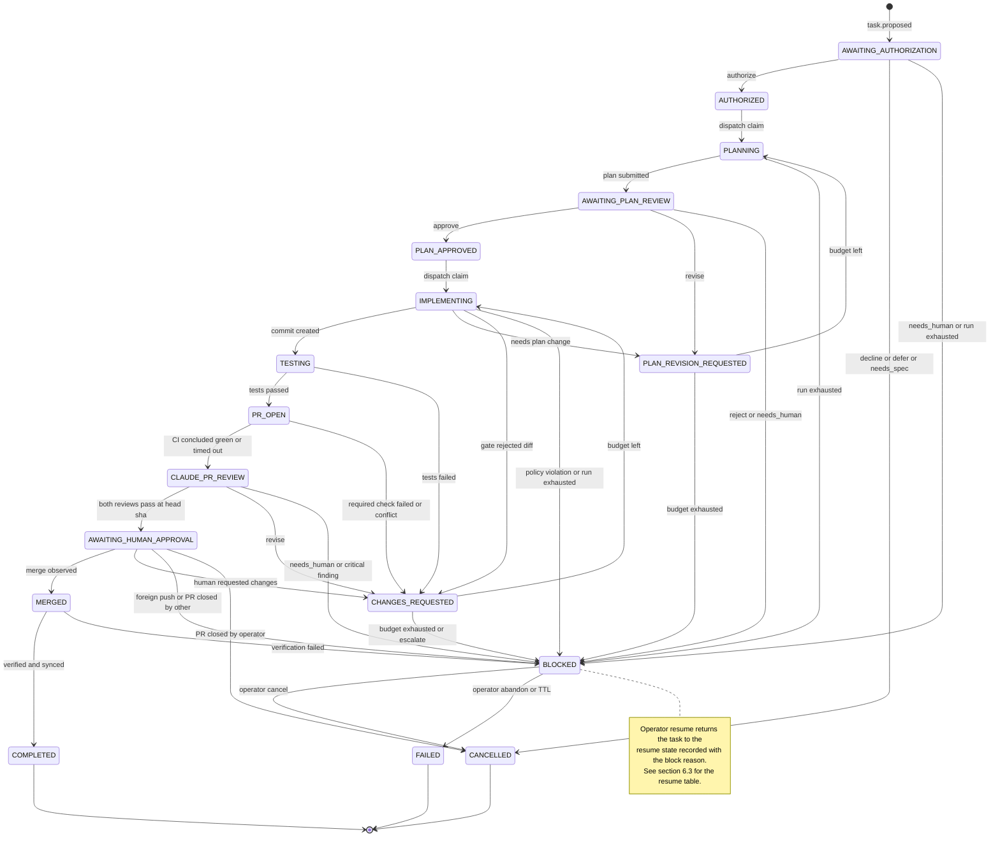
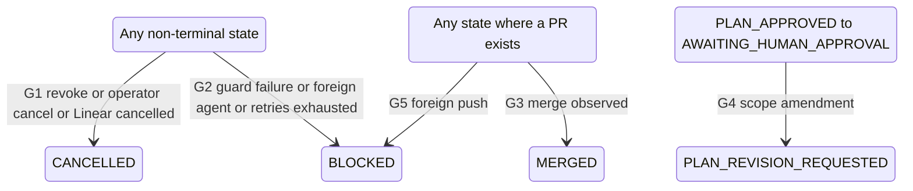

# MERCURY Task State Machine

Owner: Agent C (Staff Engineer). Status: Phase 2 design proposal. Design only.

This document is the **single source of truth** for task states, transitions, guards, evidence, retry and timeout rules, invariants and recovery semantics. It refines `architecture/overview.md` §8–§9 (Agent A). Persistent tables are defined in [`components.md` §6](components.md#6-persistent-data-model). Message payloads are defined in [`../protocols/messages.md`](../protocols/messages.md). Agent run invocation details (flags, prompts) are owned by Agent B in `integrations/claude.md` and `integrations/codex.md`.

Conventions:

- State names are `UPPER_SNAKE`. Event names are `lower.dotted`.
- *Initiator* is the authority whose output or action causes the transition. Exactly one of: **Claude** (a validated Claude decision run), **Codex-result** (a validated Codex run result; Codex never decides a transition by itself, the coordinator classifies its result), **Coordinator** (deterministic rule), **Operator** (human via `mercury` CLI over the local control socket), **GitHub** (polled observation), **Linear** (polled observation).
- *Evidence* is what the transition row stores in `task_transitions.evidence_json`: IDs and SHA-256 hashes. A transition without its required evidence is rejected by the Transition Engine.
- Assumptions are labelled `ASM-C-nn` and listed in [`../reviews/12-agent-C-report.md` §6](../reviews/12-agent-C-report.md#6-assumptions).

---

## 1. Design decisions on the state list

The baseline listed 18 candidate states. This design keeps **17 task states** and moves one to the issue level. Each change has a reason.

| Baseline | Decision | Reason |
|---|---|---|
| `DISCOVERED` | **Moved to the issue level** (`linear_issues.mercury_status = 'discovered'`). It is not a task state | A task is a unit of authorized-or-being-authorized work bound to one issue. Hundreds of backlog issues are "discovered". Making each a task would fill the task table with rows that have no authority, no runs and no lifecycle, and would make the "one active task per issue" index meaningless. Discovery and eligibility are facts about the issue, which the Linear poller owns. Agent A's Linear projection treats `DISCOVERED` and `AWAITING_AUTHORIZATION` identically (`Todo` unchanged), so the projection is unaffected |
| `AWAITING_AUTHORIZATION` | Kept. A task row is created here when triage shortlists the issue or the operator requests an authorization decision | It is where the Claude `authorization` decision run executes and where the audit trail begins ("which Linear issue started the task") |
| `TESTING` | **Kept as a distinct state**, not a sub-state of `IMPLEMENTING` | Different executor (the coordinator's sandboxed test runner, not Codex), different evidence (authoritative `test.results` bound to a commit SHA), different timeout, and a different failure route (test failure is a revision cycle, Codex failure is a run retry). Agent B's two-layer test decision (`integrations/codex.md` §10) needs a state where Codex is *not* running and the commit exists |
| `PR_OPEN` | Kept | The coordinator is pushing and opening or updating the PR through the outbox and waiting for required CI on the head SHA. Distinct from Claude review, which starts only when CI concludes |
| `MERGED` and `COMPLETED` | **Both kept** | `MERGED` is the durable checkpoint "code is on the base branch, verification and post-merge side effects pending". A crash between merge detection and the Linear update must resume from here. `COMPLETED` is terminal: verification passed and every post-merge outbox item is done |
| `BLOCKED` | Kept, with a narrower meaning: **a human decision is required**. The task never leaves `BLOCKED` without an operator command (or a Claude re-authorization where the reason allows it, §6.3) | Separates "needs a person" from "waiting for the machine". Reason codes in §6.1 |
| `FAILED` | Kept, terminal: the work could not be completed and the operator abandoned it, or it sat in `BLOCKED` past the abandonment TTL | Distinguishes "gave up" from "stopped on purpose" (`CANCELLED`) for metrics and audit |
| `CANCELLED` | Kept, terminal: work was stopped deliberately (authorization declined, deferred or revoked, operator cancel, Linear issue cancelled, PR closed by the operator) | — |
| *(new)* paused / waiting for host | **Not states.** Modelled as **holds** (§5), orthogonal to state | Operator pause, sleep, offline, rate limits, expired agent credentials, low disk and spec changes are conditions that stop *new* work without changing *what phase the task is in*. Encoding them as states would double the transition table and lose the resume point. A hold never needs a resume target because the state never changed |

### 1.1 State classes

Every non-terminal state belongs to exactly one class. The class decides what the dispatcher and the recovery manager do with it.

| Class | Meaning | States |
|---|---|---|
| **Work** | The coordinator must execute one or more runs or steps. The dispatcher starts the next required run when no active run exists, no hold applies and a slot is free | `AWAITING_AUTHORIZATION`, `PLANNING`, `AWAITING_PLAN_REVIEW`, `IMPLEMENTING`, `TESTING`, `PR_OPEN`, `CLAUDE_PR_REVIEW`, `MERGED` |
| **Gate** | Ready, waiting for a dispatch slot and guards (dependencies, authorization, approval binding). Leaving a gate state is the dispatcher's claim | `AUTHORIZED`, `PLAN_APPROVED` |
| **Decision point** | Transient. Entered with the reason for the next cycle. The coordinator checks the revision budget and either obtains the revision instruction or escalates. Usually left within one tick | `PLAN_REVISION_REQUESTED`, `CHANGES_REQUESTED` |
| **Human wait** | Waiting for the operator's action in GitHub (approval, merge) or in the CLI | `AWAITING_HUMAN_APPROVAL`, `BLOCKED` |
| **Terminal** | No outgoing transitions (enforced by a DB trigger) | `COMPLETED`, `FAILED`, `CANCELLED` |

### 1.2 Final state list

| # | State | Class | Linear projection (Agent B owns final mapping) | Required action / what is awaited |
|---|---|---|---|---|
| 1 | `AWAITING_AUTHORIZATION` | Work | unchanged (`Todo`) | Claude `authorization` decision run |
| 2 | `AUTHORIZED` | Gate | `In Progress` | Dependencies resolved, Codex slot, worktree provisioned |
| 3 | `PLANNING` | Work | `In Progress` | Codex planning run (read-only sandbox) |
| 4 | `AWAITING_PLAN_REVIEW` | Work | `In Progress` | Claude `plan_review` decision run |
| 5 | `PLAN_REVISION_REQUESTED` | Decision point | `In Progress` | Plan revision budget check; Claude `revision_request` run only for non-review sources |
| 6 | `PLAN_APPROVED` | Gate | `In Progress` | Approval binding re-check, Codex slot |
| 7 | `IMPLEMENTING` | Work | `In Progress` | Optional `deps_install` step, Codex implementation run (workspace-write, no network), coordinator commit pipeline |
| 8 | `TESTING` | Work | `In Progress` | Coordinator test runner (L2) on the commit SHA |
| 9 | `PR_OPEN` | Work | `In Progress` | Push, PR create or update (outbox), required CI on head SHA |
| 10 | `CLAUDE_PR_REVIEW` | Work | `In Progress` | Claude `pr_code_review` and `pr_security_review` runs at the exact head SHA |
| 11 | `CHANGES_REQUESTED` | Decision point | `In Progress` | Revision budget check; Claude `revision_request` run for CI, test, human or conflict sources |
| 12 | `AWAITING_HUMAN_APPROVAL` | Human wait | `In Review` | Operator approves and merges in GitHub |
| 13 | `MERGED` | Work | `In Review` until verified, then `Done` | Merge verification, post-merge outbox, worktree cleanup scheduling |
| 14 | `BLOCKED` | Human wait | `In Progress` + escalation comment | Operator command |
| 15 | `COMPLETED` | Terminal | `Done` | — |
| 16 | `FAILED` | Terminal | unchanged + comment | — |
| 17 | `CANCELLED` | Terminal | unchanged + comment (MERCURY never cancels a Linear issue) | — |

---

## 2. State diagram

### 2.1 Main lifecycle



### 2.2 Global transitions (apply from many states)



---

## 3. Transition table

Run kinds, retry counts and timeouts referenced here are defined in §7. "Outbox" means a row in `outbox` written in the same transaction (side effect executed later, idempotently). "Msg" means a row in `messages` (protocol message, schema in `protocols/`). Every transition also writes one `task_transitions` row, one `audit_log` row, updates `tasks.state`, `tasks.state_version` and `tasks.state_entered_at`, and enqueues the Linear projection outbox item when the projected Linear state changes. Those common effects are not repeated per row.

### 3.1 Creation and authorization

| ID | From → To | Event | Initiator | Guards | Required evidence | Persistent side effects | Retry / timeout |
|---|---|---|---|---|---|---|---|
| T01 | ∅ → `AWAITING_AUTHORIZATION` | `task.proposed` | Coordinator (from a validated triage proposal and free capacity) or Operator (`mercury request authorize <issue>`) | Issue `eligible` (team allowed, `mercury` label present per OD-A-02, no `Not Speced` label, repo mapping resolves, not `delegate`d to a foreign agent); no non-terminal task for the issue (unique index); issue not in decline cool-down (`linear_issues.cooldown_until`); global WIP below `limits.max_active_tasks` | `issue_snapshot` artifact id + sha256; triage run id + proposal artifact sha (or operator `control_request_id`) | Insert `tasks` (state, `issue_snapshot_artifact_id`, `proposal_source`); `linear_issues.mercury_status = 'task_open'`. No protocol message yet: the first message for a task is `task.authorization` (T02) or `task.failed` (T03/T04) | — |
| T02 | `AWAITING_AUTHORIZATION` → `AUTHORIZED` | `authorization.granted` | Claude | Decision run `succeeded`, output passed V1–V4 (`integrations/claude.md` §6); `input_digest` echo matches; `decision = authorize`; scope narrows the repo policy template only; limits clamped to config maxima; issue snapshot hash in output binding equals the current `linear_issues.description_sha256` | `run_id`, output artifact sha256, `authorization_id` + `version=1` + `payload_sha256`, `issue_snapshot_sha256` | Insert `authorizations` v1 (Decision Recorder only; DB trigger checks the run), msg `task.authorization`, outbox: Linear comment "authorized" (marker), set `tasks.current_authorization_*`, `tasks.priority` | Run retries per §7 (`claude_authorize`) |
| T03 | `AWAITING_AUTHORIZATION` → `CANCELLED` | `authorization.declined` | Claude | Decision is `decline`, `defer` or `needs_spec` | `run_id`, output sha256, decision | `tasks.cancel_reason = authorization_declined / authorization_deferred / needs_spec`; set `linear_issues.cooldown_until` (decline: until the spec hash changes; defer: `defer_until` from output, max 14 d); outbox: Linear comment with Claude's rationale or spec questions (`needs_spec`); msg `task.failed{outcome:cancelled}` | — |
| T04 | `AWAITING_AUTHORIZATION` → `BLOCKED` | `authorization.needs_human` / `run.exhausted` | Claude / Coordinator | Decision `needs_human`; or `claude_authorize` attempts exhausted | `run_id`(s), failure classes | `blocked_reason = needs_human_decision / decision_run_failed`, `resume_state = AWAITING_AUTHORIZATION`; notification `decision_needed`; msg `task.failed{outcome:blocked}` | Notification dedup per reason |

### 3.2 Planning and plan review

| ID | From → To | Event | Initiator | Guards | Required evidence | Persistent side effects | Retry / timeout |
|---|---|---|---|---|---|---|---|
| T05 | `AUTHORIZED` → `PLANNING` | `dispatch.claimed` | Coordinator | **Authorization guard** (§8.1) passes; dependencies resolved (§8.4); no blocking hold; Codex slot free (global, per repo); task worktree `ready` at `base_sha`; reference checkout at `base_sha` exists | `authorization_id`, `version`, `payload_sha256`; `base_sha`; `worktree_id` | Insert `runs(kind=codex_plan, attempt=1, authorization_*)`, set `worktrees.lock_run_id`; msg `task.assignment` | — |
| T06 | `PLANNING` → `AWAITING_PLAN_REVIEW` | `plan.submitted` | Codex-result | Run `succeeded`; `final.json` valid against `mercury.output.codex_plan.v1`; worktree unchanged (`git status --porcelain` empty, HEAD = `base_sha`; read-only sandbox self-check); `run.authorization_version` still current | `run_id`, `plan_id`, `plan_version`, plan artifact sha256 | Insert `artifacts`, `plans(version = n)`; `tasks.current_plan_id`; release worktree lock; msg `plan` | — |
| T07 | `PLANNING` → `PLANNING` (no state change) | `run.retry_scheduled` | Coordinator | Failure class retryable and attempts < max | failed `run_id`, class | Run row terminal; `tasks.next_action_at = now + backoff` | §7 `codex_plan` |
| T08 | `PLANNING` → `BLOCKED` | `run.exhausted` | Coordinator | Attempts exhausted, or non-retryable class (`config_fatal` excluded: that is a global hold) | all attempt `run_id`s | `blocked_reason = run_exhausted`, `resume_state = PLANNING`; notification `unrecoverable_failure` | — |
| T09 | `AWAITING_PLAN_REVIEW` → `PLAN_APPROVED` | `plan_review.approved` | Claude | Review run validated (V1–V4); output `plan_sha256` echo = `plans.sha256` of `tasks.current_plan_id` = sha256 recomputed from the artifact file; `decision = approve` with no finding of severity `blocking`, `critical` or `high`; every parsed AC id appears in `ac_coverage` with `covered = true`; authorization version current | `review_id`, review artifact sha256, `plan_id`, `plan_sha256`, `authorization_id`, `version` | Insert `plan_reviews`, `findings`, **`plan_approvals`** (`plan_id` unique, binds plan sha and authorization version); msgs `plan.review`, `plan.approval`; outbox: Linear comment summary | — |
| T10 | `AWAITING_PLAN_REVIEW` → `PLAN_REVISION_REQUESTED` | `plan_review.revise` | Claude | Validated; `decision = revise`; at least one `required_change` | `review_id`, sha256, finding ids | Insert `plan_reviews`, `findings`, `revision_requests(kind=plan, source=claude_plan_review)` rendered from Claude's `required_change` texts verbatim; msgs `plan.review`, `plan.revision_request` | — |
| T11 | `AWAITING_PLAN_REVIEW` → `BLOCKED` | `plan_review.escalated` | Claude / Coordinator | `decision ∈ {reject, needs_human}`, or `injection_suspected = true`, or review attempts exhausted | `review_id` or run ids | `blocked_reason = plan_rejected / needs_human_decision / injection_suspected / run_exhausted`, `resume_state = AWAITING_PLAN_REVIEW` (or `PLAN_REVISION_REQUESTED` for `plan_rejected`); notification | — |
| T12 | `PLAN_REVISION_REQUESTED` → `PLANNING` | `revision.dispatched` | Coordinator | `plan_revision_count + 1 ≤ limits.max_plan_revisions` (+ operator grants); a `revision_requests` row exists for this cycle (from T10, or from a completed Claude `revision_request` run for non-review sources); authorization guard; Codex slot | `revision_request_id`, artifact sha; authorization ids | `tasks.plan_revision_count += 1`; insert `runs(kind=codex_plan, revision_request_id, resume thread)`; msg `task.assignment` | — |
| T13 | `PLAN_REVISION_REQUESTED` → `BLOCKED` | `revision.limit_exceeded` / `revision_request.escalate` | Coordinator / Claude | Budget exhausted, or Claude `revision_request` run returned `action = escalate` | counter values; run id | `blocked_reason = plan_revision_limit / needs_human_decision`, `resume_state = PLAN_REVISION_REQUESTED`; notification `repeated_plan_review_failure` | — |

### 3.3 Implementation, commit and local tests

| ID | From → To | Event | Initiator | Guards | Required evidence | Persistent side effects | Retry / timeout |
|---|---|---|---|---|---|---|---|
| T14 | `PLAN_APPROVED` → `IMPLEMENTING` | `dispatch.claimed` | Coordinator | **Approval binding guard** (§8.2) + authorization guard (§8.1); no hold; Codex slot; worktree `ready`, HEAD equals `tasks.last_commit_sha` or `base_sha`, no uncommitted changes | `approval_id`, `plan_id`, `plan_sha256`, `authorization_id`, `version` | Insert `runs(kind=deps_install)` if the repo config requires it, else `runs(kind=codex_implement, approval_id NOT NULL)`; worktree lock; msg `task.assignment` | — |
| T15 | `IMPLEMENTING` → `TESTING` | `implementation.committed` | Codex-result + Coordinator | Codex run `succeeded`, output valid and `status = completed`; **diff gate** passes (protected paths, authorization `denied_paths`, lockfile rule, symlinks, size, submodules; `integrations/codex.md` §9); **secret scan** clean; non-empty diff; commit created by the coordinator with trailers `Mercury-Task`, `Mercury-Run`, `Mercury-Plan`, `Mercury-Authorization` | `run_id`, impl result sha256, `commit_sha`, diff artifact sha256, gate report sha256 | `tasks.last_commit_sha`; artifacts; msg `implementation.progress{phase:finished}`; insert `runs(kind=verify, commit_sha)` is **not** done here (the dispatcher starts it in `TESTING`) | Commit step idempotent: key `git:commit:<run_id>` (if HEAD already carries `Mercury-Run: <run_id>`, skip) |
| T16 | `IMPLEMENTING` → `IMPLEMENTING` | `run.retry_scheduled` | Coordinator | Retryable class, attempts < max | run id, class | Backoff; worktree reset policy per `integrations/codex.md` §12 | §7 `codex_implement` |
| T17 | `IMPLEMENTING` → `PLAN_REVISION_REQUESTED` | `implementation.needs_plan_change` | Codex-result | Output `status = needs_plan_change` with `deviations[]` | run id, output sha | Worktree reset to `tasks.last_commit_sha` or `base_sha` (uncommitted changes archived as a patch artifact first); `revision_requests(kind=plan, source=codex_deviation)` pending a Claude `revision_request` run; the current plan approval no longer applies to the next plan version | — |
| T18 | `IMPLEMENTING` → `CHANGES_REQUESTED` | `gate.rejected` | Coordinator | Diff gate rejected a **non-security** rule (e.g. lockfile change not in plan, diff too large, file outside plan but inside scope is *not* a rejection) | gate report sha256 | `revision_requests(kind=code, source=diff_gate)`; archive rejected diff as artifact | Counts toward `verify_fix_count` |
| T19 | `IMPLEMENTING` → `BLOCKED` | `policy.violation` / `run.exhausted` / `implementation.blocked` | Coordinator / Codex-result | Secret-scan hit, protected-path write, symlink escape, forbidden event type (`mcp_tool_call`, `web_search`) seen in JSONL; or attempts exhausted; or Codex `status = blocked` | evidence ids (rule ids only, never secret content) | `blocked_reason = security_policy_violation / run_exhausted / implementer_blocked`; security notification for violations; worktree quarantined (`worktrees.status = quarantined`) for violations | — |
| T20 | `TESTING` → `PR_OPEN` | `verify.passed` | Coordinator | `verify` run on `commit_sha = tasks.last_commit_sha` exited 0 for every required command (or the plan declared the exact known failures, flagged for Claude review) | `test_result_id`, artifact sha256, `commit_sha` | Insert `test_results(source=local_verify)`; msg `test.results`; outbox (ordered): `git.push` → `github.pr.upsert` → `github.pr.labels` | — |
| T21 | `TESTING` → `CHANGES_REQUESTED` | `verify.failed` | Coordinator | A required command failed or timed out (after one infra retry for `timed_out` only) | `test_result_id`, sha256 | `test_results`; msg `test.results`; `revision_requests(kind=code, source=local_tests)` pending Claude `revision_request` run | Counts toward `verify_fix_count` |

### 3.4 Pull request, Claude review, human approval

| ID | From → To | Event | Initiator | Guards | Required evidence | Persistent side effects | Retry / timeout |
|---|---|---|---|---|---|---|---|
| T22 | `PR_OPEN` → `CLAUDE_PR_REVIEW` | `ci.concluded` | GitHub (poll) + Coordinator | Outbox `git.push` and `github.pr.upsert` done; observed PR head SHA = `tasks.last_commit_sha` = `pull_requests.local_head_sha`; every required check for that SHA concluded `success` / `neutral` / `skipped`, **or** the CI wait deadline passed after a fresh post-deadline poll (`ci_status = timed_out`) | `pr_number`, `head_sha`, check-run summary artifact sha256 | `pull_requests.ci_status`; msg `pr.created` (emitted when the PR is first confirmed, dedup on `pr:<repo>:<number>`); review checkout creation scheduled | CI wait: §7.3 |
| T23 | `PR_OPEN` → `CHANGES_REQUESTED` | `ci.failed` / `pr.conflict` | GitHub + Coordinator | A required check concluded `failure` / `timed_out` / `cancelled` / `action_required` on the current head SHA; or `mergeable = false` because of a base conflict | head sha, failing check ids and summary artifact sha | `revision_requests(kind=code, source=ci / merge_conflict)` pending Claude `revision_request` run | Counts toward `verify_fix_count` |
| T24 | `CLAUDE_PR_REVIEW` → `AWAITING_HUMAN_APPROVAL` | `pr_review.passed` | Claude | **PR review binding guard** (§8.3): a `pr_reviews(kind=code)` row with `decision = approve` and a `pr_reviews(kind=security)` row with `decision = approve` (security is mandatory per Agent B), both with `head_sha` = current observed head SHA; no open finding with severity in `{blocking, critical, high}`; AC coverage complete; `injection_suspected = false` | both `review_id`s, sha256s, `head_sha` | Insert `pr_reviews`, `findings`; msgs `code.review`, `security.findings`; outbox (ordered): `github.review.post(event=COMMENT)` with summary and marker, `github.pr.ready_for_review` (undraft), `github.pr.request_reviewers(operator)`, Linear comment; notification `pr_ready_for_approval` | — |
| T25 | `CLAUDE_PR_REVIEW` → `CHANGES_REQUESTED` | `pr_review.revise` | Claude | Code review `decision = revise`, or security review has a `high` finding (or `decision = revise`) | review ids, sha256s, head sha | `pr_reviews`, `findings`; `revision_requests(kind=code, source=claude_code_review / claude_security_review)` rendered from Claude's `required_change` texts verbatim; outbox `github.review.post(event=REQUEST_CHANGES)`; msgs `code.review`, `security.findings`, `revision.request` | — |
| T26 | `CLAUDE_PR_REVIEW` → `BLOCKED` | `pr_review.escalated` | Claude / Coordinator | Any `critical` security finding; `decision ∈ {reject, needs_human}`; `injection_suspected`; review attempts exhausted | review ids or run ids | `blocked_reason = security_escalation / needs_human_decision / injection_suspected / run_exhausted`; notification `security_escalation` (critical) or `decision_needed` | — |
| T27 | `CLAUDE_PR_REVIEW` → `CLAUDE_PR_REVIEW` | `pr.head_changed_by_coordinator` | Coordinator | Only possible if a push was re-issued by recovery (same commit). Otherwise G5 applies | old/new head sha | Abort review runs bound to the old SHA; reviews for the old SHA remain stored and are simply no longer valid (validity is derived from `head_sha` equality) | — |
| T28 | `CHANGES_REQUESTED` → `IMPLEMENTING` | `revision.dispatched` | Coordinator | Counter for the source (§9) + 1 ≤ limit; a `revision_requests` row for this cycle with `action = revise`; approval binding guard (the plan has not changed); authorization guard; Codex slot | `revision_request_id`, sha256, approval id | Counter += 1; insert `runs(kind=codex_revise, approval_id, revision_request_id)`; msg `task.assignment` | — |
| T29 | `CHANGES_REQUESTED` → `BLOCKED` | `revision.limit_exceeded` / `revision_request.escalate` | Coordinator / Claude | Budget exhausted, or Claude `revision_request` returned `escalate`, or the instruction requires a plan change outside the approved plan (`needs_plan_change`, which goes to `PLAN_REVISION_REQUESTED` instead when the plan budget remains) | counters, run ids | `blocked_reason = pr_revision_limit / verify_fix_limit / human_change_limit / needs_human_decision`; notification | — |
| T30 | `CHANGES_REQUESTED` → `PLAN_REVISION_REQUESTED` | `revision_request.needs_plan_change` | Claude | Claude `revision_request.action = replan`; plan budget remains | run id, sha | `revision_requests(kind=plan, source=claude_revision_request)`; current approval stops applying once a new plan version exists | — |
| T31 | `AWAITING_HUMAN_APPROVAL` → `MERGED` | `pr.merged` | GitHub | Poll shows `merged = true` with `merge_commit_sha` | PR snapshot artifact sha256 (`merged_by`, `merged_at`, `merge_commit_sha`, head sha) | `pull_requests` merge fields; msg none yet (completion message at T34) | — |
| T32 | `AWAITING_HUMAN_APPROVAL` → `CHANGES_REQUESTED` | `human_review.changes_requested` | GitHub (operator identity) | A review with `state = CHANGES_REQUESTED` (or unresolved review comments plus a `mercury:revise` label, OD-C-03) from the configured operator login, on the current head SHA | GitHub review id, snapshot sha | `github_reviews` row; `revision_requests(kind=code, source=human_review)` pending a Claude `revision_request` run (the human's text is passed to Claude and then Codex as quoted data) | Counts toward `human_change_count` |
| T33 | `AWAITING_HUMAN_APPROVAL` → `CANCELLED` | `pr.closed_by_operator` | GitHub | PR `state = closed`, `merged = false`, `closed_by` = operator login (from the issue events API, ASM-C-13) | PR snapshot sha | `cancel_reason = pr_closed_by_human`; worktree archived; outbox Linear comment | — |

### 3.5 Merge verification and completion

| ID | From → To | Event | Initiator | Guards | Required evidence | Persistent side effects | Retry / timeout |
|---|---|---|---|---|---|---|---|
| T34 | `MERGED` → `COMPLETED` | `merge.verified` | Coordinator | **Merge verification** (§8.5) passes; every post-merge outbox item for the task is `done` (Linear state `Done` set or observed already `Done`, Linear completion comment) | verification artifact sha256 (all four checks with values) | Insert `merge_verifications`; msg `task.completed`; worktree `cleanup_due_at = now + retention`; release all task leases | Verification polls retried with backoff; §7.3 |
| T35 | `MERGED` → `BLOCKED` | `merge.verification_failed` | Coordinator | Any verification check failed definitively (not "data not yet available") | verification artifact sha256 | `blocked_reason = merge_verification_failed`; **security notification**; Linear is **not** moved to `Done` by MERCURY | — |

### 3.6 BLOCKED exits

| ID | From → To | Event | Initiator | Guards | Required evidence | Persistent side effects | Retry / timeout |
|---|---|---|---|---|---|---|---|
| T36 | `BLOCKED` → `resume_state` | `operator.resume` | Operator | The block reason allows `resume` (§6.3); the action's preconditions hold (e.g. a budget grant for revision limits; delegation removed for `foreign_agent`); the authorization guard is re-evaluated when the resume state is a Codex gate or work state | `control_request_id`, grant id if any | Insert `budget_grants` if the action grants cycles; clear `blocked_*`; audit | — |
| T37 | `BLOCKED` → `resume_state` (after re-authorization) | `authorization.regranted` | Claude (run requested by the operator with `mercury request reauth <task>`) | Reason ∈ {`reauthorization_required`, `authorization_expired`}; a new authorization version from a Claude `authorization` run passes V1–V4 | new `authorization_id/version`, run id | Insert `authorizations` v n+1; return to `resume_state` | — |
| T38 | `BLOCKED` → `CANCELLED` | `operator.cancel` | Operator | — | `control_request_id` | Cancel protocol (§8.6) | — |
| T39 | `BLOCKED` → `FAILED` | `operator.abandon` / `blocked.ttl_expired` | Operator / Coordinator | Operator command; or `blocked_since + limits.blocked_ttl` (default 30 d wall clock) passed and reminders were sent | `control_request_id` or timer id | Worktree archived; msg `task.failed{outcome:failed}`; notification `task_abandoned` | — |
| T40 | `BLOCKED(merge_verification_failed)` → `COMPLETED` | `operator.ack_merge` | Operator | Operator explicitly acknowledges (`mercury ack-merge <task> --reason`) | `control_request_id`, reason text sha | `merge_verifications.waived_by_operator = 1`; msg `task.completed{verification_waived:true}` | — |

### 3.7 Global transitions

| ID | From → To | Event | Initiator | Guards | Required evidence | Persistent side effects |
|---|---|---|---|---|---|---|
| G1a | any non-terminal → `CANCELLED` | `authorization.revoked` | Claude (revocation decision) or Operator (`mercury revoke`, recorded as an operator revocation row, not as a Claude authorization) | — | revocation authorization version or control request id | Cancel protocol (§8.6): stop runs, archive worktree, outbox PR comment + convert PR to draft (never close), Linear comment |
| G1b | any non-terminal → `CANCELLED` | `operator.cancel` | Operator | — | control request id | Same |
| G1c | any non-terminal except `MERGED` → `CANCELLED` | `linear.issue_cancelled` | Linear | Issue state type becomes `canceled` or `duplicate` (status changes may always *stop* work, `overview.md` §9.2) | issue snapshot sha | Same |
| G2 | any work or gate state → `BLOCKED` | `guard.failed` | Coordinator | Guard returned a non-retryable reason (§6.1), e.g. authorization integrity failure, approval missing, worktree HEAD unexpected, `foreign_agent` delegation, `reauthorization_required` after DB restore | guard report | `blocked_reason`, `resume_state = current state`; notification (deduplicated) |
| G3 | `IMPLEMENTING`, `TESTING`, `PR_OPEN`, `CLAUDE_PR_REVIEW`, `CHANGES_REQUESTED`, `AWAITING_HUMAN_APPROVAL`, `BLOCKED` (with PR) → `MERGED` | `pr.merged` | GitHub | `merged = true` | PR snapshot sha | Stop active runs (cancel protocol without PR comment); verification will record `merged_before_claude_review = true` if no valid Claude reviews exist for the merged head, which fails verification (T35) |
| G4 | `PLAN_APPROVED`, `IMPLEMENTING`, `TESTING`, `PR_OPEN`, `CLAUDE_PR_REVIEW`, `CHANGES_REQUESTED`, `AWAITING_HUMAN_APPROVAL` → `PLAN_REVISION_REQUESTED` | `authorization.scope_amended` | Claude | New authorization version with `amendment_kind = scope` | new authorization version, sha | Stop active run; `revision_requests(kind=plan, source=authorization_amended)`; existing approval no longer satisfies the guard because it binds the old authorization version; a `limits`-only amendment changes nothing else |
| G5 | `PR_OPEN`, `CLAUDE_PR_REVIEW`, `AWAITING_HUMAN_APPROVAL` → `BLOCKED` | `pr.foreign_push` | GitHub | Observed head SHA ≠ `pull_requests.local_head_sha` and not a pending coordinator push | old and new SHA, pusher login if known | `blocked_reason = foreign_push` (`overview.md` C7); all Claude reviews for the old SHA become invalid automatically; notification. Operator resumes with `--adopt` (task → `CLAUDE_PR_REVIEW` at the new SHA after `TESTING` on it) or `--reset` (coordinator pushes its SHA back to the `mercury/*` branch, fast-forward only if possible, else `--force-with-lease` on the task branch only) |
| G6 | `PR_OPEN`, `CLAUDE_PR_REVIEW`, `CHANGES_REQUESTED`, `IMPLEMENTING`, `TESTING` → `BLOCKED` | `pr.closed_by_other` | GitHub | PR closed, not merged, closed by a non-operator login | PR snapshot | `blocked_reason = pr_closed_unexpectedly`; security notification (`overview.md` C6) |

Events that are **not** transitions (handled as holds, timers or no-ops):

- Linear status change of any kind except G1c: recorded in `events_inbox`, may set or clear a hold (§5), **never** creates a task or moves it into `AUTHORIZED`, `PLANNING` or `IMPLEMENTING` (invariant I17).
- Human `APPROVED` review on GitHub: recorded in `github_reviews`. No transition. MERCURY waits for the merge.
- Linear Done set by Linear's GitHub integration before verification: recorded; `MERGED` verification proceeds normally.

---

## 4. Invariants

Each invariant names its enforcement layer: **DB** (constraint or trigger, holds even if application code is wrong), **TE** (Transition Engine guard), **Code** (structural: the method does not exist), **Recon** (detected by the reconciler/consistency checker).

| ID | Invariant | Enforcement |
|---|---|---|
| I1 | At most one non-terminal task per Linear issue | DB: `ux_tasks_active_issue` partial unique index |
| I2 | At most one active **mutating** run per task (Codex, `deps_install`, `verify`, git steps); at most one active run per (task, kind) | DB: `ux_runs_active_mutating`, `ux_runs_active_kind` |
| I3 | A Codex run (`codex_plan`, `codex_implement`, `codex_revise`) exists only with a non-revoked, unexpired authorization version that was current at claim time and whose issue snapshot hash equals the current Linear snapshot hash | DB: `CHECK` (authorization columns NOT NULL for Codex kinds) + FK; TE: §8.1 at claim |
| I4 | An implementation run (`codex_implement`, `codex_revise`) exists only with a `plan_approvals` row whose `plan_sha256` equals the sha256 of the current plan artifact and whose `authorization_version` equals the task's current authorization version | DB: `CHECK (approval_id NOT NULL)` + FK; TE: §8.2 |
| I5 | A plan approval binds exactly one plan version. A new plan version never inherits an approval | DB: `plan_approvals.plan_id UNIQUE`, `plan_sha256` copied and compared by trigger |
| I6 | `AWAITING_HUMAN_APPROVAL` is entered only with code and security reviews approving the exact current head SHA. Review validity is derived (`pr_reviews.head_sha = pull_requests.head_sha`), never a mutable flag | TE: §8.3; Recon: on every poll |
| I7 | Every state change has exactly one `task_transitions` row whose `from_state` equals the previous state; `tasks.state` equals the latest row's `to_state` | DB: insert trigger compares `from_state` with `tasks.state`; Recon: daily consistency check |
| I8 | Terminal states have no outgoing transitions | DB: update trigger on `tasks.state` |
| I9 | The coordinator never merges a PR, never submits an `APPROVE` review, never dismisses reviews, never changes branch protection | Code: `GitHubPort` has no such methods; contract test greps the adapter for forbidden endpoints; GitHub App lacks `administration` permission |
| I10 | Agents never write the DB, never receive GitHub or Linear credentials, never see the control socket token | Code: env allowlist; Seatbelt (Codex); tool allowlist (Claude); ASM-C-03 |
| I11 | Every external side effect is an outbox row with a unique idempotency key, written in the same transaction as the state change that caused it | Code + DB: `outbox.idempotency_key UNIQUE` |
| I12 | Every external observation is processed at most once | DB: `events_inbox UNIQUE(source, dedup_key)` + `processed_at` |
| I13 | `authorizations`, `plans`, `plan_reviews`, `plan_approvals`, `pr_reviews`, `task_transitions`, `messages`, `artifacts`, `audit_log` are append-only | DB: `BEFORE UPDATE/DELETE` triggers raise `ABORT` |
| I14 | A worktree is removed only when the task is terminal, and only if it has no uncommitted changes or an archive artifact exists for them | Code (WorktreeManager) + DB: `CHECK` on `worktrees` status transition via trigger |
| I15 | No revision counter exceeds its limit plus the sum of operator `budget_grants` for it | TE; Recon |
| I16 | At most one live `mercuryd` instance owns the database | `flock` on the lock file + `leases('daemon')` with fencing token |
| I17 | No Linear observation can move a task into `AUTHORIZED`, `PLANNING`, `PLAN_APPROVED` or `IMPLEMENTING`, or create an authorization | Code: Linear event handlers can only call `cancel`, `hold`, `release`, `block`; TE rejects these targets for initiator `linear`; test |
| I18 | Only the Decision Recorder inserts `authorizations` (decision kinds `authorize`/`amend`/`revoke` by Claude), `plan_approvals`, `plan_reviews`, `pr_reviews`; each insert references a `succeeded` Claude run whose `output_sha256` equals the record's source hash. Operator revocations are rows in `operator_revocations`, never in `authorizations` | DB: insert triggers (`overview.md` §8.4 control 2); Code |
| I19 | A transition's initiator must be allowed for that row of the table (e.g. only `Claude` may cause T02, T09, T24) | TE: the transition table is data; the engine rejects mismatches |
| I20 | Deadlines that measure agent work use awake time; deadlines that measure waits on external parties fire only after a successful poll made after the deadline | Code (Clock and TimerService); tests with a fake clock |

---

## 5. Holds: conditions orthogonal to state

A **hold** prevents the dispatcher from starting *new* runs or steps in its scope. It does not change the task state. Active runs continue unless the hold kind says `stop_runs`. Holds are rows in `holds` and are visible in `mercury status`.

| Hold kind | Scope | Set by | Cleared by | Stops active runs? | Effect on timers |
|---|---|---|---|---|---|
| `operator_pause` | global / repo / task | Operator `mercury pause` | Operator `mercury resume` | No (use `mercury cancel-run` to stop one) | Human-wait reminders continue; run deadlines unaffected |
| `host_sleep_grace` | global | Health monitor on detected sleep gap | Automatically after `wake_grace` (default 120 s) and a successful connectivity probe | No | Run idle and stall timers frozen during grace |
| `network_down` | global | Connectivity probe failure (GitHub and Linear both unreachable) | Probe success | No (agent runs may fail and be classified `network_down`, which is not counted as an attempt) | External-wait deadlines cannot fire (I20) |
| `rate_limited` | integration (`github`/`linear`) | Adapter on 403/429 with `retry-after` | Time passes | No | Polls deferred |
| `agent_auth_failed` | agent (`claude`/`codex`) | Run classified `authentication_failed` / `billing_error` | Next successful self-test (operator `mercury doctor --recheck`, or automatic every 30 min) | No | — |
| `budget_exhausted` | agent or task | Daily Claude spend cap or task token cap reached | Next day / operator grant | No | — |
| `config_fatal` | global or agent | Startup self-test failed (pinned version mismatch, missing flag, schema hash mismatch) | Successful self-test | Yes (no new runs start; running ones finish) | — |
| `low_disk` | global | Free space < `disk.min_free_gb` (default 10 GB) | Free space recovered | No | — |
| `spec_changed` | task | Linear poller: current description sha256 ≠ authorization's `issue_snapshot_sha256` | New authorization version (Claude re-authorization run with the diff) | No: a running Codex run finishes but its result is not acted on until re-authorized (`overview.md` C1) | Dispatcher schedules a Claude `authorization` run in `reauthorize` mode |
| `dependency_unresolved` | task | Linear relation `blockedBy` with an unresolved blocker added or found | Blocker resolved (§8.4) | No | — |
| `deprioritized` | task | `mercury` label removed or issue moved back to `Backlog` | Label restored | No | — |
| `waiting_retry` | task | Run failed with a retryable class | `tasks.next_action_at` passes | — | — |

Why a hold and not `BLOCKED` for `spec_changed`, `dependency_unresolved` and `deprioritized`: these resolve automatically or through Claude, so `BLOCKED` (human required) would raise notifications that need no action, the noise the Slack workflow suffered from. Agent A's conflict table (`overview.md` §9.3, C1/C3/C5) uses `BLOCKED` with automatic resume for them; this is the only material difference and is listed for Phase 4 reconciliation in the report.

---

## 6. BLOCKED, FAILED and CANCELLED semantics

### 6.1 Block reason codes

| Reason | Entered from | Notification kind | Resume actions allowed |
|---|---|---|---|
| `needs_human_decision` | T04, T11, T13, T26, T29 | `decision_needed` | `resume` (re-run the decision), `cancel`, `abandon` |
| `decision_run_failed` / `run_exhausted` | T04, T08, T11, T19, T26 | `unrecoverable_failure` | `retry` (one more attempt budget), `cancel`, `abandon` |
| `plan_rejected` | T11 | `decision_needed` | `resume --to PLAN_REVISION_REQUESTED` (needs a grant if the budget is exhausted), `cancel` |
| `plan_revision_limit`, `pr_revision_limit`, `verify_fix_limit`, `human_change_limit` | T13, T29 | `repeated_review_failure` | `grant --counter <c> --extra n` then `resume`, `cancel`, `abandon` |
| `security_policy_violation` | T19 | `security_escalation` | `resume --discard-worktree-changes` (reset to last commit), `cancel` |
| `security_escalation` | T26 | `security_escalation` | `resume` (re-review after human inspection), `cancel` |
| `injection_suspected` | T11, T26 | `security_escalation` | `resume`, `cancel` |
| `implementer_blocked` | T19 | `decision_needed` | `resume --to PLAN_REVISION_REQUESTED`, `cancel` |
| `foreign_push` | G5 | `decision_needed` | `resume --adopt`, `resume --reset`, `cancel` |
| `foreign_agent` | G2 | `decision_needed` | `resume` (only when the Linear `delegate` no longer names a foreign agent) |
| `pr_closed_unexpectedly` | G6 | `security_escalation` | `resume --reopen` (outbox reopens the PR), `cancel` |
| `merge_verification_failed` | T35 | `security_escalation` (highest) | `ack-merge`, `resume` (re-verify) |
| `authorization_expired` | G2 | `decision_needed` | `request-reauth` (Claude re-authorization, T37), `cancel` |
| `reauthorization_required` | G2 after DB restore (`overview.md` C10) | `decision_needed` | `request-reauth`, `cancel` |
| `guard_integrity_failure` | G2 (hash mismatch on artifact, authorization payload, audit chain) | `security_escalation` | `cancel`, `abandon` only |
| `external_state_conflict` | G2 (`overview.md` C4) | `decision_needed` | `resume`, `cancel` |

### 6.2 How BLOCKED, FAILED, CANCELLED and holds differ

| Aspect | Hold | `BLOCKED` | `FAILED` | `CANCELLED` |
|---|---|---|---|---|
| Changes state? | No | Yes | Yes (terminal) | Yes (terminal) |
| Needs a human? | No (auto-clears) unless `operator_pause` | Yes | No (already decided) | No |
| Worktree | Kept | Kept (quarantined for security reasons) | Archived, then removed after retention | Archived, then removed after retention |
| PR | Unchanged | Unchanged (draft for security reasons) | Converted to draft + comment | Converted to draft + comment; never closed by MERCURY |
| Notifications | None, except `low_disk`, `agent_auth_failed`, `config_fatal`, `budget_exhausted` (global, deduplicated) | One per (task, reason, resume-epoch) + reminders 24 h, 72 h, then weekly | One | One (unless the operator did it) |
| Linear projection | Unchanged | `In Progress` + escalation comment | unchanged + comment | unchanged + comment |

### 6.3 Resume semantics

`tasks.blocked_from_state` records where the task was. `tasks.resume_state` is computed from the reason when the block is entered (normally equal to `blocked_from_state`; exceptions are listed in §6.1). On `mercury resume`:

1. The Transition Engine re-evaluates every guard of `resume_state` as if it were being entered fresh (authorization guard, approval binding, review binding, dependency check).
2. If a guard fails, the task stays `BLOCKED` and the operator sees the failing guard; no partial resume happens.
3. Work-state resumes do not re-use stale runs: any run that was active when the block happened was cancelled at block time.

---

## 7. Retry, timeout and clock rules

### 7.1 Run retries per kind

Failure classes come from the adapters (`integrations/claude.md` §10, `integrations/codex.md` §11). Classes `network_down`, `rate_limited`, `agent_auth_failed`, `config_fatal`, `lost_by_coordinator_crash` (claim committed, process never started) and `cancelled_by_coordinator` **do not consume attempts**. They set a hold or are re-dispatched.

| Run kind | Executor | Lane | Awake deadline | Stall timeout | Max attempts | Backoff | On exhaustion |
|---|---|---|---|---|---|---|---|
| `claude_triage` | Claude | read-only | 5 min | 2 min | 2 per cycle | 5 min | Skip cycle; notify after 3 consecutive failed cycles |
| `claude_authorize` | Claude | read-only | 15 min | 5 min | 3 | 2, 10 min | T04 |
| `codex_plan` | Codex | mutating (worktree lock, read-only sandbox) | 45 min | 10 min | 3 | 2, 10, 30 min | T08 |
| `claude_plan_review` | Claude | read-only | 20 min | 5 min | 3 | 2, 10 min | T11 |
| `claude_revision_request` | Claude | read-only | 10 min | 5 min | 3 | 2, 10 min | T13 / T29 |
| `deps_install` | Coordinator process | mutating | 20 min | 10 min (no output) | 2 | 5 min | T19 (`run_exhausted`) |
| `codex_implement` / `codex_revise` | Codex | mutating | 120 min (`authorization.limits.max_codex_awake_minutes`, clamped) | 15 min | 2 (resume thread after `stalled`, fresh after `crash`) | 5, 20 min | T19 |
| `verify` | Coordinator test runner | mutating | `repo.test_timeout` (20 min) | 10 min (no output) | 2 for infra failures only; a test failure is a result, not a retry | 2 min | T19 (`run_exhausted`) |
| `claude_code_review` / `claude_security_review` | Claude | read-only | 30 min | 5 min | 3 | 2, 10 min | T26 |
| `git_step` (commit, review-checkout creation) | Coordinator | mutating | 5 min | — | 5 | 30 s exponential | `BLOCKED(run_exhausted)` |

Backoff: `delay = min(base × 2^(attempt-1), max) × U(0.8, 1.2)`. Output-invalid results get exactly one retry as a fresh session with the same input (Agent B), then count as a failed attempt.

### 7.2 Awake time versus wall time

- Every running run accumulates `runs.awake_ms`. Each supervisor tick credits `min(Δmonotonic, Δwall, tick_credit_cap)` with `tick_credit_cap = 3 × tick_interval`. A gap larger than the cap (sleep, `SIGSTOP`, suspended VM) is **not** credited. This works whether or not the monotonic clock advances during macOS sleep (ASM-C-02).
- Stall detection uses `runs.idle_awake_ms`: reset on every agent event, otherwise credited like `awake_ms`. It is frozen while `host_sleep_grace` is active.
- A run deadline fires when `awake_ms ≥ max_awake_ms`; the stall timer fires when `idle_awake_ms ≥ stall_ms`.

### 7.3 State-level timers

| State | Timer | Clock | Action when it fires |
|---|---|---|---|
| `AWAITING_AUTHORIZATION` | 24 h without a decision (decision runs kept failing or holds) | wall | Notification `decision_needed` (once) |
| `AUTHORIZED` / `PLAN_APPROVED` | Authorization `expires_at` | wall | G2 → `BLOCKED(authorization_expired)` at the next dispatch attempt |
| `PR_OPEN` | CI wait `repo.ci_wait` (default 90 min) since push | wall, fires only after a fresh poll made after the deadline (I20) | T22 with `ci_status = timed_out` (Claude still reviews; required checks still gate merge in GitHub) |
| `PR_OPEN` | PR upsert outbox item `dead` | — | `BLOCKED(run_exhausted)` |
| `AWAITING_HUMAN_APPROVAL` | 24 h, 72 h, then every 7 d | wall | Reminder notification only. Never a transition |
| `MERGED` | Verification not complete 24 h after merge | wall | `BLOCKED(external_state_conflict)` |
| `BLOCKED` | 24 h, 72 h, weekly reminders; `blocked_ttl` 30 d | wall | Reminder; T39 at TTL |

---

## 8. Guard specifications

### 8.1 Authorization guard (all Codex dispatches and the resume of Codex states)

```text
authorizationGuard(tx, task, now):
  a = tx.authorizations.latestVersion(task.authorization_id)            # max(version)
  fail(guard_integrity_failure) unless a
  fail(guard_integrity_failure) unless sha256(JCS(a.payload_json)) == a.payload_sha256
  fail(guard_integrity_failure) unless a.version == 1 or a.previous_sha256 == tx.authorizations.get(a.id, a.version-1).payload_sha256
  fail(guard_integrity_failure) unless hmacOk(a)                        # optional, Milestone 2 (overview §8.6)
  fail(cancelled)               if a.decision == 'revoke' or tx.operatorRevocations.exists(task)
  fail(authorization_expired)   if now_wall >= a.expires_at
  fail(guard_integrity_failure) unless a.task_id == task.id and a.repo == task.repo and a.issue_linear_id == task.issue_linear_id
  r = tx.runs.get(a.issued_by_run_id)
  fail(guard_integrity_failure) unless r.agent == 'claude' and r.kind == 'claude_authorize' and r.status == 'succeeded'
                                   and r.output_sha256 == a.source_output_sha256
  hold(spec_changed)            if tx.linearIssues.get(task.issue).description_sha256 != a.issue_snapshot_sha256
  hold(budget_exhausted)        if task.codex_awake_ms_total >= a.limits.max_codex_awake_minutes_total*60000
  return ok(a)
```

`fail(x)` moves the task to `BLOCKED(x)` (G2) except `cancelled` (G1a). `hold(x)` writes a hold and returns "not now" without a transition.

### 8.2 Plan approval binding guard (implementation dispatch)

```text
approvalGuard(tx, task, a /* from 8.1 */):
  p  = tx.plans.get(task.current_plan_id)
  fail(guard_integrity_failure) unless p
  bytes = artifactStore.read(p.artifact_id)            # outside tx: read before BEGIN, verify hash inside
  fail(guard_integrity_failure) unless sha256(bytes) == p.sha256
  ap = tx.planApprovals.byPlan(p.plan_id)
  fail(approval_missing → BLOCKED(guard_integrity_failure)) unless ap
  fail(...) unless ap.plan_sha256 == p.sha256
  fail(...) unless ap.authorization_id == a.id and ap.authorization_version == a.version
     # a scope amendment (G4) creates a.version+1 so the approval no longer matches: re-plan required
     # a limits-only amendment: approvals carry authorization_version_floor; see note
  rv = tx.planReviews.get(ap.review_id)
  fail(...) unless rv.decision == 'approve' and rv.plan_sha256 == p.sha256
  return ok(ap)
```

Note on limits-only amendments: an authorization version with `amendment_kind = limits` must not force re-planning. The guard therefore compares `ap.authorization_version` with `a.scope_version` (the version number of the latest authorization version that changed scope), which is a column on `authorizations` computed at insert time. Scope amendments increment `scope_version`; limits amendments copy it.

The Codex implementation prompt is built from `bytes` (the artifact store copy), never from a file in the worktree.

### 8.3 PR review binding guard (entering `AWAITING_HUMAN_APPROVAL`)

```text
reviewGuard(tx, task):
  pr = tx.pullRequests.active(task.id)
  head = pr.head_sha                                    # last observed by poll
  fail(foreign_push) unless head == pr.local_head_sha == task.last_commit_sha
  fail(stale_observation → retry later) if pr.observed_at < max(review runs ended_at)   # poll again first
  code = tx.prReviews.latest(task.id, kind='code', head_sha=head)
  sec  = tx.prReviews.latest(task.id, kind='security', head_sha=head)
  notReady unless code and sec
  fail(...) unless code.decision == 'approve' and sec.decision == 'approve'
  fail(...) if tx.findings.open(task.id, head).any(f => f.severity in ['blocking','critical','high'])
  return ok(code, sec)
```

Any later head change (poll) makes `pr_reviews` rows for the old SHA irrelevant because every consumer queries by the current `head_sha`. No row is mutated.

### 8.4 Dependency guard

```text
dependenciesResolved(tx, task):
  for b in tx.issueRelations.blockersOf(task.issue_linear_id):     # Linear 'blocks' inverse
    bi = tx.linearIssues.get(b)
    if bi.state_type == 'completed':
       bt = tx.tasks.latestFor(b)                                   # MERCURY task for the blocker, if any
       if bt is null: continue                                      # blocker done outside MERCURY: trust Linear Done
       if bt.state == 'COMPLETED': continue                          # merged and verified
       return hold(dependency_unresolved)                           # Linear Done but MERCURY not verified yet
    if bi.state_type in ('canceled','duplicate'): return block(external_state_conflict)  # human decides
    return hold(dependency_unresolved)
  if cycleDetected(task.issue_linear_id): return block(external_state_conflict)
  return ok
```

Checked at T05 (before planning). It is **not** re-checked at T14 unless a new blocker relation was observed since T05 (then `dependency_unresolved` hold).

### 8.5 Merge verification (T34 / T35)

```text
verifyMerge(task):
  pr      = github.getPull(repo, number)                         # fresh, no cache
  require pr.merged == true and pr.merge_commit_sha and pr.merged_at
  check1  = pr.merged_by.login == config.operator.github_login
  reviews = github.listReviews(repo, number)                      # all pages
  headAtMerge = pr.head.sha
  check2  = reviews.any(r => r.user.login == operator and r.state == 'APPROVED' and r.commit_id == headAtMerge)
            and not reviews.any(r => r.user.login == operator and r.state == 'CHANGES_REQUESTED'
                                     and r.submitted_at > thatApproval.submitted_at)
  check3  = github.compareCommits(repo, base=pr.base.ref, head=pr.merge_commit_sha).status in ('identical','behind')
            # merge commit reachable from the base branch tip
  check4  = requiredChecks(headAtMerge).all(success|neutral|skipped)
  check5  = tx.prReviews.validFor(task, headAtMerge, kinds=['code','security']).bothApprove
            # false => merged_before_claude_review (still a failure: human merged unreviewed code)
  if any check is "data not yet available" (e.g. 404 shortly after merge): retry later (no transition)
  record merge_verifications row with all values
  if all: T34 path (enqueue Linear Done + comment, then COMPLETED when outbox done)
  else:   T35
```

`check1` is detective only on a personal-account repository (`02-discovery-platform.md` §1.4). `check5` failing does not mean an attack (the operator may merge early on purpose), but it is still reported because the review boundary was skipped.

### 8.6 Cancel protocol (G1, T38)

1. In one transaction: transition to `CANCELLED`, set `cancel_reason`, mark active runs `stopping`, enqueue outbox items (PR comment with marker, PR convert-to-draft, Linear comment), schedule worktree archive.
2. After commit: `AgentRunner.cancel(run)` for each active run (§ `components.md` §8.5).
3. Worktree archive step (§ `components.md` §9.5). Cleanup after retention.

---

## 9. Revision cycle counters and escalation

| Counter (`tasks.*`) | Incremented when | Default limit | Hard cap (config) | Source of limit | Exhaustion |
|---|---|---|---|---|---|
| `plan_revision_count` | T12 (each Codex re-plan dispatch) | N = 3 | 5 | `authorization.limits.max_plan_revisions` | `BLOCKED(plan_revision_limit)` + `repeated_review_failure` notification |
| `pr_review_cycle_count` | T28 when source ∈ {`claude_code_review`, `claude_security_review`} | M = 3 | 5 | `authorization.limits.max_pr_revisions` | `BLOCKED(pr_revision_limit)` |
| `verify_fix_count` | T28 when source ∈ {`local_tests`, `ci`, `diff_gate`, `merge_conflict`} | K = 3 | 6 | `authorization.limits.max_verify_fix_cycles` | `BLOCKED(verify_fix_limit)` |
| `human_change_count` | T28 when source = `human_review` | H = 5 | 10 | config only (human is in the loop) | `BLOCKED(human_change_limit)` |
| `run attempts` | per run kind, per state entry | §7.1 | — | config | per §7.1 |

Rules:

- **R1. Plan revision invalidates approval.** A plan approval binds `(plan_id, plan_sha256, authorization_id, scope_version)`. Every re-plan creates a new `plans` row with a new `plan_id` and (almost certainly) a new hash; `tasks.current_plan_id` moves to it; the approval guard (§8.2) fails until Claude approves *that* plan. There is no "carry over approval" path in code. An identical re-submitted plan (same sha256) still needs a new approval row, because the approval row is keyed by `plan_id`.
- **R2. A new commit after Claude PR review invalidates that review.** Reviews are bound to `head_sha`. The coordinator's own new commit only happens through `CHANGES_REQUESTED → IMPLEMENTING → TESTING → PR_OPEN → CLAUDE_PR_REVIEW`, which always runs new reviews. A foreign commit triggers G5.
- **R3. Budgets are per task**, survive restarts (columns, not memory) and can only be raised by an operator `budget_grants` row. Claude cannot raise limits (Agent A: a `retry` decision cannot raise limits).
- **R4. Escalation produces exactly one notification per (task, reason, epoch)**. Epoch increments on every `resume`, so a second exhaustion after a grant notifies again.

---

## 10. Recovery semantics per state

Executed by the Recovery Manager at startup and after a wake gap, after the run reconciliation pass ([`components.md` §10.6](components.md#106-startup-recovery)). "Live run" means a `runs` row in `starting/running/stopping` whose process identity was confirmed (pid + start time + fingerprint) and that was **adopted**. "No live run" means none exists or it was found dead (its result, if any, has been finalized first).

| State | With a live adopted run | Without a live run |
|---|---|---|
| `AWAITING_AUTHORIZATION` | Claude runs are not adoptable (SDK pipes die with the coordinator): kill the group, mark `lost_by_coordinator_crash` (no attempt consumed), re-dispatch | Re-dispatch the `claude_authorize` run (input bundle is rebuilt from stored artifacts, same `input_digest`) |
| `AUTHORIZED` | n/a | Nothing special; the dispatcher re-evaluates guards on the next tick |
| `PLANNING` | Codex run adopted: continue tailing `events.jsonl`; on exit read `exit.json` and finalize | If `exit.json` exists with exit 0 and `final.json` valid: finalize as success (T06). Else classify (crash) and apply retry policy |
| `AWAITING_PLAN_REVIEW` | Kill and re-dispatch (not adoptable) | Re-dispatch review; if a validated review artifact exists for this plan sha but the transition was not committed (crash between artifact write and commit), the Decision Recorder re-runs validation and records it (idempotent on `run_id`) |
| `PLAN_REVISION_REQUESTED` / `CHANGES_REQUESTED` | Claude `revision_request` run: kill and re-dispatch | Re-evaluate the decision point (budget check, revision request presence) |
| `PLAN_APPROVED` | n/a | Re-evaluate guards; dispatch when possible |
| `IMPLEMENTING` | Adopt the Codex run | If `exit.json` says success and the commit step did not complete: re-run the idempotent commit pipeline (detects `Mercury-Run` trailer on HEAD). If the worktree has uncommitted changes and no success exit: archive them as a patch artifact, then apply the retry policy (resume or reset) |
| `TESTING` | `verify` runs are adoptable (stdout to files, `exit.json`) | If the result file exists, finalize; else re-run `verify` (no attempt consumed for `lost`) |
| `PR_OPEN` | n/a | Re-drive outbox items (idempotent: push compares remote SHA; PR upsert searches by head branch); force a PR poll |
| `CLAUDE_PR_REVIEW` | Kill and re-dispatch reviews for the **current** head SHA (re-polled first) | Same; review checkout recreated if missing |
| `AWAITING_HUMAN_APPROVAL` | n/a | Full PR poll (may produce T31, T32, T33, G5) |
| `MERGED` | n/a | Re-run verification and post-merge outbox |
| `BLOCKED` | Should not have a live run (cancelled at block time); if one is found, kill it | Nothing; re-send nothing (notification dedup) |
| Terminal | Kill any live run found (should not exist) | Resume pending cleanup and outbox items only |

Additional startup rules:

- **Downtime notice.** If the previous instance's last heartbeat is older than 60 min, enqueue one `coordinator_downtime` notification with the interval (Agent D owns wording).
- **DB restored from backup** (`overview.md` C10): every non-terminal task whose latest authorization row cannot be verified, or whose runs reference artifacts missing on disk, goes to `BLOCKED(reauthorization_required)`.

---

## 11. Transition Engine contract

The transition table in §3 is implemented as **data** (`src/core/transitions.ts`) and this document is checked against it by a test that renders the table and diffs it with this file (documentation drift test).

```ts
export interface TransitionRule {
  id: string;                         // "T09"
  from: TaskState | "*" | TaskState[];
  to: TaskState | "RESUME_STATE";
  event: TaskEventType;
  initiators: Initiator[];            // I19
  guards: GuardId[];                  // evaluated in order inside the transaction
  evidence: EvidenceKey[];            // required keys in evidence_json
  effects: EffectId[];                // rows to write: messages, outbox, holds, counters
}
```

Engine algorithm (pseudocode in [`components.md` §10.2](components.md#102-transition-engine)): one `BEGIN IMMEDIATE` transaction per event; optimistic check on `tasks.state_version`; rule lookup by `(from, event)`; initiator check; guards; evidence completeness; insert transition, messages, outbox, audit; update task; commit. Any failure rolls back everything; no partial transition is possible. Side effects run after commit.
