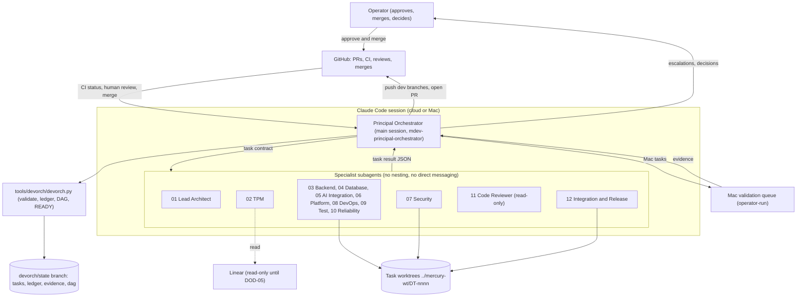
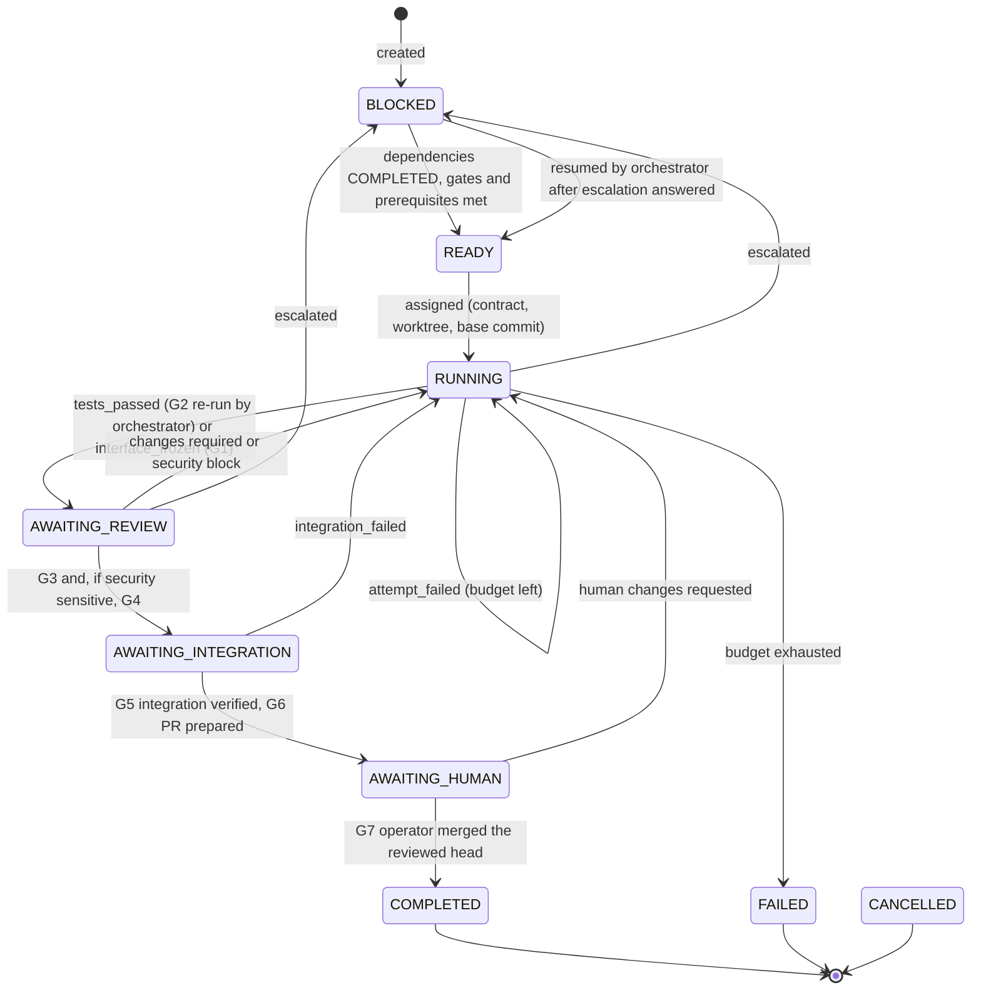

# 01 — Multi-Agent Development Architecture

Status: **Proposed** (requires operator approval; see `12-amendments.md` DOD-01). Scope: the *temporary* system used to **build** MERCURY. It is not the production MERCURY orchestrator and it changes no production design decision.

## 1. Two systems, kept apart

| | Development orchestration (this package) | Production MERCURY (TDD) |
|---|---|---|
| Purpose | Build the MERCURY code base | Coordinate Claude and Codex on target repos |
| Orchestrator | A Claude Code **main session** acting as Principal Orchestrator (`mdev-principal-orchestrator`) | `mercuryd`, a deterministic TypeScript daemon |
| Workers | 12 Claude Code project subagents `mdev-*` | Claude decision runs and Codex exec runs under `_mercuryagent` |
| Durable state | Git ledger branch `devorch/state` + GitHub PRs | SQLite (`MERCURY_HOME`) |
| Contracts | `devorch.task_contract.v1` / `devorch.task_result.v1` / `devorch.handoff.v1` | `mercury.*.v1` (protocols/schemas) |
| Identity | The operator's Claude Code session and its GitHub authorization (see DOD-03) | `mercury-bot`, `mercury-ops`, Linear app, `_mercuryagent` |
| Human authority | Operator approves and merges every PR into `main` | Operator approves and merges every PR on target repos |

**Separation rules.**
- **S1 — no reuse of production schemas or identities.** Development contracts never reuse production `mercury.*` schemas or identities.
- **S2 — no shared credentials.** Development agents never hold or use MERCURY's production credentials, which do not exist yet and are created by the operator in P0c.
- **S3 — production stays separate from development config.** Production MERCURY must never read `.claude/agents/mdev-*`, `CLAUDE.md` or `.devorch/`. Its Claude runs use `settingSources: []` (SEC-204), so they don't.
- **S4 — self-hosting changes nothing in development.** When MERCURY later works on its own repository (`11-self-hosting-transition.md`), production rules apply to the work MERCURY does, and `.claude/**` and `CLAUDE.md` become block- and escalate-class paths for it (SEC-310). The development system is not weakened by this.

## 2. Component view

## 3. Responsibilities and authority

| Actor | May | May not |
|---|---|---|
| Operator | Approve the TDD and amendments; answer escalations; run Mac and [ROOT] steps; approve and merge PRs; create Linear issues | — |
| Principal Orchestrator | Select READY tasks, write contracts, dispatch specialists, verify results mechanically, record ledger transitions, push `dev/*` branches, open PRs, write progress reports | Merge, approve, change settings, protections or credentials; mark a gate passed without evidence; modify design documents outside an approved task |
| Specialists | Work inside their worktree and allowed paths; commit to their task branch; return results | Push, merge, spawn agents, message each other, pick work, change frozen interfaces |
| Code Reviewer | Read and re-run tests | Edit anything |
| `devorch.py` | Enforce the transition table, gate prerequisites, result checks and hash chain | Decide anything |

## 4. Authoritative source per state category

| Category | Authoritative source | Notes |
|---|---|---|
| Design (requirements, contracts, ADRs) | `docs/mercury/**` on `main` after operator merge. Before that, the approved design commit recorded in each contract (`approved_design_refs …@<sha>`) | — |
| Backlog definition | `planning/issue-breakdown.md` (DAG via `devorch.py dag`) until Linear issues exist, **then Linear** (DOD-05) | — |
| Development task state (READY…CLOSED), attempts, gate records | **Ledger** (`devorch/state:ledger/<task>.jsonl`, hash-chained) | — |
| Code, branches, commits | Git (task branches; reviewed head SHAs recorded in the ledger) | — |
| CI results | GitHub Checks | — |
| Human approval and merge | **GitHub only** (`merged_by`, approving review on the merged head) | — |
| Mac validation evidence | Evidence files committed to the ledger branch by the orchestrator from operator-provided output | — |

A Linear status change never starts development work. Only a ledger `assigned` record, written by the orchestrator for a READY task, does.

## 5. Development task state machine

Any non-terminal state can also move to `CANCELLED` (operator), and to `BLOCKED` on `contract_revised`. A revised contract invalidates prior results and gates. The machine-readable table is `TRANSITIONS` in `tools/devorch/devorch.py`. A return to `RUNNING` clears the gates recorded since the last entry into RUNNING, so a correction always repeats review.

**Evidence stages required by the brief → ledger events:**

| Stage | Event | Gate |
|---|---|---|
| Task assigned | `assigned` | — |
| Task started | `started` | — |
| Implementation completed | `implementation_completed` (valid result, `check-result` VALID) | — |
| Tests passed | `tests_passed` | G2 |
| Code review completed | `code_review_passed` | G3 |
| Security review completed | `security_review_passed` | G4 |
| Integration verified | `integration_verified` | G5 |
| Pull request prepared | `pr_prepared` | G6 |
| Awaiting human approval | state `AWAITING_HUMAN` | — |
| Human-approved and merged | `human_merged` | G7 |
| Closed | `closed` (worktree removed, dependents re-evaluated) | — |

## 6. Why this shape (decisions and alternatives)

| Decision | Alternatives rejected | Reason |
|---|---|---|
| Orchestrator = main session, not a subagent | An orchestrator subagent | Subagents cannot outlive their task or reliably hold the loop. The main session can be resumed and re-reads the ledger. |
| No subagent nesting, no peer messaging | Peer-to-peer handoffs via `SendMessage` | One audited coordinator. Peer messages are not durable and would bypass the ledger. |
| Git ledger branch | Linear as state store; conversation memory | Durable across container loss (pushed), reviewable and diffable. Linear writes are not authorized yet. Conversation memory is lost on interruption. |
| Mechanical result verification | Trust agent reports | The brief forbids completion on claims alone. `check-result` compares claims with git. |
| Explicit worktrees from a recorded base | `isolation: worktree` | The built-in option branches from `main`, which lacks the design. Explicit base commits make reviews reproducible. |
| 12 specialists, most used rarely | Fewer, generalist agents | Specialization only where the expertise pays (review, security, DB). The dispatch policy (`02-…` §4) avoids launching agents to keep them busy. |
| Small stdlib tool | Implementing parts of MERCURY early to run development | It would violate "no implementation before approval" and confuse the two systems (S1–S4). |
