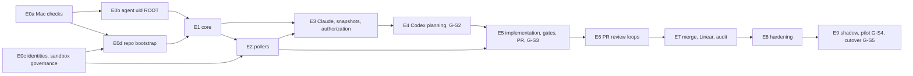

# 05 — Dependency Graph, Critical-Path Analysis and Parallel Execution Plan

**Every duration in this document is an estimate from a model, not measured data.** Inputs:

- `data/dag.json`, generated by `python3 tools/devorch/devorch.py dag` from `planning/issue-breakdown.md`;
- `tools/devorch/assignments.json`, which assigns each issue to an agent;
- `tools/devorch/schedule_model.py`, which reproduces every number here.

## 1. Verified counts

| Item | Value | Method |
|---|---|---|
| Issues | **82** (79 base + 3 conditional: MERC-1K1, MERC-3A1, MERC-807b) | `devorch.py dag` (matches roadmap/issue-breakdown) |
| Epics | 13 (E0a–E0d, E1–E9) | same |
| Dependency cycles | **0** | DFS in `devorch.py` |
| Dependency critical path | 51.0 P50 engineer-days, 26 issues | longest path in the DAG |
| Issues needing the Mac or the operator (T4/T5/ⓗ/[ROOT]) | 38 of 79 (20 fully, 18 for a validation step) | env field |
| Pure agent-executable issues | 41 (≈ 89 P50 engineer-days) | same |
| [ROOT] issues | MERC-010, MERC-011, MERC-107 (install part) | env field |

## 2. Dependency graph

### 2.1 Epic level (from issue-breakdown.md §2.1, verified)

### 2.2 Critical path (issue level)

## 3. Phase 11 questions answered

| # | Question | Answer (evidence: §5 table, `dag.json`) |
|---|---|---|
| 1 | Genuinely sequential | The M1 spine 101→102→103→104→106, the review chain 501→502→507→601→602→604→701, and the M9 sequence 901→904→905→906 (shadow and pilot are calendar-bound) |
| 2 | Concurrent | Phase 0 operator lane ∥ repo bootstrap; 112, 402a, 303 and 107 ∥ the M1 spine; 201 ∥ 202 ∥ 109 ∥ 704 after 106; 401 ∥ 301 ∥ 504 after 402a; 703/704/706 ∥ M5–M6; 801/804/806 ∥ 805 |
| 3 | Can start against mocks | Adapters (201, 202, 302, 401) against frozen `src/ports/*` with fakes from 112; 303 (schemas) any time after 112; 504/505 (git hardening) against fixture repos; 703 against a fake ops channel |
| 4 | Interfaces to freeze first | `src/ports/{store,clock,process,agents,github,linear,git}.ts`, the transition-table data format (104) and the DDL `0001_initial.sql` (103). The Lead Architect freezes them in DT tasks at the start of W1 (§6) |
| 5 | Integration bottlenecks | 106 (queue/outbox, 40 downstream), 304 (authorization guards), 506 (policy and presence: four upstream lines), 507 (PR creation), 602 (check run). Each needs an Integration and Release task |
| 6 | Need the real Mac | 001–003, 010–012, 107 (install), 302/401/502/503 validation, 406 (G-S2), 706, 802 (VM), 803, 805, 807, 901–905 |
| 7 | Security prerequisites that cannot be bypassed | G-S1 (Claude isolation self-test), **G-S2 (SEC-T-20 canaries before any non-sandbox write run)**, G-S3 (before the first push), G-S4 (pilot), G-S5 (G-ORG + OD-36 before unattended); also TDD approval (Gate 1) and the operator-consented root steps |
| 8 | Most downstream unblocked | 020 (70), 021 (68), 030 (64), 101 (63), 102 (56), 103 (46), 104 (44), 001 (43), 106 (40), 010 (40), 011 (35), 402a (34) |
| 9 | Milestones that overlap safely | P0a/P0b (operator) ∥ P0d + early M1 (agents); M2 ∥ M3 (after 106); M7's 703/704/706 ∥ M5/M6; M8's 801/804/806 ∥ M7's tail. **Not**: M5 before G-S2; M9b before G-S4; unattended before G-S5 |
| 10 | Activities on the critical path | The 26 issues in §2.2, plus, under capacity limits, the **operator/Mac lane** (≈ 32 lane-days of Mac/operator work before calendar delays) and the shadow (10 days) and pilot (5 days) calendar windows |

## 4. Scenarios

**Method.** List scheduling over the DAG (priority: longest remaining path, then downstream count).

- **Two lanes.** N agent workers, plus one operator/Mac lane that can only run one task at a time.
- **Agent work** takes P50 × *speed factor*, plus a review, test and integration overhead per task. Security-sensitive tasks get extra overhead, and integration overhead grows with each worker beyond 2.
- **Mixed tasks** put 35 % of their effort on the Mac lane at 0.8×.
- **Pure operator tasks** run at 0.7×, because agents pre-write their scripts.
- **Fixed calendar** is added at gates: shadow 10 days, pilot 5, and 1 day at each of 005/406/508/805/905.

**Speed factor:** agent-days per human engineer-day. It is optimistic 0.40, expected 0.55, pessimistic 0.80 with estimates inflated 25 %. **This factor is an assumption, not a measurement.** It must be re-fitted from the first 10 completed tasks (`09-…` §4).

| Scenario | Workers | Optimistic | **Expected** | Pessimistic | Agent-lane utilization (expected) |
|---|---|---|---|---|---|
| A Conservative | 2 | 69 | **77** | 102 | 0.64 |
| B Balanced (**recommended start**) | 3 | 68 | **73** | 96 | 0.49 |
| C Accelerated: more workers only | 5 | 75 | **80** | 101 | 0.33 |
| C′ Accelerated: 4 workers + macOS CI runners / VM take Mac validation (2 Mac lanes, Mac share 20 %) | 4 | 64 | **69** | 90 | 0.45 |

Units: elapsed **working days** from TDD approval and MERC-020. About 5 working days per calendar week, so B expected ≈ 15 weeks.

**Sensitivity (B, expected):**

| Variation | Elapsed working days |
|---|---|
| Unlimited agents | 70 (the floor is the operator/Mac lane plus calendar) |
| Operator available half-time | **88** |
| Without the shadow, pilot and gate calendar windows | 58 (not permitted; shown only to size them) |
| One worker | 111 |

**Interpretation.**

1. **The operator/Mac lane is the binding constraint, not agent count.** Adding agents beyond 3 *increases* elapsed time: more integration and review overhead, the same lane.
2. **The biggest levers** are operator availability, shifting Mac validation to GitHub-hosted macOS runners and a macOS VM where the TDD allows it (C′), and making the operator decisions (MERC-020) early.
3. **Comparison with the earlier estimate.** The historical 157 P50 / 216 P90 engineer-days for a single human is **not** divided by agent count. The scenarios model capacity, overheads and gates explicitly.

| Scenario | Critical path | Bottlenecks | Integration overhead | Major risks | Confidence |
|---|---|---|---|---|---|
| A | The §2.2 chain + operator lane | Agent lane during M1–M5 (utilization 0.64); review queue | Low (≈ 0.4 d/task) | Slower M1; reviewer queueing | Medium-low (speed factor unmeasured) |
| B | Same; operator lane dominates after W2 | Operator lane; Security Engineer reviews (≈ 60 security-sensitive issues) | Moderate (+0.1 d/task) | Operator availability; Phase 0 surprises (ASM failures → conditional issues, +12–22 days) | Medium-low |
| C | Same | Operator lane; integration conflicts; human PR queue | High (+0.45 d/task) | Rubber-stamping risk (RISK-22) from a large PR queue; laptop memory | Low |
| C′ | Shorter Mac tail | GitHub macOS runner minutes; VM fidelity (P0-047) | Moderate | macOS runner cannot nest VMs; TDD requires real-Mac evidence for some SACs | Low |

## 5. Per-issue analysis and parallel execution plan (scenario B, expected)

Columns: transitive prerequisites and downstream counts are from the DAG. "Model start → finish" is the simulated working day. Waves group work that runs together. File-conflict risk is governed by the path-ownership registry (`06-…` §4); issues in the same wave never share an owned path.

| Issue | Title | Agent / lane | Direct deps | Transitive prereqs | Downstream | Longest path P50 | Critical | Mac/operator | Security | Model start → finish (B, expected) | Wave |
|---|---|---|---|---|---|---|---|---|---|---|---|
| MERC-020 | Operator decision session | operator | — | 0 | 70 | 51.0 | **yes** | yes |  | 0.0 → 0.3 | W0 Phase 0 + bootstrap |
| MERC-001 | Mac read-only facts | mac | — | 0 | 43 | 39.0 |  | yes |  | 0.3 → 0.7 | W0 Phase 0 + bootstrap |
| MERC-021 | GitHub Apps and keys | operator | 020 | 1 | 68 | 50.5 | **yes** | yes | yes | 0.3 → 7.3 | W0 Phase 0 + bootstrap |
| MERC-022 | Linear app and sandbox team | operator | 020 | 1 | 30 | 34.0 |  | yes | yes | 0.3 → 7.5 | W0 Phase 0 + bootstrap |
| MERC-010 | Agent-uid system install (spike) | mac | 001 | 1 | 40 | 38.5 |  | yes | yes | 0.7 → 2.1 | W0 Phase 0 + bootstrap |
| MERC-011 | Agent-uid verification and canaries | mac | 010 | 2 | 35 | 36.5 |  | yes | yes | 2.1 → 2.8 | W0 Phase 0 + bootstrap |
| MERC-012 | Helper and spawn feasibility | mac | 010 | 2 | 27 | 29.5 |  | yes | yes | 2.8 → 3.8 | W0 Phase 0 + bootstrap |
| MERC-003 | Agent CLI checks (B) | mac | 001 | 1 | 21 | 23.5 |  | yes | yes | 3.8 → 4.9 | W0 Phase 0 + bootstrap |
| MERC-004 | MIG-0 legacy inventory | tpm | — | 0 | 4 | 6.0 |  | yes |  | 4.9 → 5.2 | W0 Phase 0 + bootstrap |
| MERC-902 | Coexistence | integration-release-engineer | 004 | 1 | 3 | 5.5 |  | yes |  | 5.2 → 5.9 | W0 Phase 0 + bootstrap |
| MERC-002 | Mac experiments (non-destructive) | mac | 001 | 1 | 1 | 2.0 |  | yes | yes | 5.9 → 7.0 | W0 Phase 0 + bootstrap |
| MERC-023 | Sandbox repo and rulesets | devops-engineer | 021 | 2 | 10 | 12.5 |  | yes | yes | 7.3 → 9.1 | W0 Phase 0 + bootstrap |
| MERC-030 | MERCURY repo bootstrap | devops-engineer | 021 | 2 | 64 | 49.5 | **yes** |  | yes | 7.3 → 8.7 | W0 Phase 0 + bootstrap |
| MERC-101 | Skeleton, config, paths, parameters, logging | backend-engineer | 030 | 3 | 63 | 48.5 | **yes** |  | yes | 8.7 → 11.0 | W0 Phase 0 + bootstrap |
| MERC-024 | Sandbox merge-attack suite and policy evidence | security-engineer | 023 | 3 | 1 | 1.5 |  | yes | yes | 9.1 → 10.6 | W0 Phase 0 + bootstrap |
| MERC-005 | Phase 0 closure report and re-estimate | tpm | 002, 003, 011, 024 | 9 | 0 | 0.5 |  | yes |  | 10.6 → 12.0 | W0 Phase 0 + bootstrap |
| MERC-102 | Store and durability | database-engineer | 101 | 4 | 56 | 46.0 | **yes** |  |  | 11.0 → 13.2 | W1 M1 core |
| MERC-107 | Process broker: agent-exec/agent-ctl production | security-engineer | 101, 011 | 7 | 33 | 35.5 |  | yes | yes | 11.0 → 15.0 | W1 M1 core |
| MERC-112 | Fakes and scenario runner | test-automation-engineer | 101 | 4 | 32 | 36.0 |  |  |  | 11.0 → 13.4 | W1 M1 core |
| MERC-103 | DDL, invariant triggers, audit chain | database-engineer | 102 | 5 | 46 | 43.0 | **yes** |  | yes | 13.2 → 15.9 | W1 M1 core |
| MERC-402a | Mirror and hardened read-only git invocation | security-engineer | 102 | 5 | 34 | 36.0 |  |  | yes | 13.4 → 15.1 | W1 M1 core |
| MERC-303 | Decision schemas, prompts and wire copies | ai-integration-engineer | 112 | 5 | 30 | 32.5 |  |  |  | 13.6 → 15.3 | W1 M1 core |
| MERC-402b | Task worktrees, naming and reset policy | backend-engineer | 402a | 6 | 29 | 34.5 |  |  | yes | 15.1 → 16.5 | W1 M1 core |
| MERC-401 | Codex adapter | ai-integration-engineer | 107, 303 | 10 | 27 | 30.5 |  | yes | yes | 15.3 → 18.0 | W1 M1 core |
| MERC-104 | Transition engine | backend-engineer | 103 | 6 | 44 | 39.5 | **yes** |  |  | 15.9 → 18.1 | W1 M1 core |
| MERC-504 | Git hardening and mirror push | security-engineer | 402a, 402b | 7 | 26 | 33.5 |  |  | yes | 16.5 → 19.0 | W1 M1 core |
| MERC-301 | Snapshot builder | backend-engineer | 102, 402a | 6 | 27 | 29.5 |  |  | yes | 17.2 → 19.1 | W1 M1 core |
| MERC-106 | Derived queue, claims, outbox/inbox | backend-engineer | 104 | 7 | 40 | 36.5 | **yes** |  |  | 18.1 → 20.3 | W1 M1 core |
| MERC-105 | Holds, halts and timers | backend-engineer | 104 | 7 | 32 | 36.0 |  |  | yes | 19.0 → 21.2 | W1 M1 core |
| MERC-802 | Power-loss VM rig | reliability-engineer | 504, 012 | 11 | 0 | 2.0 |  | yes |  | 19.0 → 20.4 | W1 M1 core |
| MERC-505 | Pre-push gates | security-engineer | 504 | 8 | 24 | 30.5 |  |  | yes | 19.1 → 21.3 | W1 M1 core |
| MERC-202 | Linear client and poller | platform-integration-engineer | 106, 022 | 9 | 29 | 33.5 | **yes** |  |  | 20.3 → 22.0 | W1 M1 core |
| MERC-110 | Daemon lifecycle and host model | backend-engineer | 102, 105 | 8 | 25 | 33.5 |  |  | yes | 21.2 → 23.7 | W2 M1/M2/M3 parallel |
| MERC-201 | GitHub client | platform-integration-engineer | 106, 021 | 8 | 30 | 30.5 |  |  | yes | 21.3 → 23.6 | W2 M1/M2/M3 parallel |
| MERC-306 | Linear write handlers (comments, labels, In Prog | platform-integration-engineer | 106, 202 | 10 | 26 | 31.5 | **yes** |  | yes | 22.0 → 23.7 | W2 M1/M2/M3 parallel |
| MERC-405 | Stall detection and failure sims | reliability-engineer | 401 | 11 | 23 | 26.5 |  |  |  | 23.6 → 24.9 | W2 M1/M2/M3 parallel |
| MERC-111 | Control socket, principals, CLI v1 | backend-engineer | 104, 110 | 9 | 24 | 30.5 |  |  | yes | 23.7 → 26.0 | W2 M1/M2/M3 parallel |
| MERC-304 | Authorization records and guards | backend-engineer | 103, 105, 303, 306 | 14 | 25 | 30.0 | **yes** |  | yes | 23.7 → 25.9 | W2 M1/M2/M3 parallel |
| MERC-203 | PR, check and review poller | platform-integration-engineer | 201 | 9 | 21 | 23.0 |  |  |  | 24.9 → 26.6 | W2 M1/M2/M3 parallel |
| MERC-404 | Plan review loop | backend-engineer | 304, 401, 301, 402b | 23 | 23 | 27.5 | **yes** |  | yes | 25.9 → 28.1 | W2 M1/M2/M3 parallel |
| MERC-506 | MERCURY / policy and presence tier | security-engineer | 505, 111, 201, 012 | 19 | 23 | 28.0 |  | yes | yes | 26.0 → 28.7 | W2 M1/M2/M3 parallel |
| MERC-302 | Claude adapter under agent uid | ai-integration-engineer | 107, 301, 402a, 003 | 12 | 19 | 22.0 |  | yes | yes | 26.6 → 29.6 | W2 M1/M2/M3 parallel |
| MERC-703 | Notifications and ops channel | platform-integration-engineer | 105, 201 | 10 | 11 | 15.5 |  |  | yes | 27.9 → 30.1 | W2 M1/M2/M3 parallel |
| MERC-704 | Audit trace and verification | database-engineer | 103 | 6 | 6 | 12.5 |  |  | yes | 28.1 → 30.1 | W2 M1/M2/M3 parallel |
| MERC-108 | Run outcomes, adoption, lost_by_host | reliability-engineer | 106, 107 | 12 | 3 | 11.5 |  |  |  | 28.5 → 30.2 | W2 M1/M2/M3 parallel |
| MERC-406 | G-S2 evidence run | mac | 401, 302, 011 | 16 | 5 | 9.5 |  | yes | yes | 29.6 → 31.7 | W2 M1/M2/M3 parallel |
| MERC-501 | Implementation run | ai-integration-engineer | 404, 405, 504, 505, 506 | 32 | 22 | 25.0 | **yes** |  | yes | 30.1 → 31.7 | W3 M4/M5 gates |
| MERC-706 | Watchdog and power helper | devops-engineer | 703, 012 | 14 | 7 | 13.0 |  | yes | yes | 30.1 → 32.2 | W3 M4/M5 gates |
| MERC-205 | Drift monitor (read and alert) | platform-integration-engineer | 201, 023 | 10 | 7 | 11.0 |  |  | yes | 30.2 → 31.8 | W3 M4/M5 gates |
| MERC-113 | PROP suite and crash harness v1 | test-automation-engineer | 108, 112 | 14 | 2 | 9.5 |  |  |  | 31.7 → 33.9 | W3 M4/M5 gates |
| MERC-502 | verify under agent uid | security-engineer | 501, 107 | 33 | 21 | 23.5 | **yes** | yes | yes | 31.7 → 35.4 | W3 M4/M5 gates |
| MERC-204 | Eligibility, discovery status, dependency guard | backend-engineer | 202 | 10 | 1 | 3.5 |  |  | yes | 31.8 → 33.8 | W3 M4/M5 gates |
| MERC-807 | Operations packaging | devops-engineer | 107, 706 | 17 | 5 | 11.0 |  | yes | yes | 32.2 → 34.7 | W3 M4/M5 gates |
| MERC-305 | Isolation and injection guard tests | security-engineer | 302, 304 | 23 | 0 | 2.0 |  | yes | yes | 33.5 → 36.1 | W3 M4/M5 gates |
| MERC-109 | Scheduler and limits | backend-engineer | 106 | 8 | 0 | 1.5 |  |  |  | 33.8 → 35.2 | W3 M4/M5 gates |
| MERC-206 | Shadow status and fixtures | test-automation-engineer | 203, 204 | 13 | 0 | 1.5 |  |  |  | 33.9 → 35.3 | W3 M4/M5 gates |
| MERC-403 | Instruction integrity and sandbox-violation coun | security-engineer | 401 | 11 | 0 | 1.0 |  |  | yes | 35.0 → 36.4 | W3 M4/M5 gates |
| MERC-707 | Cleanup | backend-engineer | 402b | 7 | 0 | 1.0 |  | yes | yes | 35.2 → 36.7 | W3 M4/M5 gates |
| MERC-507 | PR creation (draft) | platform-integration-engineer | 504, 203, 502 | 35 | 19 | 21.0 | **yes** |  | yes | 35.4 → 37.4 | W3 M4/M5 gates |
| MERC-503 | deps_install | security-engineer | 502 | 34 | 0 | 2.0 |  | yes | yes | 36.4 → 38.5 | W3 M4/M5 gates |
| MERC-508 | Drift halt and G-S3 gate | security-engineer | 205, 506, 507 | 38 | 6 | 9.5 |  | yes | yes | 37.4 → 40.2 | W3 M4/M5 gates |
| MERC-601 | Code and security review runs | ai-integration-engineer | 302, 301, 507 | 38 | 16 | 19.0 | **yes** |  | yes | 37.4 → 39.3 | W3 M4/M5 gates |
| MERC-602 | COMMENT reviews and claude-review check | platform-integration-engineer | 601, 506 | 39 | 15 | 17.0 | **yes** |  | yes | 39.3 → 41.0 | W4 M6/M7 |
| MERC-903 | Target onboarding | mac | 508, 807 | 42 | 4 | 7.5 |  | yes | yes | 40.2 → 41.2 | W4 M6/M7 |
| MERC-603 | Revision loops | backend-engineer | 602 | 40 | 1 | 6.0 |  |  | yes | 41.0 → 43.5 | W4 M6/M7 |
| MERC-604 | Pre-review re-check, ready, review request | backend-engineer | 602 | 40 | 12 | 15.5 | **yes** |  | yes | 41.0 → 42.4 | W4 M6/M7 |
| MERC-701 | Merge verification | platform-integration-engineer | 604 | 41 | 11 | 14.5 | **yes** | yes | yes | 42.4 → 44.9 | W4 M6/M7 |
| MERC-804 | Prompt-injection corpus at scale | security-engineer | 603 | 41 | 0 | 3.0 |  | yes | yes | 43.5 → 46.3 | W4 M6/M7 |
| MERC-702 | Linear projection, both modes | platform-integration-engineer | 701, 306 | 42 | 10 | 12.0 | **yes** |  | yes | 44.9 → 46.5 | W4 M6/M7 |
| MERC-705 | Anchoring and restore epoch | database-engineer | 704, 702, 506 | 44 | 5 | 10.5 | **yes** |  | yes | 46.5 → 48.8 | W4 M6/M7 |
| MERC-708 | Live-agent sandbox smoke | integration-release-engineer | 701, 702, 703 | 44 | 3 | 7.5 |  | yes |  | 46.5 → 47.7 | W4 M6/M7 |
| MERC-801 | Crash injection at scale | reliability-engineer | 113, 708 | 47 | 1 | 6.5 |  |  |  | 47.7 → 49.9 | W5 M8 hardening |
| MERC-806 | Performance, budgets and measurement | reliability-engineer | 708 | 45 | 0 | 2.0 |  | yes |  | 47.7 → 54.3 | W5 M8 hardening |
| MERC-805 | Security suite on the Mac and SAC evidence | mac | 406, 508, 705 | 49 | 4 | 8.0 | **yes** | yes | yes | 48.8 → 51.2 | W5 M8 hardening |
| MERC-803 | Real-Mac recovery suite | mac | 706, 801 | 49 | 0 | 3.5 |  | yes |  | 50.2 → 52.6 | W5 M8 hardening |
| MERC-901 | Shadow mode (MIG-1) | mac | 805, 903 | 54 | 3 | 6.0 | **yes** | yes |  | 52.6 → 63.7 | W5 M8 hardening |
| MERC-904 | Supervised pilot (MIG-2) | mac | 901, 902 | 57 | 2 | 4.5 | **yes** | yes | yes | 63.7 → 70.4 | W6 M9 shadow/pilot/cutover |
| MERC-905 | Unattended readiness (G-S5) | operator | 904, 805 | 58 | 1 | 2.0 | **yes** | yes | yes | 70.4 → 72.1 | W6 M9 shadow/pilot/cutover |
| MERC-906 | Cutover and watch (MIG-3/4) | operator | 905 | 59 | 0 | 1.0 | **yes** | yes |  | 72.1 → 72.8 | W6 M9 shadow/pilot/cutover |
| MERC-1K1 (cond.) | Signed Keychain helper (conditional) | security-engineer | 011 | 3 | 0 | 0 |  | yes | yes | contingency | — |
| MERC-3A1 (cond.) | ALT-B-1 fallback (contingency) | ai-integration-engineer | 301 | 7 | 0 | 0 |  | yes | yes | contingency | — |
| MERC-807b (cond.) | Coordinator account U2 (conditional) | devops-engineer | 807 | 18 | 0 | 0 |  | yes | yes | contingency | — |

## 6. Execution waves (scenario B)

| Wave | Model days | Goal | Exit evidence |
|---|---|---|---|
| W0 Phase 0 + bootstrap | 0–11 | Operator decisions; GitHub Apps; Mac facts; agent uid (root, operator); sandbox governance; MERCURY repo bootstrap (CI, ruleset on `main`) | MERC-005 closure report; MERC-030 merged; ESCALATIONS clear |
| W1 M1 core | 11–21 | **Interface freeze (first DT tasks by the Lead Architect)**; store; DDL + triggers; transition engine; fakes; process broker; mirror and hardened git | INV trigger tests green; ports frozen; MERC-107 G4 pass |
| W2 M1/M2/M3 parallel | 21–30 | Queue and outbox; holds; daemon lifecycle; GitHub and Linear clients; schemas; authorization guards; Codex adapter | G1/G2 for all; integration test of the store, engine and outbox |
| W3 M4/M5 gates | 30–38 | Plan review loop; G-S2 on the Mac; implementation run; verify; policy and presence | **G-S2 recorded** before 501 runs against any non-sandbox repo |
| W4 M6/M7 | 38–47 | PR creation; review runs; check run; merge verification; Linear projection; anchoring | **G-S3** before the first sandbox push |
| W5 M8 hardening | 47–53 | Crash injection at scale; security suite on the Mac; performance | SAC evidence |
| W6 M9 | 53–73 | Shadow (10 days), supervised pilot (G-S4), unattended readiness (G-S5), cutover | Operator sign-off at each gate |
