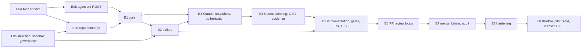

# 05 — Dependency Graph, Critical-Path Analysis and Parallel Execution Plan

**Every duration in this document is an estimate from a model, not measured data.**

- **Inputs:**
  - `data/dag.json` (`devorch.py dag` over `planning/issue-breakdown.md`);
  - `tools/devorch/assignments.json`;
  - `tools/devorch/schedule_model.py` **v2**, revised after review R3.
- **Reproduction:** `python3 tools/devorch/schedule_model.py` (scenario table), `--sensitivity`, `--plan` (§5).
- **Counting conventions:** downstream and longest-path figures exclude the 3 conditional issues. Effort is in engineer-days. Elapsed time is in working days to **cutover start** (MERC-906 done). The 30-day cutover watch (≈ 22 working days) comes after it and is not included.

## 1. Verified counts

| Item | Value | Method |
|---|---|---|
| Issues | **82** (79 base + 3 conditional: MERC-1K1, MERC-3A1, MERC-807b) | `devorch.py dag`; independently re-parsed in review R3 |
| Epics | 13 (E0a–E0d, E1–E9) | same |
| Dependency cycles | **0** | DFS |
| Dependency critical path | 51.0 P50 engineer-days, 26 issues | longest path |
| Issues needing the Mac or the operator | 38 of 79 base (20 fully, 18 for a validation step) | env field |
| Issues with real-Mac steps (T4/T5) | 32: 001, 002, 003, 010, 011, 012, 107, 1K1, 302, 305, 3A1, 401, 406, 502, 503, 506, 706, 707, 708, 802, 803, 804, 805, 806, 807, 807b, 901, 902, 903, 904, 905, 906 | env field |
| [ROOT] issues | MERC-010, 011, 107 (install part), 807b (conditional) | env field |
| Security-labelled issues | 55 base (58 including conditional) | DoR field |
| Pure agent-executable base issues | 41 (≈ 89 P50 engineer-days) | env field |

## 2. Dependency graph

### 2.1 Epic level

### 2.2 Critical path (issue level)

## 3. Phase 11 questions answered

| # | Question | Answer (each claim checked against `dag.json`) |
|---|---|---|
| 1 | Genuinely sequential | M1 spine 101→102→103→104→106; review chain 501→502→507→601→602→604→701; M9 901→904→905→906 (calendar-bound) |
| 2 | Concurrent | Operator lane (001–003, 010–012, 020–024) ∥ agent work after 030. After 102: 103 ∥ 112 ∥ 402a. After 101 + 011: 107. After 103: 704 ∥ 104. After 106: 105 ∥ 109 ∥ 201 (also needs 021) ∥ 202 (also needs 022). After 402a: 301 ∥ 402b ∥ 504. After 107 + 303: 401 |
| 3 | Could start against mocks *if* an amendment relaxes blocked-by | 201/202/302/401 against frozen ports and 112's fakes. **Not** allowed today: the approved blocked-by edges (201: 106, 021; 202: 106, 022; 302: 107, 301, 402a, 003; 401: 107, 303) must be respected. RA-D3 proposes the amendment explicitly |
| 4 | Interfaces to freeze first | `src/ports/{store,clock,process,agents,github,linear,git}.ts` and the transition-table format. Ports are created by MERC-101, so the freeze is a design task right **after** 101 (RA-D3), not before it |
| 5 | Integration bottlenecks | 106 (40 downstream), 304, 506 (four upstream lines), 507, 602. Also the single-writer files: migrations (04) and `core/transitions.ts` (03). The plan's concurrency in W1/W2 is limited by the path-ownership registry at dispatch (§5 note) |
| 6 | Need the real Mac (T4/T5) | See §1 row "real-Mac steps" |
| 7 | Security prerequisites that cannot be bypassed | **G-S1** (SEC-204 confinement self-test, recorded by 302) before any agent run on the Mac (305, 406, 501, and the Mac step of 401). G-S2 before any non-sandbox write run. G-S3 before the first sandbox push. G-S4 before the pilot. G-S5 before unattended operation. Plus TDD approval (G1 / DOD-01) and the operator-consented root steps. Enforced by `devorch.py ready` through `assignments.json` `_tdd_gates` and operator-recorded facts |
| 8 | Most downstream unblocked | 020 (70), 021 (68), 030 (64), 101 (63), 102 (56), 103 (46), 104 (44), 001 (43), 106 (40), 010 (40), 011 (35), 402a (34) |
| 9 | Milestones that overlap safely | P0a/P0b (operator) ∥ P0d + early M1 (agents). M2 ∥ M3 after 106. M7's 703/704/706 ∥ M5/M6. M8's 801/804/806 ∥ the tail of M7. **Not**: M5 non-sandbox before G-S2; M9b before G-S4; unattended before G-S5 |
| 10 | Activities on the critical path | The 26 issues of §2.2 **and**, under capacity limits: the operator lane (≈ 32 operator-days of Phase 0, Mac validation and approvals); the operator's review and merge of ≈ 60 PRs; shadow (10 days) and pilot (15–30 days) |

**Ordering conflicts surfaced (inherited from the approved breakdown; proposed amendments in `12-…`):**
- **RA-D7:** the Mac step of 401 must wait for G-S1, which 302 records. The model enforces this.
- **RA-D8:** 507's sandbox-push acceptance must move after 508 (G-S3).

## 4. Scenarios

**Model v2.**
- **Lanes and priority.** There are N agent workers and one operator lane: the operator, including the Mac. One priority queue per lane orders work by longest remaining path, then downstream count.
- **Task shape.** An issue is an agent part, then an optional operator part, then **the operator's PR review and merge**, for issues that produce code. Dependents start after the merge.
- **Operator-heavy work.** Human-only identity, ruleset and App work, and [ROOT] steps put 80 % or more of their effort on the lane. [ROOT] steps also get an agent-preparation step with a security review.
- **Gate constraint.** The Mac step of 401 waits for G-S1.
- **Calendar.** Shadow is 10 days and the pilot 15 (P50) to 30 (P90) working days, per roadmap §6 and OD-16.
- **Speed factor.** Agent-days per engineer-day are an **assumption**: 0.40 optimistic, 0.55 expected, 0.80 pessimistic (pessimistic also inflates estimates by 25 %). The factor must be re-fitted from the first 10 tasks (`09-…` §4).

| Scenario | Workers | Optimistic | **Expected** | Pessimistic | Agent / operator-lane utilization (expected) |
|---|---|---|---|---|---|
| A Conservative | 2 | 89 | **97** | 143 | 0.62 / 0.45 |
| B Balanced (**recommended**) | 3 | 86 | **92** | 135 | 0.48 / 0.47 |
| C Accelerated: more workers | 5 | 91 | **97** | 137 | 0.34 / 0.45 |
| C′ Accelerated: 4 workers + macOS CI/VM offload | 4 | 87 | **94** | 137 | 0.4 / 0.42 |

**Sensitivity**, scenario B expected (`--sensitivity`, working days to cutover start). List scheduling is not monotonic, so a small parameter change can move the result by ±1–2 days either way:

| Variation | Elapsed | Agent util | Operator-lane util |
|---|---|---|---|
| B expected (operator full-time) | 92 | 0.48 | 0.47 |
| operator 50 % available | 118 | 0.37 | 0.74 |
| operator 20 % available (RA-D4: 2 x 1/2 day per week) | 219 | 0.2 | 0.99 |
| PRs stacked (dependents start at G6) | 85 | 0.51 | 0.51 |
| PR review 0.25 d each | 91 | 0.48 | 0.55 |
| 1 worker | 134 | 0.92 | 0.33 |
| 4 workers | 93 | 0.37 | 0.47 |
| unlimited workers, no integration overhead (floor) | 86 | 0.02 | 0.51 |

**Interpretation.**
1. **Operator availability is the dominant variable.** At 50 % availability elapsed time is +28 %. At the RA-D4 pattern (about 20 %: 2 × ½ day per week) it more than doubles. **Recommendation: the operator commits ≥ 50 % availability during W0–W1 (Phase 0, identities, root steps) and on gate weeks.** RA-D4 is revised accordingly.
2. **Agent count beyond 3 gives no gain** under the stated overheads; the floor with unlimited workers is ≈ 86. The 09 §2 limit of 3 stands.
3. **Stacked PRs** (dependents start at G6) save ≈ 7 days at the cost of rebases; the operator still reviews every PR, so the operator lane is busier (0.51). They are permitted only to depth 2 (`06-…` §6). (Corrected 2026-10-25: the model's stacked mode had skipped the reviews of stacked tasks and reported 86 days at 0.40; Codex review on PR #2.)
4. **Calendar view.** B expected ≈ 92 working days ≈ 18–19 weeks to cutover start, plus the ≈ 4–5-week watch, ≈ 23 weeks in total. The roadmap's ≈ 7-month P50 assumes one human engineer; agents shorten the engineering portion, but the operator lane, shadow and pilot do not shrink.

**Assumptions not modelled.**
- Mac validation never fails or causes rework.
- Reviews run inside the implementing agent slot (the 2 extra review agents of 09 §2 are not modelled).
- MERC-005 (Phase 0 closure) gates nothing in the DAG, although roadmap M1 entry expects P0a/P0b closed. `devorch.py ready` enforces this per issue through P0 facts instead.
- Single-writer files are not modelled as a resource. They are enforced at dispatch, so real concurrency in W1/W2 may be lower.
- 004/005/902 are modelled with the agent preparation each issue's lane classification implies.

| Scenario | Bottlenecks | Integration overhead | Major risks | Confidence |
|---|---|---|---|---|
| A | Agent lane in M1–M5; operator lane | ≈ 0.4 d/task | Slower M1 | Low–medium (speed factor unmeasured) |
| B | Operator lane (Phase 0, approvals, Mac validation) | ≈ 0.55 d/task | Operator availability; Phase 0 surprises (+12–22 engineer-days if conditional issues trigger) | Low–medium |
| C | Operator lane; integration conflicts; PR queue | ≈ 0.95 d/task | Rubber-stamping (RISK-22) | Low |
| C′ | Operator lane; macOS runner minutes | ≈ 0.75 d/task | VM fidelity (P0-047); some SAC evidence needs the real Mac | Low |

## 5. Per-issue analysis and parallel execution plan (scenario B, expected)

"Model start → release" runs from the start of an issue's first part to the time its dependents may start (after merge and gate delay). Issues listed in the same wave may still be serialized at dispatch by the path-ownership registry (`06-…` §4). That registry, not this table, guarantees file isolation.

| Issue | Title | Agent / lane | Direct deps | Transitive prereqs | Downstream | Longest path P50 | Critical | Mac/operator | Security | Model start → release (B, expected) | Wave |
|---|---|---|---|---|---|---|---|---|---|---|---|
| MERC-001 | Mac read-only facts | mac | — | 0 | 43 | 39.0 |  | yes |  | 0.0 → 1.5 | W0 Phase 0 + bootstrap |
| MERC-004 | MIG-0 legacy inventory | tpm | — | 0 | 4 | 6.0 |  | yes |  | 0.0 → 1.8 | W0 Phase 0 + bootstrap |
| MERC-020 | Operator decision session | operator | — | 0 | 70 | 51.0 | **yes** | yes |  | 0.0 → 1.0 | W0 Phase 0 + bootstrap |
| MERC-021 | GitHub Apps and keys | operator | 020 | 1 | 68 | 50.5 | **yes** | yes | yes | 1.0 → 2.8 | W0 Phase 0 + bootstrap |
| MERC-022 | Linear app and sandbox team | operator | 020 | 1 | 30 | 34.0 |  | yes | yes | 1.1 → 3.2 | W0 Phase 0 + bootstrap |
| MERC-010 | Agent-uid system install (spike) | mac | 001 | 1 | 40 | 38.5 |  | yes | yes | 1.5 → 5.3 | W0 Phase 0 + bootstrap |
| MERC-003 | Agent CLI checks (B) | mac | 001 | 1 | 21 | 23.5 |  | yes | yes | 2.0 → 6.5 | W0 Phase 0 + bootstrap |
| MERC-902 | Coexistence | backend-engineer | 004 | 1 | 3 | 5.5 |  | yes |  | 2.0 → 9.9 | W0 Phase 0 + bootstrap |
| MERC-030 | MERCURY repo bootstrap | devops-engineer | 021 | 2 | 64 | 49.5 | **yes** |  | yes | 3.1 → 5.4 | W0 Phase 0 + bootstrap |
| MERC-023 | Sandbox repo and rulesets | operator | 021 | 2 | 10 | 12.5 |  | yes | yes | 3.2 → 9.7 | W0 Phase 0 + bootstrap |
| MERC-002 | Mac experiments (non-destructive) | mac | 001 | 1 | 1 | 2.0 |  | yes | yes | 3.4 → 10.9 | W0 Phase 0 + bootstrap |
| MERC-011 | Agent-uid verification and canaries | mac | 010 | 2 | 35 | 36.5 |  | yes | yes | 5.3 → 8.5 | W0 Phase 0 + bootstrap |
| MERC-012 | Helper and spawn feasibility | mac | 010 | 2 | 27 | 29.5 |  | yes | yes | 5.3 → 9.6 | W0 Phase 0 + bootstrap |
| MERC-101 | Skeleton, config, paths, parameters, logging | backend-engineer | 030 | 3 | 63 | 48.5 | **yes** |  | yes | 5.4 → 7.8 | W0 Phase 0 + bootstrap |
| MERC-102 | Store and durability | database-engineer | 101 | 4 | 56 | 46.0 | **yes** |  |  | 7.8 → 11.1 | W0 Phase 0 + bootstrap |
| MERC-112 | Fakes and scenario runner | test-automation-engineer | 101 | 4 | 32 | 36.0 |  |  |  | 7.8 → 11.2 | W0 Phase 0 + bootstrap |
| MERC-107 | Process broker: agent-exec/agent-ctl production | security-engineer | 101, 011 | 7 | 33 | 35.5 |  | yes | yes | 8.5 → 12.8 | W0 Phase 0 + bootstrap |
| MERC-024 | Sandbox merge-attack suite and policy evidence | security-engineer | 023 | 3 | 1 | 1.5 |  | yes | yes | 10.0 → 14.2 | W0 Phase 0 + bootstrap |
| MERC-103 | DDL, invariant triggers, audit chain | database-engineer | 102 | 5 | 46 | 43.0 | **yes** |  | yes | 11.1 → 14.0 | W0 Phase 0 + bootstrap |
| MERC-402a | Mirror and hardened read-only git invocation | security-engineer | 102 | 5 | 34 | 36.0 |  |  | yes | 11.1 → 12.9 | W0 Phase 0 + bootstrap |
| MERC-303 | Decision schemas, prompts and wire copies | ai-integration-engineer | 112 | 5 | 30 | 32.5 |  |  |  | 11.2 → 13.1 | W0 Phase 0 + bootstrap |
| MERC-301 | Snapshot builder | backend-engineer | 102, 402a | 6 | 27 | 29.5 |  |  | yes | 12.9 → 15.0 | W1 M1 core |
| MERC-402b | Task worktrees, naming and reset policy | backend-engineer | 402a | 6 | 29 | 34.5 |  |  | yes | 12.9 → 14.5 | W1 M1 core |
| MERC-401 | Codex adapter | ai-integration-engineer | 107, 303 | 10 | 27 | 30.5 |  | yes | yes | 13.8 → 19.7 | W1 M1 core |
| MERC-104 | Transition engine | backend-engineer | 103 | 6 | 44 | 39.5 | **yes** |  |  | 14.3 → 16.7 | W1 M1 core |
| MERC-504 | Git hardening and mirror push | security-engineer | 402a, 402b | 7 | 26 | 33.5 |  |  | yes | 14.9 → 17.5 | W1 M1 core |
| MERC-302 | Claude adapter under agent uid | ai-integration-engineer | 107, 301, 402a, 003 | 12 | 19 | 22.0 |  | yes | yes | 15.8 → 18.7 | W1 M1 core |
| MERC-704 | Audit trace and verification | database-engineer | 103 | 6 | 6 | 12.5 |  |  | yes | 16.5 → 20.0 | W1 M1 core |
| MERC-106 | Derived queue, claims, outbox/inbox | backend-engineer | 104 | 7 | 40 | 36.5 | **yes** |  |  | 17.4 → 19.8 | W1 M1 core |
| MERC-105 | Holds, halts and timers | backend-engineer | 104 | 7 | 32 | 36.0 |  |  | yes | 17.7 → 20.1 | W1 M1 core |
| MERC-505 | Pre-push gates | security-engineer | 504 | 8 | 24 | 30.5 |  |  | yes | 18.5 → 22.4 | W1 M1 core |
| MERC-802 | Power-loss VM rig | reliability-engineer | 504, 012 | 11 | 0 | 2.0 |  | yes |  | 19.6 → 22.5 | W1 M1 core |
| MERC-202 | Linear client and poller | platform-integration-engineer | 106, 022 | 9 | 29 | 33.5 | **yes** |  |  | 19.9 → 22.2 | W1 M1 core |
| MERC-110 | Daemon lifecycle and host model | backend-engineer | 102, 105 | 8 | 25 | 33.5 |  |  | yes | 20.7 → 23.4 | W1 M1 core |
| MERC-201 | GitHub client | platform-integration-engineer | 106, 021 | 8 | 30 | 30.5 |  |  | yes | 20.7 → 23.1 | W1 M1 core |
| MERC-405 | Stall detection and failure sims | ai-integration-engineer | 401 | 11 | 23 | 26.5 |  |  |  | 21.6 → 23.2 | W1 M1 core |
| MERC-108 | Run outcomes, adoption, lost_by_host | backend-engineer | 106, 107 | 12 | 3 | 11.5 |  |  |  | 22.9 → 24.7 | W1 M1 core |
| MERC-306 | Linear write handlers (comments, labels, In Prog | platform-integration-engineer | 106, 202 | 10 | 26 | 31.5 | **yes** |  | yes | 22.9 → 24.9 | W1 M1 core |
| MERC-203 | PR, check and review poller | platform-integration-engineer | 201 | 9 | 21 | 23.0 |  |  |  | 23.2 → 25.0 | W1 M1 core |
| MERC-111 | Control socket, principals, CLI v1 | backend-engineer | 104, 110 | 9 | 24 | 30.5 |  |  | yes | 24.6 → 27.0 | W2 M1/M2/M3 parallel |
| MERC-703 | Notifications and ops channel | platform-integration-engineer | 105, 201 | 10 | 11 | 15.5 |  |  | yes | 24.6 → 27.1 | W2 M1/M2/M3 parallel |
| MERC-205 | Drift monitor (read and alert) | platform-integration-engineer | 201, 023 | 10 | 7 | 11.0 |  |  | yes | 24.8 → 26.6 | W2 M1/M2/M3 parallel |
| MERC-304 | Authorization records and guards | backend-engineer | 103, 105, 303, 306 | 14 | 25 | 30.0 | **yes** |  | yes | 26.5 → 29.4 | W2 M1/M2/M3 parallel |
| MERC-113 | PROP suite and crash harness v1 | test-automation-engineer | 108, 112 | 14 | 2 | 9.5 |  |  |  | 26.8 → 29.6 | W2 M1/M2/M3 parallel |
| MERC-406 | G-S2 evidence run | mac | 401, 302, 011 | 16 | 5 | 9.5 |  | yes | yes | 26.8 → 30.3 | W2 M1/M2/M3 parallel |
| MERC-506 | MERCURY / policy and presence tier | security-engineer | 505, 111, 201, 012 | 19 | 23 | 28.0 |  | yes | yes | 28.2 → 31.1 | W2 M1/M2/M3 parallel |
| MERC-706 | Watchdog and power helper | devops-engineer | 703, 012 | 14 | 7 | 13.0 |  | yes | yes | 28.7 → 31.8 | W2 M1/M2/M3 parallel |
| MERC-204 | Eligibility, discovery status, dependency guard | backend-engineer | 202 | 10 | 1 | 3.5 |  |  | yes | 29.0 → 32.0 | W2 M1/M2/M3 parallel |
| MERC-404 | Plan review loop | backend-engineer | 304, 401, 301, 402b | 23 | 23 | 27.5 | **yes** |  | yes | 30.1 → 32.7 | W2 M1/M2/M3 parallel |
| MERC-305 | Isolation and injection guard tests | security-engineer | 302, 304 | 23 | 0 | 2.0 |  | yes | yes | 30.3 → 32.8 | W2 M1/M2/M3 parallel |
| MERC-109 | Scheduler and limits | backend-engineer | 106 | 8 | 0 | 1.5 |  |  |  | 31.0 → 33.0 | W2 M1/M2/M3 parallel |
| MERC-807 | Operations packaging | devops-engineer | 107, 706 | 17 | 5 | 11.0 |  | yes | yes | 31.8 → 36.0 | W2 M1/M2/M3 parallel |
| MERC-206 | Shadow status and fixtures | backend-engineer | 203, 204 | 13 | 0 | 1.5 |  |  |  | 32.3 → 36.1 | W2 M1/M2/M3 parallel |
| MERC-403 | Instruction integrity and sandbox-violation coun | security-engineer | 401 | 11 | 0 | 1.0 |  |  | yes | 32.4 → 36.3 | W2 M1/M2/M3 parallel |
| MERC-501 | Implementation run | ai-integration-engineer | 404, 405, 504, 505, 506 | 32 | 22 | 25.0 | **yes** |  | yes | 33.2 → 35.8 | W2 M1/M2/M3 parallel |
| MERC-707 | Cleanup | backend-engineer | 402b | 7 | 0 | 1.0 |  | yes | yes | 33.7 → 36.7 | W2 M1/M2/M3 parallel |
| MERC-005 | Phase 0 closure report and re-estimate | tpm | 002, 003, 011, 024 | 9 | 0 | 0.5 |  | yes |  | 33.8 → 38.1 | W2 M1/M2/M3 parallel |
| MERC-502 | verify under agent uid | security-engineer | 501, 107 | 33 | 21 | 23.5 | **yes** | yes | yes | 35.8 → 38.4 | W2 M1/M2/M3 parallel |
| MERC-503 | deps_install | security-engineer | 502 | 34 | 0 | 2.0 |  | yes | yes | 38.4 → 40.9 | W3 M4/M5 |
| MERC-507 | PR creation (draft) | platform-integration-engineer | 504, 203, 502 | 35 | 19 | 21.0 | **yes** |  | yes | 38.4 → 40.7 | W3 M4/M5 |
| MERC-508 | Drift halt and G-S3 gate | security-engineer | 205, 506, 507 | 38 | 6 | 9.5 |  | yes | yes | 40.7 → 43.7 | W3 M4/M5 |
| MERC-601 | Code and security review runs | ai-integration-engineer | 302, 301, 507 | 38 | 16 | 19.0 | **yes** |  | yes | 40.7 → 42.8 | W3 M4/M5 |
| MERC-602 | COMMENT reviews and claude-review check | platform-integration-engineer | 601, 506 | 39 | 15 | 17.0 | **yes** |  | yes | 42.8 → 44.6 | W3 M4/M5 |
| MERC-903 | Target onboarding | mac | 508, 807 | 42 | 4 | 7.5 |  | yes | yes | 43.7 → 45.9 | W3 M4/M5 |
| MERC-603 | Revision loops | backend-engineer | 602 | 40 | 1 | 6.0 |  |  | yes | 44.6 → 47.3 | W3 M4/M5 |
| MERC-604 | Pre-review re-check, ready, review request | backend-engineer | 602 | 40 | 12 | 15.5 | **yes** |  | yes | 44.6 → 46.2 | W3 M4/M5 |
| MERC-701 | Merge verification | platform-integration-engineer | 604 | 41 | 11 | 14.5 | **yes** | yes | yes | 46.2 → 48.8 | W3 M4/M5 |
| MERC-804 | Prompt-injection corpus at scale | security-engineer | 603 | 41 | 0 | 3.0 |  | yes | yes | 47.3 → 50.2 | W3 M4/M5 |
| MERC-702 | Linear projection, both modes | platform-integration-engineer | 701, 306 | 42 | 10 | 12.0 | **yes** |  | yes | 48.8 → 50.6 | W4 M6–M8 + shadow |
| MERC-705 | Anchoring and restore epoch | database-engineer | 704, 702, 506 | 44 | 5 | 10.5 | **yes** |  | yes | 50.6 → 53.0 | W4 M6–M8 + shadow |
| MERC-708 | Live-agent sandbox smoke | mac | 701, 702, 703 | 44 | 3 | 7.5 |  | yes |  | 50.6 → 52.0 | W4 M6–M8 + shadow |
| MERC-801 | Crash injection at scale | reliability-engineer | 113, 708 | 47 | 1 | 6.5 |  |  |  | 52.0 → 54.3 | W4 M6–M8 + shadow |
| MERC-806 | Performance, budgets and measurement | reliability-engineer | 708 | 45 | 0 | 2.0 |  | yes |  | 52.0 → 53.9 | W4 M6–M8 + shadow |
| MERC-805 | Security suite on the Mac and SAC evidence | mac | 406, 508, 705 | 49 | 4 | 8.0 | **yes** | yes | yes | 53.0 → 56.8 | W4 M6–M8 + shadow |
| MERC-803 | Real-Mac recovery suite | mac | 706, 801 | 49 | 0 | 3.5 |  | yes |  | 54.3 → 59.4 | W4 M6–M8 + shadow |
| MERC-901 | Shadow mode (MIG-1) | mac | 805, 903 | 54 | 3 | 6.0 | **yes** | yes |  | 56.8 → 69.3 | W4 M6–M8 + shadow |
| MERC-904 | Supervised pilot (MIG-2) | mac | 901, 902 | 57 | 2 | 4.5 | **yes** | yes | yes | 69.3 → 87.4 | W5 M9 pilot, cutover |
| MERC-905 | Unattended readiness (G-S5) | operator | 904, 805 | 58 | 1 | 2.0 | **yes** | yes | yes | 87.4 → 90.2 | W5 M9 pilot, cutover |
| MERC-906 | Cutover and watch (MIG-3/4) | operator | 905 | 59 | 0 | 1.0 | **yes** | yes |  | 90.2 → 91.7 | W5 M9 pilot, cutover |
| MERC-1K1 (cond.) | Signed Keychain helper (conditional) | security-engineer | 011 | 3 | 0 | 0 |  | yes | yes | contingency | — |
| MERC-3A1 (cond.) | ALT-B-1 fallback (contingency) | ai-integration-engineer | 301 | 7 | 0 | 0 |  | yes | yes | contingency | — |
| MERC-807b (cond.) | Coordinator account U2 (conditional) | devops-engineer | 807 | 18 | 0 | 0 |  | yes | yes | contingency | — |

## 6. Execution waves (scenario B)

| Wave | Model days | Goal | Exit evidence |
|---|---|---|---|
| W0 Phase 0 + bootstrap | 0–14 | Operator bootstrap (ruleset on `main`, development identity, ledger branch: RB-D1); decisions; GitHub Apps; Mac facts; agent uid (root, operator); sandbox governance; MERC-030 | MERC-005 closure report; P0 facts recorded; MERC-030 merged |
| W1 M1 core | 13–25 | Store, DDL + triggers, transition engine; interface freeze after 101 (RA-D3); fakes; process broker; mirror and hardened git | INV trigger tests green; ports frozen (`interface_frozen`); MERC-107 G4 |
| W2 M1/M2/M3 | 25–38 | Queue and outbox; holds; lifecycle; GitHub and Linear clients; schemas; snapshots; Claude adapter | **G-S1 fact recorded** (302) |
| W3 M4/M5 | 38–50 | Codex adapter, plan review loop, G-S2 evidence (406), implementation run, verify, policy and presence | G-S2 evidence collected; G-S3 fact recorded by 508 before any sandbox push |
| W4 M6–M8 + shadow | 49–69 | PR creation, review runs, check run, merge verification, Linear projection, anchoring; crash injection at scale, security suite on the Mac, performance; shadow run (MERC-901, 10 days) | M6/M7 TCs green on the sandbox; SAC evidence; shadow report |
| W5 M9 | 69–92 | Supervised pilot (G-S4), unattended readiness (G-S5), cutover start | Operator sign-off per gate; 30-day watch follows |
