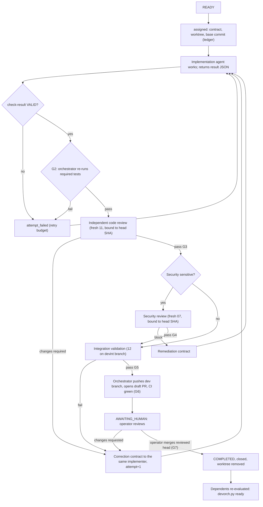

# 07 — Automatic Handoff Protocol and Failure Recovery

## 1. Handoff protocol

**Rules.**
1. **Every arrow is a ledger record** written by `devorch.py record`, with at least one evidence item. Files are hashed into the record.
2. **Order and binding.** A review is bound to `review_target.head_commit`. If the head moves after the review, the review is void, and `gates_of()` resets on re-entry to RUNNING.
3. **Context passing is file-based.** The next agent receives the contract path. The contract's `notes` cite the previous result and review files by path and SHA-256. No agent receives another agent's conversation.
4. **Design escalations route through the Lead Architect and then the operator.** Security escalations route to a fresh Security Engineer instance, then the operator.
5. **Notification-driven.** The orchestrator is woken by subagent completion notifications. It never polls with sleeps.

## 2. Failure detection

| Failure | Detected by | Classification |
|---|---|---|
| Agent execution failure (error, crash, rate limit, API session limit) | Subagent notification `failed` / no result block | **Environmental** if an API limit, network or interruption; otherwise **task** |
| Missing output | Completion without a fenced JSON result | Task |
| Invalid schema / incomplete output | `check-result` INVALID | Task |
| Failed tests | G2 re-run | Task |
| Review rejection | `changes_required` / security `fail` | Task (correction loop, separate budget) |
| Dependency changes (upstream re-opened, interface re-frozen with new hash) | Ledger of the dependency; `interface_contracts[].sha256` mismatch | Contract revision (`contract_revised` → BLOCKED) |
| Branch conflicts | Integration (G5) or rebase after a `main` merge | Task (environmental if caused only by a `main` merge) |
| Stale ownership | §4 | Environmental |
| Interrupted execution (session restart, container loss) | Resume procedure (`02-…` §6) | Environmental |
| Resource exhaustion (memory, disk, cost cap, context) | `09-…` monitors; agent `partial` with context reason | Environmental, then re-split the task if repeated |

## 3. Retry budgets (per task, per contract version)

| Loop | Budget | On exhaustion |
|---|---|---|
| Implementation attempts (task-class failures) | `budget.max_attempts`, default **3** | `failed` → escalate (`cannot_continue`) with all evidence |
| Code-review correction cycles | **3** | Escalate to the Lead Architect, then the operator |
| Security remediation cycles | **2** | Escalate to the operator (security) |
| Integration corrections | **2** | Escalate (split or re-sequence the task) |
| Human change-request cycles | Unlimited (the operator decides) | — |
| Environmental retries | **5** per attempt, backoff 1 / 5 / 15 / 60 / 240 min | Escalate (`credentials_or_permissions` or `cannot_continue`) |
| Flaky test re-runs | **1** re-run per test per G2 check; a second failure is real | Defect recorded; test quarantined only with operator approval |

**Escalation conditions** (any one stops the task in BLOCKED):
- a required architectural decision is missing;
- security boundaries are threatened;
- recovery attempts are exhausted;
- human approval is required;
- external credentials or permissions are missing;
- the task cannot safely continue.

Prior evidence is never deleted. Every attempt has its own `evidence/<task>/attempt-N/`.

## 4. Stale ownership

A RUNNING task is **stale** when:
- no subagent belonging to it is known to the current session (after a restart, this is always the case); and
- either the worktree has had no commit and no evidence-file change for `max_wall_minutes` of the contract, or the current session has no record of having dispatched it.

The response is idempotent:
1. Record `stale_detected`.
2. Archive uncommitted changes as a patch.
3. If the branch has commits and a result file exists, process it.
4. Otherwise `reclaimed` → READY.
5. Re-dispatch with attempt+1 (environmental, no charge).

## 5. Idempotency of recovery operations

| Operation | Idempotency mechanism |
|---|---|
| `record` | Legal only from the current state. Repeating an event either fails (illegal transition) or is a recorded self-loop with the same evidence |
| Worktree creation | `git worktree add` fails if it exists; the orchestrator then verifies the branch, path and base, and reuses it |
| Push of `dev/*` | Push of the same SHA is a no-op; a different SHA requires a new reviewed head |
| PR creation | Look up `head=<branch>` (`state=all`) first; create only if none exists |
| Ledger push | Fast-forward only. On rejection: pull, `verify-ledger`, re-apply local records only if their `prev_hash` still matches; otherwise escalate (two orchestrators running — forbidden, §6) |

## 6. Single-orchestrator rule

Only one Principal Orchestrator session may write the ledger.

- **Lock.** It writes `ledger/LOCK` (session id, timestamp) and pushes it. A second session that sees a lock younger than 2 hours refuses to dispatch until the operator confirms that the first session is gone.
- **Why the lock is enough.** It is a convention, not a hard lock. The fast-forward-only push rule (§5) turns a violation into a detected conflict, not silent corruption.
