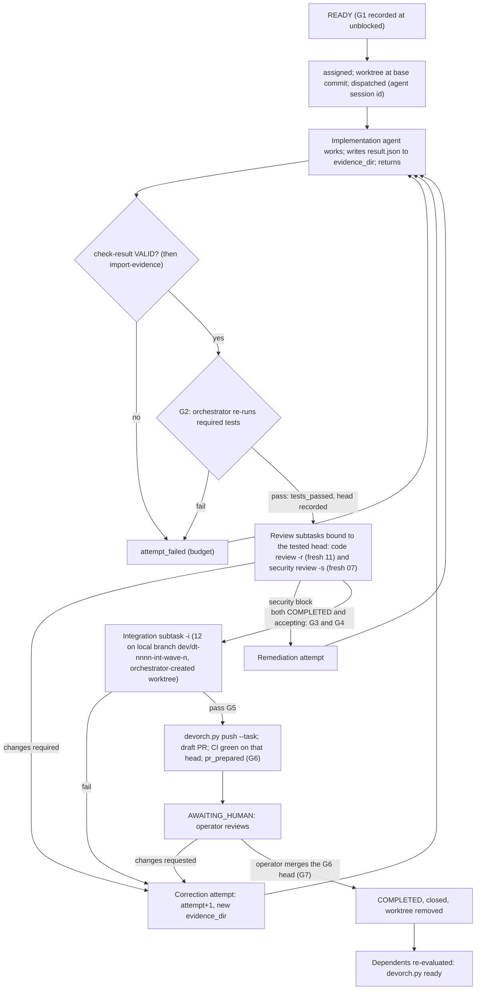

# 07 — Automatic Handoff Protocol and Failure Recovery

Event and state names are those of `01-development-architecture.md` §5 (`T_FULL` / `T_SHORT` in `tools/devorch/devorch.py`). `T` = `python3 "$CLAUDE_PROJECT_DIR/tools/devorch/devorch.py"`.

## 1. Handoff protocol

**Rules.**
1. **Every arrow is a ledger record** written by `T record` (actor `principal-orchestrator` or `operator`; agents never write the ledger), with at least one evidence item. Files are hashed into the record, and every record carries `contract_core_sha256`.
2. **Dispatch records.** Every agent invocation, including re-dispatch and resume, is a `dispatched` record with `--session <agent id>`. Review and integration subtasks have their own contracts and short-lifecycle ledgers, so their dispatches are visible on resume. `check-contract` enforces their ids: reviews `<parent>-rN`, security reviews `<parent>-sN`, integration `<first covers_tasks entry>-iN`.
3. **Order and binding.** A review is bound to `review_target.head_commit`, which must equal the tested (G2) head. Its result must report the same `reviewed_head_commit`. An integration result must list `integrated_heads` `"DT-nnnn@<tested head>"`. Every return to RUNNING clears G2–G7 (G1 survives), so a moved head needs new review subtasks.
4. **Results are files.** The agent writes `result.json` to the contract's `evidence_dir` (under `$DEVORCH_EVIDENCE`, outside `$DEVORCH_HOME`) before returning. `check-result` reads it only there, and `record` cites it there (`result_file:<evidence_dir>/result.json`, hashed into the record): for `implementation_completed` and `result_accepted` (except `mac_validation` / `operator_action`) `record` re-runs the full `check-result` checks live and requires result `status: completed`. The orchestrator also copies the directory with `T import-evidence <task>` into `$DEVORCH_HOME/evidence/<task>/attempt-N/` (with `MANIFEST.json`), so the evidence is pushed with the ledger.
5. **Context passing is file-based.** The next agent receives the contract path and, for a correction, the paths of the prior result, review and test evidence, copied by the orchestrator into `<evidence_dir>/inputs/`. No agent receives another agent's conversation, and no untrusted text is pasted into a prompt or contract.
6. **Design escalations route through the Lead Architect and then the operator.** Security escalations route to a fresh Security Engineer instance, then the operator.
7. **Notification-driven.** The orchestrator is woken by subagent completion notifications. It never polls with sleeps.

## 2. Failure detection

| Failure | Detected by | Classification → record |
|---|---|---|
| Agent execution failure (error, crash, rate limit, API session limit) | Subagent notification `failed` / no `result.json` | **Environmental** if an API limit, network or interruption → `env_retry`; otherwise **task** → `attempt_failed` |
| Missing output | No `result.json` at `evidence_dir` | Task → `attempt_failed` |
| Invalid schema / incomplete output / claims that differ from git | `check-result` INVALID | Task → `attempt_failed` |
| Failed tests | G2 re-run | Task → `tests_failed` |
| Review rejection | `changes_required` / security block | Task → `code_review_changes_required` / `security_review_blocked` (separate budgets) |
| Dependency changes (upstream re-opened, interface re-frozen with new hash) | Ledger of the dependency; `interface_contracts[].sha256` mismatch | Contract revision → `contract_revised` (→ BLOCKED) |
| Branch conflicts | Integration (G5) or rebase after a `main` merge | Task → `integration_failed` (environmental → `env_retry` if caused only by a `main` merge) |
| Stale ownership | §4 | Environmental → `stale_detected` |
| Interrupted execution (session restart, container loss) | Resume procedure (`02-…` §6) | Environmental → `stale_detected`, `env_retry` |
| Resource exhaustion (memory, disk, cost cap, context) | `09-…` monitors; agent `partial` with context reason | Environmental → `env_retry`; re-split the task (`contract_revised`) if repeated |

## 3. Retry budgets (per task, per contract version)

`T record` counts these loops from the ledger and **refuses** the record that would exceed a budget. The counters reset only on `contract_revised`.

| Loop | Event counted | Budget | On exhaustion |
|---|---|---|---|
| Implementation attempts (task-class failures) | `attempt_failed`, `tests_failed` | `budget.max_attempts`, default **3**: the failure of the last attempt cannot be recorded as a retry | `failed` (→ FAILED) or `escalated` (→ BLOCKED, `cannot_continue`) with all evidence |
| Code-review correction cycles | `code_review_changes_required` | **3** | Escalate to the Lead Architect, then the operator |
| Security remediation cycles | `security_review_blocked` | **2** | Escalate to the operator (security) |
| Integration corrections | `integration_failed` | **2** | Escalate (split or re-sequence the task) |
| Human change-request cycles | `human_changes_requested` | Unlimited (the operator decides) | — |
| Environmental retries | `env_retry` | **5**, backoff 1 / 5 / 15 / 60 / 240 min (the next tick after the delay) | Escalate (`credentials_or_permissions` or `cannot_continue`) |
| Flaky test re-runs | — | **1** re-run per test per G2 check; a second failure is real | Defect recorded; test quarantined only with operator approval |

**Correction attempts.** After any counted failure or return to RUNNING, the orchestrator increments the contract's `attempt` and sets `evidence_dir` = `$DEVORCH_EVIDENCE/<task>/attempt-<N>`. These fields and `status` are excluded from `contract_core_sha256`, so the attempt needs no `contract_revised`. `dispatched` refuses an attempt number lower than the last one. Any other contract change is refused by `record` unless it is a `contract_revised` record with a changed core (`contract_version`+1).

**After FAILED.** A FAILED task leaves only by `contract_revised` (→ BLOCKED, counters reset; then `resumed` → READY when the revision is ready) or by `cancelled`. Never raise `max_attempts` to make a task pass.

**Escalation conditions** (any one stops the task in BLOCKED via `escalated`, with an entry in `$DEVORCH_HOME/ESCALATIONS.md`):
- a required architectural decision is missing;
- security boundaries are threatened;
- recovery attempts are exhausted;
- human approval is required;
- external credentials or permissions are missing;
- the task cannot safely continue.

Prior evidence is never deleted. Every attempt has its own `evidence_dir` and its own imported `evidence/<task>/attempt-N/`.

## 4. Stale ownership

A RUNNING task is **stale** when:
- no subagent belonging to it is known to the current session (after a restart this is always the case: background agents are stopped); and
- either the worktree has had no commit and no evidence-file change for `max_wall_minutes` of the contract, or the current session has no `dispatched` record of its own for the current attempt.

The response is idempotent:
1. Record `stale_detected`.
2. If the stopped agent can be resumed by id (`SendMessage`), resume it and record `dispatched` again; stop here.
3. Archive uncommitted changes as a patch to `$DEVORCH_HOME/evidence/<task>/attempt-N/uncommitted.patch`.
4. If `<evidence_dir>/result.json` exists, process it (`02-…` §5 step 2).
5. Otherwise record `env_retry` (not charged), start a correction attempt (§3) and dispatch it; or record `reclaimed` (→ READY) to dispatch later.

## 5. Idempotency of recovery operations

| Operation | Idempotency mechanism |
|---|---|
| `record` | Legal only from the current state; replay of the same rules in `verify-ledger`. Duplicate gates are refused; repeating an event either fails (illegal transition) or is a recorded self-loop |
| Worktree creation | `git worktree add` fails if it exists; the orchestrator then verifies the branch, path and base, and reuses it |
| Push of `dev/*` | Only `T push --task`: `dev/*` branch, tip = tested head, G1–G5 recorded, git baseline verified. Pushing the same SHA is a no-op; a different SHA requires a new tested and reviewed head |
| PR creation | Look up PRs for `head=<branch>` (`state=all`) first; create a draft only if none exists |
| Ledger push | Only `T push --ledger` (non-force; rejected unless fast-forward). On rejection: pull, `T verify-ledger --remote origin/devorch/state`, re-apply local records only if their `prev_hash` still matches; otherwise escalate (two orchestrators running — forbidden, §6) |
| Partial ledger line after a crash | `record` appends with `fsync`; an unterminated final line makes `verify-ledger` fail; `verify-ledger --repair-tail` truncates it after a check of git history |

## 6. Single-orchestrator rule

Only one Principal Orchestrator session may write the ledger.

- **Lock.** `T lock acquire --session <sid>` writes `$DEVORCH_HOME/LOCK` (session id, timestamp); it is committed and pushed with the ledger. Every tick runs `T lock refresh --session <sid>` before the tick commit. `T preflight` fails unless the LOCK names this session.
- **Foreign lock.** A session that finds a LOCK naming another session refuses to dispatch, **whatever the lock's age**, until the operator confirms the other session is gone; only then `T lock acquire --session <sid> --force`. `T lock release --session <sid>` on pause or stop.
- **Why the lock is enough.** It is a convention, not a hard lock. The fast-forward-only ledger push (§5) and `verify-ledger --remote` turn a violation into a detected conflict, not silent corruption.
