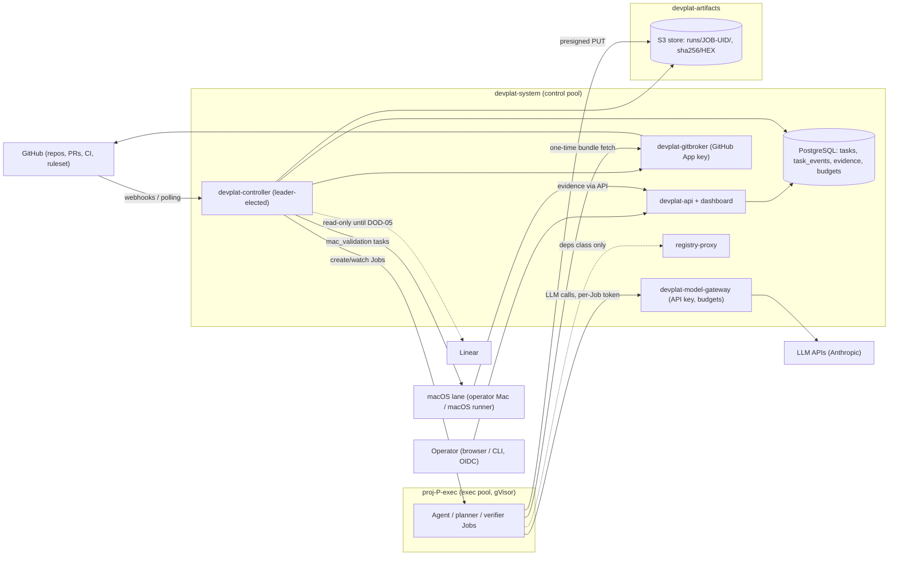
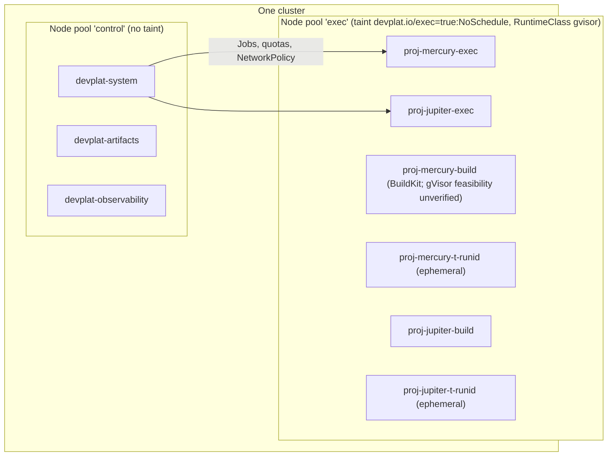
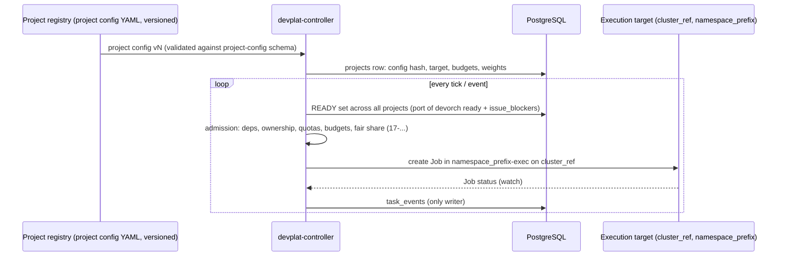

# 15 — devplat Platform Architecture (Kubernetes-native, multi-project)

Status: **Proposed — Documented only** (Architecture Amendment 001, 2026-10-17; awaits operator approval, `12-amendments.md` DOD-11…DOD-16). Nothing in this document is deployed or tested on Kubernetes. Capability status uses the amendment vocabulary (§11).
Reuses / supersedes: **supersedes for the platform** `01-development-architecture.md` §2 (component view) and §3 (responsibilities); **keeps** `01-…` §1 (separation rules S1–S4, extended here as rules P1–P10), §4 (authoritative sources, re-targeted in §9), §5 (state machine and gates G1–G7, ported unchanged) and §6 (rationale, extended by ADR-022…024). v1 (docs 00–13) remains the **local mode** (`14-…` §3).

## 1. Scope and principles

**devplat** is a project-agnostic AI development platform. It builds software for registered projects; Mercury is the first and Jupiter is expected to be the second. devplat **is not Mercury**: Mercury's production design (TDD, ADR-001…020) is unchanged unless a separately approved ADR changes it (`27-…`). A change to devplat is never a change to Mercury production, and the reverse.

| # | Principle |
|---|---|
| P1 | **Authority is code, not an LLM.** Task state, gates, admission and dispatch are decided by `devplat-controller` (a deterministic port of devorch `check_transition` / `replay`). LLM roles (specialists and the `planner`) produce *results and proposals* only. |
| P2 | **One writer of task state.** Only the controller's database role writes `tasks` and `task_events`. Agents have no DB route and no DB credentials. |
| P3 | **Human authority is unchanged.** Draft PRs only; G7 is an observed human merge. No platform component can merge, approve, enable auto-merge or edit rulesets (DOD-02, DOD-03 still required). |
| P4 | **Agents hold no credentials.** No GitHub token (gitbroker), no LLM API key (model-gateway), no Kubernetes token, no DB password. Presigned, per-Job, expiring URLs are the only capabilities a pod gets. |
| P5 | **Infrastructure enforces, prompts advise.** NetworkPolicy, RBAC, admission policy, RuntimeClass and broker validation are the controls; `disallowedTools`, deny rules and the guard hook are tripwires. |
| P6 | **Evidence over claims.** Every gate needs evidence the controller produced or verified itself (re-run tests, gitbroker validation, GitHub facts). Port of `02-…` §2. |
| P7 | **Projects are configuration.** Nothing project-specific is compiled into the controller. A project = a versioned project config (`26-…`) + an execution target. |
| P8 | **The platform outlives its projects.** devplat runs, recovers and reports while Mercury or Jupiter code, CI or repositories are broken or absent (§8). |
| P9 | **Execution is disposable.** A Job, pod, workspace or ephemeral namespace may vanish at any moment; durable state is only in PostgreSQL, the artifact store and GitHub. |
| P10 | **Platform before projects.** devplat bootstraps from its own chart without any project code (`24-…`). |

## 2. Revised multi-agent development architecture

v1 put the whole loop into one Claude Code main session. v2 splits that session's two jobs: the **mechanical loop** (ledger, gates, dispatch, push, reconciliation) moves into the deterministic controller; the **reasoning** (writing contract proposals, triaging failures, drafting escalations) moves into short-lived `planner` Jobs.

| Actor | v1 equivalent | May | May not |
|---|---|---|---|
| Operator (OIDC-authenticated via `devplat-api`) | Operator | Approve designs, contracts that widen scope, budgets, projects; record facts and decisions (authenticated, closes R5 N-06); merge PRs on GitHub | — |
| `devplat-controller` | Orchestrator's mechanical loop + `devorch.py` | Validate and record transitions and gates; admit and create Jobs; collect results; request validation and pushes from gitbroker; reconcile GitHub, Linear, Jobs | Decide content; merge; approve; change GitHub settings; accept a gate without evidence |
| `planner` Jobs (role of the Principal Orchestrator) | Orchestrator's reasoning | Read the backlog, design and evidence; write **proposals** (contracts, triage, escalation drafts) to `/out` | Dispatch, record, push, call GitHub or Linear, spawn agents |
| 12 specialist Jobs (`mdev-*`) | Specialist subagents | Work in their workspace within `allowed_paths`; commit locally; write `result.json` | Push, reach GitHub, the DB or the Kubernetes API; see another task's workspace |
| `devplat-gitbroker` | `devorch.py push`, `check-result` git checks | Fetch source; validate result bundles; push `dev/*`; open **draft** PRs; read PR/merge facts | Merge, approve, edit rulesets, push outside `dev/*` |
| `devplat-model-gateway` | (none) | Proxy LLM calls; inject the key; meter tokens and cost per Job and project; enforce budgets | Forward to non-allowlisted hosts |
| Verifier Jobs (non-LLM) | Orchestrator's G2 re-run | Run `required_tests` at the validated head in a fresh workspace | Change code |
| macOS lane (operator Mac or macOS CI runner) | Mac validation queue | Produce T4 evidence for `mac_validation` tasks | Anything in the cluster |

The task state machine, lifecycles (FULL/SHORT), gates G1–G7, subtask ids (`-rN`, `-sN`, `-iN`), budgets, bound reviews and the contract-core hash are **ported unchanged** from `01-…` §5 and `tools/devorch/devorch.py` into PostgreSQL (`19-…`). Only the storage (git ledger → `task_events`) and the actor names (`principal-orchestrator` → `devplat-controller`; `operator` → an authenticated OIDC subject) change.

## 3. Three logical environments and their isolation

| | Env-A **Platform** (devplat) | Env-B **Mercury** | Env-C **Jupiter** |
|---|---|---|---|
| Purpose | Control plane, state, brokers, artifacts, observability | Agent, build and test execution for Mercury | Agent, build and test execution for Jupiter |
| Namespaces | `devplat-system`, `devplat-artifacts`, `devplat-observability` | `proj-mercury-exec`, `proj-mercury-build`, ephemeral `proj-mercury-t-<runid>` | `proj-jupiter-exec`, `proj-jupiter-build`, ephemeral `proj-jupiter-t-<runid>` |
| Node pool (Option B) | `control` | `exec` (tainted `devplat.io/exec=true:NoSchedule`) | `exec` (same pool, separate namespaces; dedicated pool or cluster possible, §7) |
| Status | Documented only | Documented only. Mercury **has no application code** yet | **Unresolved**: no repository, specification or tracker exists (`14-…` §1). Onboarding contract only (`26-…`); nothing about its stack is assumed |

**Isolation controls (each applies per project; specification of the security matrix in `18-…`).**

| Layer | Control |
|---|---|
| Kubernetes namespace | One set of namespaces per project; the controller only creates Jobs in namespaces of the task's project (admission policy checks `devplat.io/project` label = namespace's project label) |
| Identity | Per-project ServiceAccount `proj-
-agent` with **zero** RBAC and `automountServiceAccountToken: false` |
| Network | Default-deny ingress and egress in every `proj-*` namespace; allow only DNS, model-gateway, artifact store and (class `deps`) the registry proxy; no route to another project's namespaces, to `devplat-system` PostgreSQL, or to the Kubernetes API |
| Compute | `ResourceQuota` + `LimitRange` per project namespace (backstop to controller admission, `17-…` §7); exec pool taint; gVisor `RuntimeClass` |
| Source | A GitHub App installation scoped to the project's repositories only; tokens minted by gitbroker per operation, never given to pods |
| Model | Per-project gateway route `/p/
` with its own budget and per-Job tokens |
| Artifacts | Per-project bucket; per-Job presigned URLs under `runs/<job-uid>/`; immutable evidence under `sha256/<hex>` |
| Data | `project_id` on every row; the API enforces project scoping on operator queries (`19-…`) |
| Secrets | Project test secrets (e.g. Mercury T3 sandbox App credentials) live only in that project's test namespace (`22-…`) |

Cross-project dependencies are allowed only when declared in project config and are evaluated by the controller like contract `dependencies[]` (`17-…` §9). No Job ever sees two projects' code.

## 4. Kubernetes deployment architecture

### 4.1 Components and workload types

| Component | Namespace | Workload type | Why this type |
|---|---|---|---|
| `devplat-controller` | `devplat-system` | **Deployment**, 2 replicas, leader election (`coordination.k8s.io` Lease) | Stateless: all state is in PostgreSQL. Two replicas for fast failover; only the leader reconciles. No per-replica identity or storage, so not a StatefulSet |
| `devplat-api` (REST + dashboard backend, OIDC) | `devplat-system` | **Deployment**, 2 replicas | Stateless request handling, scales horizontally |
| `devplat-gitbroker` | `devplat-system` | **Deployment**, 1 replica (2 possible) | Mirror cache is an `emptyDir`, rebuildable from GitHub plus the validated bundles in the artifact store; no durable state of its own |
| `devplat-model-gateway` | `devplat-system` | **Deployment**, 2 replicas | Stateless proxy; budget counters are in PostgreSQL (atomic reservations) |
| `devplat-registry-proxy` (npm and other package caches) | `devplat-system` | **Deployment** + PVC cache | Cache is disposable; serves network class `deps` only |
| PostgreSQL | `devplat-system` | **Operator-managed** (CloudNativePG `Cluster`), or managed PG in cloud | Failover, WAL archiving and backups are operator concerns; a hand-written StatefulSet would re-implement them |
| Artifact store (MinIO) or external S3 | `devplat-artifacts` | **StatefulSet** (via the MinIO operator or chart), or external | Durable per-replica volumes |
| Specialist and planner runs | `proj-
-exec` | **Job** per attempt (`backoffLimit: 0`) | Run-to-completion, deadline, TTL, failure policy; retries owned by the controller (`16-…`) |
| Verifier runs (G2, review re-runs, integration tests) | `proj-
-exec` / `proj-
-t-<runid>` | **Job** | Same reasons; integration and e2e in disposable namespaces |
| Image builds | `proj-
-build` | **Job** (BuildKit rootless) | No Docker socket (`22-…`) |
| Log/metrics collection | `devplat-observability` | Deployment + DaemonSet | Node-level collection needs a DaemonSet |

**Why not a Task CRD and operator.** Task state needs an append-only, hash-chained audit log with relational queries (READY computation, budgets, fair share). etcd is not an audit store, and a CRD would create a second source of truth next to PostgreSQL. The controller is still *operator-style* (level-triggered reconciliation), but over PostgreSQL state; the only Kubernetes objects it owns are Jobs, their per-Job ConfigMap/Secret, and ephemeral namespaces. **Why not CronJobs for the loop.** A tick loop inside the leader gives sub-minute reaction to Job events via watches; CronJobs would add latency and duplicate-tick races.

### 4.2 Component diagram

### 4.3 Namespaces and node pools (Option B)

Placement rules: platform pods carry no toleration for the exec taint, so agent code never shares a node with the controller, gitbroker key or model-gateway key. Agent pods carry the toleration and `nodeSelector devplat.io/pool=exec`. An admission policy (`ValidatingAdmissionPolicy`, `18-…`) rejects any pod in `proj-*` namespaces without the gVisor RuntimeClass (except in the declared reduced-assurance mode), with a service account token, host namespaces, hostPath, privileged mode or added capabilities. If BuildKit cannot run under gVisor, builds use a third pool `build` without gVisor and with its own taint (`22-…`).

## 5. Multi-project execution architecture

1. **Project registry.** Each project is a versioned config (`platform/projects/
.yaml`, schema in `26-…`): repositories, role set, path scopes per role, toolchain image, test environments, budgets, fair-share weight, concurrency caps and the execution target. Changing it is an operator-approved change.
2. **Execution target** `{cluster_ref, namespace_prefix}`. `cluster_ref` names a kubeconfig/credential entry held by the controller (`default` = the cluster the controller runs in, as in `26-…`); `namespace_prefix` defaults to `proj-
`. Every Job, quota and ephemeral namespace is addressed through it, so moving a project to another cluster (Option C) changes config, not code.
3. **One scheduler for all projects.** READY computation, admission and fair share are global (`17-…`); per-project limits and budgets are enforced inside it.
4. **Per-project role binding.** A role id (e.g. `mdev-backend-engineer`) is usable by a project only if its config lists it with path scopes. The 12 `mdev-*` definitions are Mercury-derived; whether Jupiter reuses them is **unresolved**.
5. **Project health is isolated.** A broken project (failing CI, revoked App installation, exhausted budget) is paused by the controller; other projects continue.

## 6. Five things that are easy to confuse

| Concept | What it is | Where it lives | Lifetime | Who changes it | Example |
|---|---|---|---|---|---|
| **Claude Code subagent definition** (role) | Prompt, scope, `tools` / `disallowedTools`, hooks for one role | `.claude/agents/mdev-*.md` (generated by `tools/devorch/gen_agents.py`); in the cluster an immutable ConfigMap generated from it | Versioned with the repo | Operator-approved change to the generator | `mdev-backend-engineer.md` |
| **Agent image** (OCI) | The runtime: devplat-runner, Claude Code CLI pinned, project toolchain (e.g. Node 24 for Mercury) | Registry, referenced **by digest** | Immutable per digest | DevOps build Job + operator approval of the digest | `devplat/agent-node24@sha256:…` |
| **Kubernetes Job** | One execution of one attempt of one task by one role | `proj-
-exec` | Minutes to hours; deleted after collection | Only the controller | `dp-mercury-dt-0001-a2` |
| **Task record** | Durable task state, contract, events, gates, evidence | PostgreSQL `tasks`, `task_events`, `evidence` (`19-…`) | Until the project is archived | Only the controller (state); operator via API (facts, approvals) | `DT-0001` in RUNNING, attempt 2 |
| **Project config** | What the project is and how it may be built | `platform/projects/
.yaml` (project registry) | Versioned | Operator-approved change | `mercury.yaml` with target `{default, proj-mercury}` |
| *(and)* **Execution profile** | How a role becomes a Job: resources, deadline, network, runtime, writes | `platform/agents/execution-profiles.yaml` | Versioned | Operator-approved change | `mdev-code-reviewer`: `writes_allowed: false` |

One task has many attempts; one attempt has exactly one Job (plus verifier and review Jobs bound to its head). A role has one definition and one profile; many Jobs use them. An image serves many roles.

## 7. Cluster topology options

| | **Option A** — one cluster, namespaces only | **Option B** — one cluster, dedicated node pools (**recommended**) | **Option C** — separate clusters (platform + per-project) |
|---|---|---|---|
| Shape | Platform and agent pods may share nodes; isolation by namespace, NetworkPolicy, quotas, gVisor | `control` pool for platform services; tainted `exec` pool for agent, build, test Jobs; gVisor | Platform cluster; one execution cluster per project (or per trust level) |
| Security | Lowest: a sandbox escape lands on a node that may host the gitbroker key or model-gateway key | Escape lands on an exec node that holds no platform secrets; kubelet credentials of exec nodes are the residual risk | Strongest blast-radius limit: an escape reaches only one project's cluster |
| Cost | Lowest (one pool, no idle capacity) | Moderate: the control pool is always on; exec can scale to zero in cloud | Highest: one control plane (and its fees or nodes) per cluster |
| Operational burden | Lowest | Moderate: two pools, taints, RuntimeClass on exec nodes | Highest: N clusters, upgrades, cross-cluster credentials, controller holding several kubeconfigs |
| Single workstation (M2 Air 16 GB) | **Fits** (only realistic choice) — as **reduced-assurance mode** | Not meaningful (one node) | No |
| Home/office server | Fits | **Fits** with two VMs or two nodes on one host | Overkill |
| Multi-node cluster | Wasteful of isolation | **Fits** | Fits if trust differs strongly between projects |
| Cloud | Possible | **Fits** (managed node pools, autoscaling exec pool) | Fits; recommended when projects have separate owners or compliance needs |

**Recommendation.**
1. **Option B** is the target topology for any server, multi-node or cloud installation (ADR-023).
2. **Option A** is accepted only for a single workstation, as an explicit **reduced-assurance mode**: the controller records `assurance: reduced` on every task event of that installation; gVisor may be absent (`runtime_class: default` allowed by admission only in this mode); the dashboard and every PR body generated by gitbroker state the mode. Gates do not change; isolation claims do.
3. **Option C** needs no redesign: every project already addresses execution through its **execution target**. Moving Jupiter to its own cluster = adding a `cluster_ref` credential to the controller, installing the exec-side chart (namespaces, quotas, NetworkPolicy, RuntimeClass, registry-proxy and the route to model-gateway/artifact store) in the new cluster, and changing `mercury.yaml` / `jupiter.yaml`. Cross-cluster egress from exec pods to model-gateway and the artifact store then needs an authenticated ingress (mTLS) instead of in-cluster Services — **Documented only**.

## 8. Independence from Mercury and Jupiter

devplat contains no Mercury or Jupiter code, does not import their schemas (separation rule S1 kept), and none of its components depends on their artefacts at runtime.

| Failure | Effect on devplat | What keeps working |
|---|---|---|
| Mercury repository has a broken `main`, failing CI, or no code at all | Mercury tasks fail G2/G6 or wait; project health → `degraded` | Controller, API, Jupiter execution, reconciliation, reporting |
| Mercury's agent image cannot be built | Mercury Jobs cannot be admitted (`image_unavailable` hold) | Everything else; previous image digests stay usable if still approved |
| GitHub App installation for one project revoked | That project paused (`credentials_or_permissions` escalation) | Other projects |
| A project exhausts its budget | Admission stops for that project at 80 %, hard stop at 100 % (`17-…`) | Other projects' budgets are separate |
| Jupiter not onboarded (today) | No Jupiter namespaces, no Jupiter tasks | Everything; Env-C exists only as config schema and onboarding steps |
| Mercury production (once it exists) is down | **No effect.** devplat never calls Mercury | Everything |

Rules: (1) devplat images are built from `platform/` only. (2) The controller's READY computation for project P reads only P's config and P's tasks (plus declared cross-project dependencies). (3) A project's failure is never escalated as a platform failure. (4) Mercury self-hosting (`11-…`) does not make devplat depend on Mercury: if Mercury later builds itself, it does so as a *project* on devplat or outside it, never as devplat's control plane.

## 9. What survives from v1 and what changes

| v1 element | v2 | Status |
|---|---|---|
| Separation rules S1–S4 | **Kept**, extended by P1–P10 | Documented only |
| Task lifecycles, transition table, gates G1–G7, reset rule, budgets, subtask ids, bound reviews, contract-core hash | **Kept**, ported to PostgreSQL (`19-…`) | v1: Implemented+tested (30 tests); port: Documented only (schema work in `platform/db`, see `19-…`) |
| Contracts `devorch.task_contract.v1` / `task_result.v1` / `handoff.v1` | **Kept** as the wire format between controller and Jobs; v1 schema constants that are Mercury- or session-specific need a v2 revision (§12) | Implemented+tested (v1) |
| `check-result` git checks (`result_errors`) | **Kept**, moved into gitbroker bundle validation | Documented only |
| Path ownership (`active_primary_paths`, `overlap`) | **Kept**, per project, re-checked at admission (`17-…` §9) | Documented only |
| 12 role definitions | **Kept byte-identical**; mounted from a generated ConfigMap (`16-…` §9) | Configured (v1) |
| Principal Orchestrator main session | **Changed**: loop → controller; reasoning → `planner` Jobs | Documented only |
| Git ledger `devorch/state`, LOCK, single-session rule | **Changed**: `task_events` in PostgreSQL + Lease-based leader election + task leases | Documented only |
| Operator facts via `devorch.py fact --actor operator` (self-asserted) | **Changed**: recorded only through `devplat-api` with an OIDC subject | Documented only; OIDC provider open (DOD-14) |
| Worktrees `../mercury-wt/<task>` | **Changed**: per-Job `emptyDir` workspace from a gitbroker bundle | Documented only |
| Specialist guard hook and settings denies as the main in-session controls | **Changed**: tripwire only; controls are NetworkPolicy, no credentials, gitbroker validation | Hook: Configured, did not fire in v1 live dispatch (R5) |
| Push via `devorch.py push`, PR via MCP | **Changed**: gitbroker with the dev-bot GitHub App | Awaiting operator approval (DOD-03) |
| Mac validation queue | **Kept** as the external macOS lane (`mac_validation` tasks) | Blocked on the operator |
| WIP limits, cost cap (`09-…`) | **Extended** to multi-project admission and budgets (`17-…`) | Documented only |
| Local mode (single Claude Code session) | **Kept** for use before a cluster exists | v1 status unchanged |

## 10. Rules

1. No component other than `devplat-controller` creates, mutates or deletes Jobs in `proj-*` namespaces (RBAC + admission policy).
2. No pod in `proj-*` namespaces mounts a ServiceAccount token, a GitHub credential, an LLM API key or a DB credential.
3. Every project-addressed operation goes through the project's execution target.
4. Every task event carries `project_id`, actor, evidence and the contract-core hash; installations in reduced-assurance mode also carry `assurance: reduced`.
5. A topology change (A→B, B→C) is a config and chart change recorded as an operator decision; it never changes task semantics.

## 11. Capability status

| Capability | Status |
|---|---|
| Platform architecture, environments, topology evaluation (this document) | Documented only |
| Controller, api, gitbroker, model-gateway | Documented only (no code in this document's scope) |
| Namespaces, quotas, NetworkPolicy, RuntimeClass manifests | See `platform/deploy/base` and `24-…` (other deliverables); none applied to any cluster |
| gVisor on the exec pool | Unverified assumption (node OS, arm64 support on the workstation VM, BuildKit compatibility) |
| Option C via execution targets | Documented only; cross-cluster mTLS ingress unverified |
| Human merge authority | Awaiting operator approval (DOD-02, DOD-03) |
| Jupiter environment | Blocked (Jupiter unresolved) |
| macOS lane | Blocked on the operator |

## 12. Open questions

1. OIDC provider for `devplat-api` (DOD-14 in `12-…`).
2. Which CloudNativePG / MinIO versions are pinned, and whether a workstation uses in-cluster PG or the host's.
3. Whether Jupiter reuses the `mdev-*` role set or brings its own (unresolved with Jupiter).
4. Contract schema v2: `created_by` (`principal-orchestrator` const), `task_id` (`^DT-`), `branch` (`merc-`/`dt-`) and `assigned_agent` enum in `schemas/task-contract.schema.json` are Mercury/session-specific; a `devplat.task_contract.v2` (or a project-parameterised v1.1) is needed for multi-project use and for the `plan_proposal` kind (`16-…` §10).
