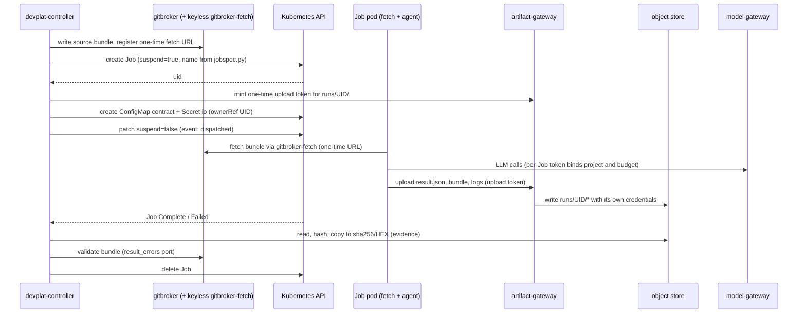

# 16 — Agent Execution and Job Lifecycle (Kubernetes)

Status: **Proposed — Documented only** (Architecture Amendment 001; R6 fix round 2026-10-20). No Job described here has run on any cluster. The example manifest (§4) is produced by `platform/controller/jobspec.py` and checked offline only (§4.3).
Reuses / supersedes: **supersedes for the platform** `02-principal-orchestrator.md` §4 dispatch steps 5–8 and §5 loop steps 2–6 (they become the controller lifecycle below); **keeps** `02-…` §2 (completion only by evidence), §3 READY rule, `04-contracts.md` (contract/result rules, re-hosted in the controller and gitbroker; wire format v2 in `platform/schemas/`) and the budgets of `07-handoff-and-recovery.md` §3. **Normative elsewhere:** Job names, labels and idempotency keys — `platform/controller/jobspec.py`; reconciliation, adoption, orphans and failure classification — `21-handoff-and-recovery-k8s.md`; artifact names, caps and prefixes — `20-artifact-storage.md` (R6 D11). Role definitions of `03-agents.md` are reused unchanged, with a runtime preamble (§9).

## 1. Invariants

1. **One dispatch = one Job.** Each run of task T, attempt N, dispatch D by one role is exactly one Kubernetes Job. Its name, labels and idempotency key are computed by `job_name()` / `idempotency_key()` in `platform/controller/jobspec.py`, which is **normative** (R6 A-23); this document does not restate the formulas. Verifier, review and integration runs are their own Jobs bound to a recorded head.
2. **Kubernetes never retries.** `backoffLimit: 0`; every retry is a new dispatch or attempt decided by the controller under the devorch budgets (`07-…` §3: `max_attempts`, review 3, security 2, integration 2, environmental 5). Environmental retries also consume the project's cost budget (R6 D17).
3. **The controller is the only writer** of task state and the only creator of Jobs in `proj-*` namespaces.
4. **The pod is untrusted.** Everything it uploads (result, bundle, logs, self-reported usage, its own exit code) is evidence to verify, never a fact. Authoritative facts: gitbroker's validation of the bundle, the verifier's re-run, model-gateway metering, Kubernetes node and pod events, GitHub.
5. **No credentials in the pod**, only per-Job, expiring capabilities: a one-time bundle URL (gitbroker-fetch), a one-time upload token for `devplat-artifact-gateway`, and a gateway token that binds the Job to its project and budget. **Agents never reach the object store** (R6 D10).
6. **Idempotent at every step.** Every step can be repeated after a controller crash without a duplicate Job, push, PR or event (`21-…` §1–§3).

## 2. The 15-step lifecycle

| # | Step | Actor and mechanism | Recorded (`task_events`) | On failure |
|---|---|---|---|---|
| 1 | **Validate dependencies** | Controller (port of devorch `issue_blockers`, R6 D7): DAG deps COMPLETED; contract `dependencies[]` at `required_state` ∈ {`COMPLETED`, `INTERFACE_FROZEN` with the dependency's own `path` and `sha256` (both required for this state, forbidden otherwise; task contract v2) equal to the freezing task's `frozen_files[path]`, `AWAITING_HUMAN` (stack ≤ 2)}; the task's **required facts** (`task_required_facts`, e.g. Mercury G-S1, P0-n); declared cross-project dependencies. Facts are OIDC-authenticated operator facts **recorded for this project** | `unblocked` (G1, `design_ref` evidence on an approved commit) | Stays BLOCKED with the blocker list |
| 2 | **Authorize** | Controller admission (`17-…` §2). Project status (R6 D4): `onboarding` dispatches only SHORT read-only kinds (planning, `*_review`, `plan_proposal`, `operator_action`, `mac_validation`); FULL-lifecycle kinds and any push need status `active` **and** this project's hard-precondition facts (`review_gates.hard_preconditions`, default `DOD-02`, `DOD-13`; a platform-wide fact never counts, R6 D1). The contract passed `register_contract` (kind→role from the catalogue, allowed ∩ restricted containment, ownership); a planner-originated contract or any revision carries an operator approval (R6 D18); budgets and capacity | `assigned` (READY → RUNNING) + task lease | Hold with reason (`admission_decisions`); stays READY |
| 3 | **Select role** | `assigned_agent` → catalogue role and execution profile (`platform/agents/execution-profiles.yaml`); the catalogue must list the role as executor of the kind; the project config must enable it | (part of `assigned`) | Contract invalid → `escalated` |
| 4 | **Prepare project environment** | Resolve the execution target `{cluster_ref, namespace_prefix}`; check namespace health, quota headroom, approved image digest for the project (per-project image prefix, R6 D15), role ConfigMap present for the pinned definition commit | — | Hold (`image_unavailable`, `target_unavailable`); a confirmed target outage is environmental per `21-…` |
| 5 | **Prepare workspace** | Gitbroker writes the source bundle `src/<project>/<sha>.bundle` (base for attempt 1, the last **validated** head of this task for a correction, the human-amended tip after §7.3) and registers a one-time fetch URL served by the keyless `devplat-gitbroker-fetch` (TTL ≤ 15 min after unsuspend). Workspace = `emptyDir` sized by the profile | — | Classified per `21-…` |
| 6 | **Create Job** | `dispatch_job()` first: it needs the step-2 `admit` decision for this task, attempt and role, **at most 10 minutes old** (`17-…` §2 rule 5); an older decision is refused and the task is re-admitted. Then create the Job **suspended** (name and key from `jobspec.py`) | — | API error → retry next tick (no event); `AlreadyExists` → `21-…` §3 |
| 7 | **Deliver contract** | Create ConfigMap `<job>-contract` (contract with `worktree=/workspace/repo`, `evidence_dir=/out`) and Secret `<job>-io` (fetch URL, one-time artifact-gateway **upload token** scoped to `runs/<job-uid>/`, TTL = Job deadline + 15 min, gateway token), both with `ownerReferences` → the Job uid; then set `suspend: false` | `dispatched` (Job uid, attempt N, dispatch D) | Setup incomplete after 5 min → delete Job; `21-…` |
| 8 | **Monitor** | Watch Job and pod; renew the task lease; heartbeats (`21-…` §5); pending timeout (10 min); `activeDeadlineSeconds` | `started` (FULL lifecycle, pod Running) | `21-…` §6 |
| 9 | **Collect** | On a terminal Job condition the controller reads `runs/<job-uid>/` (`result.json`, `result.bundle`, `agent.stream.jsonl`, `runner.json`, `fetch.log`) from the store with its own credentials; if the pod died before uploading, it reads container logs through the API (bounded) | — | Missing objects are evidence; classification `21-…` §6 |
| 10 | **Persist** | Size-check, hash, copy into immutable `sha256/<hex>`; register `artifacts` rows (`19-…`); write the evidence manifest `manifests/<task>/<attempt>/<dispatch>.json`; only then delete the Job | `artifacts` rows (not a transition) | Store unavailable → keep the Job (TTL 24 h) and retry |
| 11 | **Validate** | Gitbroker: quarantine fetch of the bundle and the port of devorch `result_errors` (§7.2). Controller (R6 D7): result schema; `project_id`/`task_id`/`contract_version`/`attempt`/`agent` match; `status = completed`; for `implementation_completed` the result `head_commit` = the validated tip; blocking findings **computed from the `findings` array**; review binding (`reviewed_head_commit`); integration binding (`integrated_heads`); required tests reported | `implementation_completed` (FULL) or `result_accepted` (SHORT) — or `attempt_failed` / `escalated` | Budgets as in devorch; exhausted → `failed` |
| 12 | **Test and review** | Verifier Job re-runs `required_tests` at the validated head in a fresh workspace (G2; `test_runs`); review subtasks `<task>-rN` (code/design/reliability) and `<task>-sN` (security, fresh Job, never the author's workspace) bound to the tested head (G3/G4); integration subtask `<first covered>-iN` (G5) | `tests_passed` (head), `code_review_passed`, `security_review_passed`, `integration_verified` | `tests_failed`, `code_review_changes_required`, `security_review_blocked`, `integration_failed` → correction attempt N+1 |
| 13 | **Pull request** | Gitbroker pushes `dev/*` only if the remote tip is an ancestor of (or equal to) the tested head and G1–G5 are recorded — **never force** (§7.3); finds or creates a **draft** PR; the controller waits for CI on that head | `pr_prepared` (G6, `pr` + `ci_run` evidence) | CI red → correction; non-fast-forward → §7.3 |
| 14 | **Human approval** | GitHub reconciliation: PR merged, `merged_by` ∈ the project's `human_approvers`, merged head = G6 head. The platform never merges (the ruleset of DOD-02 is what prevents the App from merging or approving, R6 D13) | `human_merged` (G7), `closed` | `human_changes_requested` (review, or human commits §7.3) → correction; wrong `merged_by` → security escalation |
| 15 | **Re-evaluate** | Controller recomputes READY for dependents in **all** projects (including cross-project dependencies), records `interface_frozen` where due, releases path ownership | `interface_frozen` where due | — |

Short-lifecycle kinds (reviews, integration, planning, `plan_proposal`) stop at step 11 with `result_accepted`. `mac_validation` and `operator_action` tasks (`job: false` in the catalogue) skip steps 4–10: they complete only with authenticated operator evidence through `devplat-api` (macOS lane, `22-…`).



## 3. Naming, idempotency and adoption (pointer)

- **Names, labels, idempotency key:** `platform/controller/jobspec.py` (`job_name`, `idempotency_key`, `build_job`) is normative; `test_jobspec.py` pins the example below. Labels carry `devplat.io/{project,task,attempt,dispatch,role,kind,network-class,idempotency-key}`; annotations carry the contract-core hash, contract version, base commit and role-definition hash.
- **Create protocol** (suspended create → owned ConfigMap and Secret → unsuspend → `dispatched`), **adoption after a restart or leader change, foreign and orphan Jobs, rows without a Job:** `21-handoff-and-recovery-k8s.md` §1–§4 is normative (R6 A-12). This document has no separate adoption table.

## 4. Annotated example: Backend Engineer, DT-0001 (MERC-101), attempt 2

The contract is the v1 example `examples/contract-implementation.json` (budget `max_wall_minutes: 30`, `max_turns: 10`). Profile: `mdev-backend-engineer` in `platform/agents/execution-profiles.yaml`. Image digests, registry host, the devplat-dns address and hashes are placeholders.

### 4.1 Job

```yaml
# Rendered by devplat-controller for task DT-0001 (MERC-101), attempt 2, role mdev-backend-engineer.
# Placeholders: registry host, image digests and the role ConfigMap hash are illustrative.
apiVersion: batch/v1
kind: Job
metadata:
  name: dp-mercury-dt-0001-a2-d1                 # dp-<project>-<task>-a<attempt>-d<dispatch>; deterministic => create is idempotent
  namespace: proj-mercury-exec                # from the project's execution target {cluster_ref, namespace_prefix}
  labels:
    app.kubernetes.io/managed-by: devplat-controller
    devplat.io/project: mercury
    devplat.io/task: dt-0001
    devplat.io/attempt: "2"
    devplat.io/dispatch: "1"
    devplat.io/role: mdev-backend-engineer
    devplat.io/kind: implementation
    devplat.io/network-class: deps            # selects the egress NetworkPolicy
    devplat.io/idempotency-key: 236b93d0c657f40e8603a992840ceb18a8ec0978   # sha256(project|task|contract_core|attempt|dispatch)[:40]; computed by platform/controller/jobspec.py
  annotations:
    devplat.io/contract-core-sha256: 4b1e0c3a9d7f25e86c1b0a4f3e9d2c7b6a5f4e3d2c1b0a9f8e7d6c5b4a392817
    devplat.io/contract-version: "1"
    devplat.io/base-commit: a39b1550333e5e5b20003720a65afa27bad32f6c
    devplat.io/role-definition-sha256: 0d3c5e7a9b1f2e4d6c8a0b2d4f6e8a0c2e4b6d8f0a2c4e6b8d0f2a4c6e8b0d2f
    devplat.io/profile: mdev-backend-engineer@devplat.execution_profiles.v1
spec:
  suspend: true                               # created suspended; the controller adds ConfigMap+Secret owned by this Job, then unsuspends
  backoffLimit: 0                             # no Kubernetes retries: attempts belong to the controller (budgets, attempt+1)
  completions: 1
  parallelism: 1
  activeDeadlineSeconds: 2400                 # min(contract 30, profile 60) min * 60 + setup grace 600 s
  ttlSecondsAfterFinished: 86400              # backstop; the controller deletes the Job after collection
  podReplacementPolicy: Failed                # never two pods of one attempt at once
  podFailurePolicy:                           # classification hint; the controller re-derives the class from pod status
    rules:
      - action: FailJob                       # node drain / eviction / preemption => environmental (env_retry)
        onPodConditions:
          - type: DisruptionTarget
            status: "True"
      - action: FailJob                       # fetch: bundle URL expired/used or base verify failed => environmental
        onExitCodes:
          containerName: fetch
          operator: NotIn
          values: [0]
      - action: FailJob                       # agent runner exit codes, see 16-... §6
        onExitCodes:
          containerName: agent
          operator: In
          values: [64, 65, 75]
  template:
    metadata:
      labels:
        devplat.io/project: mercury
        devplat.io/task: dt-0001
        devplat.io/attempt: "2"
        devplat.io/dispatch: "1"
        devplat.io/role: mdev-backend-engineer
        devplat.io/network-class: deps
        devplat.io/workload: agent            # NetworkPolicy and admission policy selector
    spec:
      restartPolicy: Never                    # required by podFailurePolicy
      serviceAccountName: mercury-agent       # <project>-agent; zero RBAC bindings (18-… §7)
      automountServiceAccountToken: false
      enableServiceLinks: false
      dnsPolicy: "None"                       # devplat-dns only (no internet forwarding: no DNS exfiltration, 18-… §10)
      dnsConfig:
        nameservers: [10.96.100.53]           # ClusterIP of devplat-dns, looked up by the controller (placeholder)
        searches: [proj-mercury-exec.svc.cluster.local, svc.cluster.local, cluster.local]
        options:
          - {name: ndots, value: "5"}
      runtimeClassName: gvisor                # 'default' only in reduced-assurance workstation mode
      priorityClassName: devplat-agent
      terminationGracePeriodSeconds: 60
      nodeSelector:
        devplat.io/pool: exec
      tolerations:
        - key: devplat.io/exec
          operator: Equal
          value: "true"
          effect: NoSchedule
      securityContext:
        runAsNonRoot: true
        runAsUser: 10001
        runAsGroup: 10001
        fsGroup: 10001
        seccompProfile:
          type: RuntimeDefault
      initContainers:
        - name: fetch                         # no LLM; fetches and verifies the workspace
          image: registry.devplat.internal/devplat/fetch@sha256:1111111111111111111111111111111111111111111111111111111111111111
          args: ["--io=/etc/devplat/io", "--contract=/etc/devplat/contract/contract.json", "--dest=/workspace/repo"]
          resources:
            requests: {cpu: 100m, memory: 128Mi, ephemeral-storage: 64Mi}
            limits:   {cpu: 500m, memory: 512Mi, ephemeral-storage: 256Mi}
          securityContext:
            allowPrivilegeEscalation: false
            readOnlyRootFilesystem: true
            capabilities: {drop: [ALL]}
          volumeMounts:
            - {name: workspace, mountPath: /workspace}
            - {name: io, mountPath: /etc/devplat/io, readOnly: true}
            - {name: contract, mountPath: /etc/devplat/contract, readOnly: true}
            - {name: tmp, mountPath: /tmp}
      containers:
        - name: agent                         # devplat-runner (PID 1) -> claude -p --agent <role>; then bundle + upload
          image: registry.devplat.internal/devplat/agent-node24@sha256:2222222222222222222222222222222222222222222222222222222222222222
          workingDir: /workspace/repo
          args:
            - --contract=/etc/devplat/contract/contract.json
            - --role=mdev-backend-engineer
            - --io=/etc/devplat/io
            - --out=/out
            - --max-turns=10                  # min(contract budget.max_turns, profile max_turns)
            - --wall-seconds=1800             # runner stops claude at the wall budget, keeping the grace for upload
          env:
            - {name: HOME, value: /home/agent}
            - {name: ANTHROPIC_BASE_URL, value: "http://devplat-model-gateway.devplat-system.svc:8080"}   # project bound to the token, not the URL (R6 D12)
            - name: ANTHROPIC_AUTH_TOKEN      # per-Job gateway token, not the API key; revoked when the Job ends
              valueFrom:
                secretKeyRef: {name: dp-mercury-dt-0001-a2-d1-io, key: gateway_token}
            - {name: DEVPLAT_ARTIFACT_GATEWAY, value: "http://devplat-artifact-gateway.devplat-system.svc:8082"}   # uploads only here (R6 D10)
            - {name: NPM_CONFIG_REGISTRY, value: "http://devplat-registry-proxy-mercury.devplat-system.svc:4873/"}   # this project's read-only proxy (R6 D14)
            - {name: DISABLE_AUTOUPDATER, value: "1"}
            - {name: CLAUDE_CODE_DISABLE_NONESSENTIAL_TRAFFIC, value: "1"}
          resources:                          # from platform/agents/execution-profiles.yaml
            requests: {cpu: "1", memory: 2Gi, ephemeral-storage: 4Gi}
            limits:   {cpu: "2", memory: 4Gi, ephemeral-storage: 8Gi}
          securityContext:
            allowPrivilegeEscalation: false
            readOnlyRootFilesystem: true
            capabilities: {drop: [ALL]}
          volumeMounts:
            - {name: workspace, mountPath: /workspace}
            - {name: home, mountPath: /home/agent}
            - {name: role, mountPath: /home/agent/.claude/agents, readOnly: true}   # only this role's file
            - {name: role-settings, mountPath: /etc/claude-code, readOnly: true}    # managed settings (allow/deny)
            - {name: contract, mountPath: /etc/devplat/contract, readOnly: true}
            - {name: io, mountPath: /etc/devplat/io, readOnly: true}
            - {name: out, mountPath: /out}
            - {name: tmp, mountPath: /tmp}
      volumes:
        - name: workspace
          emptyDir: {sizeLimit: 8Gi}          # profile workspace_size; ephemeral PVC where node disk is short
        - name: home
          emptyDir: {sizeLimit: 512Mi}
        - name: out
          emptyDir: {sizeLimit: 256Mi}
        - name: tmp
          emptyDir: {sizeLimit: 1Gi}
        - name: role
          configMap:
            name: devplat-roles-mercury-0d3c5e7a   # immutable, generated from .claude/agents/mdev-*.md at a pinned commit
            items:
              - {key: mdev-backend-engineer.md, path: mdev-backend-engineer.md}
        - name: role-settings
          configMap:
            name: devplat-roles-mercury-0d3c5e7a
            items:
              - {key: managed-settings.mdev-backend-engineer.json, path: managed-settings.json}   # one settings key per role
        - name: contract
          configMap:
            name: dp-mercury-dt-0001-a2-d1-contract   # ownerReference -> this Job
        - name: io
          secret:
            secretName: dp-mercury-dt-0001-a2-d1-io   # one-time bundle URL, one-time upload token, gateway token; ownerReference -> this Job
            defaultMode: 0400
```

### 4.2 Companion objects (created by the controller after the Job, owned by it)

```yaml
apiVersion: v1
kind: ConfigMap
metadata:
  name: dp-mercury-dt-0001-a2-d1-contract
  namespace: proj-mercury-exec
  ownerReferences:
    - {apiVersion: batch/v1, kind: Job, name: dp-mercury-dt-0001-a2-d1, uid: "<job uid>", controller: true}
immutable: true
data:
  contract.json: '{"schema":"devplat.task_contract.v2","project_id":"mercury","task_id":"DT-0001","attempt":2,"worktree":"/workspace/repo","evidence_dir":"/out", ...}'
---
apiVersion: v1
kind: Secret
metadata:
  name: dp-mercury-dt-0001-a2-d1-io
  namespace: proj-mercury-exec
  ownerReferences:
    - {apiVersion: batch/v1, kind: Job, name: dp-mercury-dt-0001-a2-d1, uid: "<job uid>", controller: true}
immutable: true
type: Opaque
stringData:
  bundle_url: "http://devplat-gitbroker-fetch.devplat-system.svc:8081/v1/bundles/<one-time token>"
  upload_token: "<one-time token for devplat-artifact-gateway, scope runs/<job uid>/, expires at deadline + 15 min>"
  gateway_token: "<per-Job opaque model-gateway token: binds project and budget, revoked at Job end>"
```

### 4.3 Validation of the example

`python3 platform/controller/test_jobspec.py` (13 tests, run in the R6 fix round): `build_job()` output equals the vendored fixture `platform/controller/testdata/job-example.yaml`, the fixture equals the §4.1 block byte for byte (skipped only if this doc is absent), every profile builds a Job valid against the strict Kubernetes v1.33 schema (`yannh/kubernetes-json-schema` `v1.33.0-standalone-strict`), unknown and mistyped fields are rejected, and the security properties a Job spec can carry hold (no token, non-root, read-only root FS, no capabilities, seccomp, no host access, digest-pinned images, gateway URLs without a project path, per-project registry proxy). This proves field names, types and generator/doc agreement only — not admission, scheduling, gVisor, NetworkPolicy or runtime behaviour (§11).

## 5. Container responsibilities

| | Init container `fetch` | Main container `agent` |
|---|---|---|
| Image | `devplat/fetch` (git + verifier, no LLM) | `devplat/agent-<toolchain>`: devplat-runner as PID 1, Claude Code CLI **pinned**, project toolchain (Mercury: Node 24), the vendored guard `/opt/devplat/hooks/specialist_guard.py` (`platform/agents/hooks/`) |
| Network | Same pod policy; uses only the gitbroker-fetch port | `model-only` or `deps` per profile, plus devplat-artifact-gateway; never the object store |
| Does | Download the bundle once; `git bundle verify`; clone into `/workspace/repo` with `core.hooksPath=/dev/null`; check out the contract `branch` at the expected head and verify `HEAD`; write `fetch.log` | Read the contract; start `claude -p` (§9.3) with the fixed prompt; enforce `--max-turns` and the wall budget (SIGTERM at the budget, SIGKILL after 30 s); then **always**: `git status --porcelain` (dirty flag), `git bundle create /out/result.bundle <branch> ^<base>` (writing kinds), `runner.json`, upload all files to the artifact gateway with the upload token; exit with a code from §6 |
| Never | Run repository code, hooks or LFS filters | Hold a token beyond the gateway and upload tokens; reach GitHub, the DB, the object store or the Kubernetes API |

Sidecar-less by design: logs leave the pod only as uploaded objects or through the controller's bounded `pods/log` read.

## 6. Runner exit codes and failure classification (pointer)

| Runner exit | Meaning |
|---|---|
| 0 | Claude finished (any result status) and all uploads succeeded |
| 64 (`EX_USAGE`) | Contract or runner configuration unreadable |
| 65 (`EX_DATAERR`) | Claude finished but `/out/result.json` is missing or not JSON |
| 75 (`EX_TEMPFAIL`) | The runner believes the failure is temporary (gateway error, upload failure, wall budget) |

Exit codes, `runner.json` and the result's `status` are **self-reported by an untrusted pod**. Classification follows R6 D17, and `21-handoff-and-recovery-k8s.md` §6 is the normative table:

1. **Environmental** (`env_retry`, ≤ 5, not charged to attempts but charged to the cost budget) only from **platform signals**: model-gateway-confirmed 429/5xx for this Job's token; node, eviction or `DisruptionTarget` events; fetch failure codes reported by gitbroker-fetch; image-pull errors.
2. Runner exit 75, `partial` results and anything else the pod reports are **charged attempts** (`attempt_failed`) unless a platform signal of rule 1 explains them.
3. `podFailurePolicy` (`FailJob` on `DisruptionTarget`, on any `fetch` failure and on agent exits 64/65/75) only makes the Job fail fast with a reason; it never decides the class. `Ignore` is not used: it would create a second pod for the same dispatch, re-use a consumed one-time URL and hide the retry from the budgets.

## 7. Results: collection, persistence, validation, human commits

### 7.1 Collection and persistence

The layout, names and caps are owned by `20-artifact-storage.md` (R6 D11):

| Object (`runs/<job-uid>/…`) | Cap | Authority |
|---|---|---|
| `result.json` (`devplat.task_result.v2`, or v1 for v1 contracts) | 1 MiB | Claim, validated in step 11 |
| `result.bundle` (writing kinds) | 256 MiB | Claim; gitbroker validation makes it a fact |
| `agent.stream.jsonl` (Claude `stream-json` transcript) | 64 MiB | Log evidence |
| `runner.json` (exit, timings, dirty flag, self-reported usage) | 64 MiB (log cap) | Claim; usage authority is model-gateway metering |
| `fetch.log` | 64 MiB (log cap) | Log evidence |
| **Total per run** | **512 MiB** | Enforced by the artifact gateway |

The pod uploads only to `devplat-artifact-gateway` (in-cluster, port 8082) with its one-time upload token; the gateway enforces the caps and the `runs/<job-uid>/` scope and writes to the store with its own credentials. Presigned URLs are used only between platform components. The controller copies each object to `sha256/<hex>` (object lock where supported), registers `artifacts` rows, writes `manifests/<task>/<attempt>/<dispatch>.json`, and deletes `runs/<job-uid>/` (lifecycle rule: 7 days as backstop). It deletes the Job only after the copy is committed; `ttlSecondsAfterFinished: 86400` is the backstop. Bucket: `devplat-<project>`.

### 7.2 Bundle validation in gitbroker (port of devorch `result_errors`)

1. Fetch the bundle into a per-task quarantine repository with gitbroker's own git config (no hooks, `protocol.ext.allow=never`, no system/global config); `git bundle verify`; `fsck --strict`.
2. Refuse gitlinks (submodules), files above the project size limit, and changes to `.gitattributes` / `.gitmodules` / LFS pointers unless the contract's `allowed_paths` names them.
3. devorch `result_errors` rules 4–8: `base_commit` is an ancestor; the branch tip = result `head_commit`; `commits` = `rev-list base..tip`; `modified_files` = `diff --no-renames --name-only base..tip`; every changed file inside `allowed_paths` and outside `restricted_paths`; read-only kinds and `writes_allowed: false` profiles: **no** commits beyond `review_target.head_commit`; review kinds: `reviewed_head_commit` = `review_target.head_commit`; integration: `integrated_heads` complete and contained in the tip.
4. Runner dirty flag set → INVALID (devorch rule 5).
5. Store the validated commits under `refs/devplat/<project>/<task>/a<N>` in the mirror; the bundle in the artifact store is the durable copy.

R5 N-02 (forged `.git` pointer, user git config) and N-03 (hidden index entries) do not apply: gitbroker never runs git in an agent-controlled directory; it reads objects only.

### 7.3 Human commits on a `dev/*` PR branch (R6 D21)

The operator may push commits to a task's `dev/*` branch while the PR is open (AWAITING_HUMAN or earlier).

1. **Never force-push.** Gitbroker pushes only fast-forwards; it has no force option.
2. **Detection.** GitHub reconciliation (`21-…` §7) compares the remote tip with the G6 head. Commits that gitbroker did not push are **non-platform commits**.
3. **Response.** The controller records `human_changes_requested` (→ RUNNING; G2–G7 cleared, G1 kept), asks gitbroker to fetch the new tip and validate it like an agent bundle against the contract scope (allowed/restricted paths, no gitlinks, `fsck`). If valid, the new tip becomes the **base of the next attempt** (step 5), so agent work continues on top of the human commits and every gate is re-earned at the new head.
4. **Scope violation or non-fast-forward** (history rewritten on the remote, or the human commits touch restricted paths) → `escalated` (`operator_decision`); nothing is pushed until the operator resolves it.

## 8. Deadlines, failure policy, TTL, leases

| Setting | Value | Rationale |
|---|---|---|
| `activeDeadlineSeconds` | `min(contract budget.max_wall_minutes, profile max_wall_minutes) × 60 + setup_grace_seconds (600)` | Kubernetes resets the timer while a Job is suspended, so setup time is not charged |
| Runner wall budget | `min(…) × 60` | Stops Claude before the deadline so the runner can still upload |
| `terminationGracePeriodSeconds` | 60 | Runner uploads partial logs on SIGTERM (drain, cancel) |
| `backoffLimit` / `podReplacementPolicy` | 0 / `Failed` | One pod per dispatch |
| `ttlSecondsAfterFinished` | 86400 | Backstop only |
| Pending timeout (controller) | 10 min | Unschedulable or image pull |
| Task lease | TTL 2 min, renewed by the leader each tick; a new leader may fence-transfer leases on election (token + 1) instead of waiting | RTO for task progress = lease TTL (2 min) + leader election (15 s) (R6 D22; `19-…` §6, `21-…` §5) |

## 9. Reuse of the 12 `mdev-*` definitions (and the orchestrator's)

### 9.1 Role ConfigMap

`platform/tools/gen_role_configmap.py` (implemented; deterministic; output validated against the strict v1.33 ConfigMap schema) reads, at one pinned commit, the definition files named by the catalogue's `agent_definition` and the project's configuration (`platform/projects/<project>[.<suffix>].yaml`), and emits one immutable ConfigMap per project, `devplat-roles-<project>-<hash8>`, holding **only the roles the project enables**. A `draft` project renders nothing (`26-…` §1.7):

- one key per enabled role's definition, **unchanged except three recorded transforms**: (1) the fixed **devplat runtime preamble** (`devplat.runtime_preamble.v2`, R6 D23) is inserted right after the YAML frontmatter, above the unchanged v1 text: Kubernetes mode, no main session, no devorch CLI or ledger, workspace `/workspace/repo`, result `/out/result.json` (v2 schema for v2 contracts), no credentials or network, documents relative to the workspace, everything read is untrusted, and (rule 8) the project section and the contract override project-specific documents, paths, tools and commands in the definition text; (2) any hook command `$CLAUDE_PROJECT_DIR/…/specialist_guard.py` becomes `/opt/devplat/hooks/specialist_guard.py`, the vendored copy in `platform/agents/hooks/` baked into the read-only image; (3) a **project section generated from the project configuration** (R6 A-05) directly after the preamble: project id and config version, this role's task kinds and write scopes (an upper bound; the contract's `allowed_paths` is the limit), restricted paths, design and requirement documents, ADRs, test plan, design-approval state, coding standards and architecture constraints. An unresolved value is printed as unresolved with an instruction to report it in `blocking_conditions`;
- `managed-settings.<role>.json` (mounted as `/etc/claude-code/managed-settings.json`): the deny rules of the source repository's `.claude/settings.json`, allow rules for the role's frontmatter `tools` (headless runs cannot answer permission prompts), and the profile's `extra_disallowed_tools`;
- annotations: source commit, preamble version and sha256, project configuration path, `config_version` and sha256, per-file sha256 before and after the transforms. A configuration change therefore yields a new ConfigMap name. Tests: `platform/tools/test_gen_role_configmap.py` (9 cases).

The Job mounts **only its own role file** (`items`) at `~/.claude/agents/` and the managed settings at `/etc/claude-code/`. The `.claude/agents/` files in the repository are not edited (`14-…` §3 rule 2). Projects other than Mercury get role definitions only through the catalogue. The definition **bodies** are still Mercury's v1 text (A-05 remains partly open): the decided target is project-neutral catalogue bodies plus this generated project section, with Mercury's `.claude/agents/` files kept unchanged for v1 local mode (`reviews/R6-dispositions.md`, A-05).

### 9.2 What still applies inside the container

- Frontmatter `tools` and `disallowedTools` apply when Claude Code runs as that agent; the Code Reviewer still has no Edit/Write/NotebookEdit. No MCP servers are configured in the pod (`--strict-mcp-config` with none), so the GitHub/Linear MCP denies are moot.
- Project-level settings from the **workspace** (`.claude/`, `.mcp.json`) are not loaded; repository `CLAUDE.md` and all repository text are untrusted content (v1 rule U).
- The guard hook is a **tripwire**. It did not fire in v1 live dispatch (R5 N-01), and inside the container the agent controls its own process environment. The **real controls** are: default-deny NetworkPolicy (no route to GitHub, the DB, the object store or the Kubernetes API); no credentials in the pod; gitbroker validation (only a validated bundle can become a commit, and only gitbroker pushes, only after G1–G5); zero-RBAC service account without a token; gVisor; read-only root filesystem; and, against merge or approval by the App, the DOD-02 ruleset (R6 D13).

### 9.3 Invocation

```text
claude -p "Read the contract at /etc/devplat/contract/contract.json. Execute it exactly. Write result.json
           to /out and return the final JSON result block required by your instructions." \
       --agent <role> --output-format stream-json --verbose --max-turns <n> \
       --strict-mcp-config --setting-sources user
```

The prompt is the fixed v1 dispatch instruction (`02-…` §4 step 7); for a correction attempt the controller places prior evidence files in the contract ConfigMap under `inputs/` and names only their paths. The exact flag set (`--agent` in print mode, `--setting-sources`, managed-settings path) is an **unverified assumption** for the pinned CLI version (V-16-1).

## 10. Planner Jobs (Principal Orchestrator role)

| Aspect | Rule |
|---|---|
| What runs | Catalogue role `planner`: definition `.claude/agents/mdev-principal-orchestrator.md` with the runtime preamble and `extra_disallowed_tools` `Agent`, `Edit`, `NotebookEdit`, GitHub/Linear MCP. Network `model-only`; `writes_allowed: false` |
| When | (a) drafting contracts for backlog items the controller found unblockable; (b) triage after `attempt_failed`, `tests_failed` or a review rejection; (c) drafting an escalation; (d) re-planning after `contract_revised` |
| Contract | `devplat.task_contract.v2`, kind `plan_proposal`, `allowed_paths: []`, ids `<task>-pN` (task-bound) or `PL-<nnnn>` (project-level) |
| Inputs | Read-only workspace at the approved design commit; backlog extract and prior evidence as files (rule U) |
| Outputs | `/out/result.json` (`devplat.task_result.v2`, `proposals[]`) plus `/out/proposals/*.json` (contracts, triage) and `*.md` (escalation drafts) |
| Acceptance | The controller overwrites derived fields (`task_id`, `created_by`, `branch`, `worktree`, `evidence_dir`, `attempt`), caps the budget at project defaults, keeps the lifecycle's `required_gates` and default `required_reviewers`, unions `restricted_paths` with the project baseline, runs `register_contract` and G1. **Every planner-originated contract and every `contract_revised` needs an operator approval record in `devplat-api` before READY** (`origin.approval_ref`); revisions per task are capped at 3 and the counter is reset only by the operator (R6 D18) |
| Cannot | Dispatch, record events, push, open PRs, approve, or reach GitHub, Linear, the DB or the Kubernetes API (no route, no token) |

The controller's classification of a failure (§6, `21-…`) stays authoritative; a triage proposal can only suggest a contract revision, which then follows the rules above.

## 11. Verification items (must pass on a real cluster before the first agent Job)

| ID | Item |
|---|---|
| V-16-1 | Pinned Claude Code CLI: `--agent` with `-p`, `--setting-sources`, `--strict-mcp-config`, `/etc/claude-code/managed-settings.json` precedence, frontmatter `tools`/`disallowedTools` enforced headless; the runtime preamble is honoured |
| V-16-2 | Claude Code and the Mercury toolchain run with read-only root FS, `emptyDir` HOME, uid 10001, under gVisor (amd64 and, for the workstation, arm64) |
| V-16-3 | `ANTHROPIC_BASE_URL` + per-Job token through model-gateway; key never visible in the pod (env, files, `/proc`); server tools, `mcp_servers`, files/batches APIs refused (R6 D12) |
| V-16-4 | `suspend` → unsuspend resets the deadline; `podFailurePolicy` rules match `fetch` and `agent` as written |
| V-16-5 | Default-deny egress enforced by the chosen CNI (probe: `git push`, GitHub API, PostgreSQL, the object store endpoint and the Kubernetes API from an agent pod all fail) |
| V-16-6 | Artifact gateway: upload token single-use, scope `runs/<job-uid>/` only, per-object and 512 MiB total caps, expiry at deadline + 15 min |
| V-16-7 | Kill the leader between each create step; no duplicate Job, event, push or PR (`21-…`) |
| V-16-8 | Port of the 30 devorch regression tests to controller + gitbroker (`29-…` §3) |
| V-16-9 | Human commits on a PR branch (§7.3): detected, validated, used as the next base; no force-push; a rewritten remote escalates |

## 12. Capability status

| Capability | Status |
|---|---|
| Lifecycle, planner rules, human-commit rule (this document) | Documented only |
| Job spec generator `platform/controller/jobspec.py` and the example Job | Implemented+tested offline (13 tests: equality with fixture and doc, strict v1.33 schema, security properties); never applied to a cluster |
| Role catalogue + execution profiles + schema | Configured; schema- and consistency-validated (`validate_projects.py` checks the catalogue) |
| Role ConfigMap generator with runtime preamble | Implemented+tested offline (strict v1.33 ConfigMap schema, determinism); never mounted in a pod |
| Result / handoff v2 schemas | Configured; examples validated (`platform/schemas/example-*-v2.json`) |
| Controller Job creation, runner, fetch image, artifact gateway, gitbroker validation | Designed, unverified (not built) |
| devorch rules being ported | Implemented+tested in v1 (30 tests); the DB port is owned by `19-…` |
| Claude Code headless flags, gVisor compatibility, NetworkPolicy enforcement | Unverified assumption (V-16-1…5) |
| Draft-PR push by gitbroker | Awaiting operator approval (DOD-13; DOD-02 per repository) |

## 13. Open questions

1. **DevOps tasks touching `.github/workflows/**`.** The dev-bot App has no `workflows` permission (DOD-13), so gitbroker cannot push such commits; Mercury currently restricts `.github/**` (DOD-23, operator decision).
2. Whether `started` should be added to `T_SHORT` for uniform monitoring (today it is metadata only for short kinds).
3. Pod log retention when a pod is evicted before upload (bounded `pods/log` read needs the controller's `pods/log get` in `proj-*` namespaces; `18-…`).
