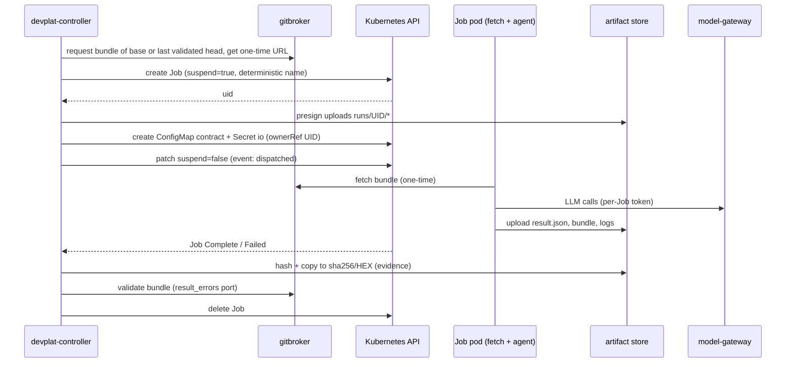

# 16 — Agent Execution and Job Lifecycle (Kubernetes)

Status: **Proposed — Documented only** (Architecture Amendment 001, 2026-10-17). No Job described here has run on any cluster. The example manifest (§4) is **validated only against the strict Kubernetes v1.33 JSON schema** (§4.3), not applied.
Reuses / supersedes: **supersedes for the platform** `02-principal-orchestrator.md` §4 dispatch steps 5–8 and §5 loop steps 2–6 (they become the controller lifecycle below); **keeps** `02-…` §2 (completion only by evidence), §3 READY rule, `04-contracts.md` (contract/result schemas and validation rules, re-hosted in the controller and gitbroker) and the failure taxonomy and budgets of `07-handoff-and-recovery.md` §2–§3 (recovery details in `21-…`). Role definitions of `03-agents.md` are reused unchanged (§9).

## 1. Invariants

1. **One attempt = one Job.** Each specialist or planner run of attempt N of task T is exactly one Kubernetes Job `dp-<project>-<task>-a<N>`. Verifier, review and integration runs are their own Jobs bound to a recorded head.
2. **Kubernetes never retries.** `backoffLimit: 0`; every retry is a new attempt decided by the controller under the devorch budgets (`07-…` §3: `max_attempts`, review 3, security 2, integration 2, environmental 5).
3. **The controller is the only writer** of task state and the only creator of Jobs in `proj-*` namespaces.
4. **The pod is untrusted.** Everything it uploads (result, bundle, logs, self-reported usage) is evidence to verify, never a fact. Authoritative facts: gitbroker's validation of the bundle, the verifier's re-run, model-gateway metering, GitHub.
5. **No credentials in the pod**, only per-Job, expiring capabilities (one-time bundle URL, presigned upload targets, a gateway token valid for this Job).
6. **Idempotent at every step.** Every step can be repeated after a controller crash without a duplicate Job, push, PR or event (§3).

## 2. The 15-step lifecycle

| # | Step | Actor and mechanism | Recorded (`task_events`) | On failure |
|---|---|---|---|---|
| 1 | **Validate dependencies** | Controller: port of devorch `issue_blockers` — DAG deps COMPLETED; contract `dependencies[]` at `required_state` (`COMPLETED`, `INTERFACE_FROZEN` with matching hash, `AWAITING_HUMAN` stack ≤ 2); TDD gates, P0 checks and per-project hard preconditions (DOD-02/03 equivalents) as **authenticated operator facts**; declared cross-project dependencies | `unblocked` (G1, `design_ref` evidence on an approved commit) | Stays BLOCKED with the blocker list |
| 2 | **Authorize** | Controller admission (`17-…` §2): project active; contract passes the port of `contract_errors` (kind→role map, read-only kinds `allowed_paths: []`, subtask ids, restricted paths); path ownership vs active tasks; operator approval present if the contract widens the role's scope; budgets and capacity | `assigned` (READY → RUNNING) + task lease | Hold with reason (`capacity`, `budget`, `ownership`, …); stays READY |
| 3 | **Select role** | `assigned_agent` → execution profile (`platform/agents/execution-profiles.yaml`); profile `kinds` must contain the contract kind; project config must bind the role | (part of `assigned`) | Contract invalid → `escalated` |
| 4 | **Prepare project environment** | Resolve the execution target `{cluster_ref, namespace_prefix}`; check namespace health, quota headroom, approved image digest for the project toolchain, role ConfigMap present for the pinned definition commit | — | `env_retry` (target unavailable) or hold (`image_unavailable`) |
| 5 | **Prepare workspace** | Gitbroker builds a git bundle: `base_commit` for attempt 1, the last **validated** head of this task for a correction attempt; mints a one-time fetch URL (TTL ≤ 15 min after unsuspend). Workspace = `emptyDir` sized by the profile | — | `env_retry` |
| 6 | **Create Job** | Create the Job **suspended** with deterministic name and idempotency key (§3); on `AlreadyExists` adopt | — | API error → retry next tick (no event) |
| 7 | **Deliver contract** | Create ConfigMap `<job>-contract` (contract with `worktree=/workspace/repo`, `evidence_dir=/out`) and Secret `<job>-io` (fetch URL, presigned upload targets scoped to `runs/<job-uid>/`, gateway token), both with `ownerReferences` → the Job uid; then set `suspend: false` | `dispatched` (`session` = Job uid, attempt N) | Setup incomplete after 5 min → delete Job, `env_retry` |
| 8 | **Monitor** | Watch Job and pod; renew the task lease; pending timeout (10 min unschedulable / image pull); `activeDeadlineSeconds`; stale detection after controller restart (§6) | `started` (FULL lifecycle, pod Running) | §6 mapping |
| 9 | **Collect** | On a terminal Job condition: list `runs/<job-uid>/` (result.json, result.bundle, agent.stream.jsonl, runner.json, fetch.log); if the pod died before uploading, read container logs through the API (bounded) | — | Missing objects are evidence of failure, classified in §6 |
| 10 | **Persist** | Size-check, hash, copy into immutable `sha256/<hex>`; insert `evidence` rows (`19-…`) with source `pod_upload` or `kube_pod_log`; write a MANIFEST evidence object; then delete the Job (`propagationPolicy: Background`) | evidence rows (not a transition) | Store unavailable → keep the Job (TTL 24 h) and retry |
| 11 | **Validate** | Gitbroker: quarantine fetch of the bundle and the port of devorch `result_errors` (§7.2). Controller: result schema, `task_id`/`contract_version`/`attempt`/`agent` match, review binding (`reviewed_head_commit`), integration binding (`integrated_heads`), required tests reported | `implementation_completed` (FULL) or `result_accepted` (SHORT) — or `attempt_failed` / `env_retry` / `escalated` | Budgets as in devorch; exhausted → `failed` |
| 12 | **Test and review** | Verifier Job re-runs `required_tests` at the validated head in a fresh workspace (G2); review subtasks `<task>-rN` (code/design/reliability) and `<task>-sN` (security, fresh Job, never the author's workspace) bound to the tested head (G3/G4); integration subtask `<first covered>-iN` (G5) | `tests_passed` (head), `code_review_passed`, `security_review_passed`, `integration_verified` | `tests_failed`, `code_review_changes_required`, `security_review_blocked`, `integration_failed` → correction attempt N+1 |
| 13 | **Pull request** | Gitbroker pushes `dev/*` only if tip = tested head and G1–G5 are recorded; finds or creates a **draft** PR; controller waits for CI on that head | `pr_prepared` (G6, `pr` + `ci_run` evidence) | CI red → correction |
| 14 | **Human approval** | GitHub reconciliation: PR merged, `merged_by` = the project's operator, merged head = G6 head. The platform never merges | `human_merged` (G7), `closed` | `human_changes_requested` → correction; wrong `merged_by` → security escalation |
| 15 | **Re-evaluate** | Controller recomputes READY for dependents in **all** projects (including cross-project dependencies), records `interface_frozen` where due, releases path ownership | `interface_frozen` where due | — |

Short-lifecycle kinds (reviews, integration, planning, `plan_proposal`) stop at step 11 with `result_accepted`. `mac_validation` tasks skip steps 4–10: they are completed by authenticated operator evidence through `devplat-api` (macOS lane, `22-…`).



## 3. Naming, idempotency and adoption

**Name.** `dp-<project>-<task>-a<attempt>`, lower-case, DNS-1123 label, ≤ 63 characters (the Job name becomes the `job-name` pod label value). Project slugs are ≤ 20 characters (`26-…`); task ids are lower-cased (`DT-0001-s1` → `dt-0001-s1`). Verifier Jobs append `-t<k>`. If a name would exceed 63 characters, the controller uses `dp-<first 45 chars>-<8 hex of sha256(full name)>`; the full name stays in the labels and annotations.

**Labels** (all Jobs): `devplat.io/project`, `devplat.io/task`, `devplat.io/attempt`, `devplat.io/role`, `devplat.io/kind`, `devplat.io/network-class`, `devplat.io/idempotency-key` = first 40 hex of `sha256(project | task | contract_core_sha256 | attempt)`; annotations carry the full contract-core hash, contract version, base commit and role-definition hash.

**Create protocol (each step idempotent).**
1. `create Job (suspend: true)`. On `AlreadyExists`: GET it. Same idempotency key → **adopt** and continue at the first incomplete step. Different key → refuse, never delete; `escalated` (`cannot_continue`): two writers or a bug.
2. `create ConfigMap` / `create Secret` with `ownerReferences` to the Job uid. On `AlreadyExists`: verify the owner uid; a stale object from a deleted Job of the same name is replaced.
3. `patch suspend: false`, then record `dispatched` with the Job uid. A crash between the patch and the record is repaired on restart: an unsuspended Job without a `dispatched` record for its uid gets the record (the event is idempotent per uid).

**Adoption after a controller restart or leader change.** The new leader lists Jobs with `app.kubernetes.io/managed-by=devplat-controller` in every execution target and joins them with RUNNING tasks:

| Found | Action |
|---|---|
| Job for the task's current attempt | Adopt; continue monitoring |
| RUNNING task, no Job, no uploaded result | `stale_detected` → `env_retry` (new attempt) |
| RUNNING task, no Job, uploaded result under `runs/<uid>/` of the recorded uid | Continue at step 9 |
| Job with no matching RUNNING task/attempt (orphan) | Collect its logs as evidence, delete it, report |

## 4. Annotated example: Backend Engineer, DT-0001 (MERC-101), attempt 2

The contract is the v1 example `examples/contract-implementation.json` (budget `max_wall_minutes: 30`, `max_turns: 10`). Profile: `mdev-backend-engineer` in `platform/agents/execution-profiles.yaml`. Image digests, registry host and hashes are placeholders.

### 4.1 Job

```yaml
# Rendered by devplat-controller for task DT-0001 (MERC-101), attempt 2, role mdev-backend-engineer.
# Placeholders: registry host, image digests and the role ConfigMap hash are illustrative.
apiVersion: batch/v1
kind: Job
metadata:
  name: dp-mercury-dt-0001-a2                 # dp-<project>-<task>-a<attempt>; deterministic => create is idempotent
  namespace: proj-mercury-exec                # from the project's execution target {cluster_ref, namespace_prefix}
  labels:
    app.kubernetes.io/managed-by: devplat-controller
    devplat.io/project: mercury
    devplat.io/task: dt-0001
    devplat.io/attempt: "2"
    devplat.io/role: mdev-backend-engineer
    devplat.io/kind: implementation
    devplat.io/network-class: deps            # selects the egress NetworkPolicy
    devplat.io/idempotency-key: 2dab2a1a1818e824a35878a3df2ed72f1f733e39   # sha256(project|task|contract_core|attempt)[:40]; computed by platform/controller/jobspec.py
  annotations:
    devplat.io/contract-core-sha256: 4b1e0c3a9d7f25e86c1b0a4f3e9d2c7b6a5f4e3d2c1b0a9f8e7d6c5b4a392817
    devplat.io/contract-version: "1"
    devplat.io/base-commit: a39b1550333e5e5b20003720a65afa27bad32f6c
    devplat.io/role-definition-sha256: 0d3c5e7a9b1f2e4d6c8a0b2d4f6e8a0c2e4b6d8f0a2c4e6b8d0f2a4c6e8b0d2f
    devplat.io/profile: mdev-backend-engineer@devplat.execution_profiles.v1
spec:
  suspend: true                               # created suspended; the controller adds ConfigMap+Secret owned by this Job, then unsuspends
  backoffLimit: 0                             # no Kubernetes retries: attempts belong to the controller (budgets, attempt+1)
  completions: 1
  parallelism: 1
  activeDeadlineSeconds: 2400                 # min(contract 30, profile 60) min * 60 + setup grace 600 s
  ttlSecondsAfterFinished: 86400              # backstop; the controller deletes the Job after collection
  podReplacementPolicy: Failed                # never two pods of one attempt at once
  podFailurePolicy:                           # classification hint; the controller re-derives the class from pod status
    rules:
      - action: FailJob                       # node drain / eviction / preemption => environmental (env_retry)
        onPodConditions:
          - type: DisruptionTarget
            status: "True"
      - action: FailJob                       # fetch: bundle URL expired/used or base verify failed => environmental
        onExitCodes:
          containerName: fetch
          operator: NotIn
          values: [0]
      - action: FailJob                       # agent runner exit codes, see 16-... §6
        onExitCodes:
          containerName: agent
          operator: In
          values: [64, 65, 75]
  template:
    metadata:
      labels:
        devplat.io/project: mercury
        devplat.io/task: dt-0001
        devplat.io/attempt: "2"
        devplat.io/role: mdev-backend-engineer
        devplat.io/network-class: deps
        devplat.io/workload: agent            # NetworkPolicy and admission policy selector
    spec:
      restartPolicy: Never                    # required by podFailurePolicy
      serviceAccountName: proj-mercury-agent  # zero RBAC bindings
      automountServiceAccountToken: false
      enableServiceLinks: false
      runtimeClassName: gvisor                # 'default' only in reduced-assurance workstation mode
      priorityClassName: devplat-agent
      terminationGracePeriodSeconds: 60
      nodeSelector:
        devplat.io/pool: exec
      tolerations:
        - key: devplat.io/exec
          operator: Equal
          value: "true"
          effect: NoSchedule
      securityContext:
        runAsNonRoot: true
        runAsUser: 10001
        runAsGroup: 10001
        fsGroup: 10001
        seccompProfile:
          type: RuntimeDefault
      initContainers:
        - name: fetch                         # no LLM; fetches and verifies the workspace
          image: registry.devplat.internal/devplat/fetch@sha256:1111111111111111111111111111111111111111111111111111111111111111
          args: ["--io=/etc/devplat/io", "--contract=/etc/devplat/contract/contract.json", "--dest=/workspace/repo"]
          resources:
            requests: {cpu: 100m, memory: 128Mi, ephemeral-storage: 64Mi}
            limits:   {cpu: 500m, memory: 512Mi, ephemeral-storage: 256Mi}
          securityContext:
            allowPrivilegeEscalation: false
            readOnlyRootFilesystem: true
            capabilities: {drop: [ALL]}
          volumeMounts:
            - {name: workspace, mountPath: /workspace}
            - {name: io, mountPath: /etc/devplat/io, readOnly: true}
            - {name: contract, mountPath: /etc/devplat/contract, readOnly: true}
            - {name: tmp, mountPath: /tmp}
      containers:
        - name: agent                         # devplat-runner (PID 1) -> claude -p --agent <role>; then bundle + upload
          image: registry.devplat.internal/devplat/agent-node24@sha256:2222222222222222222222222222222222222222222222222222222222222222
          workingDir: /workspace/repo
          args:
            - --contract=/etc/devplat/contract/contract.json
            - --role=mdev-backend-engineer
            - --io=/etc/devplat/io
            - --out=/out
            - --max-turns=10                  # min(contract budget.max_turns, profile max_turns)
            - --wall-seconds=1800             # runner stops claude at the wall budget, keeping the grace for upload
          env:
            - {name: HOME, value: /home/agent}
            - {name: ANTHROPIC_BASE_URL, value: "http://devplat-model-gateway.devplat-system.svc:8080/p/mercury"}
            - name: ANTHROPIC_AUTH_TOKEN      # per-Job gateway token, not the API key; revoked when the Job ends
              valueFrom:
                secretKeyRef: {name: dp-mercury-dt-0001-a2-io, key: gateway_token}
            - {name: NPM_CONFIG_REGISTRY, value: "http://devplat-registry-proxy.devplat-system.svc:4873/"}
            - {name: DISABLE_AUTOUPDATER, value: "1"}
            - {name: CLAUDE_CODE_DISABLE_NONESSENTIAL_TRAFFIC, value: "1"}
          resources:                          # from platform/agents/execution-profiles.yaml
            requests: {cpu: "1", memory: 2Gi, ephemeral-storage: 4Gi}
            limits:   {cpu: "2", memory: 4Gi, ephemeral-storage: 8Gi}
          securityContext:
            allowPrivilegeEscalation: false
            readOnlyRootFilesystem: true
            capabilities: {drop: [ALL]}
          volumeMounts:
            - {name: workspace, mountPath: /workspace}
            - {name: home, mountPath: /home/agent}
            - {name: role, mountPath: /home/agent/.claude/agents, readOnly: true}   # only this role's file
            - {name: role-settings, mountPath: /etc/claude-code, readOnly: true}    # managed settings (allow/deny)
            - {name: contract, mountPath: /etc/devplat/contract, readOnly: true}
            - {name: io, mountPath: /etc/devplat/io, readOnly: true}
            - {name: out, mountPath: /out}
            - {name: tmp, mountPath: /tmp}
      volumes:
        - name: workspace
          emptyDir: {sizeLimit: 8Gi}          # profile workspace_size; ephemeral PVC where node disk is short
        - name: home
          emptyDir: {sizeLimit: 512Mi}
        - name: out
          emptyDir: {sizeLimit: 256Mi}
        - name: tmp
          emptyDir: {sizeLimit: 1Gi}
        - name: role
          configMap:
            name: devplat-roles-mercury-0d3c5e7a   # immutable, generated from .claude/agents/mdev-*.md at a pinned commit
            items:
              - {key: mdev-backend-engineer.md, path: mdev-backend-engineer.md}
        - name: role-settings
          configMap:
            name: devplat-roles-mercury-0d3c5e7a
            items:
              - {key: managed-settings.mdev-backend-engineer.json, path: managed-settings.json}   # one settings key per role
        - name: contract
          configMap:
            name: dp-mercury-dt-0001-a2-contract   # ownerReference -> this Job
        - name: io
          secret:
            secretName: dp-mercury-dt-0001-a2-io   # one-time bundle URL, presigned upload URLs, gateway token; ownerReference -> this Job
            defaultMode: 0400
```

### 4.2 Companion objects (created by the controller after the Job, owned by it)

```yaml
apiVersion: v1
kind: ConfigMap
metadata:
  name: dp-mercury-dt-0001-a2-contract
  namespace: proj-mercury-exec
  ownerReferences:
    - {apiVersion: batch/v1, kind: Job, name: dp-mercury-dt-0001-a2, uid: "<job uid>", controller: true}
immutable: true
data:
  contract.json: '{"schema":"devorch.task_contract.v1","task_id":"DT-0001","attempt":2,"worktree":"/workspace/repo","evidence_dir":"/out", ...}'
---
apiVersion: v1
kind: Secret
metadata:
  name: dp-mercury-dt-0001-a2-io
  namespace: proj-mercury-exec
  ownerReferences:
    - {apiVersion: batch/v1, kind: Job, name: dp-mercury-dt-0001-a2, uid: "<job uid>", controller: true}
immutable: true
type: Opaque
stringData:
  bundle_url: "http://devplat-gitbroker-fetch.devplat-system.svc:8081/v1/bundles/<one-time token>"
  upload_targets.json: '{"result.json": {"url": "...", "fields": {...}}, "result.bundle": {...}, "agent.stream.jsonl": {...}, "runner.json": {...}, "fetch.log": {...}}'
  gateway_token: "<per-Job opaque token, revoked at Job end>"
```

### 4.3 Validation of the example

The Job in §4.1 is byte-identical to the file validated in the drafting session with
`jsonschema` 4.26.0 against `yannh/kubernetes-json-schema` **`v1.33.0-standalone-strict/job-batch-v1.json`**: 0 errors; a negative probe (an unknown field in the container and in `spec`) was rejected. This proves field names and types only — not admission, scheduling, gVisor, NetworkPolicy or runtime behaviour (§11). Strict-schema validation of the chart-rendered Job belongs to `29-…`.

## 5. Container responsibilities

| | Init container `fetch` | Main container `agent` |
|---|---|---|
| Image | `devplat/fetch` (git + verifier, no LLM, no shell for agents) | `devplat/agent-<toolchain>`: devplat-runner as PID 1, Claude Code CLI **pinned**, project toolchain (Mercury: Node 24), `/opt/devplat/hooks/specialist_guard.py` |
| Network | Same pod policy; uses only the gitbroker fetch port | `model-only` or `deps` per profile |
| Does | Download the bundle once; `git bundle verify`; clone into `/workspace/repo` with `core.hooksPath=/dev/null`; check out the contract `branch` at the expected head (`base_commit` or the last validated head) and verify `HEAD`; write `fetch.log` | Read the contract; start `claude -p` (§9.3) with the fixed prompt; enforce `--max-turns` and the wall budget (SIGTERM to Claude at the budget, SIGKILL after 30 s); then **always**: `git status --porcelain` (dirty flag), `git bundle create /out/result.bundle <branch> ^<base>` (writing kinds), `runner.json` (exit status, timings, self-reported usage), upload all files to the presigned targets; exit with the code in §6 |
| Never | Run repository code, hooks or LFS filters | Hold a token beyond the gateway token; reach GitHub, the DB or the Kubernetes API |

Sidecar-less by design: no log shipper or proxy runs next to the agent; logs leave the pod only as uploaded objects or through the controller's bounded `pods/log` read.

## 6. Runner exit codes and Job ↔ task mapping

| Runner exit | Meaning | podFailurePolicy |
|---|---|---|
| 0 | Claude finished (any result status) and all uploads succeeded | — (Job `Complete`) |
| 64 (`EX_USAGE`) | Contract or runner configuration unreadable — a platform defect | `FailJob` |
| 65 (`EX_DATAERR`) | Claude finished but `/out/result.json` is missing or not JSON | `FailJob` |
| 75 (`EX_TEMPFAIL`) | Gateway 429/5xx, budget hold, upload failure, wall budget hit before a result | `FailJob` |
| other / signal | Crash; OOM is identified from the pod's termination reason | backoffLimit 0 fails the Job |

`podFailurePolicy` is a **classification hint** (the Job condition names the matching rule); the controller re-derives the class from pod status, termination reasons and uploaded objects. `DisruptionTarget` uses `FailJob`, not `Ignore`: `Ignore` would make Kubernetes create a second pod for the same attempt, which would re-use a consumed one-time URL and hide the retry from the budgets.

| Kubernetes observation | Task event (devorch names) | Task state after |
|---|---|---|
| Job created, `suspend: true` (setup) | none (`assigned` already recorded) | RUNNING |
| `suspend: false` set | `dispatched` (session = Job uid) | RUNNING |
| Pod `Running` | `started` (FULL lifecycle; SHORT has no `started` edge, kept as metadata) | RUNNING |
| Pod `Pending` > 10 min (unschedulable, image pull) | delete Job → `env_retry`; admission hold for that role | RUNNING (next attempt) |
| `Complete`, result `completed`, validation passes | `implementation_completed` (FULL) / `result_accepted` (SHORT) | RUNNING → G2 (FULL) / COMPLETED (SHORT) |
| `Complete`, result `completed`, validation fails | `attempt_failed` (or `failed` when the budget is exhausted) | RUNNING / FAILED |
| `Complete`, result `partial` | `attempt_failed`; `env_retry` if the reason is environmental (context, rate limit) | RUNNING |
| `Complete`, result `escalated` | `escalated` + escalation entry in the API | BLOCKED |
| `Failed`, exit 65 | `attempt_failed` | RUNNING / FAILED |
| `Failed`, exit 75, `fetch` failure, `DisruptionTarget`, OOMKilled, `DeadlineExceeded` | `env_retry` (not charged; ≤ 5; backoff 1/5/15/60/240 min). Two consecutive OOM or deadline failures in one contract version → `escalated` to re-split the task (`07-…` §2 resource exhaustion) | RUNNING |
| `Failed`, exit 64 | `escalated` (`cannot_continue`, platform defect; not charged) | BLOCKED |
| Job vanished before collection | `stale_detected` → `env_retry` | RUNNING |
| Task cancelled or contract revised while the Job runs | delete Job (Background), keep uploads as evidence → `cancelled` / `contract_revised` | CANCELLED / BLOCKED |

## 7. Results: collection, persistence, validation

### 7.1 Collection and persistence

| Object (`runs/<job-uid>/…`) | Cap | Authority |
|---|---|---|
| `result.json` (`devorch.task_result.v1`) | 1 MiB | Claim, validated in step 11 |
| `result.bundle` (writing kinds) | 200 MiB | Claim; gitbroker validation makes it a fact |
| `agent.stream.jsonl` (Claude `stream-json` transcript) | 50 MiB | Log evidence |
| `runner.json` (exit, timings, dirty flag, self-reported usage) | 1 MiB | Claim; usage authority is model-gateway metering |
| `fetch.log` | 1 MiB | Log evidence |

Uploads use presigned **POST policies with `content-length-range`** where the store supports them (S3 and MinIO do — unverified for the chosen store), otherwise presigned PUTs with a server-side size check. URLs expire at the Job deadline + 15 min. The controller copies each object to `sha256/<hex>` (object lock where supported), records `evidence` rows with job uid, size and hash, and deletes `runs/<job-uid>/` (bucket lifecycle rule: 7 days as backstop). It deletes the Job only after the copy is committed; `ttlSecondsAfterFinished: 86400` is the backstop.

### 7.2 Bundle validation in gitbroker (port of devorch `result_errors`)

1. Fetch the bundle into a per-task quarantine repository with gitbroker's own git config (no hooks, `protocol.ext.allow=never`, no system/global config); `git bundle verify`; `fsck --strict`.
2. Refuse gitlinks (submodules), files above the project size limit, and changes to `.gitattributes` / `.gitmodules` / LFS pointers unless the contract's `allowed_paths` names them.
3. devorch `result_errors` rules 4–8: `base_commit` is an ancestor; the branch tip = result `head_commit`; `commits` = `rev-list base..tip` (no hidden empty commits); `modified_files` = `diff --no-renames --name-only base..tip`; every changed file inside `allowed_paths` and outside `restricted_paths`; read-only kinds and `writes_allowed: false` profiles: **no** commits beyond `review_target.head_commit`; review kinds: `reviewed_head_commit` = `review_target.head_commit`; integration: `integrated_heads` complete and contained in the tip.
4. Runner dirty flag set → INVALID (devorch rule 5; uncommitted work is never in the bundle, the flag only keeps v1 semantics).
5. Store the validated commits under `refs/devplat/<project>/<task>/a<N>` in the mirror; the bundle in the artifact store is the durable copy.

R5 N-02 (forged `.git` pointer, user git config) and N-03 (hidden index entries) do not apply: gitbroker never runs git in an agent-controlled directory; it reads objects only.

## 8. Deadlines, failure policy, TTL, leases

| Setting | Value | Rationale |
|---|---|---|
| `activeDeadlineSeconds` | `min(contract budget.max_wall_minutes, profile max_wall_minutes) × 60 + setup_grace_seconds (600)` | Kubernetes resets the timer while a Job is suspended, so setup time is not charged |
| Runner wall budget | `min(…) × 60` | Stops Claude before the deadline so the runner can still upload |
| `terminationGracePeriodSeconds` | 60 | Runner uploads partial logs on SIGTERM (drain, cancel) |
| `backoffLimit` / `podReplacementPolicy` | 0 / `Failed` | One pod per attempt |
| `ttlSecondsAfterFinished` | 86400 | Backstop only |
| Pending timeout (controller) | 10 min | Unschedulable or image pull |
| Task lease | `lease_expires_at` = now + 2 min, renewed by the leader each tick | A dead leader's tasks are taken over after expiry (`19-…`, `21-…`) |

## 9. Reuse of the 12 `mdev-*` definitions (and the orchestrator's)

### 9.1 Role ConfigMap

A generator (`platform/tools/gen_role_configmap.py`, **implemented**; its output validates against the strict v1.33 ConfigMap schema) reads `.claude/agents/mdev-*.md` at a pinned, operator-approved commit and emits one immutable ConfigMap per project, `devplat-roles-<project>-<hash8>`:

- one key per definition, **byte-identical** to the repository file except one recorded transform: the hook command `$CLAUDE_PROJECT_DIR/tools/devorch/hooks/specialist_guard.py` becomes `/opt/devplat/hooks/specialist_guard.py` (baked into the image, read-only root filesystem). In the workspace the script would be agent-writable, and non-Mercury repositories do not contain it;
- `managed-settings.<role>.json` (mounted as `/etc/claude-code/managed-settings.json`): the deny rules of `.claude/settings.json`, allow rules for the role's frontmatter `tools` (headless runs cannot answer permission prompts), and the profile's `extra_disallowed_tools`;
- annotations: source commit, per-file sha256 before and after the transform.

The Job mounts **only its own role file** (`items`) at `~/.claude/agents/` and the managed settings at `/etc/claude-code/`. The `.claude/agents/` files in the repository are not edited (`14-…` §3 rule 2).

### 9.2 What still applies inside the container

- Frontmatter `tools` and `disallowedTools` apply when Claude Code runs as that agent; the Code Reviewer still has no Edit/Write/NotebookEdit. No MCP servers are configured in the pod (`--strict-mcp-config` with none), so the GitHub/Linear MCP denies are moot — there is nothing to call.
- Project-level settings from the **workspace** (`.claude/`, `.mcp.json`) are not loaded; repository `CLAUDE.md` and all repository text are untrusted content (v1 rule U).
- The guard hook is a **tripwire**. It did not fire in v1 live dispatch (R5 N-01), and inside the container the agent controls its own process environment. The **real controls** are: default-deny NetworkPolicy (no route to GitHub, the DB or the Kubernetes API, so `git push` has nowhere to go); no credentials in the pod; gitbroker validation (only a validated bundle can become a commit, and only gitbroker pushes, only after G1–G5); zero-RBAC service account without a token; gVisor; read-only root filesystem.

### 9.3 Invocation

```text
claude -p "Read the contract at /etc/devplat/contract/contract.json. Execute it exactly. Write result.json
           to /out and return the final JSON result block required by your instructions." \
       --agent <role> --output-format stream-json --verbose --max-turns <n> \
       --strict-mcp-config --setting-sources user
```

The prompt is the fixed v1 dispatch instruction (`02-…` §4 step 7); for a correction attempt the controller places prior evidence files in the contract ConfigMap under `inputs/` and names only their paths. The exact flag set (`--agent` in print mode, `--setting-sources`, managed-settings path) is an **unverified assumption** for the pinned CLI version (V-16-1).

## 10. Planner Jobs (Principal Orchestrator role)

| Aspect | Rule |
|---|---|
| What runs | Profile `planner`: definition `.claude/agents/mdev-principal-orchestrator.md` with `extra_disallowed_tools` `Agent`, `Edit`, `NotebookEdit`, GitHub/Linear MCP. Network `model-only`; `writes_allowed: false` |
| When | (a) drafting contracts for backlog items the controller found unblockable; (b) triage after `attempt_failed`, `tests_failed` or a review rejection; (c) drafting an escalation; (d) re-planning after `contract_revised` |
| Contract | Same `devorch.task_contract.v1` / `task_result.v1` schemas, new kind `plan_proposal`, `allowed_paths: []`, ids `<task>-pN` (task-bound) or `PL-<nnnn>` (project-level). Both need a contract schema revision (§13) |
| Inputs | Read-only workspace at the approved design commit; backlog extract and prior evidence as files (rule U) |
| Outputs | `/out/result.json` plus `/out/proposals/*.json` (contracts, triage) and `*.md` (escalation drafts) |
| Acceptance | The controller overwrites derived fields (`task_id`, `created_by`, `branch`, `worktree`, `evidence_dir`, `attempt`), caps the budget at project defaults, keeps the lifecycle's `required_gates` and default `required_reviewers` (a planner cannot remove a gate or a reviewer), unions `restricted_paths` with the project baseline, runs the `contract_errors` port and G1. `allowed_paths` outside the role's scope in the project config → **operator approval** in `devplat-api` |
| Cannot | Dispatch, record events, push, open PRs, approve, or reach GitHub, Linear, the DB or the Kubernetes API (no route, no token) |

The controller's own classification of a failure (§6) stays authoritative; a triage proposal can only suggest a contract revision, which then follows the rules above.

## 11. Verification items (must pass on a real cluster before the first agent Job)

| ID | Item |
|---|---|
| V-16-1 | Pinned Claude Code CLI: `--agent` with `-p`, `--setting-sources`, `--strict-mcp-config`, `/etc/claude-code/managed-settings.json` precedence, frontmatter `tools`/`disallowedTools` enforced headless |
| V-16-2 | Claude Code and the Mercury toolchain run with read-only root FS, `emptyDir` HOME, uid 10001, under gVisor (amd64 and, for the workstation, arm64) |
| V-16-3 | `ANTHROPIC_BASE_URL` + per-Job token through model-gateway; key never visible in the pod (env, files, `/proc`) |
| V-16-4 | `suspend` → unsuspend resets the deadline; `podFailurePolicy` rules match `fetch` and `agent` as written; condition messages parseable |
| V-16-5 | Default-deny egress enforced by the chosen CNI (probe: `git push`, GitHub API, PostgreSQL, Kubernetes API from an agent pod all fail) |
| V-16-6 | Presigned POST size limits on the chosen store; expiry honoured |
| V-16-7 | Adoption: kill the leader between each create step; no duplicate Job, event, push or PR |
| V-16-8 | Port of the 30 devorch regression tests to controller + gitbroker (`29-…` §3) |

## 12. Capability status

| Capability | Status |
|---|---|
| Lifecycle, naming, mapping, planner rules (this document) | Documented only |
| Example Job manifest | Configured (example only); strict-schema validated, not applied |
| `platform/agents/execution-profiles.yaml` + schema | Configured; schema-validated (`python3 -c "import json,yaml,jsonschema; jsonschema.Draft202012Validator(json.load(open('platform/schemas/execution-profiles.schema.json'))).validate(yaml.safe_load(open('platform/agents/execution-profiles.yaml')))"`) |
| Controller Job creation/adoption, runner, fetch image, gitbroker validation | Documented only |
| Role ConfigMap generator | Documented only (not written) |
| devorch rules being ported | Implemented+tested in v1 (30 tests); the port is Documented only |
| Claude Code headless flags, gVisor compatibility, NetworkPolicy enforcement | Unverified assumption (V-16-1…5) |
| Draft-PR push by gitbroker | Awaiting operator approval (DOD-03 dev-bot App) |

## 13. Open questions and required changes elsewhere

1. **Contract schema v2.** `created_by` const `principal-orchestrator`, `task_id` `^DT-…`, `branch` `^dev/(merc-…|dt-…)`, the `assigned_agent` enum and the `kind` enum do not admit the controller as creator, the `planner` role, the `plan_proposal` kind or non-Mercury projects. Owner: contracts (`04-…`) / persistence (`19-…`).
2. **DevOps tasks touching `.github/workflows/**`.** DOD-03 (a) gives the dev-bot App no `workflows` permission, so gitbroker cannot push such commits. Options: operator pushes them, or a scoped exception (operator decision).
3. Whether `started` should be added to `T_SHORT` for uniform monitoring (today it is metadata only for short kinds).
4. Pod log retention when a pod is evicted before upload (bounded `pods/log` read requires the controller's `pods/log get` RBAC in `proj-*` namespaces; `18-…`).
