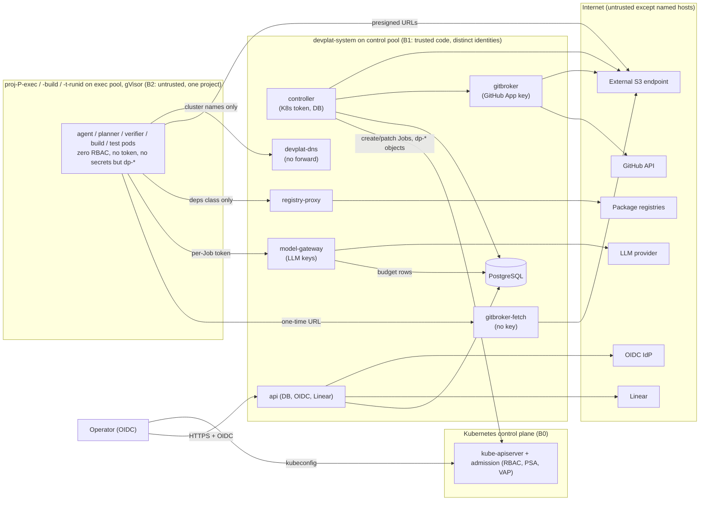

# 18 — Kubernetes Security Model (devplat)

Status: **Proposed — Documented only** (Architecture Amendment 001, 2026-10-17; awaits operator approval, `12-…` DOD-11…DOD-16). Nothing here is deployed. The base manifests in `platform/deploy/base/` are **Implemented (untested on a cluster)**: 121 documents validate against the strict Kubernetes v1.33 JSON schemas, all 93 CEL expressions compile in the Kubernetes v0.33 CEL environment, and 61 sample admission requests (77 policy decisions) give the expected allow or deny offline (§16). No kube-apiserver, CNI, gVisor or node has evaluated any of it.

Reuses / supersedes: **supersedes for the platform** `08-quality-gates-and-security.md` §4 (security and authorization matrix, enforcement layers) and §6 rules 2–4 (prompt-injection handling becomes infrastructure, §11). **Keeps unchanged** `08-…` §0 hard preconditions (in their Kubernetes form, §12), §1 gates G1–G7, §2 TDD mapping, §5 GitHub identity and merge authority (DOD-02, DOD-03 (a), G-DETECT/G-ORG) and §6 rules 1, 5, 6. v1 local mode keeps `08-…` §4 as written. Production MERCURY's threat model (`docs/mercury/security/threat-model.md`) is not changed.

## 1. Principles

1. **Infrastructure enforces, prompts advise.** Each control below is a Kubernetes object (RBAC, NetworkPolicy, admission policy, PSA, RuntimeClass) or code in a platform service. Claude Code deny rules and the specialist guard hook remain inside agent images as **tripwires** only (R5 N-01: they did not fire in v1).
2. **Agent pods are untrusted.** Assume every agent, planner, verifier, build and test pod runs code an attacker wrote: prompt injection, malicious repository content or a compromised dependency. Nothing such a pod outputs becomes a fact without a platform check (`16-…` §1 rule 4).
3. **No credential enters an untrusted pod.** Agent, build and test pods get no Kubernetes token, no GitHub token, no LLM key and no DB credential. They get only per-Job capabilities that expire: a one-time fetch URL, presigned upload targets and a gateway token.
4. **One credential, one holder.** Each long-lived secret is readable by exactly one ServiceAccount, and admission enforces it (§5).
5. **Default deny** for network (every namespace), RBAC (zero bindings unless listed in §4) and admission (`failurePolicy: Fail`).
6. **The human gate stays outside the platform.** devplat opens draft PRs only. It never approves, merges, enables auto-merge or edits rulesets, and the dev-bot GitHub App has no permission to do so (§12).
7. **Honest assurance.** Where a control is missing (single-node workstation, a CNI that does not enforce, no gVisor), the installation runs in **reduced-assurance mode**, and that is recorded and shown (§14).

## 2. Assets

| ID | Asset | Where | Holder | Impact if lost |
|---|---|---|---|---|
| A1 | Merge authority on `main` (each project) | GitHub ruleset | Operator only | Unreviewed code in `main` |
| A2 | GitHub App private key (dev bot, DOD-03 (a)/DOD-13) | Secret `devplat-gitbroker-github-app` | `devplat-gitbroker` | Push `dev/*`, open PRs, read repos as the bot |
| A3 | LLM provider API keys | Secret `devplat-model-gateway-llm-keys` | `devplat-model-gateway` | Spend, data sent to the provider under the account |
| A4 | Task state, `task_events` hash chain, gate records, budgets | PostgreSQL | `devplat-controller` (writer), `devplat-api` (operator facts), `devplat-model-gateway` (budget rows only) | Forged gates, i.e. self-certification |
| A5 | Evidence objects `sha256/<hex>` | Artifact store (external S3 by default) | Controller (write), api (read) | Forged or destroyed evidence |
| A6 | Project source code (private repos) | GitHub, gitbroker mirror, Job workspaces | gitbroker; one Job at a time per workspace | Disclosure; cross-project leak |
| A7 | Kubernetes control plane | Cluster | Operator (cluster-admin) | Everything |
| A8 | Operator identity (OIDC) | IdP | Operator | Forged approvals and facts |
| A9 | Project test secrets (e.g. Mercury T3 sandbox App) | Secrets in that project's test namespace (`22-…`) | Test Jobs of that project | Sandbox repository writes |
| A10 | Platform and agent images | Registry | Operator CI | Persistent compromise of every run |

## 3. Threat actors

| ID | Actor | Capability assumed |
|---|---|---|
| T1 | **Prompt-injected agent** (Claude Code in a Job, steered by issue text, repo content, PR comments or CI logs) | Arbitrary code execution as the pod's user inside gVisor. Full control of its own `result.json`, bundle, logs and self-reported usage |
| T2 | **Malicious repository content** (hooks, `.claude/**`, `CLAUDE.md`, build scripts, test fixtures) | Runs in agent, build and test pods; tries to reach gitbroker or the controller through bundles and results |
| T3 | **Compromised dependency** (npm package, base image, BuildKit frontend) | Code execution at install, build or test time inside a project pod; supply-chain persistence |
| T4 | **Compromised platform component** (controller, api, gitbroker, gateway): bug, RCE or malicious update | That pod's ServiceAccount, Secrets and network flows |
| T5 | **Curious co-tenant project** (project B's agents or tests) | Same as T1, but aims at project A's code, evidence, budget or secrets |
| T6 | External attacker on the internet | Reaches only what the ingress exposes (api, dashboard) |
| T7 | Operator error | Mis-applied manifests, overly broad kubeconfig, a skipped verification |

## 4. Trust boundaries



| Boundary | Crossing | Control at the crossing |
|---|---|---|
| B2 → B1 | Agent pod → gitbroker-fetch, model-gateway, registry-proxy, devplat-dns | NetworkPolicy (only these four, per workload and network class); per-Job capability tokens; services treat input as hostile; gitbroker itself is unreachable |
| B2 → B0 | Agent pod → kube-apiserver | No route (default-deny egress); no token (`automountServiceAccountToken: false`, enforced by VAP); zero RBAC |
| B2 → EXT | Agent pod → internet | No route. Only via model-gateway (provider host allowlist) and registry-proxy (per-project registry allowlist) |
| B2 → B2' | Project A pod → project B pod or namespace | No allow rule between project namespaces; per-project buckets and presigned URL scope; label checks in admission |
| B2 output → B1 | Bundle, result, logs → controller/gitbroker | Treated as data: schema-validated; the bundle is checked in a quarantine repo (port of devorch `result_errors`); tests re-run by verifier Jobs; no field becomes a command or path without validation (§11) |
| B1 → EXT | gitbroker → GitHub | App installation tokens scoped per repository and permission; push only `dev/*`; draft PRs only |
| Operator → B1 | Approvals, facts | OIDC-authenticated subject recorded with each fact (closes R5 N-06 self-assertion, §13) |

## 5. Threat analysis (STRIDE)

| # | STRIDE | Actor | Threat | Mitigation (where enforced) | Residual risk |
|---|---|---|---|---|---|
| K-01 | E | T1, T2 | Agent pushes to `main` or merges | No GitHub credential in the pod; no route to `github.com`; gitbroker pushes only `dev/*` after G1–G5; App has no merge or approve permission; ruleset DOD-02 | **Low**, once DOD-02 and DOD-13 (the Kubernetes form of DOD-03 (a)) are in place. Until then gitbroker must not be deployed with any credential |
| K-02 | E | T1 | Agent calls the Kubernetes API to create pods or read Secrets | No token, no route, zero RBAC (VAP `devplat-proj-pod-identity`, NetworkPolicy) | Low. A kube-apiserver or kubelet CVE reachable through node networking is mitigated by gVisor and the dedicated exec pool |
| K-03 | E | T1, T3 | Container escape to the node, then other pods' secrets | gVisor/Kata RuntimeClass mandatory on the exec pool (VAP); exec taint keeps platform pods (holders of A2/A3/A4) off exec nodes; PSA restricted; no hostPath or privileged | Medium on nodes without a sandbox runtime (reduced assurance); Low with gVisor |
| K-04 | I | T1, T2 | Exfiltrate source code over the network (DNS tunnelling, HTTPS) | Default-deny egress; DNS only to `devplat-dns`, which has no forwarder; model-gateway allows only provider hosts; registry-proxy allows only listed registries | Medium: content can still leave inside LLM prompts to the (trusted) provider, and through package-proxy request paths for the `deps` class. Accepted, because the provider is in scope by design |
| K-05 | T | T1 | Forge the result, test evidence or review verdict (self-certification) | Results are claims; gitbroker validation, verifier re-runs at the tested head, reviews as separate Jobs bound to the head; only the controller writes `task_events` (DB role); the controller re-derives the failure class | Low (it is the v1 design, now with real process and identity separation) |
| K-06 | T | T2 | Malicious bundle: hooks, `.git/config`, symlinks, path traversal, restricted paths, rename tricks, hidden index | Gitbroker fetches the bundle into a quarantine repo with its own git config (no hooks, `protocol.ext.allow=never`, no system/global config), runs `fsck --strict`, and validates the tree diff (`16-…` §7.2). It never runs git inside an agent-controlled directory | Low; the residual is a git parsing bug in gitbroker (keep git patched; fuzz the validator) |
| K-07 | S | T1 | Use another project's gateway budget or bucket | Per-Job gateway token bound to `(project, job uid)`; presigned URLs scoped to `runs/<job-uid>/` in the project's bucket; VAP checks that pod and Job project labels equal the namespace's | Low |
| K-08 | I | T5 | Read project A's code or evidence from project B | Separate namespaces, no allow rules between them, per-project buckets, Jobs never mount two projects' code, the artifact store requires presigned URLs | Low. Shared services (gateway, fetch, S3) are a common attack surface: a vulnerability there crosses projects |
| K-09 | D | T1, T5 | Exhaust cluster resources or LLM budget | Controller admission (global, per-project and per-role caps); ResourceQuota and LimitRange; `activeDeadlineSeconds`; gateway budgets (DOD-08); PriorityClass `devplat-agent` never preempts | Low. A noisy neighbour can still slow another project within its quota |
| K-10 | E | T4 (controller) | Compromised controller creates privileged pods or reads secrets | The controller can create Jobs only in project namespaces; admission forbids privileged pods, foreign ServiceAccounts, platform Secrets and unpinned images; it has no Secret rights outside project namespaces; its only Job mutation is unsuspend; it creates only test namespaces, through the namespacer | **Medium**: a compromised controller *is* the gate authority. It can write forged gate records into PostgreSQL and run arbitrary (pinned, allow-listed) images with arbitrary arguments in project namespaces. The GitHub ruleset and operator review (G7) remain the backstop. Signed `task_events` would be future hardening |
| K-11 | I | T4 (api) | Compromised api forges operator facts | Facts carry the OIDC subject and token hash; the controller re-verifies the subject claim | Medium: an api compromise allows forged facts. Mitigation: facts that unlock code work (DOD-02/13) are also re-checked live against GitHub by gitbroker |
| K-12 | E | T4 (gitbroker) | Compromised gitbroker misuses the App key | App permissions: `contents:write` only via push rulesets on `dev/*`, `pull_requests:write`, no `administration` or `workflows`, not a CODEOWNER; ruleset with no bypass actors; gitbroker is unreachable from project pods (fetch is a separate, keyless service) | Low to Medium: it can push garbage to `dev/*` and open draft PRs; G7 catches it. On a personal repository the merge actor is detected after the fact (G-DETECT) |
| K-13 | I | T4 (gateway) | Key theft from the gateway | Key only in this pod (VAP `devplat-secret-pinning`); egress only to provider hosts; ingress only from exec pods and the controller | Medium: a gateway RCE leaks the key. Use provider-side spend limits and key rotation; a separate key per project where the provider allows it |
| K-14 | T | T3 | Poisoned base image, BuildKit or dependency | Digest-pinned images from allow-listed prefixes (VAP `devplat-image-pinning`); pull-through mirror; per-project build caches (`22-…` §8); SBOM and provenance on every build; optional signature verification (§10) | Medium: a digest pins *what* was reviewed, not *whether* it is safe |
| K-15 | R | T1, T7 | Deny an action later; missing audit | `task_events` hash chain (controller DB role only); Kubernetes audit log at Metadata level for devplat namespaces, RequestResponse for Secrets metadata; VAP `Audit` action annotations; GitHub as the source of record for pushes and PRs | Low |
| K-16 | E | T1, T2 | Planner proposes a malicious contract (scope `**`, restricted paths, a new dispatch) | Planner output is a **proposal**. The controller validates it with the v1 `check-contract` rules (allowed paths may not fall inside restricted paths; subtask ids; ownership). Contract scope changes need an operator decision via api | Low |
| K-17 | E | T7 | Operator applies a manifest that weakens a control (e.g. removes an ns-role label) | Namespace labels are writable only by the operator; the bootstrap verification probes (`22-…` §7 N1–N12) run after every change and stop dispatch on failure | Medium (human factor) |
| K-18 | I | T1 | Read node or cloud metadata (169.254.169.254) and steal cloud credentials | Public egress `ipBlock`s exclude 169.254.0.0/16 and all private ranges; agent pods have no public egress at all; IMDSv2 hop limit 1 on cloud nodes; workload identity is bound only to platform SAs | Low |

## 6. Authorization matrix

✓ = allowed (enforced by the named layer); ✗ = denied by infrastructure; — = not applicable. "Zero RBAC" means no RoleBinding or ClusterRoleBinding names the subject, and the pod mounts no token.

| Capability | Operator | controller SA | api SA | gitbroker SA | gitbroker-fetch SA | model-gateway SA | agent / planner / verifier pod (`<P>-agent`) | build pod (`<P>-build`) | test-namespace pods (`default`) |
|---|---|---|---|---|---|---|---|---|---|
| K8s: create/get/list/watch/patch(unsuspend)/delete Jobs | ✓ | ✓ project and test namespaces only (RBAC + VAP `devplat-controller-job-update`) | ✗ | ✗ | ✗ | ✗ | ✗ (no token) | ✗ | ✗ |
| K8s: create Pods directly | ✓ | ✗ (no verb) | ✗ | ✗ | ✗ | ✗ | ✗ | ✗ | ✗ |
| K8s: pods get/list/watch, pods/log get | ✓ | ✓ project/test namespaces | ✗ | ✗ | ✗ | ✗ | ✗ | ✗ | ✗ |
| K8s: pods/exec, attach, portforward, ephemeral containers | ✓ (break-glass) | ✗ | ✗ | ✗ | ✗ | ✗ | ✗ | ✗ | ✗ |
| K8s: Secrets | ✓ | create/get/delete `dp-*` in project/test namespaces only (RBAC + VAP `devplat-controller-run-objects`); no list/watch; nothing in devplat-system | ✗ | ✗ (mounted by kubelet, no API right) | ✗ | ✗ | ✗ | ✗ | ✗ |
| K8s: create/delete namespaces | ✓ | only `proj-<P>-t-<8hex>`, by impersonating `devplat-namespacer` (VAP `devplat-namespacer-scope`) | ✗ | ✗ | ✗ | ✗ | ✗ | ✗ | ✗ |
| K8s: RBAC, admission, CRD, node, namespace-label changes | ✓ | ✗ (one RoleBinding shape inside test namespaces only) | ✗ | ✗ | ✗ | ✗ | ✗ | ✗ | ✗ |
| GitHub: read source | ✓ | ✗ | ✗ | ✓ (App installation token) | ✗ | ✗ | ✗ (bundle only) | ✗ (bundle only) | ✗ |
| GitHub: push `dev/*`, open draft PR | ✓ | ✗ (asks gitbroker) | ✗ | ✓ after G1–G5 | ✗ | ✗ | ✗ | ✗ | ✗ |
| GitHub: push `main`, approve, merge, auto-merge, rulesets, settings | **✓ (sole)** | ✗ | ✗ | ✗ (App permissions + ruleset) | ✗ | ✗ | ✗ | ✗ | ✗ |
| Linear: read | ✓ | ✗ | ✓ (adapter in api) | ✗ | ✗ | ✗ | ✗ (files only) | ✗ | ✗ |
| Linear: write | ✓ | ✗ | ✗ until DOD-05 | ✗ | ✗ | ✗ | ✗ | ✗ | ✗ |
| DB (PostgreSQL) | ✓ (break-glass) | ✓ own role (only writer of tasks and `task_events`) | ✓ own role (operator facts, reads) | ✗ | ✗ | ✓ budget tables only | ✗ (no route, no credential) | ✗ | ✗ |
| Artifact store | ✓ | ✓ read/write, evidence copy | ✓ read evidence | ✓ write bundles | ✓ read bundles | ✗ | presigned PUT/POST `runs/<job-uid>/` only; presigned GET of its own inputs | same as agent | same as agent |
| LLM API | ✓ | admin API of the gateway (budgets, token minting) | ✗ | ✗ | ✗ | ✓ (holds keys) | via gateway with per-Job token (classes `model-only`, `deps`) | ✗ | ✗ (never; `22-…` N5) |
| Egress to internet | ✓ | ✗ | 443 to public ranges (OIDC, Linear; host allowlist in app) | 443 to public ranges (GitHub; allowlist in app) | ✗ | 443 to public ranges (provider allowlist) | ✗ | ✗ (via registry-proxy) | ✗ (via registry-proxy, class `deps`) |
| Record gates / task events | facts and approvals via api | ✓ (only writer) | facts with OIDC subject | ✗ | ✗ | usage rows | ✗ | ✗ | ✗ |

## 7. RBAC design (`platform/deploy/base/rbac.yaml`)

| Subject | Grant | Scope | Why |
|---|---|---|---|
| `devplat-controller` | ClusterRole `devplat-job-runner` via **RoleBinding** in each `proj-<P>-exec` and `proj-<P>-build` | Namespaced | Jobs: create/get/list/watch/patch/delete (suspended-setup protocol, `16-…` §3 step 7); pods: get/list/watch; pods/log: get; events: read; configmaps and secrets: create/get/delete (per-run `<job>-contract` and `<job>-io`; get verifies the owner uid on `AlreadyExists`, delete replaces a stale object). No list/watch/update/patch on Secrets |
| `devplat-controller` | ClusterRole `devplat-test-runner` via RoleBinding **created by the namespacer** inside each test namespace | Namespaced (dynamic) | As above, plus services and apps deployments/statefulsets create/get/list/watch for declared test fixtures |
| `devplat-controller` | Role `devplat-controller-leader-election` | devplat-system | Lease create; get/update only `devplat-controller`; events |
| `devplat-controller` | Role `devplat-controller-impersonate-namespacer` | devplat-system | `impersonate` on exactly one ServiceAccount |
| `devplat-controller` | Roles `devplat-controller-service-lookup` | devplat-system, devplat-artifacts | `get` named Services (ClusterIPs for dnsConfig and optional hostAliases) |
| `devplat-namespacer` | ClusterRole `devplat-namespacer` via **ClusterRoleBinding** | Cluster | **The only cluster-scoped write.** Justification: Namespaces are cluster-scoped, and the bootstrap objects (default-deny NetworkPolicy, ResourceQuota, LimitRange, the controller's RoleBinding) live in a namespace that does not exist until created. Rights: namespaces create/delete/get/list/watch; networkpolicies, resourcequotas, limitranges, rolebindings create; `bind` only on `devplat-test-runner`. VAP `devplat-namespacer-scope` confines every request to `^proj-<P>-t-[0-9a-f]{8}$`, requires the labels `devplat.io/managed-by=devplat-controller`, `devplat.io/ns-role=test`, `devplat.io/project` matching the name and PSA `restricted`, allows delete only of such namespaces, and allows only the one RoleBinding shape |
| `devplat-dns` | ClusterRole `devplat-dns` (list/watch services, namespaces, endpointslices) | Cluster, **read-only** | Service names in dynamic test namespaces must resolve. These are the same rights the cluster DNS has. Residual: Service names are enumerable cluster-wide |
| `devplat-prometheus` | Role `devplat-prometheus-discovery` | devplat-system, devplat-artifacts | Scrape discovery; never project namespaces |
| api, gitbroker, gitbroker-fetch, model-gateway, registry-proxy, artifacts, every project SA | **none** | — | Kubernetes API not needed; `automountServiceAccountToken: false` on every SA |

Notes:
1. **Impersonation is for audit and policy targeting, not a privilege boundary.** A compromised controller can impersonate the namespacer. The value is that cluster-scoped writes appear as a separate user in the audit log, and that VAP pins them. A separate namespacer Deployment would be a real boundary at the cost of one more component. That is open question Q-18-1.
2. **Why not a ClusterRoleBinding for the controller.** The charts' current `controller-rbac.yaml` grants the controller cluster-wide Jobs/pods/configmaps/networkpolicies and relies on a scope VAP. The base binds per namespace instead, so a VAP outage or bug (`failurePolicy` misconfiguration) does not widen the controller to `devplat-system` or `kube-system`. See inconsistency I-1.
3. Third-party operators (CloudNativePG; an S3-compatible store operator if run in-cluster) bring their own ClusterRoles. CloudNativePG's operator role includes cluster-wide Secret access (**unverified for the pinned version, review before install**). A compromised CNPG operator would then reach the gitbroker and gateway keys. Managed PostgreSQL in cloud profiles avoids this; on a workstation it is accepted residual risk R-18-3.
4. Operator access: OIDC user with a namespaced admin role for daily work; cluster-admin only as break-glass. The operator binds it; it is not in base.

## 8. Credential isolation

### 8.1 Long-lived credentials

| Secret (name fixed in base) | Only ServiceAccount allowed to reference it (VAP `devplat-secret-pinning`) | Content | Source |
|---|---|---|---|
| `devplat-gitbroker-github-app` | `devplat-gitbroker` | Dev-bot App id + private key (DOD-13) | Operator creates the App; External Secrets in cloud |
| `devplat-model-gateway-llm-keys` | `devplat-model-gateway` | Provider API keys (spend-limited) | Operator |
| `devplat-db-controller`, `devplat-db-api`, `devplat-db-model-gateway` | controller, api, model-gateway (each its own) | Separate DB roles: controller = task/event writer; api = facts + reads; gateway = budget tables | CNPG-generated or managed PG |
| `devplat-artifacts-controller`, `-gitbroker`, `-gitbroker-fetch`, `-api` | the named component | S3 credentials scoped per prefix (fetch: read `bundles/`) | Workload identity in cloud (preferred, no static key) |
| `devplat-oidc-client`, `devplat-linear-token` | `devplat-api` | OIDC client secret; Linear read token | Operator |
| Project test secrets (e.g. Mercury T3 sandbox App) | Test Jobs of that project, in a test namespace only | Sandbox credentials | Operator; never in exec namespaces (`22-…`) |

Rules:
1. **Kubernetes Secrets are encrypted at rest**: `EncryptionConfiguration` with a KMS v2 provider (cloud: provider envelope encryption; k3s: `--secrets-encryption`; kind: a static `aescbc` key is better than nothing but lives on the same disk, so treat it as reduced assurance).
2. **Cloud:** External Secrets Operator or the CSI Secrets Store, with workload identity per platform SA. No static cloud keys in the cluster. Node IAM roles grant nothing to pods.
3. **Rotation:** App key and LLM keys are rotated by the operator; gateway tokens and installation tokens are short-lived by construction.
4. **Chart alignment:** the charts must reference these exact Secret names, or VAP pinning does not protect them (inconsistency I-4).

### 8.2 Per-Job capabilities (no credentials in untrusted pods)

| Capability | Minted by | Scope | Lifetime | Where it lives in the pod |
|---|---|---|---|---|
| One-time bundle URL | gitbroker (bundle built from the base or last validated head), served by **gitbroker-fetch** | One bundle, one download | ≤ 15 min after unsuspend | Secret `dp-<job>-io` |
| Presigned upload targets | controller | `runs/<job-uid>/<file>`, size-limited POST policy where supported | Job deadline + 15 min | Secret `dp-<job>-io` |
| Gateway token | model-gateway admin API, requested by the controller | `(project, job uid)`, token and cost budget | Revoked at Job end | Secret `dp-<job>-io` |

The per-run Secret is `immutable`, owned by its Job (VAP `devplat-controller-run-objects`) and garbage-collected with it. Pods may reference only `dp-*` Secrets (VAP `devplat-proj-pod-identity`), so a pod spec that names a platform Secret is rejected even inside a project namespace.

**gitbroker-fetch is a separate Deployment without the App key** (§4). Agent pods never reach the key holder. The charts currently serve fetch from the gitbroker pod (inconsistency I-3).

## 9. Network policies (`platform/deploy/base/networkpolicies.yaml`)

### 9.1 Rules

1. Every devplat namespace has `default-deny-all` (ingress and egress).
2. Selectors: namespaces by `devplat.io/ns-role` (system, artifacts, observability, exec, build, test, the same vocabulary as the charts); project pods by `devplat.io/workload` (agent, planner, verifier, build, test, fixture) and `devplat.io/network-class` (none, model-only, deps). The controller sets both labels; admission checks them.
3. NetworkPolicy is L3/L4. Host allowlists (GitHub, provider, Linear, registries) are enforced in the egress-owning service. Where the CNI supports it (Cilium `toFQDNs`), add FQDN policies as defence in depth (overlay, not base).
4. **The CNI must enforce NetworkPolicy.** "Objects accepted" is not "policy enforced": probe N12 of `22-…` §7 must fail the suite on a non-enforcing CNI.
5. Placeholders that the overlay must replace: kube-apiserver endpoint IPs (`192.0.2.10/32`), the external S3 endpoint (`198.51.100.10/32`), the ingress-gateway namespace label, `cnpg-system`.

### 9.2 Allowed flows

| From | To | Port | Condition |
|---|---|---|---|
| exec pods (agent, planner, verifier) | devplat-dns | 1053/UDP+TCP (Service 53) | All classes |
| exec pods | gitbroker-fetch | 8081 | All classes |
| exec pods | artifact store: external S3 443 or in-cluster 9000 | 443 / 9000 | All classes (presigned) |
| exec pods | model-gateway | 8080 | `network-class` model-only or deps |
| exec pods | registry-proxy | 4873 | `network-class` deps |
| build pods | devplat-dns; registry-proxy (packages 4873, OCI mirror 5000); artifact store | as above | Always; never the model-gateway |
| test-namespace pods | intra-namespace; devplat-dns; gitbroker-fetch; artifact store; registry-proxy (class deps) | as above | Created by the namespacer per test namespace (§9.3); **never** the model-gateway |
| controller | PostgreSQL 5432; gitbroker 8080; model-gateway admin 9443; artifact store; kube-apiserver | — | No internet |
| api | PostgreSQL; artifact store; public 443 (OIDC, Linear) | — | Ingress only from the ingress-gateway namespace |
| gitbroker | public 443 (GitHub); artifact store | — | Ingress only from the controller |
| gitbroker-fetch | artifact store | — | Ingress only from exec and test pods |
| model-gateway | public 443 (providers); PostgreSQL (budgets) | — | Ingress from exec pods (classes model-only/deps) and the controller (9443) |
| registry-proxy | public 443 (registries) | — | Ingress from deps-class pods and build pods |
| devplat-dns | kube-apiserver | — | No forwarder, no internet |
| PostgreSQL | peers; artifact store (backups); kube-apiserver (CNPG instance manager) | — | Ingress from controller, api, gateway, CNPG operator |
| Prometheus | devplat-system and devplat-artifacts :9090; kube-apiserver | — | Never project namespaces |
| "Public 443" | `0.0.0.0/0` and `::/0` **except** 10/8, 100.64/10, 169.254/16, 172.16/12, 192.168/16, fc00::/7, fe80::/10 | 443 | Metadata endpoint and cluster networks excluded |

### 9.3 Test-namespace bootstrap (created by the namespacer)

`default-deny-all`; `allow-intra-namespace` (ingress and egress, podSelector `{}` to podSelector `{}`); `allow-devplat-dns`; `allow-fetch-and-artifacts` (gitbroker-fetch 8081, artifact store); `allow-deps` (registry-proxy 4873 for `network-class: deps`); ResourceQuota (pods, CPU, memory, ephemeral storage; `services.loadbalancers`/`nodeports` 0); LimitRange; RoleBinding controller → `devplat-test-runner`. Secrets in a test namespace exist only for test classes that need them (T3), and the controller creates them from the operator's sealed source. This deviates from the charts' `secrets: "0"` (inconsistency I-5).

### 9.4 DNS design

Project pods must not use kube-dns, because it forwards to the internet and DNS tunnelling would be an exfiltration channel. `devplat-dns` is a CoreDNS Deployment with only the `kubernetes` plugin (no `forward`). It listens on 1053 as non-root, behind Service port 53. Project pods set `dnsPolicy: None` and `dnsConfig.nameservers: [<devplat-dns ClusterIP>]` with the cluster search domains. A pod left on `ClusterFirst` simply fails to resolve (fail closed). **Documented only**; doc 16's example Job still uses the default DNS policy (inconsistency I-2).

## 10. Pod Security, runtime isolation and node placement

### 10.1 Pod Security Admission per namespace (`namespaces.yaml`)

| Namespace | enforce | audit / warn | Notes |
|---|---|---|---|
| devplat-system, devplat-artifacts, devplat-observability | restricted | restricted | Node-level collectors (DaemonSets with hostPath) live in operator-owned add-on namespaces, not here |
| proj-<P>-exec | restricted | restricted | Plus VAPs (§15) |
| proj-<P>-t-<runid> | restricted | restricted | Set by the namespacer; checked by VAP |
| proj-<P>-build | **privileged** | restricted | Rootless BuildKit needs exceptions that Baseline and Restricted cannot express. The VAPs replace PSA here (below) |

**BuildKit exceptions (build namespaces only, container name `buildkitd`, image prefix pinned in params):**

| Field | Allowed for `buildkitd` | Everyone else in build namespaces |
|---|---|---|
| `seccompProfile` | `Unconfined`, or (preferred) `Localhost` profile | RuntimeDefault or Localhost |
| `appArmorProfile` / legacy annotation | `Unconfined` (preferred: Localhost) | not Unconfined |
| `allowPrivilegeEscalation` | may be true (`newuidmap`/`newgidmap`) | false |
| `procMount: Unmasked` | only with `hostUsers: false` (user namespace) | Default |
| runAsNonRoot, runAsUser ≠ 0, drop ALL, no added capabilities, no privileged, no host namespaces or paths | required | required |

The target hardening is user namespaces (`hostUsers: false`, beta and on by default in v1.33; needs kernel ≥ 6.3 and containerd ≥ 2.0), then `Localhost` seccomp/AppArmor profiles (which would allow PSA baseline). BuildKit under gVisor is an **unverified assumption** (spike S-B1, `22-…`). Otherwise builds run on a dedicated tainted `build` pool, which VAP `devplat-proj-runtime-placement` allows instead of a sandbox RuntimeClass.

### 10.2 RuntimeClass and node pools (`runtimeclasses.yaml`)

| Item | Value |
|---|---|
| `gvisor` | handler `runsc`; scheduling nodeSelector `devplat.io/pool=exec`, `devplat.io/runtime-gvisor=true`; toleration `devplat.io/exec=true:NoSchedule`; overhead 250m / 128Mi (estimate) |
| `kata` | handler `kata`; nodeSelector `devplat.io/runtime-kata=true`; same toleration; overhead 250m / 192Mi (estimate) |
| Exec pool | taint `devplat.io/exec=true:NoSchedule`, label `devplat.io/pool=exec` |
| Build pool (if needed) | taint `devplat.io/build=true:NoSchedule`, label `devplat.io/pool=build`, no gVisor |
| **Mandatory** | gVisor or Kata for **every** pod in exec and test namespaces; for build pods unless they run on the build pool (VAP). Platform pods may not tolerate either taint or use a sandbox class (VAP `devplat-platform-placement`) |
| Not enforceable by devplat | Cluster add-on DaemonSets (CNI, kube-proxy, CSI) with wildcard tolerations still run on exec nodes. They are operator-owned and in scope for node hardening |

### 10.3 Filesystem restrictions

1. `readOnlyRootFilesystem: true` for every devplat container except `buildkitd` (needs its state directory, as an emptyDir).
2. Writable paths are `emptyDir` with `sizeLimit`: `/workspace`, `/home/agent`, `/out`, `/tmp` (`16-…` §4); ephemeral PVCs only where node disk is short (quota-counted).
3. Volume type allowlist in project namespaces: emptyDir, configMap, secret (`dp-*` only), projected (no SA token), downwardAPI, ephemeral, persistentVolumeClaim. hostPath is forbidden in every devplat namespace, which covers `docker.sock` and `containerd.sock`.
4. The role ConfigMap and managed settings are mounted read-only; Claude Code's own settings directory comes from an image path plus read-only mounts, so the agent cannot install hooks that outlive the pod.
5. No cross-Job filesystem: workspaces die with the pod. Caches are per project and are written only by build Jobs to the artifact store (`22-…` §8).

## 11. Supply chain

1. **Digest pinning everywhere** (VAP `devplat-image-pinning`): every container image in every devplat namespace must contain `@sha256:` and start with an allow-listed prefix (ConfigMap `devplat-admission-params`, operator-owned; placeholder `registry.devplat.internal/`).
2. **Mirror, don't pull:** third-party images (BuildKit, PostgreSQL, CoreDNS) are mirrored under `registry.devplat.internal/mirror/` by an operator CI job that records upstream digests.
3. **SBOM and provenance:** platform images and in-cluster builds produce an SBOM and a SLSA provenance attestation (BuildKit `--attest`, `22-…` §9).
4. **Signature verification (optional, per profile):** Sigstore policy-controller or Kyverno `verifyImages` for `registry.devplat.internal/devplat/*`. Not in base, because it needs a webhook and a key or identity policy. **Documented only.**
5. **Dependencies:** installs only through registry-proxy with a per-project `registries_allowlist`; lifecycle scripts off where the package manager allows it (`08-…` §6 rule 6 kept); new runtime dependencies still need a DevOps task plus G4.
6. **Claude Code CLI pinned** in the agent image, auto-updater off (`DISABLE_AUTOUPDATER=1`), non-essential traffic off.

## 12. Prompt-injection defences at the infrastructure level

| # | Defence | Enforced by |
|---|---|---|
| PI-1 | Agents cannot reach GitHub, Linear, the Kubernetes API, the DB or the internet | NetworkPolicy default-deny; no token; no credentials |
| PI-2 | Untrusted text (issues, PR comments, CI logs, review text, Linear) reaches agents only as **files** in the workspace or `/etc/devplat/contract`, never in the dispatch prompt. The prompt is fixed (`16-…` §9.3) | Controller code (prompt builder takes no free text) |
| PI-3 | Every agent output is validated by code: result schema, task/attempt/agent match, bundle validation in gitbroker (scope, restricted paths, renames, empty commits, hidden index, hooks, symlinks, submodules), tests re-run by verifier Jobs | gitbroker, controller |
| PI-4 | Planner outputs are **proposals**. Contract creation and revision go through the controller's `check-contract` port; scope widening, new dependencies and restricted-path access need an operator decision | Controller + api (OIDC) |
| PI-5 | Reviewers run in fresh Jobs on the tested head, never in the author's workspace; commit messages and code comments are untrusted data for them | Controller (Job construction), contracts |
| PI-6 | A pod can affect another pod only through validated artifacts, never through shared filesystems or network | NetworkPolicy, per-Job emptyDir |
| PI-7 | Failure classification is derived by the controller from pod status and uploaded objects, not from self-reported text | Controller |
| PI-8 | Token and cost budgets limit what a hijacked agent can spend | model-gateway |

## 13. Human approval preservation

1. **DOD-02:** ruleset on each project's `main`: require PR, at least 1 approval of the most recent push, CODEOWNERS = operator, required CI, no force-push or deletion, **no bypass actors**. The dev-bot App cannot update `main`.
2. **DOD-03 (a) / DOD-13:** the dev-bot GitHub App (separate from `mercury-bot`, S1–S2) has `contents:write` usable only for `dev/*` (push ruleset), `pull_requests:write`, no `administration`, no `workflows`, and is not a CODEOWNER. gitbroker has **no code path** for merge, approve, auto-merge or ruleset APIs, and probe N10 (`22-…`) checks for GitHub's 403.
3. **Draft PRs only.** gitbroker creates draft PRs and never edits a PR's base or marks it ready (`08-…` §5 and R2 S-07 kept).
4. **G7 is observed, not performed:** the controller reads GitHub (merged at the G6 head, `merged_by` = operator, approving review on that head). On a personal repository this is detective (G-DETECT); G-ORG makes it preventive.
5. **Hard preconditions (Kubernetes form of `08-…` §0):** the controller refuses code-producing dispatch until the operator has recorded, through the api with an OIDC subject, the facts `DOD-02` and `identity` (DOD-13), and gitbroker's live check confirms that the App's permissions and the ruleset match. Until then only design, planning and Mac-lane preparation Jobs run.

## 14. v1 open risks resolved, partly resolved or not resolved in Kubernetes

| Item | v1 status | In devplat on Kubernetes | Remaining |
|---|---|---|---|
| R2 **S-01** (Critical): no ruleset; the operator's GitHub authorization is shared by every agent | Operator (DOD-02/03) | **Resolved structurally** for agents: no agent process holds any GitHub credential; only gitbroker holds the dev-bot key | Still needs DOD-02 + DOD-13 applied; G-DETECT on a personal repository |
| R2 **S-02** (Critical): credential reads only blocked by policy | Policy only (DOD-09) | **Resolved:** credentials are not in the pod's filesystem or environment, so there is nothing to read; separate pods and identities; Secrets encrypted at rest | A node escape (K-03) remains; mitigated by gVisor and pool separation |
| R2 **S-03** (Critical): MCP write tools reachable in normal sessions | Settings denies (tripwire) | **Resolved:** agent pods have no MCP servers with credentials and no route to GitHub or Linear; deny rules remain as tripwires in the image | — |
| R5 #1 / N-01 / N0: guard hook did not fire in live dispatch | Operator (DOD-10) | **Moot as a control:** the hook stays in the image as a tripwire; the boundary is the pod (no credentials, default-deny, zero RBAC). A broken hook no longer lowers assurance | Canary still useful for telemetry |
| R5 #2: merge authority rests on operator actions not yet taken | Open | **Unchanged in nature:** still DOD-02 + DOD-13 (§13). The platform cannot create its own boundary | Operator action |
| R5 #3: single-writer ledger forgeable by any process under the agent's uid | Open | **Resolved for agents:** `task_events` live in PostgreSQL; only the controller's DB role can insert; agents have no route or credential to the DB; the hash chain stays | A compromised **controller** can still forge (K-10); option: sign events with a key in a separate signer, or append to an external log |
| R5 N-06 residual: `--actor operator` self-asserted | Operator review of `facts.jsonl` | **Resolved:** facts are accepted only via api with an OIDC-authenticated subject, stored with the subject and token hash | api compromise (K-11) |
| R5 #4: no independent re-review (R6) | Recommended | Still needed: an R6-style review of this amendment and of the controller/gitbroker ports | — |
| R5 security Medium: `assign_copilot_to_issue`, gists, Notion/Gmail/Drive writes not denied | Open | **Resolved for agents:** no connectors or credentials in pods. Still open for any human-driven Claude Code session on the operator's machine (v1 local mode) | Settings revision for local mode |
| R2 S-05: `.git/config` and hooks planted in the shared git dir | Fixed in devorch (N-02) | **Resolved:** gitbroker never runs git in agent-controlled directories; the bundle is fetched into a quarantine repo with its own config | — |
| R2 S-06: unkeyed ledger | Fixed partially (N-04/N-05) | See R5 #3 | Signing optional |
| R2 S-08: orchestrator reads hostile text while holding push credentials | Policy | **Resolved:** the planner holds no credentials; the controller does not interpret free text | — |
| R2 S-10: cloud sessions hold the operator's authorization | DOD-04 | **Resolved for devplat:** devplat does not use Claude Code cloud sessions; LLM access is the gateway key only | v1 cloud use still governed by DOD-04 |

## 15. ValidatingAdmissionPolicies (`platform/deploy/base/admission-policies.yaml`)

**Ownership split (no duplicates):**

| Layer | Owns | File |
|---|---|---|
| **Base (this doc)** | Generic pod hardening: host namespaces, hostPath / `docker.sock`, privileged, hostPort, added capabilities, `procMount`, sysctls, ephemeral containers (`devplat-pod-hardening`); image digest and prefix pinning (`devplat-image-pinning`); platform placement; platform Secret pinning; Job invariants; per-run object rules; controller Job update; namespacer scope; generic project pod identity and runtime placement computed from namespace labels | `platform/deploy/base/admission-policies.yaml` |
| `devplat-project` chart | **Project-specific** values only: the builder image allowlist per project, and a project's `runtime_class` if it differs from the generic gVisor/Kata rule | `charts/devplat-project/templates/admission-policies.yaml` |
| `devplat` chart | None. Controller scope is enforced by the base policies on per-run objects (I-1) | — |

The `devplat-project` chart keeps only project-specific checks: a builder allowlist and an optional RuntimeClass pin. I-6 is resolved. The chart's `devplat-controller-scope` and the base's per-namespace RBAC plus `devplat-namespacer-scope` solve the same problem in two ways. One must be chosen (I-1).

| Policy | Matches | Key rules |
|---|---|---|
| `devplat-pod-hardening` | pods, pods/ephemeralcontainers in every ns-role | hostNetwork/PID/IPC, hostPath, privileged, hostPort, `capabilities.add`, procMount (BuildKit userns exception), sysctls, ephemeral containers |
| `devplat-proj-pod-identity` | pods in exec/build/test | `automountServiceAccountToken: false`; SA `<P>-agent` / `<P>-build` / `default`; no projected SA token; volume allowlist; only `dp-*` Secrets (volumes, env, envFrom); no imagePullSecrets; project label = namespace's; workload and network-class per ns-role; no shareProcessNamespace |
| `devplat-proj-runtime-placement` | pods in exec/build/test | gvisor/kata; build may use the build pool instead. **The only binding the workstation overlay relaxes** (Warn, Audit) |
| `devplat-platform-placement` | pods in system/artifacts/observability | No exec/build or wildcard toleration; no sandbox class |
| `devplat-build-exceptions` | pods in build (params) | §10.1 table |
| `devplat-image-pinning` | pods in every ns-role (params) | `@sha256:` and an allow-listed prefix |
| `devplat-job-shape` | jobs in exec/build/test | `dp-` DNS-1123 name ≤ 63; backoffLimit 0; deadline ≤ 24 h; TTL; no manualSelector; one pod; required labels mirrored in the template; project = namespace's; template token off |
| `devplat-secret-pinning` | pods in devplat-system | §8.1 table |
| `devplat-namespacer-scope` | namespaces, quotas, limitranges, networkpolicies, rolebindings by the namespacer | §7 |
| `devplat-controller-job-update` | job UPDATE by the controller | Template, labels, backoffLimit, deadline and TTL unchanged; suspend only true → false |
| `devplat-controller-run-objects` | configmaps/secrets CREATE/DELETE by the controller | Name `dp-*`; exactly one Job owner whose name prefixes it; immutable |

Example (abridged from the base):

```yaml
apiVersion: admissionregistration.k8s.io/v1
kind: ValidatingAdmissionPolicy
metadata: {name: devplat-pod-hardening}
spec:
  failurePolicy: Fail
  matchConstraints:
    namespaceSelector:
      matchExpressions: [{key: devplat.io/ns-role, operator: In, values: [system, artifacts, observability, exec, build, test]}]
    resourceRules: [{apiGroups: [""], apiVersions: [v1], operations: [CREATE, UPDATE], resources: [pods, pods/ephemeralcontainers]}]
  validations:
    - expression: "!has(object.spec.volumes) || object.spec.volumes.all(v, !has(v.hostPath))"
      message: "hostPath volumes are forbidden (this includes docker.sock / containerd.sock mounts)."
```

**Limits of VAP.** Policies match labels that only the operator can change. They do not see runtime behaviour, and they do not apply to namespaces without an `ns-role` label (for example `kube-system`). A VAP that fails to compile **denies** (`failurePolicy: Fail`), so a CEL error stops dispatch rather than opening a hole. Before switching to `Deny`, deploy with `[Warn, Audit]` and check that `status.typeChecking` is empty.

## 16. Reduced-assurance mode (single-node workstation)

| Control | Multi-node (Option B) | Single node (Option A) | Consequence |
|---|---|---|---|
| Platform and agents on separate nodes | Exec taint, separate pool | **Not possible:** one node | A container escape reaches the gitbroker and gateway keys. Biggest gap |
| gVisor/Kata | Required (VAP Deny) | Often absent (arm64 VM, nested virtualisation) | Overlay sets `devplat-proj-runtime-placement` to `[Warn, Audit]` |
| NetworkPolicy | Enforcing CNI required | k3s (kube-router) enforces; plain flannel does not; verify | Without enforcement, every flow in §9 is open. Probe N12 must fail, and dispatch must not start |
| Secrets at rest | KMS v2 | k3s `--secrets-encryption` (key on the same disk) | Disk theft exposes keys |
| Build isolation | Build pool or gVisor | Shared node, BuildKit exceptions | Build escape = node |
| Audit log | Shipped off-node | Same disk | Tamperable by a node compromise |
| Admission, RBAC, no tokens, no credentials in pods, digest pinning | Same | **Same** | These hold in every mode |

Rules: the controller records `assurance: reduced` on every task event of such an installation, the dashboard and every gitbroker-generated PR body state it, and the gates do not change. On a reduced-assurance workstation, use a separate, spend-limited LLM key and the dev-bot App installed only on the repositories that installation serves.

## 17. Verification

### 17.1 Performed in the drafting session (2026-10-17)

| Check | Tool | Result |
|---|---|---|
| Strict schema validation of every document in `platform/deploy/base/*.yaml` | `jsonschema` 4.26.0 `Draft4Validator`, schemas `yannh/kubernetes-json-schema` `v1.33.0-standalone-strict` (14 kinds, downloaded to the scratchpad) | **121 documents, 0 invalid**: admission-policies 23, namespaces 7, networkpolicies 32, priorityclasses 2, quotas 12, rbac 22, runtimeclasses 2, serviceaccounts 21. Negative control: an unknown field is rejected |
| Cross-reference and invariant checks | Python script | **PASS**: unique names; every namespaced object's namespace declared; RoleBinding roleRefs and subject SAs exist; every VAP has a binding; paramRefs exist; quota PriorityClasses exist; every namespace has `default-deny-all`; every project namespace has quotas, a LimitRange and the controller binding; every SA has automount false; no wildcard RBAC; no pods/exec-like grants; no pod writes; Secret verbs ⊆ {create, get, delete}; no Job update; ClusterRoleBindings only `devplat-namespacer`, `devplat-dns`; impersonate only on the namespacer |
| CEL compilation | Go program on `k8s.io/apiserver` v0.33.0 `environment.MustBaseEnvSet(1.33)` (Kubernetes CEL libraries, `ext.Strings`), objects as dynamic types | **93 expressions, 0 failures**. Negative controls: syntax errors and unknown functions are reported |
| Behavioural evaluation | Same environment; 61 sample requests (JSON objects without API defaulting) | **77 decisions, 0 mismatches**: e.g. good agent pod allowed; docker.sock hostPath, hostNetwork, privileged, ephemeral container, missing automount, other project's SA, projected token, platform Secret, cross-project label, missing RuntimeClass, tag instead of digest and foreign registry all denied; BuildKit exceptions only for `buildkitd` with the pinned image; Unmasked procMount only with `hostUsers: false`; gitbroker key mountable only by gitbroker; namespacer confined to `proj-<P>-t-<8hex>`; controller Job update only unsuspend; per-run objects only `dp-*`, owned by a Job, immutable. **Doc 16's example Job passes `devplat-job-shape`. Its pod passes every policy except the ServiceAccount check (`proj-mercury-agent` vs base `mercury-agent`, I-7)** |

Scripts and results are in the session scratchpad (not committed); adding them as `platform/tools/validate_deploy_base.py` plus a Go CEL checker is proposed (§19).

### 17.2 Not performed (needs a cluster)

1. Apply to a v1.33 cluster with `--dry-run=server`; read `status.typeChecking` of each VAP (typed CEL against OpenAPI). Offline evaluation with dynamic types does not catch field-type errors.
2. Negative-path probes N1–N12 (`22-…` §7) on an enforcing CNI, plus: DNS to an external name from an exec pod fails; namespacer creates `kube-foo` → denied; controller patches a Job image → denied.
3. gVisor on the chosen node OS; BuildKit rootless under gVisor and with user namespaces.
4. CNPG operator RBAC review for the pinned version.

## 18. Capability status

| Capability | Status |
|---|---|
| Threat model, authorization matrix, flows (this doc) | Documented only |
| Base namespaces, SAs, RBAC, NetworkPolicies, quotas, RuntimeClasses, PriorityClasses, VAPs | Implemented (untested on a cluster); schema- and CEL-checked offline |
| Default-deny networking actually enforced | Unverified assumption (CNI-dependent) |
| gVisor / Kata on the exec pool | Unverified assumption |
| BuildKit rootless exceptions | Documented only (BuildKit under gVisor: unverified assumption) |
| devplat-dns (no forward) | Documented only |
| gitbroker-fetch as a keyless separate service | Configured (chart template; I-3 resolved); not run on a cluster |
| Secrets encryption at rest / External Secrets / workload identity | Documented only (profile-dependent) |
| Image signature verification | Documented only (optional) |
| Ruleset DOD-02, dev-bot App DOD-13 | Awaiting operator approval |
| Operator facts with an OIDC subject | Documented only |
| Reduced-assurance mode recording | Documented only |

## 19. Open questions, inconsistencies and changes needed elsewhere

**Open questions**

- **Q-18-1:** Is a separate namespacer Deployment worth it (a real privilege boundary) instead of controller impersonation (an audit boundary)?
- **Q-18-2:** Signed `task_events` (signer outside the controller) to close K-10. Needed before G-S5-like unattended use?
- **Q-18-3:** Is CNPG in-cluster acceptable given its operator's cluster-wide Secret rights, or should every profile beyond the workstation use managed PostgreSQL?
- **Q-18-4:** Per-project LLM keys (provider support) versus one gateway key with internal budgets.
- **Q-18-5:** TLS between project pods and the gateway and fetch services (today plain HTTP on 8080/8081 inside the cluster; the tokens are per-Job and short-lived). mTLS is needed for Option C anyway.

**Inconsistencies found during drafting: all reconciled on 2026-10-17**

| ID | Resolution | Evidence |
|---|---|---|
| I-1 | The controller's cluster-wide RBAC was removed from the `devplat` chart. The controller now has per-namespace RoleBindings (`devplat-job-runner`), and test namespaces are created through the impersonated `devplat-namespacer` | Chart renders match base field by field (`24-…` §10) |
| I-2 | Doc 16 and `jobspec.py` use `dnsPolicy: None` with the ClusterIP of `devplat-dns` | `test_jobspec.py` (doc example == generator) |
| I-3 | `devplat-gitbroker-fetch` is a separate Deployment and Service on 8081, without the App key | `charts/devplat/templates/gitbroker-fetch.yaml` |
| I-4 | Secret names are fixed to §8.1 and cannot be overridden through values (the values schema refuses it) | `values.schema.json`, negative render |
| I-5 | Quotas allow 1–200 per-run Secrets and ConfigMaps; `services*` is always 0 | `charts/devplat-project/templates/quotas.yaml` |
| I-6 | The project chart keeps only project-specific policies (builder allowlist, optional RuntimeClass pin); generic hardening stays in base | §17 split |
| I-7 | The ServiceAccount is `<project>-agent` everywhere | Admission case `doc16-example-pod-as-written` allowed by all policies (`platform/tools/admission/run.sh`) |
| I-8 | Aligned: every platform pod sets `priorityClassName: devplat-platform` | Chart render |
| I-9 | PSA labels are pinned to `v1.33` | Chart render |
| I-10 | Model-gateway egress only for network classes `model-only` and `deps` | Chart NetworkPolicies match base |

**Still open:**
- Q-18-1…5 are recorded in `12-amendments.md` as DOD-17…DOD-21.
- Base mixes cluster prerequisites with a static namespace layer that the `devplat-project` chart can also install. The install rule is one install path per namespace (`24-…` §1). Splitting base into `base/cluster` and `base/static-projects` is proposed for DP1.

