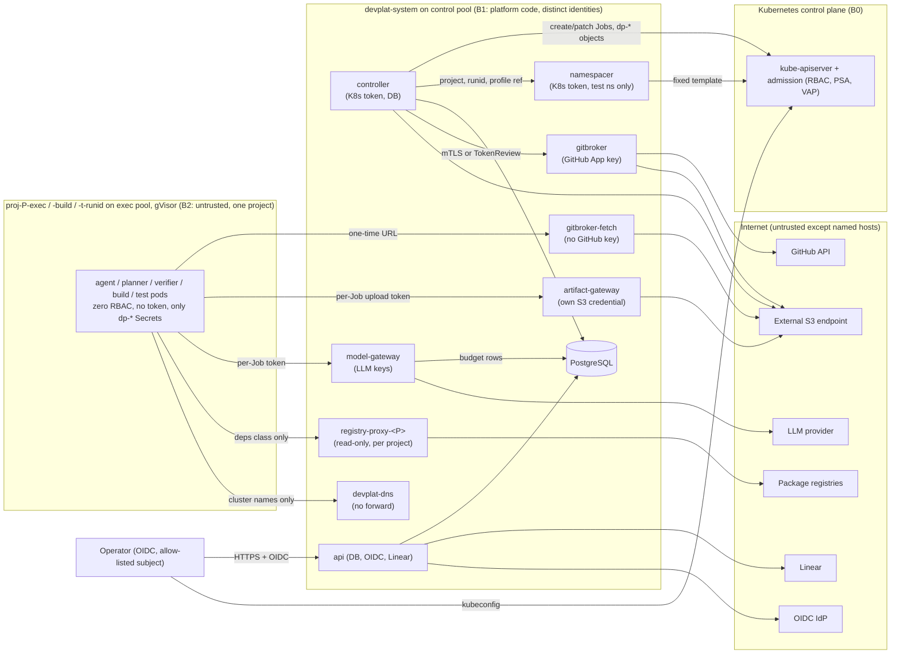

# 18 — Kubernetes Security Model (devplat)

Status: **Proposed — Designed, unverified** (Architecture Amendment 001; R6 fix round 2026-10-20; awaits operator approval, `12-…` DOD-11…DOD-24). Nothing here is deployed.

The base manifests in `platform/deploy/base/` are **Implemented (untested on a cluster)**. Offline results (§17):
- **140 documents** validate against the strict Kubernetes v1.33 schemas.
- **128 CEL expressions** compile in the Kubernetes v0.33 CEL environment.
- **115 sample admission requests** give the expected outcome for all **133 policy decisions**. They include the R6 reviewer's exploit cases E1–E11, kept as DENY regressions.

No kube-apiserver, CNI, gVisor, node or platform service has evaluated or enforced any of it. The platform services this model relies on (gitbroker, gitbroker-fetch, artifact-gateway, model-gateway, namespacer, devplat-dns) **do not exist as code**, so every control they provide is **Designed, unverified** (D26).

Reuses / supersedes:
- **Supersedes for the platform:** `08-quality-gates-and-security.md` §4 (security and authorization matrix, enforcement layers) and §6 rules 2–4 (prompt-injection handling becomes infrastructure, §12).
- **Keeps unchanged:** `08-…` §0 hard preconditions (in their per-project Kubernetes form, §13), §1 gates G1–G7, §2 TDD mapping, §5 GitHub identity and merge authority (DOD-02, DOD-03 (a), G-DETECT/G-ORG; extended by D13), and §6 rules 1, 5, 6.
- v1 local mode keeps `08-…` §4 as written. Production MERCURY's threat model (`docs/mercury/security/threat-model.md`) is not changed.

## 1. Principles

1. **Infrastructure enforces, prompts advise.** Each control below is a Kubernetes object (RBAC, NetworkPolicy, admission policy, PSA, RuntimeClass) or code in a platform service. Claude Code deny rules and the specialist guard hook stay inside agent images as **tripwires** only (R5 N-01).
2. **Agent pods are untrusted.** Assume every agent, planner, verifier, build and test pod runs attacker-written code: prompt injection, malicious repository content or a compromised dependency. Nothing such a pod outputs becomes a fact without a platform check (`16-…` §1 rule 4).
3. **No long-lived credential in an untrusted pod.** Agent, build and test pods get no Kubernetes token, no GitHub token, no LLM key, no DB credential and no object-store credential or URL. They get only per-Job capabilities that expire: a one-time fetch URL, an artifact-gateway upload token and a model-gateway token (§8.2).
4. **Each platform credential is mountable by one ServiceAccount**, enforced by admission (§8.1). This is not "one holder" in the strict sense: the operator, the kubelet of the node that runs the pod, and anyone with node or etcd access can also read it.
5. **Default deny** for network (every namespace), RBAC (zero bindings unless listed in §7) and admission (`failurePolicy: Fail`).
6. **The human gate stays outside the platform.** devplat opens draft PRs only and has no code path to approve or merge. The dev-bot App's GitHub permissions **could** approve or merge through the API. What prevents that is the per-repository ruleset (DOD-02: required code-owner review, no bypass actors), not the App's permissions (§13, D13).
7. **Honest assurance.** Where a control is missing (single-node workstation, a CNI that does not enforce, no gVisor), the project runs in **reduced-assurance mode**. It is entered by a per-project operator fact, recorded, and shown (§16, D16).

## 2. Assets

| ID | Asset | Where | Holder | Impact if lost |
|---|---|---|---|---|
| A1 | Merge authority on `main` (each project) | GitHub ruleset | Operator only | Unreviewed code in `main` |
| A2 | GitHub App private key (dev bot, DOD-13) | Secret `devplat-gitbroker-github-app` | `devplat-gitbroker` | Push `dev/*`, open PRs, **and** (without the ruleset) approve or merge as the bot |
| A3 | LLM provider API keys (standard and reduced-assurance keys, D16) | Secret `devplat-model-gateway-llm-keys` | `devplat-model-gateway` | Spend, data sent to the provider under the account |
| A4 | Task state, `task_events` hash chain, gate records, budgets | PostgreSQL (CNPG Cluster `devplat-pg` or managed) | controller (writer), api (operator facts), model-gateway (budget rows), migrator (schema only, D9) | Forged gates, i.e. self-certification |
| A5 | Evidence objects `sha256/<hex>`, run uploads `runs/<job-uid>/`, source bundles `src/<project>/<sha>.bundle` (D11) | Object store (external S3 by default) | controller, gitbroker, gitbroker-fetch, artifact-gateway, api: each with its own credential | Forged or destroyed evidence |
| A6 | Project source code (private repos) | GitHub, gitbroker mirror, Job workspaces | gitbroker; one Job at a time per workspace | Disclosure; cross-project leak |
| A7 | Kubernetes control plane | Cluster | Operator (cluster-admin) | Everything |
| A8 | Operator identity (OIDC) | IdP | Operator (allow-listed subjects, D2) | Forged approvals and facts |
| A9 | Project test secrets (e.g. Mercury T3 sandbox App) | Recommended: Mac lane only (DOD-24); otherwise a project test namespace | Test Jobs of that project | Sandbox repository writes |
| A10 | Platform and agent images; mirrored third-party images | Registry `…/devplat/`, `…/mirror/` | Platform CI (separate push identity, D14) | Persistent compromise of every run |
| A11 | Per-project package caches | Per-project registry proxy (D14) | `devplat-registry-proxy-<project>` | Dependency poisoning of one project |

## 3. Threat actors

| ID | Actor | Capability assumed |
|---|---|---|
| T1 | **Prompt-injected agent** (Claude Code in a Job, steered by issue text, repo content, PR comments or CI logs) | Arbitrary code execution as the pod's user inside gVisor. Full control of its own `result.json`, bundle, logs and self-reported usage |
| T2 | **Malicious repository content** (hooks, `.claude/**`, `CLAUDE.md`, build scripts, test fixtures, workflow files) | Runs in agent, build and test pods. Also runs in **GitHub Actions** when pushed to `dev/*` (S-3) |
| T3 | **Compromised dependency** (npm package, base image, BuildKit frontend) | Code execution at install, build or test time inside a project pod; supply-chain persistence |
| T4 | **Compromised platform component** (controller, api, gitbroker, gateways, namespacer): bug, RCE or malicious update | That pod's ServiceAccount, Secrets and network flows |
| T5 | **Curious co-tenant project** (project B's agents or tests) | Same as T1, but aims at project A's code, evidence, budget, images, caches or secrets |
| T6 | External attacker on the internet | Reaches only what the ingress exposes (api, dashboard) |
| T7 | Operator error | Mis-applied manifests, overly broad kubeconfig, a skipped verification |

## 4. Trust boundaries

| Boundary | Crossing | Control at the crossing |
|---|---|---|
| B2 → B1 | Agent pod → gitbroker-fetch, artifact-gateway, model-gateway, own registry proxy, devplat-dns | NetworkPolicy (only these, per workload, network class and project); per-Job capability tokens; services treat input as hostile; gitbroker, controller, namespacer and the DB are unreachable |
| B2 → B0 | Agent pod → kube-apiserver | No route (default-deny egress); no token (`automountServiceAccountToken: false`, enforced by VAP); zero RBAC |
| B2 → EXT | Agent pod → internet, object store | No direct route; no object-store URL in the pod (D10). Data leaves only through model-gateway (endpoint and host allowlist, D12) and the project's read-only registry proxy (upstream allowlist, D14) |
| B2 → B2' | Project A pod → project B | No allow rule between project namespaces; per-project proxies, image prefixes, buckets and tokens; label checks in admission |
| B2 output → B1 | Bundle, result, logs → artifact-gateway → controller/gitbroker | Size-capped per D11; treated as data: schema-validated; bundle checked in a quarantine repo; tests re-run by verifier Jobs; no field becomes a command or path without validation (§12) |
| B1 → B1 | controller → gitbroker push request | **Authenticated caller**: the controller's projected, audience-bound ServiceAccount token, verified by gitbroker against the cluster issuer's JWKS (`callerAuth: projected-token`); mTLS is the documented alternative. Not network position alone (S-23). NetworkPolicy is the second layer |
| B1 → EXT | gitbroker → GitHub | Installation tokens scoped per repository; push only `dev/*`; draft PRs only; the ruleset is the preventive control on `main` |
| Operator → B1 | Approvals, facts | OIDC subject must be in `operator_identities` for that project (D2); facts are per project (D1) |
| B2 → GitHub Actions | Agent-written code pushed to `dev/*` runs in CI | Per-repository CI hardening (D13, §13): read-only workflow token, no secrets and `contents: read` for `dev/**` workflows, no `pull_request_target`, Actions may not create or approve PRs |

## 5. Threat analysis (STRIDE)

| # | STRIDE | Actor | Threat | Mitigation (where enforced) | Residual risk |
|---|---|---|---|---|---|
| K-01 | E | T1, T2 | Agent pushes to `main` or merges | No GitHub credential in the pod; no route to `github.com`; gitbroker pushes only `dev/*` after G1–G5 and has no merge or approve code path; **ruleset DOD-02** (required code-owner review, no bypass actors) | **Low** only once DOD-02 and DOD-13 are applied per repository. Until then gitbroker must not be deployed with any credential. With `contents:write` + `pull_requests:write` the App **can** approve or merge through the API; only the ruleset stops it (S-14) |
| K-02 | E | T1 | Agent calls the Kubernetes API to create pods or read Secrets | No token, no route, zero RBAC (VAP `devplat-proj-pod-identity`, NetworkPolicy) | Low. A kube-apiserver or kubelet CVE reachable through node networking is mitigated by gVisor and the dedicated exec pool |
| K-03 | E | T1, T3 | Container escape to the node, then other pods' secrets | gVisor/Kata mandatory on the exec pool (VAP); exec taint keeps platform pods off exec nodes; PSA restricted; no hostPath, privileged, unsafe SELinux types (S-21) | Medium on nodes without a sandbox runtime (reduced assurance); Low with gVisor (unverified on any node) |
| K-04 | I | T1, T2 | Exfiltrate source code over the network | Default-deny egress; DNS only to `devplat-dns` (no forwarder); **no object-store reachability** (D10: an attacker's presigned URL is unreachable); model-gateway endpoint allowlist and server-tool rejection (D12); read-only per-project proxy | Medium: content can still leave in prompts to the provider (in scope by design) and in package-request paths for the `deps` class. The gateway and proxy are unbuilt: Designed, unverified |
| K-05 | T | T1 | Forge the result, test evidence or review verdict (self-certification) | Results are claims; gitbroker validation; verifier re-runs at the tested head; reviews as separate Jobs bound to the head; only the controller writes `task_events`; failure class only from platform signals (D17, doc 21) | Low by design; Designed, unverified (controller unbuilt) |
| K-06 | T | T2 | Malicious bundle: hooks, `.git/config`, symlinks, path traversal, restricted paths, rename tricks, hidden index | Gitbroker fetches into a quarantine repo with its own git config (no hooks, `protocol.ext.allow=never`, no system/global config), runs `fsck --strict`, validates the tree diff (`16-…` §7.2) | Low by design (gitbroker unbuilt); residual git parsing bugs |
| K-07 | S | T1, T5 | Use another project's budget, bucket, images or cache | Per-Job tokens bound to `(project, job uid)` in model-gateway and artifact-gateway; per-namespace image prefixes (D15); per-project proxies (D14); VAP checks project labels against the namespace | Low; gateways unbuilt |
| K-08 | I | T5 | Read project A's code or evidence from project B | Separate namespaces; no allow rules between them; project pods never reach the object store; per-project proxies and image prefixes | Low. Shared services (artifact-gateway, model-gateway, gitbroker-fetch, devplat-dns) are a common attack surface: a vulnerability there crosses projects |
| K-09 | D | T1, T5 | Exhaust cluster resources or LLM budget | Controller admission; ResourceQuota/LimitRange; namespacer quota caps (D19); `activeDeadlineSeconds`; gateway budgets (DOD-08); env retries consume the cost budget (D17); PriorityClass `devplat-agent` never preempts | Low. A noisy neighbour can still slow another project within its quota |
| K-10 | E, T | T4 (controller) | **Compromised controller**: forged gates, arbitrary Jobs, stolen run capabilities | Limits: Jobs only in project namespaces; admission forbids privileged pods, foreign SAs, platform Secrets, other projects' images, non-Opaque Secrets; the only Job mutation is unsuspend (all other spec fields fixed, S-18); no Secret rights in `devplat-system`; no namespace writes (namespacer Deployment, D19); push requests to gitbroker need an authenticated caller. **What a compromised controller CANNOT do (R6 re-check RS-5):** register a project whose hard preconditions omit the migrator-set mandatory keys (`DOD-02`, `DOD-13`), or make a hard-precondition key enable Linear writes; operator facts still come only from `devplat-api`. **What a compromised controller CAN still do (S-8):** write any gate record or task event to PostgreSQL, including forged G2–G6 evidence references; mint model-gateway tokens up to the project budgets; mint artifact-gateway upload tokens and read every evidence object with its S3 credential; run any allow-listed image of a project, with arbitrary args and env, in that project's namespaces, with that project's network class, which includes reaching the model gateway; ask gitbroker to push a validated bundle and open a draft PR for any project; ask the namespacer for test namespaces up to the caps; read Job logs of every project | **Medium–High.** The controller *is* the gate authority. The backstops are the per-repository ruleset with operator review (G7) and the operator's review of `task_events` checkpoints signed outside the controller (DOD-18). gitbroker's own re-checks of DOD-02/13 facts against GitHub limit pushes to repositories that are set up correctly |
| K-11 | I | T4 (api) | Compromised api forges operator facts | Facts need an allow-listed OIDC subject (D2), stored with subject and token hash, per project (D1) | Medium: an api compromise allows forged facts. gitbroker re-checks DOD-02/13 live against GitHub |
| K-12 | E | T4 (gitbroker) | Compromised gitbroker misuses the App key | App permissions `contents:write` (push ruleset limits pushes to `dev/*`), `pull_requests:write`, no `administration`/`workflows`, not a CODEOWNER; ruleset with no bypass actors; unreachable from project pods | Medium: it can push to `dev/*`, open PRs and **submit approving reviews** (which do not count, because the ruleset requires a code-owner review); G7 checks `merged_by`. On a personal repository the merge actor is detected after the fact (G-DETECT) |
| K-13 | I | T4 (model-gateway), T1 | Key theft; provider-side tools used for exfiltration or instruction intake (S-1) | Key mountable only by the gateway; egress only to provider hosts; **D12 allowlist**: only `POST /v1/messages` and `POST /v1/messages/count_tokens`; tools only without `type` or with `type: custom` (an allowlist, so any server-side tool type, including future ones, is refused); image and document blocks only with `source.type` `base64` or `text` (no `url`: the provider would fetch an agent-chosen URL, an exfiltration and instruction-intake path; no `file`); no `file_id` anywhere; no `mcp_servers`, `container`, Files/Batches APIs or non-allow-listed `anthropic-beta` headers; project from the token, not the URL (R6 re-check RS-1) | Medium: a gateway RCE leaks the key. Provider spend limits; per-project keys (DOD-20); a separate spend-limited key for reduced-assurance projects (D16) |
| K-14 | T | T3, T5 | Poisoned base image, dependency, dependency confusion across projects (S-12) | Digest-pinned images from per-namespace prefixes (D15); third-party images only from `mirror/`, pushed by platform CI with a separate identity; read-only per-project proxies with publish/adduser disabled (D14); per-project build caches; SBOM and provenance | Medium: a digest pins *what* was reviewed, not *whether* it is safe |
| K-15 | R | T1, T7 | Deny an action later; missing audit | `task_events` hash chain plus signed checkpoints (DOD-18); Kubernetes audit log; VAP `Audit` annotations; GitHub as the source of record | Low |
| K-16 | E | T1, T2 | Planner proposes a malicious contract | Planner output is a **proposal**; controller runs the `check-contract` port; planner-originated contracts and every `contract_revised` need an operator approval record; revision cap 3 (D18) | Low |
| K-17 | E | T7 | Operator applies a manifest that weakens a control | Namespace labels and params ConfigMaps writable only by the operator; isolation probes (`22-…` §7) after every change stop dispatch on failure | Medium (human factor) |
| K-18 | I | T1 | Read node or cloud metadata (169.254.169.254) | Public egress `ipBlock`s exclude 169.254.0.0/16 and private ranges; project pods have no public egress; IMDSv2 hop limit 1; workload identity only on platform SAs, one annotation set per SA (S-24, charts) | Low |
| K-19 | E | T2 | Agent-written workflow or test code runs in GitHub Actions on `dev/*` with a token and internet (S-3) | D13 per-repository CI hardening (§13 item 2). The dev-bot App has no `workflows` permission, so it cannot push changes to `.github/workflows/**` | Medium: existing workflows still execute agent-written code. They run with a read-only token and no secrets, but with internet access |
| K-20 | E | T4 (namespacer), T1 | Open egress or unbounded quota in a test namespace (S-6) | Namespacer Deployment applies a fixed template (D19); VAP checks NetworkPolicy names, peers, ports and CIDRs, quota keys and caps, LimitRange caps, params content and exact namespace names | Low |
| K-21 | E | T4, T1 | Bind a pre-existing PersistentVolume (registry cache, another project's data) via `volumeName`/`dataSource` (S-19) | Project pods may use only fresh generic ephemeral volumes: no `persistentVolumeClaim`, `volumeName`, `dataSource(Ref)`, `selector` or empty `storageClassName` | Low |
| K-22 | T | T4 | Steer traffic with Service `externalIPs` / `ExternalName` (S-20) | VAP `devplat-service-restrictions` (ClusterIP only); cluster `DenyServiceExternalIPs` admission plugin (operator) | Low |

## 6. Authorization matrix

✓ = allowed (enforced by the named layer); ✗ = denied by infrastructure; — = not applicable. "Zero RBAC" means no RoleBinding or ClusterRoleBinding names the subject, and the pod mounts no token.

| Capability | Operator | controller SA | namespacer SA | api SA | gitbroker SA | gitbroker-fetch / artifact-gateway SA | model-gateway SA | agent / planner / verifier pod (`
-agent`) | build pod (`
-build`) | test-namespace pods (`default`) |
|---|---|---|---|---|---|---|---|---|---|---|
| K8s: create/get/list/watch/patch(unsuspend)/delete Jobs | ✓ | ✓ project and test namespaces only (RBAC + VAP `devplat-controller-job-update`) | ✗ | ✗ | ✗ | ✗ | ✗ | ✗ (no token) | ✗ | ✗ |
| K8s: create Pods directly | ✓ | ✗ (no verb) | ✗ | ✗ | ✗ | ✗ | ✗ | ✗ | ✗ | ✗ |
| K8s: pods/exec, attach, portforward, ephemeral containers | ✓ (break-glass) | ✗ | ✗ | ✗ | ✗ | ✗ | ✗ | ✗ | ✗ | ✗ |
| K8s: Secrets | ✓ | create/get/delete `dp-*`, type Opaque, in project and test namespaces only; no list/watch | ✗ | ✗ | ✗ (kubelet mounts) | ✗ | ✗ | ✗ | ✗ | ✗ |
| K8s: create/delete namespaces and their bootstrap objects | ✓ | ✗ (asks the namespacer) | only `proj-
-t-<8hex>`, fixed content (VAP `devplat-namespacer-scope`) | ✗ | ✗ | ✗ | ✗ | ✗ | ✗ | ✗ |
| K8s: RBAC, admission, params ConfigMaps, namespace labels | ✓ | ✗ | one RoleBinding shape and the computed params ConfigMap, test namespaces only | ✗ | ✗ | ✗ | ✗ | ✗ | ✗ | ✗ |
| GitHub: read source | ✓ | ✗ | ✗ | ✗ | ✓ (App installation token) | ✗ | ✗ | ✗ (bundle only) | ✗ | ✗ |
| GitHub: push `dev/*`, open draft PR | ✓ | ✗ (asks gitbroker, authenticated) | ✗ | ✗ | ✓ after G1–G5 | ✗ | ✗ | ✗ | ✗ | ✗ |
| GitHub: approve / merge PRs | **✓ (sole that counts)** | ✗ | ✗ | ✗ | **Technically possible** through the API with the App's permissions; no code path; prevented by the ruleset (DOD-02) | ✗ | ✗ | ✗ | ✗ | ✗ |
| GitHub: push `main`, rulesets, settings, workflows | ✓ | ✗ | ✗ | ✗ | ✗ (push ruleset, no `administration`/`workflows`) | ✗ | ✗ | ✗ | ✗ | ✗ |
| Linear: read / write | ✓ | ✗ | ✗ | read; write ✗ until the project's `issue_tracker.write_fact` is recorded | ✗ | ✗ | ✗ | ✗ (files only) | ✗ | ✗ |
| DB (PostgreSQL) | ✓ (break-glass) | own role (only writer of tasks and `task_events`) | ✗ | own role (facts, reads) | ✗ | ✗ | budget tables only | ✗ | ✗ | ✗ |
| Object store (S3) | ✓ | read/write, evidence copy | ✗ | read evidence | write bundles | fetch: read `src/`; artifact-gateway: write `runs/` | ✗ | **✗ (no route, no URL; D10)** | ✗ | ✗ |
| Artifact upload | — | mints tokens; registers only their SHA-256 (`set_job_tokens()`) | ✗ | ✗ | ✗ | artifact-gateway receives | ✗ | per-Job token to artifact-gateway :8082, size caps D11 | same | same |
| LLM API | ✓ | gateway admin (budgets, tokens) | ✗ | ✗ | ✗ | ✗ | ✓ (keys) | via gateway, classes model-only/deps, D12 allowlist | ✗ | ✗ (never) |
| Package registries | ✓ | ✗ | ✗ | ✗ | ✗ | ✗ | ✗ | own project's read-only proxy, class deps | own project's proxy | own project's proxy, class deps |
| Egress to internet | ✓ | ✗ | ✗ | 443 public (OIDC, Linear) | 443 public (GitHub) | object-store endpoint only | 443 public (provider) | ✗ | ✗ | ✗ |
| Record gates / facts | facts and approvals via api (allow-listed subject) | ✓ (only writer) | ✗ | facts | ✗ | ✗ | usage rows | ✗ | ✗ | ✗ |

## 7. RBAC design (`platform/deploy/base/rbac.yaml`)

| Subject | Grant | Scope | Why |
|---|---|---|---|
| `devplat-controller` | ClusterRole `devplat-job-runner` via **RoleBinding** in each `proj-
-exec` and `proj-
-build` | Namespaced | Jobs: create/get/list/watch/patch/delete (suspended-setup protocol, `16-…` §3); pods: get/list/watch; pods/log: get; events: read; configmaps and secrets: create/get/delete. Admission narrows this: `dp-*` names only, owned by one Job, immutable, Secrets of type Opaque only. No list/watch/update/patch on Secrets |
| `devplat-controller` | ClusterRole `devplat-test-runner` via a RoleBinding **created by the namespacer** inside each test namespace | Namespaced (dynamic) | As above, plus services and apps deployments/statefulsets create/get/list/watch for declared test fixtures (ClusterIP Services only, §15) |
| `devplat-controller` | Role `devplat-controller-leader-election` | devplat-system | Lease create; get/update only `devplat-controller`; events |
| `devplat-controller` | Role `devplat-controller-service-lookup` (model-gateway, gitbroker-fetch, artifact-gateway, devplat-dns) and one Role `devplat-controller-service-lookup-
` per project (only `devplat-registry-proxy-
`, rendered by that project's `devplat-project` release) | devplat-system | `get` on named Services (ClusterIPs for `dnsConfig`) |
| `devplat-namespacer` | Role `devplat-namespacer-profiles` (configmaps get/list/watch) | devplat-system | Reads the projects' test-profile ConfigMaps for the fixed template (D19). Residual: can read every ConfigMap in devplat-system (no Secrets) |
| `devplat-gitbroker` | ClusterRoleBinding `devplat-gitbroker-issuer-discovery` → built-in `system:service-account-issuer-discovery` | Cluster, read-only non-resource URLs | Fetch the issuer JWKS to verify the controller's audience-bound projected token (S-23, `callerAuth: projected-token`). gitbroker mounts its own apiserver-audience projected token for this call |
| `devplat-namespacer` | ClusterRole `devplat-namespacer` via **ClusterRoleBinding** | Cluster | **The only cluster-scoped write.** Namespaces are cluster-scoped, and the bootstrap objects must exist in a namespace that has just been created. Rights: namespaces create/delete/get/list/watch; networkpolicies, resourcequotas, limitranges, configmaps, rolebindings create; `bind` only on `devplat-test-runner`. Held by the dedicated **namespacer Deployment** (D19, DOD-17). VAP `devplat-namespacer-scope` checks every request (§15) |
| `devplat-dns` | ClusterRole `devplat-dns` (list/watch services, namespaces, endpointslices) | Cluster, **read-only** | Service names in dynamic test namespaces must resolve. Residual: Service names are enumerable cluster-wide |
| `devplat-prometheus` | Role `devplat-prometheus-discovery` | devplat-system, devplat-artifacts | Scrape discovery; never project namespaces |
| api, gitbroker-fetch, artifact-gateway, model-gateway, registry proxies, migrator, artifacts, every project SA | **none** | — | Kubernetes API not needed; `automountServiceAccountToken: false` on every SA |

Notes:
1. **No impersonation (R6 D19, DOD-17).** The controller asks the namespacer Deployment (`:8083`) for a test namespace with `(project, runid, profile ref)` only. The namespacer renders a fixed template from the project's test profile. A compromised controller can therefore neither choose NetworkPolicy or quota content nor create namespaces itself. The namespacer is the real privilege boundary, and VAP is the independent check of its output.
2. **Per-namespace grants, not cluster-wide.** The controller is bound per namespace, so a VAP outage or misconfiguration cannot widen it to `devplat-system` or `kube-system`. The `devplat` chart follows this (I-1). It still renders the controller's impersonation Role from before R6; that must be removed (§19, chart changes).
3. Third-party operators (CloudNativePG; an S3-compatible store operator if one is run in-cluster) bring their own ClusterRoles. CloudNativePG's role includes cluster-wide Secret access (**unverified for the pinned version; review before install**). DOD-19 recommends managed PostgreSQL beyond the workstation.
4. Operator access: OIDC user with a namespaced admin role for daily work; cluster-admin only as break-glass. The operator binds it; it is not in base.

## 8. Credential isolation

### 8.1 Long-lived credentials

| Secret (name fixed in base) | Only ServiceAccount allowed to reference it (VAP `devplat-secret-pinning`) | Content |
|---|---|---|
| `devplat-gitbroker-github-app` | `devplat-gitbroker` | Dev-bot App id + private key (DOD-13) |
| `devplat-model-gateway-llm-keys` | `devplat-model-gateway` | Provider keys; separate spend-limited keys for reduced-assurance projects (D16) |
| `devplat-db-controller`, `devplat-db-api`, `devplat-db-model-gateway`, `devplat-db-artifact-gateway`, `devplat-db-migrator` | controller, api, model-gateway, artifact-gateway, migrator (each its own) | Separate DB logins; the migrator is the only schema owner login (D9) |
| `devplat-artifacts-controller`, `-gitbroker`, `-gitbroker-fetch`, `-api`, `-artifact-gateway` | the named component | S3 credentials scoped per prefix (fetch: read `src/`; artifact-gateway: write `runs/`) |
| `devplat-oidc-client`, `devplat-linear-token` | `devplat-api` | OIDC client secret; Linear read token |
| Project test secrets (T3) | Recommended: not in the cluster (DOD-24, Mac lane) | — |

Rules:
1. **Kubernetes Secrets are encrypted at rest**: `EncryptionConfiguration` with a KMS v2 provider (cloud: provider envelope encryption; k3s: `--secrets-encryption`). A static key on the same disk counts as reduced assurance.
2. **Cloud:** External Secrets Operator or the CSI Secrets Store, with workload identity per platform SA (one identity per SA, never shared, S-24). No static cloud keys; node IAM roles grant nothing to pods.
3. **Rotation:** App key and LLM keys are rotated by the operator; per-Job tokens and installation tokens are short-lived by construction.
4. **Names are fixed** in the `devplat` chart's values schema (I-4). Pinning covers volumes, projected sources, `env.valueFrom.secretKeyRef` and `envFrom`. It does not stop the kubelet or a node-level attacker.

### 8.2 Per-Job capabilities (no credentials in untrusted pods)

| Capability | Minted by | Scope | Lifetime | In the pod |
|---|---|---|---|---|
| One-time bundle URL | gitbroker prepares `src/<project>/<sha>.bundle`; **gitbroker-fetch** serves it | One bundle, one download | ≤ 15 min after unsuspend | Secret `dp-<job>-io` |
| Artifact upload token | controller (random, per Job); only its SHA-256 is stored, by `set_job_tokens()`. Each upload is authorized in PostgreSQL by `authorize_upload()` (`20-…` §3), never by gateway state; artifact-gateway admin `:9444` is an admin channel only (run registration) and neither mints nor validates tokens | `runs/<job-uid>/{result.json, result.bundle, agent.stream.jsonl, runner.json, fetch.log}`; caps 1 MiB / 256 MiB / 64 MiB logs / 512 MiB total (D11) | Job deadline + 15 min | Secret `dp-<job>-io` |
| Model-gateway token | controller (random, per Job), registered as a SHA-256 by the same `set_job_tokens()` call. Each request is authorized in PostgreSQL by `reserve_budget()` (token hash, Job phase, expiry, budgets); model-gateway admin `:9443` is an admin channel only | `(project, job uid)`, token and cost budget; D12 endpoint allowlist | Refused once the Job leaves `created`/`running` or at deadline + 15 min | Secret `dp-<job>-io` |

The per-run Secret is type `Opaque`, `immutable`, owned by its Job and garbage-collected with it (VAP `devplat-controller-run-objects`). Pods may reference only `dp-*` Secrets (VAP `devplat-proj-pod-identity`). Presigned S3 URLs are used **only between platform components** (D10). Pods never see one, so they cannot be steered to PUT to an attacker's presigned URL (S-2).

## 9. Network policies (`platform/deploy/base/networkpolicies.yaml`)

### 9.1 Rules

1. Every devplat namespace has `default-deny-all` (ingress and egress).
2. Selectors: namespaces by `devplat.io/ns-role` and `devplat.io/project`; project pods by `devplat.io/workload` (agent, planner, verifier, build, test, fixture) and `devplat.io/network-class` (`none | model-only | deps`, required on every project pod, D5). The controller sets both labels; admission checks them.
3. NetworkPolicy is L3/L4. Host allowlists (GitHub, provider, Linear, registries, object store) are enforced in the egress-owning service. FQDN policies (Cilium `toFQDNs`) are defence in depth in an overlay.
4. **The CNI must enforce NetworkPolicy.** Probe N12 (`22-…` §7) must fail the suite on a non-enforcing CNI.
5. Placeholders the overlay must replace: kube-apiserver endpoint IPs (`192.0.2.10/32`), the external S3 endpoint (`198.51.100.10/32`; platform components only), managed PostgreSQL (`203.0.113.10/32`, policy `external-postgres`; delete it when PostgreSQL runs in-cluster), the ingress-gateway namespace label, `cnpg-system`.
6. PostgreSQL pods are selected by `cnpg.io/cluster: devplat-pg`, the CloudNativePG Cluster name in the `devplat` chart (S-22).

### 9.2 Allowed flows

| From | To | Port | Condition |
|---|---|---|---|
| exec pods (agent, planner, verifier) | devplat-dns | 1053/UDP+TCP (Service 53) | All classes |
| exec pods | gitbroker-fetch | 8081 | All classes |
| exec pods | artifact-gateway | 8082 | All classes (per-Job token) |
| exec pods | model-gateway | 8080 | `network-class` model-only or deps |
| exec pods | `devplat-registry-proxy-<own project>` | 4873 | `network-class` deps |
| build pods | devplat-dns; own project's proxy (4873 packages, 5000 OCI pull-through); artifact-gateway | as above | Builds disabled by default (D20); never the model-gateway |
| test-namespace pods | intra-namespace; devplat-dns; gitbroker-fetch; artifact-gateway; own project's proxy (class deps) | as above | Fixed template from the namespacer (§9.3); **never** the model-gateway |
| controller | PostgreSQL 5432; gitbroker 8080; model-gateway admin 9443; artifact-gateway admin 9444; namespacer 8083; object store; kube-apiserver | — | No internet |
| namespacer | kube-apiserver | — | Ingress only from the controller (8083) |
| api | PostgreSQL; object store; public 443 (OIDC, Linear) | — | Ingress only from the ingress-gateway namespace |
| gitbroker | public 443 (GitHub); object store; kube-apiserver (issuer JWKS only) | — | Ingress only from the controller; every call carries the controller's audience-bound projected token, verified against the issuer JWKS (S-23) |
| gitbroker-fetch, artifact-gateway | object store; artifact-gateway also PostgreSQL (`authorize_upload()`, `complete_upload()`, RS-4) | — | Ingress from project pods (8081/8082) and the controller (9444) |
| model-gateway | public 443 (providers); PostgreSQL (budgets) | — | Ingress from exec pods (classes model-only/deps) and the controller (9443) |
| `devplat-registry-proxy-
` | public 443 (P's upstream allowlist) | — | Ingress only from P's deps-class exec/test pods and P's build pods |
| devplat-dns | kube-apiserver | — | No forwarder, no internet |
| PostgreSQL | peers; object store (backups); kube-apiserver (CNPG instance manager) | — | Ingress from controller, api, model-gateway, artifact-gateway, migrator, CNPG operator |
| migrator | PostgreSQL (or the external endpoint) | — | Helm hook Job (D9) |
| Prometheus | devplat-system and devplat-artifacts :9090; kube-apiserver | — | Never project namespaces |
| "Public 443" | `0.0.0.0/0` and `::/0` **except** 10/8, 100.64/10, 169.254/16, 172.16/12, 192.168/16, fc00::/7, fe80::/10 | 443 | Metadata endpoint and cluster networks excluded |

### 9.3 Test-namespace bootstrap (namespacer Deployment, fixed template, D19)

The controller sends `(project, runid, profile ref)`. The namespacer creates:
1. Namespace `proj-
-t-<8 hex>` with **exactly** `devplat.io/managed-by=devplat-controller`, `devplat.io/ns-role=test`, `devplat.io/project=
` and PSA `restricted` for enforce, audit and warn (versions `v1.33` or `latest`); no other label (no assurance override, no `devplat.io/ingress-gateway`; R6 re-check RS-3).
2. NetworkPolicies, only these names: `default-deny-all` (admission requires `podSelector: {}`, `policyTypes: [Ingress, Egress]` and no rules, RS-2); `allow-intra-namespace` (podSelector `{}` peers only); `allow-devplat-dns` (1053); `allow-fetch-and-artifacts` (8081, 8082); `allow-deps` (P's proxy 4873; admission requires `podSelector` exactly `network-class: deps`, RS-2). **Residual:** admission validates what is created, not that `default-deny-all` exists; the controller must observe all five policies before it creates a test pod, and a cluster-scoped baseline deny for `ns-role` exec/build/test (BaselineAdminNetworkPolicy or a CNI cluster policy) is recommended for DP4 so containment does not depend on per-namespace objects.
3. ResourceQuota: every capped key (pods, CPU, memory, ephemeral storage, services, secrets, configmaps) within `devplat-cluster-params`; `services.loadbalancers`, `services.nodeports` and `persistentvolumeclaims` = 0; no scopes.
4. LimitRange with container max cpu/memory within caps.
5. RoleBinding controller → `devplat-test-runner`.
6. Immutable ConfigMap `devplat-admission-params` with exactly `allowedImagePrefixes = <registry>/devplat/,<registry>/projects/
/,<registry>/mirror/`.

VAP `devplat-namespacer-scope` refuses anything else: other names, empty (allow-all) peers, other namespaces or apps, other ports, ipBlocks outside `allowedTestCIDRs` (empty by default), quota scopes or values over the caps, lookalike namespace names (the name must equal `proj-` + the project label + `-t-` + 8 hex).

**Services in test namespaces (S-20 resolution).** Fixtures need ClusterIP Services, so the test quota allows `services` up to `maxServices` (default 20). Exec and build namespaces keep `services: 0`. Every Service in every devplat namespace must be ClusterIP without externalIPs, externalName or load-balancer fields (VAP `devplat-service-restrictions`). The cluster should also enable the `DenyServiceExternalIPs` admission plugin.

### 9.4 DNS design

Project pods must not use kube-dns, because it forwards to the internet (DNS tunnelling). `devplat-dns` is a CoreDNS Deployment with only the `kubernetes` plugin (no `forward`), listening on 1053 as non-root behind Service port 53. Project pods set `dnsPolicy: None` and `dnsConfig.nameservers: [<devplat-dns ClusterIP>]`, as the doc 16 example and `jobspec.py` do (I-2). A pod left on `ClusterFirst` fails to resolve (fail closed). Status: Designed, unverified (the image and Deployment are configured in the chart; nothing has run).

## 10. Pod Security, runtime isolation and node placement

### 10.1 Pod Security Admission per namespace (`namespaces.yaml`)

| Namespace | enforce | audit / warn | Notes |
|---|---|---|---|
| devplat-system, devplat-artifacts, devplat-observability | restricted | restricted | Node-level collectors live in operator-owned add-on namespaces |
| proj-
-exec, proj-
-t-<runid> | restricted | restricted | Plus VAPs (§15) |
| proj-
-build | **privileged** | restricted | Rootless BuildKit needs exceptions PSA cannot express. VAPs replace PSA here, and **builds are disabled by default** (D20) |

**BuildKit rules (D20; still blocked on spike S-B1).** All of these hold in build namespaces:
1. Builds run only if the namespace's params set `buildsEnabled: "true"` (default `"false"`), and never for reduced-assurance projects.
2. The container named `buildkitd` must use the pinned image prefix and exactly the pinned args, with no `command` override.
3. The pod must use a **user namespace** (`hostUsers: false`).
4. `buildkitd` must use the **pinned Localhost seccomp profile**. `Unconfined` is never allowed, for any container.
5. AppArmor `Unconfined` (field or legacy annotation) is forbidden for every container.
6. `allowPrivilegeEscalation` may be true only for `buildkitd` (`newuidmap`).
7. `procMount: Unmasked` only for `buildkitd` with `hostUsers: false`.
8. Every container: runAsNonRoot, runAsUser ≠ 0, drop ALL, no added capabilities, no privileged, no host namespaces or paths, SELinux type in the baseline set.

### 10.2 RuntimeClass and node pools (`runtimeclasses.yaml`)

| Item | Value |
|---|---|
| `gvisor` | handler `runsc`; nodeSelector `devplat.io/pool=exec`, `devplat.io/runtime-gvisor=true`; toleration `devplat.io/exec=true:NoSchedule`; overhead 250m / 128Mi (estimate) |
| `kata` | handler `kata`; nodeSelector `devplat.io/runtime-kata=true`; same toleration; overhead 250m / 192Mi (estimate) |
| Exec pool | taint `devplat.io/exec=true:NoSchedule`, label `devplat.io/pool=exec` |
| Build pool (if needed) | taint `devplat.io/build=true:NoSchedule`, label `devplat.io/pool=build`, no gVisor |
| **Mandatory** | gVisor or Kata for every pod in exec and test namespaces, unless the project is in reduced-assurance mode (§16); for build pods unless they run on the build pool. Platform pods may not tolerate either taint or use a sandbox class |
| Not enforceable by devplat | Cluster add-on DaemonSets (CNI, kube-proxy, CSI) with wildcard tolerations still run on exec nodes; operator-owned |

### 10.3 Filesystem restrictions

1. `readOnlyRootFilesystem: true` for every devplat container except `buildkitd` (state directory as emptyDir).
2. Writable paths are `emptyDir` with `sizeLimit`. Generic ephemeral volumes must be freshly provisioned: no `persistentVolumeClaim` volumes, `volumeName`, `dataSource(Ref)`, `selector` or empty `storageClassName` (S-19).
3. Volume allowlist in project namespaces: emptyDir, configMap, secret (`dp-*` only), projected (no SA token), downwardAPI, ephemeral. hostPath is forbidden in every devplat namespace (covers `docker.sock`, `containerd.sock`).
4. The role ConfigMap and managed settings are mounted read-only. Claude Code's settings come from the image plus read-only mounts.
5. No cross-Job filesystem. Build caches are per project and go through the artifact-gateway (D10, D11).

## 11. Supply chain

1. **Digest pinning with per-namespace prefixes (D15):** every image must contain `@sha256:` and start with a prefix from the `devplat-admission-params` ConfigMap **of its own namespace**. Platform namespaces admit `…/devplat/` and `…/mirror/` only. Project namespaces admit `…/devplat/`, `…/projects/<own project>/` and `…/mirror/`.
2. **Mirror, don't pull:** third-party images (BuildKit, PostgreSQL, CoreDNS) are mirrored under `…/mirror/` by platform CI with a **separate push identity** (D14) that records upstream digests. No cluster workload can push to the registry.
3. **Per-project, read-only registry proxies (D14):** `devplat-registry-proxy-<project>` with publish and adduser disabled; upstreams from that project's `registries_allowlist`. No proxy or cache is shared between projects, which rules out cross-project dependency confusion through the proxy.
4. **SBOM and provenance** for platform images and in-cluster builds (`22-…` §9).
5. **Signature verification (optional, per profile):** Sigstore policy-controller or Kyverno `verifyImages`. Not in base. Documented only.
6. Lifecycle scripts off where the package manager allows it; the Claude Code CLI is pinned in the agent image, with the auto-updater off.

## 12. Prompt-injection defences at the infrastructure level

| # | Defence | Enforced by | Status |
|---|---|---|---|
| PI-1 | Agents cannot reach GitHub, Linear, the Kubernetes API, the DB, the object store or the internet | NetworkPolicy, no token, no credentials | Implemented (untested): base manifests |
| PI-2 | Untrusted text reaches agents only as **files**, never in the dispatch prompt | Controller prompt builder | Designed, unverified |
| PI-3 | Every agent output is validated by code (result schema, bundle validation, verifier re-runs) | gitbroker, controller | Designed, unverified |
| PI-4 | Planner outputs are proposals; planner contracts and revisions need operator approval; revision cap 3 (D18) | Controller + api | Designed, unverified |
| PI-5 | Reviewers run in fresh Jobs on the tested head | Controller | Designed, unverified |
| PI-6 | Pods affect each other only through validated artifacts | NetworkPolicy, per-Job emptyDir | Implemented (untested) |
| PI-7 | `environmental` failure class is decided **only from platform signals**: gateway-confirmed 429/5xx for that token, node and eviction events, gitbroker-fetch failure codes, image pull errors. Runner exit 75 and `partial` results are charged attempts; env retries also consume the cost budget (D17, doc 21 normative) | Controller | Designed, unverified |
| PI-8 | Token and cost budgets limit a hijacked agent | model-gateway | Designed, unverified |
| PI-9 | No provider-side tools or fetches: the model-gateway admits only custom tools and `base64`/`text` content sources, and rejects `file_id` references, MCP connectors, containers, Files/Batches and unlisted beta headers (D12, RS-1) | model-gateway | Designed, unverified |

## 13. Human approval preservation

1. **DOD-02 (per repository):** ruleset on `main`:
   - require a PR and at least 1 approval of the most recent push;
   - **required review from code owners** (CODEOWNERS = operator);
   - required CI; no force-push or deletion; **no bypass actors**;
   - the dev-bot App cannot update `main`.

   With `contents:write` + `pull_requests:write` the App **can** submit an approving review and call the merge API. The ruleset makes both ineffective: the App is not a code owner, and merge requirements cannot be bypassed. This ruleset is the preventive control (S-14).
2. **D13 CI hardening (part of the DOD-02 checklist, per repository):**
   - default workflow `GITHUB_TOKEN` read-only;
   - "Allow GitHub Actions to create and approve pull requests" off;
   - workflows triggered by `dev/**` pushes or PRs use `permissions: contents: read` and no secrets;
   - `pull_request` only from same-repository branches; no `pull_request_target`;
   - tag and release protection rulesets;
   - required checks unchanged.
3. **DOD-13:** the dev-bot App (separate from `mercury-bot`) is installed per repository with `contents:write` (push ruleset limits it to `dev/*`), `pull_requests:write`, no `administration`, no `workflows`, and is not a CODEOWNER. gitbroker has no code path for approve, merge, auto-merge, ready-for-review or ruleset APIs.
4. **Probe N10 (redefined, D13).** In the sandbox repository, with the dev-bot App's installation token, gitbroker's test harness **attempts**: (a) an approving review on a draft PR, (b) `PUT /pulls/{n}/merge`, (c) enabling auto-merge, (d) a push to `main`, (e) a ruleset update. **Pass** = (b), (c), (d) and (e) are refused by GitHub, and (a) is accepted but does not satisfy the required code-owner review (the PR stays unmergeable). Any successful merge, update of `main` or ruleset change fails the suite and stops dispatch. Doc 22 §7 must carry this definition.
5. **G7 is observed:** merged at the G6 head, `merged_by` = operator, approving code-owner review on that head. On a personal repository this is detective (G-DETECT); G-ORG makes it preventive.
6. **Hard preconditions, per project (D1):** the controller refuses FULL-lifecycle dispatch and any push for project P until P is `active` and holds the latest project-scoped facts `DOD-02` and `DOD-13`. A platform-wide fact never satisfies them. They are recorded through the api by an allow-listed OIDC subject (D2), and gitbroker re-checks the App installation and the ruleset live.

## 14. v1 open risks and R6 findings in Kubernetes

Status words follow D26. "Designed, unverified" = the mechanism needs an unbuilt component or an untested cluster. Nothing below is "Resolved".

| Item | In devplat on Kubernetes | Status |
|---|---|---|
| R2 **S-01** (Critical): operator's GitHub authorization shared by every agent | No agent process holds any GitHub credential; only gitbroker holds the dev-bot key | Designed, unverified (gitbroker unbuilt; DOD-02/13 awaiting operator) |
| R2 **S-02** (Critical): credential reads blocked only by policy | No credentials in the pod's filesystem or environment; pinned Secrets; encryption at rest | Implemented (untested) for admission and RBAC; node escape residual (K-03) |
| R2 **S-03** (Critical): MCP write tools reachable | Agent pods have no credentialed MCP servers and no route to GitHub or Linear | Implemented (untested): NetworkPolicy |
| R5 N-01 / N0: guard hook did not fire | Hook is a tripwire only; the boundary is the pod | Designed, unverified |
| R5 #2: merge authority rests on operator actions | Unchanged in nature: DOD-02 + DOD-13 + D13 per repository | Awaiting operator approval |
| R5 #3: forgeable single-writer ledger | Agents cannot reach the DB; only the controller's role inserts; signed checkpoints (DOD-18) | Designed, unverified; compromised controller remains (K-10) |
| R5 N-06: self-asserted operator facts | Allow-listed OIDC subjects (D2), per-project facts (D1) | Designed, unverified (api unbuilt; DB functions tested per the DB group) |
| R6 S-1 server tools via gateway | D12 allowlist | Designed, unverified |
| R6 S-2 pods reach external S3 | D10: project pods have no route and no URL; artifact-gateway | Implemented (untested) for NetworkPolicy; gateway Designed, unverified |
| R6 S-3 / S-14 CI runs agent code; App can merge/approve | D13 checklist; N10 redefined; claims corrected (§1 rule 6, §13) | Awaiting operator approval |
| R6 S-6 namespacer content unchecked | D19 Deployment + content-checking VAP | Implemented (untested) for VAP; namespacer Designed, unverified |
| R6 S-7 buildkitd unconfined in host userns | D20 rules; builds off by default | Implemented (untested) |
| R6 S-8 controller blast radius | K-10 rewritten | Documented |
| R6 S-12 / S-13 shared proxy, global prefixes | D14 per-project proxies (NetworkPolicy); D15 per-namespace params | Implemented (untested) for policy; proxies Designed, unverified |
| R6 S-16 reduced assurance unchanged | D16 (§16) | Implemented (untested) for admission; facts Designed, unverified |
| R6 S-17 SA-token Secret type | Run objects must be Opaque, no SA annotation | Implemented (untested) |
| R6 S-18 Job update not pinned | Every JobSpec field except `suspend` fixed | Implemented (untested) |
| R6 S-19 PV binding | Fresh ephemeral volumes only | Implemented (untested) |
| R6 S-20 Service externalIPs | VAP + `DenyServiceExternalIPs` recommended; test quota allows ClusterIP fixtures | Implemented (untested) |
| R6 S-21 seLinuxOptions | Baseline SELinux rules at pod and container level | Implemented (untested) |
| R6 S-22 CNPG label | `cnpg.io/cluster: devplat-pg`; external-PG policy option | Implemented (untested) |
| R6 S-23 label-only auth to gitbroker push | Projected-token verification via issuer JWKS (RBAC binding and apiserver egress in base; chart `callerAuth: projected-token`); mTLS alternative | Implemented (untested) for RBAC/NetworkPolicy; verification code Designed, unverified |
| R6 S-24 shared workload-identity annotations | One identity per SA (§8.1 rule 2); charts group | Documented |

## 15. ValidatingAdmissionPolicies (`platform/deploy/base/admission-policies.yaml`)

**Ownership split (no duplicates):**

| Layer | Owns |
|---|---|
| **Base (this doc)** | Every generic control: pod hardening, image pinning with per-namespace params, project pod identity, runtime placement and reduced assurance, platform placement, build exceptions, Job shape, Service restrictions, Secret pinning, namespacer scope, controller Job update, controller run objects; all params ConfigMaps of the static namespaces and the cluster params |
| `devplat-project` chart | Project-specific values only: builder allowlist; optional RuntimeClass pin (I-6) |
| `devplat` chart | None (I-1) |

| Policy | Params | Key rules |
|---|---|---|
| `devplat-pod-hardening` | — | hostNetwork/PID/IPC, hostPath, privileged, hostPort, `capabilities.add`, procMount (BuildKit userns exception), sysctls, SELinux type outside `container_t`/`container_init_t`/`container_kvm_t`/`container_engine_t` or any user/role (S-21), ephemeral containers |
| `devplat-proj-pod-identity` | — | Token off; SA `
-agent` / `
-build` / `default`; no projected SA token; volume allowlist; fresh ephemeral volumes only (S-19); only `dp-*` Secrets; no imagePullSecrets; project, workload and **required** network-class labels (E11) |
| `devplat-proj-runtime-placement` | cluster | gVisor/Kata unless the project is listed in `reducedProjects`; builds denied for reduced projects (D16) |
| `devplat-platform-placement` | — | No exec/build or wildcard toleration; no sandbox class |
| `devplat-build-exceptions` | own namespace | §10.1 (D20) |
| `devplat-image-pinning` | own namespace | `@sha256:` + per-namespace prefixes (D15, E9) |
| `devplat-job-shape` | — | `dp-` name ≤ 63; backoffLimit 0; deadline ≤ 24 h; TTL; no manualSelector; one pod; labels mirrored; project = namespace's; token off |
| `devplat-service-restrictions` | — | ClusterIP only; no externalIPs, externalName, load-balancer fields (S-20) |
| `devplat-secret-pinning` | — | §8.1 |
| `devplat-namespacer-scope` | cluster | §9.3 (S-6, E1, E2, E10) |
| `devplat-controller-job-update` | — | Only `suspend` true → false; every other JobSpec field and the labels unchanged (S-18, E5) |
| `devplat-controller-run-objects` | — | `dp-*` names; one Job owner; immutable; Secrets type Opaque without SA annotation (S-17, E3) |

Params live in `devplat-cluster-params` (devplat-system) and in one `devplat-admission-params` per namespace. Bindings with a `paramRef` that has no namespace read the request's namespace (D15). A missing ConfigMap **denies** (`parameterNotFoundAction: Deny`). Only the operator can change them: the controller may create or delete only `dp-*` objects, and the namespacer creates only the computed ConfigMap.

**Limits of VAP.** Policies match labels only the operator can change. They do not see runtime behaviour, and they do not apply to namespaces without an `ns-role` label. A policy that fails to compile denies. Before switching to `Deny`, deploy with `[Warn, Audit]` and check that `status.typeChecking` is empty.

## 16. Reduced-assurance mode (D16)

**Entering it:**
- It is per project.
- The operator records the fact `REDUCED-ASSURANCE` for project P with a reason (api, allow-listed subject).
- The operator adds P to `devplat-cluster-params.reducedProjects`.
- Both are required: the controller checks the fact, and admission reads the params.

**In that mode:**
- Pods of P may run without gVisor/Kata. The admission binding is never relaxed for other projects.
- Builds of P are denied.
- The dev-bot App is installed on a **sandbox repository only**: no pushes to P's real repositories.
- The model-gateway uses a **separate spend-limited key** for P.
- `assurance_mode = reduced` is recorded on every task event of P and shown on the dashboard and in PR bodies.

| Control | Multi-node (Option B) | Single node | Consequence |
|---|---|---|---|
| Platform and agents on separate nodes | Exec taint, separate pool | Not possible | A container escape reaches the gitbroker and gateway keys, which is why the App is sandbox-only in this mode |
| gVisor/Kata | Required | Often absent | Allowed only for listed reduced projects |
| NetworkPolicy | Enforcing CNI required | k3s (kube-router) enforces; plain flannel does not | Without enforcement every flow is open; probe N12 must fail and dispatch must not start |
| Secrets at rest | KMS v2 | Key on the same disk | Disk theft exposes keys |
| Builds | Build pool or gVisor | — | Disabled |
| Admission, RBAC, no tokens or credentials in pods, digest pinning | Same | Same | Hold in every mode |

## 17. Verification

### 17.1 Performed offline (2026-10-20, R6 fix round)

| Check | Tool | Result |
|---|---|---|
| Strict schema validation of `platform/deploy/base/*.yaml` | `platform/tools/validate_k8s.py` (jsonschema `Draft7Validator`) and `platform/tools/admission/extract_policies.py` (`Draft4Validator`), schemas `yannh/kubernetes-json-schema` `v1.33.0-standalone-strict` | **140 valid, 0 invalid, 0 skipped**: admission-policies 32, namespaces 7, networkpolicies 36, priorityclasses 2, quotas 12, rbac 25, runtimeclasses 2, serviceaccounts 24 |
| Cross-reference and invariant checks | `extract_policies.py` | **PASS, 0 errors**. Adds R6 invariants: no project-namespace NetworkPolicy reaches the object store or any ipBlock (D10); every namespace has its params ConfigMap; per-namespace paramRefs resolve; no impersonation anywhere |
| CEL compilation | `platform/tools/admission` (Go, `k8s.io/apiserver` v0.33.0 base environment, dynamic types) | **128 expressions, 0 failures** |
| Behavioural evaluation | `cases.py` + `main.go eval` (per-policy params as the bindings resolve them) | **115 cases, 133 decisions, 0 mismatches**. Includes the R6 exploit regressions E1, E2, E3, E5–E11, all **DENIED**. E4 is closed at the source by E3: no non-Opaque `dp-*` Secret can be created. Also: namespacer template objects allowed and every deviation denied; builds disabled by default; D20 pins (args, Localhost profile, userns); D16 reduced project; D15 per-namespace prefixes; S-17…S-22 cases; doc 16's example Job and pod allowed |

Command: `GO=/usr/local/go1.24.7/bin/go OUT=<dir> bash platform/tools/admission/run.sh`. Chart parity (`platform/tools/charts/run.sh`, helm v3.17 + kubeconform): 51 passed, 0 failed; both parity checks with 0 unexpected and 0 stale differences.

### 17.2 Not performed (needs a cluster or built services)

1. `--dry-run=server` on a v1.33 cluster; `status.typeChecking` of each VAP (typed CEL). Offline dynamic typing does not catch field-type errors.
2. Probes N1–N12 (`22-…` §7, with N10 as redefined in §13) on an enforcing CNI.
3. gVisor on the chosen node OS; BuildKit with user namespaces and the Localhost profile (spike S-B1).
4. CNPG operator RBAC review for the pinned version.
5. Every platform-service control (gateways, gitbroker, namespacer, controller) once the code exists.

## 18. Capability status

| Capability | Status |
|---|---|
| Threat model, authorization matrix, flows (this doc) | Documented only |
| Base namespaces, SAs, RBAC, NetworkPolicies, quotas, RuntimeClasses, PriorityClasses, VAPs and params | Implemented (untested on a cluster); schema-, CEL- and case-checked offline |
| Default-deny networking actually enforced | Unverified assumption (CNI-dependent) |
| gVisor / Kata on the exec pool | Unverified assumption |
| BuildKit rules (D20) | Implemented (untested) as policy; builds disabled; BuildKit itself unverified (S-B1) |
| devplat-dns, gitbroker-fetch, artifact-gateway, namespacer, per-project registry proxies, model-gateway allowlist (D12) | Designed, unverified (no code) |
| Authenticated controller → gitbroker calls (S-23) | Designed, unverified |
| Secrets encryption at rest / External Secrets / workload identity | Documented only (profile-dependent) |
| Image signature verification | Documented only (optional) |
| Ruleset DOD-02 + CI hardening D13, dev-bot App DOD-13, probe N10 | Awaiting operator approval |
| Per-project facts (D1), allow-listed operator subjects (D2), REDUCED-ASSURANCE fact (D16) | Designed, unverified (api unbuilt) |

## 19. Open questions, reconciliations and changes needed elsewhere

**Reconciled during drafting (2026-10-17)**

| ID | Resolution | Evidence |
|---|---|---|
| I-1 | The controller's cluster-wide RBAC was removed from the `devplat` chart; per-namespace RoleBindings (`devplat-job-runner`). Since R6, test namespaces come from the namespacer Deployment, not impersonation | Chart renders match base (`24-…` §10); chart still renders the impersonation Role (below) |
| I-2 | Doc 16 and `jobspec.py` use `dnsPolicy: None` with the ClusterIP of `devplat-dns` | `test_jobspec.py` |
| I-3 | `devplat-gitbroker-fetch` is a separate Deployment and Service on 8081, without the App key | `charts/devplat/templates/gitbroker-fetch.yaml` |
| I-4 | Secret names fixed to §8.1 and not overridable | `values.schema.json` |
| I-5 | Quotas allow per-run Secrets and ConfigMaps. `services` is 0 in exec/build; test namespaces need fixture Services (§9.3) | `charts/devplat-project/templates/quotas.yaml` (test profile must change, below) |
| I-6 | Project chart keeps only project-specific policies | §15 split |
| I-7 | ServiceAccount `<project>-agent` everywhere | Case `doc16-example-pod-as-written` allowed by all policies |
| I-8 | Every platform pod sets `priorityClassName: devplat-platform` | Chart render |
| I-9 | PSA labels pinned to `v1.33` | Chart render |
| I-10 | Model-gateway egress only for network classes `model-only` and `deps` | Chart NetworkPolicies match base |

**Open questions:** Q-18-1…5 are DOD-17…DOD-21 in `12-…` (DOD-17 is answered by D19 as the dedicated Deployment, pending operator approval). Splitting base into `base/cluster` and `base/static-projects` is proposed for DP1.

**Chart changes needed (charts group; base is authoritative):**
1. `devplat`: remove the `devplat-controller-impersonate-namespacer` Role/RoleBinding and the impersonation config in `controller.yaml`; give the namespacer Deployment a pod-level, audience-bound token; namespacer :8083, artifact-gateway :8082 and admin :9444, migrator Job with SA `devplat-migrator`.
2. `devplat`: SA lists add `devplat-artifact-gateway`, `devplat-migrator` and `devplat-registry-proxy-<project>`; drop the shared `devplat-registry-proxy`; the comment "devplat-namespacer is never mounted by any pod" is obsolete.
3. `devplat-project`: one read-only registry proxy per project (`devplat-registry-proxy-<project>`, ports 4873/5000, publish/adduser off); project NetworkPolicies select it and the artifact-gateway (no object-store egress); test profile renders exactly the §9.3 objects, with `services` ≤ `maxServices` and the params ConfigMap; builds off by default (`buildsEnabled: "false"`).
4. CNPG `Cluster` stays named `devplat-pg` (base selects `cnpg.io/cluster: devplat-pg`).
5. Workload-identity annotations: one identity per SA (S-24).
6. gitbroker: verify the controller's projected token (`callerAuth: projected-token`). The gitbroker Deployment must mount its own apiserver-audience projected token to fetch the JWKS: the template comment "no RBAC grant needed" holds only with an authenticated request (base binds `system:service-account-issuer-discovery` explicitly).

**Other docs (owners):**
- Doc 22 §7: N10 as redefined in §13, plus probes for D10 (pod → S3 denied) and D12 (server tool rejected).
- Doc 16: artifact uploads via artifact-gateway with a per-Job token, no presigned URLs in pods; `devplat-registry-proxy-<project>` in the example env.
- Doc 20: artifact-gateway in the artifact path (D11 owner).
- `validate_all.sh`: the label "61 cases" is stale (now 115 cases / 133 decisions).
