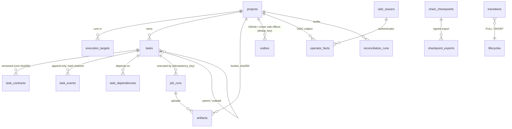

# 19 — PostgreSQL State Management (devplat)

Status: **Proposed.** The schema (`platform/db/schema.sql`) is **implemented and tested against a real PostgreSQL 16.15 server** (`platform/db/test_schema.py`, 21/21 pass, §13). The controller code that calls it, CloudNativePG deployment, backups, PITR, migrations tooling and the v1 import tool are **Documented only**. Decision record: ADR-026 (Proposed).
Reuses / supersedes: **supersedes for the platform** `01-development-architecture.md` §4 "ledger branch `devorch/state`" as the state store, `07-handoff-and-recovery.md` §5 rows "`record`", "Ledger push", "Partial ledger line" and §6 (single-orchestrator LOCK, replaced by leases, §6 below). **Keeps unchanged:** the state machine, lifecycles, gates G1–G7, budgets, subtask binding and contract-core rule of `01-…` §5, `04-contracts.md` and `tools/devorch/devorch.py`. They are ported to SQL, not redesigned. v1 stays the local mode (`14-…`).

## 1. Why PostgreSQL

| Option | Verdict | Reason |
|---|---|---|
| **PostgreSQL** | **Chosen** | Transactions put the state check, event append, task update and outbox enqueue in one commit. Constraints and triggers give an append-only audit table. Relational queries cover READY computation, budgets, fair share and per-project views. Row-level security is available. Operators exist (CloudNativePG), and every cloud offers a managed service |
| etcd / Task CRDs | Rejected | etcd is not an audit store: it compacts history, objects are capped at about 1.5 MiB, and it has no relational queries. A CRD would add a second source of truth next to the event log. Admission webhooks can enforce a transition table, but not atomically together with an outbox and budgets. The controller is still level-triggered over this state (`15-…` §4.1) |
| SQLite (per controller) | Rejected | Two controller replicas, leader failover and a separate API process need a shared, network-reachable writer. SQLite on a shared PVC is unsafe across pods (file locking over network storage) |
| Keep the v1 git ledger | Rejected for the platform, **kept for local mode** | One writer per branch, push races resolved by fast-forward-only (`07-…` §5), with no concurrent controllers and no queries. R5 §3.3 showed that anyone with the writer's uid can forge a consistent ledger. In PostgreSQL, agents never get a DB route or credentials (`18-…`), which moves the residual risk to the DB administrator (§8) |

## 2. Deployment

| Mode | Engine | HA | Backups | Status |
|---|---|---|---|---|
| In-cluster (P1–P5 in `25-…`) | **CloudNativePG** `Cluster`, 3 instances (1 on a workstation), PostgreSQL 16, on the `control` pool in `devplat-system` | Streaming replication, automated failover. The `-rw` Service always targets the primary | `Backup` / `ScheduledBackup` plus continuous WAL archiving to the S3 store (`20-…`, separate bucket `devplat-pg-backup`) | Documented only |
| Managed cloud (P6) | Cloud SQL / RDS / Azure Flexible Server, PostgreSQL 16 | Provider HA (regional) | Provider PITR (≥ 7 days) plus a logical dump to the artifact store weekly | Documented only |
| Test (this repository) | Scratch PostgreSQL 16.15, or an ephemeral private instance started by the test (§13) | — | — | Implemented and tested |

Rules:
1. Agent namespaces (`proj-*`) have **no route** to PostgreSQL (NetworkPolicy, `18-…`) and no credentials.
2. Three login identities, each a member of one group role: controller → `devplat_controller`, api → `devplat_api`, dashboards and exporters → `devplat_readonly`. The migration job uses `devplat_owner`, a NOLOGIN owner role that is assumed via `SET ROLE` by the migration login only. With CNPG, these are `managed.roles` with passwords in Kubernetes Secrets, or IAM database authentication in cloud.
3. TLS is required (`sslmode=verify-full`). CNPG issues the server certificate.

## 3. Schema overview

| Table | Purpose | Written by |
|---|---|---|
| `transitions`, `gate_prerequisites`, `loop_counters`, `event_counters`, `task_kinds`, `gate_providers`, `reviewer_kinds`, `evidence_kinds`, `hard_preconditions` | The rules: a port of `T_FULL`/`T_SHORT` (86 rows), `REQUIRED_BEFORE`, `LIMITS`, the kind tables, `REVIEWER_KIND` and `HARD_PRECONDITIONS`. A test asserts equality with `devorch.py` | Migration only |
| `projects`, `execution_targets` | Project registry mirror; execution target `{cluster_ref, namespace_prefix}` (Option C is a row change) | `upsert_project()`, `upsert_execution_target()` |
| `tasks` | Current state projection: state, gates, counters, tested/PR head, contract version and core, attempt, `need_bump`, chain tail, **lease** (`lease_holder`, `lease_token`, `lease_expires_at`) | `create_task()`, `record_event()`, lease functions |
| `task_contracts` | Immutable contract versions: `core_sha256` (devorch `contract_core_sha`), body, `max_attempts`. `UNIQUE(task_id, core_sha256)` | `register_contract()` |
| `task_events` | The ledger: `seq`, `prev_hash`, `hash`, event, from/to, gate, evidence, payload, `controller_id`, `lease_token`, `on_behalf_of`, `idempotency_key` | `record_event()` only |
| `job_runs` | One row per Kubernetes Job: `idempotency_key` (unique), namespace, name, uid, phase, failure class, heartbeat | `dispatch_job()`, `update_job_phase()`, `job_heartbeat()` |
| `leases` | Named non-task leases (outbox dispatcher, reconcilers, checkpoint exporter) | `acquire_lease()` |
| `artifacts` | Content-addressed objects: sha256, bucket, `object_key = 'sha256/'‖sha256`, size, kind, retention, legal hold | `register_artifact()`, `expire_artifacts()` |
| `operator_facts` | Authenticated human facts (DOD-xx, approvals, Mac/operator results): OIDC `subject`, `issuer`, `auth_time`, `token_jti` (unique) | `record_operator_fact()`. **devplat_api only** |
| `outbox` | GitHub and Linear side effects. `dedup_key` unique; status pending → in_flight → done / dead; backoff | `record_event(p_outbox)`, `enqueue_outbox()`, `claim/complete/fail_outbox()` |
| `reconciliation_runs` | Audit of every reconciliation pass (findings, actions) | `start/finish_reconciliation()` |
| `chain_checkpoints`, `checkpoint_exports` | Digest of all chain tails, plus the signed export reference | `create_checkpoint()`, `record_checkpoint_export()` |

## 4. Transactional transitions — `record_event()`

`record_event(task, event, contract_version, attempt, lease_holder, lease_token, evidence, head_commit, payload, idempotency_key, outbox)` is a `SECURITY DEFINER` function owned by `devplat_owner` with a fixed `search_path`. In **one transaction** it:

1. Locks the task row (`FOR UPDATE`). This serialises all writers of one task.
2. Returns the existing record if `idempotency_key` was already used. The same key with a different event, attempt or version is refused.
3. Checks the **lease and fencing token** (§6).
4. Looks up `(lifecycle, from_state, event)` in `transitions`. An unknown pair is refused: `illegal transition for kind K: S --e-->`.
5. Validates the evidence: 1–100 items with known kinds. File kinds need the `sha256` of an artifact registered for **the task's project** (port of `verify_file_evidence`). An `operator_fact` item must name a fact of that project, and its subject becomes `on_behalf_of`.
6. **Contract continuity:** the core may change only through `contract_revised` with a higher version and a different core. Every other event must use the current version.
7. **Attempt discipline:** `dispatched` may not go backwards. After a counted failure or a return to RUNNING it must be `attempt + 1`. Every other event must carry the current attempt (stricter than v1, which did not check it).
8. **Budgets:** `attempt_failed`/`tests_failed` against the contract's `max_attempts`; review 3, security 2, integration 2, env 5 from `loop_counters`.
9. **Duplicate gate** refusal (gates since the last return to RUNNING; G1 survives).
10. Gate evidence exactly as in devorch:

    | Gate | Evidence rule |
    |---|---|
    | G1 | `design_ref`; the FULL lifecycle also needs satisfied **operator facts** DOD-02 and DOD-03 and satisfied `task_dependencies` |
    | G2 | Head equals the checked `implementation_completed` head; `test_run` |
    | G3/G4/G5 | Bound COMPLETED subtasks of the right kind and parent. Accepting recommendation, no blocking findings, `reviewed_head_commit` and the contract's `review_target.head_commit` equal to the tested head, `integrated_heads` contains `task@head`, and required reviewers |
    | G6 | `pr` and `ci_run`, head equal to the tested head |
    | G7 | `github_merge`, head equal to the G6 head |
    | SHORT `result_accepted` | A `result_file` plus the controller-validated `payload.result`; for `mac_validation`/`operator_action`, an operator fact for that task |

11. Resolves the review-gate target (G3 and G4 → AWAITING_INTEGRATION) and checks `REQUIRED_BEFORE`.
12. Applies the devorch `apply()` semantics, computes `hash = sha256(event_canonical(row))` with `prev_hash` = the previous hash, inserts the event, updates `tasks`, and enqueues outbox rows.

Refusals raise SQLSTATE `DP001` (rule) or `DP002` (lease) with a `refused: …` message. Nothing is written. The controller still runs the checks that need the outside world before calling `record_event`: git and gitbroker result validation, schema validation and the test re-run. The DB enforces everything that can be decided from its own rows. **What the DB cannot check:** that a `sha256` artifact really holds a valid result, that a `pr` reference exists on GitHub, and that `payload.result` faithfully summarises the stored result file. Those stay controller duties, and the reconciliation loops re-check them (`21-…`).

## 5. Idempotency keys

| Operation | Key | Effect of a repeat |
|---|---|---|
| Event append | `task_events.idempotency_key`, `UNIQUE(task_id, key)`. Controller convention: `sha256(task‖event‖attempt‖dispatch_no‖trigger-id)` | Returns the committed record (`r_replayed = true`) |
| Job dispatch | `job_runs.idempotency_key` (unique). `jobspec.py`: `sha256(project‖contract_core‖attempt)`. Also `UNIQUE(task_id, attempt, role, dispatch_no)` and `UNIQUE(namespace, job_name)` | `ON CONFLICT DO NOTHING`, then returns the existing row (`r_created = false`). A different key for the same slot is a **duplicate execution** and is refused |
| Side effect | `outbox.dedup_key` (unique). Example: `gh:<project>:<task>:pr` | One row. Execution is at-least-once, so the GitHub/Linear call itself must be idempotent: look up before create (`21-…` §8) |
| Artifact | `UNIQUE(project_id, sha256)` | Same content is one row. A repeat may only **extend** retention |
| Operator fact | `token_jti` unique | A replayed authenticated request is refused |
| Task creation | `task_id` primary key | The same holder re-creating the identical task gets its token back |

## 6. Leases, fencing and the controller leader

1. **Leader:** a Kubernetes `coordination.k8s.io` Lease decides which controller replica reconciles (`16-…`). It is not in the DB.
2. **Task lease:** `tasks.lease_holder` / `lease_token` / `lease_expires_at`. `acquire_task_lease(task, holder, ttl)` renews for the same holder (same token), returns NULL while another holder's lease is unexpired, and after expiry hands the lease over with **token + 1**.
3. **Fencing:** every write function (`record_event`, `register_contract`, `add_dependency`, `dispatch_job`, `update_job_phase`) requires holder **and** token **and** an unexpired lease. A paused or partitioned old leader that wakes up after takeover is refused (`DP002`), even if its pod still believes it is the leader. Every event stores `controller_id` and `lease_token`.
4. Recommended TTL: 2 min, renewed each tick (`16-…`).
5. Generic `leases` rows use the same semantics for singleton loops.

This replaces the v1 LOCK file (`07-…` §6): the lock was a convention, and the lease is enforced inside the writing transaction.

## 7. Heartbeats and retry budgets

- `job_heartbeat(job_id, uid)` updates `last_heartbeat_at` only for an active Job with the matching uid. The view `stale_jobs` lists Jobs whose heartbeat is older than `projects.limits.heartbeat_timeout_seconds` (default 300 s). The controller derives heartbeats from pod status and a progress object the runner uploads. **Agents never write the DB.**
- Retry budgets are counted in `tasks.counts` by `record_event()` and reset only by `contract_revised`, as in `07-…` §3. Kubernetes never retries (`backoffLimit: 0`, `16-…`).
- Outbox retries: 30 s·2^(n−1), capped at 1 h, or a `Retry-After` hint, whichever is longer. After `max_attempts` (8) the row is `dead` and visible to the operator.

## 8. Audit trail, hash chain and the honest limit

| Control | Mechanism | Tested |
|---|---|---|
| Append-only | `BEFORE UPDATE OR DELETE` row trigger and `BEFORE TRUNCATE` statement trigger on `task_events`, `task_contracts`, `operator_facts` and checkpoints. These fire for every role, **including the table owner and a superuser** in normal mode | Yes |
| Single writer | No table privileges for any login role. The controller has EXECUTE only; `devplat_api` cannot call `record_event` | Yes |
| State only via the log | A `tasks` trigger refuses state-column changes outside `record_event()` | Yes |
| Hash chain | Per task, `prev_hash`/`hash` over `event_canonical()`: a jsonb text with deterministic key order. **Not** devorch's Python canonical JSON and not RFC 8785 | Yes |
| Verification | `verify_chain(task?)` re-computes hashes and checks seq contiguity, links, from/to continuity, transition legality and the `tasks` row against the tail | Yes |

**Honest limit.** A PostgreSQL superuser (or the owner role with `ALTER TABLE … DISABLE TRIGGER`, or anyone with access to the data files or backups) can rewrite history. The test shows this: an in-place edit or a removed tail is detected, but a **consistent rewrite** that re-hashes the rest of the chain and updates `tasks` passes `verify_chain()`. In-database hashing proves internal consistency, not authenticity. Mitigations:

1. **Signed checkpoints exported outside the DB.** Each hour, and at every G6/G7, the controller runs `create_checkpoint()`, a digest over every task's `(task_id, seq, hash)` tail. It writes the checkpoint to the artifact store as an object-locked object (`20-…` §5), signs it with a key the DB administrator does not hold (Sigstore keyless with the controller's workload identity, or a KMS key), records the export in `checkpoint_exports`, and also commits the digest to the `devplat/checkpoints` branch through gitbroker. A rewrite then changes `chain_digest()` against the exported value (tested). **Status: Documented only** (export, signing and branch are not implemented).
2. Superuser access is break-glass only. On CNPG, `enableSuperuserAccess: false` and the `postgres` secret is sealed. In cloud, IAM-only access is used.
3. PostgreSQL audit logging (`pgaudit`) of DDL and role changes is shipped to the observability stack.
4. G7 stays externally anchored: the merge itself is on GitHub, with `merged_by` checked by reconciliation (`21-…`).

## 9. Backups, PITR and restore

| Item | In-cluster (CNPG) | Managed |
|---|---|---|
| Base backup | Daily `ScheduledBackup` to object storage (`barmanObjectStore` or the Barman Cloud plugin) | Provider automated |
| WAL archive | Continuous. RPO ≈ `archive_timeout` (set 60 s) | Provider (≈ 5 min typical) |
| Retention | 30 days | ≥ 7 days PITR, plus weekly logical dump for 90 days |
| Restore drill | Monthly: restore into a new `Cluster`, run `verify_chain()` and compare `chain_digest()` with the last exported checkpoint **before** the restored instance is promoted | Same |
| After restore | Tasks whose events are newer than the restore point are re-derived by reconciliation from Jobs, artifacts and GitHub (`21-…` §9). The outbox is reconciled by dedup lookup | Same |

All rows are **Documented only**.

## 10. Migrations

1. Versioned forward-only SQL files `platform/db/migrations/NNNN_<name>.sql`, applied by a Helm pre-upgrade Job (`24-…`) as the migration login with `SET ROLE devplat_owner`, inside one transaction. A `schema_migrations(version, sha256, applied_at)` table records them. `schema.sql` is today's baseline (version 0001).
2. Expand/contract changes only, because two controller replicas may run different versions during a rollout. Functions are versioned when their signature changes (`record_event_v2`), and the old version is dropped one release later.
3. Rule tables (`transitions`, …) change only through an approved amendment, and `test_transitions_table_matches_devorch` keeps them equal to `devorch.py` while v1 remains in use.
4. Each migration's CI runs `test_schema.py` against an ephemeral PostgreSQL 16 server.

The migration runner and the `schema_migrations` table are **Documented only**.

## 11. Multi-project isolation

| Layer | Control | Tested |
|---|---|---|
| Rows | `project_id` on every project-scoped row. Composite FKs `(project_id, task_id)` keep events and Jobs inside their task's project | Yes (structure) |
| Cross-project references | Evidence artifacts, subtasks, covered tasks and operator facts must belong to the same project (`record_event`) | Partly (artifacts, facts) |
| Read isolation | Row-level security on all project tables: `can_see(project_id)` is true if the current role is a member of a role granted that project in `project_grants` (`'*'` = all; controller and api). A per-project reader role (for example a dashboard for one project) sees only that project | Yes |
| API | `devplat-api` sees all rows (`'*'`) and enforces per-operator project authorization in application code. RLS is the backstop for read-only consumers, not for the API | Documented only |
| Separate clusters (Option C) | Still one database. A project needing a separate trust domain gets its own devplat installation | Documented only |

## 12. v1 git ledger → PostgreSQL

| v1 (`devorch/state`) | devplat |
|---|---|
| `tasks/<task>.json` | `task_contracts` (one row per `contract_version`; `core_sha256` = `contract_core_sha`) |
| `ledger/<task>.jsonl` record | `task_events` row; `actor` → `devplat-controller`, operator records → `on_behalf_of` |
| `prev_hash` / `hash` (Python canonical JSON) | New chain. The v1 hash is kept in `payload.v1_hash` and the v1 seq in `payload.v1_seq` |
| `evidence/<task>/records/*` (hashed copies) | Objects `sha256/<hex>` in the project bucket plus `artifacts` rows |
| `facts.jsonl` (`--actor operator`, self-asserted) | **Not imported as authenticated.** Re-recorded by the operator through `devplat-api`. An imported v1 fact is stored with `fact_key` `v1:<key>`, which no gate accepts |
| `LOCK` | Task leases |
| `dag.json` | `task_dependencies` (plus scheduler inputs in `17-…`) |

**Import tool** (`platform/tools/import_v1_ledger.py`, **Documented only**):
1. Run `devorch.py verify-ledger --remote origin/devorch/state`. Abort on any failure.
2. Upload every evidence file. Register artifacts.
3. Per task, call `create_task` and `register_contract` for each version.
4. **Replay** every v1 record through `record_event()`, so the SQL rules re-validate the whole history. A record the DB refuses stops the import for that task, which then goes to the operator.
5. Write an import report and a checkpoint, and record operator fact `v1-import-accepted` after the operator's review.

The tool runs once at cutover (`28-…`). After cutover, v1 is read-only for the project.

## 13. What was tested here

**Environment.** PostgreSQL 16.15 (Ubuntu 16.15-0ubuntu0.24.04.1, x86_64); psql through `subprocess`; no psycopg.

**Server.** The brief's scratch server (socket `…/scratchpad/pg`, port 55432) **crashed at 08:36:46 UTC before the first test run**. Its log shows `PANIC: could not open file …/pg_control: Permission denied`: the server's user `nobody` lost directory traverse permission on `/tmp/claude-0`. Restoring that permission was not allowed in this session. The test therefore started its own **ephemeral PostgreSQL 16.15 instance** (initdb as `nobody` in a fresh `mkdtemp` directory, Unix socket only, removed at the end). It falls back like this automatically and uses the configured server when that server answers.

**Isolation.** Each run uses a fresh database `devplat_test_<random>` and roles `dpt_<random>_*`, dropped at the end.

**Command:** `python3 platform/db/test_schema.py`. **Result:** `Ran 21 tests … OK` (≈ 29 s).

| Test | Shows |
|---|---|
| `test_transitions_table_matches_devorch` | `transitions` = `T_FULL`/`T_SHORT` and `GATE_OF` (86 rows); `gate_prerequisites` = `REQUIRED_BEFORE`; `loop_counters` = `LIMITS`; FULL/SHORT kind sets equal |
| `test_legal_happy_path_to_completed` | NEW → … → COMPLETED with bound `-r1`, `-s1`, `-i1` subtasks, G1–G7, `closed`. 12 parent events; all four chains verify |
| `test_illegal_transition_refused` | BLOCKED --assigned, READY --tests_passed, READY --human_merged refused; state unchanged; chain intact |
| `test_g1_requires_design_ref_and_operator_facts` | G1 without `design_ref` refused; a newer `DOD-03 revoked` fact blocks G1 |
| `test_g2_requires_checked_implementation_at_that_head` | G2 at a head without a checked implementation refused; unregistered file evidence refused |
| `test_g4_cannot_be_skipped` | After G3: `integration_verified` and `pr_prepared` illegal; a code review cannot provide G4; state AWAITING_REVIEW with G1–G3 |
| `test_duplicate_gate_refused` | Second G3 refused |
| `test_review_bound_to_tested_head` | A review of a stale head is refused; a design review does not satisfy `required_reviewers`; a bad subtask id is refused |
| `test_review_budget_enforced` | Three change cycles, each correction forced to attempt + 1; the 4th is refused ("review loop budget 3 exhausted"); `escalated` works |
| `test_attempt_budget_enforced` | `max_attempts` 2: the second `attempt_failed` is refused; `failed` → FAILED |
| `test_contract_core_continuity` | A version change without `contract_revised` is refused; revising to the same version is refused; re-registering a version with a different core is refused |
| `test_task_events_update_delete_refused` | Controller: no INSERT/UPDATE/DELETE privilege. Superuser: UPDATE, DELETE and TRUNCATE are refused by trigger, and direct `tasks.state` changes are refused. The api role cannot call `record_event` |
| `test_hash_chain_detects_superuser_tamper` | With `session_replication_role = replica`: an in-place edit gives "hash mismatch" and a removed tail is detected. A consistent rewrite **passes** `verify_chain()`, but `chain_digest()` differs from the earlier checkpoint |
| `test_record_event_idempotency_key_replay` | The same key returns the same seq (`replayed`); reuse for another event is refused |
| `test_idempotent_dispatch_concurrent` | **Two parallel psql sessions** with the same key: one row, one `created=t` and one `f`; the second session waited for the first (elapsed > 2.5 s). A different key for the same slot is refused; a Job uid change is flagged as duplicate execution; an illegal phase change is refused |
| `test_task_lease_fencing` | B cannot take an unexpired lease. After expiry, A's write with its own token is refused. B takes over with token + 1; A's old token and A's re-acquire are refused; B's write succeeds; events record holder and token |
| `test_outbox_dedup` | The same dedup key gives one row, also from `record_event`. `merge_pr` is not an allowed operation. Linear needs DOD-05. Claim, fenced completion by a stale claimer refused, and backoff are checked |
| `test_operator_fact_not_writable_by_controller` | The controller cannot call `record_operator_fact` or insert into `operator_facts`; neither can readonly. The api refuses `system:serviceaccount:*` subjects, stale `auth_time`, a replayed `jti` and unknown issuers. Facts are append-only |
| `test_operator_task_completion_needs_authenticated_fact` | `mac_validation` completion needs an operator fact for that task; `on_behalf_of` = issuer#subject |
| `test_rls_project_isolation` | A reader role with no grant sees 0 rows; with a project grant it sees only that project; the api sees all; readers cannot read `leases` |
| `test_artifact_immutability_and_bucket` | Identity is immutable; deleting a retained object is refused; a wrong bucket is refused; the per-kind size limit is enforced |

**Mutation check.** Each rule was broken in a copy of the schema (`DEVPLAT_SCHEMA=<copy>`), and at least one test failed for each of: G4 not required, duplicate-gate check removed, append-only trigger moved off `task_events`, lease expiry check removed, fencing token check removed, review budget 3→4, review head binding removed.

**Not tested:** the controller calling these functions; CNPG, failover, backup, PITR and restore; TLS and auth; migrations; the import tool; checkpoint export and signing; performance or load (no benchmark was run); `expire_artifacts` on expired rows (only the no-op path ran).
