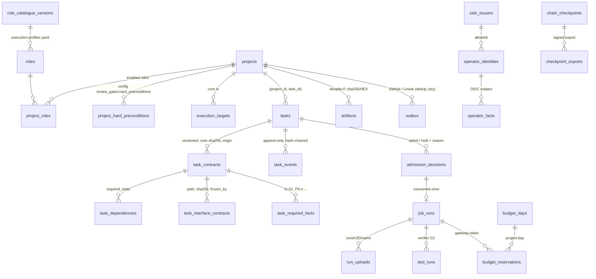

# 19 — PostgreSQL State Management (devplat)

Status: **Proposed (R6 fix round applied).** The schema (`platform/db/roles.sql`, `platform/db/schema.sql`) is **Implemented and tested against a real PostgreSQL 16.15 server** (`platform/db/test_schema.py`, 54 tests, §13). The controller, api, gateways and migration Job that call it, CloudNativePG deployment, backups, PITR and the v1 import tool are **Designed, unverified** (not built). Decision record: ADR-026 (Proposed).
Reuses / supersedes: **supersedes for the platform** `01-development-architecture.md` §4 "ledger branch `devorch/state`" as the state store, `07-handoff-and-recovery.md` §5 rows "`record`", "Ledger push", "Partial ledger line" and §6 (single-orchestrator LOCK → leases, §6). **Keeps unchanged:** the state machine, lifecycles, gates G1–G7, budgets, subtask binding, contract-core rule and the `contract_errors` / `result_errors` / `contract_dep_blockers` rules of `01-…` §5, `04-contracts.md` and `tools/devorch/devorch.py`. They are ported to SQL, not redesigned. v1 stays the local mode (`14-…`).

## 1. Why PostgreSQL

| Option | Verdict | Reason |
|---|---|---|
| **PostgreSQL** | **Chosen** | One transaction covers the state check, event append, task update and outbox enqueue. Constraints and triggers give an append-only audit table. Relational queries cover READY, budgets, admission and fair share. Row-level security per project. Operator (CloudNativePG) and managed services exist |
| etcd / Task CRDs | Rejected | Not an audit store (compaction, ~1.5 MiB objects, no relational queries); a second source of truth; no atomic state + outbox + budget commit |
| SQLite (per controller) | Rejected | Two controller replicas, the api and two gateways need a shared, network-reachable writer |
| Keep the v1 git ledger | Rejected for the platform, **kept for local mode** | Single writer, push races, no concurrency or queries. R5 §3.3: the writer's uid can forge a consistent ledger. In PostgreSQL, agents have no DB route or credentials (`18-…`), which moves the residual risk to the DB administrator (§8) |

## 2. Deployment and database roles (R6 D9)

| Mode | Engine | HA | Backups | Status |
|---|---|---|---|---|
| In-cluster (profiles in `25-…`) | **CloudNativePG** `Cluster`, PostgreSQL 16, 3 instances (1 on a workstation), `control` pool, `devplat-system` | Streaming replication, automated failover | `ScheduledBackup` + WAL archive to the platform bucket's backup prefix (separate credential) | Designed, unverified |
| Managed cloud | Cloud SQL / RDS / Azure Flexible Server, PostgreSQL 16 | Provider HA | Provider PITR ≥ 7 days + weekly logical dump | Designed, unverified |
| Test | Scratch PostgreSQL 16.15, or an ephemeral private instance started by the test (§13) | — | — | Implemented and tested |

| Role | Login | Used by | May |
|---|---|---|---|
| `devplat_migrator` | **yes** (CNPG `bootstrap.initdb.owner`; Secret `devplat-db-migrator`, pinned) | Helm pre-install / pre-upgrade migration Job only | Own the database; `SET ROLE devplat_owner`; run `schema.sql` and migrations; `load_role_catalogue()`, `set_operator_identities()`. Not SUPERUSER, not CREATEROLE (`roles.sql` refuses otherwise) |
| `devplat_owner` | **never** (`roles.sql` forces NOLOGIN) | — | Owns every object and every `SECURITY DEFINER` function |
| `devplat_controller` | group (controller login is a member) | devplat-controller | EXECUTE on the controller functions; SELECT under RLS. **No DDL, no table writes, never a member of the owner, never runs migrations** (tested) |
| `devplat_api` | group | devplat-api | `record_operator_fact()` for allow-listed OIDC subjects; SELECT |
| `devplat_readonly` | group | dashboards, exporters | SELECT under per-project RLS |
| `devplat_model_gateway` | group | model-gateway | `reserve_budget()`, `settle_budget()`, `release_budget()` only (no table reads) |
| `devplat_artifact_gateway` | group | artifact-gateway | `authorize_upload()`, `complete_upload()` only |

Bootstrap order: (1) the administrator (CNPG `managed.roles` or the provider admin) runs `roles.sql`; (2) the migration Job connects as `devplat_migrator`, which `SET ROLE`s to the owner and applies `schema.sql`, then loads the role catalogue from `platform/agents/execution-profiles.yaml` and the operator allowlist from the chart (`allowedSubjects`, minItems 1). Agent namespaces have no route to PostgreSQL (NetworkPolicy, `18-…`). TLS is required (`sslmode=verify-full`).

## 3. Schema overview

| Table | Purpose | Written by |
|---|---|---|
| `transitions`, `gate_prerequisites`, `loop_counters`, `event_counters`, `task_kinds`, `gate_providers`, `evidence_kinds`, `fact_statuses`, `env_signals`, `run_object_caps`, `artifact_kinds`, `outbox_operations` | Platform rules: the devorch tables (86 transitions), plus the D11 run layout, D17 platform signals and allowed side effects. **No project, role or v1 fact literal** (tested by grep) | Migration only |
| `roles`, `role_catalogue_versions` | Platform role catalogue (role, kinds, llm, network class `none\|model-only\|deps`, writes, concurrency). The `mdev-` prefix is historical. The kind→role map (devorch `KIND_AGENT`) is this data | `load_role_catalogue()` (migrator) |
| `projects` | Status `draft\|onboarding\|active\|paused\|archived`, `config_version`, assurance mode, bucket `devplat-<project>`, daily budgets, Linear write fact. Id `^[a-z][a-z0-9-]{1,22}[a-z0-9]$` | `upsert_project()` |
| `project_hard_preconditions`, `project_roles` | From project config: required precondition facts (default `[DOD-02, DOD-13]` lives in the config schema), enabled roles × allowed kinds | `upsert_project()` |
| `tasks` | Current-state projection, PK `(project_id, task_id)`; lease, revision counter | `create_task()`, `record_event()`, lease functions |
| `task_contracts` + `task_dependencies`, `task_interface_contracts`, `task_required_facts` | Immutable contract versions (core sha256, `origin` controller/planner, `requires_approval`), and the rows derived from the contract at registration | `register_contract()` |
| `task_events` | The ledger; carries `config_version` and `assurance_mode` | `record_event()` only |
| `admission_decisions` | Every admit / hold / reject with a reason | `record_admission()` |
| `job_runs` | One row per Kubernetes Job; `admission_id` (consumed once), idempotency key, `dispatch_no`, uid, phase, failure class, hashed per-Job gateway and upload tokens | `dispatch_job()`, `set_job_tokens()`, `update_job_phase()`, `job_heartbeat()` |
| `run_uploads` | One-time, capped objects of a run | `authorize_upload()`, `complete_upload()` (artifact-gateway) |
| `test_runs` | Verifier results per test at a head (G2) | `record_test_run()` |
| `budget_days`, `budget_reservations` | Atomic per-project-day and per-task cost/token reservations | model-gateway functions |
| `artifacts` | Evidence objects `sha256/<hex>` (+ manifest alias `manifests/<task>/<attempt>/<role>-d<dispatch>.json` or `…/gate-G<n>.json`, unique per project) | `register_artifact()`, `expire_artifacts()` |
| `operator_identities`, `oidc_issuers`, `operator_facts` | Allowed operator subjects (per project or all), and authenticated facts | migrator / `record_operator_fact()` (api only) |
| `outbox`, `reconciliation_runs`, `leases`, `chain_checkpoints`, `checkpoint_exports` | As before | controller functions |

## 4. Transactional transitions — `record_event()`

`record_event(project, task, event, contract_version, attempt, lease_holder, lease_token, evidence, head_commit, payload, idempotency_key, outbox)` runs in **one transaction**:

1. Locks the task row; returns the committed record for a repeated idempotency key.
2. Checks the lease and fencing token (§6).
3. Looks up `(lifecycle, from_state, event)` in `transitions`; unknown → `illegal transition`.
4. Validates evidence: file kinds must be artifacts of the **same project**; an `operator_fact` must belong to the project, and its subject becomes `on_behalf_of`.
5. **Contract continuity** (core changes only via `contract_revised` with a higher version) and the **revision limit**: at most 3 `contract_revised` until an operator `revision-reset` fact for the task (R6 D18).
6. **Attempt discipline**: corrections are dispatched as attempt + 1; other events carry the current attempt.
7. **Dispatch gate** (`assigned`, `dispatched`): project `active` (FULL kinds also need every hard precondition), or `onboarding` for SHORT read-only kinds only (R6 D4). Path ownership is re-checked at `assigned`.
8. **`env_retry`** needs a platform signal from `env_signals` and must cite a Job of this task already classified `environmental` with the same signal (R6 D17).
9. Budgets, duplicate gates.
10. **Entering READY** (`unblocked`, `resumed`, `reclaimed`) with a planner-originated or revised contract needs an operator `contract-approval` fact naming that version and core (R6 D18).
11. Gate evidence (devorch, restored in R6 D7):

    | Gate / event | Rule |
    |---|---|
    | G1 | `design_ref`; FULL lifecycle: every project hard precondition is a satisfied **project-scoped** fact (latest fact per key decides; a platform-wide fact never counts, R6 D1); every `task_required_facts` key satisfied; every interface contract's sha256 equals the freezing task's frozen hash; every dependency in its required state (`COMPLETED`, `AWAITING_HUMAN` = AWAITING_HUMAN or COMPLETED, `INTERFACE_FROZEN` = frozen hash of that path equals the contracted sha256) |
    | `implementation_completed` | head, `result_file` and a checked `payload.result` (below) |
    | G2 | head = checked implementation head; `test_run` evidence; **a passed verifier `test_runs` row at this head and attempt for every required test** (R6 D8) |
    | G3/G4/G5 | Bound COMPLETED subtasks of the right kind and parent; accept; **blocking findings computed from `findings[]`**; reviewed head = tested head; integration covers the task at that head; required reviewers (kinds from the catalogue) |
    | G6 / G7 | `pr` + `ci_run` at the tested head / `github_merge` at the G6 head |
    | SHORT `result_accepted` | `result_file` + checked `payload.result`; operator kinds: a satisfied operator fact for the task |

    **Result checks** (port of `result_errors`, applied to `payload.result`, the controller-validated summary): task id, contract version and attempt match; `agent` = assigned role; `status = completed`; result `head_commit` = recorded head; reviews: `reviewed_head_commit` = `review_target.head_commit`, a recommendation, no accept with a blocking finding, an outcome for every required test, no accept with a failing required test; other kinds (except planning, mac_validation, operator_action): every required test reported passed with exit 0; integration: recommendation and `integrated_heads`.
12. Applies devorch `apply()`, hashes (`event_canonical()` now includes `config_version` and `assurance_mode`), inserts, updates `tasks`, enqueues outbox rows.

**Contract registration** (`register_contract`, port of `contract_errors`): kind matches the task; the assigned role is a non-retired catalogue role whose kinds include the task kind **and** which the project enables for it; operator kinds may not be assigned to an LLM role; read-only kinds have `allowed_paths []`; no allowed path inside `restricted_paths` (git-like glob port); review target and parent; integration `covers_tasks`; required reviewers are enabled reviewing roles; **path ownership conflict** against active primary writers (literal-prefix overlap); contract-derived dependencies, interface contracts and required facts are stored.

**What the DB still cannot check**: that an artifact's content is the result it summarises, that a `pr` exists on GitHub, git facts (scope, renames, hidden index entries — gitbroker's validation). These remain controller/gitbroker duties and are re-checked by reconciliation (`21-…`).

## 5. Idempotency keys

| Operation | Key | Repeat |
|---|---|---|
| Event append | `UNIQUE(project_id, task_id, idempotency_key)` | Returns the committed record |
| Admission | `job_runs.admission_id` unique | An admit is consumed by exactly one Job |
| Job dispatch | `job_runs.idempotency_key` unique; `UNIQUE(project_id, task_id, attempt, role, dispatch_no)`; `UNIQUE(namespace, job_name)` | Same row returned; a different key for the same slot is a duplicate execution |
| Budget reservation | `UNIQUE(job_id, request_id)` | Same reservation returned |
| Run upload | `run_uploads` PK `(job_id, name)` | Second upload of a name refused (one-time) |
| Side effect | `outbox.dedup_key` | One row; the external call does lookup-before-create (`21-…` §8) |
| Artifact | `UNIQUE(project_id, sha256)` | One row; retention can only grow |
| Operator fact | `token_jti` unique | Replay refused |

## 6. Leases, fencing and leader change (R6 D22)

1. The controller leader is a Kubernetes Lease. On election the winner takes the DB lease `controller-leader` (TTL 15 s) and may call **`fence_transfer_task_leases()`**, which hands every task lease held by another holder to it with **token + 1** immediately, instead of waiting for the 2-minute task-lease TTL. A refused write (DP002) makes the old leader step down.
2. Task lease functions: same holder renews (same token); another holder gets NULL while unexpired; after expiry the taker gets token + 1. An expired lease is lost even if nobody took it.
3. Every write function requires holder + token + unexpired lease. Events store `controller_id` and `lease_token`.

## 7. Heartbeats, budgets and admission

- `job_heartbeat()` and the `stale_jobs` view as before; agents never write the DB.
- Loop budgets in `tasks.counts` (reset only by `contract_revised`, which is itself limited, R6 D18).
- **Cost budgets** (R6 D8, D17): model-gateway resolves the per-Job token hash to its Job, task and project and calls `reserve_budget()` before forwarding a request. It locks the project-day row (atomic; tested with two parallel sessions), refuses over `cost_usd_per_day` / `tokens_per_day`, and refuses over the contract's `budget.max_cost_usd` counted over **all** reservations of the task, so environmental re-dispatches consume the same budget. `settle_budget()` books the real cost; `release_budget()` only for requests that never reached the upstream API.
- **Admission** (`17-…`): every decision is recorded with a reason (`admitted`, `global_limit`, `project_limit`, `role_limit`, `budget`, `project_status`, `quota`, `dependency`, `operator_hold`, `image_unavailable`, `target_unavailable`). `dispatch_job()` requires a fresh (≤ 10 min) unconsumed `admit` for that task, attempt and role.

## 8. Audit trail, hash chain and the honest limit

Append-only triggers now also cover the contract-derived tables, `admission_decisions` and `test_runs`. `verify_chain(project?, task?)` and `chain_digest()` as before (tails keyed by `(project_id, task_id)`).

**Honest limit.** A PostgreSQL superuser, the owner role, or anyone with data files or backups can rewrite history consistently; `verify_chain()` then passes (tested). Mitigations: signed checkpoints exported outside the DB to **object-lock storage**, signed by a signer outside the controller (DOD-18; not a git branch: the development App may push only `dev/*` under DOD-13, so gitbroker cannot anchor them, R6 A-15) — **Designed, unverified**; owner role NOLOGIN and the migrator pinned and used only by the migration Job (R6 D9); no superuser access in normal operation; pgaudit of DDL and role changes; G7 anchored on GitHub.

## 9. Backups, PITR and restore

Unchanged in substance: daily base backup + continuous WAL (RPO ≈ 60 s), 30 days; monthly restore drill that runs `verify_chain()` and compares `chain_digest()` with the last exported checkpoint before promotion; re-derive post-restore state by reconciliation (`21-…` §9). **Designed, unverified.**

## 10. Migrations (R6 D9)

1. One mechanism only: a Helm `pre-install,pre-upgrade` Job (`24-…`) that connects as `devplat_migrator`, `SET ROLE devplat_owner`, applies forward-only files `platform/db/migrations/NNNN_<name>.sql` in one transaction and records them in `schema_migrations`. `schema.sql` is the baseline. The controller never migrates (it has no DDL rights; tested).
2. Expand/contract only; versioned function names on signature change.
3. Rule tables change only through an approved amendment; `test_transitions_table_matches_vendored_devorch_rules` keeps them equal to the vendored `platform/db/devorch_v2_rules.json`, which an optional test checks against `tools/devorch/devorch.py` when that directory exists.
4. CI runs `test_schema.py` against an ephemeral PostgreSQL 16.

The migration runner and `schema_migrations` are **Designed, unverified**.

## 11. Multi-project isolation

| Layer | Control | Tested |
|---|---|---|
| Identity | `(project_id, task_id)` is the key of tasks, contracts, events, Jobs, admissions, test runs, reservations; the same task id in two projects are two tasks (R6 D3) | Yes |
| Cross-project references | Artifacts, subtasks, covered tasks, dependencies, frozen interfaces, operator facts, Jobs: same project only (composite FKs and checks) | Yes (artifacts, facts, identity) |
| Preconditions | Project-scoped facts only (R6 D1) | Yes |
| Operator identity | Subject must be in `operator_identities` for that project or for all (R6 D2) | Yes |
| Read isolation | RLS on every project table via `project_grants` membership | Yes |
| Buckets | `devplat-<project>` enforced by constraint | Yes |
| Budgets | Gateway token bound to `(project, job)` | Yes |

## 12. v1 git ledger → PostgreSQL

| v1 | devplat |
|---|---|
| `tasks/<task>.json` | `task_contracts` per version, plus derived dependency, interface and fact rows |
| `ledger/<task>.jsonl` | `task_events` (`actor` → `devplat-controller`; operator records → `on_behalf_of`); v1 hash and seq in `payload.v1_hash`, `payload.v1_seq` |
| `evidence/<task>/records/*` | `sha256/<hex>` objects + `artifacts` |
| `facts.jsonl` (self-asserted) | **Not imported as authenticated**: re-recorded through devplat-api; imported v1 facts get key `v1:<key>`, which no gate accepts |
| `LOCK`, `dag.json`, `assignments.json` | leases; contract `dependencies`; project config roles and gates |

Import tool (`platform/tools/import_v1_ledger.py`, **Designed, unverified**): `verify-ledger --remote` first; upload evidence; create tasks and contracts; **replay** every record through `record_event()` so the SQL rules re-validate history (a refusal stops that task); report and checkpoint; operator fact `v1-import-accepted`.

## 13. What was tested here

**Environment.** PostgreSQL 16.15 (Ubuntu 16.15-0ubuntu0.24.04.1, x86_64); psql via `subprocess`; PyYAML for the catalogue; no psycopg. The brief's scratch server (`…/scratchpad/pg:55432`) was not reachable (it crashed on 2026-10-17 when `/tmp/claude-0` lost its traverse permission), so the test started its own **ephemeral PostgreSQL 16.15 instance** (initdb as `nobody` in a fresh `mkdtemp`, socket only, removed afterwards). Per run: database `devplat_test_<random>` owned by a LOGIN migrator role; roles `dpt_<random>_*`; **the schema is applied by the migrator login**, not by a superuser.

**Command:** `python3 platform/db/test_schema.py`. The suite does not import anything outside `platform/` except the optional cross-check (A-04).

**Result (2026-10-22, R6 fix round):** five consecutive runs, each `Ran 47 tests … OK` (37.6 s, 38.2 s, 38.9 s, 44.5 s, 39.8 s); the optional devorch cross-check ran (tools/devorch present). **Mutation check:** 17 copies of the schema, each with one R6 rule disabled (D1 platform-wide fact counts; D2 allowlist off; D3 admission off; D4 FULL dispatch in onboarding; D7 interface hash, required facts, result status, blocking findings, role↔kind, ownership; D8 verifier runs, task cost cap; D10 one-time upload; D17 signal check; D18 approval, revision limit 3→99; D22 fence transfer without leader lease) — **every one made at least one test fail**. The earlier mutations (G4, duplicate gate, append-only trigger, lease expiry, fencing token, review budget, head binding) were also all caught in the first round.

**Result (2026-10-23, cross-group alignment):** `Ran 49 tests … OK` (44.3 s). New: `plan_proposal` kind (SHORT, read-only, suffix `p`; ids `<task>-pN` or `PL-<nnnn>`, doc 16 §10), a catalogue ↔ `task_kinds` equality check, and the 10-minute admission expiry. **Mutation check:** 4 copies, each with one new rule weakened (`p` id branch off; `plan_proposal` writable; admission TTL 10 years; `PL-` pattern loosened) — every one made at least one test fail.

**R6 re-check fixes (2026-10-23):** `upsert_project()` refuses a `hard_preconditions` list that omits any key of `mandatory_hard_preconditions` (set only by the migration Job through `set_mandatory_hard_preconditions()`, `DOD-02`, `DOD-13`), and a `linear_write_fact` that is a hard precondition or `REDUCED-ASSURANCE` (RS-5; `test_controller_cannot_drop_mandatory_hard_preconditions`, 2 mutations caught). `test_assigned_role_and_verifier_jobs_of_one_attempt` dispatches both roles of one attempt with the `jobspec.py` names and keys (RA-1; the role-less formulas fail it). `Ran 51 tests … OK`. Later the same day: cross-project dependencies refused (`test_cross_project_dependency_refused`, RA-3), manifest aliases carry the role and are unique (RC-1), and `dispatch_job()` requires the task's project's execution target (`test_dispatch_needs_the_projects_execution_target`, RS-9). `Ran 53 tests … OK`.

**Found by CI (2026-10-25).** Two simultaneous `dispatch_job()` calls with one idempotency key could both miss the lookup; the second insert then failed on `job_runs.admission_id` (a unique index that `ON CONFLICT (idempotency_key)` does not arbitrate) instead of returning the first row. `dispatch_job()` now takes a transaction-scoped advisory lock on the key before the lookup. `test_dispatch_serialized_per_key` checks it deterministically, failing without the lock in every run; `test_idempotent_dispatch_concurrent` is now a gated stress test (8 rounds × 4 sessions released together). `Ran 54 tests … OK`.

| Class | Tests |
|---|---|
| T01 rules | `test_transitions_table_matches_vendored_devorch_rules` (devorch kinds plus the devplat kind `plan_proposal`; catalogue kinds = DB kinds), `test_vendored_rules_still_equal_devorch_source` (optional), `test_no_project_or_role_literals_seeded` (grep + catalogue = YAML) |
| T02 | `test_legal_happy_path_to_completed` (12 events; `config_version`/`assurance_mode` recorded; verifier G2; draft-PR outbox) |
| T03 refusals | `test_illegal_transition_refused`, `test_g1_hard_preconditions_are_project_scoped` (revoked fact blocks; platform-wide fact does not satisfy), `test_g2_requires_checked_implementation_and_verifier_run_at_that_head`, `test_g4_cannot_be_skipped`, `test_duplicate_gate_refused`, `test_review_bound_to_tested_head` |
| T04 budgets/revisions | `test_review_budget_enforced`, `test_attempt_budget_enforced`, `test_contract_core_continuity`, `test_revision_needs_operator_approval_before_ready`, `test_planner_contract_needs_operator_approval`, `test_revision_limit_three_until_operator_reset` |
| T05 audit | `test_task_events_update_delete_refused` (also: api, gateways, readonly cannot call `record_event`), `test_hash_chain_detects_superuser_tamper` (incl. the consistent-rewrite limit), `test_record_event_idempotency_key_replay` |
| T06 execution | `test_admission_required_and_consumed_once`, `test_admission_older_than_ten_minutes_is_refused` (needs a superuser connection, else skipped), `test_idempotent_dispatch_concurrent` (two parallel sessions → one row), `test_env_classification_only_from_platform_signals`, `test_fence_transfer_on_leader_election`, `test_task_lease_fencing` |
| T07 side effects | `test_outbox_dedup_and_allowed_operations`, `test_push_needs_active_project_with_hard_preconditions`, `test_linear_writes_need_configured_project_fact` |
| T08 operator | `test_operator_fact_not_writable_by_controller`, `test_operator_subject_must_be_allowlisted`, `test_operator_task_completion_needs_authenticated_fact` |
| T09 isolation/status | `test_rls_project_isolation`, `test_plan_proposal_ids_and_onboarding_dispatch`, `test_task_identity_is_project_scoped`, `test_project_status_gates_creation_and_dispatch`, `test_identifiers_and_network_classes`, `test_artifact_immutability_bucket_and_caps` |
| T10 devorch ports (D7) | `test_g1_requires_ready_including_hard_preconditions`, `test_g1_requires_task_required_facts`, `test_interface_contract_hash_must_equal_frozen_hash`, `test_dependency_required_states`, `test_result_checks_status_head_and_blocking_findings`, `test_result_accepted_requires_checking_result`, `test_contract_rules_role_scope_and_ownership`, `test_path_ownership_conflict` |
| T11 gateways | `test_budget_reservations_atomic_and_env_retries_charged` (incl. two parallel reservations → one), `test_artifact_gateway_authorizes_layout_caps_once` |
| T12 roles | `test_owner_nologin_and_migrator_least_privilege`, `test_catalogue_reload_is_versioned` |

**Not tested:** the services that call these functions; CNPG, failover, backup, PITR; TLS and auth; the migration Job and runner; the import tool; checkpoint export and signing; performance and load; `expire_artifacts` on rows whose retention has ended; the 512 MiB run total (unreachable with the D11 per-object caps, which sum to 449 MiB).
