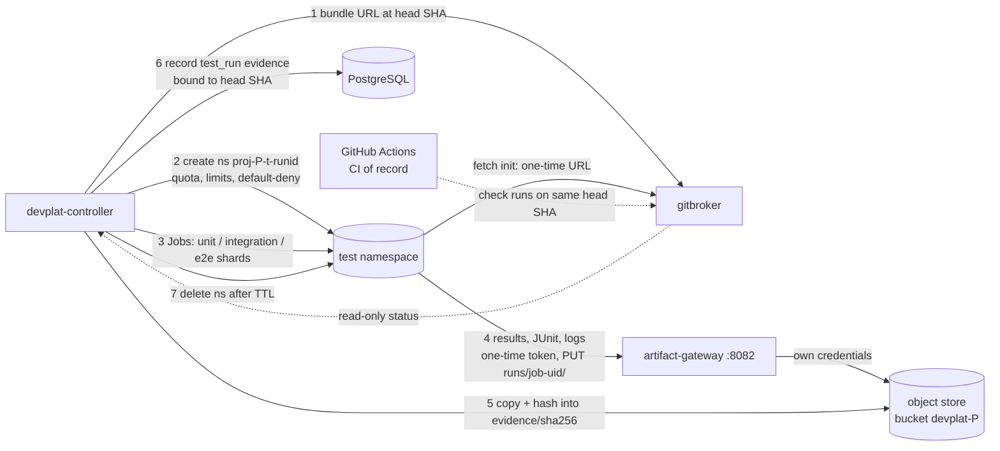

# 22 — Build and Test Architecture on Kubernetes

Status: **Proposed** (Architecture Amendment 001, 2026-10-17; R6 fix round 2026-10-22: D10, D12–D14, D16, D19, D20, D24, S-15). Documented only: nothing here is deployed or run on a cluster. Each capability's status is in §13.
Reuses / supersedes: keeps v1 `08-…` §1 (gates G1–G7 and their rules) and §3 (testing matrix per change type) unchanged. Replaces the G2/G5 "re-run in the task worktree" mechanics of `08-…` §1 and `10-…` §1 steps 2–4 for v2 with re-runs in Kubernetes test namespaces. Keeps `09-…` §1's rule that Mac-only evidence comes from the Mac. Mercury's test levels and environments (`../testing/verification-plan.md` §2–§3) are **not changed**: this document only says where each one runs.

## 1. Principles

1. **The repository's CI is the CI of record.** Each project's GitHub Actions workflows and the required checks in its ruleset decide whether a head is green (`23-…`). In-cluster runs are **additional evidence** for the controller's gates. They never replace a required check.
2. **Code under test is untrusted.** Test and build Jobs run agent-written code. They get the same pod hardening as agent Jobs (`16-…`, `18-…`): no Kubernetes API token, no Secrets, no DB access, default-deny egress, non-root.
3. **Tests run from the tested head, never from an agent's workspace.** The controller asks gitbroker for a source bundle at an exact commit SHA. Results are bound to `(project, head_sha, suite, image digest, seed)`. Doc 08 §1's rule "G2 tests are re-run, not read from the report" is kept.
4. **Pinned inputs.** Toolchain and test images are referenced by digest. Seeds and clock modes are recorded. Network is denied except where a test class explicitly allows it (§6).
5. **Per-project isolation** of namespaces, quotas, caches, artifacts and evidence (§8). No cross-project cache, bucket or registry path.
6. **Project-agnostic.** Suites, commands and environments come from the project configuration (`26-…`, `platform/schemas/project-config.schema.json`). Mercury's are listed here as the worked example. **Jupiter's are unresolved:** no repository or specification exists, and nothing here assumes a language or stack for it.
7. **Kubernetes cannot produce macOS evidence.** Mercury T4, T4v and T5 stay in the external **macOS lane** (§11).

## 2. Workflow

Builds are optional (§9). Most Mercury suites run in a **pinned toolchain image** with the source fetched at the head SHA. Mercury's deliverable is a macOS daemon, not a container image.

## 3. Test kinds: what runs, for whom, where

"Project" = suites declared in the project configuration (Mercury: the verification-plan levels). "Platform" = devplat's own suites, which run in **devplat's** CI (`23-…` §5) and in the bootstrap verification (`24-…` §9).

| Kind | For | Where | Network | Notes |
|---|---|---|---|---|
| Unit | Project, platform | Test Job in `proj-
-t-<runid>` (project); GitHub-hosted runner (platform) | None | Mercury L1 (T0). Coverage thresholds from the project configuration |
| Property / state machine | Project | Test Jobs, sharded by seed range | None | Mercury L2: 10,000 sequences per property per run, 100,000 nightly. The cluster's main advantage is parallel shards |
| Integration | Project, platform | Test namespace; real dependencies as pods in the same namespace | Intra-namespace only | Mercury L4 Linux part (T1). Platform: PostgreSQL 16 via CloudNativePG in a test namespace, or a service container in CI |
| API contract | Project, platform | Test Job | None (recorded fixtures) | Mercury L3 (golden examples, mutants). Platform: devplat REST API schema and the contract/result JSON schemas (`04-…`) |
| End-to-end with fakes | Project | Test namespace (daemon + fakes as pods or processes) | Intra-namespace | Mercury L5, L7, L8 (FaultProxy), L10 (T2) |
| Negative-path | Project, platform | Test namespace; platform probes in every project namespace kind | As tested | Mercury L7/L8 failure classes. Platform: the isolation probes in §7, which are mandatory |
| Concurrency | Project, platform | Test Jobs; platform: 2 controller replicas in a test namespace or vCluster (§5) | Intra-namespace | Mercury L11. Platform: leader-election handover, idempotent Job create (`AlreadyExists` ⇒ adopt), ≤ 1 lease holder per task |
| Recovery / crash injection | Project, platform | Test Jobs (project harness kills its own process); platform: chaos Job deletes the controller leader pod, evicts agent pods, drains a node (vCluster or dedicated test cluster only) | Intra-namespace | Mercury L9 crash runs (T1/T2): 1,000 randomized runs nightly, sharded. Platform: named crash points (env `DEVPLAT_CRASHPOINT`) at every DB transaction and external-effect boundary, ported from the devorch tests (`21-…`, `29-…`) |
| Multi-agent coordination | Platform | Platform test environment with a **fake agent image** (`devplat-fake-agent`: scripted results, no LLM) | Intra-cluster | N fake Jobs across ≥ 2 synthetic projects. Checks admission limits, fair share, per-project quotas, no cross-project reads, bound reviews (G3 subtask head = tested head), duplicate-dispatch refusal |
| Security / dependency / container scanning | Project, platform | Scanner Jobs in the test namespace (project); platform CI (platform images) | Scanner DB mirror via the registry proxy only | Secrets (gitleaks), dependencies (osv-scanner or Grype on the lockfile), images (Trivy or Grype), SBOM (Syft). Tools pinned by digest. Results are G4 evidence; they do not replace the security review subtask |
| Deployment smoke | Platform | After every `helm install/upgrade` (bootstrap step 6, `24-…` §9) | — | Health and readiness, migration version, leader Lease, gitbroker dry-run, model-gateway budget check, plus every §7 probe |
| Sandbox integration (Mercury T3) | Project | Only with the sandbox test class (§4.3), after operator approval | HTTPS to GitHub and Linear | Otherwise on the operator's machine, as `verification-plan.md` §2.3 says today |

## 4. Disposable test namespaces `proj-
-t-<runid>`

### 4.1 Lifecycle (controller-owned)

1. **Admit.** Fewer than `test.maxConcurrentNamespaces` live namespaces for the project, and global admission allows it (`17-…`).
2. **Name.** `runid` = the first 8 lowercase hex characters of `sha256(project, task, attempt, suite, head_sha)`. It is deterministic, so a retried create returns `AlreadyExists` and the namespace is adopted. The project id matches `^[a-z][a-z0-9-]{1,22}[a-z0-9]$` (D24), so `proj-
-t-<8>` stays ≤ 39 characters.
3. **Create.** The controller has no cluster-wide rights and no impersonation. It sends `(project, runid, profile ref)` to the **`devplat-namespacer` Deployment** (D19, :8083). The namespacer renders **exactly** the objects of doc 18 §9.3 from its fixed template, parameterized only by the project's test profile (`devplat-test-profile-
`, `devplat-project` chart):
   1. the Namespace (labels `devplat.io/project`, `devplat.io/ns-role=test`, `devplat.io/managed-by=devplat-controller`, PSA `restricted` pinned to `v1.33`);
   2. the NetworkPolicies `default-deny-all`, `allow-intra-namespace`, `allow-devplat-dns`, `allow-fetch-and-artifacts` (keyless `devplat-gitbroker-fetch` :8081 and `devplat-artifact-gateway` :8082) and `allow-deps` (the project's own registry proxy :4873, class `deps` only);
   3. a ResourceQuota with pods, CPU, memory, ephemeral storage, `services` (≤ `maxServices`, default 20, ClusterIP fixtures only; exec/build keep 0), `secrets` and `configmaps`, each within `devplat-cluster-params`; `persistentvolumeclaims`, `services.loadbalancers` and `services.nodeports` = 0;
   4. a LimitRange within the container caps;
   5. a RoleBinding controller → `devplat-test-runner`;
   6. the immutable `devplat-admission-params` with the project's image prefixes (D15).

   Base VAP `devplat-namespacer-scope` refuses anything else: other names, empty peers, other ports, ipBlocks outside `allowedTestCIDRs`, quotas over the caps, lookalike namespace names.
4. **Never reachable** from test namespaces: model-gateway, gitbroker, the object store, PostgreSQL, the Kubernetes API, kube-dns. Tests cannot spend LLM budget, cannot write artifacts except through the gateway, and cannot tunnel DNS: pods use `dnsPolicy: None` with the `devplat-dns` ClusterIP (CoreDNS without `forward`).
5. **Run** the test Jobs (`backoffLimit: 0`, `activeDeadlineSeconds`, `ttlSecondsAfterFinished`), with the same pod hardening as agent Jobs: ServiceAccount `default` with no token, gVisor/Kata, only `dp-*` Secrets. Shards are separate Jobs with deterministic names `dp-<project>-<task>-a<attempt>-d<dispatch>` (`16-…`).
6. **Collect.** Each Job uploads its results to `devplat-artifact-gateway` with its one-time upload token (D10). The gateway writes `runs/<job-uid>/` with its own credentials. The controller copies them into content-addressed evidence (`sha256/<hex>`) and records `test_run` evidence (`19-…`).
7. **Delete** after `ttlSecondsAfterSuccess` (default 0) or `ttlSecondsAfterFailure` (default 1 h, kept for inspection). A namespace older than `maxLifetimeSeconds` is deleted whatever its state, and the run is recorded as an environmental failure (`env_retry`).

### 4.2 Garbage collection and recovery

- **Reconcile loop.** On start and every minute, the leader lists namespaces with `devplat.io/managed-by=devplat-controller,devplat.io/ns-role=test`. It compares them with the `test_runs` table and asks the namespacer to delete any namespace that has no run row, is past its TTL, or belongs to a terminal run (the controller cannot delete namespaces itself). This loop is what makes the system safe after controller crashes, which leave orphans.
- **Stuck termination.** A namespace stuck in `Terminating` for more than 10 min raises an operator alert. The controller never removes finalizers.
- **Quota backstop.** If the controller is down, existing namespaces still have quotas and `activeDeadlineSeconds`, so no test runs unbounded.

### 4.3 Test classes

| Class | Egress | Secrets | Use | Status |
|---|---|---|---|---|
| `isolated` (default) | devplat-dns, gitbroker-fetch, artifact-gateway, intra-namespace | None | Mercury T0–T2, most project suites | Documented only |
| `deps` | + the project's own read-only registry proxy `devplat-registry-proxy-
` (D14) | None | Suites that must install dependencies at test time. Prefer prebuilt toolchain images | Documented only |
| `sandbox` | + HTTPS to sandbox endpoints (CIDR allowlist; FQDN policy where the CNI supports it) | Sandbox-only credentials, injected by the controller from a secret store into this namespace only | Mercury T3 (sandbox repo, sandbox App installations, Linear `MSB`) | **Not recommended** (R6 S-15; DOD-24 recommendation): it runs agent-written code next to sandbox credentials with egress to GitHub, and the controller would hold those keys. **Keep T3 on the Mac lane**, as `verification-plan.md` §2.3 says. If the operator ever approves it: only heads that passed G3 and G4, never production or development-bot credentials |

## 5. Isolation options: namespaces vs vCluster vs kind

| Criterion | Namespace `proj-
-t-<runid>` | vCluster (virtual control plane in a host namespace) | Temporary kind cluster |
|---|---|---|---|
| Startup | Seconds | Tens of seconds (an API server pod) | ~1 min; needs a container runtime |
| Isolation of the Kubernetes API | Shared. Tests get no API token at all | Separate API, CRDs and RBAC per run; workloads still run on host nodes under the host's policies | Fully separate |
| Needs privileged pods in the host cluster | No | No (syncer and control plane run unprivileged) | **Yes** for kind-in-pod (nested container runtime). Rejected in a shared cluster |
| Cost per run | Lowest | Moderate (control-plane pod) | Highest |
| Fits | Project suites that do not need the Kubernetes API (all of Mercury) | Platform tests that need cluster-scoped objects: chart install, CRDs, admission policies, controller RBAC, chaos against a controller | The platform's own chart and e2e tests **outside** the shared cluster: on GitHub-hosted runners (`23-…` §5) or the operator workstation |

**Recommendation.**
- Namespaces are the default for project tests.
- vCluster is an **optional** class for platform tests that need cluster scope inside a shared cluster. It is an unverified assumption until a spike shows it runs under the platform's admission policies.
- kind runs only on CI runners and workstations, never inside the shared cluster.

## 6. Deterministic testing rules

1. **Pinned images** by digest: the toolchain, test runner, scanners and the fake agent. The digest is part of the evidence key.
2. **Seeds.** Every randomized suite gets its seed from the controller, derived from `(head_sha, suite, shard)`, and records it. A failing seed becomes a permanent regression fixture (verification-plan §5).
3. **Time.** Logic tests use the project's fake clock (Mercury: FakeClock in both monotonic modes, verification-plan §2.2). `TZ=UTC` and `LC_ALL=C.UTF-8` are set in the pod environment.
4. **No ambient network.** Default-deny egress makes accidental internet dependencies fail loudly instead of flaking.
5. **Resource-stable.** Guaranteed QoS (requests = limits) for timing-sensitive shards. Node architecture and RuntimeClass are recorded, because gVisor changes syscall timing.
6. **Flake handling.** A failure is re-run once on a different node with the same seed.
   - Same failure ⇒ a real failure.
   - Passes ⇒ `flaky`: recorded, the gate is **not** passed on that run, and the TPM's flake register gets an entry.
   - The controller never turns "passed on retry" into green.
7. **Reproducibility check (weekly).** One suite per project is re-run from the same evidence key, and the result digests are compared.

## 7. Mandatory negative-path (isolation) probes

These run in every profile before the first dispatch (bootstrap step 7, `24-…` §9), after every platform upgrade, and nightly. A probe that **succeeds** at the forbidden action fails the suite and stops dispatch.

| # | From | Attempt | Expected |
|---|---|---|---|
| N1 | Pod in `proj-
-exec` | TCP to `devplat-pg-rw.devplat-system:5432` | Timeout or refused (NetworkPolicy) |
| N2 | Same | HTTPS to the Kubernetes API with no token; and `ls /var/run/secrets/kubernetes.io` | Connection denied; directory absent |
| N2b | Same | DNS query to kube-dns (`kube-system`); resolve `example.com` through `devplat-dns` | kube-dns unreachable; external name NXDOMAIN or refused (no `forward`) |
| N2c | Same | gitbroker `:8080` (the key holder); and a request to gitbroker without the controller's audience-bound token from inside `devplat-system` | Denied by NetworkPolicy; refused by gitbroker caller authentication (S-23) |
| N2d | Pod with `devplat.io/network-class: none` in `proj-
-exec` | Model-gateway `:8080` | Denied (`model-egress` selects only classes model-only and deps) |
| N3 | Same | HTTPS to a public host (e.g. `example.com:443`) | Denied |
| N4 | Same | Model-gateway with an unknown upstream host / over budget | 403 from the gateway |
| N5 | Pod in `proj-
-t-<runid>` | Model-gateway `:8080` | Denied (NetworkPolicy) |
| N6 | Pod in project A | Upload to artifact-gateway with project A's token into a project B path; reuse of an expired or another Job's token | 403 from the gateway |
| N6b | Pod in any project namespace (exec, build, test) | TCP/HTTPS to the object store: the external S3 endpoint and the in-cluster store `:9000`, including PUT to an attacker-supplied presigned URL (D10) | Denied (NetworkPolicy); only `devplat-artifact-gateway :8082` is reachable |
| N7 | Admission | Create a privileged pod, a hostPath pod, a pod without gVisor/Kata, a pod with another ServiceAccount, or a pod mounting a non-`dp-*` Secret in `proj-
-exec` | Rejected (PSA restricted + base VAPs `devplat-pod-hardening`, `devplat-proj-runtime-placement`, `devplat-proj-pod-identity`) |
| N8 | RBAC + admission | Controller creates a Job in `devplat-system` or `kube-system`, or a namespace at all; the namespacer creates namespace `kube-foo`, a lookalike `proj-
-t-…`, an allow-all NetworkPolicy, or a quota over the caps, or deletes `proj-
-exec` | Forbidden (no RBAC grant) / rejected (`devplat-namespacer-scope`) |
| N9 | gitbroker | Bundle that touches restricted paths, renames out of scope, or a push to `main` | Refused; push never attempted |
| N10 | Development App, on the sandbox repository (D13) | Directly with the App's installation token: approve a PR review, merge a PR, enable auto-merge, push to `main`, create or edit a ruleset. Also the same requests through gitbroker | gitbroker has no endpoint for any of them. **The App itself can approve and merge** with `contents:write` + `pull_requests:write`. The probe therefore passes only if the **ruleset** refuses every merge/push to `main` (required code-owner review, no bypass) and the API refuses the ruleset change (no `administration`). An approval by the App must not count toward the required review |
| N11 | Build pod | Image not on the project's builder allowlist; `capabilities.add`; `Unconfined` seccomp on a container other than `buildkitd` | Rejected (`devplat-
-builder-allowlist`; base `devplat-pod-hardening`, `devplat-build-exceptions`) |
| N12 | NetworkPolicy enforcement | N1/N3 run on a CNI known not to enforce | The suite must **fail**. "Objects accepted" is never "policy enforced" |
| N13 | Agent pod with class `model-only` | Model-gateway requests with a server tool (`web_search`, `web_fetch`, `code_execution`, computer use), `mcp_servers`, `container`, a Files or Batches endpoint, a non-allowlisted `anthropic-beta` header, a project in the URL path that differs from the token's (D12) | 403 from the gateway before anything is forwarded |

## 8. Per-project artifact isolation

| Artifact | Isolation |
|---|---|
| Test results, logs, JUnit, coverage | Bucket `devplat-
`. Jobs upload only through `devplat-artifact-gateway` with a per-Job token (D10). The gateway writes `runs/<job-uid>/{result.json, result.bundle, agent.stream.jsonl, runner.json, fetch.log}` within the D11 caps. The controller copies into `sha256/<hex>` (immutable, controller-written) |
| Build caches | Per project (BuildKit `--export-cache` to `<bucket>/cache/`) or none. Caches are never shared across projects, which rules out cross-project cache poisoning |
| Built images | Per-project repository path (`<registry>/
/…@sha256`) when an in-cluster registry is enabled. Test images are never promoted to release images (§9.3) |
| Scanner databases | One read-only mirror, shared (no project data) |
| Package downloads | One read-only registry proxy **per project** (`devplat-registry-proxy-
`, publish/adduser disabled, upstreams from the project's allowlist, D14). No cross-project package cache |
| Evidence index | `test_runs` and `evidence` rows carry `project_id`; the API filters by the caller's project membership (`19-…`, `18-…`) |

## 9. Container image builds

### 9.1 When builds happen in the cluster

- **Platform images** (`devplat-*`) are built in devplat's own GitHub Actions CI, not in the cluster (`23-…` §5).
- **Project release images** are built by the project's own repository CI (CI of record).
- **In-cluster builds** exist only for test images, when the project configuration declares `builds.images`. Mercury ships as a macOS daemon, not a container image, so it needs no release image from the cluster. It does need a pinned toolchain/test image: `platform/projects/mercury.yaml` currently plans to build that image rootless in `proj-mercury-build`. This document recommends building toolchain images in devplat CI instead (§10); the choice is open question O-5. Jupiter: unresolved.
- **Builds are disabled by default (D20)** and stay blocked on spike S-B1. Build namespaces exist, but their params say `buildsEnabled: "false"` until the operator enables builds for a project. When enabled, `buildkitd` must run with `hostUsers: false`, the pinned args and the node-installed Localhost seccomp profile (base VAP `devplat-build-exceptions`), and only the project's allowlisted images may run. Builds are never enabled for a reduced-assurance project (D16).

### 9.2 Options evaluated (checked 2026-10-17)

| Option | Status / facts | Security fit | Verdict |
|---|---|---|---|
| **BuildKit rootless** (`moby/buildkit:*-rootless`, daemonless per Job) | Maintained (moby). The upstream Kubernetes example runs as uid 1000 with seccomp **and** AppArmor `Unconfined` and `--oci-worker-no-process-sandbox`, because Kubernetes lacks `systempaths=unconfined`. Needs `user.max_user_namespaces` > 0 on nodes; overlayfs needs kernel ≥ 5.11. `procMount: Unmasked` with `hostUsers: false` is the documented alternative [S1][S2] | Not PSA `restricted` (needs a user namespace and `newuidmap`, i.e. privilege escalation). Base therefore labels build namespaces PSA `enforce: privileged` (audit/warn restricted), and the VAPs do the real work: `devplat-build-exceptions` allows the exceptions only for the container `buildkitd` with the pinned image, and everything else stays forbidden (doc 18 §10.1). Localhost profiles (unverified) would allow PSA baseline later. Never a privileged container | **Recommended**, on a dedicated tainted `build` pool or `exec` nodes without gVisor |
| BuildKit rootless + Kubernetes user namespaces (`hostUsers: false`) | User namespaces for pods are beta and on by default since Kubernetes 1.33; they need kernel ≥ 6.3 (idmap mounts) and containerd ≥ 2.0 or CRI-O ≥ 1.25 [S3] | Better: container root ≠ host root | **Target hardening**, after a spike on the chosen node OS |
| BuildKit inside gVisor (`runtimeClassName: gvisor`) | No BuildKit-specific documentation found. The gVisor docs show Docker running inside gVisor with `--net-raw` and broad capabilities inside the sandbox [S4] | Strongest isolation if it works; capabilities are confined to the sandbox kernel | **Unverified assumption.** Spike before relying on it. GKE Sandbox does not support privileged containers [S5] |
| BuildKit rootful / privileged, DinD | — | Privileged pod = node compromise | **Rejected** |
| **Docker socket** (`/var/run/docker.sock`) | — | Host root | **Rejected** (amendment rule). Every hostPath is denied by admission |
| **Kaniko** | Upstream `GoogleContainerTools/kaniko` was **archived on 2025-06-03** and is "no longer developed or maintained" [S6]. Chainguard maintains a fork (security and bug fixes only, no new features; prebuilt images for its customers) [S7] | Runs as root inside the container | **Alternative only**: a maintained fork, built from source and pinned by digest. Not the default |
| **Buildah / Podman rootless** | Maintained (containers project). Rootless needs user namespaces and fuse-overlayfs or vfs, or chroot isolation with extra capabilities | Comparable to BuildKit rootless | Viable second choice. Not chosen: BuildKit's multi-platform, cache-export and attestation features fit better |
| **Cloud build services** (Cloud Build, CodeBuild) and **GitHub-hosted runners** | Outside the cluster | No cluster privilege. Credentials stay with the CI provider | **Used for release and platform images** (CI of record). Not for per-task test images: latency, and an agent-written Dockerfile would run in a credentialed CI context |

### 9.3 Build rules (when enabled)

1. One build = one Job in `proj-
-build`, ServiceAccount `
-build`, with no API token and only its per-run `dp-*` Secret. The builder image must be on the project's digest allowlist (chart VAP `devplat-
-builder-allowlist`) and on base's `buildkitImagePrefix` for the `buildkitd` container.
2. Inputs: the source bundle at the head SHA. Base images and packages come only through the project's own read-only registry proxy (digest-pinned bases enforced by a Dockerfile lint step).
3. Output: an OCI image layout (`--output type=oci`) uploaded through the artifact gateway, plus an SBOM and provenance attestation (BuildKit `--attest`). The controller records the digest.
4. Builds run agent-written `RUN` steps, so they are **untrusted execution** under the same egress rules as agent Jobs.
5. Built test images are never pushed to a public or release registry.
6. Getting a built image to kubelet (a controller-owned importer into an in-cluster registry, `zot` or CNCF Distribution) is **documented only** and needs a spike.

### 9.4 Multi-architecture (amd64 / arm64)

| Approach | Pros | Cons | Use |
|---|---|---|---|
| Native per-arch builds (amd64 nodes and arm64 nodes, or amd64 and arm64 CI runners), merged into one manifest list | Real hardware; no emulation | Needs both node types | **Preferred** for platform images, where CI runners of both architectures are available to the account (open question O-3) |
| BuildKit/buildx cross-build with QEMU (`binfmt_misc`) | One builder | Registering binfmt handlers needs a **privileged** DaemonSet on nodes (rejected in the shared cluster); slow | Only on CI runners, never in the cluster |
| Cross-compilation in the Dockerfile (`--platform=$BUILDPLATFORM`, `TARGETARCH`) | Fast; no emulation | Only for languages that cross-compile cleanly | Allowed. Still needs native verification |

**Verification requirement per image.** An architecture may be listed as supported for an image digest only after that per-arch image has passed its smoke test **on a native node of that architecture**. The result is recorded as `verified_platforms` in the release evidence. Emulated test runs do not count. An unverified architecture is either left out of the manifest list or published with an `unverified` annotation, and docs and NOTES must not claim it.

## 10. Who builds what (summary)

| Artifact | Built by | Signed | Where it runs |
|---|---|---|---|
| `devplat-*` images | devplat CI (GitHub Actions), multi-arch native | cosign keyless (GitHub OIDC) + SBOM + provenance (`23-…` §5) | Any profile |
| Toolchain / test-runner images per project | devplat CI from versioned Dockerfiles under `platform/images/` (proposed path) | Same | Test Jobs |
| Mercury release artefacts (npm package, checksums) | Mercury's CI of record (`10-…` §3) | Per Mercury's release process | Operator's Mac |
| Project test images | In-cluster BuildKit (§9.3), only if declared | Attestation only (internal use) | Test namespaces of that project |

## 11. Mercury test tiers: where they run

Source: `../testing/verification-plan.md` §2.1 and §3. Exit criteria are Mercury's. The platform never relaxes them.

| Tier (levels) | Where in v2 | CI of record | Can Kubernetes produce the required evidence? |
|---|---|---|---|
| **T0** in-process (L1 unit, L2 property) | Test Jobs in `proj-mercury-t-<runid>`; L2 nightly 100,000 sequences sharded | Mercury GitHub Actions (Linux + macOS) | **Yes** for the logic. Both-clock-mode runs included |
| **T1** local integration (L3, L4, L9 crash injection, L11) | Linux part: test namespace (SQLite drivers, git, child processes, fakes). macOS part: GitHub-hosted macOS runners in Mercury's CI | Mercury CI, **macOS runner** | **Partly.** L4's exit criterion is "100 % pass on macOS runner, both SQLite drivers" (verification-plan §3). In-cluster Linux runs are early feedback only |
| **T2** e2e simulation (L5, L7, L8, L10; L9 crash harness) | Test namespace; crash harness 1,000 runs sharded | Mercury CI | **Yes** (fakes, virtual clock, FaultProxy) |
| **T3** sandbox (L6, L13, parts of L12, L15) | `sandbox` test class (§4.3) **only after operator approval**; otherwise the operator's machine (unchanged) | Sandbox evidence plus operator ⓗ steps | Possible for the automated parts; ⓗ steps remain human. Governance truth comes only from the real sandbox ruleset |
| **T4** real Mac (L0, L9-Mac, L12, L15): launchd, Keychain, Seatbelt, `_mercuryagent`, sudoers, sleep and wake | **External macOS lane**: the operator's Mac. The platform schedules `mac_validation` tasks; scripts are prepared by agents; the operator runs them and records evidence through `devplat-api` (OIDC) | — | **No.** Kubernetes cannot run launchd, Keychain, Seatbelt or a macOS uid |
| **T4v** macOS guest VM (TC-REC-020 power loss) | Operator-controlled Apple Silicon host (`tart`/UTM) | — | **No** (and no nested virtualization on hosted macOS runners) |
| **T5** pilot (L17) | Operator's Mac, `network_monitor` | — | **No** |

The macOS lane is a separate **execution target kind** (`external_manual`). Tasks for it never create Jobs. The controller only waits for operator evidence (short lifecycle `result_accepted`, operator actor, hashed evidence file; v1 R5 N4 rule kept).

## 12. Quality-gate matrix G1–G7 per project

The gate rules are v1's (`08-…` §1), ported into the controller (`19-…`). "Controller" means deterministic code checking evidence, never an LLM judgement.

| Gate | Mercury: what runs, where | Jupiter (and any project): from the project configuration | Verified by |
|---|---|---|---|
| **G1** Design validation | `design_ref` to operator-approved TDD commits; DAG and contract dependencies; TDD gates G-S1…G-S5 and P0 facts as READY preconditions | `design_sources` and dependency graph from the project configuration. **Jupiter: unresolved ⇒ no Jupiter task can pass G1** until its design source is registered and approved | Controller (code), from operator facts recorded through `devplat-api` with an OIDC subject; Lead Architect review subtask for interface tasks |
| **G2** Implementation validation | `check-result` port in gitbroker (scope, restricted paths, rename/empty-commit/hidden-index checks). Then typecheck, lint, build and `required_tests` (TC-* at T0–T2) **re-run by the controller** in `proj-mercury-t-<runid>` at the tested head. T1-macOS and T3/T4 TCs are split into CI-of-record checks (G6) or `mac_validation` subtasks | Commands and suites from the project configuration (`gates.g2`) | Controller (re-run results, not the agent's report) |
| **G3** Independent review | `code_review` subtask Job (reviewer role, read-only bundle at the tested head); `reviewed_head_commit` = tested head; required reviewers present | Same mechanism; reviewers from the project configuration | Controller checks the binding; the reviewer agent judges the content |
| **G4** Security validation | `security_review` subtask Job (fresh instance, never the author), with scanner results (§3) as attached evidence; SEC IDs in scope; operator review for [ROOT] artefacts (DOD-06) | Same; project-specific security policy from the configuration | Controller checks binding and `gate_result`; Security Engineer agent judges; operator for root-level artefacts |
| **G5** Integration validation | `integration` subtask: integration branch built **inside the pod** from current `main` + covered tested heads (never pushed); full suite + T2 e2e in a test namespace; `range-diff` patch-id equality | Same | Controller re-checks `integrated_heads` against the tested heads and the evidence |
| **G6** Release readiness | gitbroker pushes `dev/*` (tip = tested head) and opens a **draft** PR. Mercury's required checks (Linux + macOS runners) green **on the same head SHA**, read by gitbroker (`23-…` §3); required `mac_validation` evidence present | Same; required checks per the project's ruleset | Controller (GitHub checks API through gitbroker, read-only) |
| **G7** Human approval | Operator approves and merges on GitHub; observed `merged_by` = operator and the approving review on the G6 head | Same; human approvers per the project configuration | **The operator performs it.** The controller only observes. gitbroker has no merge or approve path. The App's permissions would allow both through the API, so the per-repository ruleset is the preventive control (D13, probe N10) |

## 13. Capability status

| Capability | Status |
|---|---|
| Test-namespace profile (labels, quota, limits, default-deny) rendered by `devplat-project` | **Implemented (untested)**: rendered with `helm template` (helm v3.17.3 built from source via the Go module proxy) and validated strict against Kubernetes v1.33 schemas (kubeconform); never applied to a cluster |
| Test-namespace creation by the `devplat-namespacer` Deployment (fixed template + test profile) | Chart templates **Implemented (untested)**; the namespacer itself is not built (**Designed, unverified**); RBAC and VAP are base manifests (doc 18) |
| Artifact gateway as the only artifact path (D10); per-project read-only registry proxy (D14) | NetworkPolicies and templates **Implemented (untested)**; gateway not built (**Designed, unverified**) |
| Project-specific VAPs (builder allowlist, RuntimeClass pin) | **Implemented (untested)**: CEL compiled and evaluated offline (k8s 1.33 CEL environment); not run on an API server |
| Test-namespace lifecycle and GC loop in the controller | **Documented only** |
| Mandatory isolation probes N1–N13 | **Documented only** |
| Deterministic seeds and flake rule | **Documented only** |
| In-cluster BuildKit rootless builds | **Documented only.** Build namespace PSA `privileged` + base VAPs (doc 18 §10.1); the Localhost-profile route (PSA baseline) is an **unverified assumption** |
| BuildKit under gVisor | **Unverified assumption** (spike S-B1) |
| vCluster test class | **Unverified assumption** |
| Multi-arch verification rule | **Documented only** |
| Mercury T3 in cluster (`sandbox` class) | **Not recommended** (S-15); T3 stays on the Mac lane unless the operator decides otherwise (DOD-24) |
| Mercury T4 / T4v / T5 in Kubernetes | **Not possible.** External macOS lane (**Blocked** on operator Phase 0, as in v1) |

## 14. Open questions

1. **O-1:** DOD-24: keep Mercury T3 on the Mac lane (recommended, S-15), or approve the `sandbox` class?
2. **O-2:** Node OS for the `build`/`exec` pools: needed to decide Localhost seccomp/AppArmor profiles, kernel ≥ 6.3 for user namespaces, and gVisor support.
3. **O-3:** Are GitHub-hosted arm64 Linux runners available to this account and repository type? This decides native multi-arch builds in CI versus an arm64 node.
4. **O-4:** Jupiter's test suites, toolchain and whether it ships container images: **unresolved** until a Jupiter repository and specification exist.
5. **O-5:** Where Mercury's toolchain/test image is built: in devplat CI (recommended) or rootless in `proj-mercury-build` (as `platform/projects/mercury.yaml` currently says).

## Sources (accessed 2026-10-17; untrusted web content, used as data)

- [S1] BuildKit rootless docs: <https://github.com/moby/buildkit/blob/master/docs/rootless.md>
- [S2] BuildKit Kubernetes rootless example: <https://github.com/moby/buildkit/blob/master/examples/kubernetes/deployment%2Bservice.rootless.yaml>
- [S3] Kubernetes user namespaces, v1.33 beta on by default: <https://kubernetes.io/blog/2025/04/25/userns-enabled-by-default/> and <https://kubernetes.io/docs/concepts/workloads/pods/user-namespaces/>. Kernel and runtime minimums as summarised by the CNCF blog (2025-07-16)
- [S4] gVisor, Docker in gVisor: <https://gvisor.dev/docs/tutorials/docker-in-gvisor/> (seen through search results; the site could not be fetched from this environment)
- [S5] GKE Sandbox concepts: <https://cloud.google.com/kubernetes-engine/docs/concepts/sandbox-pods> (seen through search results)
- [S6] Kaniko repository (archived 2025-06-03): <https://github.com/GoogleContainerTools/kaniko>
- [S7] Chainguard, "Fork yeah: We're bringing kaniko back": <https://www.chainguard.dev/unchained/fork-yeah-were-bringing-kaniko-back>
