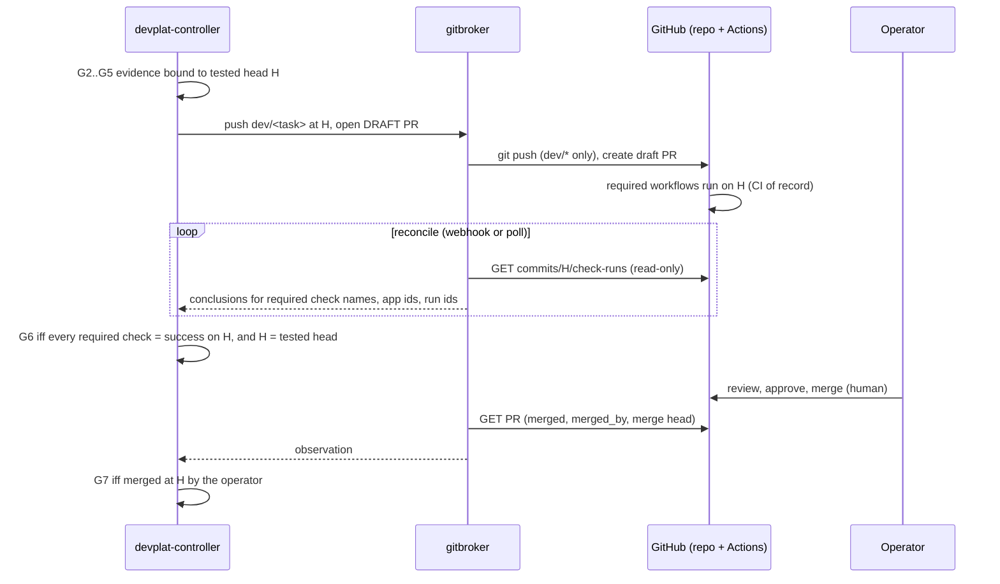

# 23 — CI/CD Integration

Status: **Proposed** (Architecture Amendment 001, 2026-10-17). Documented only. No workflow in this document exists yet; the Project-Mercury repository has no CI and no ruleset today (`14-…` §1).
Reuses / supersedes: keeps v1 `08-…` §1 G6 ("required CI green on that head"), §5 (identity and merge authority), `10-…` §2 (PR template) and §3 (Mercury releases) unchanged. It adds head-SHA correlation for in-cluster evidence, an evaluation of in-cluster runners, and the platform's own CI and release process. RA-D2 (`12-…`: MERC-030 split, macOS runners in Mercury CI) is kept as is.

## 1. Rules

1. **Each repository's GitHub Actions CI is its CI of record.** The ruleset on `main` (DOD-02) names the required checks. Only those checks, plus the operator's approval, let a PR merge.
2. **Platform evidence is additional, never a substitute.** G2/G5 in-cluster runs (`22-…`) feed the controller's gates. They are not required checks, they never satisfy a required check, and a green in-cluster run never outweighs a red CI run.
3. **Both must be green.** The controller records G6 only when (a) its own G2–G5 evidence is bound to head `H`, and (b) the repository's required checks are successful **on the same `H`**.
4. **The platform does not write required checks.** The development bot App never gets `checks: write` for a check name that is required. If the platform ever publishes an informational status, it uses a distinct context (`devplat/evidence`) that the ruleset must not list. Making it required would let the platform certify its own work (v1 "self-certification", `08-…` §1).
5. **CI independence.** If devplat is compromised or down, every project's CI and merge protection keep working unchanged. Hence GitHub-hosted runners are the default (§4).
6. **The platform's own CI does not depend on Mercury or Jupiter** (§5.3).

## 2. Flow and head-SHA correlation

**Correlation rules.**

| # | Rule |
|---|---|
| C1 | The key is the **full 40-hex commit SHA**, never a branch name. Evidence rows store `head_sha`. A PR whose head ≠ the tested head blocks G6, and the task returns to RUNNING if new commits appear (v1 reset rule: G2–G7 cleared, G1 kept) |
| C2 | Required check names come from the **live ruleset** (read through gitbroker), cached with an ETag. A check counts only when its `app.id` equals the expected GitHub Actions App id, so a same-name check posted by another App does not count (Mercury's verification plan applies the same rule to forged checks) |
| C3 | Conclusions: only `success` counts. `neutral`, `skipped`, `cancelled`, `timed_out`, `action_required` and stale runs (re-run superseded) do not |
| C4 | `ci_run` evidence records the run ids, attempt numbers, conclusions and the `head_sha` that GitHub reports for each run |
| C5 | Disagreement: CI red and in-cluster green ⇒ G6 refused, and the failing CI log reaches the next correction attempt **as an evidence file path** (untrusted data, `08-…` §6). In-cluster red and CI green ⇒ G2/G5 not recorded, so G6 is never reached. Flaky either way ⇒ not green (`22-…` §6) |
| C6 | Webhooks (if configured) only wake the reconcile loop. The state decision always comes from a fresh read of GitHub |

## 3. What runs where (per project)

| Check | Mercury (from `verification-plan.md`, RA-D2) | Jupiter | In-cluster counterpart |
|---|---|---|---|
| Lint, typecheck, unit, property (T0) | Mercury CI, Linux **and** macOS runners | Unresolved: from the project configuration and Jupiter's own workflows | G2 re-run (`22-…` §12) |
| Integration T1 (both SQLite drivers) | Mercury CI, **macOS runner** (exit criterion) | Unresolved | Linux part, early feedback only |
| E2E with fakes T2 | Mercury CI | Unresolved | G2/G5 |
| Secret scan, ID lint, dependency scan | Mercury CI | Unresolved | G4 attached scanner evidence |
| T3 sandbox, T4 Mac, T4v, T5 | Not in CI (operator machine; macOS lane) | n/a | `mac_validation` tasks with operator evidence |

## 4. In-cluster self-hosted runners (Actions Runner Controller): evaluation

**ARC** runs GitHub Actions runners as pods: a controller plus runner scale sets, with ephemeral runners.

| Aspect | Finding |
|---|---|
| Container modes | `dind` runs a **privileged** Docker sidecar [S1]. `kubernetes` mode runs each job as a pod through runner-container-hooks: no privileged sidecar, but every job must specify a container, Dockerfile-based actions are unsupported, a work-volume claim is needed, and without an enforced job container the runner pod may get elevated Kubernetes API privileges (create pods, read secrets) [S1] |
| Controller privileges | The ARC controller manager is a singleton with a **ClusterRoleBinding with broad permissions** [S1] |
| Registration credentials | ARC needs a GitHub App or PAT that can register runners. Repository-level runners need repository **administration** permission. That conflicts with DOD-03 (a) (development bot: no `administration`), so it would need a **second App** held only by ARC and created by the operator |
| Who runs on it | Any workflow that targets the runner label, including workflows on `dev/*` pushes that agents wrote. Workflow files are restricted paths, but a test script inside the repo still executes on the runner |
| Public repositories | GitHub's guidance, as quoted by community and vendor docs, is not to use self-hosted runners with public repositories: fork PRs can run arbitrary code [S2] |
| Independence | CI on platform infrastructure makes CI of record depend on the platform. That defeats rule 5 |

**Risks.** Cluster compromise through privileged DinD. Runner pods with API access. Long-lived registration credentials in the cluster. Cross-project interference (shared nodes, caches). Loss of CI when the cluster is down. Mercury needs macOS runners anyway, which ARC cannot provide.

**Recommendation: do not adopt ARC now.** GitHub-hosted runners stay the CI of record for every project and for devplat itself. Reconsider only on a measured need (cost, minutes, special hardware) and only with all of these:
- a **separate cluster or at least a separate tainted node pool and namespace** (`arc-runners`);
- `kubernetes` container mode with the job container enforced;
- ephemeral runners;
- private repositories only;
- a dedicated registration App;
- never for devplat's own CI.

Status: **Documented only (rejected for now).**

## 5. CI for the platform itself (devplat)

### 5.1 Pipeline (proposed workflow `devplat-ci.yml`, path-filtered to `platform/**` while devplat lives in this repository)

| Stage | Job | Tools (pinned) | Gate |
|---|---|---|---|
| Lint | Python lint and format; YAML lint; workflow lint; shell lint | ruff, yamllint, actionlint, shellcheck | Required |
| Unit | Controller state machine (ports of the 30 devorch regression tests, `29-…`), jobspec generator, gitbroker bundle validation, model-gateway budget logic | pytest | Required |
| DB | Migrations up/down on PostgreSQL 16 (service container); `record_event` sole-writer grants; hash-chain verification; idempotency and lease tests | pytest + PostgreSQL 16 | Required |
| Schemas | `platform/schemas/*.json` meta-validate; every `platform/projects/*.yaml` validates against `project-config.schema.json`; contract/result examples validate | jsonschema 4.26.0 | Required |
| Manifests | `platform/deploy/base/**` strict-validated against Kubernetes v1.33 JSON schemas; CRDs (CloudNativePG `Cluster`) against their CRD schemas | kubeconform `-strict`, `platform/tools/validate_k8s.py` | Required |
| Charts | `helm lint`; `helm template` for a values matrix (cnpg/external, ingress on/off, reduced mode, project with/without build) piped into kubeconform; negative cases must fail (empty digest, `draftPullRequestsOnly: false`, unknown key, NetworkPolicy off in standard mode); chart-testing `ct lint` | helm 3, kubeconform, ct | Required |
| Policy | Admission policies applied in a **kind** cluster on the runner; the isolation probes N1–N12 (`22-…` §7) run against a real install with a NetworkPolicy-enforcing CNI | kind + Calico or Cilium | Required before release; nightly |
| E2E | `ct install` of both charts in kind; fake-agent multi-project scenario; controller leader-kill and agent-pod-eviction recovery | kind, fake agent image | Required before release; nightly |
| Images | Build `devplat-controller`, `-api`, `-gitbroker`, `-model-gateway`, `-fake-agent` and toolchain images with BuildKit (buildx) on hosted runners, native per arch where available (`22-…` §9.4) | docker buildx | Required |
| Scan | Image and dependency scan; fail on fixable Critical/High; SBOM | Trivy or Grype, Syft | Required |
| Sign | cosign **keyless** signing via GitHub OIDC (`id-token: write`) on tags only; SBOM and provenance attestations attached | cosign | Release only |

**Workflow hygiene:**
- third-party actions pinned by commit SHA;
- `permissions:` minimal per job;
- no `pull_request_target`;
- no secrets in PR jobs;
- dependency installs without lifecycle scripts where the package manager allows it (v1 `08-…` §6 rule 6).

### 5.2 Validation already possible offline (this authoring environment)

| Check | Result (2026-10-17) |
|---|---|
| `helm lint` both charts | Pass. helm v3.17.3 was built from source through the Go module proxy (checksums verified against `sum.golang.org`), because no helm binary was installed |
| `helm template` + kubeconform v0.6.7 `-strict`, Kubernetes 1.33.0 | devplat: 28/28 valid (CloudNativePG `Cluster` validated against the datreeio CRDs-catalog schema); devplat-project: 17/17 valid; variant matrix valid; 6 negative cases fail as intended |
| `values.yaml` against `values.schema.json` (jsonschema 4.26.0) | 0 errors both charts; negative mutations rejected |
| CEL in admission policies | **Not compiled** (needs an API server) |

### 5.3 Independence from Mercury and Jupiter

1. Platform CI never checks out, builds or tests Mercury or Jupiter code. Fixtures are **synthetic projects** (`example-a`, `example-b`) with a tiny test suite and a fake agent.
2. `platform/projects/mercury.yaml` is **data**. Validating it against the schema is allowed, but platform CI must pass with `platform/projects/` reduced to the synthetic fixtures.
3. No platform workflow is triggered by Mercury paths, and Mercury's workflows ignore `platform/**`.
4. **Repository location** (ADR-030, operator decision DOD-12). devplat lives in `Project-Mercury/platform/` today, on an unmerged branch. ADR-030 recommends a dedicated operator-created repository with its own ruleset and CODEOWNERS. Then a Mercury PR can never change the system that gates it. Until the move, `platform/**` is a restricted path for every Mercury task contract. The same principle is v1 `11-…` rule 2 ("tasks that modify the development-orchestration configuration stay with Stage A").

## 6. Release and versioning of the platform

| Item | Scheme |
|---|---|
| Application version | SemVer `MAJOR.MINOR.PATCH`, pre-releases `-alpha.N` / `-rc.N`. One version for all `devplat-*` images of a release |
| Chart versions | `devplat` and `devplat-project` versioned together. `appVersion` = application version. A chart change without an app change bumps only the chart PATCH |
| Image references | Published with a version tag, **consumed by digest** (`values.yaml` `image.digest`). Release notes list each digest with `verified_platforms` |
| DB schema | Forward-only numbered migrations. The controller refuses to start if the schema version is newer than it knows. A release states the minimum version it can upgrade from (N-1 minor) |
| Wire schemas | Contract/result schemas and the project-config `apiVersion` (`devplat.io/v1alpha1` → `v1beta1` → `v1`) are versioned independently of the app; the API serves old versions for one minor release |
| Compatibility matrix | Kubernetes minors (initially 1.30–1.33, by the VAP GA requirement), CloudNativePG versions, gVisor availability per profile (`25-…`) |
| Release steps | 1. Release PR (CHANGELOG, versions) through normal review and G1–G7. 2. Operator merges. 3. **Operator** creates the signed tag (as v1 `10-…` §3). 4. Tag workflow builds, scans, signs and publishes images and charts (OCI chart registry, e.g. `oci://ghcr.io/OWNER/charts`). 5. Upgrade rehearsal in the CI kind cluster (N-1 → N, then rollback, `24-…` §6). 6. Operator upgrades installations |
| Agent role definitions | `.claude/agents/mdev-*.md` are versioned with the repository that owns them (Mercury, for Mercury's roles). The platform records the definition's content hash per Job, so role changes and platform releases are independent |

## 7. Capability status

| Capability | Status |
|---|---|
| Repository CI of record (Mercury) | **Awaiting operator approval** (MERC-030 / RA-D2; DOD-02 ruleset) |
| Head-SHA correlation and G6 rule | **Documented only** (the v1 equivalent is implemented in `devorch.py` `pr_prepared` requiring `ci_run` evidence) |
| devplat CI workflow | **Documented only** |
| Offline chart and manifest validation | **Implemented+tested** in the authoring environment (§5.2); not yet wired into CI |
| Image build, scan, sign pipeline | **Documented only.** No images exist |
| ARC in-cluster runners | **Documented only; not recommended** |
| Separate devplat repository | **Awaiting operator approval** (ADR-030, DOD-12) |

## 8. Open questions

1. **O-1:** Timing of the repository move (ADR-030 / DOD-12): before devplat coordinates any task, or after Mercury Stage A?
2. **O-2:** Should gitbroker publish an informational `devplat/evidence` commit status? This needs `statuses: write` on the development bot App. Recommendation: not in Phase 1.
3. **O-3:** OCI chart registry and image registry owner (GHCR under the operator's account or an organization, linked to G-ORG in `08-…` §5).

## Sources (accessed 2026-10-17; untrusted web content, used as data)

- [S1] Actions Runner Controller container modes and RBAC, as summarised from GitHub's ARC documentation and the ARC repository (`actions/actions-runner-controller`) via search results; GitHub docs could not be fetched directly from this environment.
- [S2] GitHub community thread "Self-hosted runner security with public repositories": <https://github.community/t/self-hosted-runner-security-with-public-repositories/17860>; Microsoft Learn, "Explore runners": <https://learn.microsoft.com/en-us/training/modules/introduction-to-github-actions/8-explore-runners>.
