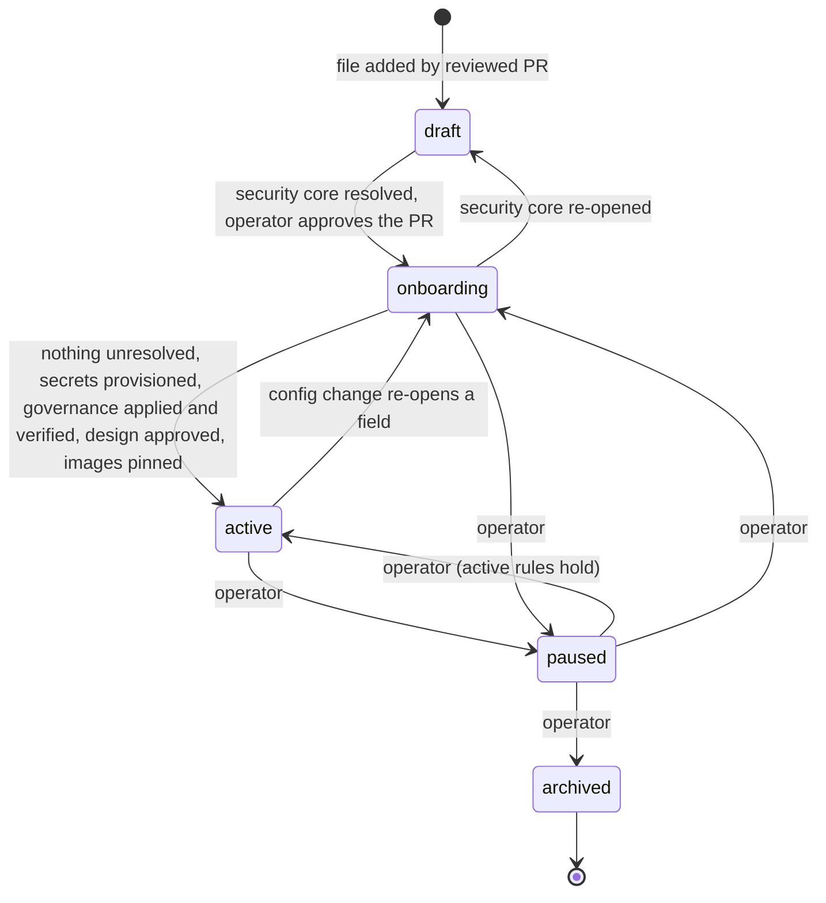

# 26 — Project Configuration Contract, Mercury Configuration and Jupiter Onboarding

Status: **Proposed** (Architecture Amendment 001, 2026-10-17; R6 fix round 2026-10-20; awaits operator approval, `12-amendments.md` DOD-11…DOD-24 and ADR-029). Schema (`devplat.project.v1`, minor 2) and both configurations are **Implemented+tested** as files: they validate with `jsonschema` 4.26.0 and `platform/tools/validate_projects.py`, whose self-test (50 checks, including the role-catalogue consistency checks) passes (§4). Nothing reads them at runtime yet: the controller and the config renderer are **Designed, unverified** (not built).
Reuses / supersedes: **supersedes** the Mercury-specific hard wiring of v1 (`tools/devorch/assignments.json` paths and agent mapping, the `restricted_paths` written by hand into each contract, the WIP limits in `09-…` §2, the branch rules in `06-…` §2) by **one versioned file per project**. **Keeps** the v1 rules themselves: the gates G1–G7 (`08-…` §1), the contract and result schemas (`04-…`), the path-scope rule "an allowed path may not fall inside a restricted path" (`04-…` check-contract 6), draft-only PRs and human merge (`08-…` §5). Schema: `platform/schemas/project-config.schema.json`. Files: `platform/projects/mercury.yaml`, `platform/projects/jupiter.onboarding.yaml`. Validator: `platform/tools/validate_projects.py`.

---

## 1. The contract

### 1.1 What a project configuration is, and what it is not

A **project configuration** says *what a project is and how devplat may build it*. It is the only place devplat reads project facts from. The platform code contains no project literal (`15-…` P7; acceptance test AT-01).

| Object | Holds | Not |
|---|---|---|
| Project configuration (`platform/projects/<id>.yaml`, `devplat.project.v1`) | Repository, tracker, documents, toolchain, test levels, environments, quotas, network classes, secret **names**, restricted paths, per-role path scopes, gates, reviewers, approvers, budgets, execution target | Not a task, not a role definition, not an image, never a secret value |
| Role definition (`.claude/agents/mdev-*.md`) | What a specialist does and must not do | **Not project-neutral**: the 12 definitions were written for Mercury and v1 (main session, devorch CLI, Mercury doc paths). They stay unchanged in the repository; in a Job they are delivered with the fixed devplat runtime preamble that overrides the v1 mechanics, followed by a project section generated from this configuration that overrides project-specific documents and paths (`16-…` §9.1, R6 D23/A-05). Direction (R6 dispositions A-05, subject to the operator's review of this package): project-neutral catalogue bodies plus the generated section, not per-project definitions |
| Platform role catalogue (`platform/agents/execution-profiles.yaml`) | Roles, the kind→role map and per-role execution profiles (resources, wall time, network class, runtime class, writes) | Not project facts. A project only **enables** catalogue roles and may **lower**, never raise, a profile value (R6 D6) |
| Task contract (`devplat.task_contract.v2`; v1 for local mode) | One task's objective, `allowed_paths`, tests, reviewers, required facts, base commit | Must lie inside the project's path scopes and outside its restricted paths |

### 1.2 Field groups

The schema is strict: `additionalProperties: false` at every level, so a misspelt or unknown field is an error, not a silent default.

| Group | Fields | Consumed by | May be `unresolved` in |
|---|---|---|---|
| Identity | `schema`, `schema_minor`, `project_id` (≤ 24 characters, R6 D24), `display_name`, `status` (draft, onboarding, active, paused, archived), `config_version`, `verified{date, by, sources}` | all | never |
| Source | `source_repository{url, default_branch, protected_branches, visibility, owner_kind}` | gitbroker, controller | draft only (url, default branch, owner kind) |
| Tracking and documents | `issue_tracker` (Linear team/project with `write_mode` and, for any write, `write_fact`; `none`; or unresolved), `documentation{requirements, design, adr, runbooks, test_plan, design_approval}`, `architecture_constraints`, `coding_standards` | controller (G1 design refs), planner, Linear adapter | draft, onboarding |
| Build | `languages`, `toolchains`, `container_images` (digest-pinned or unresolved; verified platforms only), `test_levels[]` with `commands{build, lint, typecheck, test, scan, deployment_validation}` per level, `required_tooling` | controller (G2 re-run), build Jobs | draft, onboarding |
| Environments | `environments[]`: `kubernetes_exec`, `kubernetes_build`, `kubernetes_ephemeral_test`, `github_hosted_ci`, `external_lane` (e.g. macOS, with `task_kinds` and `readiness`) | controller scheduler | draft, onboarding |
| Capacity | `resources{default_job, namespace_quota, max_concurrent{jobs, implementation, review, external_lane, open_prs_awaiting_human}, priority_weight}`, `budgets{cost_usd_per_day, tokens_per_day, stop_dispatch_at_fraction, max_wall_minutes_per_job}` | controller admission, model-gateway, chart | draft, onboarding |
| Network | `network{model_providers, classes_allowed, registries_allowlist, extra_egress (must be empty)}` | NetworkPolicy, registry proxy, model-gateway | providers and classes: draft only; allowlist: draft, onboarding (unresolved = empty = **deps denied**) |
| Identities | `identities{github_app, secrets[]}` — each `{name, purpose, holder, scope, provisioning}`; `holder` ∈ gitbroker, model-gateway, controller, api, test-namespace, external-lane — **never an agent Job** | gitbroker, model-gateway, chart | github_app: draft only |
| Security core | `security{restricted_paths, security_sensitive_paths, escalate_paths, runtime_class, pod_security (= restricted), untrusted_inputs, reduced_assurance?}`, `agent_permissions.roles{<catalogue role>: enabled, writes, path_scopes, task_kinds, network_class, max_concurrent}` | gitbroker validation, controller contract checks, admission | **draft only** |
| Governance | `review_gates{gates G1–G7 (G7 always required), required_reviewers, human_approvers, human_approver_rule (= repository_owner), hard_preconditions (⊇ DOD-02, DOD-13), external_gates}`, `github_policy{pr_mode (= draft), branch_prefix, branch_pattern, base_branch, merge_by (= human), agent_may ⊆ {push_branch_prefix, open_draft_pr, comment}, ruleset, codeowners, required_ci_contexts, commit_trailers}` | controller gates, gitbroker | **draft only** (except `required_ci_contexts`, `ruleset`/`codeowners` state) |
| Output | `artifacts{bucket = devplat-<id>, retention_days}`, `deployment_targets[]` (purpose `deployment_validation` only; `production: true` ⇒ `automated: false` and a recorded approval) | artifact store, controller | draft, onboarding |
| Placement | `execution_target{cluster_ref, namespace_prefix = proj-<id>}`, `cross_project_dependencies[]` | controller, chart | never |

Several properties are **constants in the schema** so that a project file cannot weaken them: `pr_mode: draft`, `merge_by: human`, `human_approver_rule: repository_owner`, `G7.required: true`, `pod_security: restricted`, `extra_egress: []`, `hard_preconditions` must contain `DOD-02` and `DOD-13`, `reduced_assurance.builds: disabled`, and the closed `agent_may` list, which has no value for approve, merge, auto-merge, mark-ready or settings changes. The `agent_may` list constrains what gitbroker *does*; it is not a GitHub permission: with `contents:write` + `pull_requests:write` the App **can** merge and approve through the API, so the per-repository ruleset verified as the `DOD-02` fact is the preventive control (R6 D13).

### 1.3 Value markers

| Marker | Meaning | Example |
|---|---|---|
| `{unresolved: "<question>", owner?, blocks?}` | The value is unknown. The text is the question to ask; `blocks` says what cannot happen until it is answered | Mercury's Linear project |
| `{planned: "<what>", ref: "<design ref>", runner?}` | The command or job is designed but does not exist in the repository yet | Mercury `tsc --noEmit` (no `package.json` exists) |
| `{not_applicable: "<why>"}` | The command does not apply at this level | deployment validation at T0 |
| `{run: [argv], timeout_minutes?}` | An executable command that exists | — (none yet for Mercury) |

### 1.4 Status lifecycle

| Status | May run | Validator rule |
|---|---|---|
| `draft` | Nothing. No namespace, bucket, secret or App is created | Schema only; any field may be unresolved except identity and placement |
| `onboarding` | Tasks may be created. Only **SHORT read-only kinds** are dispatched: `planning`, `plan_proposal`, `*_review`, `operator_action`, `mac_validation` (R6 D4); nothing is pushed. `design` is a FULL-lifecycle kind and waits for `active`. Namespaces may be rendered | Security core resolved: source url/branch/owner kind, `security.*`, `review_gates.*`, governance constants, `execution_target`, `identities.github_app`, network providers and classes; every **enabled** role has resolved path scopes; at least one role enabled; every required reviewer enabled |
| `active` | All task kinds. FULL-lifecycle dispatch and every push additionally need this project's hard-precondition facts (`review_gates.hard_preconditions`, default `DOD-02`, `DOD-13`), recorded **for this project** by an allowlisted operator identity; a platform-wide fact never counts (R6 D1, D2) | No `unresolved` anywhere; every secret `provisioned`; ruleset and CODEOWNERS `applied_verified`; `design_approval: approved`; no Kubernetes test level whose command is only `planned` |

| `paused` | No new admission; running Jobs finish | Same as `onboarding` (security core resolved) |
| `archived` | Nothing; records stay readable | Same as `onboarding` |

The DB mirrors these five statuses (`19-…`). The controller's admission re-applies the same rules at every dispatch (a stale or tampered registry checkout cannot promote a project). Status changes are operator-approved PRs to the registry.

### 1.5 Validation

Rules applied by `platform/tools/validate_projects.py` (exit 0 = valid, 1 = violation, 2 = environment error):

1. Draft 2020-12 metaschema check of the schema, then schema validation of each file with format checking.
2. Status rules of §1.4.
3. Cross-field rules: file stem = `project_id`; `namespace_prefix = proj-<project_id>`; `bucket = devplat-<project_id>` (artifact layout, R6 D11); unique environment and test-level ids; every test level names a declared environment; a read-only role (`writes: false`) has `path_scopes: []`; **no role path scope falls inside `restricted_paths`** (devorch check-contract rule 6, same glob semantics); required reviewers are declared roles; unique `project_id` and `namespace_prefix` across the registry.
4. **Role catalogue** (R6 D6): every role key is a role of the platform catalogue; its `task_kinds` are kinds the catalogue gives it; a role whose catalogue kinds are all read-only cannot have `writes: true`; required reviewers are roles of a gated review kind. The catalogue itself is checked for consistency (every profile's kinds equal the catalogue's, every Job executor has a profile, review kinds are read-only, non-Job kinds name only `operator` / `mac-validation-queue`).
5. **Preconditions and assurance** (R6 D1, D16): a hard-precondition key is not repeated in `external_gates`; `runtime_class: default` requires `security.reduced_assurance`, which forbids `kubernetes_build` environments and needs a sandbox repository other than the source repository.
5a. **Linear writes** (minor 2; replaces the platform-wide DOD-05): `issue_tracker.write_mode` other than `read_only` requires `write_fact`, `read_only` forbids it, and `write_fact` must not be a hard-precondition key. The controller passes it to `upsert_project(..., p_linear_write_fact)`; the outbox (`_enqueue_outbox`) refuses a `linear` side effect until an allowlisted operator has recorded that fact **for this project** (`19-…` T07 `test_linear_writes_need_configured_project_fact`).
5b. **`.github/**` restricted** for every non-draft project (CI hardening H8, R6 D13).
6. **No secret values**: any string that looks like a PEM private key, an Anthropic, OpenAI, GitHub, Slack, AWS or Linear token is refused.
7. `--self-test`: 43 mutations of the first non-draft file (status promoted with unresolved values; unresolved runtime class, restricted paths or approvers; PR mode not draft; `merge` added to `agent_may`; agent merge; G7 optional; approver rule changed; image by tag; role scope inside a restricted path; read-only role with a scope; token and private key in text; a `value` field on a secret; a secret held by an agent Job; wrong namespace; unknown environment; automated production deployment; unknown top-level field; wrong schema id; pod security relaxed; extra egress; R6: old bucket name, project id of 25 characters, unknown network class, unknown status, paused with an unresolved security core, hard preconditions without DOD-13 or missing, a hard precondition duplicated as an external gate, a role outside the catalogue, a task kind the catalogue does not give, a read-only role made writable, a reviewer without a gated kind, no sandbox runtime without reduced assurance, reduced assurance with builds, on the real repository, or with `builds: enabled`) plus 5 catalogue mutations. Each must be rejected **for its expected reason**; the unmutated file and catalogue must pass.

The platform repository's CI runs both commands on every PR that touches `platform/projects/` or the schema (**Documented only**: no CI exists yet).

### 1.6 Versioning and migration rules

1. `schema` carries the **major** version (`devplat.project.v1`). A breaking change (removed or renamed field, narrowed type, new required field without a default) creates `devplat.project.v2`.
2. `schema_minor` counts **additive** changes (a new optional field or a new enum value that no existing file uses). Because the schema rejects unknown fields, a reader must support the file's minor: the controller refuses a file whose minor is newer than its own.
3. During a major migration the controller accepts **N and N-1** (same rule as Mercury's message envelopes, TDD §10). A migration script converts files; the converted files are reviewed PRs, never rewritten in place by the controller.
4. `config_version` is the revision of one file. Every change bumps it. Each task event records the `config_version` it was admitted under, so a later tightening never re-legitimises an earlier admission and a loosening never applies retroactively.
5. **Tightening** (more restricted paths, fewer roles, lower budget) takes effect at the next admission; running Jobs finish under their admitted version, and their results are checked against the **stricter** of the two versions at result application (same "guards run twice" idea as Mercury ADR-011).
6. **Loosening** any security-core field needs an operator-approved PR **and** a Security Engineer review (`security_review` subtask on the registry PR).
7. Constants (§1.2) can only change through a new schema major, a Security review and an ADR.

### 1.7 How the configuration becomes Kubernetes resources (devplat-project chart)

A **config renderer** (part of the controller release; **Documented only**) turns a validated project file into the values of the `devplat-project` chart (`platform/deploy/charts/devplat-project/`, whose `values.yaml` header states it is generated from the project configuration). Nothing is hand-edited per project.

| Project config | Chart value / Kubernetes object |
|---|---|
| `execution_target.namespace_prefix` | `project.namespacePrefix` → Namespaces `<prefix>-exec`, `<prefix>-build`; label template for ephemeral `<prefix>-t-<runid>` (created and deleted by the controller) |
| `execution_target.cluster_ref` | `project.clusterRef`: the release is installed in that cluster (topology C = another value, no code change) |
| `resources.namespace_quota`, `resources.default_job` | `exec.quota`, `exec.limits`, `build.quota`, `test.quota` → `ResourceQuota` and `LimitRange` per namespace (backstop to controller admission, `17-…`) |
| `resources.max_concurrent.*`, `priority_weight`, `budgets.*` | Controller admission tables and model-gateway budgets (not chart values) |
| `security.runtime_class` | `exec.requiredRuntimeClassName` → admission policy rejecting pods without it (except reduced-assurance mode) |
| `security.pod_security` | Pod Security Admission label `enforce: restricted` on exec and test namespaces |
| `network.classes_allowed`, `registries_allowlist` | `registryProxy.enabled` and the upstreams of this project's own read-only proxy `devplat-registry-proxy-<id>` (R6 D14); NetworkPolicies allowing devplat-dns, model-gateway, artifact-gateway, gitbroker-fetch and (class `deps`) that proxy only; default deny otherwise |
| `network.model_providers` | model-gateway route table for this project (keys stay in the gateway) |
| `identities.*` | Names of Secrets mounted **only** by the listed holder (gitbroker, model-gateway, or a test namespace for T3-like levels); never mounted in exec namespaces |
| `environments[kind=kubernetes_ephemeral_test]` with `needs_secrets` | A separate test class whose namespace gets those Secrets and its own egress policy (`test.*` in the chart) |
| `artifacts.bucket`, `retention_days` | Bucket `devplat-<id>` and lifecycle policy in the store; pods upload only through `devplat-artifact-gateway` with one-time tokens scoped to `runs/<job-uid>/` (R6 D10) |
| `review_gates.hard_preconditions`, `external_gates` | Controller admission (precondition keys) and DB `task_required_facts` (not chart values) |
| `security.reduced_assurance` | Admission accepts `runtime_class: default` for this project only with its `REDUCED-ASSURANCE` fact; gitbroker uses the sandbox repository; model-gateway uses the separate key; build environments are not rendered (R6 D16) |
| `agent_permissions.roles` | One ServiceAccount per project with zero RBAC (`<id>-agent`); role enablement is enforced by the controller, not by RBAC |

A project in `draft` renders nothing. A project in `onboarding` may render namespaces with quota 0 for implementation Jobs.

### 1.8 Binding agent roles to a project

The **effective permission** of a Job is the intersection of four things, checked by the controller at contract creation and by gitbroker at result validation:

1. **Role definition**: the specialist's own restrictions (`.claude/agents/mdev-*.md` plus the devplat runtime preamble, mounted read-only from a ConfigMap).
2. **Catalogue entry and execution profile**: the kinds the role may execute; resources, wall time, network class, runtime class (`platform/agents/execution-profiles.yaml`).
3. **Project role entry**: `enabled`, `writes`, `path_scopes`, `task_kinds`, an optional lower `network_class` and `max_concurrent`.
4. **Contract**: `allowed_paths` ⊆ the role's `path_scopes`; `restricted_paths` ⊇ the project's `security.restricted_paths`; `security_sensitive: true` whenever `allowed_paths` intersect `security_sensitive_paths` (then G4 runs at full depth by a fresh Security Engineer instance); `escalate_paths` only when named explicitly.

A role absent from the project or with `enabled: false` cannot be assigned. A read-only role gets `allowed_paths: []` and gitbroker rejects any commit from it.

### 1.9 Onboarding a project without changing controller code

1. **Discovery** (agent or operator): fill the discovery checklist (§3.2 is the template). Record every source.
2. **Draft**: add `platform/projects/<id>.yaml` with `status: draft`; every unknown is `unresolved` with its question. Validate. Open a draft PR to the registry; the operator reviews and merges.
3. **Operator answers**: the operator answers the questions; each answer is a reviewed PR that bumps `config_version`.
4. **Operator-only setup**: create the repository (if new), apply the ruleset, CODEOWNERS and the CI hardening of DOD-02 (read-only default workflow token, Actions may not create or approve PRs, `dev/**` workflows without secrets, tag and release rulesets; R6 D13), install the dev bot GitHub App on that repository only, create the Secrets named in `identities`, set the budget. Record each as an OIDC-authenticated operator fact **for this project** in `devplat-api` (`DOD-02`, `DOD-13`, R6 D1).
5. **Onboarding**: once the security core validates, change `status: onboarding` (reviewed PR plus a Security review). The renderer installs the `devplat-project` release; SHORT read-only Jobs (planning, planner proposals, reviews) may run.
6. **Images**: a build Job produces the toolchain and agent images; their digests are recorded in `container_images` after a scan and operator approval of the digest.
7. **Active**: when the validator reports zero unresolved and every `active` rule holds, change `status: active` (reviewed PR). The first implementation task must reach G7 before concurrency is raised above 1.

No step edits controller, gitbroker, gateway or chart code.

---

## 2. The Mercury configuration (`platform/projects/mercury.yaml`)

### 2.1 Status: `onboarding`, not `active`

Mercury cannot be `active` today: the TDD is not approved for implementation (TDD §32.3; DOD-01), no `package.json` or source exists, the `main` ruleset with CI hardening (DOD-02) and the development bot App (DOD-13) are not recorded as Mercury facts, and the daily budget (DOD-08) is not set. The **security core is fully resolved** (validator: `security-core=0`), so SHORT read-only Jobs (planning, planner proposals) could run once the platform exists; `design` tasks wait for `active` (R6 D4). 22 values are unresolved and 17 commands are `planned`.

### 2.2 Source of each value

| Field | Value | Source |
|---|---|---|
| `source_repository.url` | `https://github.com/usjbro/Project-Mercury` | `git remote -v`. Design docs spell it `usjbro/project-mercury` (GitHub names are case-insensitive) |
| `default_branch`, `protected_branches` | `main`, `[main]` | `14-…` §1; DOD-02 |
| `visibility`, `owner_kind` | public, user | TDD §4; `operations/macos-service.md` §15.1 ("public repo"); `08-…` §5 (personal repository → G-DETECT) |
| `issue_tracker` | **unresolved** | No Mercury Linear project or issue exists (`14-…` §1). Linear team `JAM` belongs to the target repository `network_monitor`, not to Mercury's own development |
| `documentation.*` | TDD, components, state-machine, messages, traceability, threat model, verification plan, recovery, macOS service, ADR folder | TDD single-source table |
| `design_approval` | `awaiting_operator` | TDD §32.3; DOD-01 |
| `architecture_constraints`, `coding_standards` | components.md §1–§2 (D1–D7), TDD §6, ADR-001…020, S1–S4; ADR-001 item 3; `06-…` §3 | as cited |
| `languages` | TypeScript 5.x strict; Node.js 24 LTS; SQLite via `node:sqlite` (fallback `better-sqlite3`) | components.md §1; ADR-001; ADR-002 |
| `toolchains` | node (patch **unresolved**), typescript 5.x, ajv 8, smol-toml (pin **unresolved**), Claude Agent SDK (pin **unresolved**), test stack (**unresolved**: "node:test or Vitest"), Codex CLI 0.162.x (production only; FakeCodex in Kubernetes) | components.md §1; TDD §4; ADR-005 |
| `container_images` | both **unresolved** (no image built; must be digest-pinned) | `15-…` §6 (agent image by digest) |
| `test_levels` | T0, T1, T1-mac, T2, T3, T4, T4v, T5 | verification-plan §2.1 tiers; commands `planned` from macos-service §15.1 CI jobs (lint, typecheck, test-unit, test-integration, test-contracts, test-wrappers, test-macos) and MERC-030; T4/T4v/T5 are operator-run |
| `environments` | k8s-exec, k8s-test (T0–T2), k8s-sandbox (T3), gh-hosted-macos (T1-mac), macos-lane (T4), macos-vm-lane (T4v, host **unresolved**) | verification-plan §2.1, §2.3, §2.5; macos-service §15.1 ("GitHub-hosted runners only"); `09-…` §1. No `kubernetes_build`: toolchain and agent images are built in devplat CI (`22-…` O-5, config_version 3) |
| `resources.max_concurrent` | 5 Jobs = 3 implementation + 2 review; 1 external lane; ≤ 4 open PRs awaiting the operator | `09-…` §2 |
| `resources.default_job`, `namespace_quota`, `priority_weight` | **unresolved** | no measurement exists (`09-…` §4) |
| `network.model_providers` | `[anthropic]` | Development agents are Claude Code. Real Codex runs only in the Mac-lane contract-recording suite (verification-plan §2.4) |
| `network.registries_allowlist` | **unresolved** → deps class effectively denied | ADR-005 item 7 and FR-123 require an allowlist but name no host |
| `identities.github_app` | `devplat-github-app-mercury`, held by gitbroker, `awaiting_operator` | DOD-13 (replaces DOD-03 (a) in Kubernetes mode). Not `mercury-bot`: separation rule S1–S2. The scope note records that the App could merge/approve via the API and that the ruleset prevents it (R6 D13) |
| `identities.secrets` | Anthropic key (gateway), three T3 sandbox credentials (test namespace), all not created | DOD-08; verification-plan §2.3 (sandbox Apps, Linear team `MSB`) |
| `security.restricted_paths` | `.claude/**`, `CLAUDE.md`, `.mcp.json`, `.codex/**`, `.agents/**`, `AGENTS*.md`, `tools/devorch/**`, `platform/**`, `.git/**`, `docs/**`, `.github/**` (`.github/**` is required for every non-draft project by CI hardening H8, R6 D13; `docs/**` is a **recommended default pending DOD-23**, not a decision) | CLAUDE.md (design docs only by approved amendment); guard hook PATH_DENY; example contracts (`docs/**`, `.github/**`); SEC-310 instruction-file classes; ADR-030 (`platform/**` is not Mercury's) |
| `security.security_sensitive_paths` | process, git, keychain, presence and GitHub adapters; redaction policy; decision recorder; guards; migrations; `packaging/agent/**`; `package.json` and lockfile | `gen_agents.py` role 07 scope; components.md §2 D6 and INV-18; `06-…` §4 (lockfile = supply chain) |
| `security.escalate_paths` | `src/ports/**` | `06-…` §4 (frozen interfaces), RA-D3 |
| `security.runtime_class` | `gvisor` | recommended (ADR-023 proposed; awaits DOD-11) |
| `agent_permissions.roles` | 12 specialists + `planner`, all catalogue roles; path scopes copied from each role's scope in `tools/devorch/gen_agents.py`; reviewer, TPM and planner read-only; task kinds as the catalogue gives them (DevOps `implementation, release`; Reliability without `mac_validation`, which is the operator lane's kind) | `03-…`, `gen_agents.py`, catalogue |
| `review_gates` | G1–G7 as in `08-…` §1; reviewers code + security on every task (TDD DoD D6), plus Lead Architect for interfaces; operator for root artefacts (DOD-06); approver `usjbro`; **hard preconditions `DOD-02`, `DOD-13`** (Mercury-scoped facts, R6 D1); external gates G-S1…G-S5 and DOD-01 as Mercury operator facts | `08-…` §1–§2; ADR-008; github.md §9.4 O2 |
| `github_policy` | draft PRs; `dev/` prefix; branch pattern from `06-…` §2; trailers from `06-…` §3; ruleset and CODEOWNERS `awaiting_operator`; required CI contexts **unresolved** | `06-…`, `08-…` §5, DOD-02, MERC-030 |
| `artifacts` | bucket `devplat-mercury`; `retention_days` **unresolved** (v1 keeps evidence permanently on `devorch/state`) | `20-…` (R6 D11); `06-…` §1 |
| `budgets` | cost/tokens/wall **unresolved**; stop dispatch at 0.8 | DOD-08; `09-…` §5 |
| `deployment_targets` | one production target (operator's Mac LaunchAgent), `automated: false`, operator-only | TDD §18, §24. devplat never deploys Mercury |
| `execution_target` | `{default, proj-mercury}` | `15-…` §3 |

### 2.3 Mercury questions for the operator

| ID | Question | Field | Blocks |
|---|---|---|---|
| Q-M1 | Which Linear team/project holds the MERC backlog, and when may it be imported (DOD-05)? | `issue_tracker` | Linear reconciliation; nothing else (DAG comes from `data/dag.json`) |
| Q-M2 | Exact Node 24 patch, `smol-toml` and Agent SDK pins | `toolchains` | Toolchain image, every Kubernetes test level |
| Q-M3 (= DOD-23) | `docs/**` and `.github/**` are **restricted** for every agent role here (recommended default). v1 gave the DevOps role `.github/workflows/**` (MERC-030, RA-D2) and the Lead Architect proposed ADRs under `docs/`. Should either become a role scope (it would move to `escalate_paths` with full G4), or stay operator-only? | `security`, `agent_permissions` | MERC-030 as an agent task; ADR proposals as agent tasks |
| Q-M4 | Test stack: `node:test` or Vitest (components.md §1 leaves both) | `toolchains` | Test commands |
| Q-M5 | Registry allowlist: is `registry.npmjs.org` the only host? | `network.registries_allowlist` | Dependency installs in Jobs |
| Q-M6 | Which secret scanner and version for development CI (SEC-502)? | `required_tooling` | `scan` commands |
| Q-M7 | Which CI job names become required checks on `main`? | `github_policy.required_ci_contexts` | G6 |
| Q-M8 | Quota and fair-share weight for Mercury on the chosen cluster (DOD-15) | `resources` | `active` |
| Q-M9 | Daily cost cap (DOD-08), optional token cap, per-Job wall ceiling | `budgets` | `active` |
| Q-M10 | Evidence, log and cache retention | `artifacts` | `active` |
| Q-M11 | Which Apple Silicon host runs the T4v power-loss VM (P0-047)? | `environments` | TC-REC-020 |

---

## 3. Jupiter onboarding specification

**Facts (discovery 2026-10-17).** No Jupiter repository among the 8 repositories visible to the connected GitHub account; no Linear project or issue; no Notion page; no document in any branch of this repository. `platform/projects/jupiter.onboarding.yaml` therefore has `status: draft` and **53 unresolved values**; every resolved value is a platform invariant or a platform naming convention (marked "platform" in the file). Nothing about Jupiter's language, stack, purpose or requirements is assumed.

### 3.1 Questions the operator must answer

| ID | Question | Why it matters | Field(s) |
|---|---|---|---|
| Q-J01 | Is Jupiter a separate software project to be built on devplat? Confirm the id `jupiter` and its display name | Without a project there is nothing to onboard; delete the file if not | `project_id`, `display_name` |
| Q-J02 | Which GitHub repository? Will the operator create it, under a user or an organization? | Gitbroker needs it; organization enables preventive operator-only merge (G-ORG) | `source_repository.url`, `owner_kind` |
| Q-J03 | Default, protected and PR base branches | Ruleset target; G6 base | `default_branch`, `protected_branches`, `github_policy.base_branch` |
| Q-J04 | Public or private? | Publication of review findings; CI runner options | `visibility` |
| Q-J05 | Issue tracker (Linear team/project or none); may devplat write to it? Issue-key format for branch names | Backlog source; Linear adapter mode | `issue_tracker`, `branch_pattern` |
| Q-J06 | Where are requirements, design, ADRs and runbooks? Who approves the design, and which commit? | G1 needs approved design refs | `documentation.*` |
| Q-J07 | Architecture constraints (runtime platform, data stores, external services, compliance) | Reviews check against them | `architecture_constraints` |
| Q-J08 | Languages, toolchains with pinned versions, coding standards, required tooling | Toolchain image, lint and build commands | `languages`, `toolchains`, `coding_standards`, `required_tooling` |
| Q-J09 | (DevOps after Q-J08) toolchain and test images, target platforms | Digest-pinned images | `container_images` |
| Q-J10 | Test levels and the exact build/lint/test/scan/deployment-validation commands; test plan; required CI checks | G2 re-runs these commands | `test_levels`, `documentation.test_plan`, `required_ci_contexts` |
| Q-J11 | Does any test need something Kubernetes cannot provide (macOS or Windows host, GPU, hardware device, real external service)? | Becomes an `external_lane` like Mercury's macOS lane | `environments` |
| Q-J12 | Expected Job size, quota share and fair-share weight relative to Mercury; concurrency caps | Admission and ResourceQuota | `resources` |
| Q-J13 | How many Jupiter PRs can the operator review at once, in addition to Mercury's? | Human queue (RISK-22 equivalent) | `max_concurrent.open_prs_awaiting_human` |
| Q-J14 | Which model providers may agents use; which package registries do builds need? | Gateway routes; registry proxy allowlist | `network` |
| Q-J15 | Install the dev bot App on the Jupiter repository only? Which external credentials (names only) do tests need, and in which namespace? | Secrets inventory; holder rules | `identities` |
| Q-J16 | Paths no agent may change; security-sensitive paths; escalate-only paths | Gitbroker validation; G4 depth | `security.*` |
| Q-J17 | Which of the 12 roles apply, and with which path scopes? | Role binding (§1.8) | `agent_permissions.roles` |
| Q-J18 | GitHub login of the repository owner who alone approves and merges | G7 | `review_gates.human_approvers` |
| Q-J19 | Any project-specific gate (hardware sign-off, compliance review)? | External gates as operator facts | `review_gates.external_gates` |
| Q-J20 | Apply the same ruleset and CODEOWNERS as Mercury's DOD-02 before any code task? | Real merge control | `github_policy.ruleset`, `codeowners` |
| Q-J21 | Evidence, log and cache retention | Artifact lifecycle | `artifacts.retention_days` |
| Q-J22 | Daily cost cap (separate from Mercury), token cap, per-Job wall ceiling | Model-gateway budget | `budgets` |
| Q-J23 | Does Jupiter deploy anywhere? Which target may be used for deployment validation only? | Production deployment is never automated | `deployment_targets` |
| Q-J24 | Does Jupiter need its own cluster or node pool (data residency, hardware, isolation requirement)? | Topology C by config | `execution_target.cluster_ref` |

### 3.2 Discovery checklist

| # | Source | Searched on 2026-10-17 | Result | Re-run when |
|---|---|---|---|---|
| D1 | GitHub repositories visible to the account | Full list (8): Project-Mercury, network_monitor, autoclicker, not-the-auto-clicker-game, 100dayspython-udemy, 100days_python, redesigned-giggle, reticulating_spline | No Jupiter repository | Operator names or creates it |
| D2 | This repository, all branches | Text search | No Jupiter document | Any new branch |
| D3 | Linear projects and issues | Search "Jupiter" | None | Q-J05 answered |
| D4 | Notion | Search "Jupiter" | None | Operator points to a page |
| D5 | Repository content (once it exists) | — | Pending | Q-J02 answered: read README, build files, CI workflows, CODEOWNERS, rulesets (read-only) |
| D6 | Toolchain detection | — | Pending | After D5: lockfiles, manifests, `Dockerfile`, CI images → **proposals** for Q-J08–Q-J10, confirmed by the operator, never adopted silently |
| D7 | Secrets inventory | — | Pending | After D5: list secrets referenced by CI (names only) → Q-J15 |
| D8 | Governance state | — | Pending | After D5: ruleset, CODEOWNERS, collaborators (read-only) → Q-J20 |

Discovery is read-only and runs as a `planning` task; its result is a proposed config diff, never a direct edit.

### 3.3 Onboarding steps for Jupiter

The general procedure of §1.9 applies. Jupiter-specific order: Q-J01 first (if Jupiter is not a separate project, delete the draft); then Q-J02–Q-J06 (repository and documents); then discovery D5–D8 to propose answers for Q-J07–Q-J17; then the operator-only setup (repository, ruleset, App installation, Secrets, budget); then `onboarding`; then images; then `active`.

### 3.4 Acceptance criteria

**draft → onboarding** (all must hold; checked by `validate_projects.py` and an operator-approved PR):
1. Q-J01 answered "yes"; Q-J02, Q-J03, Q-J16, Q-J17, Q-J18, Q-J20 answered.
2. The validator reports `security-core=0` for `jupiter`, at least one role enabled, every required reviewer enabled.
3. The repository exists and a read-only discovery (D5–D8) has been recorded with sources.
4. A Security Engineer `security_review` of the registry PR passed (loosening rule §1.6 item 6).

**onboarding → active** (all must hold):
1. `validate_projects.py` reports `unresolved=0` for `jupiter` and no `planned` command at a Kubernetes test level.
2. Operator facts recorded through `devplat-api` (OIDC, allowlisted identity) **for project `jupiter`**: `DOD-02` (ruleset, CODEOWNERS and CI hardening applied and verified on the default branch with no bypass actors) and `DOD-13` (dev bot App installed on that repository only); every Secret named in `identities` provisioned; daily budget set. Mercury's facts never count for Jupiter (R6 D1).
3. Design approved (`design_approval: approved`, referenced commit).
4. Toolchain and agent images built, scanned and digest-pinned; platforms recorded as verified.
5. A trial `planning` Job and one `test`-kind Job ran in `proj-jupiter-*` and passed the cross-project isolation test (AT-15: a Jupiter pod reaches no `proj-mercury-*` pod or artifact, and vice versa).
6. The operator merges the status change.

---

## 4. Validation evidence (R6 fix round, 2026-10-20, this container)

| Command | Result |
|---|---|
| `python3 platform/tools/validate_projects.py` | `schema … (Draft 2020-12, metaschema OK); jsonschema 4.26.0` · `VALID platform/projects/jupiter.onboarding.yaml project=jupiter status=draft unresolved=53 (security-core=8) planned=0` · `VALID platform/projects/mercury.yaml project=mercury status=onboarding unresolved=22 (security-core=0) planned=17; deps egress effectively DENIED (registries_allowlist unresolved)` · `2/2 valid`, exit 0. The role catalogue is loaded and consistency-checked first |
| `python3 platform/tools/validate_projects.py --self-test` | project baseline valid; 43 mutations each rejected for the expected reason; catalogue baseline valid; 5 catalogue mutations rejected; `50/50 passed`, exit 0 (2026-10-23, after minor 2 and the R6 re-check) |
| Direct `jsonschema.Draft202012Validator` on `platform/agents/execution-profiles.yaml` | 0 errors |

## 5. Capability status

| Capability | Status |
|---|---|
| Schema `devplat.project.v1` (minor 2) | Implemented+tested (metaschema, 2 files, 50-check self-test) |
| `validate_projects.py` | Implemented+tested |
| Mercury configuration | Configured (status `onboarding`; 22 unresolved) |
| Jupiter onboarding configuration | Configured (status `draft`; 53 unresolved; nothing invented) |
| Config renderer (config → `devplat-project` values) | Designed, unverified (not built) |
| Controller admission re-applying the status, precondition and catalogue rules | Designed, unverified (not built) |
| Registry CI running the validator | Documented only (no CI exists) |
| OIDC-authenticated, project-scoped operator facts | Designed, unverified (DB allowlist and scoping owned by `19-…`; IdP DOD-14) |
| Per-config-version recording on task events | Designed, unverified (`task_events.config_version`, `19-…`; `devplat.handoff.v2`) |

## 6. Open questions and inconsistencies found

1. **Restricted vs. v1 role scopes (Q-M3).** v1 role 08 (DevOps) owns `.github/workflows/**` and role 01 writes proposed ADRs under `docs/`, but every v1 example contract restricts `docs/**` and `.github/**`. This configuration keeps both restricted (the stricter reading); MERC-030 and ADR proposals therefore need an operator decision before they can be agent tasks on devplat.
2. **Network class vocabulary.** Resolved (R6 D5): `none | model-only | deps` in every schema, profile and policy.
3. **`cluster_ref` default.** Resolved: the configs, `jobspec.py` tests and the `devplat-project` chart all use `default` (R6 A-22).
4. **Chart example quotas.** `devplat-project/values.yaml` shows concrete Mercury quotas as an example; the Mercury configuration has them `unresolved` because no measurement or cluster decision exists. The renderer must not emit the example values.
5. **File name.** `15-…` §7 mentions `jupiter.yaml`; the draft is `jupiter.onboarding.yaml` (stem `jupiter`). It should be renamed to `jupiter.yaml` when it reaches `onboarding`.
6. **Repository name case.** Design docs say `usjbro/project-mercury`; the remote is `usjbro/Project-Mercury`.
7. **Role definitions are Mercury-specific** (R6 A-05, partly closed). The runtime preamble overrides the v1 mechanics, and the generated project section (`16-…` §9.1) gives each Job its own project's documents, standards, restricted paths and role scopes, with precedence over the definition text (preamble rule 8). The definition bodies still describe Mercury's components. Direction, subject to the operator's review: 13 project-neutral catalogue bodies, written in the platform repository after DOD-12 (R6 dispositions R-1).
