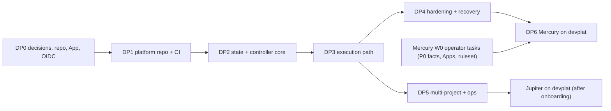

# 28 — Updated implementation roadmap (devplat, Amendment 001)

Status: **Proposed**. Estimates are **unmodelled P50 judgements**, not output of `schedule_model.py`. They will be recomputed once the DP1–DP2 issue breakdown exists. Nothing in this roadmap is authorized to start before the decisions in §3.
Reuses / supersedes:
- Mercury's own roadmap and issue DAG (`planning/`, `05-…`) are **unchanged**.
- This roadmap adds the platform track **DP0–DP6**, which comes before agent-driven Mercury implementation in Kubernetes.
- v1 local mode stays available for design and planning work in the meantime.

## 1. Phases

| Phase | Goal | Main deliverables | Owners (roles) | Exit evidence (`29-…`) | Est. working days |
|---|---|---|---|---|---|
| **DP0** Decisions and bootstrap prerequisites | Operator decisions; identities; repository | DOD-01…03, DOD-11…16 answered; platform repository created (ADR-030); GitHub App (dev bot) created; OIDC provider chosen | Operator; Lead Architect and Security prepare | Recorded decisions; `get_me` = dev bot | 2–5 operator days |
| **DP1** Platform repository and CI | Independent home and CI of record | Move `platform/` + package docs; platform CI (lint, unit, DB tests on a PostgreSQL service, manifest validation, chart lint/render, image build/scan/sign); ruleset on the platform repository | DevOps, Integration & Release | AT-01, AT-02 green in the platform CI | 3–4 |
| **DP2** State and controller core | Deterministic controller without a cluster | `platform/db` schema hardened; controller reconciler with a fake Kubernetes client; port of the 30 devorch regression cases; operator facts via the API with OIDC | Backend, Database, Test Automation, Security review | AT-03…AT-07 | 8–10 |
| **DP3** Execution path | First real agent Job on a local cluster | Agent image (Claude Code headless + runner) for the Mercury toolchain; `jobspec` (exists, tested); fetch and upload; gitbroker (port of `result_errors` plus push to `dev/*` plus draft PR); model gateway; bootstrap steps 1–9 on kind/k3d | Platform Integration, AI Integration, DevOps, Security | AT-08…AT-12; bootstrap evidence | 10–12 |
| **DP4** Security hardening and recovery | Infrastructure-enforced boundaries proven | NetworkPolicies on an enforcing CNI; gVisor RuntimeClass on exec nodes; admission policies; secrets handling; recovery drills (controller kill, pod delete, node drain, DB failover); bootstrap step 10 | Security, Reliability, DevOps | AT-13…AT-22 (security and recovery suites) | 6–8 |
| **DP5** Multi-project and operations | Two projects concurrently; dashboard; budgets | Scheduler fair share and admission; per-project budgets in the gateway; dashboard; Linear adapter (read-only until DOD-05); project onboarding via `devplat-project`; a dummy third project onboarded by configuration only | Backend, Platform Integration, TPM | AT-23…AT-28 | 8–10 |
| **DP6** Project work | Mercury (and Jupiter once it is real) developed on devplat | Mercury tasks dispatched as Jobs. The macOS lane is wired as `mac_validation` tasks. Jupiter moves from `draft` to `active` when the onboarding criteria (`26-…` §3.4) hold | All roles | Mercury W0–W1 tasks completed through G7 | Mercury roadmap |

Indicative total before Mercury implementation runs on devplat: **≈ 29–39 working days** (DP0–DP4). DP5 can overlap with DP6.

## 2. Critical path and parallelism

- **Can run in parallel now:**
  - Mercury W0 operator tasks (Mercury `05-…` W0: Phase 0 facts, GitHub Apps, ruleset), which don't need agents.
  - Mercury design-only work in v1 local mode (planning, design review).
  - DP0.
- **Critical path:** DP0 → DP1 → DP2 → DP3 → DP4 (≈ 29–39 days). The longest items are the gitbroker (DP3) and the recovery and security drills (DP4).
- **Effect on Mercury:**
  - Agent-driven Mercury implementation starts after DP4 rather than right after DOD-01–03. That is roughly 6–8 calendar weeks later than the v1 plan if DP0–DP4 run serially.
  - The v1 alternative, running Mercury implementation in local mode first, stays possible only if the hook canary passes (DOD-10) and DOD-02/03/09 hold. It doesn't satisfy this amendment, so it would be an interim the operator must accept explicitly (DOD-16).

## 3. Decisions gating the roadmap

These are listed in full in `12-amendments.md`.

| Decision | Gates |
|---|---|
| DOD-11: adopt devplat (ADR-022) and the topology recommendation (ADR-023) | DP0 |
| DOD-12: platform repository creation and ownership (ADR-030) | DP1 |
| DOD-13: GitHub App for the dev bot (DOD-03 a, re-scoped to gitbroker) | DP3 |
| DOD-14: OIDC provider for operator identity | DP2 exit |
| DOD-15: target environment for the first cluster (workstation kind/k3d, or a home server) and any software installation on it | DP3 |
| DOD-16: interim use of v1 local mode for Mercury implementation before DP4 (yes or no) | Mercury timing |
| DOD-01…03 (existing) | Any code task, either mode |

## 4. Issue breakdown

The DP issues are **not yet created**: no Linear project exists, and Linear writes are not authorized (DOD-05). A proposed breakdown of about 35 issues, DP-001…DP-6xx, is generated once DOD-11 is approved. Each issue follows the v1 DoR/DoD with the same gates G1–G7. The platform's own G-gates are the acceptance tests in `29-…`.
