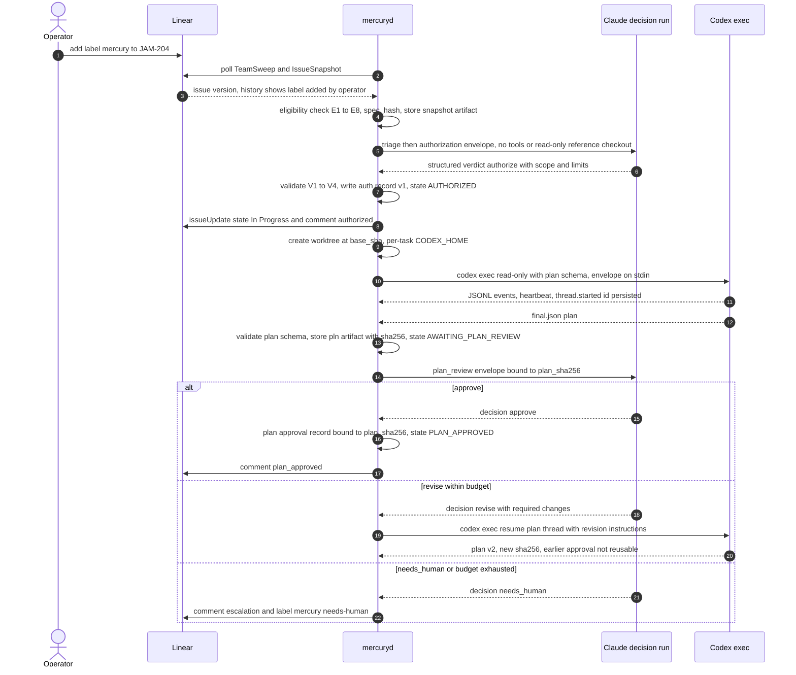
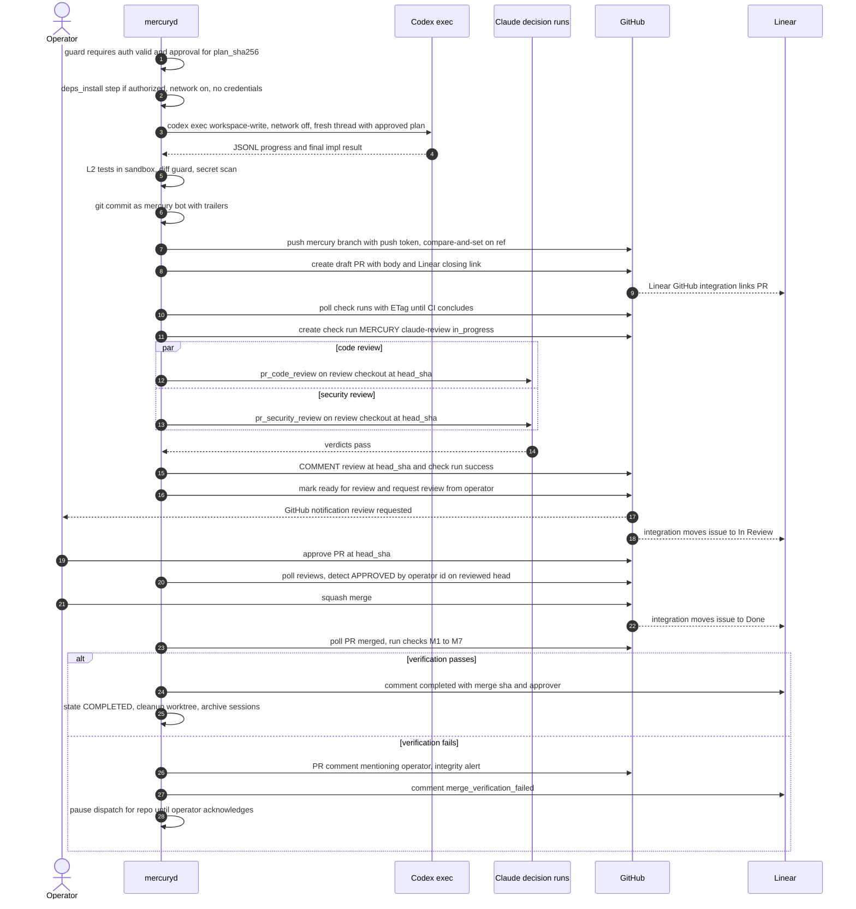
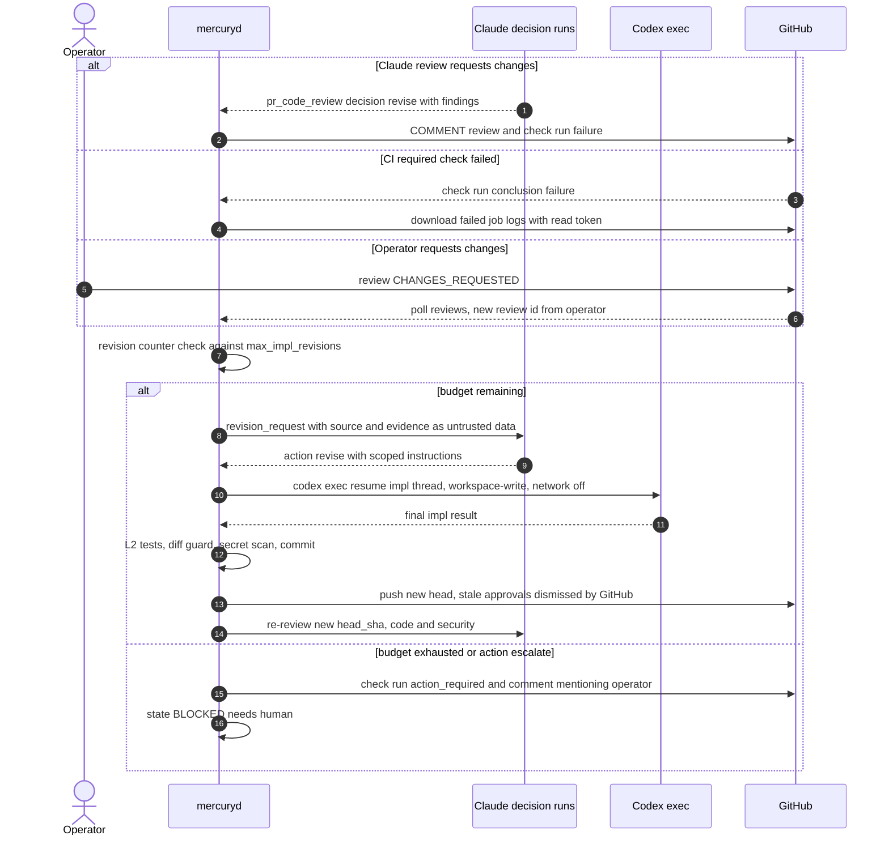
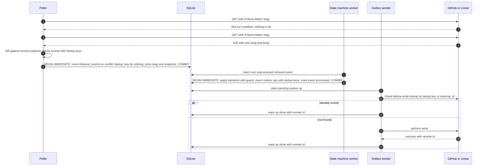

# Integration: GitHub, and cross-cutting integration architecture

**Owner:** Agent B, Phase 2 proposal.
**Builds on:**
- `reviews/02-discovery-platform.md` §1, §2 and §6 (**DP**)
- `reviews/01-discovery-integrations.md` (**DI**)

**Structure:**
- **Part A (§1–§10):** GitHub.
- **Part B (§11–§19):** cross-cutting architecture for all four integrations: event strategy, sequence diagrams, idempotency, retry matrix, credential boundary, compatibility, and authority.

---

# Part A: GitHub

## 1. Role and invariants

The coordinator talks to GitHub through **one non-human identity**, a GitHub App. That identity pushes `mercury/*` branches, opens PRs, posts Claude's review as `COMMENT`, and publishes a `MERCURY / claude-review` check run.

The **operator** (`usjbro`) is the only identity that can satisfy required approval. The operator is the only intended merger.

| ID | Invariant | Enforcement |
|---|---|---|
| GH-1 | No agent identity's review can satisfy the required approval | **Software (GitHub).** Require Code Owner review with `CODEOWNERS = * @usjbro`. Require approval of the most recent push (the App is always the last pusher). Dismiss stale approvals. Empty bypass list (DP §1.2). Apps cannot be code owners |
| GH-2 | MERCURY never submits `APPROVE` or `REQUEST_CHANGES` | **Software (MERCURY).** The GitHub client module exposes only `createReview(event:"COMMENT")`; the event value is a type-level constant; a unit and contract test asserts it. GH-1 makes a violation harmless anyway |
| GH-3 | MERCURY never calls a merge endpoint | **Software (MERCURY):** no merge method exists in the client; an egress allowlist test asserts no `PUT …/merge` or `merge-async` call. **Detective:** merge verification (§8). **Preventive only with an org-owned repo** (§10) |
| GH-4 | No push to protected branches. No force-push anywhere | **Software (GitHub):** ruleset (§9). **Software (MERCURY):** push refspec is always `refs/heads/mercury/…`, never `--force` |
| GH-5 | Agents (Claude, Codex) hold no GitHub credential | **Software:** tokens live in coordinator memory only (§3); child `env` allowlists (claude.md §7.2, codex.md §6) |
| GH-6 | Workflow files cannot be changed by MERCURY | **Software (GitHub):** the App has **no `workflows` permission**, so GitHub rejects pushes touching `.github/workflows/**` (**ASM-B-50**). **Software (MERCURY):** diff guard |
| GH-7 | Only PRs authored by the MERCURY App on `mercury/*` branches are acted on. Comments and reviews by other accounts are data (the repo is public) | **Software:** event filter on `pr.user.id == app_bot_user_id` and on `review.user.id ∈ operator_ids` |

## 2. Identity model (decision)

| Identity | Kind | Used for | Never used for |
|---|---|---|---|
| `mercury-bot[bot]` (name TBD by operator) | GitHub App, installed on the `usjbro` account, **selected repositories only** | Push `mercury/*`, open and update PRs, `COMMENT` reviews, check runs, read checks and logs | Approve, merge, settings, workflows |
| `usjbro` | Human owner (admin) | Approve and merge PRs; repo settings; CODEOWNERS owner | Any MERCURY automation. MERCURY never reads or uses `gh` auth or the operator's PATs |
| `github-actions[bot]` | Repo CI | Required CI checks | Approvals ("Allow GitHub Actions to create and approve pull requests" stays **OFF**, DP §1.2) |
| `chatgpt-codex-connector` (exists on `network_monitor`, DI) | Third-party bot | Ignored by MERCURY | Its reviews are never counted as anything |

Rejected options:
- **Machine user.** Fine-grained PATs do not work for collaborator-only access, so this needs a coarse classic PAT. Its approvals would count. It also adds an extra account (DP §1.3).
- **Human PAT.** The agent would become the PR author, which blocks human approval. It would also gain admin merge.

### 2.1 Required App permissions

| Permission | Level | Why | If omitted |
|---|---|---|---|
| Metadata | read | mandatory | — |
| Contents | **write** | Push `mercury/*` branches; read files and compare | Cannot push |
| Pull requests | **write** | Create and update PR; mark ready (GraphQL); request reviewer; `COMMENT` reviews and inline comments; PR conversation comments | Cannot open PR or post review |
| Checks | **write** | Create and update the `MERCURY / claude-review` check run; read CI check runs | No required MERCURY gate. Must fall back to commit statuses |
| Commit statuses | read | Read legacy statuses from CI | Missing CI signal for status-based CI |
| Actions | read | Download failed job logs for CI-failure revision requests | Claude sees only check summaries |
| Workflows | **none** | GH-6 | — |
| Issues | none | PR comments go through `pull_requests:write` | — |
| Administration, Members, Secrets, Environments, Deployments, Pages | **none** | Least privilege; Administration would let the App change protections | — |
| Webhook | **inactive** (no URL) | No inbound access to the Mac | — |

Even with this minimal set, `contents:write` lets the App merge a PR once approvals and checks are satisfied (DP §1.4). That gap is closed in §8 (detective) and §10 (preventive, org only).

## 3. Token minting and private-key custody

- **Private key.** One PEM, generated in the App settings by the operator.
  - Stored in the login Keychain as generic password `dev.mercury.github-app-key`.
  - The ACL is limited to the MERCURY binary or `/usr/bin/security` (DP §4.5).
  - It never touches the filesystem after import; the downloaded `.pem` is deleted, and this is checked in the Phase 0 checklist.
- **Broker.** The coordinator module `github-auth` (optionally a separate tiny process, ALT-B-4) does the following:
  - reads the key on demand;
  - signs an RS256 JWT with `iss = <App client ID>`, `iat = now − 60 s` and `exp = now + 9 min`;
  - calls `POST /app/installations/{installation_id}/access_tokens` with a **narrowed request body**: `{"repositories":["<name>"],"permissions":{…}}`.
- **Per-purpose tokens.** Each expires in 1 h (DP §1.3) and is cached in memory until 10 min before expiry.

  | Purpose | Permissions requested |
  |---|---|
  | `read` | `contents:read, pull_requests:read, checks:read, statuses:read, actions:read` |
  | `push` | `contents:write` |
  | `pr` | `pull_requests:write` |
  | `check` | `checks:write` |

  The token used for polling therefore cannot write, and the push token cannot post reviews. Any failure to narrow is a `config_fatal`.
- **Git push credential.** Supplied through `GIT_ASKPASS=<mercury-askpass>`, which reads a one-time FD or an env variable of the `git` child only. Alternatively, use `-c http.https://github.com/.extraheader="AUTHORIZATION: basic <b64(x-access-token:TOKEN)>"` passed via `GIT_CONFIG_COUNT` / `GIT_CONFIG_KEY_0` / `GIT_CONFIG_VALUE_0` env, never via argv or `.git/config`.
- **Rotation.** The App key is rotated yearly or on suspicion: create a new key, update the Keychain, delete the old key in App settings. Installation tokens can be revoked via `DELETE /installation/token` on shutdown (optional).

## 4. Branches, commits and push

### 4.1 Branch naming (decision)

`mercury/<issue-key-lowercase>-<slug>`, for example `mercury/jam-204-flow-export-csv`.

- `<slug>` is derived from the Linear title: lowercase `[a-z0-9-]`, at most 40 characters, with no trailing dash. The full name is at most 63 characters.
- **Why not `jamesmbrownjr/jam-<n>-<slug>`** (Linear's generated format, DI)? That prefix denotes the human. MERCURY branches must be visibly non-human.
- Containing `jam-<n>` keeps Linear auto-linking. Linear treats this as a **closing** link, so the Linear GitHub integration owns `Done` (linear.md §6, default mode).
- One branch per task. A re-authorized task that restarts implementation from scratch (for example after cancellation) uses `-r<k>`.
- The branch is never force-pushed or rebased. Base updates are **merge commits from base** made by the coordinator (§7.4).
- **Worktree:** `~/Developer/mercury-worktrees/<owner>__<repo>/<task_id>/` on the local branch of the same name. Agent D owns cleanup.

### 4.2 Commit convention

One commit per successful implementation or revision run (squash-merged at the end, DI).

```
JAM-204: Export flow table as CSV (impl run 1)

<= 15 lines summarising changes, generated from the Codex final JSON `summary` (redacted)

Mercury-Task: tsk_01J9…
Mercury-Run: run_01J9…
Mercury-Authorization: auth_01J9…@v1
Mercury-Plan: pln_01J9…@sha256:3f1c…(12 hex)
Linear-Issue: JAM-204
```

- Author and committer are `mercury-bot[bot] <APP_ID+mercury-bot[bot]@users.noreply.github.com>`. Never a human `Co-authored-by`.
- Signing is not required in v1.
- **ALT-B-5:** create commits through the REST Git Data API (`POST /git/blobs`, `/git/trees`, `/git/commits`, `PATCH /git/refs`). GitHub then marks them "Verified" for the App. This costs more API calls and loses local `git` ergonomics; adopt it if the operator wants a `required_signatures` rule.

### 4.3 Push

```
git -C <wt> -c core.hooksPath=/dev/null push --no-verify --porcelain origin HEAD:refs/heads/mercury/jam-204-…
```

- Uses the `push` token.
- Before pushing, `git ls-remote origin refs/heads/<branch>` must equal the coordinator's recorded `last_pushed_sha`, or be absent on the first push. This is compare-and-set.
- A mismatch means someone else pushed (§7.5), and the result is `BLOCKED(foreign_push)`.
- Dedup key `out:git:push:<task_id>:<sha>`. A retry after an ambiguous failure first runs `ls-remote` and, if the SHA is already there, records success.

## 5. Pull request creation

1. **Find or create.** Find with `GET /repos/{o}/{r}/pulls?head=<owner>:<branch>&state=all` (idempotent). If none exists, `POST /pulls` with `{title, head, base, body, draft: true}`. Dedup key `out:gh:pr:create:<task_id>`.
2. **Title:** `JAM-204: <Linear issue title>`. This also links in Linear.
3. **Draft while Claude reviews.** The PR stays **draft** until both Claude reviews pass. Then MERCURY:
   - marks it ready (`markPullRequestReadyForReview` GraphQL mutation, `pr` token);
   - requests the operator's review (`POST /pulls/{n}/requested_reviewers {"reviewers":["usjbro"]}`).

   Code owner review is also requested automatically. The operator's GitHub notification fires **only when there is something to decide**, which avoids low-value alerts (brief §G).
4. **Body.** Generated from the template in §5.1. MERCURY rewrites it on each revision through `PATCH /pulls/{n}`. The hidden metadata block is the coordinator's own reference; it is never trusted on read-back.

### 5.1 PR body template

```markdown
## Summary
<2–6 lines from approved plan + Codex final summary>

## Linear
Closes JAM-204            <!-- default mode; "Part of JAM-204" in mercury_owns_all mode (linear.md §6) -->

## Acceptance criteria
| AC | Status | Evidence |
|---|---|---|
| AC-1 Export button produces CSV | covered | tests/flows/export.test.ts |
| AC-2 … | covered | … |

## Changes
- `src/flows/export.ts` (new) …
- Out-of-plan files (inside authorized scope): none

## Tests
- Coordinator test run `run_…`: 214 passed, 0 failed (npm test), lint clean
- CI: see checks

## Claude review
- Code review `rev_…` on `<head_sha:12>`: **pass**, 0 blocking, 3 non-blocking
- Security review `rev_…`: **pass**, 0 high/critical

## Provenance
Authorization `auth_…@v1` · Plan `pln_…` v2 (sha256 `3f1c…`) · Codex runs `run_…`, `run_…`
**Merging is the operator's decision. MERCURY never approves or merges.**

<!-- mercury:pr v1 {"task":"tsk_…","auth":"auth_…@1","plan_sha256":"…","reviewed_head":"…"} -->
<!-- linear:extension {"version":1,"plugins":[{"plugin":"onBehalfOf","agent":"codex","visible":true}]} -->
```

The `linear:extension` block gives "on behalf of Codex" attribution in Linear Reviews (Linear Docs "Reviews", 2026-10-12).

## 6. Posting Claude reviews

For each head SHA that is reviewed:

1. **Check run.**
   - Create `POST /check-runs {name:"MERCURY / claude-review", head_sha, status:"in_progress", external_id:"<task_id>:<head_sha>"}` when the review starts. `external_id` gives idempotent lookup via `GET /commits/{sha}/check-runs?check_name=…`.
   - After **both** Claude decisions (code and security) are accepted, `PATCH` it with:
     - `conclusion: success`, when both pass;
     - `failure`, when revision is requested;
     - `action_required`, when the decision is `needs_human`, the review is inconclusive, or there is spec drift.

     The `output.summary` holds the verdict summary, and `output.text` holds the findings table.
2. **Review.**
   - One `POST /pulls/{n}/reviews` with `event:"COMMENT"`, `commit_id: head_sha`, `body` (summary plus findings table) and `comments[]`.
   - Inline comments are `{path, line, side:"RIGHT", body}`, used only for findings with a validated location (claude.md §6 V4). At most 30 inline comments; the rest go in the body.
   - Dedup key `out:gh:review:<task_id>:<head_sha>`. Idempotency check: list reviews and look for one by the App user with the dedup marker in its body. The author ID is verified, and the marker is only used to select among the App's own reviews.
3. **Never APPROVE or REQUEST_CHANGES (GH-2).** The **check run** carries the gate.
   - A bot `REQUEST_CHANGES` would leave a "changes requested" review that blocks merge until it is dismissed, which needs dismissal rights and adds state.
   - A bot `APPROVE` would be confusing even though GH-1 neutralises it.
4. **Security findings.** These appear in the same review body under a separate heading. Critical and high findings are marked **blocking**. If a security finding must not be public (the repo is public), only a generic line is posted ("Security finding withheld: see local MERCURY report `rev_…`"), and the operator is notified through the local channel (Agent E policy, OQ-B-07).

## 7. Polling: PR, reviews, checks, merges

All polling uses `GET` with `If-None-Match: <etag>`. A `304` is free (DP §2). Requests are serialised per installation, with at least 1 s between mutations.

| Resource | Endpoint | When | Interval |
|---|---|---|---|
| PR state | `GET /repos/{o}/{r}/pulls/{n}` | `PR_OPEN` … `AWAITING_HUMAN_APPROVAL` | 60 s while checks are running; 120 s while awaiting the human; 300 s after 24 h waiting |
| Reviews | `GET /pulls/{n}/reviews?per_page=100` | same | same |
| Review comments (human inline) | `GET /pulls/{n}/comments?sort=created&direction=asc&since=<cursor>` | when a review from the operator appears | on demand |
| Check runs | `GET /commits/{head_sha}/check-runs?per_page=100` and `GET /commits/{head_sha}/status` | after push until all required checks conclude | 30 s for the first 10 min, then 60 s; CI timeout 60 min, then `needs_human` |
| Failed job logs | `GET /actions/jobs/{job_id}/logs` (`actions:read`) | on a required check failure | once |
| Base branch head | `GET /repos/{o}/{r}/branches/{base}` | while the PR is open (strict checks) | 300 s |
| Open MERCURY PRs (reconciliation) | `GET /pulls?state=all&head=<owner>:mercury/…` per known branch | startup, wake, every 30 min | — |

### 7.1 Event derivation

The poller compares the new response with the stored one and emits inbound events, each with a dedup key (§14). The state machine consumes events, not raw responses.

### 7.2 Human approval detection

An event `human_approved` is emitted only if **all** of the following hold:
- `review.state == "APPROVED"`;
- `review.user.id ∈ operator_user_ids`, compared by **numeric ID**, not login;
- `review.commit_id == pr.head.sha == last_reviewed_head_sha` (Claude reviewed it).

The task then moves to `AWAITING_HUMAN_APPROVAL → approved, awaiting merge`, which Agent C names. MERCURY does nothing further but wait. An approval on an older SHA is ignored; GitHub dismisses it anyway.

### 7.3 Human changes requested

When `review.state == "CHANGES_REQUESTED"` from the operator:
1. A `revision_request` Claude decision runs. Its input is the review body plus inline comments, treated as operator-authored **data**.
2. If its output is `revise`, Codex runs a revision, MERCURY pushes the new commit, and Claude re-reviews. The operator's stale review is dismissed by GitHub on the push.
3. Revision cycles count against `limits.max_impl_revisions` (shared with Claude-initiated cycles; default 3). When exhausted, MERCURY escalates.

### 7.4 Base branch moved

With strict required checks, GitHub requires the branch to be up to date. MERCURY handles this by:
1. merging base into the branch locally (`git merge --no-ff origin/<base>`, hooks disabled);
2. if there is no conflict, running L2 tests, pushing, and having Claude re-review the new head SHA (cheap delta review: the diff of the merge is provided);
3. if there is a conflict, sending a `revision_request` (source `conflict`) to Codex in the worktree with the conflict markers.

These steps run only on demand: when the operator has approved but GitHub reports `mergeable_state == "behind"`, or when MERCURY's own CI check needs a re-run. They never run proactively on every base move, to avoid churn.

### 7.5 Foreign pushes

If `pr.head.sha` is not a SHA that MERCURY pushed, someone else pushed to the branch: the operator, or the Linear agent (linear.md §9).
- MERCURY moves the task to `BLOCKED(foreign_push)`.
- It runs a Claude review of the new head for information only (check run `action_required`).
- It never pushes again unless the operator re-authorizes through the local CLI.
- Merge verification still applies.

## 8. Merge detection and verification

When the PR poll shows `merged == true`, or the PR is closed:

| # | Check | Source | On failure |
|---|---|---|---|
| M1 | `merged == true` and `merged_at` set | `GET /pulls/{n}` | Closed without merge: task `CANCELLED(pr_closed)`, Linear comment |
| M2 | `merged_by.id ∈ operator_user_ids` | same | **Security escalation `unauthorized_merge`** |
| M3 | At least one review satisfies `state == APPROVED`, `user.id ∈ operator_user_ids`, and `commit_id == merged head SHA` (`pr.head.sha` at merge) | `GET /pulls/{n}/reviews` | Security escalation `merge_without_human_approval` |
| M4 | Merged head SHA `==` `last_reviewed_head_sha`, and the Claude check run on that SHA had conclusion `success` | local DB plus `GET /commits/{sha}/check-runs?check_name=MERCURY / claude-review` | Escalation `merged_unreviewed_head`. Policy breach, not necessarily malicious |
| M5 | `merge_commit_sha` exists and is reachable from `base`: `GET /repos/{o}/{r}/compare/{base}...{merge_commit_sha}` returns `status ∈ {behind, identical}` | REST | Escalation `merge_commit_not_on_base` |
| M6 | All required checks on the merged head were `success`/`neutral`/`skipped` | check runs plus statuses | Escalation `merged_with_failing_checks` |
| M7 | Diff of `merge_commit_sha^..merge_commit_sha` (squash) equals the reviewed head's tree diff against the merge base (tree-hash comparison) | REST compare | Escalation `merge_content_mismatch` |

Outcomes:
- **All pass:** `MERGED → COMPLETED`. MERCURY posts a Linear `completed` comment, cleans up the worktree (Agent D), and archives Codex sessions. MERCURY deletes the `mercury/*` branch (`DELETE /git/refs/heads/…` with the push token) only if the repo setting "automatically delete head branches" is off.
- **Any failure:** the task goes to `MERGED` with an `integrity_alert` record (Agent C defines the state or flag). MERCURY:
  - posts a PR comment that @mentions the operator, which produces a GitHub notification;
  - posts a Linear `merge_verification_failed` comment;
  - notifies the operator locally;
  - **pauses all new dispatch for that repo** until the operator acknowledges through the CLI (Agent E decides whether this pause is mandatory).

Dedup key `gh:pr:<repo>#<n>:merged:<merge_commit_sha>`.

## 9. Required repository settings (target repos)

These are applied by the **operator**, not by MERCURY. MERCURY has no admin permission. At startup and every 6 h, MERCURY **verifies** them with read-only calls:
- `GET /repos/{o}/{r}/rulesets`;
- `GET /repos/{o}/{r}/rules/branches/{base}`;
- `GET /repos/{o}/{r}` for merge settings;
- CODEOWNERS contents.

If they drift, MERCURY refuses to open new PRs for that repo (`repo_governance_drift`). Verifying rulesets may need `administration:read`. If the App lacks it, MERCURY uses `GET /repos/{o}/{r}/rules/branches/{branch}`, which needs only `metadata:read` (**ASM-B-51**).

### 9.1 Ruleset on the default branch

```json
{
  "name": "mercury-protect-default-branch",
  "target": "branch",
  "enforcement": "active",
  "bypass_actors": [],
  "conditions": { "ref_name": { "include": ["~DEFAULT_BRANCH"], "exclude": [] } },
  "rules": [
    { "type": "deletion" },
    { "type": "non_fast_forward" },
    { "type": "required_linear_history" },
    { "type": "pull_request",
      "parameters": {
        "required_approving_review_count": 1,
        "dismiss_stale_reviews_on_push": true,
        "require_code_owner_review": true,
        "require_last_push_approval": true,
        "required_review_thread_resolution": false,
        "allowed_merge_methods": ["squash"]
      } },
    { "type": "required_status_checks",
      "parameters": {
        "strict_required_status_checks_policy": true,
        "do_not_enforce_on_create": false,
        "required_status_checks": [
          { "context": "MERCURY / claude-review", "integration_id": 0 },
          { "context": "<ci job name, e.g. test>", "integration_id": 15368 }
        ] } }
  ]
}
```

Notes:
- Replace `integration_id: 0` with the MERCURY App ID. `15368` is GitHub Actions' App ID (**ASM-B-52**).
- `required_review_thread_resolution: false` keeps Claude's non-blocking inline notes from blocking the human. Set it to `true` if the operator wants every thread resolved (OQ-B-08).
- Making `MERCURY / claude-review` a required check pinned to the App means the operator **cannot merge before Claude's review passes on the exact head SHA**. This is software enforcement of brief step 10's ordering. The operator can still override as admin only if a bypass is configured, and none is (empty list).
  - **Trade-off:** if MERCURY is down, the operator cannot merge MERCURY PRs without temporarily editing the ruleset. This is intentional; document it in the runbook (Agent D).
- Also apply legacy branch protection with "Do not allow bypassing the above settings" if the operator prefers classic protection (DP §1.1). Rulesets and protection aggregate, and the most restrictive rule wins.

### 9.2 Ruleset on MERCURY branches

```json
{ "name": "mercury-branches", "target": "branch", "enforcement": "active", "bypass_actors": [],
  "conditions": { "ref_name": { "include": ["refs/heads/mercury/**"], "exclude": [] } },
  "rules": [ { "type": "non_fast_forward" } ] }
```

This blocks force-push on agent branches, so history stays auditable. Deletion is allowed for cleanup.

### 9.3 Other repository settings

| Setting | Value |
|---|---|
| `CODEOWNERS` (on the default branch, at `.github/CODEOWNERS`) | `* @usjbro` and `/.github/ @usjbro`. Changes to it require code-owner review, and the MERCURY diff guard blocks it |
| Allow merge methods | squash only (matches existing practice, DI) |
| Automatically delete head branches | on |
| Actions → "Allow GitHub Actions to create and approve pull requests" | **off** |
| Actions → fork PR workflows | "Require approval for all outside collaborators" (public repo) |
| Self-hosted runners | **none** (public repo, DP §2) |
| Auto-merge | **off**. With auto-merge on, the App, with `pull_requests:write`, could enable it (`enablePullRequestAutoMerge`) and merge would then execute under the enabling actor (**ASM-B-53**). GH-3 forbids MERCURY from calling it; turning the repo setting off removes the vector |

## 10. Personal-account limitations and options

| Need | Personal account (status quo) | Free organization (repos transferred) |
|---|---|---|
| Human approval required, agent approval cannot count | **Preventive**: code owners, last-push approval, stale dismissal | Same |
| Only the human can merge | **Detective only**: §8 M2. The App, with `contents:write`, can merge an approved PR | **Preventive**: a ruleset "Restrict updates" on the default branch with bypass = a team containing only `usjbro`, set "for pull requests only" (DP §1.1; **ASM-B-54**: blocks PR merges by non-bypass actors, including Apps) |
| Bypass lists | Not available (DP §1.1) | Available (teams, roles, Apps) |
| App installation | Supported | Supported |
| Linear Coding sessions setup | Requires GitHub org owner (Linear docs), so it is effectively unavailable on a personal account, which is good for LN-6 | Must be explicitly left disabled |

**Recommendation:** start on the personal account with the detective control and the required `MERCURY / claude-review` check. Raise ADR "repository ownership" (Agent A) so the operator can decide whether to transfer the target repos to a free organization before MERCURY reaches unattended mode (roadmap gate, Agent F). This is OQ-B-09.

---

# Part B: Cross-cutting integration architecture

## 11. Event strategy: polling, not webhooks (decision)

| Source | Mechanism | Rationale |
|---|---|---|
| GitHub | REST polling with ETags (§7); GraphQL only for mutations REST lacks (mark ready) | No inbound access. A 304 is free. The Events and Notifications APIs lag 30 s to 6 h (DP §2) |
| Linear | GraphQL polling with an `updatedAt` cursor and overlap (linear.md §3) | Webhooks need a public HTTPS URL (DP §3) |
| Claude, Codex | Local child processes with stream output (SDK messages / JSONL) | Local |
| Webhook relays (smee, `gh webhook forward`, a cloud relay) | **Not in v1.** If ever added, a payload is only a *hint* to poll immediately, never the source of truth (DP §2) | Third-party transit plus a forgery surface. Polling latency of 30–120 s is acceptable for a human-paced workflow |

**Wake and restart behaviour:** on coordinator start, or when wake is detected:
1. Wait for the connectivity gate (probe `api.github.com` and `api.linear.app`).
2. Run the Linear Q3 reconciliation and GitHub reconciliation for every non-terminal task.
3. Then resume the normal cadence.

Polling stops while asleep, which is expected (Discovery fact 10).

**Latency targets** (awake, online):
- Linear label added → triage considered: ≤ 2 min.
- CI concluded → Claude review started: ≤ 2 min.
- Human approval or merge → detected: ≤ 3 min (≤ 6 min after 24 h waiting).

## 12. Sequence diagrams

### 12.1 Authorization → planning → plan review



### 12.2 Implementation → PR → Claude review → human approval → merge → Linear



### 12.3 Revision loop



### 12.4 Idempotent inbound event processing



## 13. Inbound and outbound processing contract

- **Inbound.** Pollers never mutate task state directly. They insert `inbound_events(dedup_key UNIQUE, source, kind, payload_json, observed_at, processed_at NULL)` in the same transaction that stores the new ETag and snapshot. A crash between fetch and commit therefore re-fetches, and the unique key absorbs duplicates.
- **Outbound.** Every external write is an `outbound_ops(dedup_key UNIQUE, target, kind, request_json, state, attempts, next_attempt_at, remote_id)` row created in the **same transaction** as the state transition that requires it (transactional outbox). Senders perform check-before-write when the API has no idempotency key.
- Canonical tables are owned by Agent C (`architecture/components.md`). This section defines the integration-side requirements only.

## 14. Dedup key catalogue

| Event or op | Dedup key format |
|---|---|
| Linear issue version | `ln:issue:<issue_uuid>:<updatedAt>` |
| Linear comment version | `ln:comment:<comment_uuid>:<updatedAt>` |
| Linear spec drift detected | `ln:drift:<task_id>:<new_spec_hash>` |
| GitHub PR observed / head change | `gh:pr:<owner>/<repo>#<n>:head:<sha>` |
| GitHub review | `gh:pr:<owner>/<repo>#<n>:review:<review_id>:<state>` |
| GitHub review comment | `gh:pr:<owner>/<repo>#<n>:rc:<comment_id>:<updated_at>` |
| GitHub check conclusion | `gh:check:<owner>/<repo>@<sha>:<check_run_id>:<conclusion>` |
| GitHub combined status | `gh:status:<owner>/<repo>@<sha>:<context>:<state>` |
| GitHub merge | `gh:pr:<owner>/<repo>#<n>:merged:<merge_commit_sha>` |
| GitHub PR closed unmerged | `gh:pr:<owner>/<repo>#<n>:closed:<closed_at>` |
| Base branch moved | `gh:ref:<owner>/<repo>:<base>:<sha>` |
| Claude decision (accepted) | `claude:<task_id>:<decision_type>:<input_digest>` |
| Codex run attempt | `codex:<task_id>:<kind>:<plan_sha256_or_revision_id>:<attempt>` |
| Out: git push | `out:git:push:<task_id>:<sha>` |
| Out: PR create | `out:gh:pr:create:<task_id>` (lookup by head branch) |
| Out: PR body update | `out:gh:pr:body:<task_id>:<body_sha256>` |
| Out: Claude review | `out:gh:review:<task_id>:<head_sha>` (lookup: App-authored reviews) |
| Out: check run | `out:gh:check:<task_id>:<head_sha>:<conclusion>` (lookup: `external_id`) |
| Out: ready + reviewer request | `out:gh:ready:<task_id>:<head_sha>` |
| Out: Linear comment | `out:ln:comment:<task_id>:<kind>:<version>` (Linear `id` = UUIDv5 of key) |
| Out: Linear state | `out:ln:state:<task_id>:<target_state_id>` (compare-and-set) |

## 15. API failure and retry behaviour matrix

| Condition | GitHub | Linear | Claude (Anthropic API via SDK) | Codex (OpenAI API via exec) |
|---|---|---|---|---|
| 429 / secondary rate limit | Honour `retry-after` or `x-ratelimit-reset`; exponential backoff from 60 s with jitter; serialise requests (DP §2) | `RATELIMITED`: wait until the reset header; widen the poll interval | SDK retries internally; final failure is `transient_api` with backoff 1/5/15/30 m (claude.md §10) | `transient_api`: 2/10/30 m, then resume (codex.md §11) |
| 5xx / 502 / timeout | Retry 3× (2 s, 8 s, 30 s), then defer the op with backoff up to 30 min; reads keep the last snapshot | Same | Same as 429 | Same as 429 |
| 401 | Re-mint the installation token once. Still 401 means the key was revoked or the App uninstalled: `github_auth` breaker opens, all GitHub writes pause, operator notified | Re-mint once, then `linear_auth` breaker | `auth_failed`: Claude breaker; no retry | `auth_failed`: Codex breaker |
| 403 (permission) | Not retried. `config_fatal` for that operation type; operator notified (likely missing App permission or a ruleset rejection) | Same | n/a | n/a |
| 404 on PR / branch | Re-check via reconciliation; if confirmed, task `BLOCKED(external_state_lost)` | Issue deleted: task `CANCELLED(issue_deleted)` | n/a | n/a |
| 409 / 422 on write (conflict, validation) | PR already exists → adopt it. Review on an outdated SHA → re-evaluate. Push rejected (ruleset) → `BLOCKED(push_rejected)` | Comment ID exists → success | n/a | n/a |
| Network down / DNS | Connectivity gate closed: no attempts counted; resume after the probe succeeds plus 30 s stability | Same | Run fails as `network_down`; not counted | Same |
| Mac asleep | Nothing runs; deadlines are sleep-aware; full reconciliation on wake | Same | In-flight run killed or broken: classified on wake, retried | Same; resume thread |
| Schema / contract drift (unexpected shape) | `config_fatal` for the endpoint; stop that poller; operator notified | Same | `output_invalid` or `config_fatal` | `config_fatal` |

**Circuit breakers** (per integration):
- They open after 5 consecutive non-auth failures in 10 min, or immediately on an auth failure.
- Half-open probe every 5 min.
- While a breaker is open, no new tasks are dispatched that need that integration. In-flight runs that do not need it continue; for example, Codex implementation continues while Linear is down.

## 16. Credential boundary

| Credential | Held by (in memory) | At rest | Scope | Never available to |
|---|---|---|---|---|
| GitHub App private key | `github-auth` module in `mercuryd` (or a separate broker process) | Keychain `dev.mercury.github-app-key` | Mints installation tokens for selected repos | Claude, Codex, test runner, logs, DB |
| GitHub installation tokens (`read`, `push`, `pr`, `check`) | `mercuryd`, and the `git push` child via askpass for the push token only | Not stored (memory, ≤ 1 h) | Narrowed per §3 | Claude, Codex, test runner |
| Linear OAuth client secret | `linear-auth` module | Keychain `dev.mercury.linear` | Mints the app-actor token | All agents |
| Linear app token | `mercuryd` | Memory only | `read`, `write`, app actor | All agents |
| Anthropic API key | `mercuryd` → Claude child `env` | Keychain `dev.mercury.anthropic` | Model calls, dedicated workspace with spend cap | Codex, test runner, git |
| OpenAI API key | `mercuryd` → Codex process `env` | Keychain `dev.mercury.openai` | Model calls, dedicated project with cap | Commands run by Codex (`shell_environment_policy`), Claude, test runner |
| Operator GitHub credentials (`gh`, browser, PATs) | Operator only | Operator's own stores | Admin | **All of MERCURY.** MERCURY never reads `~/.config/gh`. Agents may be able to read it from disk; see codex.md §5, risk R-B-01 |
| Operator Linear session | Operator only | Browser / app | Human | All of MERCURY |

## 17. Integration compatibility matrix (pin and verify)

| Component | Pin (proposal) | Features required | Verification |
|---|---|---|---|
| Claude Agent SDK `@anthropic-ai/claude-agent-sdk` | exact, ≥ 0.3.296 | `settingSources: []`, `tools`, `disallowedTools`, `permissionMode:"dontAsk"`, `canUseTool`, in-process `PreToolUse` hook, `outputFormat` json_schema, `maxTurns`, `maxBudgetUsd`, `env`, `sessionId`, `pathToClaudeCodeExecutable`, `interrupt()` | Startup canary (claude.md §8); contract tests |
| Claude Code binary (bundled with the SDK) | matches the SDK (≥ 2.1.296) | Same as the SDK; fallback flags `--bare`, `--json-schema`, `--permission-prompts none`, `--restricted` | `--version` check |
| Claude model | `claude-opus-5-5` per decision type | Structured output | Recorded per run |
| Codex CLI `@openai/codex` | exact, ≥ 0.162.1 | `exec --json`, `--output-schema`, `-o`, `--sandbox`, `--strict-config`, `--ignore-rules`, `exec resume`, `sandbox_workspace_write.network_access`, `shell_environment_policy` | Startup self-test (codex.md §13); JSONL contract test |
| Codex model | operator-chosen, pinned in config | `--output-schema` support | Recorded per run |
| GitHub REST API | `X-GitHub-Api-Version: 2022-11-28` (or the newest stable at implementation) | ETags, check runs with `external_id`, reviews `COMMENT` with inline comments, rulesets read, compare | Contract tests against recorded fixtures plus a live sandbox repo |
| GitHub GraphQL | n/a | `markPullRequestReadyForReview` | Contract test |
| Linear GraphQL API | unversioned; schema snapshot captured at implementation | `issues` filter by `updatedAt`, `history`, `delegate`, `inverseRelations`, `commentCreate(id)`, client-credentials grant | Introspection diff in CI (fails on removed fields); ASM-B-30 to ASM-B-39 |
| git | ≥ 2.40 (worktrees, `GIT_CONFIG_COUNT`) | `worktree add --detach`, `-c core.hooksPath` | Startup check |
| gitleaks (or equivalent) | exact | Diff scanning | Startup check |
| Node.js | 24 LTS (then 26 LTS) | Per Agent D | Per Agent D |

## 18. Local versus external authority

| Fact or decision | Authoritative source | Mirror / projection | Conflict rule |
|---|---|---|---|
| What work exists and its spec | Linear issue, as a snapshot with `spec_hash` | Local snapshot artifact | Linear wins; drift forces re-authorization |
| Eligibility | Local evaluation of Linear signals | — | Local |
| Authorization to work | **Local `auth_` record** from a Claude verdict | Linear `authorized` comment (informational) | Local only; Linear text is never read back as authority |
| Plan content and approval | Local artifact `pln_` plus approval record | PR body provenance line | Local |
| Task workflow state (18 states) | **Local SQLite** | Coarse Linear status (linear.md §6); PR draft/ready | Local. Linear status is a projection with single-writer rules |
| Code on the branch | **GitHub** ref (`head_sha`) | Local worktree | GitHub wins; foreign push leads to `BLOCKED` |
| CI results | GitHub check runs | Local copy | GitHub |
| Claude review verdict | Local `rev_` artifact | GitHub `COMMENT` review plus check run | Local; the GitHub copy is a publication |
| Human approval | **GitHub review** by operator ID on head SHA | Local event | GitHub |
| Merge | **GitHub** PR `merged`, `merged_by`, `merge_commit_sha` | Local `MERGED` | GitHub, then local verification |
| Linear `Done` | Linear (written by the GitHub integration) | — | Never treated as proof of merge |
| Repository governance settings | GitHub | Local verified snapshot | Drift blocks new PRs |
