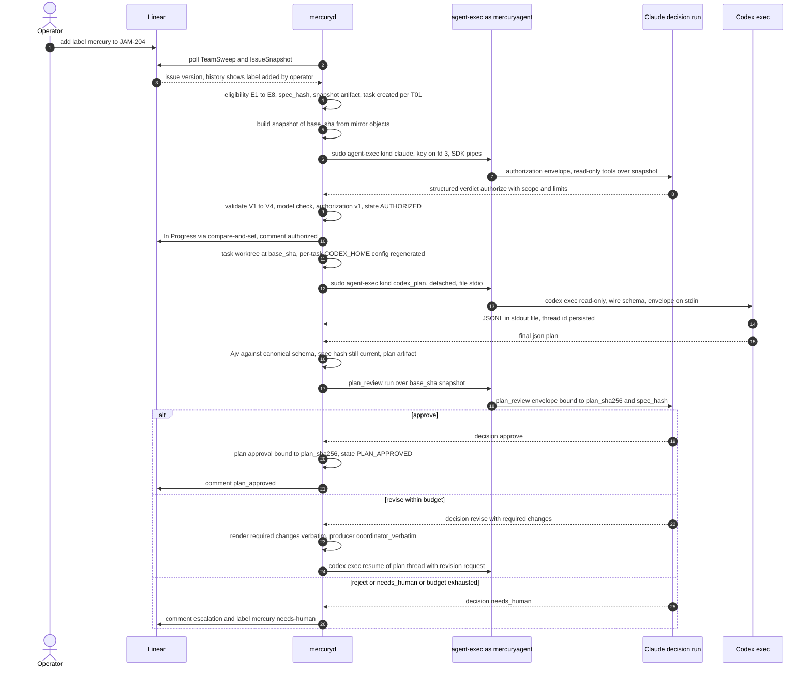
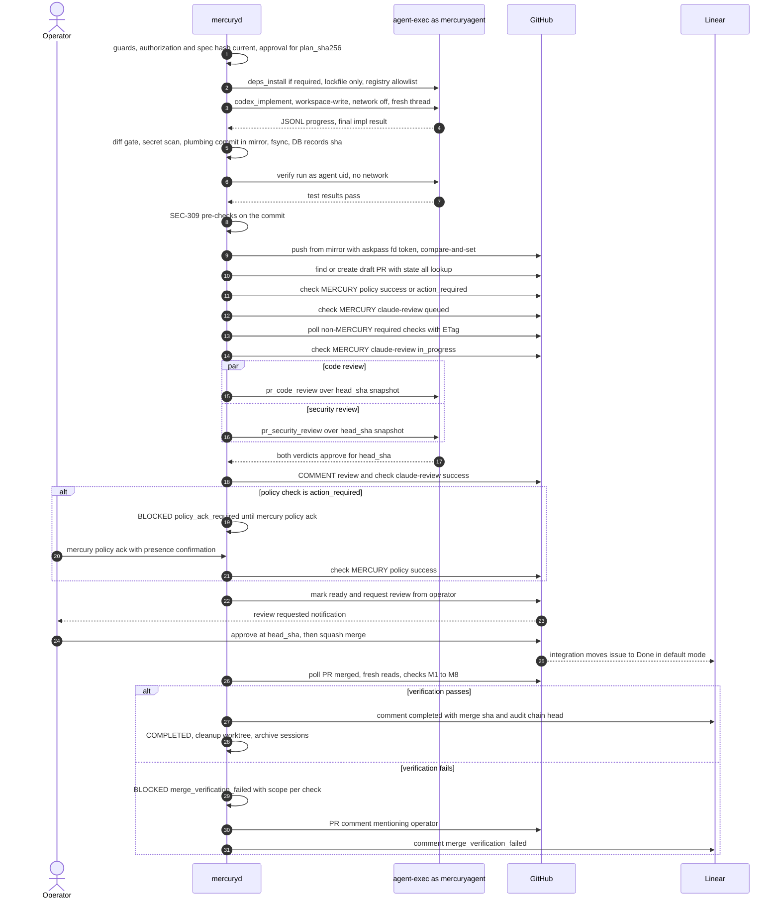
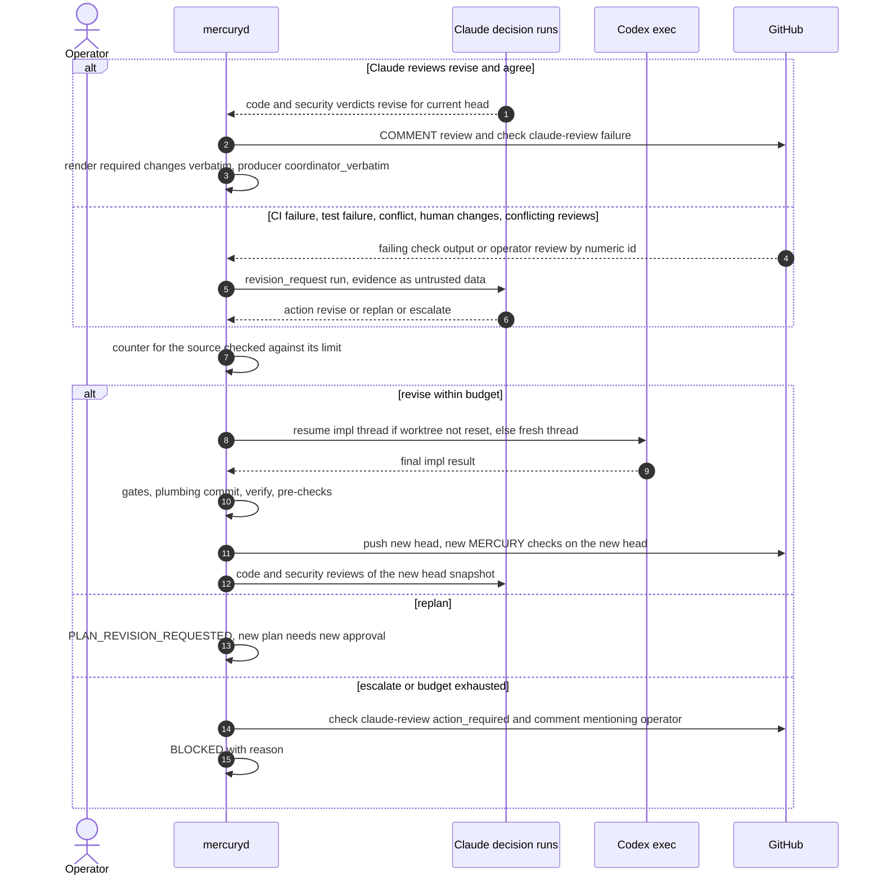
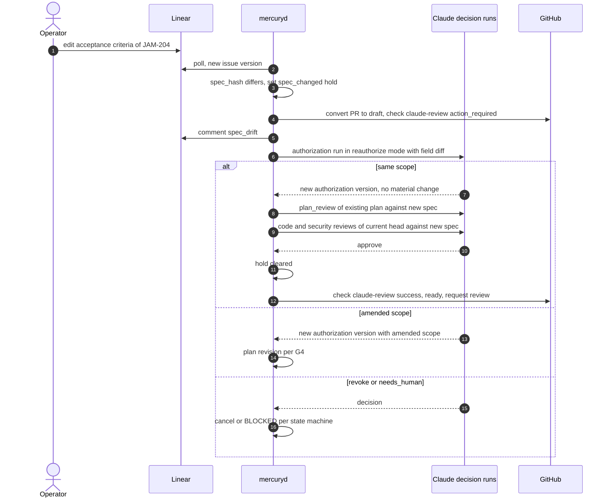
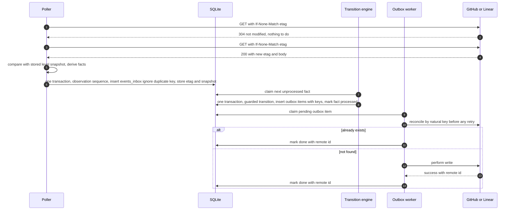

# Integration: GitHub, and cross-cutting integration architecture

**Owner:** Agent B. **Status:** Phase 4 revision. Implements RD-5, RD-6, RD-9, RD-14, RD-17 and RD-18 (`reviews/30-reconciliation.md`), plus ADR-014 (merge governance) and ADR-008 (identity inventory) as revised by Agent A.
**Builds on:** `reviews/02-discovery-platform.md` §1, §2, §6 (**DP**), `reviews/01-discovery-integrations.md` (**DI**) and the GitHub docs-source evidence in `reviews/21-review-B-interfaces.md` ([V-doc-src]).

**Structure:**
- **Part A (§1–§10):** GitHub: identities, branches and commits, PRs, MERCURY check runs, reviews, polling, merge verification, repository governance and onboarding, endpoint allowlist.
- **Part B (§11–§19):** cross-cutting integration architecture for GitHub, Linear, Claude and Codex: event strategy and connectivity probe, sequence diagrams, **the single dedup-key catalogue (§13)**, polling budget, **the single retry matrix (§15)**, credential boundary, compatibility matrix, authority table, and the Phase 0 checks owned by B.

**Single sources referenced, not restated here:** states, transitions, holds, block reasons and guards (Agent C, `architecture/state-machine.md`); DDL (`components.md` §6.3); output contracts and messages (`protocols/`); filesystem layout (`operations/macos-service.md` §7.1); operational parameter values (D's parameter table in `macos-service.md`; this document names keys only); credential inventory (`macos-service.md` §9.1); SEC statements (`security/threat-model.md`); requirement and test ids (`planning/traceability.md`, `testing/verification-plan.md`).

---

# Part A: GitHub

## 1. Role and invariants

The coordinator acts on target repositories through one non-human identity, the **`mercury-bot`** GitHub App. It pushes `mercury/*` branches from the mirror, opens PRs as drafts, posts Claude's reviews as `COMMENT`, and publishes two required check runs, **`MERCURY / claude-review`** and **`MERCURY / policy`**. A second App, **`mercury-ops`**, carries operations alerts, the heartbeat and audit anchors (§2).

The **operator** is the only identity that can satisfy required approval and the only intended merger. Merge enforcement depends on the governance mode (§10.1).

| ID | Invariant | Enforcement |
|---|---|---|
| GH-1 | No agent identity's review can satisfy the required approval | **GitHub:** ruleset requires Code Owner review (`CODEOWNERS` = operator only; Apps cannot be code owners), approval of the most recent reviewable push, stale-approval dismissal, no bypass (§9.1) |
| GH-2 | MERCURY posts reviews only as `COMMENT`; it never submits `APPROVE` or `REQUEST_CHANGES` and never dismisses a review | **MERCURY:** endpoint allowlist (§10.4); the review event is a type-level constant; contract test. Detective: merge-verification check M8 (§8) |
| GH-3 | MERCURY never merges, never updates a branch server-side, never enables auto-merge | **MERCURY:** no code path for merge, `update-branch` or auto-merge endpoints (§10.4, SEC-102). **GitHub:** `allow_auto_merge = false` (§9.5). **Preventive merge-actor control only under G-ORG** (§10.1); detective under G-DETECT (§8) |
| GH-4 | No push to protected branches; no force-push anywhere | **GitHub:** rulesets (§9.1, §9.3). **MERCURY:** push refspec is always `refs/heads/mercury/…`, never forced |
| GH-5 | Agents hold no GitHub credential | Tokens live in coordinator memory; agents run as `_mercuryagent` with an allowlisted environment (`claude.md` §7.2, `codex.md` §6) |
| GH-6 | MERCURY cannot change workflows or repository governance | **GitHub:** neither App has `workflows`, `administration` or `actions` permission (§2). **MERCURY:** diff gate (`codex.md` §9) |
| GH-7 | Only PRs authored by `mercury-bot` on the task's `mercury/*` branch are acted on; reviews and comments count only from the operator's numeric user ids | **MERCURY:** every find and poll filters on `user.id == mercury_bot_user_id` and head branch (SEC-107); human input filtered on `user.id ∈ operator_user_ids` (SEC-313) |
| GH-8 | The operator cannot merge before Claude's code and security reviews pass on the exact head SHA, and before protected-path changes are acknowledged | **GitHub:** `MERCURY / claude-review` and `MERCURY / policy` are required checks pinned to `mercury-bot`'s integration id (§6, §9.1) |

## 2. Identities and permissions (RD-6)

### 2.1 Identity inventory

| Identity | Kind | Installed on | Used for | Never used for |
|---|---|---|---|---|
| `mercury-bot` | GitHub App | Target repositories only (selected repositories) | Push `mercury/*`, open and update PRs, `COMMENT` reviews, the two MERCURY check runs, reads for polling and merge verification | Approve, merge, update-branch, auto-merge, settings, workflows, Actions |
| `mercury-ops` | GitHub App | `project-mercury` and the private anchor repository **only** (see §2.3) | Ops/heartbeat issue and SECURITY alerts in `project-mercury`; daily audit anchor commits | Anything on target repositories |
| Operator | Human owner | — | Approve and merge PRs; repository settings and rulesets; `CODEOWNERS` owner | Any MERCURY automation. MERCURY never reads `gh` auth, PATs or browser sessions (SEC-103) |
| `github-actions[bot]` | Repo CI | — | Required CI checks | Approvals ("Allow GitHub Actions to create and approve pull requests" off, SEC-105) |
| Third-party bots (e.g. `chatgpt-codex-connector`, DI) | — | — | Ignored | Never counted as anything |

Rejected: a machine user (needs a classic PAT; its approvals would count; extra account, DP §1.3) and the operator's PAT (the agent would become the PR author and gain admin merge).

Linear (OAuth app, `actor=app`) and the model keys are covered in `linear.md` §2, `claude.md` §7 and `codex.md` §7.

### 2.2 `mercury-bot` permissions (App level)

| Permission | Level | Why |
|---|---|---|
| Metadata | read | Mandatory; repository object, rulesets and branch rules reads |
| Contents | **write** | Push `mercury/*` branches from the mirror; read trees, files (`CODEOWNERS`), commits and compare; delete MERCURY branches after completion |
| Pull requests | **write** | Create and update PRs; draft/ready (GraphQL); request reviewers; `COMMENT` reviews and inline comments; PR conversation comments and labels |
| Checks | **write** | Create and update the two MERCURY check runs; read CI check runs and annotations |
| Commit statuses | **read** (Addendum B); **write only if Phase 0 requires it** | `read`: a target repo's required context may be a commit status. `write`: GitHub's docs state the ruleset's expected-source App "must be installed … with the `statuses:write` permission" (RB-05, [V-doc-src]); Phase 0 check **ASM-B-57** decides. Even if granted, MERCURY creates no commit statuses (§10.4) |
| Actions, Workflows, Administration, Issues, Members, Secrets, Environments, Deployments, Pages | **none** | Least privilege (SEC-101). Consequence: CI-failure evidence is the check run's output and annotations, not raw job logs |
| Webhook | inactive (no URL) | No inbound access to the Mac |

`contents:write` lets the App merge an approved, green PR through the API (DP §1.4). That gap is closed only under G-ORG (§10.1); under G-DETECT it is detected (§8); G-SPLIT removes `contents:write` from the PR-opening identity if its Phase 0 tests pass (§10.2).

### 2.3 `mercury-ops` permissions

GitHub App permissions are App-wide: an installation grants the App's full permission set on every selected repository, and on a personal account an App has one installation per account. Installing `mercury-ops` on target repositories would therefore give it `issues:write` and `contents:write` there, which SEC-110 forbids. **Design: `mercury-ops` is installed only on `project-mercury` and the anchor repository; the governance drift monitor reads target repositories with a `mercury-bot` `audit` token narrowed to `metadata:read`** (the permission RD-6 intended for this read). This deviates from RD-6's wording and is recorded as an objection in `reviews/41-revision-B.md` §3.

| Permission (App level) | `project-mercury` | Private anchor repo |
|---|---|---|
| Metadata: read | read | read |
| Issues: write | write (heartbeat issue edits, ops and SECURITY alerts) | narrowed away at mint |
| Contents: write | narrowed away at mint | write (anchor commits) |
| Everything else | none | none |

`mercury-bot` is never installed on `project-mercury` or the anchor repository (SEC-110).

### 2.4 Per-purpose installation tokens

Tokens are minted with a narrowed body `{"repositories":["<repo>"],"permissions":{…}}`; a failure to narrow is `config_fatal`. Tokens live in memory only.

| App | Purpose | Permissions requested | Used by |
|---|---|---|---|
| `mercury-bot` | `read` | `metadata:read, contents:read, pull_requests:read, checks:read, statuses:read` | All polling and merge verification. One long-lived token per installation, re-minted before expiry, so that ETag caches stay warm (§14) |
| `mercury-bot` | `push` | `contents:write` | `git push` from the mirror via the askpass fd (§4.3); MERCURY branch deletion |
| `mercury-bot` | `pr` | `pull_requests:write` | PR create/update, draft/ready, reviewers, `COMMENT` reviews, PR comments, labels |
| `mercury-bot` | `check` | `checks:write` (+ `statuses:write` only if granted per §2.2) | The two MERCURY check runs |
| `mercury-ops` | `ops` | `issues:write` on `project-mercury` | Heartbeat, ops and SECURITY alerts |
| `mercury-ops` | `anchor` | `contents:write` on the anchor repo | Daily audit-chain anchor (RD-4) |
| `mercury-bot` | `audit` | `metadata:read` | Governance drift monitor (§9.6): rulesets, branch rules, collaborators, repository settings |

## 3. Token minting and private-key custody

- **Private keys.** One PEM per App, generated by the operator, imported into the login Keychain under the single prefix `com.usjbro.mercury.*` (item names and ACLs: `macos-service.md` §9.1); the downloaded files are deleted (checked in Phase 0).
- **Reads (RD-18).** `mercuryd` reads every credential once at start and on `mercury reload-credentials`, and holds it in memory as a `Secret` value. No on-demand Keychain reads, so a locked Keychain after wake cannot stall a run.
- **Minting.** The `github-auth` module signs an RS256 JWT (`iss` = App client id, `iat = now − 60 s`, `exp = now + 9 min`) and calls `POST /app/installations/{installation_id}/access_tokens` with the narrowed body (§2.4). Tokens are re-minted `github.token_refresh_before_expiry_min` before expiry.
- **Git push credential (RD-17, single mechanism).** `git push` runs with `GIT_ASKPASS=<mercury-askpass>`; the helper reads the `push` token from an inherited file descriptor and prints it once. The token never appears in argv, environment, `.git/config` or the control socket.
- **Rotation.** App keys yearly or on suspicion (create new key, update Keychain, `reload-credentials`, delete old key); procedure in `operations/recovery.md`. Installation tokens may be revoked with `DELETE /installation/token` at shutdown.

## 4. Branches, commits and push

### 4.1 Branch and title naming (decision; depends on the Linear status mode)

| Linear mode (`linear.md` §6) | Branch | PR title | Commit subject |
|---|---|---|---|
| `integration_owns_done` (default) | `mercury/<issue-key-lower>-<slug>`, e.g. `mercury/jam-204-flow-export-csv` | `JAM-204: <Linear title>` | `JAM-204: <title> (impl run n)` |
| `mercury_owns_all` | `mercury/t-<task-ulid-suffix>-<slug>` (no issue id, so no closing link) | `<Linear title> [mercury tsk_…]` | `<title> (impl run n)` |

- `<slug>`: lowercase `[a-z0-9-]` from the Linear title, at most 40 characters, no trailing dash; full name at most 63 characters.
- The prefix `mercury/` marks the branch as non-human (Linear's generated `<user>/jam-n-…` prefix denotes the human).
- One branch per task. A task restarting implementation from scratch, or a `--reset` that cannot fast-forward (§7.6), uses a new branch with suffix `-r<k>`.
- The branch is never force-pushed or rebased. Base updates are merge commits made by the coordinator (§7.5).
- Worktree location and naming: `macos-service.md` §7.1.

### 4.2 Commit convention and trailers (superset, RF-28)

One commit per successful implementation or revision run, created by the coordinator's plumbing pipeline (`codex.md` §9); squash-merged at the end (DI).

```text
JAM-204: Export flow table as CSV (impl run 1)

<= 15 lines summarising the change, rendered from the Codex result summary through the public-sink renderer (redacted, neutralised)

Mercury-Task: tsk_01J9…
Mercury-Run: run_01J9…
Mercury-Authorization: auth_01J9…@v1
Mercury-Plan: pln_01J9…@sha256:<64 hex>
Linear-Issue: JAM-204
```

- This set is the superset that SEC-111 and the requirements reference. `Linear-Issue` is omitted in `mercury_owns_all` mode (`linear.md` §6.2).
- Coordinator-only commits add `Mercury-Merge-Base: <base_sha>` (§7.5) or `Mercury-Reset-From: <sha>` (§7.6).
- Author and committer: `mercury-bot[bot] <APP_ID+mercury-bot[bot]@users.noreply.github.com>`; never a human `Co-authored-by`. Signing is not required in v1. Alternative ALT-B-5 (commits through the Git Data API, shown as "Verified") is kept for a future `required_signatures` rule.

### 4.3 Push (from the mirror, RD-17)

```text
GIT_DIR=<mirror> GIT_ASKPASS=<mercury-askpass> GIT_CONFIG_GLOBAL=/dev/null GIT_CONFIG_NOSYSTEM=1 GIT_TERMINAL_PROMPT=0 \
git -c core.hooksPath=/dev/null -c protocol.allow=never -c protocol.https.allow=always \
    push --porcelain --no-verify https://github.com/<owner>/<repo>.git <sha>:refs/heads/<branch>
```

- Runs against the mirror, never from the worktree, with the hardening of `codex.md` §9; the remote URL carries no credential.
- **Compare-and-set:** before pushing, `ls-remote` for the branch must equal the recorded `pull_requests.local_head_sha` (or be absent on the first push). A mismatch is a foreign push (§7.6). A non-fast-forward push is impossible: the refspec is never forced and the `mercury/**` ruleset blocks it server-side.
- Outbox key `out:git:push:<task_id>:<sha>`; after an ambiguous failure the handler first reconciles with `ls-remote` and records success if the SHA is already there.

## 5. Pull requests

### 5.1 Find or create

- **Find** with `GET /repos/{o}/{r}/pulls?head=<owner>:<branch>&state=all` (the `owner:` prefix and `state=all` are mandatory, so a closed MERCURY PR is found rather than duplicated; RB-23). A PR counts as MERCURY's only if `user.id == mercury_bot_user_id` **and** the head branch is the task's branch; the body marker is a secondary check, never sufficient alone (RC-36).
- A closed MERCURY PR goes through SM's closed-PR rules (§7.7), never a new create.
- **Create** with `POST /repos/{o}/{r}/pulls {title, head, base, body, draft: true}` (`pull_requests:write` only [V-doc-src]). Outbox key `out:gh:pr:upsert:<task_id>`.

### 5.2 Draft policy (RD-18)

- Every PR opens as a **draft** (SEC-114) and stays draft until `MERCURY / claude-review` **and** `MERCURY / policy` both succeed on the head (SM T24 plus the policy guard). MERCURY then marks it ready (`markPullRequestReadyForReview`) and requests the operator's review (`POST /pulls/{n}/requested_reviewers`); the code-owner request follows automatically. The operator is notified only when there is something to decide.
- **Target-repo onboarding requires CI to run on draft PRs** (§9.4). Otherwise T22 would wait for CI that never starts.
- MERCURY converts the PR back to draft when the task is blocked for a security reason or a `spec_changed` hold is set (`linear.md` §8). MERCURY never closes a PR.

### 5.3 PR body template

All agent-originated text passes the public-sink renderer (SEC-304, C-SEC-7): redaction (SEC-501), quote block, `@mention` neutralisation, GitHub closing keywords and Linear magic words neutralised, HTML comments and `<details>` stripped, length cap (RE-12). The Linear link line is the only closing or contributing phrase, and it is generated by the coordinator.

```markdown
## Summary
<2–6 lines from the approved plan and the Codex result summary, rendered>

## Linear
Closes JAM-204            <!-- integration_owns_done; "Part of JAM-204" in mercury_owns_all (linear.md §6) -->

## Acceptance criteria
| AC | Status | Evidence |
|---|---|---|
| AC-1 Export button produces CSV | covered | tests/flows/export.test.ts |

## Changes
- `src/flows/export.ts` (new) …
- Out-of-plan files (inside authorized scope): none
- Protected-path or dependency changes: none (see check MERCURY / policy)

## Tests
- Coordinator verify run `run_…`: 214 passed, 0 failed
- CI: see checks

## Claude review
- Code review on `<head_sha:12>`: pass, 0 blocking, 3 non-blocking
- Security review: pass, 0 high/critical

## Provenance
Authorization `auth_…@v1` · Plan `pln_…` v2 (sha256 `3f1c…`) · Codex runs `run_…`
**Merging is the operator's decision. MERCURY never approves or merges.**

<!-- mercury:pr v1 {"task":"tsk_…","auth":"auth_…@1","plan_sha256":"…","reviewed_head":"…"} -->
<!-- linear:extension {"version":1,"plugins":[{"plugin":"onBehalfOf","agent":"codex","visible":true}]} -->
```

MERCURY rewrites the body on each revision (`PATCH /pulls/{n}`, key `out:gh:pr:body:<task_id>:<body_sha256>`). The hidden blocks are never trusted on read-back.

## 6. Gates: MERCURY check runs and Claude reviews (RD-5)

Both gates are **check runs** created by `mercury-bot` on the PR's head SHA (SEC-113). Check runs are per SHA, so every new head starts without MERCURY checks and is unmergeable until MERCURY concludes them. `external_id = <task_id>:<head_sha>:<gate>` (`gate ∈ {claude_review, policy}`) gives idempotent lookup through `GET /commits/{sha}/check-runs?check_name=<name>&app_id=<mercury_bot_app_id>`.

**Conclusions:** only `success`, `failure` and `action_required` are used. **`neutral` and `skipped` are never used for a MERCURY gate, because GitHub treats them as passing for required checks.** SEC-113 and RD-5 mention `neutral` for `MERCURY / policy`; this design uses `action_required` instead (objection recorded in `reviews/41-revision-B.md` §3). `action_required` carries `details_url` = the PR URL and an output text that says which local command clears it.

**Updates:** a check run is updated with `PATCH /check-runs/{id}`. If GitHub refuses to change the conclusion of a completed run, the handler creates a new check run with the same name and an `external_id` suffix `:<n>`. Phase 0 verifies which behaviour applies and that the required-check evaluation uses the most recent run of that name from the App (**ASM-B-56**).

The outbox op `github.check.upsert{gate, head_sha, status, conclusion, output}` is emitted by transitions **and by hold set/release** (RD-3(d)).

### 6.1 `MERCURY / claude-review`

| Trigger (SM) | Status / conclusion on the current head | Output |
|---|---|---|
| Push and PR upsert done (T20 effects) | `queued` | "Waiting for CI, then Claude review" |
| Review runs claimed in `CLAUDE_PR_REVIEW` | `in_progress` | Run ids |
| T24: code and security reviews both `approve` for this exact head, spec hash current | `success` | Verdict summaries, findings table (per §6.4), review ids and sha256. **Private repositories only:** the audit-chain head `(seq, hash)` as an extra anchor carrier; never on public repositories (Addendum B, OD-24) |
| T25: revise | `failure` | Required changes (Claude's words, rendered) |
| T26 escalation; `BLOCKED` with a PR; `spec_changed` hold set; repo `integrity_alert` or global `security_halt` while the PR is open | `action_required` | Reason code and the clearing command |
| Hold cleared and a fresh review passes | new `success` | — |

### 6.2 `MERCURY / policy`

Deterministic pre-checks (SEC-309) run on every commit before it is pushed: changed files vs plan, protected-path classifier (SEC-310), dependency and lockfile changes, build-script changes, secret-scan result.

| Trigger | Conclusion | Notes |
|---|---|---|
| Push of a head whose pre-checks hit no escalation class | `success` | Output lists the classes checked |
| Pre-checks hit an escalation class (protected path, dependency, build script) | `action_required` | Label `mercury:needs-human-security-review` added to the PR. Before the human review request, the guard sends the task to `BLOCKED(policy_ack_required)` (RD-14) |
| Operator `mercury policy ack <task> --head <sha>` (human-presence tier, RD-12) | `success` | Output records the acknowledgement id. The ack binds the task, the rule ids and the digest of the protected-path diff; a later head with the same protected-path diff digest inherits it, any other change needs a new ack |
| Pre-check pipeline error | `failure` | Retried as a coordinator step |

T22 waits only on **non-MERCURY** required contexts (§7.2), so the MERCURY checks cannot deadlock it.

### 6.3 Posting Claude reviews (`COMMENT` only)

- One `POST /pulls/{n}/reviews` per reviewed head with `event: "COMMENT"`, `commit_id: head_sha`, a body (summary plus findings table) and inline `comments[]` for findings with a validated location (`claude.md` §6), up to `github.review.max_inline_comments`; the rest go in the body.
- If the operator chooses to require conversation resolution on the default branch (operator decision, RB-20), MERCURY switches to **body-only** reviews so that Claude's notes never create threads the human must resolve.
- Idempotency: list reviews, keep only those with `user.id == mercury_bot_user_id`, then match the marker `<!-- mercury:review=<review_id> -->`. Key `out:gh:review:<task_id>:<head_sha>`.
- **Never `APPROVE` or `REQUEST_CHANGES` (GH-2).** A bot `REQUEST_CHANGES` would leave a blocking review that only dismissal clears, and MERCURY has no dismissal path; a bot `APPROVE` is meaningless under GH-1 and confusing. The gate is the check run. Phase 0 confirms that a `COMMENT` review by the App never blocks the merge box (**ASM-B-58**).

### 6.4 Security findings publication policy (RD-18, OD-21, SEC-507)

| Finding | Public repository | Private repository (default) |
|---|---|---|
| Introduced by the PR, severity `medium`, `low`, `info` | Full details in the review body, inline comment and check output | Full details |
| Introduced by the PR, severity `critical` or `high` | **Withheld:** generic line "Security finding withheld (severity high): local report `fnd_…`" | Full details (`github.security_findings.private_full = true`; the operator may set it to the public policy) |
| Located outside the PR diff (pre-existing code), any severity | **Withheld** (generic line) | Withheld (generic line) |

Withheld findings still fail `MERCURY / claude-review`. They are stored in the local report store and shown through `mercury show` and the local SECURITY notification (RD-19). No finding ever contains secret values or exploit payloads. The same policy applies to check-run output, PR comments and Linear comments.

## 7. Polling and event derivation

All polling uses the `read` token with `If-None-Match`; an authorized `304` does not count against the primary rate limit [V-doc-src]. Mutations are serialised per installation with at least `github.mutation_spacing_s` between them.

### 7.1 Endpoints and cadence (keys; values in the parameter table)

| Resource | Endpoint | When | Cadence key |
|---|---|---|---|
| PR state | `GET /repos/{o}/{r}/pulls/{n}` | `PR_OPEN` … `AWAITING_HUMAN_APPROVAL`, `BLOCKED` with PR | `github.poll_pr_s` |
| Reviews | `GET /pulls/{n}/reviews?per_page=100` | same | same |
| Review comments | `GET /pulls/{n}/comments?sort=created&direction=asc&since=<cursor>` | When an operator review appears | on demand |
| Check runs (and `GET /commits/{head_sha}/status` for status-based contexts) | `GET /commits/{head_sha}/check-runs?per_page=100` | After push until the required non-MERCURY checks conclude | `github.poll_checks_s` |
| Check annotations | `GET /check-runs/{id}/annotations` | On a required check failure | once |
| Branch rules | `GET /repos/{o}/{r}/rules/branches/{base}` | At each T22 and T34 evaluation | on demand (ETag) |
| Base branch head | `GET /repos/{o}/{r}/branches/{base}` | While a PR is open | `github.poll_base_branch_s` |
| Issue events | `GET /issues/{n}/events` | When the PR is observed closed | once |
| Reconciliation | `GET /pulls?state=all&head=<owner>:<branch>` per known branch | Startup, wake, every `github.reconcile_open_prs_min` | — |

CI wait behaviour (deadline, `ci_status = timed_out`, then Claude review) is workflow policy defined by SM T22 and state-machine §7.3.

### 7.2 Required contexts (RD-18, RB-17)

At each T22 and T34 evaluation the coordinator derives the required check contexts from `GET /rules/branches/{base}` (`metadata:read`), not from static configuration. It excludes the two MERCURY contexts for T22. The repo configuration keeps an *expected* list that the drift monitor compares with GitHub's (§9.6).

### 7.3 Human approval detection

`human_approved` is recorded (no transition; SM waits for the merge) only if `review.state == "APPROVED"`, `review.user.id ∈ operator_user_ids` (numeric ids, never logins), and `review.commit_id == pr.head.sha == last_reviewed_head_sha`. Approvals on older SHAs are ignored (GitHub dismisses them on push).

### 7.4 Human changes requested

`CHANGES_REQUESTED` from an operator id on the current head (SM T32), or the `mercury:revise` label **only if the label event's actor is an operator id** (RE-21): the review body and the operator's inline comments (filtered by user id; all other authors' comments are excluded, SEC-313) go to a Claude `revision_request` run as data. Cycles count against `human_change_count` (SM §9).

### 7.5 Base branch moved

With strict required checks, a PR must be up to date before merge. When the operator has approved but `mergeable_state == "behind"`, or the PR conflicts (`mergeable == false`), the state machine runs the coordinator-only base merge (SM T41 as added by Agent C):

1. In the mirror: `git merge-tree --write-tree <head> <base>` (hardened, no worktree checkout).
2. **No conflict:** `commit-tree` with parents `(head, base)` and trailer `Mercury-Merge-Base: <base_sha>`; `verify` on the new head; push; Claude delta re-review (the merge diff is provided). The operator's approval is dismissed by the push and must be given again on the new head.
3. **Conflict:** the coordinator materialises the conflicted merge in the worktree (hardened `merge --no-commit --no-ff` with explicit `GIT_DIR`), and the task goes to `CHANGES_REQUESTED(merge_conflict)` → Claude `revision_request` → Codex resolves the markers → the commit pipeline creates the two-parent commit.

These steps run only on demand, never proactively on every base move. MERCURY never calls `PUT /pulls/{n}/update-branch` (§10.4).

### 7.6 Foreign pushes

If `pr.head.sha` is not a SHA MERCURY pushed, the task goes to `BLOCKED(foreign_push)` (SM G5). No Claude run happens while `BLOCKED` (RC-38). The operator resumes with:

- `--adopt`: the task goes through `TESTING` (`verify` on the new head) and both Claude reviews before anything else.
- `--reset`: the coordinator pushes a **new fast-forward commit** on top of the foreign head whose tree equals the tree of `tasks.last_commit_sha` (`commit-tree` with that tree and parent = foreign head; trailer `Mercury-Reset-From: <foreign_sha>`). If even that is impossible, it opens a new branch `-r<k>` and a new PR. Never a force push (RE-28).

### 7.7 PR closed without merge

Closed by an operator id (from `GET /issues/{n}/events`, `actor.id`) → SM T33 (`CANCELLED`). Closed by anyone else → SM G6 `BLOCKED(pr_closed_unexpectedly)` with a SECURITY notification.

## 8. Merge verification (single definition, RD-14)

When the PR poll shows `merged == true`, the coordinator fetches fresh data (no cache) and evaluates M1–M8. SM §8.5 and SEC-905 reference this list; halt scoping follows SEC-906. All identities are compared by **numeric id**; the configuration holds `operator.github_user_ids`. A check whose data is not yet available (for example a 404 shortly after merge) is retried later and causes no transition.

| # | Check | Source | Failure code | Scope on failure |
|---|---|---|---|---|
| M1 | `merged == true`, `merged_at` and `merge_commit_sha` set | `GET /pulls/{n}` | — (not merged: §7.7) | — |
| M2 | `merged_by.id ∈ operator_user_ids` | same | `unauthorized_merge` | **Global `security_halt`** + task `BLOCKED(merge_verification_failed)` |
| M3 | An `APPROVED` review by an operator id with `commit_id ==` head SHA at merge, and no later `CHANGES_REQUESTED` by an operator id | `GET /pulls/{n}/reviews` (all pages) | `merge_without_human_approval` | Repo `integrity_alert` hold + `BLOCKED` |
| M4 | Head SHA at merge `== last_reviewed_head_sha`, valid code and security reviews exist for it, and `MERCURY / claude-review` concluded `success` on it | Local DB + `GET /commits/{sha}/check-runs?check_name=MERCURY / claude-review` | `merged_unreviewed_head` | `BLOCKED` with a **policy notice** (not a security incident, no hold) |
| M5 | `merge_commit_sha` is reachable from the base branch: `GET /compare/{base}...{merge_commit_sha}` status `behind` or `identical` | REST | `merge_commit_not_on_base` | **Global `security_halt`** + `BLOCKED` |
| M6 | Every required context (from `/rules/branches/{base}`) concluded `success`, `neutral` or `skipped` on the head at merge, including both MERCURY checks with `success` | Check runs | `merged_with_failing_checks` | Repo `integrity_alert` + `BLOCKED` |
| M7 | Tree of `merge_commit_sha` equals the tree of the head at merge (holds for squash merges of an up-to-date branch under strict checks) | `GET /git/commits/{sha}` for both | `merge_content_mismatch` | Repo `integrity_alert` + `BLOCKED` |
| M8 | No review by `mercury_bot_user_id` with state `APPROVED` or `CHANGES_REQUESTED` exists on the PR | `GET /pulls/{n}/reviews` | `mercury_review_state_violation` | **Global `security_halt`** + `BLOCKED` |

**Outcomes:**

- **All pass:** SM T34 → `COMPLETED`. Linear: in `integration_owns_done`, the `completed` comment, and `Done` observed or warned; in `mercury_owns_all`, MERCURY sets `Done` (`linear.md` §6). Worktree cleanup and session archive (D, C). MERCURY deletes the branch only if "automatically delete head branches" is off.
- **Any failure:** SM T35 → `BLOCKED(merge_verification_failed)` with the scope above. The merge-verification row records which checks failed and their values. MERCURY posts a PR comment mentioning the operator, a Linear `merge_verification_failed` comment and a SECURITY notification (M4: a policy notice instead). Exit only via `mercury ack-merge` (human-presence tier, RD-12) or a successful re-verification. `security_halt` and `integrity_alert` clear only through the presence tier.

Dedup key `gh:pr:<owner>/<repo>#<n>:merged:<merge_commit_sha>`.

## 9. Repository governance and onboarding (operator-applied, MERCURY-verified)

These settings are applied by the **operator**; MERCURY has no administration permission. Governance uses **rulesets only**, never classic branch protection, so that the drift monitor can read it with `metadata:read` (RB-16).

### 9.1 Ruleset on the default branch (all modes)

```json
{
  "name": "mercury-protect-default-branch",
  "target": "branch",
  "enforcement": "active",
  "bypass_actors": [],
  "conditions": { "ref_name": { "include": ["~DEFAULT_BRANCH"], "exclude": [] } },
  "rules": [
    { "type": "deletion" },
    { "type": "non_fast_forward" },
    { "type": "required_linear_history" },
    { "type": "pull_request",
      "parameters": {
        "required_approving_review_count": 1,
        "dismiss_stale_reviews_on_push": true,
        "require_code_owner_review": true,
        "require_last_push_approval": true,
        "required_review_thread_resolution": false,
        "allowed_merge_methods": ["squash"]
      } },
    { "type": "required_status_checks",
      "parameters": {
        "strict_required_status_checks_policy": true,
        "do_not_enforce_on_create": false,
        "required_status_checks": [
          { "context": "MERCURY / claude-review", "integration_id": 1000001 },
          { "context": "MERCURY / policy", "integration_id": 1000001 },
          { "context": "test", "integration_id": 15368 }
        ] } }
  ]
}
```

- `1000001` is a placeholder for **`mercury-bot`'s App id**, captured at onboarding after the App's first check run; the drift monitor asserts that both MERCURY contexts carry exactly that id (RB-05). `test` stands for the repository's own CI job names; `15368` is GitHub Actions' App id (**ASM-B-52**).
- `required_review_thread_resolution: false` keeps Claude's inline notes from blocking the human (operator decision, RB-20; if set to `true`, MERCURY posts body-only reviews, §6.3).
- **MERCURY-down trade-off:** while MERCURY is down the operator cannot merge MERCURY PRs. Default: wait. The emergency path is the audited ruleset-edit runbook in `operations/recovery.md`, executed through the human-presence tier (RD-5, RD-12); a merge during that window is reported by M4/M6.

### 9.2 G-ORG addition (organization-owned repositories)

Under G-ORG the default-branch ruleset additionally restricts updates to a team that contains only the operator, for pull-request merges only:

```json
{
  "bypass_actors": [ { "actor_id": 2000002, "actor_type": "Team", "bypass_mode": "pull_request" } ],
  "rules": [ { "type": "update", "parameters": { "update_allows_fetch_and_merge": false } } ]
}
```

`2000002` is a placeholder for the operator-only team's id. Neither MERCURY App is ever a bypass actor (**ASM-B-54**: the rule blocks PR merges by non-bypass Apps).

### 9.3 Ruleset on MERCURY branches

```json
{ "name": "mercury-branches", "target": "branch", "enforcement": "active", "bypass_actors": [],
  "conditions": { "ref_name": { "include": ["refs/heads/mercury/**"], "exclude": [] } },
  "rules": [ { "type": "non_fast_forward" } ] }
```

Blocks force-push on agent branches so history stays auditable; deletion is allowed for cleanup. This is why `--reset` uses a fast-forward commit (§7.6).

### 9.4 Target-repository onboarding checklist (`mercury repo add` / `mercury repo check`)

Onboarding refuses the repository until every item passes; the result is stored as a signed onboarding record and re-checked by the drift monitor.

| # | Check | How |
|---|---|---|
| O1 | **CI runs on draft PRs** (RD-18, RB-09) | Static: every workflow providing a required context triggers on `pull_request` with types including `opened` and `synchronize` (not only `ready_for_review`) and has no job- or workflow-level condition skipping drafts (`github.event.pull_request.draft`). Empirical: the first MERCURY draft PR in the repo must receive the required contexts before T22's deadline, else the repo is suspended with a notice |
| O2 | `CODEOWNERS` at `.github/CODEOWNERS` is exactly `* @<operator>` (SEC-104) | Read blob on the default branch; record its SHA |
| O3 | Rulesets §9.1 and §9.3 active (and §9.2 under G-ORG); no classic branch protection | `GET /rulesets`, `GET /rulesets/{id}`; `bypass_actors` visible to a metadata reader (**ASM-B-66**) |
| O4 | The required contexts in `GET /rules/branches/{default}` include both MERCURY contexts pinned to `mercury-bot`'s App id, plus the repo's CI contexts | Branch rules |
| O5 | Repository settings §9.5, including `allow_auto_merge = false` and squash-only | `GET /repos/{o}/{r}` with the `mercury-bot` read token (field visibility: **ASM-B-68**) |
| O6 | Both Apps installed with exactly the permissions of §2 and the expected repository selection | App JWT: `GET /app/installations/{id}` |
| O7 | Linear mode prerequisites (`linear.md` §6) and team mapping | Config |
| O8 | Toolchain manifest, test and setup commands configured; `verify` passes on the base SHA as `_mercuryagent` | `mercury toolchain sync`, then a `verify` run |
| O9 | Actions settings (SEC-105) and secret scanning with push protection (SEC-506) | Operator attestation (POL; reading Actions settings needs `administration:read`, which no MERCURY identity holds) |
| O10 | Governance mode recorded (G-ORG / G-DETECT with written risk acceptance / G-SPLIT if verified, §10.1) | Config + acceptance record |

### 9.5 Other repository settings

| Setting | Value |
|---|---|
| Allowed merge methods | Squash only (matches existing practice, DI) |
| Auto-merge (`allow_auto_merge`) | **false** in every mode (RD-5, RB-06) |
| Automatically delete head branches | On |
| Actions: "Allow GitHub Actions to create and approve pull requests" | Off (SEC-105) |
| Actions: default `GITHUB_TOKEN` permissions | Read (SEC-105) |
| Actions: fork PR workflows | Require approval for all outside collaborators (public repos) |
| Self-hosted runners | None |
| Secret scanning and push protection | On (SEC-506) |
| Tag ruleset for release tags | Operator-only create, update and delete (SEC-112) |

### 9.6 Governance drift monitor and base-commit audit

- **Cadence:** at startup, after every wake, and every `gov.drift_check_interval_min` (SEC-108 bound).
- **Reads:** rulesets and their details, branch rules, repository settings (`allow_auto_merge`, merge methods), collaborators, `CODEOWNERS` blob SHA, both Apps' installation permissions and repository selections. Actions settings are not readable without `administration:read` and stay a periodic operator attestation (ASM-E-03).
- **Base-commit audit (RE-16):** every commit on the default branch since the last audit (`GET /commits?sha=<base>&since=<cursor>`) must be the merge commit of a verified PR or authored by an operator id; otherwise `unexpected_base_commit`.
- **On any deviation:** global `security_halt` (dispatch stops; polling and verification continue) plus one SECURITY notification (RE-17, RE-25). It clears only through the human-presence tier after the operator restores or re-baselines the settings.

## 10. Governance modes and the endpoint allowlist

### 10.1 Merge-governance modes (RD-5, ADR-014)

| Mode | Precondition | Merge-actor control | Allowed for |
|---|---|---|---|
| **G-ORG** | Target repos in a GitHub organization; §9.2 rule active | Preventive: only the operator-only team can merge PRs | Required before unattended or overnight operation on target repos |
| **G-SPLIT** | Phase 0 passes ASM-E-01/02/07 and both tests of §10.2 | Preventive by credentials: no MERCURY credential with merge capability (PRs opened by an identity without `contents:write`; pushes by a per-repo deploy key) | Only if verified |
| **G-DETECT** | Personal-account repositories | Detective: M2 by numeric id (§8) | Sandbox and supervised pilot, **with written operator risk acceptance** |

In every mode: the §9.1 ruleset, the two required MERCURY checks, `COMMENT`-only reviews and the endpoint allowlist.

### 10.2 G-SPLIT verification (RB-06)

G-SPLIT stays conditional until both pass in the sandbox:

1. After the operator approves an all-green PR, a push of the approved head to `main` with the repository's write deploy key is rejected (**ASM-B-63**).
2. The PR-opening identity (`pull_requests:write`, no `contents`) calling `enablePullRequestAutoMerge` gets `FORBIDDEN` (**ASM-B-53**), independently of the `allow_auto_merge` setting.

G-SPLIT needs one deploy key per repository (keys cannot be reused), SSH transport and SEC-504 rotation.

### 10.3 What MERCURY posts where

Channels follow ADR-019 (RD-19): the GitHub review request when a PR is ready; a PR comment mentioning the operator for CI intervention and task escalations with a PR; the `mercury-ops` issue in `project-mercury` for daemon, ops and SECURITY halts; Linear comments for issue-level decisions and completion (`linear.md` §7.2); local notifications for credentials and disk. Responses are local CLI only in v1. GitHub and Linear text is never a control input. The kind → channel → dedup matrix is Agent C's (`components.md` §4.15).

### 10.4 Endpoint allowlist (SEC-102)

The GitHub adapter is an allowlist of (method, path template, App, token purpose). A request outside the table is a programming error: it is refused before sending, audited, and fails the operation as `config_fatal`. A contract test enumerates the adapter's code paths against this table.

| Method and path (REST unless noted) | App / token | Purpose |
|---|---|---|
| `GET /repos/{o}/{r}`, `/branches/{b}`, `/rules/branches/{b}`, `/compare/{base}...{head}`, `/git/commits/{sha}`, `/contents/.github/CODEOWNERS`, `/commits?sha=&since=` | bot `read` | Polling, merge verification, onboarding, base-commit audit |
| `GET /pulls?head=&state=all`, `/pulls/{n}`, `/pulls/{n}/reviews`, `/pulls/{n}/comments`, `/issues/{n}/comments`, `/issues/{n}/events` | bot `read` | PR, reviews, human comments, closed-by |
| `GET /commits/{sha}/check-runs`, `/check-runs/{id}/annotations`, `/commits/{sha}/status` | bot `read` | CI and MERCURY gate state |
| git smart-HTTP `receive-pack` to `refs/heads/mercury/**` only; `DELETE /git/refs/heads/mercury/{…}` | bot `push` | Push from the mirror; cleanup |
| `POST /pulls`; `PATCH /pulls/{n}` (title, body; `state: open` only to reopen per SM); GraphQL `markPullRequestReadyForReview`, `convertPullRequestToDraft` | bot `pr` | PR lifecycle |
| `POST /pulls/{n}/requested_reviewers` (operator only); `POST /issues/{n}/comments`; `POST /issues/{n}/labels`, `DELETE /issues/{n}/labels/{name}` (MERCURY labels only) | bot `pr` | Review request, comments, labels |
| `POST /pulls/{n}/reviews` with `event: "COMMENT"` only | bot `pr` | Claude reviews |
| `POST /check-runs`, `PATCH /check-runs/{id}` with `name ∈ {MERCURY / claude-review, MERCURY / policy}` only | bot `check` | MERCURY gates |
| `GET /repos/{o}/{r}/rulesets`, `/rulesets/{id}`, `/collaborators` | bot `audit` | Drift monitor |
| `POST /repos/{o}/project-mercury/issues`, `PATCH /issues/{n}`, `POST /issues/{n}/comments` | ops `ops` | Heartbeat, ops and SECURITY alerts |
| `PUT /repos/{o}/{anchor}/contents/{path}` | ops `anchor` | Daily audit anchor |
| `POST /app/installations/{id}/access_tokens`, `GET /app/installations/{id}` | App JWT | Token minting, permission self-check |

**Explicitly forbidden (no code path; listed so reviews and tests can assert absence):** `PUT /pulls/{n}/merge` and any merge-queue or `POST /merges` call; GraphQL `mergePullRequest`, `enablePullRequestAutoMerge`, `disablePullRequestAutoMerge`, `enqueuePullRequest`; `PUT /pulls/{n}/update-branch` (RB-24); reviews with `APPROVE` or `REQUEST_CHANGES`, pending-review submission with those events, and `PUT /pulls/{n}/reviews/{id}/dismissals`; any write to rulesets, branch protection, repository settings, collaborators, hooks, Actions or workflows; commit-status creation; check runs with other names or check-suite re-requests; pushes to any ref outside `refs/heads/mercury/**`, and any forced push.

---

# Part B: Cross-cutting integration architecture

## 11. Event strategy

### 11.1 Polling, not webhooks (decision)

| Source | Mechanism | Rationale |
|---|---|---|
| GitHub | REST polling with ETags (§7); GraphQL only for mutations REST lacks (draft/ready) | No inbound access; a 304 is free; the Events and Notifications APIs lag (DP §2) |
| Linear | GraphQL polling with an `updatedAt` cursor and overlap (`linear.md` §3) | Webhooks need a public HTTPS URL (DP §3) |
| Claude, Codex | Local agent-uid processes: SDK pipes (Claude), `stdout.jsonl` files (Codex, `verify`, `deps_install`) | Local |
| Webhook relays | **Not in v1.** If ever added, a payload is only a hint to poll immediately, never a source of truth | Third-party transit and a forgery surface |

Latency targets are requirements (`planning/traceability.md`), measured from the first awake-and-online instant after the event (RD-16).

### 11.2 Connectivity probe (RD-18, RB-10)

- **Passive first:** an integration is "up" if an authenticated request to it succeeded within `net.error_probe_window_s`.
- **Active probe** (only when no recent success exists): GitHub — an **authenticated, ETag-conditional** `GET /repos/{o}/{r}` for a managed repository with the `read` token (a 304 is free); Linear — `query { viewer { id } }` with the app token. **Never unauthenticated** (GitHub allows 60 unauthenticated requests per hour per IP, shared with the operator's own tools).
- A network-class error counts as `network_down` if the probe fails at the time of the error or within `net.error_probe_window_s` after it (§15.1). While offline the probe repeats every `net.probe_interval_offline_s`; `network_down` clears after `net.stability_s` of continuous success.
- `network_down` (global hold) is set when both GitHub and Linear probes fail; a single failing integration opens `circuit_open{integration}` instead.

### 11.3 Wake and restart

On coordinator start or detected wake: wait for full wake (RD-16: a full-wake signal or `wake.dark_wake_min_awake_s` of continuous credited awake time), then the connectivity probe, then the Linear Q3 reconciliation, GitHub reconciliation for every non-terminal task and the drift monitor, then the normal cadence. Due reminders and expiries are coalesced into one summary notification (RD-14 timer rule). Polling stops while asleep.

## 12. Sequence diagrams

### 12.1 Eligibility → authorization → planning → plan review



### 12.2 Implementation → PR → gates → human approval → merge → Linear



### 12.3 Revision loop (hybrid revision requests, RD-8)



### 12.4 Spec drift on a PR-stage task (RD-13)



### 12.5 Idempotent inbound and outbound processing



## 13. Idempotency: contract and the single dedup-key catalogue (RD-18)

### 13.1 Contract

- **Inbound.** Pollers never change task state. They insert facts into `events_inbox` (Agent C DDL) in the **same transaction** that stores the new ETag and level snapshot; a crash between fetch and commit re-fetches, and the unique key absorbs duplicates. Pollers store **level snapshots** (current head, current relations, current review states); the inbox processor diffs them against stored state, and edge facts are kept for audit.
- **Outbound.** Every external write is an `outbox` row created in the same transaction as the transition or hold change that requires it. Every handler implements `reconcile(natural_key)`, which runs before every attempt after the first and for every `in_flight` item at startup (RC-10).
- C adopts this catalogue verbatim in `components.md` §4.13–§4.14; `messages.md` §4 keys protocol messages, which are a separate namespace.

### 13.2 Observation sequence for value-keyed facts

A fact keyed only by a value (`head:<sha>`) is lost when the value returns (A → B → A). For value-keyed facts the key includes `obs:<seq>`:

```text
per entity (e.g. "gh:pr:<repo>#<n>:head"): stored (seq, value_hash)
observe(value):
  if hash(value) == stored.value_hash: key uses stored.seq        -- re-observation dedups
  else: seq = stored.seq + 1; store (seq, hash(value)); key uses seq   -- A→B→A yields 3 keys
```

The sequence is updated in the same transaction as the inbox insert, so it is crash-safe. Version-keyed facts (Linear `updatedAt`, GitHub ids that change on every event) need no sequence.

### 13.3 Catalogue

| Fact or operation | Key |
|---|---|
| Linear issue version (and every fact derived from it: spec, state, labels, delegate) | `ln:issue:<issue_uuid>:<updatedAt>` and `ln:<kind>:<issue_uuid>:<updatedAt>` |
| Linear comment version | `ln:comment:<comment_uuid>:<updatedAt>` |
| Linear relation | `ln:rel:<relation_id>:<present>` (a re-added relation has a new id) |
| GitHub PR head | `gh:pr:<owner>/<repo>#<n>:head:<sha>:obs:<seq>` |
| GitHub PR open/closed state | `gh:pr:<owner>/<repo>#<n>:state:<open|closed>:obs:<seq>` |
| GitHub PR merged | `gh:pr:<owner>/<repo>#<n>:merged:<merge_commit_sha>` |
| GitHub mergeable state | `gh:pr:<owner>/<repo>#<n>:mergeable:<state>:obs:<seq>` |
| GitHub review | `gh:pr:<owner>/<repo>#<n>:review:<review_id>:<state>` |
| GitHub review comment | `gh:pr:<owner>/<repo>#<n>:rc:<comment_id>:<updated_at>` |
| GitHub check run | `gh:check:<owner>/<repo>@<sha>:<check_run_id>:<status>:<conclusion>` |
| GitHub required-CI aggregate for a head | `gh:ci:<owner>/<repo>@<sha>:<required_set_digest>:<aggregate>:obs:<seq>` |
| Base branch head | `gh:ref:<owner>/<repo>:<base>:<sha>:obs:<seq>` |
| Governance snapshot | `gh:gov:<owner>/<repo>:<snapshot_digest>:obs:<seq>` |
| Accepted Claude decision | `claude:<task_id>:<decision_type>:<input_digest>` |
| Commit step | `git:commit:<run_id>` |
| Out: git push | `out:git:push:<task_id>:<sha>` |
| Out: PR upsert | `out:gh:pr:upsert:<task_id>` (reconcile: `state=all`, author id + head branch) |
| Out: PR body | `out:gh:pr:body:<task_id>:<body_sha256>` |
| Out: draft/ready | `out:gh:pr:draft:<task_id>:<draft|ready>:<cause>` |
| Out: Claude review | `out:gh:review:<task_id>:<head_sha>` (reconcile: App-authored reviews + marker) |
| Out: MERCURY check | `out:gh:check:<task_id>:<head_sha>:<gate>:<status_or_conclusion>:<cause>` (reconcile: `external_id`) |
| Out: reviewer request | `out:gh:reviewers:<task_id>:<head_sha>` |
| Out: PR comment / labels | `out:gh:comment:<task_id>:<kind>:<cause>`, `out:gh:labels:<task_id>:<label_set_digest>:<cause>` |
| Out: Linear comment | `out:ln:comment:<task_id>:<kind>:<cause>` (Linear `id` = v4-shaped UUID of the key, `linear.md` §7.3) |
| Out: Linear state / labels | `out:ln:state:<task_id>:<target_state_id>:<cause>`, `out:ln:labels:<issue_uuid>:<label_set_digest>:<cause>` |
| Out: ops issue / heartbeat / anchor | `out:ops:alert:<incident_key>`, `out:ops:heartbeat:<period>`, `out:ops:anchor:<chain_seq>` |

`<cause>` is the id of the transition (`task_transitions`) or hold change that enqueued the item, so set-to operations that legitimately repeat (ready → draft → ready) get distinct keys while a retry of the same cause dedups.

## 14. Polling budget versus rate limits (RB-21)

Facts used [V-doc-src]: installation limit 5,000 requests/h (scaling to at most 12,500); authorized 304s and `GET /rate_limit` do not count; secondary limits of 100 concurrent requests, 900 points/min per endpoint, 80 content-creating requests/min and 500/h.

Counted requests per hour, **worst case with no 304s**, computed with the values of `macos-service.md` §2.5 (`github.poll_pr_s`, `github.poll_checks_s`, `github.poll_base_branch_s`; recompute if they change), at WIP `limits.max_active_tasks` = 4 with one PR in CI wait and three awaiting the human:

| Item | Formula | Requests/h |
|---|---|---|
| PR in CI wait (pull, reviews, check runs, at the 30 s check cadence; pull and reviews are slower in practice) | 3 × 3600 / 30 | ≤ 360 |
| PRs awaiting the human (pull, reviews) | 3 × 2 × 3600 / 120 | 180 (36 after 24 h) |
| Base branch heads | repos × 3600 / 300 | ≤ 24 |
| Reconciliation, drift monitor, base-commit audit | per repo and task | ≤ 40 |
| Writes (bounded by SEC-705) | `budget.github_mutations_per_hour` | ≤ 60 |
| **Total** | | **≤ 670 (13 % of 5,000)**, under the 1,000 non-304/h budget |

Content-creating writes stay far below the secondary 80/min and 500/h. ETags are kept warm by one long-lived `read` token per installation; whether GitHub varies ETags by token, and the resulting 304 ratio across hourly re-mints, is measured in M2 (**ASM-B-65**). When `x-ratelimit-remaining` falls below 10 % of the limit, cadences move to their slow values.

## 15. Retry matrix (single source, RD-18)

### 15.1 Failure classes and accounting (all integrations and agent runs)

SM §7.1 references this table for accounting; per-run-kind attempt caps and backoff values are SM's and the parameter table's.

| Class | Applies to | Consumes run attempt | Counts toward outbox `dead` | Consumes revision budget | Hold or escalation |
|---|---|---|---|---|---|
| `network_down` (network-class error while the probe fails at the error or within `net.error_probe_window_s`) | API calls, agent runs | No | No | No | `network_down` (global) or `circuit_open{integration}`; never `BLOCKED` |
| `rate_limited` (429, secondary limit, `RATELIMITED`) | API | No | No | No | `rate_limited{integration}` until reset |
| `transient_api` (5xx, timeouts, model overload) | API, model calls | No | No | No | Backoff `backoff.api` / `backoff.model_api`; repeated failures open `circuit_open{integration}` instead of dead-lettering |
| `host_sleep`, `lost_by_coordinator_crash`, `cancelled_by_coordinator` | Runs | No | — | No | Re-dispatch |
| `lost_by_host` (boot session changed, supervisor lease lost) | Runs | No; separate cap `run.lost_by_host_cap` per step | — | No | Ops alert at the cap, not `BLOCKED` |
| `integration_auth_failed` (401 after one re-mint) | API | No | No | No | `integration_auth_failed{github|linear}` hold; one notification |
| `agent_auth_failed` | Agent runs | No | — | No | `agent_auth_failed{claude|codex}` hold |
| `config_fatal` (self-test, pins, grammar, schema rejection, contract drift, allowlist refusal) | All | No | Item `dead` | No | `config_fatal` hold (global or agent); notification |
| Non-retryable 4xx (403 permission, 404 after reconcile, 422 validation) | Outbox | — | **Yes** (`dead`) | No | Notification; task effect per SM |
| `crash`, `timeout`, `stalled`, `output_invalid`, `semantic_invalid`, `limit_exhausted`, `incomplete` | Agent runs | **Yes** | — | No | Caps per SM §7.1, then `BLOCKED(run_exhausted)` |
| Results: tests failed, gate rejected, review `revise`, CI failed, human changes | Task | — | — | **Yes**, per source counter (SM §9) | Limit exhausted → `BLOCKED(<counter>_limit)` |
| `policy_violation`, `binding_mismatch`, secret-scan hit | Runs | — | — | — | `BLOCKED(security_*)`; SECURITY notification |

### 15.2 Per-integration HTTP handling

| Condition | GitHub | Linear | Claude (Anthropic API) | Codex (OpenAI API) |
|---|---|---|---|---|
| 429 / secondary limit | Honour `retry-after` / `x-ratelimit-reset`; serialise | Wait until reset; slower poll cadence | SDK retries internally; final failure `transient_api` | `transient_api`; resume |
| 5xx / timeout | Backoff `backoff.api`; reads keep the last snapshot | Same | Backoff `backoff.model_api` | Same |
| 401 | Re-mint once; then hold | Same | `agent_auth_failed` | Same |
| 403 permission | Non-retryable; `config_fatal` for that op type (missing permission or ruleset rejection) | Same | n/a | n/a |
| 404 on PR or branch | Reconcile; if confirmed, `BLOCKED(external_state_conflict)` | Issue deleted: cancel | n/a | n/a |
| 409 / 422 | PR exists → adopt after author check; review on outdated SHA → re-evaluate; push rejected by ruleset → `BLOCKED(external_state_conflict)` | Comment id exists → reconcile by author + marker | n/a | n/a |
| Network down | §11.2; not counted | Same | `network_down` | Same |
| Mac asleep | Nothing runs; credited time excludes sleep; reconciliation on wake | Same | Run killed or lost: re-run with the same `input_digest` | Adopted if alive, else `lost_by_host` |
| Contract drift (unexpected shape) | `config_fatal` for the endpoint | Same | `output_invalid` / `config_fatal` | `config_fatal` |

### 15.3 Circuit breakers and mutation budgets

- A breaker opens after `circuit.open_after_failures` consecutive non-auth failures within `circuit.window_min`, or immediately on an auth failure, by setting `circuit_open{integration}`. Half-open probe every `circuit.half_open_probe_min`. While open, no new work that needs the integration is dispatched; in-flight work that does not need it continues (for example Codex continues while Linear is down).
- **Mutation budgets (SEC-705):** per repository and integration, `budget.github_mutations_per_hour` and `budget.linear_mutations_per_hour`. Exceeding one stops that integration's writes (`circuit_open{integration_writes}`) and raises an ops alert, which protects against comment or check loops.

## 16. Credential boundary

| Credential | Held by (memory) | At rest | Scope | Never available to |
|---|---|---|---|---|
| `mercury-bot` private key | `github-auth` in `mercuryd` | `com.usjbro.mercury.github-bot-key` | Mints narrowed tokens for target repos | Agents, `verify`, `deps_install`, logs, DB |
| `mercury-ops` private key | `github-auth` | `com.usjbro.mercury.github-ops-key` | Mints ops and anchor tokens | Same |
| Installation tokens | `mercuryd`; the `push` token also briefly to `git push` via the askpass fd | Not stored (≤ 1 h) | Narrowed per §2.4 | Agents |
| Linear client secret and app token | `linear-auth` in `mercuryd` | Secret in Keychain; token memory only | `read`, `write`, app actor | Agents |
| Anthropic API key | `mercuryd` → fd 3 → `agent-exec` → Claude process env (agent uid); in-process under ALT-B-1 | Login Keychain | Model calls, dedicated workspace with spend cap | Codex, `verify`, `deps_install`, git |
| OpenAI API key | `mercuryd` → fd 3 → `agent-exec` → Codex process env | Login Keychain | Model calls, dedicated project with cap | Codex's commands (`shell_environment_policy`), Claude, `verify`, `deps_install` |
| Operator GitHub and Linear credentials | Operator only | Operator's stores | Human | **All of MERCURY.** The agent uid cannot read the operator's home (SEC-201, verified by SEC-T-20) |

The control socket token and the human-presence helper are D's and E's (`macos-service.md`, RD-12).

## 17. Integration compatibility matrix (pin and verify)

| Component | Pin | Features required | Verification |
|---|---|---|---|
| Claude Agent SDK | exact, ≥ 0.3.296 | `settingSources: []`, `tools`/`allowedTools`/`disallowedTools`, `permissionMode:"dontAsk"`, `canUseTool`, in-process `PreToolUse`, `outputFormat`, `maxTurns`, `maxBudgetUsd`, `sessionId`, `pathToClaudeCodeExecutable`, **`spawnClaudeCodeProcess`**, `interrupt()`, `modelUsage` | `claude.md` §8 self-test; SDK argv captured for the `agent-exec` grammar |
| Claude Code binary | matches the SDK (≥ 2.1.296), sha256 in `pins.json` | As SDK | Hash and `--version` at start and spawn |
| Anthropic SDK (`@anthropic-ai/sdk`) | exact | Messages API structured outputs, tool use (ALT-B-1 only) | Contract test with the `anthropic-messages` wire profile |
| Claude model | per decision type | Structured output | Recorded per run; V1 model check |
| Codex CLI | exact, ≥ 0.162.1, sha256 in `pins.json` | `exec --json`, `--output-schema` (strict wire copy), `-o`, `--sandbox`, `--strict-config`, `--ignore-rules`, `--cd`, `exec resume`, `sandbox_workspace_write.network_access`, `shell_environment_policy` | `codex.md` §13 self-test; JSONL contract test |
| `agent-exec` / `agent-ctl` | hash-pinned (D) | Kinds `claude`, `codex_plan`, `codex_implement`, `codex_revise`, `verify`, `deps_install`; fd-3 key; `signal`, `ps`, `stats`, `purge` | `mercury doctor` |
| GitHub REST | `X-GitHub-Api-Version: 2022-11-28` (or newest stable at implementation) | ETags, check runs with `external_id`, `COMMENT` reviews, rulesets and branch-rules reads, compare, annotations | Recorded-fixture contract tests plus the sandbox repo |
| GitHub GraphQL | — | `markPullRequestReadyForReview`, `convertPullRequestToDraft` | Contract test |
| Linear GraphQL | schema snapshot at implementation | `issues` by `updatedAt`, `history`, `delegate`, `relations` with ids, `commentCreate(id)`, client-credentials grant | Introspection diff in CI |
| git | ≥ 2.38 | `merge-tree --write-tree`, `commit-tree`, `update-ref` CAS, `core.fsync`, linked worktrees | Startup check |
| gitleaks (or equivalent) | exact | Diff scanning | Startup check |
| Node.js | per Agent D | — | — |

## 18. Local versus external authority

| Fact or decision | Authoritative source | Mirror / projection | Conflict rule |
|---|---|---|---|
| What work exists and its spec | Linear issue, as a snapshot with `spec_hash` | Local snapshot artifact | Linear wins; drift sets `spec_changed` and forces re-authorization |
| Eligibility | Local evaluation of Linear signals | `linear_issues.mercury_status` | Local |
| Authorization to work | **Local authorization record** from a Claude verdict | Linear `authorized` comment | Local only; Linear text is never read back as authority |
| Plan content and approval | Local plan artifact and approval record | PR body provenance line | Local |
| Task workflow state (17 states) | **Local SQLite** | Linear status per mode (`linear.md` §6); PR draft/ready | Local; Linear is a projection with single-writer rules |
| Code on the branch | **GitHub** ref | Mirror and worktree | GitHub wins; a foreign push leads to `BLOCKED(foreign_push)` |
| CI results and required contexts | GitHub check runs and `/rules/branches` | Local copy | GitHub |
| Claude review verdict | Local review artifact | `COMMENT` review and `MERCURY / claude-review` | Local; the GitHub copies are publications |
| Protected-path acknowledgement | Local acknowledgement record (presence tier) | `MERCURY / policy` | Local |
| Human approval | **GitHub review** by an operator id on the head SHA | Local fact | GitHub |
| Merge | **GitHub** `merged`, `merged_by`, `merge_commit_sha` | Local `MERGED` | GitHub, then local verification (§8) |
| Linear `Done` | Linear | — | Never proof of merge |
| Repository governance | GitHub rulesets and settings | Local verified snapshot | Drift → global `security_halt` |

## 19. Phase 0 checks owned by B

`ASM-B-nn` ids stay as aliases; each maps to a canonical check `P0-2nn` (B's range in the Phase 0 register owned by F and D). F registers these in `planning/traceability.md`. [V-src] / [V-doc-src] mark items already verified from source or docs data, leaving only a runtime confirmation.

| P0 | ASM | Check | Gates |
|---|---|---|---|
| P0-201 | ASM-B-01 | SDK accepts `settings.disableAllHooks` while programmatic `PreToolUse` hooks still fire (with ASM-E-17) | Claude dispatch |
| P0-202 | ASM-B-02 | Transcripts land under the run's `CLAUDE_CONFIG_DIR` | Audit |
| P0-203 | ASM-B-04, ASM-B-05, ASM-B-06 | Reasoning-effort option; custom system prompt with built-in tools; non-essential-traffic variable name | Claude dispatch |
| P0-204 | ASM-B-10 [V-src] | `exec resume` re-applies the sandbox at runtime | Codex revisions |
| P0-205 | ASM-B-11, ASM-B-12, ASM-B-13 | Config values valid; ephemeral credential store with `CODEX_API_KEY`; `shell_environment_policy` excludes the key | Codex dispatch |
| P0-206 | ASM-B-14 | Deny-read permission profiles (optional second layer) | — |
| P0-207 | ASM-B-16 | A sandboxed command cannot read the Codex process environment via `ps` (same agent uid) | Key exposure assessment |
| P0-208 | ASM-B-19 | `git commit` inside workspace-write in a linked worktree of the read-only mirror is denied | M3 |
| P0-209 | ASM-B-21 | Codex behaviour on an output-schema mismatch | Failure mapping |
| P0-210 | ASM-B-22 | Exact list of files Codex writes in `CODEX_HOME` | Per-task home ACLs |
| P0-211 | ASM-B-61 | Each `codex-strict` wire schema is accepted by the pinned Codex and provider | Codex dispatch |
| P0-213 | ASM-B-59 | SDK `spawnClaudeCodeProcess` through `sudo … agent-exec --run-dir` with spec `kind: claude` from a LaunchAgent: pipes, fd-3 key, result with `structured_output` | Claude transport choice (else ALT-B-1) |
| P0-214 | ASM-B-60 | Every decision type with the exact isolation profile returns `success` with `structured_output` (RB-18) | Claude dispatch |
| P0-220 | ASM-B-30, ASM-B-31 | Linear client-credentials grant, `actor=app`, token lifetime and team reach | Linear writes |
| P0-221 | ASM-B-32/33/34/38/39 [V-src] | Field permissions at runtime for the app token | Linear polling |
| P0-222 | ASM-B-35, ASM-B-36 | `updatedAt` ordering direction; rate-limit error surface | Linear polling |
| P0-223 | ASM-B-37 | `commentCreate` with a client-supplied v4-shaped id; duplicate-id behaviour | Linear outbox |
| P0-224 | ASM-B-55 | Which Linear link types close an issue (branch, PR title, commit body) | `mercury_owns_all` mode |
| P0-225 | ASM-B-64 (ASM-E-05, ASM-E-11) | The app token cannot use diff review or merge; Linear app/MCP merge paths | Linear writes |
| P0-230 | ASM-B-50 | GitHub rejects App pushes touching `.github/workflows/**` without `workflows` | GH-6 |
| P0-231 | ASM-B-51 [V-doc-src], ASM-B-66 | `rules/branches`, rulesets and collaborators with a `mercury-bot` token narrowed to `metadata:read`; `bypass_actors` visible to it | Drift monitor |
| P0-232 | ASM-B-52 | GitHub Actions integration id | Ruleset JSON |
| P0-233 | ASM-B-53 | App without `contents` calling `enablePullRequestAutoMerge` gets `FORBIDDEN` | G-SPLIT |
| P0-234 | ASM-B-54 | Org "restrict updates" blocks PR merges by non-bypass Apps | G-ORG |
| P0-235 | ASM-B-57 | Pinning a required check to `mercury-bot` needs `statuses:write` or not | App permissions |
| P0-236 | ASM-B-56 | Updating a completed check run's conclusion; required-check evaluation uses the latest run per name and App | Gate lifecycle |
| P0-237 | ASM-B-58 | A `COMMENT` review by the App never blocks the merge box | GH-2 |
| P0-238 | ASM-B-63 | Push of an approved head to `main` with a write deploy key is rejected | G-SPLIT |
| P0-239 | ASM-B-65 | 304 ratio across read-token re-mints | Polling budget (M2) |
| P0-240 | ASM-B-67 | Draft-PR CI detection (O1) matches observed behaviour on the sandbox repo | Onboarding |
| P0-241 | ASM-B-68 | `allow_auto_merge` and merge settings are visible to the `mercury-bot` read token | Onboarding, drift |

Withdrawn: ASM-B-03 (CLI fallback removed), ASM-B-15 (agent home replaces the operator home), ASM-B-17/18 (ChatGPT login not supported), ASM-B-20 (L2 uses MERCURY's own Seatbelt profile).
