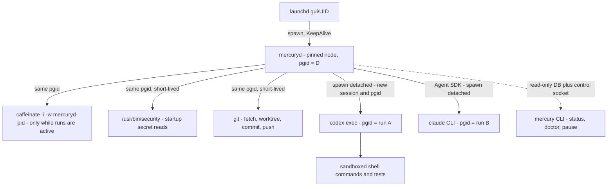

# MERCURY — macOS Runtime and Service Management

Owner: Agent D (DevOps / Platform Architect). Phase 2 design. Status: **proposal for reconciliation**. Feeds TDD §18 (macOS Runtime), §20 (Reliability, with `recovery.md`), §21 (Logging and Monitoring), §23 (Performance and Resources) and §24 (Deployment and Upgrade).

Companion document: [`recovery.md`](recovery.md), which holds the failure catalogue, startup recovery and the operations runbook.

Conventions:
- **ASM-D-nn** marks an assumption about Mac or tool behaviour that has not been verified. Each one maps to a Phase 0 check in §16.
- **REL-nn** marks a measurable reliability requirement (§2). Agent F owns the final requirement IDs and may renumber them.
- Evidence tags reuse `02-discovery-platform.md`: `[S16]`, `[S18m]` and so on. New sources are listed in §18.
- Paths are written with `~`, but the installer expands them to absolute paths, because launchd does not expand `~` or `$HOME` in plists (ASM-D-01).

---

## 1. Design summary

| Decision | Choice | Why (short) |
|---|---|---|
| Supervisor | Per-user **LaunchAgent** `com.usjbro.mercury` in `gui/<uid>` | Gets the login Keychain and the user's git, Claude and Codex configuration. A LaunchDaemon cannot read the login Keychain [S22]. |
| Process model | `launchd → mercuryd (Node, pinned) → agent runs in their own process groups` | Each agent tree can be killed as a group (`kill(-pgid)`), and runs survive a daemon crash so they can be re-attached (§3.3). |
| Restart policy | `KeepAlive = {SuccessfulExit = false}`, `ThrottleInterval = 30` | Restart after a crash. A clean stop (logout, `bootout`, fatal-config halt) stays stopped. |
| Shutdown budget | Internal budget **20 s**; `ExitTimeOut = 45` | Leaves headroom for logout/shutdown paths that may cut time short (ASM-D-04). |
| Sleep | Hold `caffeinate -i -w <mercuryd pid>` **only while ≥ 1 agent run is active**. Never fight lid close or user sleep. | Power assertions stop idle sleep only [S20a]. Correctness never depends on them. |
| Sleep detection | **Timer-gap detection**: the event-loop tick stops while suspended, but Node's monotonic clock keeps counting through sleep. Confirm with `sysctl kern.waketime`. | Node/libuv uses `mach_continuous_time()` on macOS, which **counts during sleep** [N1]. **This corrects discovery §4.4** (see §8.2). |
| State | `~/Library/Application Support/Mercury/` (DB, artifacts, runs, backups) | Outside the TCC-protected folders [S23]. |
| Work trees | `~/Library/Mercury/{mirrors,worktrees}` (space-free path) | Many build and test scripts break on paths with spaces (ASM-D-12). Excluded from Time Machine. |
| Secrets | Login Keychain generic-password items, read once at start via `/usr/bin/security` on a pipe. Never in plist, env files, argv or logs. | [S22], discovery M5. |
| Durability | SQLite WAL, `synchronous=FULL`, `fullfsync=ON`, single writer | Discovery P1. A lost commit could cause a duplicate side effect. |
| Upgrades | Versioned release dirs + `current` symlink, drain, pre-migration backup, expand/contract migrations | Allows rollback without a restore (§13). |
| Liveness alerting | **GitHub Actions scheduled watchdog** in the MERCURY repo reads a heartbeat issue that mercuryd updates; optional Healthchecks-style external ping | Needs no inbound access. Alerts arrive through GitHub Mobile, which the operator already uses (§11.6). |
| CI | GitHub-hosted runners only, including one `macos` job. **No self-hosted runner.** | Discovery E2 [S21]. |

---

## 2. Reliability requirements (measurable)

All targets apply **while the Mac is awake, the operator is logged in, and the network is up**, unless a row says otherwise. Time spent asleep, logged out or offline is excluded and reported separately.

| ID | Requirement | Target | How it is measured / verified |
|---|---|---|---|
| REL-01 | Daemon restart after a crash (RTO, process) | ≤ 45 s from exit to `ready` (`ThrottleInterval` 30 s + start ≤ 15 s) | Fault test: `kill -SEGV`, then measure the gap between the `daemon.exit` and `daemon.ready` log lines |
| REL-02 | Full reconciliation after start or wake (RTO, workflow) | Every non-terminal task reconciled against GitHub and Linear within **≤ 3 min** of `ready` (≤ 50 open tasks) | `recovery.completed` log event carries `duration_ms` |
| REL-03 | Committed state lost on crash or power loss | **0** committed transitions (WAL + `synchronous=FULL` + `fullfsync`) | Power-cut simulation (kill -9 + VM hard reset in CI where possible) followed by `integrity_check` and a ledger comparison |
| REL-04 | Agent work lost on daemon crash | ≤ **0** Codex runs (re-attach, §3.3); ≤ 1 Claude run per task (re-run) | Fault-injection test |
| REL-05 | Agent work lost on reboot or power loss | ≤ **1 agent run per active task**. The worktree is rolled back to the last coordinator checkpoint commit. | Fault-injection test |
| REL-06 | Duplicate external side effects (PRs, pushes, comments, reviews, Linear writes) | **0**, enforced through the side-effect journal plus reconcile-before-retry (`recovery.md` §3) | Chaos test: crash injected before and after every outbound call; count remote objects |
| REL-07 | Time to detect a dead agent run (process gone) | ≤ **60 s** (supervisor liveness poll every 15 s) | Test: `kill -9` the agent pgid |
| REL-08 | Time to detect a stalled agent run (alive, no output) | ≤ `stall_timeout` (default **15 min** of awake time) + 60 s | Test with a fake agent that hangs |
| REL-09 | Time for the operator to learn MERCURY is down while work is pending | ≤ **75 min** (heartbeat every 5 min; watchdog every 30 min; threshold 45 min) | Stop the daemon with an active task; time until the GitHub notification arrives |
| REL-10 | Orphan agent processes after startup recovery | **0** processes with cwd under the worktree root that lack a live `runs` row | `mercury doctor` orphan check |
| REL-11 | Database backup RPO | ≤ 24 h of awake time, plus a backup before every upgrade or migration | `backups/` listing; `mercury doctor` warns if the newest backup is older than 26 h |
| REL-12 | Restore time from backup | ≤ 15 min of operator time with the runbook | Game-day drill each quarter |
| REL-13 | Re-poll after wake | First GitHub and Linear poll ≤ **60 s** after the network is reachable | `wake.detected` → `poll.completed` latency |
| REL-14 | Shutdown on SIGTERM | Exits by **20 s**, with all runs marked `interrupted` and the WAL checkpointed | Test: `launchctl kill TERM` and measure |
| REL-15 | Crash loop containment | > 5 starts in 10 min → **safe mode** (no dispatch, heartbeat says `degraded`) | Test with a forced crash on start |

---

## 3. Runtime architecture

### 3.1 Process tree



| Process | Process group | Who kills it on daemon death | Notes |
|---|---|---|---|
| `mercuryd` | Its own (the launchd job) | launchd | Single instance, enforced by a lease (§3.4) |
| `caffeinate` | mercuryd's group | launchd group cleanup, **and** `-w <mercuryd pid>` exits on its own | Started when the active-run count goes 0→1 and killed at 1→0 |
| `security`, `git`, `ps`, `lsof` helpers | mercuryd's group | launchd | Short-lived, run with timeouts (git 10 min, others 15 s) |
| `codex exec` | **Own session and group** (`spawn({detached:true})`) [S28] | **Not launchd.** mercuryd re-attaches or reaps it on start (§3.3) | stdout/stderr go to **files**, not pipes, so a daemon crash does not SIGPIPE it |
| Claude (Agent SDK → `claude` CLI) | Own group (SDK `spawnClaudeCodeProcess` / `detached`; ASM-D-15) | mercuryd reaps it on start | The SDK uses pipes, so the run cannot survive a daemon crash. It is re-run (decision runs are idempotent). |

`AbandonProcessGroup` stays at its default (false). launchd therefore cleans up mercuryd's own group (caffeinate and helpers) when the job exits [S18m]. Agent groups deliberately escape that cleanup so they can survive a crash, and mercuryd owns their whole life cycle.

### 3.2 Child spawn contract

Every agent run is started with:

```ts
interface AgentSpawnSpec {
  run_id: string;                 // run_<ulid>
  argv: string[];                 // absolute binary path first; never a shell string
  cwd: string;                    // the task worktree (Codex) or a read-only review checkout (Claude)
  env: Record<string, string>;    // built from the allowlist in §9.4; process.env is NEVER inherited
  stdin: 'prompt-file-then-close' | 'ignore';
  stdout_path: string;            // runs/<run_id>/stdout.jsonl  (O_APPEND, 0600)
  stderr_path: string;            // runs/<run_id>/stderr.log
  nice: 10;                       // os.setPriority(pid, 10) right after spawn
  deadline_awake_ms: number;      // whole-run budget, counted in awake time (§8.3)
  stall_timeout_ms: number;       // no stdout growth for this long → stalled
  max_rss_bytes: number;          // group RSS ceiling, sampled every 15 s (§10.3)
}
```

Persisted in `runs` **before** spawn returns control to the scheduler, in the same transaction that marks the run `starting`:

```sql
-- illustrative; Agent C owns the canonical DDL
ALTER TABLE runs ADD COLUMN pid INTEGER;
ALTER TABLE runs ADD COLUMN pgid INTEGER;
ALTER TABLE runs ADD COLUMN proc_start_time TEXT;  -- from `ps -o lstart= -p <pid>`, guards against PID reuse
ALTER TABLE runs ADD COLUMN stdout_path TEXT;
ALTER TABLE runs ADD COLUMN awake_ms_used INTEGER NOT NULL DEFAULT 0;
ALTER TABLE runs ADD COLUMN last_output_at TEXT;   -- wall clock of the last stdout growth
```

Ordering rule: write `runs(status='starting')` → spawn → `UPDATE runs SET pid, pgid, proc_start_time, status='running'`. If the daemon dies between spawn and the update, startup recovery finds a `starting` row with no pid. It then finds the process by cwd (§3.5) and kills it, because without a recorded identity the run cannot be re-attached safely.

### 3.3 Re-attaching a Codex run after a daemon crash

Codex writes JSONL to a file and the daemon only tails that file, so a Codex run does not depend on the daemon staying alive. On restart:

1. The pid is alive, `ps -o lstart=` matches `proc_start_time`, and `pgid` matches → **re-attach**. Resume tailing at the stored byte offset and poll liveness every 15 s with `kill(pid, 0)` (the daemon cannot `waitpid` a non-child).
2. The pid is gone and the output file (`-o`) exists, passes the schema, and the JSONL contains `turn.completed` → **adopt the result** as if the daemon had seen the exit.
3. The pid is gone and the output is incomplete → mark the run `interrupted`, roll the worktree back to the checkpoint (`recovery.md` §4 step 9), and re-dispatch under the retry policy.

Exit status is unknown after re-attach (ASM-D-16). Success is judged **only** from the schema-valid final output plus a `turn.completed` event, never from the exit code. That matches discovery: Codex's exit code is 0/1 only and failures must be classified from the JSONL.

### 3.4 Single-instance guard

- A row in `instance_lease(id=1, holder_pid, proc_start_time, boot_session_uuid, renewed_at)` is renewed every 10 s inside `BEGIN IMMEDIATE`.
- A starting instance refuses to run if the lease was renewed less than 30 s ago **and** the holder pid is alive with the same start time.
- `boot_session_uuid` comes from `sysctl -n kern.bootsessionuuid` (ASM-D-17). If it differs from the stored value, the machine has rebooted since the last run: every recorded pid is invalid, and reboot recovery applies.
- launchd already prevents two copies of the same label. The lease additionally guards against a manual `node mercuryd.js` in a terminal.

### 3.5 Optional helpers

| Helper | v1? | Purpose |
|---|---|---|
| `caffeinate` (Apple, `/usr/bin/caffeinate`) | **Yes** | Idle-sleep assertion while runs are active |
| `mercury-keychain` (small signed Swift binary) | **No (v2 option)** | Narrows Keychain item ACLs to one binary instead of `/usr/bin/security` (§9.2) |
| Native IOKit power-notification helper | No | `kIOMessageSystemWillSleep` callbacks would allow pre-sleep checkpoints. Not needed, because recovery is wake-driven and checkpoints are already continuous. |

---

## 4. LaunchAgent vs LaunchDaemon

| Criterion | LaunchAgent (`gui/<uid>`) | LaunchDaemon (`system`, with `UserName`) | Weight |
|---|---|---|---|
| Login Keychain (GitHub App key, API keys) | Available after login [S16, S22] | **Not available** [S22]. Would need the System keychain (root-managed) or files. | Decisive |
| Agent CLIs' own auth and config (`~/.codex`, `~/.claude`) | Natural | Possible with `UserName`, but there is no user Keychain, and Claude stores OAuth in the Keychain | High |
| Runs before login, after reboot | **No** | Yes | High, but blocked by FileVault anyway (§6) |
| Runs while logged out | No | Yes | Medium. The operator rarely logs out (ASM-D-05). |
| Install privilege | None (user-writable `~/Library/LaunchAgents`) | Root (`/Library/LaunchDaemons`, `sudo launchctl`) | Medium |
| TCC | User context. Still keep out of protected folders. | Separate context; often denied user folders [S23] | Medium |
| Local notifications (`osascript display notification`) | Works in the Aqua session (ASM-D-06) | No GUI session | Low |
| Blast radius | User privileges | Root unless `UserName` is set; any mistake is system-wide | High |

**Decision: LaunchAgent.** The Keychain criterion alone decides it. The main thing a daemon would buy, running before login, is cancelled by FileVault: the disk stays locked until a user authenticates at boot (§6). The cost, "nothing runs while logged out or before first login", is accepted, and the watchdog (§11.6) makes it visible.

Revisit only if the operator moves to an always-on, FileVault-off build host. That would be a security regression and needs an ADR.

---

## 5. LaunchAgent plist

Installed at `~/Library/LaunchAgents/com.usjbro.mercury.plist`, mode `0644` (launchd refuses group- or world-writable plists; ASM-D-02). The installer renders it from a template with absolute paths. The example user `jb` and the versions are placeholders.

```xml
<?xml version="1.0" encoding="UTF-8"?>
<!DOCTYPE plist PUBLIC "-//Apple//DTD PLIST 1.0//EN" "http://www.apple.com/DTDs/PropertyList-1.0.dtd">
<plist version="1.0">
<dict>
  <key>Label</key>
  <string>com.usjbro.mercury</string>

  <!-- Absolute, pinned interpreter. Never /usr/bin/env node, never Homebrew's moving node. -->
  <key>ProgramArguments</key>
  <array>
    <string>/Users/jb/Library/Application Support/Mercury/runtime/node-v24.21.0-darwin-arm64/bin/node</string>
    <string>--disable-warning=ExperimentalWarning</string>
    <string>/Users/jb/Library/Application Support/Mercury/app/current/dist/mercuryd.js</string>
    <string>--config</string>
    <string>/Users/jb/Library/Application Support/Mercury/config/mercury.toml</string>
  </array>

  <key>RunAtLoad</key>
  <true/>

  <!-- Restart after a crash or signal death. A clean exit (0) stays down: logout, bootout,
       or a deliberate fatal-config halt. Crashed=true would be redundant with SuccessfulExit=false. -->
  <key>KeepAlive</key>
  <dict>
    <key>SuccessfulExit</key>
    <false/>
  </dict>

  <!-- Minimum seconds between respawns. App-level crash-loop guard escalates to safe mode (REL-15). -->
  <key>ThrottleInterval</key>
  <integer>30</integer>

  <!-- SIGTERM → SIGKILL gap. Internal shutdown budget is 20 s (§12); 45 s leaves headroom. -->
  <key>ExitTimeOut</key>
  <integer>45</integer>

  <!-- Standard: normal scheduling. Background would throttle CPU/IO and slow DB fsyncs. -->
  <key>ProcessType</key>
  <string>Standard</string>

  <!-- Daemon stays at nice 0; agent children are reniced to +10 individually. -->
  <key>Nice</key>
  <integer>0</integer>

  <!-- false: DB fsync latency matters. Agent IO is not marked low-priority in v1 (ASM-D-18). -->
  <key>LowPriorityIO</key>
  <false/>

  <key>WorkingDirectory</key>
  <string>/Users/jb/Library/Application Support/Mercury</string>

  <!-- Decimal 63 == octal 0077 → files 0600, dirs 0700. launchd wants decimal. -->
  <key>Umask</key>
  <integer>63</integer>

  <!-- Minimal, non-secret environment. Tool binaries are configured by absolute path in
       mercury.toml, so PATH is only a fallback for system tools. -->
  <key>EnvironmentVariables</key>
  <dict>
    <key>PATH</key>
    <string>/usr/bin:/bin:/usr/sbin:/sbin</string>
    <key>LANG</key>
    <string>en_US.UTF-8</string>
    <key>MERCURY_HOME</key>
    <string>/Users/jb/Library/Application Support/Mercury</string>
    <key>NODE_ENV</key>
    <string>production</string>
  </dict>

  <!-- Only for output before the in-process logger starts, and for crash traces.
       Structured logs go to ~/Library/Logs/Mercury/mercuryd.jsonl (rotated in-process). -->
  <key>StandardOutPath</key>
  <string>/Users/jb/Library/Logs/Mercury/launchd.stdout.log</string>
  <key>StandardErrorPath</key>
  <string>/Users/jb/Library/Logs/Mercury/launchd.stderr.log</string>

  <key>SoftResourceLimits</key>
  <dict>
    <key>NumberOfFiles</key>
    <integer>8192</integer>
  </dict>
  <key>HardResourceLimits</key>
  <dict>
    <key>NumberOfFiles</key>
    <integer>16384</integer>
  </dict>

  <!-- Aqua is the default for ~/Library/LaunchAgents; stated explicitly for clarity. -->
  <key>LimitLoadToSessionType</key>
  <string>Aqua</string>
</dict>
</plist>
```

Key decisions:

| Key | Value | Justification / rejected alternative |
|---|---|---|
| `KeepAlive` | `{SuccessfulExit:false}` | `true` would restart even after a deliberate halt (fatal config, DB corruption → safe-stop), which creates a crash loop. `NetworkState` is believed to be no longer honoured [S18m, I]. The daemon handles connectivity itself (§8.5). |
| Exit-code contract | `0` = intentional stop (SIGTERM, `mercury stop`, fatal non-retryable error after writing `run/fatal.json`). `≠0` / signal = crash → restart. | `EX_CONFIG` (78) is **not** used for fatal errors, because launchd would restart it every 30 s. |
| `ThrottleInterval` | 30 | The default is 10 [S18m]. 30 s halves the respawn churn in a crash loop, and REL-01 still holds. |
| `ExitTimeOut` | 45 | The default is 20 [S18m]. The internal budget is 20 s, so we never depend on the extra time. ASM-D-04: at system shutdown macOS may not honour long timeouts. |
| `ProcessType` | `Standard` | `Background` adds CPU/IO throttling [S18m]. `Adaptive` needs XPC activity. `Interactive` is for apps. |
| `Nice` | 0 (daemon), children +10 | The daemon is light and latency-sensitive (polling, DB). Agents and tests are heavy and should yield to the operator's interactive work. |
| `Umask` | 63 (`0077`) | Enforces 0600/0700 on everything the daemon creates (§7.2). Children inherit it. Git respects umask for worktree files, which is acceptable because worktrees are private. |
| `EnvironmentVariables` | No secrets, no tool paths | Secrets come from the Keychain at runtime (§9). The plist is world-readable by design (ASM-D-02). |
| `SoftResourceLimits.NumberOfFiles` | 8192 | Node, SQLite, the git subprocesses and log tails need more than the default 256 soft limit (ASM-D-19). `NumberOfProcesses` is not lowered, because test suites fork heavily. |
| `StandardOut/ErrorPath` | Small files | launchd holds these fds, so they cannot be renamed for rotation without a restart. The daemon truncates them at start if > 5 MiB (§11.3). |
| No `StartInterval` or `WatchPaths` | — | The daemon schedules itself. Launch-on-demand is not wanted. |
| No `AssociatedBundleIdentifiers` | — | Needs an app bundle. The Login Items UI will show the item as "node" or the script name (ASM-D-07). |

### 5.1 Install, control and uninstall commands

```sh
UID_=$(id -u); LABEL=com.usjbro.mercury; PLIST=~/Library/LaunchAgents/$LABEL.plist

# validate, then install
plutil -lint "$PLIST"
launchctl bootstrap gui/$UID_ "$PLIST"            # load + RunAtLoad start
launchctl enable    gui/$UID_/$LABEL              # clear any persisted 'disabled' override

# inspect
launchctl print gui/$UID_/$LABEL                  # state, pid, last exit code, runs
launchctl print-disabled gui/$UID_ | grep mercury

# restart (kill existing instance, start new one)
launchctl kickstart -k gui/$UID_/$LABEL

# graceful stop that stays stopped (exit 0 → KeepAlive does not restart)
launchctl kill TERM gui/$UID_/$LABEL              # or: mercury stop

# uninstall
launchctl bootout gui/$UID_/$LABEL                # SIGTERM, waits up to ExitTimeOut
rm "$PLIST"
```

Notes:
- `load`/`unload` are legacy. "Bootstrap failed: 5: Input/output error" usually means the job is already loaded: run `bootout` first [S19m].
- `bootstrap`, `bootout` and `kickstart` need no `sudo` in the `gui/<uid>` domain (ASM-D-03).
- On macOS 13+ the first bootstrap triggers a "Background Items Added" notification. The item can be switched off under System Settings › General › Login Items › Allow in the Background. If it is switched off, `bootstrap` fails or the job never runs (ASM-D-07). `mercury doctor` checks `launchctl print` for this.

---

## 6. Login-session behaviour

| Situation | MERCURY behaviour |
|---|---|
| Boot, before any login | **Nothing runs.** With FileVault on, the data volume is locked until a user authenticates. |
| Operator logs in | launchd bootstraps `gui/<uid>`. `RunAtLoad` starts mercuryd → startup recovery (`recovery.md` §4) → dispatch resumes. |
| Fast User Switching to another user | The operator's session (and mercuryd) keeps running in the background (ASM-D-08). |
| Screen locked | Keeps running. The login Keychain normally stays unlocked while the screen is locked, unless the operator set "Lock after N minutes of inactivity" or "Lock when sleeping" on the login keychain (ASM-D-09). `mercury doctor` reports `security show-keychain-info`. |
| Logout | SIGTERM → graceful shutdown (§12). Runs are marked `interrupted`. Resumes at next login. |
| Restart or shutdown | Same as logout, and the same at the next login. |
| macOS update with "Install overnight" | Behaves like a restart. If macOS uses an FileVault authenticated restart, the user may come back logged in (ASM-D-10). Otherwise MERCURY waits for login. |

**FileVault and auto-login tradeoff:**

| Option | Availability after reboot | Security | Recommendation |
|---|---|---|---|
| FileVault ON (auto-login impossible) | Waits for the operator to log in | Data at rest is encrypted. Protects the GitHub App key, API keys (Keychain) and source. | **Recommended** |
| FileVault OFF + auto-login | Resumes unattended after a power cut | A stolen or lost Mac gives full access to the agent credentials and the push-capable App key | Reject |
| Planned reboot with `sudo fdesetup authrestart` | Unlocks once and logs straight back in (ASM-D-10) | Same as FileVault ON | Use for planned maintenance |

Consequence: after an unplanned reboot, MERCURY is down until the operator logs in. The watchdog (§11.6) alerts if active tasks exist. No work is lost beyond REL-05.

---

## 7. Directory layout and permissions

### 7.1 Layout

```
~/Library/Application Support/Mercury/          0700  MERCURY_HOME (state; Time Machine: included except db/ live files)
├── app/
│   ├── releases/<semver>/                      0700  immutable release tree (dist/, node_modules/, package-lock.json, SHA256SUMS)
│   └── current -> releases/<semver>            symlink, switched atomically (§13)
├── runtime/node-v24.x.y-darwin-arm64/          0700  pinned Node, verified by SHA-256 against nodejs.org SHASUMS256
├── tools/                                       0700  pinned agent CLIs (optional; else absolute paths to user installs)
│   ├── codex/<version>/bin/codex
│   └── claude/<version>/bin/claude
├── config/mercury.toml                          0600  non-secret config (repos, limits, Keychain item names)
├── db/                                          0700  TM-EXCLUDED (live WAL files are inconsistent mid-copy)
│   ├── mercury.db  mercury.db-wal  mercury.db-shm   0600
├── backups/                                     0700  TM-INCLUDED; VACUUM INTO snapshots (§14)
│   ├── daily/  weekly/  pre-upgrade/  quarantine/
├── artifacts/sha256/<aa>/<hash>                 0600  immutable content-addressed artifacts (plans, reviews, test reports)
├── runs/<run_id>/                               0700  per-run prompt, stdout.jsonl, stderr.log, output.json, codex_home/
├── run/                                         0700  volatile runtime files
│   ├── mercuryd.sock                            0600  control socket (CLI ⇄ daemon)
│   ├── heartbeat.json                           0600  rewritten every 30 s (atomic rename)
│   ├── fatal.json                               0600  present only after a deliberate halt
│   ├── starts.log                               0600  start timestamps for the crash-loop guard
│   └── ballast                                  0600  64 MiB reserve file, deleted on disk-full (§10.4)
└── tmp/                                          0700  TMPDIR for children (per-run subdirs)

~/Library/Mercury/                               0700  WORK ROOT (no spaces; TM-EXCLUDED)
├── mirrors/<owner>__<repo>.git                  bare mirror per target repo (fetch only)
└── worktrees/<owner>__<repo>/<task-short>-<slug>/  linked worktree per task (`git worktree add`)

~/Library/Logs/Mercury/                          0700
├── mercuryd.jsonl  mercuryd.<n>.jsonl.gz        0600  structured logs, rotated in-process
├── audit.jsonl                                  0600  append-only audit projection (Agent C/E own semantics)
└── launchd.stdout.log  launchd.stderr.log       0600
```

Rules:
- **Nothing under `~/Documents`, `~/Desktop`, `~/Downloads`, iCloud Drive or removable volumes** (TCC [S23]). `mercury doctor` refuses a config whose paths resolve there.
- The work root is space-free on purpose (ASM-D-12). The `owner__repo` encoding avoids nested `/`. The worktree directory name keeps the Linear identifier so humans can find it (e.g. `JAM-204-wifi-retry`).
- `runs/<run_id>/codex_home/` is a **per-run `CODEX_HOME`**. It holds a copied minimal `config.toml` and no `auth.json` (auth comes from `CODEX_API_KEY`). This sidesteps the unverified safety of parallel runs sharing one `CODEX_HOME` (runtime discovery §3.6). It is deleted with the run directory.
- Bare mirrors are owned by the coordinator. Codex only sees a linked worktree, whose `.git` is a file pointing into `mirrors/…/worktrees/<name>`. That path is protected by Codex's sandbox, so the **coordinator performs commits** (runtime discovery finding 7).

### 7.2 Permissions

| Object | Mode | Enforcement |
|---|---|---|
| All directories above | `0700` | Created by the installer. Umask 0077 for everything created later. `mercury doctor` verifies and repairs (`chmod`), and never loosens. |
| All files | `0600` | Umask; atomic writes use `open(O_CREAT|O_EXCL, 0600)` then `rename` |
| Plist | `0644` | launchd requirement (ASM-D-02). Contains no secrets. |
| Control socket | `0600` + peer-uid check (`getpeereid` equivalent; ASM-D-20) | Only the operator's uid may connect |
| Path length | Socket path ≤ 103 bytes (macOS `sun_path` limit) | The installer checks this. Fallback: `/tmp/mercury-<uid>/mercuryd.sock` (0700 dir). |

---

## 8. Sleep, wake, clocks and connectivity

### 8.1 Policy

1. **Never fight the operator.** Lid close, Apple-menu sleep, low battery and scheduled sleep always win. MERCURY never uses `caffeinate -s`, `-d`, `pmset` changes or `sudo` by default.
2. **Prevent idle sleep only while agent runs are active.** When the active-run count goes 0→1, spawn `/usr/bin/caffeinate -i -w <mercuryd pid>` in mercuryd's process group. When it goes 1→0, SIGTERM it. Because of `-w`, the assertion ends by itself if mercuryd dies [S21m], and launchd group cleanup is a second guarantee. The assertion appears in `pmset -g assertions` (ASM-D-11).
3. Optional config `power.prevent_system_sleep_on_ac = false` (default). When it is true, `-s` is used instead of `-i`, which keeps a desktop or clamshell Mac awake on AC while runs are active. Lid close still sleeps a laptop that is not in clamshell mode.
4. **Correctness never depends on being awake.** Every waiting state uses persisted deadlines that are re-evaluated on wake (§8.3).

### 8.2 Detecting sleep and clock changes

Discovery §4.4 assumed that Node's monotonic clock pauses during sleep. **That is wrong for current Node:** libuv's macOS `uv__hrtime` returns `mach_continuous_time()`, which keeps counting during sleep [N1, N2]. `process.hrtime.bigint()` and `performance.now()` therefore advance across sleep just like `Date.now()`. The design uses two separate detectors instead:

| Signal | Detector | Meaning |
|---|---|---|
| **Suspension gap** | A 5 s `setInterval` "tick" records `mono = process.hrtime.bigint()`. If `mono_now − mono_prev > 30 s`, the process did not run for that long: system sleep, SIGSTOP, or severe starvation. | `suspended_ms = gap − 5 s` |
| **Sleep confirmation** | `sysctl -n kern.sleeptime kern.waketime` (ASM-D-13). A `waketime` later than the previous tick means a real system sleep. | Distinguishes sleep from starvation |
| **Wall-clock jump** | `drift = (wall_now − wall_prev) − (mono_now − mono_prev)`. Both clocks advance in sleep, so `|drift| > 2 s` means the wall clock was stepped (NTP correction, manual change, time zone does not matter because UTC is used). | Clock adjustment; see `recovery.md` FM-15 |

ASM-D-14: the Node version shipped on the Mac bundles a libuv with the `mach_continuous_time` behaviour (it was introduced around libuv 1.38.1 [N2]). Phase 0 experiment E2 confirms it. If the clock turns out to pause, the suspension detector still works unchanged, and the wall-versus-monotonic difference becomes a second sleep signal.

### 8.3 Deadline semantics

| Deadline kind | Clock | On sleep gap |
|---|---|---|
| Agent run whole-run budget (`deadline_awake_ms`) | **Awake time**: `awake_ms_used += tick_delta` only for ticks without a suspension gap. Persisted every 30 s. | The sleep does not count. The run gets its full budget. |
| Stall timeout (no stdout growth) | Awake time, with the clock **reset at wake** | After wake, a run gets `post_wake_grace = 5 min` to produce output before stall handling |
| Waiting on external parties (CI checks, human approval reminders, Claude review SLA) | Wall clock, persisted as absolute UTC `due_at` | Evaluated on wake. Reminders that fell due during sleep are **coalesced** into one notification (no burst). |
| Installation token expiry (GitHub, 1 h) | Wall clock | Re-minted lazily if `expires_at − now < 5 min` |
| Retry backoff timers | Wall clock `next_attempt_at` | Fire on wake if due; jitter added so no thundering herd |

### 8.4 Wake procedure

On a suspension gap > 30 s (sleep confirmed or not):

1. Log `wake.detected {suspended_ms, sleeptime, waketime}`. Increment `mercury_sleep_events`.
2. Pause dispatch of **new** runs. Existing children keep running: they were suspended too and resume on their own.
3. **Connectivity gate** (§8.5): wait until `api.github.com` and `api.linear.app` are reachable (HEAD probes with backoff 2 s → 60 s cap). The agent APIs (Anthropic, OpenAI) are probed only if runs are active.
4. Re-mint the GitHub installation token if it expires within 5 min.
5. Reset the stall clocks of active runs and start the 5-min post-wake grace (§8.3).
6. Run the **reconcile pass** (the same procedure as startup steps 10–13 in `recovery.md` §4, without the process-reaping steps): re-poll GitHub (conditional requests) and Linear (`updatedAt` cursor with a 10-min overlap). Process coalesced wall-clock deadlines.
7. Resume dispatch. Log `wake.recovered {duration_ms}` (REL-13).

### 8.5 Connectivity loss

- **Detection:** an outbound call fails with a DNS, connect or timeout error class. Two consecutive failures across ≥ 2 hosts → `net.state = offline`. Probes use HEAD `https://api.github.com/zen`-style lightweight endpoints, rate-limited to one per 15 s while offline.
- **While offline:**
  - No new agent runs are dispatched. Agent runs need model APIs, and coordinator side effects would queue up.
  - Active runs continue. They may fail on their own network errors, which are classified `environment` and do not consume the task's retry budget (max 3 environment retries per run step).
  - Outbound side effects stay in the side-effect journal as `pending` (`recovery.md` §3).
  - Polling stops. Heartbeats to remote watchdogs obviously fail. That is expected, and the watchdog's threshold is longer than typical outages.
- **On recovery:** run steps 4–7 of the wake procedure. Every journal entry that was `in_flight` when the network dropped is **reconciled before retry** (did the push or PR actually land?).
- **Captive portals and proxies:** a probe that returns a non-GitHub TLS certificate or HTML fails TLS validation and counts as offline. TLS verification is never disabled.

---

## 9. Credentials and environment

### 9.1 Inventory

| Credential | Keychain service (`-s`) | Account (`-a`) | Used by | Format |
|---|---|---|---|---|
| GitHub App private key | `com.usjbro.mercury.github-app-key` | `mercury` | mercuryd only (JWT signing) | Base64 of the PEM (single line) |
| GitHub App ID / installation ID | — (config, not secret) | — | mercuryd | `mercury.toml` |
| Linear API key (team-scoped) or OAuth app token | `com.usjbro.mercury.linear` | `mercury` | mercuryd only | Opaque string |
| Anthropic API key (Claude runs) | `com.usjbro.mercury.anthropic` | `mercury` | Claude child (env, per run) | Opaque string |
| OpenAI / Codex API key | `com.usjbro.mercury.codex` | `mercury` | Codex child (`CODEX_API_KEY`, per run) | Opaque string |
| Watchdog ping URL (optional, §11.6) | `com.usjbro.mercury.healthcheck` | `mercury` | mercuryd | URL (contains a token) |

Which auth mode is used for each agent (API key versus subscription) is an operator decision (runtime discovery §8). The table assumes API keys, which work with `--bare` and do not expire unattended.

### 9.2 Creating items (operator, once per credential)

```sh
# Prompts for the secret (-w as LAST option → interactive prompt, nothing in shell history or argv)
security add-generic-password -U -s com.usjbro.mercury.anthropic -a mercury \
  -l "MERCURY Anthropic API key" -T /usr/bin/security -w

# GitHub App key: base64 the PEM, then paste at the prompt; shred the download afterwards
base64 -i ~/Downloads/mercury-app.private-key.pem | pbcopy
security add-generic-password -U -s com.usjbro.mercury.github-app-key -a mercury \
  -l "MERCURY GitHub App private key" -T /usr/bin/security -w
rm -P ~/Downloads/mercury-app.private-key.pem   # -P is ignored on APFS; delete anyway, empty Bin
pbcopy < /dev/null
```

ACL tradeoff (Agent E owns the final call):
- `-T /usr/bin/security` lets any process of this user that runs `security` read the item while the keychain is unlocked. That is the same trust boundary as the user account itself.
- Agent children are the realistic threat. Mitigations:
  - (a) The Claude review role gets no Bash.
  - (b) Codex runs inside Seatbelt. Phase 0 experiment E5 must show that `security find-generic-password … -w` **fails inside `codex exec --sandbox workspace-write`** (ASM-D-21).
  - (c) The children's env never contains item names or MERCURY_HOME.
- v2 option: a signed `mercury-keychain` helper as the only trusted application. Caveat: ACLs bind to the code signature, so a re-signed helper prompts once.

### 9.3 How mercuryd reads secrets

- At start, and on `mercury reload-credentials`, mercuryd spawns `/usr/bin/security find-generic-password -s <svc> -a mercury -w` **with no secret in argv** and reads stdout over a pipe. Timeout 10 s.
- Exit code 44 means the item was not found. `errSecInteractionNotAllowed` (-25308, keychain locked or ACL prompt) causes a retry every 5 min plus a local notification (`recovery.md` FM-08).
- Secrets live only in memory, wrapped in a `Secret` type whose `toJSON` and `inspect` return `"[REDACTED]"`. They are never written to the DB, logs, artifacts or crash dumps. Node is started without `--inspect`, and `--report-on-fatalerror` is not enabled because reports include the environment.
- **GitHub:** mercuryd signs a 9-minute JWT (RS256, `node:crypto`) → `POST /app/installations/{id}/access_tokens` with the minimal `permissions` and `repositories` body → caches the 1 h token in memory → re-mints 5 min before expiry.
- **git push credential:** git is run with `-c credential.helper= -c credential.helper=!<abs path>/mercury-git-cred`. The helper connects to `run/mercuryd.sock` and presents a one-time nonce from env `MERCURY_CRED_NONCE`, and the daemon returns `username=x-access-token / password=<token>`. The token never appears in argv, config files or a long-lived env (ASM-D-22; Agent B owns the push design).

### 9.4 Per-child environment allowlist

`process.env` is never inherited. Each child gets exactly:

| Variable | Codex child | Claude child | git (coordinator) |
|---|---|---|---|
| `PATH` | `/usr/bin:/bin:/usr/sbin:/sbin` + pinned toolchain dirs from repo config (e.g. a pinned Node for tests) | `/usr/bin:/bin` | `/usr/bin:/bin` |
| `HOME` | real home (ASM-D-23: some tools need it) | real home | real home |
| `TMPDIR` | `MERCURY_HOME/tmp/<run_id>/` | same | — |
| `LANG`, `LC_ALL` | `en_US.UTF-8` | same | same |
| `CODEX_HOME` | `runs/<run_id>/codex_home` | — | — |
| `CODEX_API_KEY` | ✓ (per run) | — | — |
| `ANTHROPIC_API_KEY` | — | ✓ (or via `apiKeyHelper`, Agent B) | — |
| `DISABLE_AUTOUPDATER` / `CLAUDE_CODE_DISABLE_NONESSENTIAL_TRAFFIC` | — | `1` (ASM-D-24) | — |
| `MERCURY_RUN_ID` | ✓ (non-secret, used for orphan matching) | ✓ | — |
| `GIT_TERMINAL_PROMPT=0`, `GIT_CONFIG_NOSYSTEM=1`, `MERCURY_CRED_NONCE` | — | — | ✓ |
| **Never** | `GITHUB_TOKEN`, `GH_TOKEN`, `LINEAR_API_KEY`, `ANTHROPIC_API_KEY`, `SSH_AUTH_SOCK`, `MERCURY_HOME`, any `*_TOKEN` | `CODEX_API_KEY`, GitHub/Linear tokens, `SSH_AUTH_SOCK` | agent keys |

Codex shell commands get an additional filter through `shell_environment_policy` (inherit core + `include_only`), so even `CODEX_API_KEY` does not reach model-generated commands (runtime discovery §3.3; exact values ASM per runtime discovery unknown 5).

---

## 10. Resource limits and concurrency

### 10.1 Defaults (`mercury.toml`)

```toml
[concurrency]
max_active_tasks          = 4    # tasks in non-terminal, non-waiting states
max_codex_runs            = 1    # raise to 2 after Phase 0 E6 proves parallel CODEX_HOME safety + capacity
max_claude_runs           = 2    # review/decision runs are lighter (no Bash, read-only)
max_total_agent_runs      = 3
max_runs_per_repo         = 1    # one Codex run per target repo at a time (shared mirror fetches, test ports)

[resources]
min_free_disk_gib_dispatch   = 15    # below: no new worktree / run
min_free_disk_pct_dispatch   = 10
min_free_disk_gib_hardstop   = 5     # below: pause all dispatch, alert, (eventually) interrupt runs at 2 GiB
max_loadavg_per_cpu          = 1.5   # 1-min loadavg / ncpu above → defer new runs (not kill)
defer_on_memory_pressure     = "warn" # kern.memorystatus_vm_pressure_level: 1 normal, 2 warn, 4 critical
max_run_rss_gib              = 8     # whole process group RSS ceiling (sampled)
max_worktree_gib             = 10    # du of worktree; above → fail run (classification: resource)
max_runs_dir_gib             = 20    # prune oldest terminal run dirs above this

[timeouts]
codex_plan_awake_min         = 30
codex_impl_awake_min         = 120
claude_review_awake_min      = 20
stall_min                    = 15
post_wake_grace_min          = 5
```

Rationale for `max_codex_runs = 1`:
- Parallel safety of Codex state, and the operator's API spend, are unverified.
- One-at-a-time implementation matches today's workflow, and the bottleneck is human merge time (PR-to-merge ≈ 14.5 h; integrations discovery), not throughput.
- Claude reviews may overlap with a Codex run.

### 10.2 Admission check (before every run dispatch)

```ts
function admit(run: PendingRun, s: SystemSnapshot): Admission {
  if (s.mode !== 'normal') return defer('mode:' + s.mode);            // paused / safe / degraded
  if (s.net.state !== 'online') return defer('offline');
  if (s.disk.freeGiB < cfg.min_free_disk_gib_dispatch ||
      s.disk.freePct < cfg.min_free_disk_pct_dispatch) return defer('disk');
  if (s.loadavg1 / s.ncpu > cfg.max_loadavg_per_cpu) return defer('cpu');
  if (s.memPressure >= levelOf(cfg.defer_on_memory_pressure)) return defer('memory');
  if (countActive(run.agent) >= limitFor(run.agent)) return defer('slots');
  if (run.kind === 'codex' && activeInRepo(run.repo) >= cfg.max_runs_per_repo) return defer('repo-slot');
  if (s.circuit[run.agent] === 'open') return defer('circuit:' + run.agent); // see recovery FM-16
  return admitNow();
}
```

Deferral is not failure: the task stays in its state, and `deferred_reason` is shown by `mercury status`. Deferral lasting > 2 h for `disk` or `memory` raises one operator notification.

### 10.3 Monitoring active runs (every 15 s)

- Liveness: `kill(pid,0)` plus a start-time match.
- Output growth: the `stat` size of stdout.jsonl.
- Group RSS: `ps -o rss= -g <pgid>` summed. Above `max_run_rss_gib` → SIGTERM the group, then SIGKILL after 10 s, and fail the run with class `resource`.
- macOS does not reliably enforce `RLIMIT_AS`/`RLIMIT_DATA` (ASM-D-25), so this is sampling, not a hard limit.

### 10.4 Disk-space guard

- Before `git worktree add` and before each run: `statfs` on the work root and on MERCURY_HOME. Dispatch is refused below the thresholds.
- `run/ballast` (64 MiB) is created at install. On `SQLITE_FULL` or `ENOSPC`, mercuryd deletes the ballast, which frees room to commit a `degraded:disk_full` state and the alert, then stops dispatch. The ballast is recreated when free space recovers above `min_free_disk_gib_dispatch`.
- Cleanup order when free space is low (automatic, safe items only):
  1. Terminal run directories older than 7 days.
  2. Compressed logs beyond retention.
  3. Worktrees of COMPLETED/CANCELLED tasks past retention.
  4. `git gc --auto` on mirrors.
  5. **Never** worktrees of non-terminal or FAILED tasks, backups, artifacts or the DB.

### 10.5 Log rotation

- **In-process** (no `newsyslog`, which needs root to install `/etc/newsyslog.d` config).
- `mercuryd.jsonl` rotates at 20 MiB or daily, whichever comes first. Up to 14 gzip generations are kept, with a 300 MiB total cap.
- `runs/<id>/stdout.jsonl` is not rotated. It is capped at 200 MiB per run, and above that the daemon stops copying it into artifacts and records truncation.
- launchd stdout/stderr files are truncated at start if > 5 MiB, keeping the last 1 MiB copied to `launchd.stderr.prev.log`.

---

## 11. Observability

### 11.1 Structured log schema (`mercuryd.jsonl`, one JSON object per line)

```ts
interface LogLine {
  ts: string;                  // RFC 3339 UTC with ms
  level: 'trace'|'debug'|'info'|'warn'|'error'|'fatal';
  msg: string;                 // stable event name, dot-separated: 'run.started', 'wake.detected'
  component: string;           // 'scheduler'|'supervisor'|'github'|'linear'|'db'|'power'|'recovery'|...
  daemon_version: string;      // semver of app/current
  boot_id: string;             // kern.bootsessionuuid (ties logs to a boot)
  instance_id: string;         // ulid per daemon start
  // correlation (present when applicable; names per baseline)
  task_id?: string; correlation_id?: string; causation_id?: string;
  run_id?: string; message_id?: string; auth_id?: string; plan_id?: string;
  issue?: string; repo?: string; pr?: number; dedup_key?: string;
  // payload
  data?: Record<string, unknown>;   // event-specific, passed through the redactor
  err?: { class: FailureClass; code?: string; message: string; stack?: string };
  duration_ms?: number;
}
type FailureClass = 'environment'|'network'|'rate_limit'|'auth'|'contract'|'resource'|'agent'|'internal'|'external_outage'|'conflict';
```

- **Redaction:** a central redactor drops keys matching `/(token|secret|key|password|authorization|cookie)/i` and scrubs values matching known secret shapes (GitHub `ghs_`/`ghp_`/`github_pat_`, `sk-`, `lin_api_`, PEM blocks, JWT `eyJ…`). Every in-memory `Secret` value is also registered for exact-match scrubbing. Agent stdout copied into artifacts goes through the same redactor (Agent E owns the patterns).
- **Levels:** `info` is the production default. `debug` can be switched on at runtime with `mercury log-level debug --for 30m`, and it reverts automatically.
- **Retention:** logs 30 days (by size cap); `runs/` 30 days for terminal runs; **audit records and artifacts are kept for the life of the DB** (Agent C/E own audit).

### 11.2 Key metrics (logged as `metric.*` lines every 5 min; no metrics server)

`tasks_by_state`, `runs_active{agent}`, `runs_deferred{reason}`, `run_duration_ms{agent,kind}`, `poll_latency_ms{source}`, `rate_limit_remaining{source}`, `side_effects_pending`, `side_effects_reconciled`, `sleep_events`, `suspended_ms_total`, `disk_free_gib`, `db_size_mib`, `wal_size_mib`, `last_backup_age_h`, `circuit_state{dependency}`.

### 11.3 Health surfaces

| Surface | Content | Works when daemon is down? |
|---|---|---|
| `run/heartbeat.json` (every 30 s, atomic) | `{ts, instance_id, version, mode: normal|paused|safe|degraded, net, active_runs, active_tasks, awaiting_human, deferred, last_poll:{github,linear}, last_backup_at, oldest_pending_side_effect_s}` | Its age shows staleness |
| `mercury status` | Heartbeat + read-only DB query (SQLite WAL readers do not block the writer): tasks by state, active runs with awake time and last output, deferrals, circuits | Yes (read-only DB), shows "daemon DOWN since …" |
| `mercury doctor` | Checks: launchd job loaded and enabled; pid matches lease; Background Items allowed; dirs and permissions; TCC-safe paths; Keychain items present and readable (values not printed); Node/Claude/Codex/git versions match pins; `codex exec --help` flags present; DB `quick_check` (or `integrity_check` with `--full`); backup age; disk; orphan processes; worktree consistency (`git worktree list` vs DB); clock drift; heartbeat age; watchdog last-seen | Yes |
| `launchctl print gui/$UID/com.usjbro.mercury` | launchd state, last exit status | Yes |

### 11.4 Alert classes (operational, not workflow)

Workflow notifications (PR ready, plan escalation, …) are designed by others (brief §G). Operational alerts from this document:

| Alert | Trigger | Channel | Dedup |
|---|---|---|---|
| `ops.daemon_down` | Watchdog: heartbeat stale > 45 min while `active_tasks > 0` or `awaiting_human = false` with work queued | Watchdog workflow → GitHub issue comment @mentioning the operator (§11.6) | One open alert issue; re-notify every 24 h at most |
| `ops.safe_mode` / `ops.fatal_halt` | Crash loop, DB corruption, migration refusal | GitHub ops issue (if network) + local macOS notification | Per instance |
| `ops.credentials` | 401 / revoked / keychain locked > 15 min | Local notification + the **other** channel (Linear comment if GitHub auth failed, GitHub if Linear failed) | Per credential per 24 h |
| `ops.disk` / `ops.memory` | Hard stop, or deferral > 2 h | GitHub ops issue | Per condition per 24 h |
| `ops.backup_stale` | No verified backup in 48 h of awake time | GitHub ops issue | Per 72 h |
| `ops.contract_break` | Agent CLI output contract failure, circuit opened | GitHub ops issue | Per agent version |

"GitHub ops issue" means one long-lived issue in `usjbro/project-mercury` titled `MERCURY operations alerts`, with comments posted by the App and an @mention of the operator, so GitHub Mobile notifies. This needs the App to have `issues:write` on the MERCURY repo only (dependency on Agent B/E).

### 11.5 Local notifications

`/usr/bin/osascript -e 'display notification "…" with title "MERCURY"'` from the LaunchAgent (ASM-D-06). The message text is fixed and contains no task content, which avoids injection through issue titles. Used for credential and disk alerts that may also block remote alerting.

### 11.6 "Is the daemon itself alive?" — dead man's switch without inbound access

| Option | How | Pros | Cons | Verdict |
|---|---|---|---|---|
| **A. GitHub Actions scheduled watchdog** | mercuryd edits the body of a pinned "MERCURY heartbeat" issue in `project-mercury` every 5 min with JSON `{at, version, mode, active_tasks, awaiting_human}`. A workflow `on: schedule: '*/30 * * * *'` reads it with `GITHUB_TOKEN` (`issues: read`), and if it is stale and work is pending, comments on the ops issue with an @mention (`issues: write`). | No new vendor. Alerts arrive through GitHub Mobile. **Conditional alerting** (silent when nothing is pending, so overnight lid-close is not an alert). Free on public repos. | Scheduled runs can be delayed under load. **Scheduled workflows in public repos are disabled after 60 days without repository activity** [N3]. Issue edits may not count as "activity" (ASM-D-26). Adds `issues:write` on the MERCURY repo. ~288 issue edits a day. | **Recommended default.** Mitigate the 60-day rule: `mercury doctor` checks the workflow state via `GET /repos/{o}/{r}/actions/workflows/{id}` (`state: active`). A monthly MERCURY repo commit (release cadence) keeps it active. |
| B. Healthchecks.io-style ping | mercuryd `GET`s a secret ping URL every 5 min. The service alerts by email or app when pings stop [N4]. | Simplest. Robust. Independent of GitHub. | New third-party service and account. The ping URL is a secret. Alerting is unconditional (laptop asleep overnight → alert) unless grace is set long (12 h) or the check is paused via its API. | **Optional add-on** (operator decision). Use a long grace (12 h) as a backstop for "silent for half a day". |
| C. Linear-based | No scheduler in Linear | — | — | Reject |
| D. Self-hosted runner / inbound probe | — | — | Violates no-inbound and discovery E2 | Reject |
| E. iOS Shortcuts automation polling the heartbeat issue | Personal automation on the iPhone | No server | Fragile; iOS limits background automations | Reject |

**Heartbeat issue body example** (written by the App; non-secret):

```json
{"schema":"mercury.heartbeat.v1","at":"2026-10-12T21:05:00Z","version":"0.4.2","mode":"normal",
 "active_tasks":2,"active_runs":1,"awaiting_human":1,"pending_work":true}
```

Watchdog workflow logic (illustrative):

```yaml
name: mercury-watchdog
on:
  schedule: [{ cron: '7,37 * * * *' }]    # off-minute to dodge top-of-hour load
  workflow_dispatch: {}
permissions: { issues: write, contents: read }
jobs:
  check:
    runs-on: ubuntu-latest
    timeout-minutes: 5
    steps:
      - uses: actions/github-script@<pinned-sha>
        with:
          script: |
            const hb = JSON.parse((await github.rest.issues.get({...context.repo, issue_number: Number(process.env.HB_ISSUE)})).data.body);
            const ageMin = (Date.now() - Date.parse(hb.at)) / 60000;
            if (ageMin > 45 && hb.pending_work) {
              // post once per 24h: check last comment marker before posting
              await github.rest.issues.createComment({...context.repo, issue_number: Number(process.env.OPS_ISSUE),
                body: `@usjbro MERCURY heartbeat stale for ${Math.round(ageMin)} min with pending work. <!-- mercury:watchdog:${new Date().toISOString().slice(0,10)} -->`});
            }
        env: { HB_ISSUE: '1', OPS_ISSUE: '2' }
```

`pending_work = active_tasks > 0 && !(all active tasks are waiting on the human)`. This keeps "PR waiting for your approval while the Mac sleeps" from producing noise.

---

## 12. Graceful shutdown (SIGTERM / SIGINT / `mercury stop`)

Budget: **20 s** internal, `ExitTimeOut` 45 s. Installing a SIGTERM listener removes Node's default exit, so the handler must call `process.exit` [S28b].

| t (s) | Step |
|---|---|
| 0 | Set `mode = stopping`. Stop the scheduler (no new dispatch), the pollers and the backup job. Reject new control-socket mutations. Log `daemon.stopping {reason}`. |
| 0–1 | Let in-flight **DB transactions** finish. Let in-flight **outbound HTTP side effects** finish, up to 5 s (their journal rows are already `in_flight`, so a cut-off call is reconciled at next start). |
| 1 | **Codex runs: leave them running** if the reason is `bootout`/`kickstart`/upgrade (they re-attach, §3.3). Interrupt them if the reason is logout or shutdown. The daemon cannot tell logout from bootout through SIGTERM alone, so the **default is to interrupt**. `mercury restart --keep-runs` sets a flag file first. |
| 1 | Interrupt: send SIGINT to Claude groups (clean turn end; runtime discovery: SIGTERM gives 143 and an unfinished turn) and SIGTERM to Codex groups (`process.kill(-pgid, …)`). |
| 1–11 | Wait for groups to exit, polling every 250 ms. |
| 11 | SIGKILL any group still alive. |
| 12 | In one transaction: mark interrupted runs `interrupted` with `awake_ms_used`. Tasks **stay in their workflow state** (run-level, not task-level, failure). Write the `daemon.stopped` event. |
| 13 | Kill `caffeinate`. `PRAGMA wal_checkpoint(TRUNCATE)`. Close the DB. Release the instance lease (`renewed_at = 0`). Final heartbeat (`mode: stopped`) to the file. A remote heartbeat is attempted with a 2 s timeout only. |
| ≤ 20 | `process.exit(0)` |

A second SIGTERM during shutdown jumps straight to the t=11 step.

---

## 13. Upgrades, migrations and rollback

### 13.1 Release and install

1. CI produces `mercury-<semver>.tgz` + `SHA256SUMS` + a build-provenance attestation (§15).
2. `mercury upgrade <semver>`:
   1. Downloads the release.
   2. Verifies SHA-256 and `gh attestation verify` (operator's `gh`, optional).
   3. Extracts to `app/releases/<semver>/`.
   4. Runs `npm ci --omit=dev --ignore-scripts` from the bundled lockfile. Native modules are not used in v1, because `node:sqlite` is behind an interface; if `better-sqlite3` is ever adopted, it uses a prebuilt binary, verified.
   5. Runs `node app/releases/<semver>/dist/selftest.js` (config parse, schema files, migration dry-run on a **copy** of the DB).
3. The Node runtime is upgraded separately: new `runtime/node-<ver>/` + plist re-render + `bootout`/`bootstrap`. The old runtime is kept for rollback.

### 13.2 Upgrade procedure (atomic switch)

```
mercury upgrade 0.5.0
  1. preflight: doctor --quick; free disk ≥ 2× DB size + 1 GiB
  2. drain: mode=draining → no new dispatch; wait for active Claude runs (≤ 20 min);
     Codex runs may continue (re-attach) unless the release notes say "requires-drain"
  3. backup: VACUUM INTO backups/pre-upgrade/<ts>-v<old>-uv<user_version>.db; integrity_check the copy
  4. switch: ln -sfn releases/0.5.0 app/current.tmp && mv -h app/current.tmp app/current   (atomic rename)
  5. restart: launchctl kickstart -k gui/$UID/com.usjbro.mercury  (with keep-runs flag)
  6. new version runs migrations at start (13.3), then recovery, then emits daemon.ready{version}
  7. verify: mercury status shows new version + mode normal within 2 min; else auto-rollback (13.4)
```

### 13.3 Database migrations

- `PRAGMA user_version` = the schema version. Migrations are numbered SQL files `NNNN_description.sql`, shipped in the release, forward-only.
- Each migration runs in `BEGIN IMMEDIATE … COMMIT` and sets `user_version` in the same transaction.
- **Before the first pending migration:** `PRAGMA integrity_check` (must return `ok`) and a `VACUUM INTO` backup (already taken in step 3; taken again if the daemon was started without `mercury upgrade`).
- **Compatibility window (expand/contract):**
  - Release N+1 may only add tables, columns (nullable or defaulted) and indexes ("expand").
  - Removing or renaming happens no earlier than release N+2 ("contract"), after N+1 has run successfully.
  - A table `schema_meta(min_reader_version INTEGER)` records the oldest app version that can safely operate on this schema. Expand migrations leave it unchanged. Contract migrations raise it.
- **Start rule:**
  - `user_version > max_known` **and** `min_reader_version ≤ app_version` → run (forward-compatible; rollback case).
  - `min_reader_version > app_version` → **fatal halt** (exit 0, `fatal.json`, alert). Never write.
  - `user_version < max_known` → migrate.
- Data backfills that touch more than 10k rows run in batches outside the schema transaction, idempotently.

### 13.4 Rollback

| Situation | Procedure | Data loss |
|---|---|---|
| New version fails before migrating | `mercury rollback` → `current` → previous release → kickstart | None |
| New version migrated (expand only) and misbehaves | `mercury rollback` → previous release. The old version still runs on the expanded schema (compat window). | None |
| Migration itself failed (transaction rolled back) | Daemon halts with `fatal.json`. `mercury rollback`. | None |
| Contract migration ran, or the schema is damaged | `mercury restore --pre-upgrade <file>` + rollback (`recovery.md` RB-08) | State since the backup. Recovered by reconciliation; authority can only shrink (re-authorization may be needed). |

Auto-rollback: if the new version does not reach `daemon.ready` within 3 starts or 5 min, the upgrade wrapper (a separate `mercury upgrade` process that stays running and polls the heartbeat) switches back and kickstarts. It logs `upgrade.rolled_back`.

### 13.5 Agent CLI upgrades (Claude, Codex)

- Versions are pinned in `mercury.toml` (`agents.codex.version`, `agents.claude.version`, plus absolute binary paths).
- Auto-update is disabled (Codex `check_for_update_on_startup=false` in the per-run config; Claude `DISABLE_AUTOUPDATER=1`, ASM-D-24).
- Upgrading is an explicit `mercury agents upgrade codex <ver>`. It installs side by side, runs the contract suite (`mercury doctor --agents`, which uses recorded fixtures plus one cheap live smoke run in a scratch repo), and then switches the pin.
- Startup check: the actual `--version` equals the pin, otherwise that agent's circuit opens (`recovery.md` FM-16).

---

## 14. Backups and integrity

| Item | Policy |
|---|---|
| Method | `VACUUM INTO 'backups/daily/mercury-<UTC ts>-uv<n>.db'` on the live DB. Consistent, compact, safe on WAL [discovery 5.1]. Then open the copy read-only, run `PRAGMA integrity_check` and record `{path, sha256, size, user_version, integrity:'ok'}` in `backups` (and in `backups/index.json`). |
| Schedule | "Due" when the newest verified backup is > 24 h old. Checked hourly and at wake. Runs at the first moment that is due **and** there is no active DB-heavy work (or after a 30-min deferral cap). No fixed 03:00 slot, because the Mac may be asleep then. |
| Extra triggers | Before upgrade and migration (`pre-upgrade/`), before `mercury restore` (`quarantine/` copy of the current DB), on `mercury backup` |
| Retention | 7 daily, 4 weekly (the first daily of each ISO week is copied to `weekly/`), last 5 pre-upgrade, quarantine 30 days |
| Off-device | `backups/` and `artifacts/` are **included** in Time Machine. `db/` (live files), `~/Library/Mercury/` (mirrors, worktrees), `runs/` and `tmp/` are **excluded** with `tmutil addexclusion <path>` (a sticky, per-path exclusion; no sudo; ASM-D-27). Reasons: live WAL files can be captured inconsistently, and mirrors and worktrees are large and can be rebuilt from GitHub. |
| Worktree caveat | A worktree may hold Codex changes not yet committed by the coordinator. These are by design checkpointed into local commits after each successful run step (`recovery.md` §4 step 9), and pushed at PR stages. Excluding worktrees from Time Machine therefore loses at most one run step, consistent with REL-05. |
| Startup integrity | `PRAGMA quick_check` at every start (fast). `PRAGMA integrity_check` daily before the backup, and before migrations. On failure → `recovery.md` FM-09. |
| `foreign_key_check` | Daily, alongside `integrity_check` |
| Secrets in backups | None by design (secrets are never in the DB). Backups are protected by FileVault plus 0600. |

---

## 15. CI/CD architecture

### 15.1 MERCURY's own repository (`usjbro/project-mercury`)

All jobs run on **GitHub-hosted runners**. No self-hosted runner: the repo is public, and GitHub says self-hosted runners should only be used with private repositories [S21]. Actions are pinned by commit SHA. `permissions: contents: read` by default. No repository secrets are needed for CI.

| Job (required check name) | Runner | Content | Gate |
|---|---|---|---|
| `lint` | ubuntu | eslint, prettier --check, markdownlint for docs, `actionlint` | Required |
| `typecheck` | ubuntu | `tsc --noEmit` (strict) | Required |
| `test-unit` | ubuntu | State machine, scheduler admission, deadline/awake-time math (with a fake clock), redactor, migrations on an in-memory DB | Required, coverage ≥ 85% on `core/` |
| `test-integration` | ubuntu | Coordinator against fake GitHub and Linear servers (recorded fixtures, injected 5xx/429/timeout/reset), crash injection around every side effect (REL-06), duplicate poll events, restore-and-reconcile | Required |
| `test-contracts` | ubuntu | JSON Schemas compile; recorded Codex JSONL and Claude stream-json fixtures for the **pinned** versions parse; unknown event types tolerated | Required |
| `test-macos` | `macos-15` (GitHub-hosted; ASM-D-28) | `plutil -lint` of the rendered plist; process-group spawn and kill and orphan reaping; `fullfsync` pragma effective; `caffeinate -w` lifecycle; `security` CLI round-trip in a **temporary keychain** (`security create-keychain`); Unix socket path length; TCC-safe path validation | Required |
| `build` | ubuntu | `npm ci --ignore-scripts`, build `dist/`, `npm pack`, SHA256SUMS | Required |
| `supply-chain` | ubuntu | `npm audit signatures`, OSV scan of the lockfile, dependency-review on PRs, lockfile-only installs | Required (high/critical fail) |
| `codeql` | ubuntu | JS/TS analysis | Advisory → required after baseline |

Release workflow (`on: push: tags: v*`): rebuild → `actions/attest-build-provenance` → GitHub Release with tarball + SHA256SUMS. Permissions: `contents: write`, `id-token: write`, `attestations: write`, scoped to this job only.

Branch protection for `main` uses the same human-approval model as target repos (discovery G3): CODEOWNERS `* @usjbro`, last-push approval, dismiss stale, the required checks above, no bypass.

### 15.2 Target repositories (e.g. `usjbro/network_monitor`)

- Each target repo keeps **its own CI** (unknown today; integrations discovery). MERCURY does not install runners or modify workflows (the App has no `workflows:write`).
- **Onboarding precondition** (checked by `mercury repo check <owner/repo>`, read-only): protections per G3, at least **one required status check** on the default branch, CODEOWNERS = human, "Allow GitHub Actions to create and approve pull requests" off. A repo failing the check can be registered but stays `onboarding_blocked`, and no tasks are dispatched for it.
- MERCURY reads check runs and statuses for the PR head SHA (`checks:read`, `statuses:read`). "Tests pass" for workflow purposes = **all required checks green on the exact head SHA**, plus the local test evidence from the Codex run (Agent B/C own the evidence model).
- Optional (Agent B to decide): a tiny `mercury-pr-policy` workflow in each target repo, using `GITHUB_TOKEN` with read permission, that verifies the PR body contains a `Mercury-Task:`/Linear reference and the branch-name convention. Making it a required check catches PRs that bypass MERCURY.

---

## 16. Phase 0 Mac verification checklist

### 16.1 Read-only commands (safe to run any time)

Run in Terminal as the operator and paste the output into `reviews/phase0-mac-facts.md`. Redact anything sensitive. None of these change system state.

| # | Command | Confirms / informs |
|---|---|---|
| P0-01 | `sw_vers; uname -m; sysctl -n hw.model hw.ncpu hw.memsize` | macOS version (launchd/BTM behaviour), Apple Silicon or Intel (Node build), capacity for concurrency defaults |
| P0-02 | `pmset -g; pmset -g batt; pmset -g custom` | Laptop or desktop, AC/battery sleep timers, `powernap`, `standby` (§8) |
| P0-03 | `pmset -g assertions` | Baseline assertions; later compare while MERCURY runs (ASM-D-11) |
| P0-04 | `pmset -g log \| grep -E " (Sleep\|Wake\|DarkWake) " \| tail -40` | Real sleep/wake cadence (sizing of thresholds; REL-09) |
| P0-05 | `sysctl -n kern.sleeptime kern.waketime kern.bootsessionuuid kern.boottime` | Availability of the sleep confirmation and boot id sysctls (ASM-D-13, ASM-D-17) |
| P0-06 | `fdesetup status; defaults read /Library/Preferences/com.apple.loginwindow autoLoginUser 2>&1` | FileVault on, auto-login off (§6) |
| P0-07 | `id -u; echo $HOME; ls -ld ~/Library/Application\ Support ~/Library/LaunchAgents ~/Library/Logs` | uid, paths, existing permissions |
| P0-08 | `launchctl print gui/$(id -u) \| head -40; launchctl print gui/$(id -u)/com.usjbro.mercury 2>&1 \| head -5` | GUI domain present; label not already taken |
| P0-09 | `ls ~/Library/LaunchAgents; launchctl print-disabled gui/$(id -u)` | Existing agents; disabled overrides |
| P0-10 | `man launchd.plist \| col -b \| grep -A6 -E "ExitTimeOut\|ThrottleInterval\|KeepAlive\|Umask\|ProcessType"` | Current defaults and semantics (ASM-D-04, unknown 9) |
| P0-11 | `ulimit -n; launchctl limit maxfiles; launchctl limit maxproc` | File limits (ASM-D-19) |
| P0-12 | `which -a node; node -v; node -p "process.versions"` | Installed Node, bundled `uv` and `sqlite` versions (ASM-D-14) |
| P0-13 | `node -e "const s=require('node:sqlite');console.log(Object.keys(s), typeof s.backup)"` | `DatabaseSync`/`Database` naming, `backup()` availability (discovery unknown 11) |
| P0-14 | `/usr/bin/sqlite3 --version; git --version; xcode-select -p` | System sqlite3 (for `.recover`), git version and source |
| P0-15 | `which -a claude; claude --version; claude auth status` | Claude version and auth method (JSON; no secrets printed) |
| P0-16 | `which -a codex; codex --version; codex exec --help; codex login status 2>&1` | Codex version, flags present (`--json`, `--output-schema`, `-o`, `--sandbox`, `--strict-config`, `--ignore-user-config`), auth mode |
| P0-17 | `ls -la ~/.codex ~/.claude 2>&1 \| head -40; test -f ~/.codex/config.toml && grep -nE "^(sandbox_mode\|approval_policy\|check_for_update\|cli_auth_credentials_store\|\[mcp_servers\|\[hooks)" ~/.codex/config.toml` | Existing configs that could leak into runs (runtime unknown 10) |
| P0-18 | `security list-keychains; security show-keychain-info ~/Library/Keychains/login.keychain-db 2>&1` | Keychain lock settings (ASM-D-09) |
| P0-19 | `df -h ~; diskutil info / \| grep -E "File System Personality\|Volume Free Space"` | Disk headroom for thresholds (§10), APFS |
| P0-20 | `tmutil destinationinfo 2>&1; tmutil isexcluded ~/Library/Application\ Support 2>&1` | Time Machine in use? (§14) |
| P0-21 | `ls -d ~/Documents/* ~/Developer ~/src ~/code 2>/dev/null \| head` | Where repositories live today (TCC exposure; discovery unknown 10) |
| P0-22 | `defaults read /Library/Preferences/com.apple.SoftwareUpdate 2>&1 \| grep -iE "Automatic\|Critical"` | Unattended OS update/restart likelihood (ASM-D-10) |
| P0-23 | `networksetup -listallhardwareports \| grep -A1 -E "Wi-Fi\|Ethernet"; scutil --dns \| grep nameserver \| sort -u` | Network type (wake reconnect timing) |
| P0-24 | `gh --version 2>&1; gh auth status 2>&1 \| sed 's/Token:.*/Token: [redacted]/'` | Whether the human's `gh` session exists (must never be used by MERCURY, discovery G1) |
| P0-25 | System Settings › General › Login Items › "Allow in the Background" (manual screenshot) | BTM toggle (ASM-D-07, discovery M7) |

### 16.2 Phase 0 experiments (non-destructive, need the operator's explicit go-ahead)

| # | Experiment | Pass criterion | Validates |
|---|---|---|---|
| E1 | Bootstrap a **dummy** LaunchAgent `com.usjbro.mercury-probe` (runs `/bin/sh -c 'trap "sleep 25; exit 0" TERM; while :; do sleep 5; done'`), then `bootout` and time it | `bootout` waits ≥ 25 s (ExitTimeOut honoured); at logout, observe the probe log | ASM-D-03, ASM-D-04 |
| E2 | `node -e` script logging `Date.now()`, `process.hrtime.bigint()` and tick gaps every 5 s; sleep the Mac for 2 min | hrtime advances across sleep (≈ wall); tick gap ≈ 120 s; `kern.waketime` updated | ASM-D-13, ASM-D-14 |
| E3 | From the probe agent: `security find-generic-password -s com.usjbro.mercury.probe -a mercury -w` on a throwaway item; repeat with the screen locked | Returns the value without a prompt in both cases | ASM-D-09, discovery 4.5 |
| E4 | `caffeinate -i -w <probe pid>` then `pmset -g assertions`; kill the probe | Assertion is listed, then disappears | ASM-D-11 |
| E5 | Inside a scratch repo: `codex exec --sandbox workspace-write "run: security find-generic-password -s com.usjbro.mercury.probe -w; git commit --allow-empty -m x"` (throwaway item) | **Both fail** (keychain denied; `.git` write denied) | ASM-D-21, runtime finding 7 |
| E6 | Two parallel `codex exec --sandbox read-only` runs with separate `CODEX_HOME` + `CODEX_API_KEY` in a scratch repo | Both complete; no auth or state errors | Raises `max_codex_runs` to 2 |
| E7 | `osascript -e 'display notification "probe" with title "MERCURY"'` from the probe agent | Notification shown | ASM-D-06 |
| E8 | Create, then delete, a socket at the real `run/mercuryd.sock` path length | `bind` succeeds | §7.2 |

Remove the probe afterwards (`launchctl bootout`, `security delete-generic-password -s com.usjbro.mercury.probe`).

---

## 17. Assumptions register (Agent D)

| ID | Assumption | Verified by | If false |
|---|---|---|---|
| ASM-D-01 | launchd does not expand `~`/`$HOME` in plists | P0-10 | No impact (installer already expands) |
| ASM-D-02 | launchd rejects group/world-writable plists; 0644 accepted | E1 | Adjust mode |
| ASM-D-03 | `bootstrap/bootout/kickstart` work in `gui/<uid>` without sudo | E1 | Document sudo steps |
| ASM-D-04 | `ExitTimeOut` honoured on bootout; may be shortened at logout or shutdown | E1 | Shrink internal budget |
| ASM-D-05 | The operator usually stays logged in (does not log out nightly) | Operator | Availability expectations (no design change) |
| ASM-D-06 | `osascript display notification` works from a LaunchAgent | E7 | Drop local notifications |
| ASM-D-07 | BTM "Allow in the Background" can disable the agent; it shows as node or the script | P0-25, E1 | Doctor check only |
| ASM-D-08 | The operator's session keeps running under Fast User Switching | Operator | Note only |
| ASM-D-09 | The login keychain stays unlocked while the screen is locked (default settings) | P0-18, E3 | Credential alert path FM-08 more frequent |
| ASM-D-10 | An FileVault authenticated restart or overnight update logs the user back in | P0-22 | MERCURY waits for manual login |
| ASM-D-11 | `caffeinate -i -w` holds PreventUserIdleSystemSleep and releases on pid exit | E4 | Use an IOKit helper |
| ASM-D-12 | Some target-repo build or test tooling breaks on paths with spaces | Phase 0 run of the target test suite | Could co-locate worktrees under MERCURY_HOME |
| ASM-D-13 | `kern.sleeptime`/`kern.waketime` sysctls are readable by a user | P0-05, E2 | Rely on the tick gap only |
| ASM-D-14 | Node on the Mac uses `mach_continuous_time` (hrtime advances in sleep) | P0-12, E2 | Detector still works; extra signal |
| ASM-D-15 | The Agent SDK lets the Claude child run in its own process group (custom spawn or `detached`) | Agent B, SDK docs | Kill by descendant scan instead of `-pgid` |
| ASM-D-16 | A re-attached Codex run's success can be judged from `-o` output + `turn.completed` without the exit code | Contract tests | Re-run instead of adopting |
| ASM-D-17 | `kern.bootsessionuuid` exists and changes per boot | P0-05 | Use `kern.boottime` |
| ASM-D-18 | Agent IO contention with interactive work is acceptable at nice 10 without `LowPriorityIO` | Operator feedback | Spawn children through `taskpolicy -b` |
| ASM-D-19 | The default soft `NumberOfFiles` (256) is too low; 8192 is accepted | P0-11 | Adjust |
| ASM-D-20 | Node can verify the peer uid on a Unix socket (or 0600 is a sufficient guard) | Implementation spike | Rely on 0600 + 0700 dir |
| ASM-D-21 | Codex's Seatbelt profile denies Keychain access through `security` | E5 | Move to a signed helper ACL (§9.2) — **security-critical** |
| ASM-D-22 | A git credential helper over the control socket works for HTTPS pushes | Spike | Short-lived `GIT_ASKPASS` env token |
| ASM-D-23 | Agents need the real `HOME` (toolchains) | Phase 0 test run | Synthetic HOME per run |
| ASM-D-24 | `DISABLE_AUTOUPDATER=1` disables Claude Code auto-update in the pinned version | Claude docs and settings | Use settings `autoUpdates:false` or a managed setting |
| ASM-D-25 | macOS does not enforce `RLIMIT_AS` for typical processes | Spike | Sampling remains |
| ASM-D-26 | Issue body edits by an App do **not** count as "repository activity" for the 60-day schedule rule | Observe | Monthly commit or doctor re-enable |
| ASM-D-27 | `tmutil addexclusion` (sticky) works without sudo for user paths | P0-20 | Manual exclusion in Settings |
| ASM-D-28 | GitHub-hosted macOS runners allow launchd/process-group/keychain tests (temporary keychain) | CI spike | Move those tests to Phase 0 manual |

---

## 18. Sources

- Discovery: `reviews/02-discovery-platform.md` §4–§6 (S16–S29), `reviews/02-discovery-agent-runtimes.md` §1, §3, §6–§7, `reviews/01-discovery-integrations.md` (cadence, failure patterns).
- **N1** libuv `src/unix/darwin.c` (`uv__hrtime` returns `mach_continuous_time()` scaled by the timebase), fetched 2026-10-12: https://github.com/libuv/libuv/blob/v1.x/src/unix/darwin.c [V]
- **N2** libuv change switching macOS monotonic time to `mach_continuous_time` (PR #2894 for issue #2891), shipped in libuv 1.38.1 per the Node.js dependency update; found via search excerpts of https://github.com/libuv/libuv/pull/2552 and related mirrors [V~]
- **N3** GitHub Docs, "Disabling and enabling a workflow": scheduled workflows in public repos are disabled after 60 days of no repository activity — https://docs.github.com/en/actions/how-tos/manage-workflow-runs/disable-and-enable-workflows [V~ search excerpt]
- **N4** Healthchecks.io FAQ (dead man's switch, ping URLs) — https://healthchecks.io/faq [V~ search excerpt]
