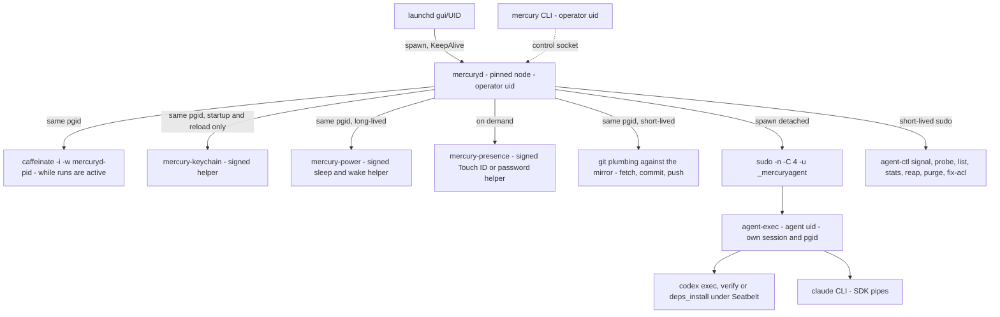

# MERCURY — macOS Runtime and Service Management

Owner: Agent D (DevOps / Platform Architect). Phase 4 revision. Status: **revised to the binding reconciliation decisions** in `reviews/30-reconciliation.md` (RD-1…RD-20). Feeds TDD §18 (macOS Runtime), §20 (Reliability, with `recovery.md`), §21 (Logging and Monitoring), §23 (Performance and Resources) and §24 (Deployment and Upgrade).

Companion document: [`recovery.md`](recovery.md) holds the failure catalogue, the startup recovery order and the operations runbooks.

**What this document is the single source of truth for:**

| Topic | Section | Referenced by |
|---|---|---|
| Operational parameter values (timings, thresholds, caps) | §2 | TDD §18/§20, every other document. Requirement IDs for these targets are registered by Agent F in `planning/traceability.md` |
| Agent-uid isolation: `_mercuryagent`, group, sudoers drop-in, `agent-exec` / `agent-ctl` grammar, secret hand-off on fd 3, ACLs, toolchains | §3.3–§3.9 | ADR-013 (A), components §4.7/§8 (C), SEC-201 (E), claude.md / codex.md (B) |
| Filesystem layout, ownership and modes | §7.1 | ADR-016 (A) and all documents |
| Process exit-code and startup contract | §5.2 | components §10.6 (C), `recovery.md` §4 |
| Credential inventory (Keychain prefix, read-once semantics) | §9.1 | github.md §3/§16, linear.md §2, claude.md §7, codex.md §7 |
| Sleep helper, dark-wake rule, watchdog | §8, §11.6 | state-machine §5, components §10.10 |
| Durability of git objects, refs and run control files | §14.2 | components §9/§10, `recovery.md` |
| Phase 0 Mac verification register (`P0-nnn`, Mac items) | §16 | traceability.md (closure tracking, F) |

**What this document does not restate** (single source elsewhere): SQL DDL (components §6.3), task states, holds and block reasons (state-machine §5, §6.1), run failure classes and per-kind attempts (state-machine §7.1), the credited-time algorithm (components §10.10), the integration retry matrix (github.md §15), dedup keys (github.md §14), CLI verbs (components §5.5), notification channel matrix (components §4.15), SEC statements (threat-model §5), requirement IDs (traceability.md).

Conventions:
- **ASM-D-nn** is an unverified assumption about Mac or tool behaviour. Each one links to a Phase 0 check `P0-nnn` (§16, §17).
- The Phase 2 `REL-nn` IDs are retired. Their targets are now parameters in §2 and requirement IDs in traceability.md (alias table there).
- Evidence tags reuse `02-discovery-platform.md` (`[S16]`, `[S18m]`, …). New sources are in §18.
- Paths written with `~` are expanded by the installer to absolute paths, because launchd does not expand `~` or `$HOME` in plists (ASM-D-01). All paths come from one constant module (`core/paths.ts`) generated from §7.1.
- **Root-level steps.** Every step marked **[ROOT — operator consent]** modifies the host as root. It is performed only by the operator, explicitly, with the command shown to them first. The design phase and MERCURY itself never perform it. `mercury-install --system` prints the full plan and asks for confirmation before calling `sudo`.

---

## 1. Design summary

| Decision | Choice | Why (short) |
|---|---|---|
| Supervisor | Per-user **LaunchAgent** `com.usjbro.mercury` in `gui/<uid>` (ADR-010) | Gets the login Keychain. A LaunchDaemon cannot read it [S22]. |
| Trust zones | Three: operator uid (coordinator `mercuryd`, Keychain, `MERCURY_HOME`), agent uid `_mercuryagent` (every process that executes model-directed or repository-derived code), root (two fixed-grammar wrappers and the sudoers drop-in) | RD-1 / ADR-013. Protects both the human's and MERCURY's own credentials from agents (§3.3). |
| Agent launch | `mercuryd` → `sudo -n -C 4 -u _mercuryagent -g mercury agent-exec --run-dir …` (detached). Control through `agent-ctl` (signal, probe, list, stats, reap, purge, fix-acl) | Cross-uid `kill`, identity and file ownership all work, and there is no long-lived agent-uid daemon (§3.3–§3.6). |
| Secrets to agents | One model key per run, on **fd 3**, length-prefixed, read once by `agent-exec` and closed. Never in env passed by sudo, argv or files | `sudo`'s `env_reset` and `closefrom` are configured so only fd 3 passes (§3.6). |
| Restart policy | `KeepAlive = {SuccessfulExit = false}`; exit-code contract in §5.2 | Crash → restart; deliberate halt, lock held, corruption → never a crash loop. |
| Single instance | `flock` on `run/mercuryd.lock` (components §11 L1). No `instance_lease` row. | The kernel releases the lock on crash. |
| Run survival | Codex, `verify`, `deps_install` are **adopted** after a coordinator restart (identity triple: run marker, start time, boot session). Claude runs are killed and re-run without consuming an attempt (ADR-020). | Coordinator restarts lose no Codex work. |
| Unsupervised runs | `agent-exec` enforces the hard awake-time deadline and the **supervisor lease** (`supervisor.lease_stale_min`, §2) | A run never outlives its coordinator by more than the lease. |
| Sleep | `caffeinate -i -w <mercuryd pid>` only while runs are active. Sleep gaps are never credited to run budgets (components §10.10). A signed **power helper** reports will-sleep, wake and full-wake. No dispatch during dark wake. | §8. |
| State | `MERCURY_HOME` = `~/Library/Application Support/Mercury` (operator, 0700) | §7.1, RD-2 |
| Work | `WORK_ROOT` = `/Users/Shared/MercuryWork` (operator:`mercury`, 0750 + inherited group ACLs where agents write) | Space-free, outside the operator's 0700 home, traversable by the agent uid. §7.1 |
| Secrets | Login Keychain items with prefix `com.usjbro.mercury.*`, read **once** at start and on `mercury reload-credentials` by a signed `mercury-keychain` helper; held in memory | §9, RD-18 |
| Durability | SQLite WAL `synchronous=FULL`, `fullfsync=ON`; mirror `core.fsync=committed,reference`; git commit → fsync → DB transaction; `proc.json`/`exit.json` with fsync + rename + directory fsync | §14.2, RD-11 |
| Liveness alerting | GitHub Actions watchdog in `project-mercury` reading a heartbeat issue written by **`mercury-ops`**; thresholds differ for awake and sleeping | §11.6, RD-6, RD-16 |
| Human presence | Signed `mercury-presence` helper (LocalAuthentication: Touch ID or password) gates every `operator-presence` command | §9.5, RD-12 / ADR-019 |
| CI | GitHub-hosted runners only. No self-hosted runner. Power-loss tests in a macOS guest VM on an Apple Silicon host, never on the operator's Mac | §15, RD-24 |

---

## 2. Operational parameter table (normative)

This is the **only** place parameter values are defined (RD-10). Other documents cite the parameter **name**. Agent F registers each name with an ID in traceability.md and links the requirement it measures. Configurable values have the same name as their `mercury.toml` key; the loader clamps them to the hard caps shown. "Awake" means credited awake time (components §10.10); "wall" means UTC wall clock.

Workflow policy is **out of scope** of this table and stays with its owner: per-kind attempt counts and backoff (state-machine §7.1), revision budgets and authorization expiry (OD-08), state-level reminder timers (state-machine §7.3), notification cadence (components §4.15), retry matrix (github.md §15).

### 2.1 Service, restart and recovery

| Parameter | Value | Clock | Rationale |
|---|---|---|---|
| `svc.throttle_interval_s` | 30 | wall | launchd minimum gap between respawns. Halves crash-loop churn vs the default 10. |
| `svc.exit_timeout_s` | 45 | wall | launchd SIGTERM → SIGKILL gap. Headroom above the internal budget (ASM-D-04). |
| `svc.shutdown_budget_s` | 20 | wall | Internal shutdown budget (§12). Never relies on the extra launchd time. |
| `svc.start_to_ready_max_s` | 15 | wall | Process start → `daemon.ready` (local steps only). |
| `svc.restart_to_ready_max_s` | 45 | wall | Crash → `ready` = throttle + start. A process that ran > 30 s restarts immediately. |
| `svc.crash_loop_starts` / `svc.crash_loop_window_min` | 5 / 10 | wall | More starts than this in the window → safe mode (§5.2). |
| `recovery.reconcile_max_s` | 120 (≤ 50 non-terminal tasks) | wall, from first awake-and-online instant | Full GitHub + Linear reconcile after `ready` or after wake + network. One number for start and wake. |
| `recovery.first_poll_max_s` | 60 | wall, from network reachable | First GitHub and Linear poll after start or wake. |
| `recovery.downtime_notice_min` | 60 | wall | Downtime with non-terminal tasks above this → one "resumed after N h" ops notice. |
| `db.lease_persist_s` | 60 (minimum) | wall | Lease rows are persisted no more often than this; `flock` is the real guard (RD-17). |
| `db.progress_flush_s` | 60 | wall | In-memory run progress (`awake_ms`, `idle_awake_ms`, byte offsets) flushed at this interval, on phase change and at exit. |
| `run.liveness_poll_s` | 15 | wall | `agent-ctl probe` / `stats` sampling of active runs. |
| `run.lost_by_host_cap` | 5 per run step | — | `lost_by_host` outcomes never consume attempts; above the cap → ops alert (not BLOCKED). |

### 2.2 Supervisor lease and wrapper deadlines

| Parameter | Value | Clock | Rationale |
|---|---|---|---|
| `supervisor.alive_touch_s` | 10 | wall | `mercuryd` touches `WORK_ROOT/ctl/coordinator.alive`. |
| `supervisor.lease_stale_min` | 10 | awake (computed by `agent-exec`) | Stale alive file → `agent-exec` ends the run (`exit.json{reason: supervisor_lost}`). Default of OD-D-08. |
| `supervisor.kill_ladder_s` | SIGINT → 15 → SIGTERM → 10 → SIGKILL | wall | Same ladder for lease expiry, deadline and `agent-ctl signal` sequences driven by the coordinator. |
| `run.hard_deadline_margin_pct` | 10 | awake | `agent-exec` enforces `deadline_awake_ms × 1.10`; the coordinator normally cancels at 100 %. |
| `wrapper.tick_s` | 5 | — | `agent-exec` internal tick for credited time, deadline and lease. |

### 2.3 Run deadlines and stall detection

Deadlines are awake time. Liveness = stdout growth **or** process-group CPU-time progress (`agent-ctl stats`, RD-15). `stalled` requires both to be flat for the stall value. While a command is running inside a Codex turn, the effective stall value is `max(stall, repo.test_timeout_min)`.

| Parameter | Deadline (awake) | Stall (awake) |
|---|---|---|
| `run.claude_triage.*` | 5 min | 2 min |
| `run.claude_authorize.*` | 15 min | 5 min |
| `run.claude_plan_review.*` | 20 min | 5 min |
| `run.claude_revision_request.*` | 10 min | 5 min |
| `run.claude_code_review.*` / `run.claude_security_review.*` | 30 min | 5 min |
| `run.codex_plan.*` | 45 min | 10 min |
| `run.codex_implement.*` / `run.codex_revise.*` | 120 min (cap 240; authorization may lower) | 15 min |
| `run.verify.*` | `repo.test_timeout_min` (default 20 min) | 10 min |
| `run.deps_install.*` | 20 min | 10 min |
| `run.git_step.*` | 5 min | — |

### 2.4 Clocks, sleep and connectivity

| Parameter | Value | Rationale |
|---|---|---|
| `clock.tick_active_ms` / `clock.tick_idle_ms` | 2000 / 5000 | HealthMonitor tick (components §10.10). Credit cap per tick = 3 × tick. |
| `clock.sleep_gap_s` | 30 | A gap above this not explained by a measured blocking operation is a sleep gap, confirmed by `kern.waketime` (RD-16). |
| `clock.wall_jump_s` | 2 | `|Δwall − Δmono|` above this is a wall-clock step, not sleep. |
| `wake.grace_s` | 120 | `host_sleep_grace` hold duration; stall clocks frozen. |
| `wake.dark_wake_min_awake_s` | 300 | Without a full-wake signal from the power helper, dispatch only after this much continuous credited awake time. |
| `power.will_sleep_budget_s` | 20 | Time the power helper holds the sleep transition for the final `sleeping` heartbeat and checkpoint. |
| `net.stability_s` | 30 | Probe must succeed continuously this long before `network_down` clears. |
| `net.probe_interval_offline_s` | 30 | Authenticated, ETag-conditional probe (never unauthenticated GitHub requests, RB-10). |
| `net.error_probe_window_s` | 60 | A network-class error is not counted toward any run or outbox attempt if the probe fails within this window of it (RD-18). |
| `power.prevent_system_sleep_on_ac` | false (laptop) / true (desktop) | Default of OD-D-05. |

### 2.5 Integration cadence (values proposed by B; changed only here)

| Parameter | Value |
|---|---|
| `github.poll_pr_s` | 60 while checks run; 120 awaiting human; 300 after 24 h waiting |
| `github.poll_checks_s` | 30 for the first 10 min after push, then 60 |
| `github.poll_base_branch_s` | 300 |
| `github.reconcile_open_prs_min` | 30 (plus at start and wake) |
| `github.token_refresh_before_expiry_min` | 10 |
| `github.mutation_spacing_s` | 1 |
| `linear.poll_s` / `linear.poll_idle_s` | 60 / 300 (no active tasks) |
| `linear.poll_overlap_s` | 300 steady state; 600 after restart or wake |
| `linear.relation_refresh_min` | 15 |
| `circuit.open_after_failures` / `circuit.window_min` / `circuit.half_open_probe_min` | 5 / 10 / 5 |
| `gov.drift_check_interval_min` | 60 (plus at every wake) |
| `audit.anchor_overdue_h` | 24 (awake) → ops alert, never a halt |

### 2.6 Concurrency, resources and disk (defaults of OD-07)

| Parameter | Value | Rationale |
|---|---|---|
| `limits.max_codex_runs` | 1 | Raise to 2 only after P0-038 (parallel per-task `CODEX_HOME`) and spend review. |
| `limits.max_claude_runs` | 2 | Read-only, light. |
| `limits.max_runs` | 3 | Total agent runs. |
| `limits.max_runs_per_repo` | 1 mutating | Shared mirror, test ports. |
| `limits.max_active_tasks` | 4 | Tasks in non-terminal, non-waiting states. |
| `resources.max_loadavg_per_cpu` | 1.5 | Defer new runs (never kill). |
| `resources.defer_on_memory_pressure` | `warn` | `kern.memorystatus_vm_pressure_level` ≥ 2 → defer. |
| `resources.max_run_rss_gib` | 8 | Group RSS ceiling, sampled → kill ladder, class `crash` (detail `rss_cap`). |
| `resources.worktree_notify_gib` / `resources.worktree_max_gib` | 5 / 10 | Notify / fail the run. |
| `resources.worktrees_total_max_gib` | 40 | Accelerate terminal-task cleanup. |
| `resources.artifacts_notify_gib` / `resources.runs_dir_max_gib` | 20 / 20 | Notify / prune oldest terminal run dirs. |
| `disk.dispatch_hold_gib` / `disk.dispatch_hold_pct` | 15 / 10 % | `low_disk` hold: no new runs. |
| `disk.interrupt_local_gib` | 5 | Interrupt `verify` and `deps_install`. |
| `disk.interrupt_codex_gib` | 2 | Interrupt Codex runs. |
| `disk.ballast_mib` | 64 | Released on `ENOSPC`/`SQLITE_FULL`. |
| `run.stdout_cap_mib` | Codex 256, Claude 64, verify 128; stderr 32 | Above → cancel, class `crash` (`output_cap_exceeded`). |
| `deferral.notify_after_h` | 2 | Disk or memory deferral longer than this → one notification. |

### 2.7 Observability, backups and holds

| Parameter | Value | Rationale |
|---|---|---|
| `heartbeat.local_s` | 30 | `run/heartbeat.json`. |
| `heartbeat.remote_min` | 5 | Heartbeat issue body via `mercury-ops`. |
| `watchdog.schedule` | every 30 min (`7,37 * * * *`) | Off-minute. |
| `watchdog.stale_awake_min` | 45 | Last heartbeat mode ≠ `sleeping`. |
| `watchdog.stale_sleeping_h` | 12 | Last heartbeat mode = `sleeping` (RD-16). |
| `watchdog.renotify_h` | 24 | One open alert at a time. |
| `credentials.locked_alert_min` | 15 | Keychain locked at start or reload → alert. |
| `credentials.locked_retry_s` | 60 | Retry interval while `keychain_locked`. |
| `backup.due_after_h` | 24 (awake) | Next backup due. `doctor` warns at 26 h; `ops.backup_stale` at 48 h. |
| `backup.retention` | 7 daily, 4 weekly, 5 pre-upgrade, quarantine 30 d | |
| `logs.rotate_mib` / `logs.generations` / `logs.total_cap_mib` | 20 (or daily) / 14 / 300 | In-process rotation. |
| `logs.retention_d` / `runs.retention_d` | 30 / 30 | Audit records and artifacts: life of the DB. |
| `hold_age.spec_changed_h` | 24 (awake) | Hold ageing (RD-3): escalate once. |
| `hold_age.dependency_unresolved_d` | 7 (awake) | |
| `hold_age.deprioritized_d` | 14 (awake) | |
| `helper.timeout_s` | `security`/helpers 10; git network ops 120; local git 600 | Subprocess timeouts. |

---

## 3. Runtime architecture and agent isolation

### 3.1 Process tree



| Process | uid | Session / group | Survives a `mercuryd` crash? | Notes |
|---|---|---|---|---|
| `mercuryd` | operator | launchd job | — | Single instance by `flock` |
| `caffeinate`, `mercury-keychain`, `mercury-power`, git | operator | mercuryd's group | No (launchd group cleanup; `caffeinate -w` exits by itself) | `mercury-power` is restarted by `mercuryd` if it dies |
| `mercury-presence` | operator | mercuryd's group | No | Spawned per presence-tier request (§9.5) |
| `sudo` (monitor) + `agent-exec` + agent | root → `_mercuryagent` | own session (`detached: true`, then `setsid()` in `agent-exec`) | **Yes** for Codex, `verify`, `deps_install` (stdout/stderr to files); **no** for Claude (pipes break) | Adopted per §3.8; bounded by the supervisor lease |
| `agent-ctl` | `_mercuryagent` | short-lived child of mercuryd | — | One invocation per control action |

`AbandonProcessGroup` stays false, so launchd cleans up mercuryd's own group. Agent sessions deliberately escape that cleanup and are governed by `agent-exec`.

### 3.2 Spawn contract (`spec.json`)

`mercuryd` writes `WORK_ROOT/runs/<run_id>/spec.json` (operator-owned, 0640) **before** spawn, in the same step that records the run row in `runs` (C's DDL, components §6.3; status values are C's). The file is the whole contract with `agent-exec`; nothing else is passed except `--run-dir` and fds 0–3.

| Field | Content | Validated by `agent-exec` |
|---|---|---|
| `spec_version` | `1` | `agent-exec` supports versions N and N−1 (upgrade window, §13.6) |
| `run_id` | `run_<ULID>` | Equals the run directory name; regex `^run_[0-9A-HJKMNP-TV-Z]{26}$` |
| `kind` | `codex_plan` · `codex_implement` · `codex_revise` · `verify` · `deps_install` · `claude` | One of the six |
| `argv` | Array, binary first; never a shell string | Grammar per kind (§3.5) |
| `cwd` | Absolute path | Allowed root per kind (§3.5) |
| `env` | Map of allowlisted keys to values | Key allowlist per kind; path values realpath-confined (§9.4) |
| `secret_env` | Name the fd-3 secret is bound to (`CODEX_API_KEY` or `ANTHROPIC_API_KEY`) or `null` | Must match kind: Codex kinds → `CODEX_API_KEY`; `claude` → `ANTHROPIC_API_KEY` (or `CLAUDE_CODE_OAUTH_TOKEN` under OD-03); `verify`/`deps_install` → `null` |
| `deadline_awake_ms` | Awake-time budget (§2.3) | Positive, ≤ the per-kind cap compiled into `agent.conf` |
| `rlimits` | `nofile`, `core=0` | Within compiled bounds |
| `sandbox_profile` | `verify` or `deps` for those kinds, else `null` | Must name a root-owned profile in `/usr/local/libexec/mercury/profiles/` whose SHA-256 matches `agent.conf` |

The **identity triple** of a run (ADR-020) is `(run_id marker, process start time, kern.bootsessionuuid)`. `agent-exec` records it in `ctl/proc.json`; adoption requires all three to match (§3.8).

### 3.3 Identities **[ROOT — operator consent]**

| Identity | Definition | Created by |
|---|---|---|
| `_mercuryagent` | Hidden role account, uid in 200–400 chosen at install, primary group `mercury`, shell `/usr/bin/false`, no password, never logs in. Home `/Users/_mercuryagent` (0700) holding caches only. | `sysadminctl -addUser _mercuryagent -roleAccount -UID <uid> -shell /usr/bin/false -home /Users/_mercuryagent` then `createhomedir -c -u _mercuryagent` |
| Group `mercury` | Members: the operator and `_mercuryagent` | `dseditgroup -o create -r "MERCURY" mercury`; `dseditgroup -o edit -a <operator> -t user mercury`; `dseditgroup -o edit -a _mercuryagent -t user mercury` |
| Operator home | `chmod 0700 ~` (ASM-E-04). `~/.ssh`, `~/.config`, `~/Library` 0700 at minimum | `mercury-install --system` (operator-level `chmod`, shown and confirmed) |

`mercury doctor` verifies these at every start (§3.10).

### 3.4 Root-owned wrappers and the sudoers drop-in **[ROOT — operator consent]**

**Binaries.** Two compiled wrappers (Swift; no interpreter, no dynamic plugins), signed, with SHA-256 pinned in the MERCURY release manifest:

```text
/usr/local/libexec/mercury/                 root:wheel 0755
  agent-exec                                root:wheel 0755   spawn (replaces C's runwrap for agent runs)
  agent-ctl                                 root:wheel 0755   control operations
  agent.conf                                root:wheel 0644   operator uid, WORK_ROOT, pinned agent binaries + SHA-256, per-kind caps
  profiles/verify.sb, profiles/deps.sb      root:wheel 0644   Seatbelt profiles (E designs, SEC-703; D installs)
  mercury-presence, mercury-power, mercury-keychain   root:wheel 0755   signed helpers that run as the operator (§8.6, §9.3, §9.5)
```

Root ownership means neither the operator uid nor the agent uid can replace a wrapper, its configuration, a profile or a helper. Every path in `agent.conf` is absolute; `agent.conf` is re-generated only by `mercury-install --system`.

**sudoers drop-in.** `/etc/sudoers.d/mercury`, root:wheel 0440, rendered by the installer with the real operator short name and digests, validated with `visudo -cf` before it is moved into place:

```text
# /etc/sudoers.d/mercury — generated by mercury-install --system. Do not edit.
Cmnd_Alias MERCURY_AGENT_EXEC = sha256:<agent-exec digest> /usr/local/libexec/mercury/agent-exec --run-dir /Users/Shared/MercuryWork/runs/*
Cmnd_Alias MERCURY_AGENT_CTL  = sha256:<agent-ctl digest>  /usr/local/libexec/mercury/agent-ctl *
Defaults!MERCURY_AGENT_EXEC, MERCURY_AGENT_CTL env_reset, !setenv, !use_pty, !log_output, umask=0007, umask_override
Defaults!MERCURY_AGENT_EXEC closefrom_override
<operator> ALL = (_mercuryagent : mercury) NOPASSWD: MERCURY_AGENT_EXEC, MERCURY_AGENT_CTL
```

- The grant is **lateral**: to `_mercuryagent:mercury` only, never to root, and only for the two digests.
- `env_reset` + `!setenv`: nothing from `mercuryd`'s environment reaches the wrapper. `agent-exec` builds the child environment from `spec.json` alone.
- `closefrom_override` lets `-C 4` keep fds 0–3 open for `agent-exec` only; `agent-ctl` gets no extra fds.
- `!use_pty`: Claude's SDK pipes stay direct pipes.
- sudoers wildcards match spaces and `..`, so the drop-in is a coarse filter. **The authoritative validation is inside the wrappers** (§3.5, §3.7).

**Spawning.** `mercuryd` runs (Node `spawn`, `detached: true`):

```text
sudo -n -C 4 -u _mercuryagent -g mercury /usr/local/libexec/mercury/agent-exec --run-dir /Users/Shared/MercuryWork/runs/<run_id>
  fd 0: /dev/null (Codex, verify, deps) | SDK stdin pipe (claude)
  fd 1: runs/<run_id>/stdout.jsonl opened by mercuryd O_WRONLY|O_APPEND|O_CREAT, operator-owned 0640 | SDK stdout pipe (claude)
  fd 2: runs/<run_id>/stderr.log, same
  fd 3: pipe carrying the model key (§3.6) | closed for verify and deps_install
```

The agent writes its output through inherited descriptors whose permission was checked when `mercuryd` opened them. It cannot reopen, truncate or replace those files afterwards.

### 3.5 `agent-exec` grammar and argv validation

**Command line.** Exactly two arguments: `--run-dir <path>`. Anything else → exit 125.

**Validation, in order** (any failure → exit 125, `ctl/reject.json {stage, reason}` if `ctl/` is writable, nothing executed; the coordinator classifies the run `config_fatal` and sets the `config_fatal` hold for agent dispatch):

1. **Caller.** Real uid of the invoking sudo user (`SUDO_UID`) equals the operator uid in `agent.conf`; effective uid is `_mercuryagent`.
2. **Run directory.** `realpath(path)` equals `WORK_ROOT/runs/<run_id>`, no component is a symlink (checked with `O_NOFOLLOW` walks), owner is the operator uid, mode 0750, group `mercury`.
3. **Spec file.** `spec.json` is a regular file, owner operator, mode 0640, size ≤ 64 KiB, valid JSON, `spec_version` supported, `run_id` equals the directory name.
4. **Kind and binary.** `argv[0]` must equal the pinned binary for the kind in `agent.conf`, and its SHA-256 must match (checked at every spawn; the file is root-owned, so a mismatch means an upgrade without `mercury agents upgrade`):

   | Kind | `argv[0]` | Fixed prefix | Allowed option tokens | Forbidden (always rejected) |
   |---|---|---|---|---|
   | `codex_plan`, `codex_implement`, `codex_revise` | pinned `codex` | `exec` (plus `resume <uuid>` for `codex_revise` and plan revisions) | Only the flags listed for that run type in codex.md §3 (B owns the list; it is compiled into `agent.conf` as a token table). `--sandbox` value ∈ {`read-only` for `codex_plan`, `workspace-write` otherwise}. Path-valued options (`--cd`, `--output-schema`, `-o`) realpath-confined: `--cd` = `cwd`; schema under `runs/<run_id>/in/`; `-o` under `runs/<run_id>/out/` | `--dangerously-bypass-approvals-and-sandbox`, any option that enables network access, `danger-full-access`, `-c`/`--config` keys outside the allowlist, `--profile`, `--add-dir`, any second positional prompt source |
   | `verify` | `/usr/bin/sandbox-exec` | `-f /usr/local/libexec/mercury/profiles/verify.sb --` | Then the repository's `test_commands` entry: `argv[0]` must resolve under `WORK_ROOT/toolchains/` or `/usr/bin`, `/bin`; no shell unless the repo config names one explicitly (`shell = true` is an onboarding-time decision recorded in `mercury.toml`) | Any `-p`/`-D` to `sandbox-exec`; a profile other than the pinned one |
   | `deps_install` | `/usr/bin/sandbox-exec` | `-f /usr/local/libexec/mercury/profiles/deps.sb --` | The repository's `setup_commands` entry, which must contain the package manager's ignore-scripts flag (SEC-703; OD-09) | Lifecycle-script-enabling flags |
   | `claude` | pinned `claude` | Options from claude.md §2.2 (B owns), compiled as a token table | `--settings` JSON only from `runs/<run_id>/in/settings.json`; `--add-dir` only `cwd` | `--dangerously-skip-permissions`, `--mcp-config`, `--plugin-dir`, `--setting-sources` other than empty |

5. **Working directory.** `cwd` realpath, no symlink components:
   - Codex kinds, `verify`, `deps_install` → exactly `WORK_ROOT/worktrees/<owner>__<repo>/<task_dir>`;
   - `claude` → exactly `WORK_ROOT/snapshots/<tree_sha>` (RD-7).
6. **Environment.** Only keys in the per-kind allowlist (§9.4). Values that are paths must realpath under `WORK_ROOT` or `/Users/_mercuryagent` or be one of the fixed system paths.
7. **Secret.** For kinds with `secret_env`, read fd 3: 4-byte big-endian length, then that many bytes (1…4096), then EOF. Anything else → reject. For `verify`/`deps_install`, fd 3 must be closed; if it is open → reject. Close fd 3, then `closefrom(3)`.
8. **Process setup.** `setsid()`; `umask(0007)`; `setpriority(+10)`; rlimits; `HOME=/Users/_mercuryagent`.
9. **Record identity.** Write `ctl/proc.json` `{run_id, wrapper_pid, pgid, start_time, boot_session_uuid, argv_sha256, spec_sha256, wrapper_sha256}` with write → `F_FULLFSYNC` → rename → directory `fsync` (§14.2).
10. **Execute.** `fork` + `execve` the child in the same process group; `waitpid` it.
11. **Supervise** every `wrapper.tick_s`: credited awake time (same algorithm as components §10.10); hard deadline (`deadline_awake_ms × (1 + run.hard_deadline_margin_pct)`); supervisor lease (`WORK_ROOT/ctl/coordinator.alive` mtime older than `supervisor.lease_stale_min` of credited time). Either trigger → kill ladder (`supervisor.kill_ladder_s`) on the group.
12. **Record outcome.** `ctl/exit.json {run_id, code, signal, reason: exited|deadline|supervisor_lost|exec_failed, ended_at, credited_ms, rusage}` with the same fsync + rename + directory fsync. Exit with the child's status (128 + signal for signal death); 126 if `execve` failed.

`agent-exec` never reads anything under `MERCURY_HOME` and has no network code.

### 3.6 Secret hand-off on fd 3

- `mercuryd` holds the model keys in memory (§9.3). For each Codex or Claude run it creates a pipe, writes the length-prefixed key, closes the write end, and passes the read end as fd 3.
- The key never appears in `spec.json`, argv, a file, the sudo environment or logs. Inside the agent, it is in the agent process's environment only (`CODEX_API_KEY` / `ANTHROPIC_API_KEY`), because both CLIs read it from there.
- **Residual risk (accepted, recorded as ASM-B-16 / RISK register):** commands that Codex runs as the same uid could read Codex's environment. Mitigations: Codex `shell_environment_policy` excludes the key (codex.md §6); the key is a dedicated, spend-capped project key (OD-03/04); `verify` and `deps_install` never receive a key.
- The agent uid has no Keychain and cannot open the operator's `~/Library/Keychains` (0700 home).

### 3.7 `agent-ctl` grammar

All subcommands run as `_mercuryagent` (so `kill(2)` and `proc_pidinfo` work on agent processes without root) and print one JSON object. Arguments are validated by regex before any use; unknown subcommands or extra arguments → exit 2.

| Subcommand | Arguments | Behaviour | Replaces |
|---|---|---|---|
| `signal` | `--run <run_id> --sig INT\|TERM\|KILL` | Reads `runs/<run_id>/ctl/proc.json`, verifies with `proc_pidinfo` that the pid is alive, owned by `_mercuryagent`, in the recorded pgid, with the recorded start time and boot session; then `kill(-pgid, sig)`. Result `signalled` · `not_running` · `identity_mismatch` (never signals on mismatch). | `kill(-pgid)` from the coordinator |
| `probe` | `--run <run_id>` | Same identity check; returns `alive_match` · `dead` · `alive_mismatch` with `pgid`, `start_time`. | `ps -o lstart=` probes |
| `list` | — | Every `_mercuryagent` process: `pid, ppid, pgid, start_time, cwd, run_id` (run id = the run whose `proc.json` pgid matches, else `null`). | `ps` argv marker scans and `lsof -d cwd` (ASM-D-30 no longer load-bearing) |
| `stats` | `--run <run_id>` | Summed RSS, summed CPU time and process count over the group. | `ps -o rss= -g`; feeds stall liveness (RD-15) and the RSS cap |
| `reap` | `--pid <pid> --start <start_time>` | Kills one `_mercuryagent` process (and its group if it leads one) after verifying uid and start time. Used for orphans that escaped their group. | Orphan sweep kill |
| `purge` | `--path <path>` | Recursive delete with `openat`/`unlinkat` and `O_NOFOLLOW`; refuses unless `realpath` is under `WORK_ROOT/{worktrees,runs,codex-home,snapshots}`. Needed because agent-owned files may lack group write after an agent `chmod`. | `rm -rf` by the coordinator |
| `fix-acl` | `--path <path>` | Re-applies the group ACL (§7.3) to agent-owned files under an allowed root. | — |
| `version` | — | Wrapper version and SHA-256. | — |

C's `ProcessSupervisor` / `AgentLauncher` port maps `signalGroup`, `probe`, `listMarked`, the stats sampler, orphan reaping and worktree removal onto these subcommands (components §4.7, §8). The same-uid implementation (`SameUidLauncher`) exists only for fakes and the sandbox repository (§3.11).

### 3.8 Adoption, lease and launchd interaction

| Event | What happens |
|---|---|
| `mercuryd` crash, `kickstart -k`, upgrade | `sudo` + `agent-exec` sessions survive. On start, `agent-ctl probe` per active run: `alive_match` + adoptable kind → **adopt** (resume tailing from the persisted offset); Claude → `agent-ctl signal` ladder, re-run with the same `input_digest`, no attempt consumed. Dead with `exit.json` → finalize from `exit.json` + `final.json` (also after a reboot). The authorization guard is re-evaluated **before** an adopted output is acted on (ADR-020). |
| Coordinator absent (logout, `bootout`, crash loop) | `agent-exec` keeps enforcing the deadline. When `coordinator.alive` is stale for `supervisor.lease_stale_min` of credited time, it ends the run with `reason: supervisor_lost` → recovery classifies `lost_by_host`. |
| Safe mode or `security_halt` | Adopted runs are **never kept**: every active run is signalled with the kill ladder (RD-11). |
| Logout | Agent-uid sessions may survive logout (ASM-D-32, P0-031); the lease bounds them. |
| Shutdown, power loss, panic | Everything dies. Next start sees a changed `kern.bootsessionuuid` → runs without `exit.json` are `lost_by_host` (no attempt; cap `run.lost_by_host_cap`). |
| `caffeinate`, BTM, `ExitTimeOut` | Unchanged by the agent uid. |

Run statuses and failure classes are C's (components §6.3 `runs`, state-machine §7.1). The Phase 2 values `interrupted` and `adopted` are withdrawn: an interrupted run is `lost` or `cancelled` with class `lost_by_host`, `cancelled_by_coordinator` or `lost_by_coordinator_crash`; adoption is an audit event.

### 3.9 Toolchain provisioning

- Each target repository declares its toolchain in `mercury.toml` (`[repos."<owner>/<repo>".toolchain] node = "22.11.0"`, `python = "3.12.7"`, …).
- `mercury toolchain sync` (operator uid, no root) downloads official release archives, verifies them against the vendor checksum list pinned in the release manifest, and installs to `WORK_ROOT/toolchains/<name>/<version>/` (operator:`mercury`, dirs 0750, files 0640/0750). Agents can read and execute toolchains, never write them.
- `PATH` for agent kinds is built from the manifest plus `/usr/bin:/bin`. The pinned Codex and Claude CLIs live in `WORK_ROOT/toolchains/agents/<name>/<version>/` and are also pinned by hash in `agent.conf`.
- The agent `HOME` holds only caches (npm, pip, cargo registries). Git for the agent uses `GIT_CONFIG_GLOBAL=WORK_ROOT/toolchains/agent.gitconfig` (operator-owned, read-only to agents) containing `safe.directory` entries for `WORK_ROOT/worktrees/*` and `core.hooksPath=/dev/null`.
- `mercury doctor` scans `/Users/_mercuryagent` (through `agent-ctl list` + a read-only `find` run as the agent uid) for credential-shaped files (`.npmrc` with `_authToken`, `.netrc`, `.git-credentials`, `.ssh/`, `.config/gh`, `.aws/`). Any hit → `config_fatal` hold for agent dispatch.

### 3.10 Install, verification and uninstall **[ROOT — operator consent]**

`mercury-install --system` prints every command, then asks for the operator's typed confirmation, then runs them through `sudo` interactively (the operator's password; never stored). Steps:

1. Create group `mercury` and user `_mercuryagent`; add both members (§3.3).
2. Install the wrappers, helpers, `agent.conf` and Seatbelt profiles into `/usr/local/libexec/mercury/` (root:wheel), verifying each SHA-256 against the release manifest.
3. Render `/etc/sudoers.d/mercury` to a temp file, `visudo -cf` it, then `install -o root -g wheel -m 0440`.
4. Create `WORK_ROOT` and its subdirectories with the owners, modes and ACLs in §7.1 (`chown`, `chmod`, `chmod +a`).
5. `chmod 0700 ~` (operator-level; shown separately).
6. Optionally (OD-19) install managed Claude settings and the Codex `requirements.toml` as root at the paths verified by P0 (ASM-E-10), validated after install.

`mercury-install --system --uninstall` reverses steps 1–4 and 6 (after `mercury` is stopped and `WORK_ROOT` archived).

`mercury doctor` checks at every start and on demand; any failure sets the `config_fatal` hold for agent dispatch (coordinator keeps running):

| Check | Pass condition |
|---|---|
| sudoers | `sudo -n -l` (as operator) lists exactly the two digests for `(_mercuryagent : mercury)` |
| Wrappers and helpers | SHA-256 of every file in `/usr/local/libexec/mercury/` matches the release manifest; owner root:wheel; not writable by others |
| Identities | `_mercuryagent` exists, shell `/usr/bin/false`, member of `mercury`; operator is a member of `mercury` |
| Modes and ACLs | Every path in §7.1 has its owner, mode and ACL |
| Operator home | `~` is 0700; `~/.ssh`, `~/.config`, `~/Library` are 0700 |
| Agent home | No credential-shaped files (§3.9) |
| Canary self-test | Weekly and after any install change: `agent-ctl` runs a fixed canary probe as the agent uid that tries to read the canary files planted by `mercury doctor --plant-canaries` (SEC-T-20 subset); any read → `security_halt` |

### 3.11 Interim same-uid mode and gates

- Same-uid execution with Seatbelt deny profiles (`SameUidLauncher`) is allowed **only** with fakes and the sandbox repository (milestones M1–M4), recorded as RISK (R-03) Critical while in use.
- **No workspace-write Codex, `verify` or `deps_install` run against a non-sandbox repository until SEC-T-20 passes on the real Mac** with P0-026…P0-032 green (RD-1 gate).
- If P0-042 (Claude SDK spawn through sudo) fails, Claude decision runs use B's ALT-B-1 (Messages API with coordinator-implemented, realpath-confined Read/Grep/Glob over the snapshot), and the `claude` kind is removed from `agent-exec`.

---

## 4. LaunchAgent vs LaunchDaemon

| Criterion | LaunchAgent (`gui/<uid>`) | LaunchDaemon (`system`, with `UserName`) | Weight |
|---|---|---|---|
| Login Keychain (App keys, model keys) | Available after login [S16, S22] | **Not available** [S22]; would need the System keychain (root) or files | Decisive |
| Runs before login, after reboot | No | Yes | High, but blocked by FileVault anyway (§6) |
| Runs while logged out | No | Yes | Medium (ASM-D-05) |
| Install privilege | None for the coordinator (root only for the one-time §3.10 step) | Root | Medium |
| Local notifications, LocalAuthentication prompt | Work in the Aqua session (ASM-D-06, ASM-D-34) | No GUI session | Medium (presence tier needs it) |
| Blast radius | Operator privileges; agents confined to `_mercuryagent` | Root unless `UserName` is set | High |

**Decision: LaunchAgent (ADR-010).** A broker LaunchDaemon with `UserName=_mercuryagent` for agent spawning is the documented v2 alternative to sudo (true `waitpid`, survives logout), at the cost of IPC, stdio relaying for Claude and its own recovery. A dedicated macOS account for the coordinator (U2) is OD-36, default not in v1.

---

## 5. LaunchAgent plist and process contract

### 5.1 Plist

Installed at `~/Library/LaunchAgents/com.usjbro.mercury.plist`, mode 0644 (launchd refuses group- or world-writable plists; ASM-D-02). Rendered from a template with absolute paths; `jb` and versions are placeholders. Values in comments are §2 parameters.

```xml
<?xml version="1.0" encoding="UTF-8"?>
<!DOCTYPE plist PUBLIC "-//Apple//DTD PLIST 1.0//EN" "http://www.apple.com/DTDs/PropertyList-1.0.dtd">
<plist version="1.0">
<dict>
  <key>Label</key>
  <string>com.usjbro.mercury</string>

  <!-- Absolute, pinned interpreter. Never /usr/bin/env node, never Homebrew's moving node. -->
  <key>ProgramArguments</key>
  <array>
    <string>/Users/jb/Library/Application Support/Mercury/runtime/node-v24.21.0-darwin-arm64/bin/node</string>
    <string>--disable-warning=ExperimentalWarning</string>
    <string>/Users/jb/Library/Application Support/Mercury/app/current/dist/mercuryd.js</string>
    <string>--config</string>
    <string>/Users/jb/Library/Application Support/Mercury/config/mercury.toml</string>
  </array>

  <key>RunAtLoad</key>
  <true/>

  <!-- Restart only after a crash or signal death. Exit 0 stays down (see the exit-code contract). -->
  <key>KeepAlive</key>
  <dict>
    <key>SuccessfulExit</key>
    <false/>
  </dict>

  <key>ThrottleInterval</key>   <!-- svc.throttle_interval_s -->
  <integer>30</integer>
  <key>ExitTimeOut</key>        <!-- svc.exit_timeout_s -->
  <integer>45</integer>

  <key>ProcessType</key>
  <string>Standard</string>
  <key>Nice</key>
  <integer>0</integer>
  <key>LowPriorityIO</key>
  <false/>

  <key>WorkingDirectory</key>
  <string>/Users/jb/Library/Application Support/Mercury</string>

  <!-- Decimal 63 == octal 0077. MERCURY_HOME files 0600, dirs 0700. Files under WORK_ROOT
       get explicit modes from core/paths.ts (0640/0750), never from the umask. -->
  <key>Umask</key>
  <integer>63</integer>

  <key>EnvironmentVariables</key>
  <dict>
    <key>PATH</key>
    <string>/usr/bin:/bin:/usr/sbin:/sbin</string>
    <key>LANG</key>
    <string>en_US.UTF-8</string>
    <key>MERCURY_HOME</key>
    <string>/Users/jb/Library/Application Support/Mercury</string>
    <key>NODE_ENV</key>
    <string>production</string>
  </dict>

  <key>StandardOutPath</key>
  <string>/Users/jb/Library/Logs/Mercury/launchd.stdout.log</string>
  <key>StandardErrorPath</key>
  <string>/Users/jb/Library/Logs/Mercury/launchd.stderr.log</string>

  <key>SoftResourceLimits</key>
  <dict><key>NumberOfFiles</key><integer>8192</integer></dict>
  <key>HardResourceLimits</key>
  <dict><key>NumberOfFiles</key><integer>16384</integer></dict>

  <key>LimitLoadToSessionType</key>
  <string>Aqua</string>
</dict>
</plist>
```

| Key | Value | Justification |
|---|---|---|
| `KeepAlive` | `{SuccessfulExit:false}` | `true` would restart after a deliberate halt and create a crash loop. `NetworkState` is not honoured [S18m]; the daemon handles connectivity (§8.5). |
| `ThrottleInterval` / `ExitTimeOut` | §2.1 | Default 10 / 20 [S18m]. |
| `ProcessType` | `Standard` | `Background` throttles CPU/IO and slows DB fsyncs. |
| `Nice` | 0 daemon; agents +10 (set by `agent-exec`) | Agents yield to the operator's interactive work. |
| `Umask` | 63 (`0077`) | Private by default. Shared paths get explicit modes. |
| `EnvironmentVariables` | No secrets, no tool paths | Plist is world-readable by design. |
| `NumberOfFiles` | 8192 / 16384 | Node, SQLite, git and log tails exceed the default 256 (ASM-D-19). |
| `StandardOut/ErrorPath` | Small files | Truncated at start if > 5 MiB (§10.5). |

### 5.2 Exit-code and startup contract (normative, RD-11)

`mercuryd` uses exactly these outcomes. C's startup pseudocode (components §10.6) and `recovery.md` §4 follow this table; exit codes 75 and 78 are never used.

| Condition at start or at runtime | Behaviour | Exit | launchd result |
|---|---|---|---|
| `flock(run/mercuryd.lock)` already held | Log `daemon.duplicate`, exit immediately | 0 | Stays down (the live instance keeps running) |
| `run/fatal.json` present | Log, do not start; watchdog and `mercury status` show it | 0 | Stays down until `mercury clear-fatal` + `launchctl kickstart` |
| Config invalid, path under a TCC-protected folder, socket path too long | Write `fatal.json {reason}`, local notification | 0 | Stays down |
| Schema too new (`schema_meta.min_reader_version` > app version) | Write `fatal.json`, local notification, never write the DB | 0 | Stays down |
| DB corruption (`quick_check` ≠ ok, `SQLITE_CORRUPT`, `SQLITE_NOTADB`) | **Stay alive in safe mode**: no DB writes, no dispatch, read-only status, heartbeat file, local + ops alerts | — | Running |
| Audit chain verification fails and no matching restore epoch (§14.4) | **Safe mode** + one SECURITY notification (global `integrity_check_failed` hold, components / state-machine §5) | — | Running |
| More than `svc.crash_loop_starts` starts in `svc.crash_loop_window_min` | Safe mode (no dispatch); ops alert with the last exception class | — | Running |
| Agent-uid infrastructure check fails (§3.10) | Normal mode, `config_fatal` hold for agent dispatch | — | Running |
| Keychain locked at start | Normal mode; `keychain_locked` hold; retry every `credentials.locked_retry_s` | — | Running |
| SIGTERM, `mercury stop`, `daemon.shutdown` | Graceful shutdown (§12) | 0 | Stays down until next login or `kickstart` |
| Unhandled exception, OOM, signal death | — | ≠ 0 / signal | Restart after `svc.throttle_interval_s` |

"Safe mode" is the daemon `mode = safe`: the global holds `config_fatal` or `integrity_check_failed` (state-machine §5), plus no DB writes when the cause is corruption. In safe mode and under `security_halt`, adopted runs are stopped (§3.8).

### 5.3 Install, control and uninstall (operator level, no root)

```sh
UID_=$(id -u); LABEL=com.usjbro.mercury; PLIST=~/Library/LaunchAgents/$LABEL.plist
plutil -lint "$PLIST"
launchctl bootstrap gui/$UID_ "$PLIST"            # load + RunAtLoad start
launchctl enable    gui/$UID_/$LABEL
launchctl print gui/$UID_/$LABEL                  # state, pid, last exit code
launchctl kickstart -k gui/$UID_/$LABEL           # restart; adoptable runs are kept
launchctl kill TERM gui/$UID_/$LABEL              # graceful stop that stays stopped (exit 0)
launchctl bootout gui/$UID_/$LABEL && rm "$PLIST" # uninstall
```

- `load`/`unload` are legacy. "Bootstrap failed: 5" usually means already loaded: `bootout` first [S19m].
- `bootstrap`, `bootout`, `kickstart` need no `sudo` in `gui/<uid>` (ASM-D-03).
- macOS 13+ shows "Background Items Added". If "Allow in the Background" is off, the job never runs (ASM-D-07); `mercury doctor` checks `launchctl print`.

---

## 6. Login-session behaviour

| Situation | MERCURY behaviour |
|---|---|
| Boot, before login | Nothing runs. FileVault keeps the data volume locked. |
| Operator logs in | `RunAtLoad` → startup recovery (`recovery.md` §4) → dispatch after the dark-wake rule is satisfied (§8.4). |
| Fast User Switching | The operator's session keeps running (ASM-D-08). |
| Screen locked | Keeps running. Secrets were read at start, so a later Keychain lock has no effect (§9.3). |
| Logout | SIGTERM → §12: Claude runs interrupted; adoptable runs left to `agent-exec` and bounded by the supervisor lease. |
| Restart / shutdown | As logout; the kernel ends all runs → `lost_by_host` at next start. |
| macOS overnight update | Behaves like a restart. A FileVault authenticated restart may log the user back in (ASM-D-10). |

**FileVault ON is required** (auto-login is then impossible). Planned maintenance reboots use `sudo fdesetup authrestart` **[ROOT — operator consent]**. After an unplanned reboot MERCURY waits for login; the watchdog alerts if work is pending.

---

## 7. Directory layout and permissions

### 7.1 Filesystem layout (single source of truth, ADR-016)

All paths are generated from `core/paths.ts`; no other document defines paths. "op" = operator uid; "agent" = `_mercuryagent`; "ACL" = the group ACL in §7.3 with inheritance. Agent access is via group `mercury` unless stated.

| Path | Owner:group | Mode | ACL | Agent access | Purpose | Time Machine |
|---|---|---|---|---|---|---|
| **`MERCURY_HOME`** = `~/Library/Application Support/Mercury/` | op:staff | 0700 | — | none | Coordinator state | included except as noted |
| `MERCURY_HOME/app/releases/<semver>/`, `app/current` → symlink | op | 0700 | — | none | Immutable release tree; atomic switch (§13) | included |
| `MERCURY_HOME/runtime/node-<ver>-darwin-arm64/` | op | 0700 | — | none | Pinned Node for `mercuryd` (SHA-256 verified) | included |
| `MERCURY_HOME/config/mercury.toml` | op | 0600 | — | none | Non-secret configuration, Keychain item names | included |
| `MERCURY_HOME/db/mercury.db`, `-wal`, `-shm` | op | 0600 (dir 0700) | — | none | SQLite (C's schema) | **excluded** (live WAL) |
| `MERCURY_HOME/backups/{daily,weekly,pre-upgrade,quarantine}/` | op | 0700 / files 0600 | — | none | Verified `VACUUM INTO` copies (§14) | included |
| `MERCURY_HOME/artifacts/sha256/<aa>/<hash>` | op | 0600 | — | none (agents receive copies under `runs/<run>/in/`) | Content-addressed artifacts | included |
| `MERCURY_HOME/run/` | op | 0700 | — | none | `mercuryd.lock`, `mercuryd.sock` (0600), `tokens/` (C), `heartbeat.json`, `fatal.json`, `restore.json`, `starts.log`, `ballast` | excluded |
| `MERCURY_HOME/tmp/` | op | 0700 | — | none | Coordinator scratch | excluded |
| **Logs** `~/Library/Logs/Mercury/` | op | 0700 / files 0600 | — | none | `mercuryd.jsonl`, `audit.jsonl` projection, `launchd.*.log` | included |
| `~/Library/LaunchAgents/com.usjbro.mercury.plist` | op | 0644 | — | read (world) | LaunchAgent | included |
| **`WORK_ROOT`** = `/Users/Shared/MercuryWork/` | op:mercury | 0750 | — | traverse, list | Space-free work root | **excluded** (rebuildable) |
| `WORK_ROOT/ctl/coordinator.alive` | op:mercury | 0640 (dir 0750) | — | read | Supervisor lease (§3.8) | excluded |
| `WORK_ROOT/mirrors/<owner>__<repo>.git/` (`core.sharedRepository=0640`) | op:mercury | dirs 0750, files 0640 | — | read objects and refs | Bare mirror; coordinator commits and pushes here (RD-17) | excluded |
| `WORK_ROOT/mirrors/…/worktrees/<name>/` (linked-worktree admin: `HEAD`, `index`) | op:mercury | 0750 / 0640 | — | read | git admin data | excluded |
| `WORK_ROOT/worktrees/<owner>__<repo>/<issue-lower>-<ulid8>/` | op:mercury | 2770 | ACL | read/write (Codex, `verify`, `deps_install`) | Task worktree. Directory name is local only; branch naming is B's (RD-9) | excluded |
| `WORK_ROOT/snapshots/<tree_sha>/` | op:mercury | dirs 0555, files 0444 | — | read | Git-object snapshots for Claude (RD-7, ADR-017) | excluded |
| `WORK_ROOT/codex-home/<task_id>/` | op:mercury | 2770 | ACL | read/write | Per-task `CODEX_HOME` (RD-15). `config.toml` op 0640, regenerated and byte-verified before every run; `sessions/` agent-writable; archived at task cleanup | excluded |
| `WORK_ROOT/runs/<run_id>/` | op:mercury | 0750 | — | read | Per-run I/O | excluded |
| `…/runs/<run_id>/spec.json`, `stdout.jsonl`, `stderr.log` | op:mercury | 0640 | — | read; stdout/stderr written only through inherited fds | Spawn contract, agent streams | excluded |
| `…/runs/<run_id>/in/` | op:mercury | 0750 / files 0640 | — | read | Prompt envelope, wire-copy schema, Claude `settings.json` | excluded |
| `…/runs/<run_id>/{ctl,tmp,out,claude-config}/` | op:mercury | 2770 | ACL | read/write | `ctl/proc.json`, `ctl/exit.json` (by `agent-exec`); `TMPDIR`; `final.json`; `CLAUDE_CONFIG_DIR` | excluded |
| `WORK_ROOT/toolchains/<name>/<version>/`, `toolchains/agents/…`, `toolchains/agent.gitconfig` | op:mercury | dirs 0750, files 0640/0750 | — | read, execute | Pinned toolchains and agent CLIs (§3.9) | excluded |
| `WORK_ROOT/quarantine/<task_id>/` | op:op | 0000 until inspected | — | none | Quarantined worktrees (RE-13). Inspect only with `mercury show --diff` | excluded |
| `WORK_ROOT/archive/<task_id>/` | op:op | 0700 | — | none | Bundles and patches before upload to artifacts | excluded |
| `/Users/_mercuryagent/` | agent:mercury | 0700 | — | owner | Agent `HOME`: caches only | n/a |
| `/usr/local/libexec/mercury/` | root:wheel | 0755, files 0755/0644 | — | read, execute | Wrappers, helpers, `agent.conf`, Seatbelt profiles (§3.4) | n/a |
| `/etc/sudoers.d/mercury` | root:wheel | 0440 | — | none | sudoers drop-in | n/a |
| Managed Claude settings / Codex `requirements.toml` (OD-19) | root:wheel | 0644 | — | read | Paths per P0-048 (ASM-E-10) | n/a |

`~/MercuryWork`, `~/Library/Mercury`, `/Users/Shared/mercury`, `~/Developer/mercury-worktrees` and `…/Application Support/Mercury/checkouts` are **withdrawn**. If the operator declines the agent uid (not the default), the same table applies with agents running as the operator in the sandbox-only interim mode (§3.11).

### 7.2 Rules

- Nothing under `~/Documents`, `~/Desktop`, `~/Downloads`, iCloud Drive or removable volumes (TCC [S23]); `/Users/Shared` is not TCC-protected (ASM-D-31, P0-044). `mercury doctor` refuses paths that resolve elsewhere.
- Modes under `WORK_ROOT` are set explicitly at creation (`open(…, mode)` + `fchmod`), never inherited from the daemon's umask.
- Atomic writes: `open(O_CREAT|O_EXCL)` → write → `fsync` (`F_FULLFSYNC` for durability-relevant files, §14.2) → `rename` → directory `fsync`.
- Control socket: 0600 in a 0700 directory, path ≤ 103 bytes (macOS `sun_path`), peer-uid check (ASM-D-20). Principals and tokens are C's (components §5.2); presence-tier methods additionally need §9.5.
- Codex's project-trust key, the `doctor` mode checks and the orphan sweep all derive from the `WORK_ROOT` constant (RE-19).

### 7.3 Group ACL and its failure mode

```text
group:mercury allow list,search,add_file,add_subdirectory,delete_child,read,write,append,execute,delete,readattr,writeattr,readextattr,writeextattr,readsecurity,file_inherit,directory_inherit
```

Applied with `chmod +a` to the ACL-marked directories in §7.1. New files created by either uid inherit it, so the coordinator can read, commit, reset, clean and remove agent-written files, and the agent (umask 0007) can write in its directories.

An agent can strip ACLs (`chmod -N`) or `chmod 600` files it owns. The coordinator's commit read then fails closed: the run is classified `policy_violation`, the task goes to `BLOCKED(security_policy_violation)`, and `agent-ctl fix-acl` / `purge` are used during the operator-approved resume. Nothing unreadable can be committed or pushed.

**Seatbelt is the second layer.** Codex's writable roots are the worktree plus `runs/<run_id>/{tmp,out}` (and `codex-home/<task_id>/sessions`), so model-generated commands cannot forge `ctl/exit.json` or touch another run, even though they share the uid with `agent-exec`. A sandbox escape could overwrite another run's group-writable files; the coordinator therefore copies `out/final.json` to the artifact store at run end and records its hash, and it validates outputs against its own copy of `stdout.jsonl` (residual risk recorded by E).

---

## 8. Sleep, wake, clocks and connectivity

### 8.1 Policy

1. **Never fight the operator.** Lid close, menu sleep, low battery and scheduled sleep always win. No `pmset` changes; no `sudo`.
2. **Prevent idle sleep only while runs are active**: `/usr/bin/caffeinate -i -w <mercuryd pid>` on 0→1 active runs, SIGTERM on 1→0 (ASM-D-11). With `power.prevent_system_sleep_on_ac = true`, `-s` is used instead.
3. **Correctness never depends on being awake.** Sleep gaps are not credited to run budgets; waits use persisted deadlines re-evaluated on wake.

### 8.2 Clocks

On macOS, Node's monotonic clock (`mach_continuous_time` in libuv) **continues during sleep** [N1, N2]. The normative credited-time algorithm is C's (components §10.10): credited = `min(Δmono, Δwall, 3 × tick)` per tick; a gap above `clock.sleep_gap_s` not explained by a measured blocking operation is a sleep gap, confirmed by `sysctl kern.waketime`; `|Δwall − Δmono| > clock.wall_jump_s` is a wall-clock step. The algorithm is correct whether or not the monotonic clock pauses. Blocking work (backups, `integrity_check`) runs in a worker thread so it cannot fake a gap (§14.1, RD-17).

### 8.3 Deadline semantics

| Deadline | Clock | On a sleep gap |
|---|---|---|
| Run budget, stall | Awake (credited) | Not credited; stall clocks frozen during `wake.grace_s` |
| Supervisor lease (`agent-exec`) | Awake (credited by `agent-exec` itself) | Not credited, so sleep never kills a run |
| External waits (CI, human, reminders) | Wall, persisted `due_at` | A timer fires only after at least one attempt of the awaited action was made after the latest wake (state-machine §7.3, RD-14). Due reminders are coalesced into one summary notification. |
| Installation tokens | Wall | Re-minted `github.token_refresh_before_expiry_min` before expiry and at wake |
| Retry backoff | Wall `next_attempt_at` | Fire on wake if due, with jitter |

### 8.4 Wake procedure

1. Sleep gap detected (or the power helper reports `did_wake`): log `wake.detected {suspended_ms, waketime, wake_type}`; set the `host_sleep_grace` hold for `wake.grace_s`.
2. Reset the HTTP keep-alive pool (undici) so dead sockets are not reused.
3. **Connectivity gate** (§8.5). Re-mint installation tokens.
4. Reconcile (same as `recovery.md` §4 steps 15–17, without process steps): conditional GitHub requests, Linear with `linear.poll_overlap_s` after wake. Coalesce due reminders and expiries into one summary notification.
5. **Dark-wake rule (RD-16).** No new run is dispatched until either the power helper reports a **full wake** (display/graphics capability present, `wake_type = full`) or `wake.dark_wake_min_awake_s` of continuous credited awake time has elapsed. Polling and reconciliation may run during dark wake; dispatch may not.
6. Resume dispatch; log `wake.recovered {duration_ms}`.

### 8.5 Connectivity loss

- **Detection:** authenticated, ETag-conditional probes only (GitHub: conditional `GET` of an already-polled resource with the read token; Linear: the cheapest authenticated query). No unauthenticated GitHub requests (RB-10). A failed probe sets the `network_down` hold (state-machine §5); it clears after `net.stability_s` of successful probes.
- **Accounting:** network-class failures never consume run or outbox attempts while `network_down` is held or when a probe fails within `net.error_probe_window_s` of the error. Only non-network errors count toward `dead`. The retry matrix itself is github.md §15 (RD-18). There is no `BLOCKED(network)`.
- **While offline:** no new dispatch that needs a model API; active runs continue and may end as `network_down` (no attempt consumed); outbox items stay `pending`; the remote heartbeat is skipped.
- **Captive portals and TLS interception** fail TLS validation and count as offline. TLS verification is never disabled.

### 8.6 Power helper (`mercury-power`)

A small signed Swift binary in `/usr/local/libexec/mercury/` (root-owned file, runs as the operator as a child of `mercuryd`; OD-D-04 default yes):

- Registers with `IORegisterForSystemPower` and `IOPMConnectionCreate` (capability changes).
- **Will sleep** (`kIOMessageSystemWillSleep`): sends `will_sleep` on its stdout pipe; `mercuryd` flushes in-memory progress, checkpoints the WAL, writes `run/heartbeat.json` and the remote heartbeat with `mode: sleeping` (best effort within `power.will_sleep_budget_s`), then acknowledges; the helper calls `IOAllowPowerChange` on the acknowledgement or at the budget.
- **Can sleep** (idle sleep request): always allowed; MERCURY uses `caffeinate` assertions instead of vetoing.
- **Did wake**: reports `wake_type = full` when the graphics/display capability is present, else `dark`.
- If the helper is missing or dies twice in 10 min, `mercuryd` falls back to gap detection only, uses the dark-wake time rule, and the watchdog uses `watchdog.stale_awake_min` regardless of sleep (more false alerts; `doctor` warns).

---

## 9. Credentials, environment and human presence

### 9.1 Credential inventory (single source)

All items are generic passwords in the operator's **login Keychain**, service prefix **`com.usjbro.mercury.`**, account `mercury`, created with an ACL that trusts only the signed `mercury-keychain` helper (§9.2). The prefixes `dev.mercury.*` and others are withdrawn.

| Keychain service | Secret | Used by | Delivery | Rotation and expiry |
|---|---|---|---|---|
| `com.usjbro.mercury.github-bot-key` | **`mercury-bot`** GitHub App private key (base64 PEM). Permissions per RD-6: `contents:write`, `pull_requests:write`, `checks:write`, `metadata:read` (+ `statuses:write` only if RD-5's pinning test requires it) | `mercuryd` github-auth | In memory; mints per-purpose installation tokens (github.md §3) | Yearly or on suspicion (`recovery.md` RB-06) |
| `com.usjbro.mercury.github-ops-key` | **`mercury-ops`** GitHub App private key: `issues:write` on `project-mercury`, `contents:write` on the private anchor repo, `metadata:read` on targets | `mercuryd` (heartbeat, ops alerts, daily anchor, ruleset drift reads) | In memory | Yearly or on suspicion |
| `com.usjbro.mercury.linear-client-secret` | Linear OAuth app client secret (client-credentials grant → `actor=app` token, linear.md §2) | `mercuryd` linear-auth | In memory; app token in memory only, refreshed before its expiry | On suspicion; app token ~30 d (ASM-B-30) |
| `com.usjbro.mercury.linear-refresh-token` | Only if the authorization-code fallback is used (ASM-B-31) | `mercuryd` | In memory; **the only item `mercuryd` writes**, on refresh rotation | Per Linear |
| `com.usjbro.mercury.anthropic` | Dedicated Anthropic workspace API key with spend limit (OD-03) | Claude runs | fd 3 → `ANTHROPIC_API_KEY` in the agent | On suspicion; vendor limits |
| `com.usjbro.mercury.claude-oauth` | Only if OD-03 selects a `claude setup-token` subscription token | Claude runs | fd 3 → `CLAUDE_CODE_OAUTH_TOKEN` | Expiry recorded at creation; `ops.credentials` alert 14 d before |
| `com.usjbro.mercury.openai` | Dedicated OpenAI project key with spend limit (OD-04) | Codex runs | fd 3 → `CODEX_API_KEY` | On suspicion |
| `com.usjbro.mercury.audit-hmac` | `k_auth` for `record_mac` (SEC-603, SHOULD) | `mercuryd` | In memory | Never rotated in place; loss handled in §14.4 (escrow OD-D-07) |
| `com.usjbro.mercury.healthcheck` | Optional external dead-man's-switch ping URL (OD-D-06) | `mercuryd` | In memory | On suspicion |

Not in the Keychain: GitHub App IDs, installation IDs and the Linear client id (config, not secret); control-socket tokens (files under `run/tokens/`, C). The operator's own `gh`, SSH and Linear credentials are **never** read by MERCURY.

### 9.2 Creating items (operator, once per credential)

```sh
H=/usr/local/libexec/mercury/mercury-keychain
# -w as the LAST option prompts for the secret: nothing in argv or shell history.
security add-generic-password -U -s com.usjbro.mercury.openai -a mercury \
  -l "MERCURY OpenAI project key" -T "$H" -w
# App keys: base64 the downloaded PEM, paste at the prompt, then delete the download.
base64 -i ~/Downloads/mercury-bot.private-key.pem | pbcopy
security add-generic-password -U -s com.usjbro.mercury.github-bot-key -a mercury \
  -l "MERCURY mercury-bot App private key" -T "$H" -w
rm ~/Downloads/mercury-bot.private-key.pem; pbcopy < /dev/null
```

- Trusting only the signed helper means any other process (including `/usr/bin/security` run by the operator's interactive tools) gets a visible macOS prompt instead of silent access (RE-29). A re-signed helper prompts once per item after an upgrade (expected; documented in RB-07).
- Fallback if P0-036 shows the helper ACL is unworkable: `-T /usr/bin/security`, recorded as an accepted risk (ASM-E-08).

### 9.3 Read-once semantics

- At start and on `mercury reload-credentials`, `mercuryd` spawns `mercury-keychain read <service>` per item and reads the value from a pipe (timeout `helper.timeout_s`). Nothing is ever read on demand, so "lock keychain when sleeping" cannot break a running daemon.
- Missing item → the dependent integration is disabled (`config_fatal` for that integration); locked keychain (`errSecInteractionNotAllowed`, −25308) → `keychain_locked` hold, retry every `credentials.locked_retry_s`, `ops.credentials` alert after `credentials.locked_alert_min`.
- Values live only in memory in a `Secret` type (`toJSON`/`inspect` → `"[REDACTED]"`), registered with the redactor for exact-match scrubbing. Never written to the DB, logs, artifacts, `spec.json` or crash reports. Node runs without `--inspect` and without `--report-on-fatalerror`.
- `mercury reload-credentials` swaps values atomically; runs already started keep the key they received on fd 3.
- **Git push credential (RD-17):** pushes happen from the mirror; `GIT_ASKPASS` points to a coordinator helper that reads the push token from an inherited fd. There is no socket credential helper (RD-20).

### 9.4 Per-kind environment allowlist

Nothing is inherited: `agent-exec` builds the environment from `spec.json` (sudo `env_reset`), and coordinator git children get an explicit environment.

| Variable | Codex kinds | `verify` / `deps_install` | `claude` | Coordinator git |
|---|---|---|---|---|
| `PATH` | toolchain dirs (§3.9) + `/usr/bin:/bin` | same | `/usr/bin:/bin` | `/usr/bin:/bin` |
| `HOME` | `/Users/_mercuryagent` | same | same | operator home |
| `TMPDIR` | `runs/<run_id>/tmp/` | same | same | `MERCURY_HOME/tmp/` |
| `LANG`, `LC_ALL` | `en_US.UTF-8` | same | same | same |
| `CODEX_HOME` | `WORK_ROOT/codex-home/<task_id>` | — | — | — |
| `CLAUDE_CONFIG_DIR` | — | — | `runs/<run_id>/claude-config` | — |
| `GIT_CONFIG_GLOBAL` | `WORK_ROOT/toolchains/agent.gitconfig` | same | — | `/dev/null` |
| `GIT_CONFIG_NOSYSTEM`, `GIT_TERMINAL_PROMPT=0` | ✓ | ✓ | — | ✓ |
| `MERCURY_RUN_ID` | ✓ (non-secret) | ✓ | ✓ | — |
| `DISABLE_AUTOUPDATER`, `CLAUDE_CODE_DISABLE_NONESSENTIAL_TRAFFIC` | — | — | `1` (ASM-D-24, ASM-E-12) | — |
| Secret from fd 3 | `CODEX_API_KEY` | **none** | `ANTHROPIC_API_KEY` (or `CLAUDE_CODE_OAUTH_TOKEN`) | push token via askpass fd |
| **Never** | any `*_TOKEN`, `GH_*`, `LINEAR_*`, `SSH_AUTH_SOCK`, `MERCURY_HOME`, the other vendor's key | any key | `CODEX_API_KEY`, GitHub/Linear tokens, `SSH_AUTH_SOCK` | agent keys |

The exact per-kind lists are B's (codex.md §6, claude.md §7.2); `agent-exec` compiles them as its allowlist.

### 9.5 Human-presence helper (`mercury-presence`, RD-12 / ADR-019)

- Signed Swift binary (root-owned file in `/usr/local/libexec/mercury/`, runs as the operator). It calls `LAContext.evaluatePolicy(.deviceOwnerAuthentication, localizedReason:)`, so the operator confirms with Touch ID or the login password.
- **Flow.** A CLI request for an `operator-presence` method (`ack-merge`, security resume/unhalt, `adopt`, `grant`, `policy ack`, post-incident `unpause`, ruleset-emergency, restore-epoch acceptance) reaches `mercuryd`, which spawns the helper itself with a fixed reason template (`"MERCURY: <method> <task or scope>"`, no free text from GitHub or Linear) and a fresh nonce. Only an `ok` with the matching nonce on the helper's stdout, from the child `mercuryd` spawned, authorizes the method. A process running as the operator can therefore request but never complete the confirmation without the human.
- Built with the hardened runtime and no `get-task-allow`, so same-uid processes cannot attach to it. Its SHA-256 is checked by `doctor`.
- Works only in the Aqua session (ASM-D-34, P0-045). Without a GUI session, presence-tier methods fail with `presence_unavailable`; the operator uses the Mac directly.

---

## 10. Resource limits and concurrency

### 10.1 Defaults

All values are §2.6 parameters. `limits.max_codex_runs = 1` because parallel spend and capacity are unverified, the bottleneck is human merge time (≈ 14.5 h PR-to-merge, integrations discovery), and Claude reviews may overlap with a Codex run.

### 10.2 Admission check (before every dispatch)

```ts
function admit(run: PendingRun, s: SystemSnapshot): Admission {
  if (s.holdsBlocking(run)) return defer('hold:' + s.firstHold(run));         // state-machine §5 holds
  if (!s.wake.fullOrSettled) return defer('dark_wake');                        // §8.4 step 5
  if (s.disk.freeGiB < p['disk.dispatch_hold_gib'] ||
      s.disk.freePct < p['disk.dispatch_hold_pct']) return defer('disk');
  if (s.loadavg1 / s.ncpu > p['resources.max_loadavg_per_cpu']) return defer('cpu');
  if (s.memPressure >= level(p['resources.defer_on_memory_pressure'])) return defer('memory');
  if (s.countActive(run.executor) >= s.limitFor(run.executor)) return defer('slots');
  if (run.lane === 'mutating' && s.activeMutatingInRepo(run.repo) >= p['limits.max_runs_per_repo']) return defer('repo_slot');
  return admitNow();
}
```

Deferral is not failure: the task keeps its state; `mercury status` shows the reason; a disk or memory deferral longer than `deferral.notify_after_h` raises one notification.

### 10.3 Monitoring active runs

Every `run.liveness_poll_s`: `agent-ctl probe` (identity), `agent-ctl stats` (group RSS, CPU time) and `stat` of `stdout.jsonl`. Above `resources.max_run_rss_gib` → kill ladder via `agent-ctl signal`, class `crash` (detail `rss_cap`). macOS does not reliably enforce `RLIMIT_AS` (ASM-D-25), so this is sampling.

### 10.4 Disk guard

- `statfs` on `WORK_ROOT` and `MERCURY_HOME` before `git worktree add` and before each run.
- On `ENOSPC`/`SQLITE_FULL`: delete `run/ballast`, commit `low_disk` hold + alert, stop dispatch; recreate the ballast when space recovers above `disk.dispatch_hold_gib`.
- Below `disk.interrupt_local_gib` interrupt `verify`/`deps_install`; below `disk.interrupt_codex_gib` interrupt Codex runs (worktree reset policy applies on retry, components §9).
- Automatic cleanup (safe items only): terminal run directories past `runs.retention_d`; compressed logs past retention; archived worktrees of terminal tasks past retention (C §9.5); `git gc --auto` on mirrors. **Never**: worktrees of non-terminal or FAILED tasks, quarantine, backups, artifacts, the DB.

### 10.5 Log rotation

In-process (no `newsyslog`, which needs root). `mercuryd.jsonl` per `logs.*`. Run streams are capped by `run.stdout_cap_mib`. launchd stdout/stderr files are truncated at start if > 5 MiB, keeping the last 1 MiB.

### 10.6 Host capacity input for TDD §23 (cost and throughput, RF-32)

| Item | Value / source |
|---|---|
| Concurrent mutating agent runs | 1 Codex + 1 local (`verify`/`deps_install` are serialized with Codex per repo) |
| Concurrent Claude runs | 2 |
| Implementation run envelope | ≤ 120 min awake, ≤ 8 GiB group RSS, ≤ 10 GiB worktree |
| Daily awake hours | From P0-004 (`pmset -g log`); planning assumption 8–10 h on a laptop |
| Upper bound of implementation runs per day | `awake_hours × 60 / mean implement run minutes` (with 1 Codex slot); F combines with B's per-decision cost (claude.md §3.1) and OD-08 budgets |

---

## 11. Observability

### 11.1 Structured log schema (`mercuryd.jsonl`)

```ts
interface LogLine {
  ts: string;                  // RFC 3339 UTC with ms
  level: 'trace'|'debug'|'info'|'warn'|'error'|'fatal';
  msg: string;                 // stable dot-separated event name: 'run.started', 'wake.detected'
  component: string;           // 'scheduler'|'supervisor'|'github'|'linear'|'db'|'power'|'recovery'|'agent-ctl'|...
  daemon_version: string;
  boot_id: string;             // kern.bootsessionuuid
  instance_id: string;         // ULID per daemon start
  task_id?: string; correlation_id?: string; causation_id?: string;
  run_id?: string; message_id?: string; auth_id?: string; plan_id?: string;
  issue?: string; repo?: string; pr?: number; dedup_key?: string;
  data?: Record<string, unknown>;   // passed through the redactor
  err?: { class: string; code?: string; message: string; stack?: string };  // class = C's failure classes (state-machine §7.1)
  duration_ms?: number;
}
```

Redaction is E's pipeline (threat-model §8.4); every `Secret` value is registered for exact-match scrubbing. `info` is the default; `debug` is switchable at runtime for a bounded period.

### 11.2 Metrics (logged as `metric.*` every 5 min; no metrics server)

`tasks_by_state`, `holds_active{kind}`, `runs_active{kind}`, `runs_deferred{reason}`, `run_duration_ms{kind}`, `poll_latency_ms{source}`, `rate_limit_remaining{source}`, `outbox_pending`, `outbox_reconciled`, `sleep_events`, `dark_wakes`, `credited_ms_total`, `lost_by_host_total`, `disk_free_gib`, `db_size_mib`, `wal_size_mib`, `db_commit_ms_p99`, `event_loop_lag_ms_p99`, `last_backup_age_h`, `last_anchor_age_h`, `circuit_state{dependency}`.

### 11.3 Health surfaces

| Surface | Content | Works when the daemon is down? |
|---|---|---|
| `run/heartbeat.json` (every `heartbeat.local_s`) | `{ts, instance_id, version, mode: normal|paused|safe|degraded|sleeping|stopped, net, active_runs, active_tasks, awaiting_human, deferred, holds, last_poll, last_backup_at, last_anchor_at}` | Its age shows staleness |
| `mercury status` | Heartbeat + read-only DB (components §5.6) | Yes ("daemon DOWN since …") |
| `mercury doctor` | launchd job loaded/enabled; BTM; §3.10 agent-uid checks; §7.1 modes; TCC-safe paths; Keychain items present (values not printed); Node/Codex/Claude/git versions and hashes; DB `quick_check` (or `integrity_check` with `--full`); backup age; anchor age; disk; orphan processes (`agent-ctl list`); worktree consistency; clock drift; heartbeat and watchdog state | Yes |
| `launchctl print gui/$UID/com.usjbro.mercury` | launchd state, last exit | Yes |

### 11.4 Operational alert kinds

Channels follow the notification matrix (components §4.15; ADR-019): the **`mercury-ops`** issue in `project-mercury` for daemon, ops and security halts; local macOS notifications for credentials and disk. Workflow notifications are not listed here.

| Alert | Trigger | Dedup |
|---|---|---|
| `ops.daemon_down` | Watchdog: heartbeat stale (§11.6) with `pending_work` | One open alert; re-notify every `watchdog.renotify_h` |
| `ops.safe_mode` / `ops.fatal_halt` | §5.2 conditions | Per instance |
| `ops.security_halt` | `security_halt` or `integrity_check_failed` set | Per halt epoch |
| `ops.credentials` | Locked > `credentials.locked_alert_min`; 401 after re-mint; OAuth token expiry within 14 d | Per credential per 24 h |
| `ops.disk` / `ops.memory` | Hard thresholds or deferral > `deferral.notify_after_h` | Per condition per 24 h |
| `ops.backup_stale` | No verified backup in 48 h awake | Per 72 h |
| `ops.anchor_overdue` | No anchor for `audit.anchor_overdue_h` awake | Per 24 h |
| `ops.lost_by_host_cap` | `run.lost_by_host_cap` reached for a step | Per step |
| `ops.agent_infra` | §3.10 check failure (`config_fatal` for agents) | Per cause per 24 h |
| `ops.contract_break` | Agent output contract failure, circuit opened | Per agent version |

### 11.5 Local notifications

`/usr/bin/osascript -e 'display notification "…" with title "MERCURY"'` from the LaunchAgent (ASM-D-06). Fixed texts only; no task content.

### 11.6 Dead man's switch (watchdog)

- `mercuryd` edits the body of a pinned "MERCURY heartbeat" issue in `project-mercury` every `heartbeat.remote_min`, using a `mercury-ops` installation token narrowed to `issues:write` on that repository. Body (non-secret, no counts, no task content):

  ```json
  {"schema":"mercury.heartbeat.v1","at":"2026-10-12T21:05:00Z","mode":"normal","pending_work":true}
  ```

  `pending_work = non-terminal tasks exist && !(all are waiting on the human) && mode ∉ {paused}`.
- A scheduled workflow (`watchdog.schedule`) in `project-mercury` reads the issue with `GITHUB_TOKEN` (`issues: write`) and, when `pending_work` is true and the heartbeat is older than `watchdog.stale_awake_min` (mode ≠ `sleeping`) or `watchdog.stale_sleeping_h` (mode = `sleeping`), posts a **fixed-template** comment on the ops issue mentioning the operator, at most once per `watchdog.renotify_h` (marker comment).
- **Hardening (RE-11):** both issues have conversations locked to collaborators; alert texts are templates; the runbook tells the operator to trust only App-badged comments from `mercury-ops` or `github-actions`.
- **60-day rule:** scheduled workflows in public repositories are disabled after 60 days without repository activity [N3]; `mercury doctor` checks `GET /repos/{o}/{r}/actions/workflows/{id}` (`state: active`) with the `mercury-ops` token (ASM-D-26).
- Optional external backstop (OD-D-06): Healthchecks-style ping with a 12 h grace.

```yaml
name: mercury-watchdog
on:
  schedule: [{ cron: '7,37 * * * *' }]
  workflow_dispatch: {}
permissions: { issues: write, contents: read }
jobs:
  check:
    runs-on: ubuntu-latest
    timeout-minutes: 5
    steps:
      - uses: actions/github-script@<pinned-sha>
        env: { HB_ISSUE: '1', OPS_ISSUE: '2', AWAKE_MIN: '45', SLEEPING_H: '12' }
        with:
          script: |
            const hb = JSON.parse((await github.rest.issues.get({...context.repo, issue_number: +process.env.HB_ISSUE})).data.body);
            const ageMin = (Date.now() - Date.parse(hb.at)) / 60000;
            const limit = hb.mode === 'sleeping' ? +process.env.SLEEPING_H * 60 : +process.env.AWAKE_MIN;
            if (hb.pending_work && ageMin > limit) {
              const marker = `<!-- mercury:watchdog:${new Date().toISOString().slice(0,10)} -->`;
              const comments = await github.paginate(github.rest.issues.listComments, {...context.repo, issue_number: +process.env.OPS_ISSUE, per_page: 100});
              if (!comments.some(c => c.body.includes(marker)))
                await github.rest.issues.createComment({...context.repo, issue_number: +process.env.OPS_ISSUE,
                  body: `@usjbro MERCURY heartbeat is stale (mode ${hb.mode}) with pending work. Check the Mac. ${marker}`});
            }
```

The thresholds in `env` are rendered from §2.7 by the installer.

---

## 12. Graceful shutdown (SIGTERM, `mercury stop`, `daemon.shutdown`)

Budget `svc.shutdown_budget_s`; launchd `svc.exit_timeout_s`. Installing a SIGTERM listener removes Node's default exit, so the handler calls `process.exit` [S28b].

| t (s) | Step |
|---|---|
| 0 | `mode = stopping`. Stop dispatch, pollers and the backup job. Reject new control-socket mutations. Log `daemon.stopping {reason}`. |
| 0–1 | Let in-flight DB transactions finish; let in-flight outbox HTTP calls finish up to 5 s (their rows are `in_flight` and reconciled at next start). |
| 1 | **Keep adoptable runs** (Codex, `verify`, `deps_install`): they continue under `agent-exec`, bounded by the supervisor lease. **Interrupt non-adoptable runs** (Claude, `git_step`): `agent-ctl signal --sig INT`. |
| 8 | `agent-ctl signal --sig TERM` to non-adoptable runs still alive. |
| 13 | `agent-ctl signal --sig KILL` to any still alive. |
| 14 | One transaction: interrupted runs → C's status `cancelled` with class `cancelled_by_coordinator` (no attempt consumed); flush in-memory progress; write `daemon.stopped`. Tasks keep their states. |
| 15 | Stop `caffeinate` and `mercury-power`. `PRAGMA wal_checkpoint(TRUNCATE)`. Close the DB. Final heartbeat file `mode: stopped`; remote heartbeat attempted with a 2 s timeout. Release the `flock` (process exit). |
| ≤ 20 | `process.exit(0)` |

A second SIGTERM jumps to t = 13. Exception: in safe mode or under `security_halt`, adoptable runs are interrupted too (§3.8).

---

## 13. Upgrades, migrations and rollback

### 13.1 Release and install

1. CI produces `mercury-<semver>.tgz` + `SHA256SUMS` + a build-provenance attestation (§15). The release manifest also lists the SHA-256 of the wrappers and helpers.
2. `mercury upgrade <semver>`: download → verify SHA-256 (and optionally `gh attestation verify` with the operator's own `gh`) → extract to `app/releases/<semver>/` → `npm ci --omit=dev --ignore-scripts` from the bundled lockfile → `selftest.js` (config parse, schema files, migration dry-run on a **copy** of the DB).
3. The Node runtime is upgraded separately (`mercury runtime upgrade`: new `runtime/node-<ver>/`, plist re-render, `bootout`/`bootstrap`); the old runtime is kept for rollback.

### 13.2 Upgrade procedure

```text
mercury upgrade 0.5.0
  1. preflight: doctor --quick; free disk ≥ 2× DB size + 1 GiB
  2. drain: no new dispatch; wait for active Claude runs (≤ 20 min); adoptable runs continue
     unless the release notes say "requires-drain"
  3. backup: VACUUM INTO backups/pre-upgrade/<ts>-v<old>.db (worker thread); integrity_check the copy
  4. switch: ln -sfn releases/0.5.0 app/current.tmp && mv -h app/current.tmp app/current
  5. restart: launchctl kickstart -k gui/$UID/com.usjbro.mercury   (adoptable runs are kept, §12)
  6. new version migrates (13.3), recovers, emits daemon.ready{version}
  7. verify: mode normal and new version within 2 min; else auto-rollback (13.4)
```

### 13.3 Database migrations

- C's `schema_migrations` (checksummed) is the record of applied migrations; `PRAGMA user_version` mirrors the latest number; `schema_meta.min_reader_version` records the oldest app version allowed to open the schema (RC-29).
- Each migration runs in `BEGIN IMMEDIATE … COMMIT`. Before the first pending migration: `integrity_check` and a `VACUUM INTO` backup.
- **Expand/contract:** release N+1 only adds tables, nullable/defaulted columns, indexes and `vocab` rows; removing, renaming or changing a CHECK (a SQLite table rebuild) is a contract migration, no earlier than N+2, and raises `min_reader_version`. C keeps evolving vocabularies in app-validated TEXT with a `vocab` table so new reason codes are expand-class.
- **Start rule:** `min_reader_version > app_version` → fatal halt (§5.2); `user_version > max_known` and `min_reader_version ≤ app_version` → run (rollback case); `user_version < max_known` → migrate.
- Backfills touching > 10 k rows run in idempotent batches outside the schema transaction.

### 13.4 Rollback

| Situation | Procedure | Data loss |
|---|---|---|
| New version fails before migrating | `mercury rollback` → previous release → kickstart | None |
| Expand migration ran; new version misbehaves | `mercury rollback`; the old version runs on the expanded schema | None |
| Migration failed (transaction rolled back) | Daemon halts with `fatal.json`; `mercury rollback` | None |
| Contract migration ran, or schema damaged | `mercury restore --pre-upgrade <file>` + rollback (`recovery.md` RB-08) | State since the backup; reconciled; authority only shrinks; restore epoch recorded (§14.4) |

Auto-rollback: if the new version does not reach `daemon.ready` within 3 starts or 5 min, the `mercury upgrade` process (which stays running and polls the heartbeat) switches back and kickstarts; logs `upgrade.rolled_back`.

### 13.5 Agent CLI upgrades (Claude, Codex)

- Versions and SHA-256 pinned in `config/agent-pins.json` and mirrored into `agent.conf` (root) by `mercury-install --system --update-pins` **[ROOT — operator consent]**, because `agent-exec` checks the hash at every spawn (RE-18, D-SEC-4).
- Auto-update disabled (Codex `check_for_update_on_startup=false` in the per-task config; Claude `DISABLE_AUTOUPDATER=1`).
- `mercury agents upgrade codex <ver>` installs side by side under `toolchains/agents/`, runs the contract suite (`mercury doctor --agents`: fixtures + one cheap live smoke run in a scratch repo), then switches the pin. A pin/version mismatch at start sets `config_fatal` for that agent.

### 13.6 Wrapper and helper upgrades

`agent-exec` supports `spec_version` N and N−1, so the coordinator can be upgraded first. Wrapper or helper changes ship as a release manifest entry and are installed with `mercury-install --system --upgrade-wrappers` **[ROOT — operator consent]**, which also re-renders the sudoers digests and runs `visudo -cf`. Adopted runs continue across a wrapper upgrade (the running `agent-exec` keeps its inode).

---

## 14. Backups, durability and integrity

### 14.1 Backups

| Item | Policy |
|---|---|
| Method | `VACUUM INTO 'backups/daily/mercury-<UTC ts>-uv<n>.db'` in a **worker thread with its own read connection** (RD-17); then open the copy read-only, `integrity_check`, record `{path, sha256, size, user_version, audit_head_seq, audit_head_hash, epoch}` in C's backup table and `backups/index.json`. |
| Schedule | Due when the newest verified backup is older than `backup.due_after_h` of awake time; checked hourly and at wake; runs when due and no DB-heavy work (30-min deferral cap). |
| Extra triggers | Before upgrade and migration (`pre-upgrade/`), before `mercury restore` (quarantine copy), on `mercury backup`. |
| Retention | `backup.retention`. |
| Off-device | `backups/`, `artifacts/`, `config/` and logs are in Time Machine. `db/` live files, `run/`, `tmp/` and the whole `WORK_ROOT` are excluded with `tmutil addexclusion` (sticky, no sudo; ASM-D-27). |
| Integrity | `quick_check` at every start; `integrity_check` and `foreign_key_check` daily (worker thread) and before migrations. Failure → `recovery.md` FM-09. |
| Secrets in backups | None by design. Protected by FileVault and 0600. |

### 14.2 Durability beyond SQLite (RD-11)

| Object | Rule |
|---|---|
| SQLite | WAL, `synchronous=FULL`, `fullfsync=ON`, `checkpoint_fullfsync=ON`, single writer. |
| Mirror objects and refs | Mirror config `core.fsync=committed,reference` and `core.fsyncMethod=fsync`. Whether git issues `F_FULLFSYNC` on macOS is ASM-D-29 (P0-043); if it does not, the coordinator calls `F_FULLFSYNC` on the new object/ref files after each commit and push-ref update. |
| Ordering | Coordinator commit via plumbing against the mirror (RD-17, components §4.10) → fsync → **then** the DB transaction that records `last_commit_sha`. A pushed SHA is recorded only after `git push` returned success. |
| `proc.json`, `exit.json` | Written by `agent-exec`: write → `F_FULLFSYNC` → `rename` → directory `fsync`. A torn or missing file is treated as absent. |
| `run/fatal.json`, `run/restore.json`, `heartbeat.json` | Atomic write with fsync + rename (heartbeat without `F_FULLFSYNC`). |
| Worktree files written by agents | Not flushed. After power loss, uncommitted changes may be torn; C's worktree reset policy (components §9: archive patch → `reset --hard last_commit_sha` or `base_sha` → `clean -ffd`, `-x` only when `deps_install` is re-queued) restores a consistent tree. There are **no checkpoint commits**. |
| Recovery check | At start, for every non-terminal task with `last_commit_sha`: `git cat-file -e <sha>` and the branch ref in the mirror. Missing → the step's run is `lost_by_host` (no attempt) and the task replays from the last durable commit (`recovery.md` §4 step 10). |

### 14.3 Audit anchoring (operations side)

Hash chain, anchors and `audit_epochs` are C's tables and E's controls (ADR-018). D's obligations: startup verifies the chain since the last anchor before dispatch (`recovery.md` §4 step 7); the daily anchor is posted by `mercury-ops` to the private anchor repo; `ops.anchor_overdue` after `audit.anchor_overdue_h` (never a halt).

### 14.4 Restore epoch and new-Mac procedure (RD-4)

**Restore epoch.** `mercury restore <backup>` (daemon stopped) quarantines the current `db/*`, copies the backup, verifies `integrity_check`, and writes `run/restore.json {backup_file, backup_sha256, backup_audit_head, reason: restore|new_host, requested_at}`. At the next start:

1. Chain verification finds the restored head behind the last off-host anchor. Because `restore.json` matches the restored DB, startup does **not** enter safe mode; it asks for presence-tier confirmation (`mercury restore --confirm`, §9.5).
2. On confirmation, `mercuryd` records an operator-initiated `audit.restore_epoch` event in C's `audit_epochs`: `{epoch+1, backup_seq, backup_hash, last_anchor_seq, last_anchor_hash, reason}`, anchors it immediately via `mercury-ops`, and deletes `restore.json`. `audit verify` accepts a fork only at a recorded epoch boundary.
3. For every non-terminal task whose authority rows cannot be verified (rows missing after the restore, or `record_mac` unverifiable): `BLOCKED(reauthorization_required)`, **never** `guard_integrity_failure`.
4. Remote objects whose marker names an unknown task (created after the backup) are recorded as **orphan remote objects** and reported once; they are never adopted automatically (`mercury orphan adopt|close`, components §5.5).
5. Full reconcile (`recovery.md` §4) with `rebooted = true`.

Without a matching `restore.json`, a head behind the anchor is tampering until proven otherwise: safe mode + SECURITY (§5.2).

**New Mac (or disk loss).**

1. On the new Mac: Phase 0 read-only checks (§16.1), then `mercury-install --system` **[ROOT — operator consent]** (agent uid, wrappers, sudoers, `WORK_ROOT`).
2. Generate **new** private keys for `mercury-bot` and `mercury-ops` in the App settings and delete the old ones (the old Mac may be lost); create new model keys if the old Mac is not wiped; recreate all §9.1 items.
3. Restore `backups/`, `artifacts/` and `config/` from Time Machine; `mercury toolchain sync`.
4. `mercury restore <latest verified backup> --reason new_host` → restore epoch as above. If `k_auth` was not escrowed (OD-D-07 default: no escrow), every `record_mac` is unverifiable and all non-terminal tasks go to `BLOCKED(reauthorization_required)`; `mercury request reauth` per task.
5. Mirrors are re-cloned. Commits that existed only in the old mirror are missing → `lost_by_host`, replay from the last pushed commit or `base_sha`.

---

## 15. CI/CD architecture

### 15.1 MERCURY's own repository (`usjbro/project-mercury`)

GitHub-hosted runners only (public repo; self-hosted runners only for private repos [S21]). Actions pinned by SHA; `permissions: contents: read` by default; no repository secrets.

| Job (required check) | Runner | Content |
|---|---|---|
| `lint` | ubuntu | eslint, prettier, markdownlint, `actionlint` |
| `typecheck` | ubuntu | `tsc --noEmit` (strict) |
| `test-unit` | ubuntu | State machine, admission, credited-time math (FakeClock in both monotonic modes, RD-16), redactor, migrations; coverage ≥ 85 % on `core/` |
| `test-integration` | ubuntu | Fakes for GitHub/Linear, crash injection around every side effect, restore-and-reconcile, restore epoch |
| `test-contracts` | ubuntu | Schemas compile; recorded Codex/Claude fixtures for the pinned versions parse |
| `test-wrappers` | `macos-15` | Build `agent-exec`/`agent-ctl`/helpers; grammar unit tests and argv fuzzing (SEC-T range, E); `visudo -cf` of the rendered drop-in; spec validation fixtures |
| `test-macos` | `macos-15` | `plutil -lint`; same-uid spawn/kill/adoption with a fake agent; `fullfsync` pragma; `caffeinate -w`; temporary-keychain round trip; socket path length; TCC-safe path validation (ASM-D-28) |
| `build`, `supply-chain`, `codeql` | ubuntu | As Phase 2 |

Hosted macOS runners have no nested virtualization and no second uid with sudo, so agent-uid and power-loss tests run outside CI (§15.3, `recovery.md` §6). Release workflow: rebuild → `attest-build-provenance` → Release with tarball, `SHA256SUMS` and the wrapper/helper manifest. `main` uses the same governance as target repos.

### 15.2 Target repositories

- Each keeps its own CI. **Onboarding precondition** (`mercury repo check`, read-only): rulesets per RD-5 including the two required MERCURY checks; CI runs on draft PRs (RD-18); CODEOWNERS = operator; "Allow GitHub Actions to create and approve pull requests" off. A failing repo stays `onboarding_blocked`.
- Required CI contexts are derived from `GET /rules/branches/{base}` at each evaluation (B).

### 15.3 Power-loss and agent-uid test rig (RD-24)

- **Power loss:** a macOS guest VM on an Apple Silicon host (Virtualization.framework via `tart` or UTM), VM disk in uncached/synchronous mode. Procedure in `recovery.md` §6. Never power-cut the operator's Mac.
- **Agent uid:** the same VM, provisioned with `mercury-install --system`, runs the SEC-T-20 canary suite and `agent-ctl` fuzzing before the real Mac does.
- The Linux fault-injection filesystem is used for SQLite logic only.

---

## 16. Phase 0 Mac verification register (Mac items)

Agent F tracks closure in traceability.md; each row lists its gating milestone. Results go to `reviews/phase0-mac-facts.md`, redacted. Phase 2 IDs `P0-01`…`P0-25` and experiments `E1`…`E9` are aliases of the 3-digit IDs below.

### 16.1 Read-only commands (safe at any time)

| ID | Command | Confirms | Gate |
|---|---|---|---|
| P0-001 | `sw_vers; uname -m; sysctl -n hw.model hw.ncpu hw.memsize` | macOS version, architecture, capacity | M0 |
| P0-002 | `pmset -g; pmset -g batt; pmset -g custom` | Laptop or desktop; sleep timers; `powernap` (OD-D-05) | M0 |
| P0-003 | `pmset -g assertions` | Baseline assertions (ASM-D-11) | M0 |
| P0-004 | `pmset -g log \| grep -E " (Sleep\|Wake\|DarkWake) " \| tail -40` | Real sleep, wake and dark-wake cadence (§2.4, §10.6) | M0 |
| P0-005 | `sysctl -n kern.sleeptime kern.waketime kern.bootsessionuuid kern.boottime` | Sleep confirmation and boot id (ASM-D-13, ASM-D-17) | M0 |
| P0-006 | `fdesetup status; defaults read /Library/Preferences/com.apple.loginwindow autoLoginUser 2>&1` | FileVault on, auto-login off | M0 |
| P0-007 | `id -u; id -Gn; ls -ld ~ ~/.ssh ~/.config ~/Library ~/Library/Application\ Support ~/Library/LaunchAgents /Users/Shared` | Home and credential-folder modes (ASM-E-04), `/Users/Shared` mode | M0 |
| P0-008 | `launchctl print gui/$(id -u) \| head -40; launchctl print gui/$(id -u)/com.usjbro.mercury 2>&1 \| head -5` | GUI domain; label free | M0 |
| P0-009 | `ls ~/Library/LaunchAgents; launchctl print-disabled gui/$(id -u)` | Existing agents; overrides | M0 |
| P0-010 | `man launchd.plist \| col -b \| grep -A6 -E "ExitTimeOut\|ThrottleInterval\|KeepAlive\|Umask\|ProcessType"` | Defaults (ASM-D-04) | M0 |
| P0-011 | `ulimit -n; launchctl limit maxfiles; launchctl limit maxproc` | File limits (ASM-D-19) | M0 |
| P0-012 | `which -a node; node -v; node -p "process.versions"` | Node, libuv, sqlite versions (ASM-D-14) | M0 |
| P0-013 | `node -e "const s=require('node:sqlite');console.log(Object.keys(s), typeof s.backup)"` | `node:sqlite` API | M0 |
| P0-014 | `/usr/bin/sqlite3 --version; git --version; xcode-select -p; sudo -V \| head -1` | git (≥ 2.36 for `core.fsync`), sudo version (`closefrom_override`, ASM-D-36) | M0 |
| P0-015 | `which -a claude; claude --version; claude auth status` | Claude version and auth | M0 |
| P0-016 | `which -a codex; codex --version; codex exec --help; codex login status 2>&1` | Codex flags | M0 |
| P0-017 | `ls -la ~/.codex ~/.claude 2>&1 \| head -40` | Existing configs | M0 |
| P0-018 | `security list-keychains; security show-keychain-info ~/Library/Keychains/login.keychain-db 2>&1` | Keychain lock settings (ASM-D-09) | M0 |
| P0-019 | `df -h ~ /Users/Shared; diskutil info / \| grep -E "File System Personality\|Volume Free Space"` | Disk headroom, APFS | M0 |
| P0-020 | `tmutil destinationinfo 2>&1; tmutil isexcluded ~/Library/Application\ Support 2>&1` | Time Machine | M0 |
| P0-021 | `ls -d ~/Documents/* ~/Developer ~/src ~/code 2>/dev/null \| head` | Where repositories live today (TCC) | M0 |
| P0-022 | `defaults read /Library/Preferences/com.apple.SoftwareUpdate 2>&1 \| grep -iE "Automatic\|Critical"` | Unattended update/restart (ASM-D-10) | M0 |
| P0-023 | `networksetup -listallhardwareports \| grep -A1 -E "Wi-Fi\|Ethernet"` | Network type | M0 |
| P0-024 | `gh --version 2>&1; gh auth status 2>&1 \| sed 's/Token:.*/Token: [redacted]/'` | Operator's `gh` session (never used by MERCURY) | M0 |
| P0-025 | System Settings › General › Login Items (screenshot) | BTM toggle (ASM-D-07) | M0 |

### 16.2 Agent-uid setup and verification **[ROOT — operator consent]** (gate for RD-1, feeds SEC-T-20)

These need the §3.10 system install (or its manual equivalent on a probe account). The operator runs them; each step is shown before it runs.

| ID | Check | Pass criterion | Validates | Gate |
|---|---|---|---|---|
| P0-026 | From a probe LaunchAgent (no TTY): `sudo -n -C 4 -u _mercuryagent -g mercury /usr/local/libexec/mercury/agent-ctl version` and an `agent-exec` run of `/usr/bin/true`; observe whether a root `sudo` monitor process remains | Both succeed without a prompt; fd 3 arrives in `agent-exec`; sudo monitor behaviour recorded | ASM-D-36, §3.4 | M1 |
| P0-027 | **SEC-T-20 canaries**: canary secrets in `~/.ssh`, `~/.config/gh`, `~/.codex/auth.json`, `~/.claude/.credentials.json`, a test Keychain item, `MERCURY_HOME/db`, `~/.aws`, `~/.netrc`, a browser profile; try `cat`, `find`, `security find-generic-password`, Claude `Read`/`Grep` as `_mercuryagent` | 0 reads | ASM-E-04, SEC-201 | M1 (before any non-sandbox agent run) |
| P0-028 | `kill -TERM` of an agent-uid group from the operator uid; then `agent-ctl signal` | First fails with EPERM; second succeeds | §3.7 | M1 |
| P0-029 | `ps -axo pid,user,command` as the operator while an agent process runs | Record whether argv is visible (not load-bearing) | ASM-D-30 | M1 |
| P0-030 | Codex run (`workspace-write`) as the agent uid in a worktree of the 0640 mirror; `git status`/`git diff` in the worktree | Works without write access to the mirror; no "dubious ownership" error with `agent.gitconfig` | ASM-E-13 | M1 |
| P0-031 | Start an agent-uid `sleep` via `agent-exec`, log out, log in after 15 min | Survival recorded; with the lease, the process ends after `supervisor.lease_stale_min` and writes `exit.json{reason: supervisor_lost}` | ASM-D-32 | M1 |
| P0-032 | The `network_monitor` test suite as `_mercuryagent` with `toolchains/` (through `agent-exec` with a `verify` spec) | Passes | RD-26 | M1 |

### 16.3 Experiments (non-destructive; operator go-ahead required)

| ID (alias) | Experiment | Pass criterion | Validates | Gate |
|---|---|---|---|---|
| P0-033 (E1) | Dummy LaunchAgent `com.usjbro.mercury-probe` trapping TERM for 25 s; `bootout` and time it; observe at logout | `bootout` waits ≥ 25 s | ASM-D-03, ASM-D-04 | M1 |
| P0-034 (E2) | Node script logging `Date.now()`, `hrtime`, tick gaps every 2 s; sleep the Mac 2 min | Record whether mono advances in sleep; gap detected; `kern.waketime` updated | ASM-D-13, ASM-D-14 (RD-16) | M1 |
| P0-035 (E3) | From the probe agent: read a throwaway item via `mercury-keychain`; repeat with the screen locked | Value returned without a prompt both times | ASM-D-09 | M1 |
| P0-036 | Create a throwaway item with `-T mercury-keychain`; read it with the helper (no prompt) and with `/usr/bin/security` (prompt expected); re-sign the helper and read again | Helper silent; `security` prompts; re-signed helper prompts once | ASM-E-08, RE-29 | M1 |
| P0-037 (E5) | Inside a scratch repo: Codex `workspace-write` (agent uid) tries `security find-generic-password`, `git commit` in the mirror, writing `runs/<other>/ctl/exit.json`; repeat under the `verify` and `deps` profiles | All fail | ASM-D-21, ASM-E-15 | M1 |
| P0-038 (E6) | Two parallel Codex runs for **two tasks** with separate per-task `CODEX_HOME` | Both complete; no state errors | Raises `limits.max_codex_runs` | M6 |
| P0-039 (E4) | `caffeinate -i -w <probe pid>`, `pmset -g assertions`, kill the probe | Assertion appears, then disappears | ASM-D-11 | M1 |
| P0-040 (E7) | `osascript display notification` from the probe agent | Shown | ASM-D-06 | M1 |
| P0-041 (E8) | Bind a socket at the real `run/mercuryd.sock` path | Succeeds | §7.2 | M1 |
| P0-042 | Claude Agent SDK with `spawnClaudeCodeProcess` → `sudo -n -C 4 -u _mercuryagent agent-exec` (kind `claude`); one decision run with a snapshot `cwd` | Pipes work; structured output returned; key arrives on fd 3; `CLAUDE_CONFIG_DIR` writable | ASM-D-33 (RD-1, RD-25) | M3 (else ALT-B-1) |
| P0-043 | `sudo fs_usage -w -f filesys git` during a mirror commit with `core.fsync=committed,reference` | `F_FULLFSYNC` (or `fcntl` 51) observed for objects and refs | ASM-D-29 | M2 |
| P0-044 | Create `WORK_ROOT` with ACLs; create files as each uid; `chmod -N` as the agent; check TCC prompts for `/Users/Shared` | Inheritance works; stripping fails closed as in §7.3; no TCC prompt | ASM-D-31 | M1 |
| P0-045 | Probe LaunchAgent spawns `mercury-presence`; screen unlocked and locked | Touch ID/password sheet appears and returns the nonce; locked screen → error | ASM-D-34 (RD-12) | M5 |
| P0-046 (E9) | `mercury-power` probe with Power Nap enabled; close the lid for 2 h with tasks queued; compare `pmset -g log` DarkWake entries with the helper log | will-sleep acknowledged; dark wakes reported `dark`; no dispatch logged during dark wake | ASM-D-35 (RD-16, RD-18) | M5 |
| P0-047 | Apple Silicon host can run a macOS guest VM (`tart`/UTM) with an uncached disk | VM boots; force-stop works | RD-24 | M2 |
| P0-048 | Locate and validate managed Claude settings and Codex `requirements.toml` paths **[ROOT — operator consent]** | Settings honoured; forbidden flags refused | ASM-E-10 (OD-19) | M3 |

Remove probe agents and throwaway items afterwards.

### 16.4 Security assumptions mapped to Phase 0

| ASM-E | P0 | Owner of the check |
|---|---|---|
| ASM-E-04 | P0-007, P0-027 | D |
| ASM-E-06 (pf egress for the agent uid) | P0-049 (to be specified by E; root) | E with D |
| ASM-E-08 | P0-036 | D |
| ASM-E-09 (`fs.rm` symlinks) | unit test on `macos-15` CI (no P0 needed) | C |
| ASM-E-10 | P0-048 | D |
| ASM-E-11, ASM-E-12 | P0-042 run with egress logging | B with D |
| ASM-E-13 | P0-030 | D |
| ASM-E-14 | optional, not gating | E |
| ASM-E-15 | P0-037 | D |
| ASM-E-01/02/03/05/07 (GitHub, Linear) | Non-Mac; F allocates P0 IDs in the sandbox org/team | B, E |

---

## 17. Assumptions register (Agent D)

| ID | Assumption | P0 | If false |
|---|---|---|---|
| ASM-D-01 | launchd does not expand `~`/`$HOME` in plists | P0-010 | None (installer expands) |
| ASM-D-02 | launchd rejects group/world-writable plists; 0644 accepted | P0-033 | Adjust mode |
| ASM-D-03 | `bootstrap/bootout/kickstart` work in `gui/<uid>` without sudo | P0-033 | Document sudo steps |
| ASM-D-04 | `ExitTimeOut` honoured on bootout; may be shorter at logout or shutdown | P0-033 | Shrink `svc.shutdown_budget_s` |
| ASM-D-05 | The operator usually stays logged in | Operator | Availability only |
| ASM-D-06 | `osascript display notification` works from a LaunchAgent | P0-040 | Drop local notifications |
| ASM-D-07 | BTM can disable the agent | P0-025 | Doctor check only |
| ASM-D-08 | Session keeps running under Fast User Switching | Operator | Note |
| ASM-D-09 | Login keychain stays unlocked while the screen is locked (only matters at start/reload now) | P0-018, P0-035 | More `keychain_locked` holds |
| ASM-D-10 | FileVault authenticated restart logs the user back in | P0-022 | Wait for login |
| ASM-D-11 | `caffeinate -i -w` holds and releases the assertion | P0-039 | Assertion from `mercury-power` |
| ASM-D-12 | Some target-repo tooling breaks on paths with spaces | P0-032 | None (WORK_ROOT is space-free anyway) |
| ASM-D-13 | `kern.sleeptime`/`kern.waketime` readable by a user | P0-005, P0-034 | Gap detection only |
| ASM-D-14 | Node on the Mac uses `mach_continuous_time` (source-verified [N1]) | P0-012, P0-034 | None: C's algorithm handles both modes |
| ASM-D-16 | An adopted Codex run's success can be judged from `exit.json` + `final.json` + `turn.completed` | Contract tests | Re-run instead of adopting |
| ASM-D-17 | `kern.bootsessionuuid` exists and changes per boot | P0-005 | Use `kern.boottime` |
| ASM-D-18 | Nice +10 without `LowPriorityIO` is acceptable | Operator | `taskpolicy -b` in `agent-exec` |
| ASM-D-19 | Default soft `NumberOfFiles` 256 too low; 8192 accepted | P0-011 | Adjust |
| ASM-D-20 | Node can check the peer uid on a Unix socket | Spike | 0600 + 0700 dir |
| ASM-D-21 | Seatbelt profiles deny Keychain access via `security` (now defence in depth) | P0-037 | Rely on the agent uid |
| ASM-D-24 | `DISABLE_AUTOUPDATER=1` disables Claude auto-update | P0-042 | Managed setting |
| ASM-D-25 | macOS does not enforce `RLIMIT_AS` | Spike | Sampling remains |
| ASM-D-26 | App issue edits do not count as repository activity for the 60-day rule | Observe | Monthly commit or doctor re-enable |
| ASM-D-27 | `tmutil addexclusion` (sticky) works without sudo, also for `/Users/Shared` | P0-020 | Manual exclusion |
| ASM-D-28 | Hosted macOS runners allow same-uid process-group and temporary-keychain tests | CI spike | Move to the VM rig |
| ASM-D-29 | git with `core.fsync` issues `F_FULLFSYNC` on macOS | P0-043 | Coordinator `F_FULLFSYNC` after commits (§14.2) |
| ASM-D-30 | `ps` shows another uid's argv (no longer load-bearing) | P0-029 | None (`agent-ctl list`) |
| ASM-D-31 | `/Users/Shared` is not TCC-protected; ACL inheritance behaves as in §7.3 | P0-044 | Alternative root `/Users/Shared` subvolume or `/opt/mercury` (ADR change) |
| ASM-D-32 | Agent-uid processes may survive logout | P0-031 | Lease is moot; runs end at logout → `lost_by_host` |
| ASM-D-33 | Claude SDK custom spawn through sudo keeps pipes and fd 3 | P0-042 | ALT-B-1 (OD-D-02) |
| ASM-D-34 | LocalAuthentication works from a LaunchAgent child in the Aqua session | P0-045 | Presence via a small login-item app (ADR-019 amendment) |
| ASM-D-35 | IOKit power notifications and capability flags distinguish full and dark wake for a LaunchAgent child | P0-046 | Time rule only (`wake.dark_wake_min_awake_s`) |
| ASM-D-36 | macOS sudo supports `closefrom_override`, `-C 4`, digests and `umask_override` | P0-014, P0-026 | `agent-exec` reads the key from a 0600 file in a 0700 agent-owned dir, deleted after read (weaker) |

Withdrawn: ASM-D-15 (replaced by ASM-D-33), ASM-D-22 (socket credential helper removed, RD-17), ASM-D-23 (agents use the agent `HOME`).

---

## 18. Sources

- Discovery: `reviews/02-discovery-platform.md` §4–§6 (S16–S29), `reviews/02-discovery-agent-runtimes.md` §1, §3, §6–§7, `reviews/01-discovery-integrations.md`.
- Decisions: `reviews/30-reconciliation.md` RD-1…RD-20; Phase 3 reviews `reviews/20`–`25`.
- **N1** libuv `src/unix/darwin.c` (`uv__hrtime` returns `mach_continuous_time()`), fetched 2026-10-12: https://github.com/libuv/libuv/blob/v1.x/src/unix/darwin.c [V]
- **N2** libuv change switching macOS monotonic time to `mach_continuous_time`, shipped in libuv 1.38.1 [V~]
- **N3** GitHub Docs, "Disabling and enabling a workflow" (60-day rule for scheduled workflows in public repos) [V~]
- **N4** Healthchecks.io FAQ [V~]
- **N5** `sudoers(5)`: `Cmnd_Alias` digests, `closefrom_override`, `umask_override`, wildcard matching in arguments [V~, verify against the macOS sudo version in P0-014]
- **N6** Apple `LocalAuthentication` (`LAContext.evaluatePolicy`) and IOKit power management (`IORegisterForSystemPower`, `IOPMConnectionCreate`) [V~]
