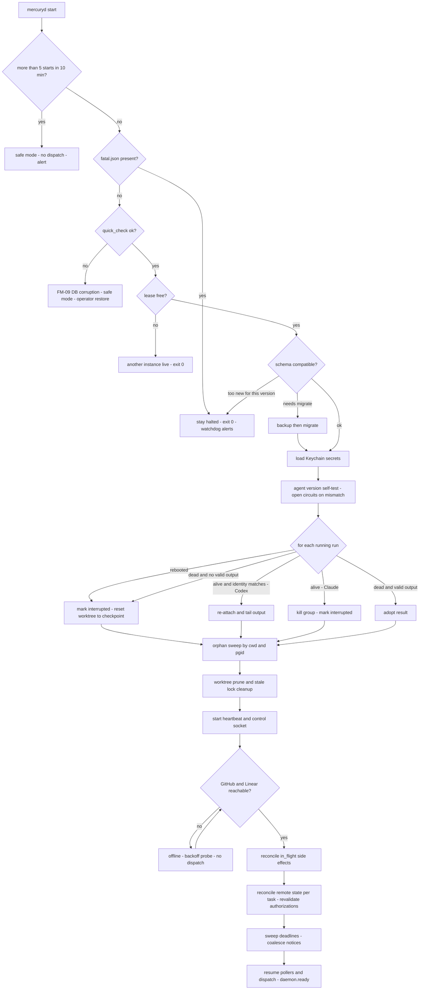
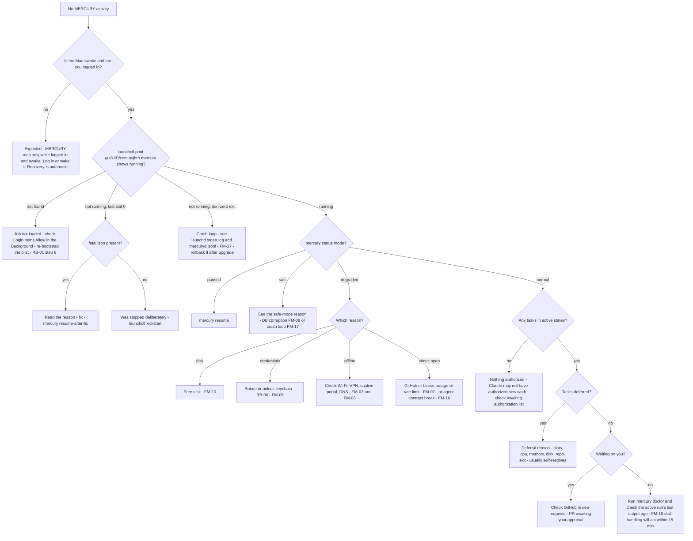

# MERCURY — Failure Recovery and Operations Runbook

Owner: Agent D (DevOps / Platform Architect). Phase 2 design. Status: **proposal for reconciliation**. Feeds TDD §20 (Reliability and Failure Recovery) and §24 (Deployment and Upgrade).

Read with [`macos-service.md`](macos-service.md), which covers the process model, the REL-nn requirements, paths and assumptions (ASM-D-nn). State names follow the design baseline. Agent C owns the canonical state machine; this document only relies on the rules stated in §1.

---

## 1. Recovery principles

| # | Principle | Consequence |
|---|---|---|
| R1 | **The database is the source of truth for intent. GitHub and Linear are the source of truth for effects.** | After any doubt (crash, restore, outage), MERCURY re-reads remote state before acting again. |
| R2 | **Commit the intent, then act, then record the outcome.** Every external side effect is a row in the side-effect journal, written in the same transaction as the state transition that requires it (§3). | A crash at any point leaves either no intent, or an intent that can be reconciled. |
| R3 | **Reconcile before retry.** An `in_flight` side effect is never re-sent blindly. The remote is queried first by a natural key. | REL-06: zero duplicate side effects |
| R4 | **Authority can only shrink during recovery.** Restoring, rolling back or losing state can cause re-authorization to be required. It can never create an authorization, plan approval or human approval. | Safe direction for every data-loss case |
| R5 | **Run failures are not task failures.** An interrupted agent run is retried under a run-level policy. The task keeps its workflow state until the retry budget is exhausted. | Sleep, reboot and network blips do not FAIL tasks |
| R6 | **Environmental failures do not consume the task's retry budget**, but have their own cap (3 per run step). | Flaky Wi-Fi does not escalate to the human |
| R7 | **Stop dispatch, not the daemon.** Degraded conditions (disk, credentials, outage, contract break) pause the affected dispatch and keep heartbeat, polling (where possible), status and alerting alive. | The operator can still see what is wrong |
| R8 | **Never destroy evidence automatically.** Worktrees of non-terminal or FAILED tasks, artifacts, backups and audit records are never auto-deleted. | Post-mortem is always possible |
| R9 | **Never force-push, never merge, never touch protected branches** during recovery. | Same authority invariants as normal operation |

---

## 2. Failure classes and retry policy

| Class | Examples | Retry? | Counts against task budget? | Backoff |
|---|---|---|---|---|
| `network` | DNS failure, connect timeout, TLS reset, HTTP 502/503/504 | Yes | No (cap 3 per step, then `BLOCKED` with reason `network`) | Exp. 30 s → 15 min, ±20% jitter |
| `environment` | Run interrupted by sleep, shutdown, reboot or daemon crash | Yes | No (cap 3 per step) | Immediate (after wake/start reconcile) |
| `rate_limit` | GitHub 403/429 with `retry-after` or `x-ratelimit-remaining: 0`; Linear `RATELIMITED`; agent API `rate_limit` | Yes | No | Honour `retry-after` / reset header; minimum 60 s |
| `external_outage` | ≥ 5 consecutive 5xx from one dependency, or its status page reports an incident (not polled in v1) | Yes, after the circuit half-opens | No | Circuit: open 5 min → 15 → 30 → 60 (cap) |
| `auth` | 401, revoked App installation, `authentication_failed`, keychain locked | No automatic retry except a token re-mint once | No | Operator action (FM-08) |
| `contract` | Agent output fails schema validation; unknown required field; CLI flag missing | Once (the first one may be model variance) | Yes | — then the agent circuit opens after 2 consecutive |
| `agent` | Agent reports failure, tests fail, plan rejected | Per workflow rules (Agent C) | Yes | — |
| `resource` | RSS cap, worktree size cap, disk guard | Once after cleanup | Yes | 10 min |
| `conflict` | Remote branch moved unexpectedly, PR closed by a human, base branch force-updated | No | — | → `BLOCKED` + human |
| `internal` | Invariant violation, unhandled exception | Process restart (launchd) | — | Crash-loop guard → safe mode |

---

## 3. Side-effect journal (outbox) and reconciliation keys

Agent C owns the table design. This document needs these columns and semantics:

```sql
CREATE TABLE side_effects (
  id               TEXT PRIMARY KEY,           -- se_<ulid>
  task_id          TEXT NOT NULL,
  kind             TEXT NOT NULL,              -- see table below
  dedup_key        TEXT NOT NULL UNIQUE,       -- deterministic: hash(task_id, kind, target, logical version)
  status           TEXT NOT NULL CHECK (status IN ('pending','in_flight','done','failed','abandoned')),
  attempt          INTEGER NOT NULL DEFAULT 0,
  request_json     TEXT NOT NULL,              -- redacted, no secrets
  remote_ref       TEXT,                       -- e.g. PR number, comment id, pushed sha
  next_attempt_at  TEXT,
  last_error_class TEXT,
  created_at TEXT NOT NULL, updated_at TEXT NOT NULL
);
```

Execution: `pending` → (transaction) `in_flight, attempt+1` → call → (transaction) `done, remote_ref` plus any resulting state transition. When the daemon finds an `in_flight` row at startup or after reconnect, it runs **reconcile** before anything else:

| Kind | Natural key / reconcile query | If found | If not found |
|---|---|---|---|
| `git.push` | `git ls-remote <mirror-remote> refs/heads/<branch>` | Remote sha == intended sha → `done`. Remote sha is an ancestor of the intended sha → retry push (fast-forward). Otherwise → `conflict`, task `BLOCKED`. | Retry push (no force) |
| `github.pr.create` | `GET /repos/{o}/{r}/pulls?head={owner}:{branch}&state=all` | Adopt the PR number → `done` | Retry create |
| `github.pr.update` (title/body) | `GET /pulls/{n}`; compare the body marker `<!-- mercury:rev=<n> -->` | Marker ≥ intended → `done` | Retry |
| `github.review.post` (Claude review, COMMENT/REQUEST_CHANGES) | `GET /pulls/{n}/reviews`; body contains `<!-- mercury:dedup=<dedup_key> -->` | `done` | Retry |
| `github.comment.post` | `GET /issues/{n}/comments?since=<created_at-5m>`; marker as above | `done` | Retry |
| `github.reviewers.request` | `GET /pulls/{n}/requested_reviewers` (or an existing human review) | `done` | Retry (idempotent anyway) |
| `linear.comment.create` | Client-supplied `id` = UUIDv5(dedup_key); `comment(id:)` query | `done` | Retry create with the same `id` |
| `linear.issue.update` (state/labels) | Read the issue; compare to the target values | Already at target → `done` | Retry (idempotent) |
| `linear.attachment.link` | Attachment keyed on (issue, url) is an upsert | `done` | Retry |
| `heartbeat.update` | Not journaled (best effort) | — | — |

Rules:
- Markers are HTML comments inside bodies, so they are invisible in the UI and searchable. Markers carry only IDs, never content.
- A side effect whose `attempt > 5` across `network` errors stays `pending`. It continues only after the circuit closes, and never becomes `failed` just because of being offline.
- `abandoned` is used only when the task was CANCELLED before the effect ran. The reconcile still runs, so a PR that actually got created is found and closed/commented by the cancellation flow (Agent B/C).

---

## 4. Startup recovery procedure (ordered)

Runs at every start: crash restart, login after reboot, upgrade, or restore. Each step logs `recovery.step {n, name, duration_ms, result}`. Steps 1–8 are local and need no network.

| # | Step | Detail | On failure |
|---|---|---|---|
| 1 | **Crash-loop guard** | Append the start time to `run/starts.log`. If > 5 starts in 10 min → `mode = safe` (no dispatch; status, heartbeat and alerts only). | — |
| 2 | **Fatal marker** | If `run/fatal.json` exists, stay halted unless started with `--clear-fatal` (written by `mercury resume-after-fix`). | Exit 0 |
| 3 | **Config and paths** | Parse `mercury.toml`. Verify directories exist, modes are 0700/0600 (repair to stricter only), and no path is under TCC-protected folders. | Fatal halt |
| 4 | **Open DB** | Pragmas: `journal_mode=WAL`, `synchronous=FULL`, `fullfsync=ON`, `foreign_keys=ON`, `busy_timeout=5000`. Run `PRAGMA quick_check`. | FM-09 (safe mode, no writes) |
| 5 | **Single-instance lease** | Acquire `instance_lease` (`macos-service.md` §3.4). Read `kern.bootsessionuuid`; set `rebooted = (stored != current)`. | Another live instance → exit 0 |
| 6 | **Schema** | Migration rules (`macos-service.md` §13.3): backup → migrate, or refuse. | Fatal halt + alert |
| 7 | **Secrets** | Load Keychain items. A missing or locked item disables only the integrations that depend on it (FM-08). | Partial degrade |
| 8 | **Agent tool self-test** | `codex --version`, `claude --version` equal the pins; `codex exec --help` contains the required flags. A mismatch opens that agent's circuit (FM-16). | Partial degrade |
| 9 | **Process and run recovery** | For every `runs` row in `starting`/`running`: if `rebooted` → mark `interrupted`. Else apply the re-attach rules (`macos-service.md` §3.3): live + identity match → **re-attach** (Codex) or **kill group + interrupt** (Claude); dead + valid output → **adopt**; else → `interrupted`. For each interrupted **implementation** run: `git -C <worktree> reset --hard <checkpoint_sha> && git clean -fdx -e .mercury-keep`, where `checkpoint_sha` is the last coordinator commit recorded for the task. Planning and review runs need no worktree reset. | Worktree reset failure → task `BLOCKED` (FM-12) |
| 10 | **Orphan sweep** | List processes of this uid: `ps -axo pid,ppid,pgid,lstart,command` + `lsof -a -u $UID -d cwd -Fpn` filtered to cwd under the work root or `runs/`. Any process not belonging to a live run → SIGTERM its group, then SIGKILL after 10 s. Log each one with `{pid, pgid, cwd, cmd}` (redacted). | Log + alert if unkillable |
| 11 | **Worktree and lock hygiene** | `git -C <mirror> worktree prune`. For each DB worktree: the directory exists and `git worktree list` agrees. Remove `index.lock`/`HEAD.lock`/`shallow.lock` only if no live process has cwd in that worktree **and** the lock is older than 10 min. Worktrees on disk without a DB task → move to `worktrees/_quarantine/` (never delete). | FM-12 |
| 12 | **Start the heartbeat and control socket** | `mode` = normal, safe or degraded. `mercury status` works from here. | — |
| 13 | **Connectivity gate** | Probe GitHub and Linear (`macos-service.md` §8.5). Offline → wait. Steps 14–16 run when online. | — |
| 14 | **Side-effect reconcile** | Every `in_flight` journal row → reconcile (§3). | Per row |
| 15 | **Remote state reconcile** | For every non-terminal task: fetch the PR (by number or head branch), reviews, check runs on the head SHA, merge status and the Linear issue. Apply observed external transitions through the normal event path (dedup by `(source, entity, updated_at/etag)`), e.g. PR merged while down → merge verification flow; PR closed by human → `CANCELLED`/`BLOCKED` per Agent C. Re-validate that each task's authorization is still unrevoked and unexpired. | Per task |
| 16 | **Deadline sweep** | Re-evaluate wall-clock deadlines that fell due while down. Coalesce notifications: at most **one** summary per task. | — |
| 17 | **Resume pollers and dispatch** | Linear cursor rewinds by a 10-min overlap; GitHub uses ETags. Dispatch interrupted run steps first (oldest first), then new work. | — |
| 18 | **Ready** | Log `recovery.completed {duration_ms, reattached, adopted, interrupted, orphans_killed, side_effects_reconciled}` and `daemon.ready`. If the downtime was > 6 h and tasks were active, post one `ops` comment: "MERCURY resumed after N h; X tasks resumed". | — |

Steps 9–11 also run after a restore (§7 RB-08), with `rebooted` forced to true.

### 4.1 Failure-recovery flowchart



---

## 5. Failure-mode catalogue

Columns: **Detection** (how and how fast), **Automatic recovery**, **Operator action** (blank = none needed), **Bound** (REL reference or invariant).

| ID | Failure | Detection | Automatic recovery | Operator action | Bound |
|---|---|---|---|---|---|
| FM-01 | **Daemon crash mid-transition** (exception, OOM, SIGKILL) | launchd sees a non-zero exit or signal death | launchd restarts after ≥ 30 s. The transition transaction either committed (state + journal rows) or rolled back. Startup §4 reconciles `in_flight` effects. | — (if crash-looping: FM-17) | REL-01, REL-03, REL-06 |
| FM-02 | **Daemon crash mid-agent-run** | Same as FM-01 | Codex run keeps going (detached, output to file) → re-attached at step 9. Claude run is killed (pipes gone) → `interrupted` → re-dispatched as `environment` (decision runs are idempotent; outputs are new artifact versions, never overwriting). | — | REL-04 |
| FM-03 | **Mac sleeps mid-run** | Tick gap > 30 s + `kern.waketime` (`macos-service.md` §8.2) | All processes resume. Awake-time budget excludes the gap. Stall clock is reset with a 5-min post-wake grace. Connectivity gate → token re-mint → reconcile → re-poll. If the agent's API stream died and the run fails → `environment` retry. | — | REL-13 |
| FM-04 | **Reboot / logout** (graceful) | SIGTERM → shutdown sequence (`macos-service.md` §12). At next start, `bootsessionuuid` changed. | Runs interrupted cleanly with state persisted. At login: full startup recovery. Implementation worktree reset to checkpoint; step re-run. | Log in (FileVault) | REL-05, REL-14 |
| FM-05 | **Power loss / kernel panic** | No `daemon.stopped` event for the previous instance + `bootsessionuuid` changed | As FM-04. The DB is durable to the last commit (`synchronous=FULL`, `fullfsync`). Uncommitted worktree changes may be torn → reset to checkpoint. `quick_check` at start; FM-09 if it fails. | Log in | REL-03, REL-05 |
| FM-06 | **Network loss during push / PR creation** | Request error class `network`; journal row stays `in_flight` | Connectivity gate → reconcile by natural key (§3): `ls-remote` for push, `pulls?head=` for PR. Adopt or retry; never duplicate. | — | REL-06 |
| FM-07 | **GitHub or Linear outage / rate limit** | 5xx streak → circuit open. 403/429 with `retry-after` or `x-ratelimit-remaining` < 10% → throttle. | Per-dependency circuit (5 → 60 min). Polling slows to the budget. GitHub open → no new Codex dispatch for PR-stage steps; planning may continue. Linear open → Linear writes queue in the journal (Linear is not on the code path). Outage time does not count toward stall or SLA timers (paused on `external_outage`). | Only if > 6 h (notified once via the other channel) | REL-06 |
| FM-08 | **Expired or revoked credentials / locked keychain** | GitHub: JWT mint returns 401 (key revoked) or installation 404 (App uninstalled). Linear 401. Agent `authentication_failed` result. Keychain `-25308`. | One re-mint/re-read attempt. Then that integration → `credential_invalid`: dispatch depending on it stops. Other integrations continue. Keychain-locked retried every 5 min. | Rotate credential (RB-06), then `mercury reload-credentials` | Alert ≤ 15 min |
| FM-09 | **DB corruption** (`quick_check` ≠ ok, `SQLITE_CORRUPT`, `SQLITE_NOTADB`) | Start step 4, daily `integrity_check`, or any query error | **Safe mode**: no writes, no dispatch. Copy `db/*` to `backups/quarantine/<ts>/`. Alert. Agent runs left running are allowed to finish; their output files are kept. | RB-08 restore (latest verified backup) → reconcile. Optional `sqlite3 corrupt.db .recover` for forensics. | REL-11, REL-12, R4 |
| FM-10 | **Disk full** | `ENOSPC`/`SQLITE_FULL`, or the guard at dispatch (`macos-service.md` §10.4) | Delete ballast → commit `degraded:disk` → stop dispatch → safe cleanup (old run dirs, logs, completed worktrees). Below 2 GiB: interrupt active Codex runs (checkpoint first). Resume automatically when above threshold; recreate ballast. | Free disk space if automatic cleanup is not enough | — |
| FM-11 | **Orphaned agent processes** | Startup step 10, and every 10 min: processes with cwd under the work root without a live run; a run's pgid alive after the run ended | SIGTERM group → SIGKILL after 10 s. Log each one. | Only if unkillable (zombie or `UE` state) → reboot | REL-10 |
| FM-12 | **Stuck worktree / git locks** | git error `index.lock exists`; `worktree add` fails (path exists or branch checked out); worktree missing for a non-terminal task | Remove the stale lock if no process uses the worktree and it is > 10 min old. Missing worktree → recreate from the mirror at `checkpoint_sha` (if pushed) or the last pushed branch sha; else task `BLOCKED`. Branch-in-use → `git worktree prune`, then retry once. | For `BLOCKED`: inspect, then `mercury task retry <id>` or cancel | R8 |
| FM-13 | **Half-created PR** (pushed but no PR; PR created but DB not updated; PR created but Linear not linked) | Journal `in_flight`/`pending` rows at reconcile | §3: `pulls?head=` adopts an existing PR. Missing PR is created. Linear link via an idempotent attachment upsert. | — | REL-06 |
| FM-14 | **Duplicate polling events** (overlapping Linear windows, ETag replay, repeated GitHub states) | Inbox unique key `(source, entity_id, version)` where version = `updatedAt`, review id, check-run id + status, or PR `updated_at` | Duplicates are dropped at insert (`INSERT … ON CONFLICT DO NOTHING`). Handlers are idempotent with respect to current state (guards reject transitions that are no longer valid). | — | REL-06 |
| FM-15 | **Clock jumps** (NTP step, manual change, DST is irrelevant because UTC is used) | `|wall delta − mono delta| > 2 s` (`macos-service.md` §8.2) | Durations inside a process lifetime use the monotonic clock. Persisted `due_at` values are re-evaluated. A backward jump > 5 min → log `clock.jump`; ULID generation stays monotonic (ULID monotonic factory). JWT `iat` set to now − 60 s to tolerate GitHub clock skew. | If skew vs GitHub `Date` header > 2 min persists: check System Settings › Date & Time | — |
| FM-16 | **Claude or Codex CLI upgrade breaks the output schema** (or someone upgrades outside MERCURY) | Start step 8 version pin mismatch; run final output fails schema; JSONL lacks the required event; required flag missing from `--help` | Run → `contract` failure, retried once. 2 consecutive contract failures, or a version mismatch → that agent's **circuit opens** (dispatch for that agent stops; tasks stay in state and are shown as deferred `circuit:codex`). Other agent continues. | Re-pin to the previous version (RB-09 agent rollback), or validate the new version with `mercury doctor --agents` and update the pin | Max 2 wasted runs |
| FM-17 | **Crash loop** (bug triggered by specific data) | > 5 starts in 10 min | Safe mode (no dispatch). Heartbeat `mode: safe`. Ops alert with the last exception class. | Inspect logs → `mercury rollback` (upgrade-related) or `mercury task quarantine <id>` (data-related) → `mercury resume` | REL-15 |
| FM-18 | **Agent run hangs** (alive, no output) | No stdout growth for `stall_min` of awake time | SIGINT (Claude) / SIGTERM (Codex) the group → 10 s → SIGKILL. Run `agent` failure class `stalled` → retried once; second stall → task `BLOCKED` + notify | Investigate if repeated | REL-08 |
| FM-19 | **Agent run dies** (OOM, segfault, killed by the user) | Liveness poll 15 s; RSS cap | Classify from JSONL/stderr: `resource` or `agent`. Retry per §2. | — | REL-07 |
| FM-20 | **Daemon down for a long time** (BTM toggle off, plist removed, fatal halt, operator logged out) | Watchdog: heartbeat issue stale > 45 min with pending work | None possible locally | §8 troubleshooting tree | REL-09 |
| FM-21 | **Unauthorized external change** (human or other bot pushed to a MERCURY branch, PR closed, Linear-native coding session started) | Reconcile sees an unexpected head sha, PR state or delegate | Never overwrite. Task → `BLOCKED` (reason `conflict`/`foreign_actor`) + notify. Security-relevant cases are escalated per Agent E. | Decide: adopt, retry or cancel | R9 |

---

## 6. Recovery verification (feeds `testing/verification-plan.md`)

| Test | Method | Pass criterion |
|---|---|---|
| T-REC-01 crash at every journal boundary | Fault injector kills the process (SIGKILL) before and after each outbound call and each commit; 100 randomized seeds | 0 duplicate remote objects; all tasks reach the same final state as a fault-free run |
| T-REC-02 power-loss durability | macOS VM hard reset during write load; then `integrity_check` + ledger compare | `ok`; 0 committed transitions lost |
| T-REC-03 re-attach | Kill mercuryd mid-Codex run (fake Codex that writes JSONL for 2 min) | Run completes and its result is adopted; no re-run |
| T-REC-04 sleep | Fake clock: inject a 2 h tick gap | Budget unchanged; stall grace applied; one coalesced notice |
| T-REC-05 orphan sweep | Spawn grandchildren that `setsid` with cwd in the worktree; kill mercuryd | After restart: 0 orphans (REL-10) |
| T-REC-06 restore | Restore a 24 h-old backup while fake GitHub has newer PRs | PRs adopted; no duplicate PRs; tasks whose authorization is missing go back to awaiting authorization |
| T-REC-07 contract break | Fake Codex emits a schema-invalid final message | 1 retry, then circuit open after a 2nd; no task FAILED for environment reasons |
| T-REC-08 shutdown budget | `launchctl kill TERM` with 2 active fake runs | Exit ≤ 20 s; runs `interrupted`; WAL truncated |

---

## 7. Operations runbook

All commands run as the operator in Terminal. `mercury` is the CLI installed at `~/Library/Application Support/Mercury/app/current/bin/mercury`; the installer adds a symlink in `~/.local/bin`. `L=com.usjbro.mercury; U=$(id -u)`.

### RB-01 Install (first time)

1. Complete Phase 0 (`macos-service.md` §16) and the identity prerequisites: GitHub App created and installed on the selected repos only; Linear key or app; CODEOWNERS and protections per discovery G3.
2. Install the pinned Node into `runtime/` (verify against nodejs.org SHASUMS256). Install the pinned Codex and Claude versions.
3. Download the MERCURY release → verify `SHA256SUMS` (and optionally `gh attestation verify`) → `mercury-install` creates the directory tree with 0700, renders `mercury.toml` and the plist, and creates `run/ballast`.
4. Create the Keychain items (`macos-service.md` §9.2). Never paste secrets into config files.
5. `tmutil addexclusion` for `db/`, `runs/`, `tmp/`, `~/Library/Mercury`.
6. `plutil -lint ~/Library/LaunchAgents/$L.plist && launchctl bootstrap gui/$U ~/Library/LaunchAgents/$L.plist`
7. Allow the background item if macOS asks (Login Items).
8. Create the heartbeat and ops issues in `project-mercury` and enable the watchdog workflow.

### RB-02 First-run verification

| Check | Command | Expected |
|---|---|---|
| Job running | `launchctl print gui/$U/$L \| grep -E "state\|pid\|last exit"` | `state = running`, a pid |
| Health | `mercury doctor` | All checks `ok` (warnings explained) |
| Status | `mercury status` | `mode: normal`, `net: online`, pollers have run |
| Heartbeat | `cat "~/Library/Application Support/Mercury/run/heartbeat.json"` | `ts` < 60 s old |
| Remote heartbeat | Open the heartbeat issue | Updated < 10 min ago |
| Watchdog | Run the `mercury-watchdog` workflow manually (`workflow_dispatch`) | Green; no alert (no pending work) |
| Restart behaviour | `launchctl kickstart -k gui/$U/$L` then `mercury status` | Back to `ready` ≤ 45 s |
| Sleep behaviour | Start a dry-run task, put the Mac to sleep for 2 min, wake | `wake.detected` and `wake.recovered` in logs; run resumes |
| Dry-run task | `mercury task dry-run <ISSUE> --repo <owner/repo>` (no push, no PR) | Reaches the plan-review stage with artifacts |

### RB-03 Daily checks

**None required.** MERCURY reports problems through GitHub notifications (ops issue + watchdog) and local notifications. Optional weekly glance: `mercury status --summary` (backup age, deferrals, circuits).

### RB-04 Pause / resume

```sh
mercury pause [--reason "travel"]      # stop new dispatch; active runs finish; polling + heartbeat continue
mercury pause --hard                    # also interrupt active runs (checkpointed), like a shutdown without exiting
mercury resume
mercury stop                            # graceful exit 0; launchd will NOT restart; next login starts it
launchctl kickstart gui/$U/$L          # start again without logging out
```

While paused, the heartbeat reports `mode: paused` and the watchdog does not alert (`pending_work = false`).

### RB-05 Cancel a task

```sh
mercury task show <task_id|ISSUE>       # state, active run, PR, side effects pending
mercury task cancel <task_id> --reason "<text>"
```

Effects (Agent C owns the transition): active runs are interrupted; pending journal rows become `abandoned` (reconciled first); task → `CANCELLED`; an open PR gets a comment and is closed only if the cancellation policy says so (Agent B); the worktree is kept for 7 days, then removed. Cancelling never deletes remote branches automatically in v1.

### RB-06 Rotate credentials

| Credential | Procedure |
|---|---|
| GitHub App private key | GitHub › App settings › Generate a new private key → `security add-generic-password -U -s com.usjbro.mercury.github-app-key -a mercury -T /usr/bin/security -w` (paste the base64) → `mercury reload-credentials` → `mercury doctor` (mints a token) → **delete the old key in GitHub** → securely delete the downloaded PEM. |
| Linear key | Create the new key (same team scope) → update the Keychain item → `mercury reload-credentials` → revoke the old key in Linear. |
| Anthropic / Codex keys | New key in the vendor console → update the Keychain item → `mercury reload-credentials` (next runs use it; active runs keep the old key until they end) → revoke the old key after active runs finish. |
| Suspected compromise | `mercury pause --hard` first → revoke at the vendor immediately → rotate → review `audit.jsonl` and GitHub audit events → `mercury resume`. |

### RB-07 Upgrade MERCURY

```sh
mercury upgrade <version>        # preflight → drain → pre-upgrade backup → switch symlink → restart → verify
mercury status                   # version = new, mode normal
```

If verification fails, auto-rollback runs (`macos-service.md` §13.4). Node runtime upgrade: `mercury runtime upgrade <node-version>` (re-renders the plist, then bootout/bootstrap). Agent CLI upgrade: `mercury agents upgrade codex|claude <version>`.

### RB-08 Roll back / restore from backup

```sh
# Code rollback (schema-compatible):
mercury rollback                         # current -> previous release; kickstart

# Data restore:
mercury stop
mercury backup list                      # verified backups with user_version + age
mercury restore <backup-file>            # quarantines current db/*, copies backup, removes -wal/-shm,
                                         # sets a flag forcing full reconcile with rebooted=true
launchctl kickstart gui/$U/$L
mercury status; mercury doctor
```

After a restore:
- Tasks are reconciled against GitHub and Linear. PRs created after the backup are adopted by head branch.
- Authorizations and plan approvals recorded after the backup are **gone**, so those tasks return to awaiting authorization or plan review (R4).
- Audit records lost with the restore are partly recoverable from `audit.jsonl` and from GitHub/Linear history. The restore itself is logged as an audit event.

### RB-09 Agent CLI rollback

`mercury agents pin codex <previous-version>` → `mercury doctor --agents` → `mercury circuit close codex`.

### RB-10 Decommission

1. `mercury pause` → wait for `active_runs = 0` (or `mercury pause --hard`).
2. `mercury backup` (final) → copy `backups/` and `artifacts/` to an archive location if they are to be kept.
3. `launchctl bootout gui/$U/$L && rm ~/Library/LaunchAgents/$L.plist`
4. Delete the Keychain items: `security delete-generic-password -s com.usjbro.mercury.<name> -a mercury` for each.
5. Revoke credentials at the vendors. Uninstall the GitHub App from the account. Delete the Linear key/app.
6. Disable the watchdog workflow; close the heartbeat and ops issues.
7. Remove `~/Library/Application Support/Mercury`, `~/Library/Mercury`, `~/Library/Logs/Mercury` (after checking that no worktree holds unpushed work you want: `mercury task list --non-terminal` before step 1).

### RB-11 Restore after a new Mac or disk loss

Restore `backups/` and `artifacts/` from Time Machine → RB-01 steps 1–6 with a restore flag → `mercury restore <latest>` → mirrors and worktrees are recreated from GitHub. Unpushed worktree changes are lost (bounded by REL-05 semantics: at most the current step per task).

### RB-12 Force-clean a stuck task

```sh
mercury task show <id>                    # look at blocked_reason, worktree path, locks
mercury task retry <id> [--from-checkpoint]
mercury task quarantine <id>              # exclude from dispatch + crash-loop suspects; keeps evidence
```

---

## 8. "MERCURY is silent — what do I check?"

Use this when no updates arrive on GitHub or Linear and you expected some.



Quick commands in order:

```sh
pmset -g log | grep -E " (Sleep|Wake) " | tail -5
launchctl print gui/$(id -u)/com.usjbro.mercury | grep -E "state|pid|last exit"
ls -l "$HOME/Library/Application Support/Mercury/run/"     # heartbeat age, fatal.json?
mercury status
mercury doctor
tail -n 50 "$HOME/Library/Logs/Mercury/mercuryd.jsonl" | grep -E '"level":"(warn|error|fatal)"'
tail -n 50 "$HOME/Library/Logs/Mercury/launchd.stderr.log"
```
