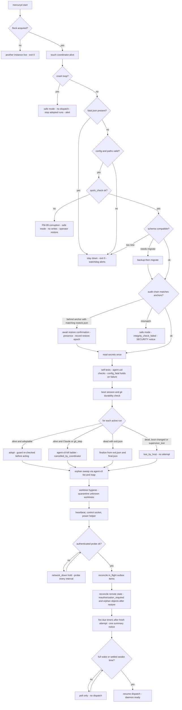
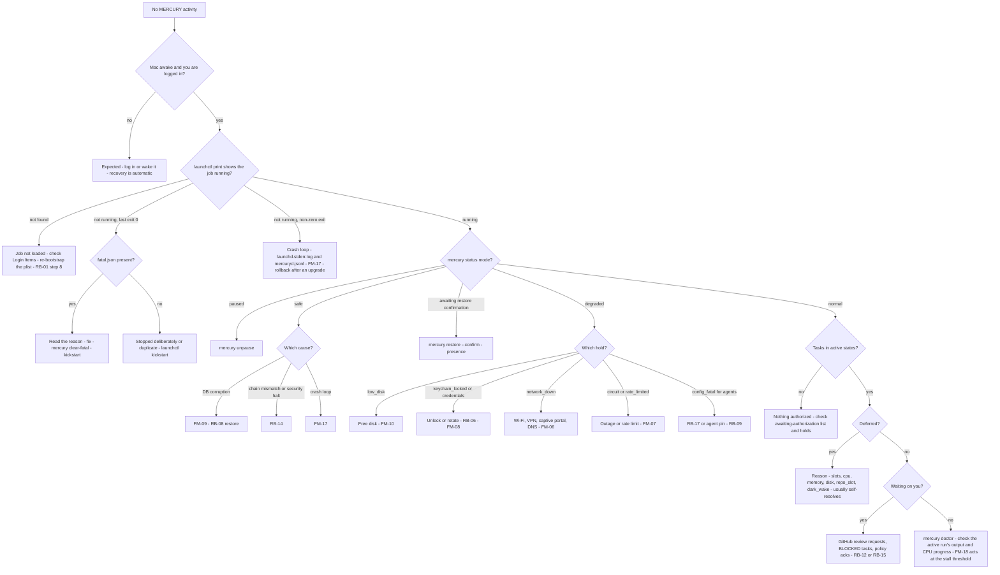

# MERCURY — Failure Recovery and Operations Runbook

Owner: Agent D (DevOps / Platform Architect). Phase 4 revision. Status: **revised to the binding reconciliation decisions** (`reviews/30-reconciliation.md`, RD-1…RD-20). Feeds TDD §20 (Reliability and Failure Recovery) and §24 (Deployment and Upgrade).

Read with [`macos-service.md`](macos-service.md), which owns the parameter table (§2), the agent-uid design (§3), the exit-code contract (§5.2), the filesystem layout (§7.1), the credential inventory (§9.1) and durability (§14). Parameter names below (`svc.*`, `run.*`, …) refer to macos-service §2; no values are restated here.

Single sources referenced, not restated: task states, holds and block reasons (state-machine §5, §6.1); run failure classes and per-kind attempts (state-machine §7.1); recovery per task state (state-machine §10); DDL (components §6.3); startup pseudocode (components §10.6); outbox handler contract (components §10.7); worktree reset policy (components §9); integration retry matrix (github.md §15); dedup keys (github.md §14); CLI verbs (components §5.5); notification matrix (components §4.15).

Commands marked **(presence)** are `operator-presence` methods: they need Touch ID or the login password through `mercury-presence` (macos-service §9.5, ADR-019). Steps marked **[ROOT — operator consent]** are host changes performed only by the operator.

---

## 1. Recovery principles

| # | Principle | Consequence |
|---|---|---|
| R1 | **The database is the source of truth for intent; GitHub and Linear for effects.** | After any doubt (crash, restore, outage), MERCURY re-reads remote state before acting again. |
| R2 | **Commit the intent, then act, then record the outcome.** Every external effect is an `outbox` row written in the same transaction as the transition that needs it (components §6.3, §10.7). Local git is ordered commit → fsync → DB transaction (macos-service §14.2). | A crash at any point leaves either no intent or an intent that can be reconciled. |
| R3 | **Reconcile before retry.** Every outbox handler implements `reconcile(natural_key)`; it runs for every `in_flight` item at startup and before every attempt after the first (components §10.7, dedup keys github.md §14). | Zero duplicate side effects. |
| R4 | **Authority can only shrink during recovery.** Restore, rollback, key loss or a lost DB can make re-authorization necessary (`BLOCKED(reauthorization_required)`); they never create an authorization, plan approval or human approval, and never map to `guard_integrity_failure`. | Safe direction for every data-loss case (RD-4). |
| R5 | **Run failures are not task failures.** Host-caused losses (`lost_by_host`, `lost_by_coordinator_crash`, `cancelled_by_coordinator`, `network_down`) never consume attempts and never block; `lost_by_host` has its own cap (`run.lost_by_host_cap`); at the cap the task gets the `host_instability` hold (released by `mercury unpause --task`) and an ops alert, never `BLOCKED`. | Sleep, reboot and Wi-Fi do not escalate (CON-009). |
| R6 | **Stop dispatch, not the daemon.** Degraded conditions set holds (state-machine §5) and keep heartbeat, status, polling and alerting alive. Only the §5.2 fatal rows stop the process. | The operator can see what is wrong. |
| R7 | **Security conditions never auto-clear.** `security_halt`, repo `integrity_alert` and `integrity_check_failed` are cleared only through the presence tier; adopted runs are not kept through them (RD-3, RD-11). | An operator-uid process can request but not clear an escalation. |
| R8 | **Never destroy evidence automatically.** Worktrees of non-terminal or FAILED tasks, quarantine, artifacts, backups and audit records are never auto-deleted; resets archive uncommitted changes first (components §9). | Post-mortem is always possible. |
| R9 | **Never force-push, never merge, never touch protected branches**, during recovery or otherwise. | Same authority invariants as normal operation. |

---

## 2. Host-level failure classification

Run failure classes, attempts and backoff are state-machine §7.1; the integration retry matrix is github.md §15. This table defines how **host events** map onto those classes. `lost_by_host` is the class added by ADR-020 / RD-11.

| Host event | How it is detected | Run outcome (C's class) | Attempt consumed? | Escalation |
|---|---|---|---|---|
| Sleep, run process intact | Sleep gap (components §10.10) | Run continues; not credited | — | — |
| Sleep, model API stream died | Agent error after wake | `network_down` or `transient_api` | No | Per github.md §15 |
| Network down / flapping | `network_down` hold or probe failure within `net.error_probe_window_s` | `network_down` | No | Never `BLOCKED`, never `dead` |
| Coordinator crash, adoptable run alive | `agent-ctl probe` = `alive_match` | Adopted (audit event) | No | — |
| Coordinator crash, Claude run | Pipes gone | `cancelled_by_coordinator`; re-run with the same `input_digest` | No | — |
| Coordinator crash between claim and spawn | `runs.status = starting`, no `proc.json` | `lost_by_coordinator_crash` | No | — |
| Reboot, shutdown, power loss, panic | `kern.bootsessionuuid` changed; no `exit.json` | `lost_by_host` | No | `run.lost_by_host_cap` per step → `host_instability` hold + `ops.lost_by_host_cap` |
| Coordinator absent too long | `exit.json{reason: supervisor_lost}` | `lost_by_host` | No | Same cap |
| Durable commit missing after power loss | `git cat-file -e last_commit_sha` fails | Current step `lost_by_host`; replay from last durable commit | No | Same cap |
| Run finished while the coordinator was down (even across reboot) | `exit.json` + `final.json` present | Finalized normally | Per result | — |
| Wrapper rejected the spec | `agent-exec` exit 125 | `config_fatal` | No | `config_fatal` hold for agents; `ops.agent_infra` |
| Agent stripped ACLs / unreadable output | Commit read fails | `policy_violation` | — | `BLOCKED(security_policy_violation)` |
| Disk below interrupt thresholds | Disk guard | `cancelled_by_coordinator` + `low_disk` hold | No | `ops.disk` |
| RSS cap | `agent-ctl stats` | `crash` (`rss_cap`) | Yes | Per SM §7.1 |
| Hard deadline in `agent-exec` | `exit.json{reason: deadline}` | `timed_out` | Yes | Per SM §7.1 |

A genuinely stuck task (many environmental interruptions without progress) is caught by C's no-progress detector, which notifies without changing state.

---

## 3. Outbox reconciliation (semantics D relies on)

The table, statuses and handlers are C's (`outbox`, components §6.3, §10.7); keys are B's (github.md §14). Recovery relies on these properties only:

- At startup and after `network_down` clears, every `in_flight` item runs `reconcile(natural_key)` **before** any new attempt.
- Network-class and 5xx failures do not count toward `max_attempts`; a per-integration circuit hold replaces dead-lettering (RD-18). Only non-network 4xx-class errors lead to `dead`.
- Pushes are reconciled with `git ls-remote` against the mirror remote: remote SHA = intended → done; remote is an ancestor → fast-forward retry; otherwise `BLOCKED(foreign_push)` (never force).
- PRs are found with `findPullByHead` using `state=all`.
- Items for a task that was cancelled are reconciled first, so an effect that did land is found and handled by the cancellation flow.

---

## 4. Startup recovery procedure (ordered)

Runs at every start: crash restart, login after reboot, upgrade, restore. Each step logs `recovery.step {n, name, duration_ms, result}`. Exit-code behaviour is macos-service §5.2; components §10.6 is the implementation pseudocode of the same order.

| # | Step | Detail | On failure |
|---|---|---|---|
| 1 | **Instance lock** | `flock(run/mercuryd.lock)`. Then start touching `WORK_ROOT/ctl/coordinator.alive` every `supervisor.alive_touch_s`, so `agent-exec` sees a live supervisor during recovery. | Held → exit 0 |
| 2 | **Crash-loop guard** | Append to `run/starts.log`; above `svc.crash_loop_starts` in `svc.crash_loop_window_min` → `mode = safe`. Evaluated **before** the DB is opened or migrated, so a migration that crashes the process cannot loop forever. | — |
| 3 | **Fatal marker** | `run/fatal.json` present → do not start. | Exit 0 |
| 4 | **Config and paths** | Parse `mercury.toml`; verify §7.1 owners, modes and ACLs (repair to stricter only, ACLs via `agent-ctl fix-acl`); TCC-safe paths; socket path length. | Fatal → `fatal.json`, exit 0 |
| 5 | **Open DB** | Pragmas per macos-service §14.2; `PRAGMA quick_check`. | Corruption → safe mode, no writes (FM-09): skip steps 6–11 and 13; step 12 runs without the DB (`agent-ctl list` → `reap` **every** `_mercuryagent` process); step 14 surfaces; ops alert sent directly (not through the outbox) |
| 6 | **Schema** | macos-service §13.3: backup → migrate, or refuse if too new. | Too new → `fatal.json`, exit 0 |
| 7 | **Audit chain** | Verify the chain since the last off-host anchor. If the head is behind the anchor and `run/restore.json` matches the DB → **awaiting restore confirmation** (no dispatch) until `mercury restore --confirm` **(presence)** records the restore epoch (macos-service §14.4). Mismatch without a matching restore → safe mode + one SECURITY notification (`integrity_check_failed`). | Safe mode |
| 8 | **Secrets** | Read every §9.1 item once via `mercury-keychain`. Missing → that integration `config_fatal`; locked → `keychain_locked` hold. | Partial degrade |
| 9 | **Self-tests** | Agent CLI versions and hashes; agent-uid infrastructure (macos-service §3.10); power and presence helpers present. | `config_fatal` hold (agents) |
| 10 | **Host and durability** | `rebooted = (stored bootsessionuuid ≠ current)`. For every non-terminal task with `last_commit_sha`: `git cat-file -e` + branch ref in the mirror. Missing → mark the step for replay from the last durable commit (`lost_by_host`). | Per task |
| 11 | **Runs** | For each `runs` row in `starting`/`running`/`stopping`: see the table below. Results finalized here are **recorded but not applied** (`result_disposition = deferred`) until step 17 has refreshed the issue's `spec_sha256` from Linear after this start; AG@apply then runs against the fresh observation (VD-03). | Per run |
| 12 | **Orphan sweep** | `agent-ctl list`: any `_mercuryagent` process not in an adopted run's group → `agent-ctl reap` (ladder), audit `orphan_killed`. | Unkillable → `ops.agent_infra` |
| 13 | **Worktree hygiene** | Resume worktree steps in `creating`/`archiving`/`removing` idempotently (components §9); clear stale `lock_owner`; `git worktree prune`; remove `index.lock` only if no agent process has its cwd there (`agent-ctl list`) and it is older than `git.stale_index_lock_min`; worktrees on disk without a DB row → `WORK_ROOT/quarantine/` (mode 0000). Tasks marked in step 10 or with `lost` runs get the reset policy at re-dispatch. | FM-12 |
| 14 | **Surfaces** | Heartbeat file, control socket, `mercury-power`, remote heartbeat. `mercury status` works from here. | — |
| 15 | **Connectivity gate** | Authenticated probes (macos-service §8.5). Offline → `network_down` hold; steps 16–18 wait. | — |
| 16 | **Outbox reconcile** | Every `in_flight` item → `reconcile` (§3). | Per item |
| 17 | **Remote reconcile** | Every non-terminal task: PR (by number or head, `state=all`), reviews, checks on the head SHA, merge state, Linear issue (`linear.poll_overlap_s` after restart). Facts enter through the inbox (dedup keys, github.md §14). After a restore: tasks with unverifiable authority, and **all** non-terminal tasks when history was lost (macos-service §14.4 step 3) → `BLOCKED(reauthorization_required)`; remote objects naming unknown tasks → orphan remote objects (never adopted). | Per task |
| 18 | **Timers** | Due state timers fire only after a fresh attempt of the awaited action (RD-14); due reminders and expiries → **one** summary notification; hold ageing evaluated (`hold_age.*`). | — |
| 19 | **Dispatch gate** | Dark-wake rule (macos-service §8.4). Then resume pollers and dispatch: replayed steps first (oldest first), then new work. | — |
| 20 | **Ready** | Log `recovery.completed {duration_ms, adopted, finalized, lost_by_host, orphans_reaped, outbox_reconciled}` and `daemon.ready`. Downtime above `recovery.downtime_notice_min` with non-terminal tasks → one ops notice. | — |

**Step 11 — run recovery table** (statuses and classes are C's):

| Situation | Action |
|---|---|
| `starting`, no `proc.json` | `lost_by_coordinator_crash`; re-dispatch |
| `starting`, `proc.json` present (crash after spawn, before the pid was recorded) | Probe with the identity from `proc.json`; continue with the rows below (adopt if `alive_match`) — never re-dispatch while that process may be alive |
| `agent-ctl probe` = `alive_match`, kind adoptable (Codex, `verify`, `deps_install`), mode normal | **Adopt**: resume tailing from the persisted offset; deadlines continue from persisted `awake_ms`. The authorization guard (incl. `spec_hash`) is re-evaluated before the result is acted on. |
| `alive_match`, kind adoptable, mode safe or `security_halt` | Kill ladder via `agent-ctl signal`; `cancelled_by_coordinator` |
| `alive_match`, kind `claude` or `git_step` | Kill ladder; `cancelled_by_coordinator`; re-run (same `input_digest`) |
| Dead, `exit.json` present (any boot session) | Finalize from `exit.json` + `final.json` (validated); `reason: supervisor_lost` → `lost_by_host` |
| Dead, no `exit.json`, boot session changed | `lost_by_host` |
| Dead, no `exit.json`, same boot session | `agent-exec` itself was killed → `crash` (SM §7.1), unless `proc.json` is also absent (`lost_by_coordinator_crash`) |
| `alive_mismatch` | Treat as dead for this run; the process is handled by the orphan sweep |

Safe mode stops after step 14 (no steps 15–19 dispatch effects; read-only polling only when the DB is writable).

### 4.1 Failure-recovery flowchart



---

## 5. Failure-mode catalogue

Columns: **Detection**, **Automatic recovery**, **Operator action** (blank = none), **Bound** (parameter or invariant). Parameter names are macos-service §2.

| ID | Failure | Detection | Automatic recovery | Operator action | Bound |
|---|---|---|---|---|---|
| FM-01 | **Coordinator crash mid-transition** | launchd sees non-zero exit or signal | Restart after `svc.throttle_interval_s`; the transaction committed or rolled back; §4 reconciles `in_flight` items | If crash-looping: FM-17 | `svc.restart_to_ready_max_s` |
| FM-02 | **Coordinator crash mid-run** | As FM-01 | Codex, `verify`, `deps_install` keep running under `agent-exec` and are adopted; Claude re-run with the same `input_digest`, no attempt | — | 0 lost adoptable runs |
| FM-03 | **Mac sleeps mid-run** | Sleep gap + `kern.waketime`; power helper | Not credited; `host_sleep_grace`; connectivity gate; token re-mint; reconcile; dark-wake rule before new dispatch | — | `recovery.first_poll_max_s` |
| FM-04 | **Logout or graceful reboot** | SIGTERM (macos-service §12); boot session changes on reboot | Claude runs interrupted; adoptable runs left under `agent-exec` (lease-bounded); at login full §4 | Log in (FileVault) | `supervisor.lease_stale_min` |
| FM-05 | **Power loss / kernel panic** | No `daemon.stopped` + boot session changed | DB durable to last commit; runs → `lost_by_host`; git durability check (§4 step 10); reset policy at re-dispatch | Log in | `run.lost_by_host_cap` |
| FM-06 | **Network loss during push / PR creation** | Network-class error; item stays `in_flight` | `network_down` hold; on recovery reconcile by natural key; adopt or retry; attempts not consumed | — | 0 duplicates |
| FM-07 | **GitHub or Linear outage / rate limit** | Retry matrix (github.md §15); circuit holds | Per-integration circuit; polls widen; Codex work that does not need the integration continues | Only if long (one notification through the other channel) | — |
| FM-08 | **Credential expired, revoked, keychain locked** | 401 after one re-mint; Keychain −25308 at start or reload; agent run classified `auth_failed`/billing (model key) | `integration_auth_failed` / `agent_auth_failed` / `keychain_locked` hold; others continue; retry every `credentials.locked_retry_s` | RB-06 then `mercury reload-credentials` | `credentials.locked_alert_min` |
| FM-09 | **DB corruption** | `quick_check`, daily `integrity_check`, `SQLITE_CORRUPT` | Safe mode (no writes, no dispatch); copy `db/*` to `backups/quarantine/<ts>/`; every agent-uid process reaped (§4 step 5); direct alert | RB-08 restore → restore epoch | — |
| FM-10 | **Disk full** | `ENOSPC`/`SQLITE_FULL` or guard | Ballast released; `low_disk` hold; cleanup of safe items; interrupts at `disk.interrupt_local_gib` / `disk.interrupt_codex_gib` | Free space if cleanup is not enough | `disk.*` |
| FM-11 | **Orphaned agent processes** | §4 step 12 and every `orphan.sweep_interval_min`: `agent-ctl list` shows `_mercuryagent` processes outside live run groups | `agent-ctl reap`; audit | Only if unkillable → reboot | 0 orphans |
| FM-12 | **Stuck worktree / git locks** | `index.lock exists`; `worktree add` fails; worktree missing for a non-terminal task | Stale lock removal (no agent cwd there, older than `git.stale_index_lock_min`); missing worktree recreated from the mirror at `last_commit_sha` or `base_sha` (components §9), counted as a reset (`worktrees.reset_epoch` incremented, so Codex threads are not resumed); branch in use → prune + retry once | If `BLOCKED`: RB-12 | R8 |
| FM-13 | **Half-created PR** | Outbox items `in_flight`/`pending` at reconcile | Reconcile adopts the PR found by head (`state=all`) | — | 0 duplicates |
| FM-14 | **Duplicate poll events** | Inbox unique dedup key (github.md §14) | Dropped at insert; handlers idempotent | — | 0 duplicates |
| FM-15 | **Clock jumps** | `|Δwall − Δmono| > clock.wall_jump_s` | Not treated as sleep; persisted `due_at` re-evaluated; ULIDs monotonic; JWT `iat` = now − 60 s | If skew vs GitHub `Date` > `clock.skew_alert_s` persists: check Date & Time | — |
| FM-16 | **Agent CLI upgrade breaks the contract** | Version/hash pin mismatch; schema validation failures; missing flag | `config_fatal` for that agent; circuit; other agent continues | RB-09 | — |
| FM-17 | **Crash loop** | `svc.crash_loop_starts` in `svc.crash_loop_window_min` | Safe mode; ops alert with the last exception class | Logs → `mercury rollback` (upgrade-related) or `mercury pause --task <id>` for a data-related task → `mercury unpause --safe-mode` **(presence)** (releases the global safe-mode hold, components §10.6) → `launchctl kickstart -k` | — |
| FM-18 | **Agent run hangs** | No stdout growth **and** no group CPU progress (`agent-ctl stats`) for the stall value (macos-service §2.3) | Kill ladder; `stalled` per SM §7.1 | Investigate if repeated | — |
| FM-19 | **Agent run dies** (OOM, segfault) | `agent-ctl probe` every `run.liveness_poll_s` | Classified from `exit.json`/stderr per SM §7.1 | — | — |
| FM-20 | **Daemon down for a long time** (BTM off, plist removed, fatal halt, logged out) | Watchdog (`watchdog.stale_awake_min` / `watchdog.stale_sleeping_h`) with `pending_work` | None locally | §8 troubleshooting | — |
| FM-21 | **Foreign change** (foreign push, PR closed, foreign Linear agent) | Reconcile sees unexpected head, PR state or delegate | Never overwrite; `BLOCKED(foreign_push \| pr_closed_unexpectedly \| foreign_agent)` per SM §6.1 | Decide: adopt, reset, reopen, cancel | R9 |
| FM-22 | **Supervisor lost** (coordinator absent beyond the lease) | `exit.json{reason: supervisor_lost}` | `lost_by_host`; replay | — | `supervisor.lease_stale_min` |
| FM-23 | **Agent-uid infrastructure broken** (sudoers changed, wrapper hash mismatch, user/group missing, ACLs missing) | `doctor` at start and on demand; `agent-exec` exit 125; `sudo -n` failure | `config_fatal` hold for agents; coordinator keeps polling and notifying | RB-17 | — |
| FM-24 | **Audit chain mismatch** (not explained by a restore epoch) | §4 step 7 or `mercury audit verify` | Safe mode, `integrity_check_failed`, one SECURITY notification; adopted runs stopped | RB-14 | R7 |
| FM-25 | **Restore or new host** | `run/restore.json` | Awaiting confirmation; restore epoch; `reauthorization_required`; orphan remote objects reported | RB-08 / RB-11 / RB-18 | R4 |
| FM-26 | **Dark wake with queued work** | Power helper reports `dark`; or no full-wake signal | No dispatch until full wake or `wake.dark_wake_min_awake_s`; polls allowed | — | 0 dispatches in dark wake |
| FM-27 | **MERCURY down while the operator must merge** | Required MERCURY checks absent or pending | None (by design the merge waits) | RB-13 | — |
| FM-28 | **Security halt** (unauthorized merge actor, merge commit not on base, governance drift, secret-scan hit, git-config tamper, sandbox violation, canary read) | MergeVerifier, drift monitor, canary self-test, pre-push gates | Global `security_halt` (or repo `integrity_alert`); all runs in scope stopped; SECURITY notification | RB-14 | R7 |
| FM-29 | **Agent tampered with permissions** (ACL stripped, files 0600) | Coordinator read fails during commit or archive | `policy_violation`; `BLOCKED(security_policy_violation)` | RB-12 with `--discard-worktree-changes` | — |
| FM-30 | **Keychain locked at start** (not at runtime: secrets are read once) | −25308 at step 8 | `keychain_locked` hold; retry | Unlock (log in again or `security unlock-keychain`) | `credentials.locked_alert_min` |

---

## 6. Recovery verification (procedures; IDs registered by F)

IDs are proposals for F (`TC-REC-*`, `TC-NET-*`, `TC-OPS-*`); Phase 2 `T-REC-nn` are aliases. Environments: T1 unit with FakeClock (every sleep test runs in **both** monotonic modes, RD-16), T2 integration with fakes and FaultProxy, T4 real Mac, VM = macOS guest on an Apple Silicon host. ⓗ = operator involvement.

| Test | Scenario and method | Env | Pass criterion |
|---|---|---|---|
| TC-REC-001 (T-REC-01) | SIGKILL before and after every outbound call and every commit; 100 seeds | T2 | 0 duplicate remote objects; same final states as a fault-free run; git and SQLite consistent (`last_commit_sha` present) |
| TC-REC-002 (T-REC-02) | Power-loss durability (see §6.1) | VM | 50/50 cycles: `integrity_check` ok; ledger matches; every recorded `last_commit_sha` present or the step classified `lost_by_host`; no torn `exit.json` accepted |
| TC-REC-003 (T-REC-03) | Kill `mercuryd` mid-Codex run (fake agent writing JSONL for 2 min) under `agent-exec` | T2 / VM | Run adopted and finalized; no re-run; guard re-checked before acting |
| TC-REC-004 (T-REC-04) | 2 h sleep gap, both monotonic modes | T1 | Budget unchanged; grace applied; one summary notice |
| TC-REC-005 (T-REC-05) | Agent grandchildren that `setsid` away; kill `mercuryd` | VM | After restart: 0 `_mercuryagent` orphans (`agent-ctl list`) |
| TC-REC-006 (T-REC-06) | Restore a 24 h-old backup while fake GitHub has newer PRs | T2 | Restore epoch recorded after presence confirmation; orphan remote objects reported; 0 duplicate PRs; 0 auto-adoptions; tasks with missing authority `BLOCKED(reauthorization_required)` |
| TC-REC-007 (T-REC-07) | Fake Codex emits a schema-invalid final message | T2 | Classified per SM §7.1; `config_fatal`/circuit on repeat; no task FAILED for environment reasons |
| TC-REC-008 (T-REC-08) | `launchctl kill TERM` with one Claude and one Codex fake run | T2 / VM | Exit within `svc.shutdown_budget_s`; Claude run `cancelled_by_coordinator`; Codex run still alive and adopted on restart |
| TC-REC-009 | Supervisor lease: stop `mercuryd` permanently with an active run | VM | Run ended after `supervisor.lease_stale_min` of credited time with `reason: supervisor_lost`; next start classifies `lost_by_host`, 0 attempts consumed |
| TC-REC-010 | Lid-close sleep ≥ 2 h during `codex_implement` | T4 ⓗ | `network_down`/`transient_api`, resumed or replayed; 0 attempts consumed; token re-minted |
| TC-REC-011 | Idle-sleep assertion present only while runs are active | T4 | Assertion present/absent as expected |
| TC-REC-012 | Dark wake (Power Nap) with tasks queued | T4 ⓗ | 0 dispatches during dark wake; dispatch after full wake |
| TC-REC-013 | Logout with an active Codex run; log in within and beyond the lease | T4 ⓗ | Within: adopted. Beyond: `lost_by_host`. 0 orphans |
| TC-REC-014 | Login Keychain locked at start; "lock on sleep" set | T4 | `keychain_locked` hold and alert; recovery after unlock; no effect of later locks on a running daemon |
| TC-REC-015 | Disk full during a run | T2 + T4 | Ballast released; `low_disk`; 0 DB corruption |
| TC-REC-016 | Wall-clock jump ±10 min | T1 + T4 | No false sleep; deadlines correct |
| TC-REC-017 | BTM "Allow in the Background" off | T4 ⓗ | `doctor` reports it; watchdog alerts with pending work |
| TC-REC-018 | Upgrade during a real Codex run | T4 | Adopted; finalized; 0 re-runs |
| TC-REC-019 | Restore with anchors ahead of the backup, including a revocation and a CLI cancel recorded after the backup | T2 | Epoch recorded; 0 cancelled tasks; every non-terminal task `BLOCKED(reauthorization_required)`; 0 Codex dispatches before re-authorization; authority only shrinks |
| TC-REC-020 | Power-loss VM cycles (= TC-REC-002 at scale) | VM | As TC-REC-002 |
| TC-REC-021 | Merged while asleep > 24 h | T2 virtual clock | Verified, not BLOCKED (RD-14 timer rule) |
| TC-REC-022 | Wrapper rejects: tampered `spec.json` mode, symlinked `--run-dir`, unknown flag, key on fd 3 for `verify` | VM | 100 % rejected with exit 125; nothing executed; `config_fatal` hold |
| TC-REC-023 | Agent strips ACLs in its worktree | VM | `policy_violation`; `BLOCKED(security_policy_violation)`; nothing committed |
| TC-NET-006 | Flapping link (GitHub reachable, Linear not, and reverse) | T2 FaultProxy | 0 `dead` outbox items from network-class errors |
| TC-NET-007 | Captive portal / TLS interception | T2 | Treated as offline; TLS never disabled |
| TC-OPS-011 | Watchdog end-to-end: daemon stopped vs sleeping heartbeat | Sandbox repo | Alert vs no alert |
| TC-OPS-012 | Restore drill ⓗ (RB-08) on the VM | VM | Completed with the runbook within the restore-time target registered by F |

### 6.1 Power-loss test approach (RD-24)

- **Rig:** a macOS guest VM on an Apple Silicon host (Virtualization.framework through `tart` or UTM; P0-047). The VM disk uses uncached/synchronous host I/O so that a guest flush reaches the host disk; record the setting in the test report because it determines fidelity.
- **Load:** inside the guest, MERCURY runs against the fakes with a write-heavy synthetic workload: transitions, outbox items, coordinator commits in a mirror, and fake agent runs writing `proc.json`/`exit.json` through the real `agent-exec`.
- **Fault:** force-stop the VM (`tart stop --timeout 0` or the hypervisor's hard power-off) at a random point, 50 cycles.
- **Check after each boot:** `PRAGMA integrity_check`; the ledger of acknowledged transitions (written by the load generator to the host) is a prefix of the DB; every `last_commit_sha` exists in the mirror (or the step is `lost_by_host`); every `exit.json` parses or is treated as absent; MERCURY's own §4 completes without safe mode.
- **Not done:** never power-cut the operator's Mac. GitHub-hosted macOS runners cannot run the VM (no nested virtualization). The Linux fault-injection filesystem is used for SQLite logic only.

---

## 7. Operations runbook

All commands run as the operator in Terminal. `mercury` is `~/Library/Application Support/Mercury/app/current/bin/mercury` (symlinked into `~/.local/bin`). `L=com.usjbro.mercury; U=$(id -u)`. CLI verbs follow components §5.5. **Not yet in §5.5** (open for C, `reviews/51` VD-05): `upgrade`, `rollback`, `runtime upgrade`, `agents upgrade|pin`, `db backup --list`, `restore --reason restore`, `ruleset-emergency begin|end`, `repo check`, `show --diff [--policy]`, `doctor --repair|--presence|--plant-canaries|--agents|--quick|--full`. Runbook steps using them are marked †.

### RB-01 Install (first time)

1. Phase 0 read-only checks (macos-service §16.1) and governance prerequisites: **two** GitHub Apps (`mercury-bot` on the selected target repos, `mercury-ops` on `project-mercury` and the private anchor repo) with the RD-6 permissions; Linear OAuth app (`actor=app`); rulesets per RD-5 with the two required MERCURY checks; CODEOWNERS = operator.
2. **[ROOT — operator consent]** `mercury-install --system`: shows the plan (user, group, wrappers, sudoers, `WORK_ROOT` + ACLs, `chmod 700 ~`, optional managed settings), asks for confirmation, then runs it with `sudo`.
3. Phase 0 agent-uid checks P0-026…P0-032 and SEC-T-20 (macos-service §16.2). **No non-sandbox agent run before these pass.**
4. Install the pinned Node into `runtime/`; `mercury toolchain sync` (agent CLIs and repo toolchains into `WORK_ROOT/toolchains`).
5. Verify the release (`SHA256SUMS`, optional `gh attestation verify`) → `mercury-install` (operator level) creates `MERCURY_HOME`, renders `mercury.toml` and the plist, creates `run/ballast`.
6. Create the Keychain items (macos-service §9.2), trusting only `mercury-keychain`.
7. `tmutil addexclusion` for `db/`, `run/`, `tmp/` and `/Users/Shared/MercuryWork`.
8. `plutil -lint ~/Library/LaunchAgents/$L.plist && launchctl bootstrap gui/$U ~/Library/LaunchAgents/$L.plist`; allow the background item if asked.
9. In `project-mercury`: create the heartbeat and ops issues, **lock both conversations to collaborators**, enable the watchdog workflow.

### RB-02 First-run verification

| Check | Command | Expected |
|---|---|---|
| Job running | `launchctl print gui/$U/$L \| grep -E "state\|pid\|last exit"` | `state = running` |
| Health | `mercury doctor` | All `ok`, including the agent-uid checks and canary self-test |
| Status | `mercury status` | `mode: normal`, `net: online`, pollers ran |
| Heartbeat | `ls -l "$HOME/Library/Application Support/Mercury/run/heartbeat.json"` | Updated within `heartbeat.local_s` |
| Remote heartbeat | Open the heartbeat issue | Updated within `heartbeat.remote_min` |
| Watchdog | Run `mercury-watchdog` manually | Green, no alert |
| Restart | `launchctl kickstart -k gui/$U/$L`; `mercury status` | Ready within `svc.restart_to_ready_max_s` |
| Presence | `mercury doctor --presence` | Touch ID/password sheet appears and succeeds |
| Sleep | Start a sandbox task, sleep the Mac 2 min, wake | `wake.detected`, `wake.recovered`; run continues |
| Sandbox task | `mercury request authorize <ISSUE>` on the sandbox repo | Reaches plan review with artifacts |

### RB-03 Daily checks

None required. Problems arrive through the ops issue, the watchdog and local notifications. Optional weekly: `mercury status` (backup age, anchor age, holds, deferrals).

**Trust rule:** act only on ops comments posted by the `mercury-ops` App or `github-actions` (badge visible in GitHub Mobile). Never run a command quoted in a comment; responses happen only through the local CLI (RD-19).

### RB-04 Pause, unpause, stop

```sh
mercury pause --all --reason "travel"     # operator_pause hold: no new dispatch; runs finish; polling + heartbeat continue
mercury pause --repo usjbro/network_monitor --reason "..."
mercury cancel-run <run>                   # stop one run (no attempt consumed)
mercury unpause --all
mercury stop                               # graceful exit 0; launchd does not restart; adoptable runs continue (lease-bounded)
launchctl kickstart gui/$U/$L              # start again
```

While paused, the heartbeat says `mode: paused` and the watchdog stays silent.

### RB-05 Cancel a task

```sh
mercury show <task|issue>
mercury cancel <task> --reason "<text>"
```

Effects are C's (G1b): active runs cancelled, outbox items reconciled then cancelled, PR to draft + comment (never closed), worktree archived then removed after retention.

### RB-06 Rotate credentials

| Credential | Procedure |
|---|---|
| `mercury-bot` / `mercury-ops` App key | App settings › Generate a new private key → `security add-generic-password -U -s com.usjbro.mercury.github-bot-key` (or `github-ops-key`) `-a mercury -T /usr/local/libexec/mercury/mercury-keychain -w` → `mercury reload-credentials` → `mercury doctor` (mints a token) → **delete the old key in GitHub** → delete the downloaded PEM. |
| Linear client secret | Regenerate in the Linear app settings → update `com.usjbro.mercury.linear-client-secret` → `mercury reload-credentials` (new app token minted) → confirm the old secret is invalid. |
| Anthropic / OpenAI keys | New key in the dedicated workspace/project → update the item → `mercury reload-credentials` (new runs use it; running runs keep the fd-3 copy) → revoke the old key after active runs end. |
| Claude OAuth token (only under OD-03 subscription mode) | `claude setup-token` as instructed by B → update `com.usjbro.mercury.claude-oauth` with the new expiry → reload. Alert fires 14 d before expiry. |
| `k_auth` (HMAC) | Not rotated in place. Rotation = new key + `BLOCKED(reauthorization_required)` for non-terminal tasks; do it only after compromise (then follow RB-14). |
| **Suspected compromise** | `mercury pause --all` → revoke at the vendor immediately → rotate → `mercury audit verify`, review `audit.jsonl` and the GitHub audit log → if any security condition is open, RB-14 → `mercury unpause --all`. |

### RB-07 Upgrade

```sh
mercury upgrade <version> †                # preflight → drain → pre-upgrade backup → switch → restart → verify (macos-service §13.2)
mercury status                             # new version, mode normal
mercury runtime upgrade <node-version> †   # Node runtime (plist re-render, bootout/bootstrap)
mercury agents upgrade codex|claude <ver> †# side-by-side install, contract suite, pin switch
```

Wrapper or helper changes in a release: **[ROOT — operator consent]** `mercury-install --system --upgrade-wrappers` (new digests in sudoers, `visudo -cf`). After a `mercury-keychain` re-sign, macOS asks once per item: choose "Always Allow" only when the requesting binary is `/usr/local/libexec/mercury/mercury-keychain`. Failed verification → automatic rollback (macos-service §13.4).

### RB-08 Roll back code / restore data (restore epoch)

```sh
# Code rollback (schema-compatible)
mercury rollback †

# Data restore
mercury stop
mercury db backup --list †                 # verified backups: user_version, age, audit head, epoch
mercury restore <backup-file> --reason restore †  # quarantines db/*, copies the backup, writes run/restore.json
launchctl kickstart gui/$U/$L              # daemon waits in "awaiting restore confirmation"
mercury restore --confirm                  # (presence) records audit.restore_epoch, anchors it
mercury status; mercury doctor
```

After a restore:
- Tasks whose authority rows are missing or unverifiable are `BLOCKED(reauthorization_required)` → `mercury request reauth <task>` for each that should continue, or `mercury cancel`.
- PRs and branches created after the backup are reported as orphan remote objects → RB-18.
- The restore and its epoch are audit events; the gap between the backup and the old head is visible in `mercury trace` and in the anchor repo.

### RB-09 Agent CLI rollback

`mercury agents pin codex <previous-version>` † (also updates `agent.conf` with **[ROOT — operator consent]**) → `mercury doctor --agents` → `mercury doctor --recheck` clears the `config_fatal` hold.

### RB-10 Decommission

1. `mercury pause --all`; wait for `active_runs = 0` or `mercury cancel-run` each.
2. `mercury db backup`; copy `backups/` and `artifacts/` to an archive if they are to be kept. `mercury show` every non-terminal task first to decide about unpushed work.
3. `launchctl bootout gui/$U/$L && rm ~/Library/LaunchAgents/$L.plist`.
4. Delete the Keychain items (`security delete-generic-password -s com.usjbro.mercury.<name> -a mercury`).
5. Revoke at the vendors; uninstall both GitHub Apps; delete the Linear app.
6. Disable the watchdog; close the heartbeat and ops issues.
7. **[ROOT — operator consent]** `mercury-install --system --uninstall` (sudoers, wrappers, user, group, `WORK_ROOT`).
8. Remove `~/Library/Application Support/Mercury` and `~/Library/Logs/Mercury`.

### RB-11 New Mac or disk loss

Follow macos-service §14.4 "New Mac": system install **[ROOT — operator consent]** → **new** App private keys (delete the old ones) → recreate items → restore `backups/`, `artifacts/`, `config/` from Time Machine → `mercury toolchain sync` → `mercury restore <latest> --reason new_host` → `mercury restore --confirm` **(presence)**. Without `k_auth` escrow, every non-terminal task needs `mercury request reauth`. Commits that existed only on the old Mac are replayed from the last pushed commit (`lost_by_host`).

### RB-12 Stuck or blocked task

```sh
mercury show <task>          # state, blocked reason, failing guard, worktree, holds, runs
mercury trace <task>
mercury resume <task> --action resume|retry|adopt|reset|reopen     # actions allowed per reason: state-machine §6.1
mercury resume <task> --action discard-worktree-changes            # security_policy_violation: archive, reset, agent-ctl purge/fix-acl
mercury grant <task> --counter plan|pr|verify|human --extra N --reason TEXT   # (presence)
mercury pause --task <task> --reason "investigate"                 # exclude a crash-suspect task from dispatch
```

Inspect a quarantined worktree only with `mercury show <task> --diff`; never open `WORK_ROOT/worktrees` or `quarantine` in an IDE or interactive agent (hostile files such as `.vscode/tasks.json` would run with your credentials, RE-13).

### RB-13 MERCURY is down and a PR must be merged (RD-5)

Default: **wait.** The ruleset requires `MERCURY / claude-review` and `MERCURY / policy`, so a merge waits for MERCURY by design.

1. Bring MERCURY back (§8). Once Claude reviews the head, the checks conclude and the merge proceeds normally.
2. Only if the merge cannot wait:
   1. If `mercuryd` is running: `mercury ruleset-emergency begin † --repo <owner/repo> --pr <n> --reason "<text>"` **(presence)**. This records an audited expected-drift window, so the drift monitor reports the change as expected instead of raising `security_halt`.
   2. In your own browser session (never with MERCURY's credentials): edit the default-branch ruleset of that repository and remove **only** the two MERCURY required checks. Do not disable other rules; do not add a bypass actor.
   3. Review and merge the PR yourself.
   4. Immediately restore both required checks, pinned to the `mercury-bot` App, and run `mercury ruleset-emergency end † --repo <owner/repo>` **(presence)** if MERCURY is running.
3. When MERCURY next runs:
   - If no emergency window was recorded (MERCURY was down), the drift monitor sees the edit in the ruleset history → `security_halt` + SECURITY notification → clear it with RB-14, giving the emergency as the reason.
   - Merge verification for the PR reports `merged_unreviewed_head` (a policy notice, not a security incident, RD-14) → the task goes to `BLOCKED(merge_verification_failed)` with that detail → `mercury ack-merge <task> --reason "<text>"` **(presence)**.

### RB-14 Clearing a security halt or integrity alert

1. `mercury status` — halt scope (global `security_halt`, repo `integrity_alert`, `integrity_check_failed`) and trigger.
2. Investigate: `mercury trace <task>`, `mercury audit verify`, GitHub audit log, ruleset history, collaborators, installed Apps, the anchor repo. Assume compromise until explained (RB-06 "Suspected compromise").
3. Fix the cause (restore the ruleset, rotate keys, remove the tampered file, restore a backup with RB-08 if the chain was tampered with).
4. Clear: `security_halt` → `mercury security unhalt [--repo <owner/repo>] --reason "<text>"` **(presence)**; `integrity_alert` → `mercury ack-merge <task>` **(presence)** or a successful re-verify (`mercury resume <task>`); `integrity_check_failed` → `mercury unpause --safe-mode` **(presence)**. Tasks blocked by the incident are resumed individually (`ack-merge`, `resume`) **(presence)**; any resume that re-enables Codex work passes the authorization guard first (RD-3).
5. An `integrity_check_failed` caused by a chain mismatch cannot be cleared by unpause alone: `mercury audit verify` must pass, or a restore epoch must be recorded (RB-08).

### RB-15 Policy acknowledgement (`BLOCKED(policy_ack_required)`)

`MERCURY / policy` stays neutral/failure when a PR changes protected paths, dependencies, lockfiles or build scripts.

```sh
mercury show <task> --diff --policy †      # lists the triggering paths and pre-check results
mercury policy ack <task> --head <sha> --reason "<text>"   # (presence) concludes MERCURY / policy as success for this head SHA
```

A new push after the acknowledgement invalidates it (the check is bound to the head SHA). Lockfile changes acknowledged here are the only ones `deps_install` may use (RD-17).

### RB-16 Toolchain changes

Edit `[repos."<owner/repo>".toolchain]` in `mercury.toml` → `mercury toolchain sync` → `mercury doctor --agents` → the next `verify` uses the new toolchain. Toolchains are never installed by agents.

### RB-17 Agent-uid infrastructure repair (`config_fatal` for agents)

1. `mercury doctor` names the failing check (sudoers digests, wrapper hash, user/group, ACLs, agent home contents).
2. Credential-shaped files in `/Users/_mercuryagent` → treat as a security event (RB-14), then remove them with **[ROOT — operator consent]** `sudo -u _mercuryagent rm …` after recording them.
3. ACLs or modes → `mercury doctor --repair` (uses `agent-ctl fix-acl` and operator-level `chmod`; never loosens).
4. Wrappers, sudoers, user or group → **[ROOT — operator consent]** `mercury-install --system --repair`.
5. `mercury doctor --recheck` clears the hold.

### RB-18 Orphan remote objects after a restore

```sh
mercury orphan list
mercury orphan adopt <pr>      # creates a new task in AWAITING_AUTHORIZATION (proposal_source=orphan_adoption); reused only after Claude authorization and plan approval
mercury orphan close <pr>      # closes MERCURY's orphan PR with a comment; branch kept
```

---

## 8. "MERCURY is silent — what do I check?"



Quick commands:

```sh
pmset -g log | grep -E " (Sleep|Wake|DarkWake) " | tail -5
launchctl print gui/$(id -u)/com.usjbro.mercury | grep -E "state|pid|last exit"
ls -l "$HOME/Library/Application Support/Mercury/run/"      # heartbeat age, fatal.json, restore.json
mercury status
mercury doctor
tail -n 50 "$HOME/Library/Logs/Mercury/mercuryd.jsonl" | grep -E '"level":"(warn|error|fatal)"'
tail -n 50 "$HOME/Library/Logs/Mercury/launchd.stderr.log"
```
