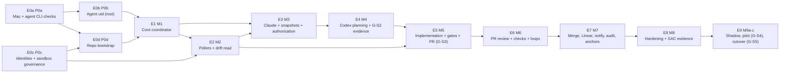

# MERCURY — Issue Breakdown (proposal)

| | |
|---|---|
| **Owner** | Agent F (Technical Program Manager) |
| **Status** | Phase 4 proposal for the operator. **No Linear issues are created by this design**; the operator creates them (or asks MERCURY's predecessor workflow to) after TDD sign-off. |
| **Sources** | Requirements and DoR/DoD: `planning/traceability.md` §3, §12, §13. Tests: `testing/verification-plan.md`. Phases, gates, estimates method and risks: `planning/roadmap.md`. |

## 1. Conventions

- **IDs.** `MERC-nnn`; the hundreds digit is the milestone (`0xx` Phase 0, `1xx` M1 … `9xx` M9). Suffixed IDs (`MERC-1K1`, `MERC-3A1`, `MERC-807b`) are **conditional** issues that exist only if a Phase 0 result or an operator decision triggers them; they are excluded from the base totals and carried as schedule contingency.
- **Epics** group issues by phase (§2). Every issue below lists the Definition of Ready fields of traceability §12: requirements (R1), acceptance with the TCs it makes pass (R2/R3), blocked-by (R5), gates (R6), OD (R7), security (R8), recovery (R9), estimate (R10), environment (R11).
- **Estimates** are focused engineer-days, P50 / P90, with an uncertainty class (L ≤ 1.5× spread, M ≈ 1.6–1.8×, H ≥ 1.8× or dependent on a Phase 0 outcome). Issues with P50 > 3 are flagged **split before Ready** (R10); their subtasks are the intended split.
- **Parameters** are cited by name (traceability §7), never by value.

## 2. Epics

| Epic | Phase | Scope | Issues | P50 | P90 (sum) |
|---|---|---|---|---|---|
| E0a | P0a | Mac and agent-CLI verification | MERC-001, MERC-002, MERC-003, MERC-004, MERC-005 | 4.5 | 8 |
| E0b | P0b | Agent-uid provisioning and verification | MERC-010, MERC-011, MERC-012 | 4.5 | 8.5 |
| E0c | P0c | Identities, sandbox governance, decisions | MERC-020, MERC-021, MERC-022, MERC-023, MERC-024 | 4.5 | 7.5 |
| E0d | P0d | MERCURY repository bootstrap | MERC-030 | 1 | 1.5 |
| E1 | M1 | Core coordinator | MERC-101, MERC-102, MERC-103, MERC-104, MERC-105, MERC-106, MERC-107, MERC-1K1, MERC-108, MERC-109, MERC-110, MERC-111, MERC-112, MERC-113 | 38 | 62.5 |
| E2 | M2 | Read-only pollers and drift read | MERC-201, MERC-202, MERC-203, MERC-204, MERC-205, MERC-206 | 11.5 | 18 |
| E3 | M3 | Claude adapter, snapshots, authorization | MERC-301, MERC-302, MERC-3A1, MERC-303, MERC-304, MERC-305 | 11.5 | 18 |
| E4 | M4 | Codex planning and plan review | MERC-401, MERC-402, MERC-403, MERC-404, MERC-405, MERC-406 | 11.5 | 20 |
| E5 | M5 | Implementation, gates, PR | MERC-501, MERC-502, MERC-503, MERC-504, MERC-505, MERC-506, MERC-507, MERC-508 | 18 | 29.5 |
| E6 | M6 | Claude PR review and loops | MERC-601, MERC-602, MERC-603, MERC-604 | 7.5 | 11.5 |
| E7 | M7 | Merge, Linear, notifications, audit, anchoring | MERC-701, MERC-702, MERC-703, MERC-704, MERC-705, MERC-706, MERC-707, MERC-708 | 16 | 26 |
| E8 | M8 | Hardening on the real Mac | MERC-801, MERC-802, MERC-803, MERC-804, MERC-805, MERC-806, MERC-807, MERC-807b | 19 | 33.5 |
| E9 | M9a–c | Pilot and cutover | MERC-901, MERC-902, MERC-903, MERC-904, MERC-905, MERC-906 | 8.5 | 15 |
| **Total (base)** | | | 77 issues | **156** | **259.5** |
| Contingency (conditional) | | MERC-1K1, MERC-3A1, MERC-807b | 3 | 12 | 22 |

Planning P90 (partly correlated, ρ = 0.5): P50 + 0.5 × Σ(P90−P50) + 0.5 × √Σ(P90−P50)² = 156 + 51.8 + 6.4 ≈ **214 engineer-days** (method in `planning/roadmap.md` §5).

### 2.1 Epic dependency graph

## 3. Critical path (issue level, P50)

Longest blocked-by chain over base issues:

| # | Issue | Title | P50 | Cumulative |
|---|---|---|---|---|
| 1 | MERC-020 | Operator decision session | 0.5 | 0.5 |
| 2 | MERC-021 | GitHub Apps and keys | 1 | 1.5 |
| 3 | MERC-030 | MERCURY repo bootstrap | 1 | 2.5 |
| 4 | MERC-101 | Skeleton, config, paths, parameters, logging | 2.5 | 5 |
| 5 | MERC-102 | Store and durability | 3 | 8 |
| 6 | MERC-103 | DDL, invariant triggers, audit chain | 3.5 | 11.5 |
| 7 | MERC-104 | Transition engine | 3 | 14.5 |
| 8 | MERC-106 | Derived queue, claims, outbox/inbox | 3 | 17.5 |
| 9 | MERC-201 | GitHub client | 2.5 | 20 |
| 10 | MERC-203 | PR, check and review poller | 2 | 22 |
| 11 | MERC-507 | PR creation (draft) | 2 | 24 |
| 12 | MERC-601 | Code and security review runs | 2 | 26 |
| 13 | MERC-602 | COMMENT reviews and claude-review check | 1.5 | 27.5 |
| 14 | MERC-604 | Pre-review re-check, ready, review request | 1 | 28.5 |
| 15 | MERC-701 | Merge verification | 2.5 | 31 |
| 16 | MERC-702 | Linear projection, both modes | 2.5 | 33.5 |
| 17 | MERC-705 | Anchoring and restore epoch | 2.5 | 36 |
| 18 | MERC-805 | Security suite on the Mac and SAC evidence | 2 | 38 |
| 19 | MERC-901 | Shadow mode (MIG-1) | 1.5 | 39.5 |
| 20 | MERC-904 | Supervised pilot (MIG-2) | 2.5 | 42 |
| 21 | MERC-905 | Unattended readiness (G-S5) | 1 | 43 |
| 22 | MERC-906 | Cutover and watch (MIG-3/4) | 1 | 44 |

This **dependency** critical path is ≈ **44 P50 engineer-days**: the shortest possible build with unlimited parallel capacity. MERCURY is built by one operator-engineer with agent assistance, so the schedule is **capacity-bound**: the phase sequence in `planning/roadmap.md` §5 (≈ 156 P50 days of effort, of which P0c/P0d and most of M2 overlap other work) determines the calendar, and this chain says which issues must never wait for capacity. Issues on it are prioritised first in every milestone. Calendar time for shadow, supervised pilot and the cutover watch is added in `planning/roadmap.md` §6.

## 4. Issues

### E0a — Phase 0a — Mac and agent-CLI verification

#### MERC-001 — Mac read-only facts

- **Description:** Run D's read-only Phase 0 commands and record redacted results.
- **Blocked by:** —
- **Requirements:** OPS-001, CON-015, NFR-092, NFR-094
- **Acceptance:** P0-001…025 recorded in `reviews/phase0-mac-facts.md`; supported-OS decision made.
- **Estimate:** P50 0.5 / P90 1 engineer-days; uncertainty L
- **DoR fields:** Env T4 · Gates — · OD — · Security label no · Recovery: None (read-only)
- **Subtasks:** Run commands; redact; record; decide macOS baseline

#### MERC-002 — Mac experiments (non-destructive)

- **Description:** Run D's experiments P0-033…035, P0-037, P0-039…041 with the operator's go-ahead.
- **Blocked by:** MERC-001
- **Requirements:** OPS-001, FR-282, OPS-007
- **Acceptance:** Each experiment Pass/Fail recorded; clock behaviour (P0-034) decides FakeClock default; Keychain behaviour (P0-035) recorded.
- **Estimate:** P50 1.5 / P90 2.5 engineer-days; uncertainty M
- **DoR fields:** Env T4 ⓗ · Gates — · OD — · Security label yes · Recovery: Probe agents and throwaway items removed afterwards
- **Subtasks:** Probe LaunchAgent; clock across sleep; Keychain from agent; Seatbelt denial; caffeinate; notifications; socket path

#### MERC-003 — Agent CLI checks (B)

- **Description:** Run B's agent-CLI checks P0-201…214 with the dedicated keys.
- **Blocked by:** MERC-001
- **Requirements:** FR-062, FR-100, SEC-204, NFR-090
- **Acceptance:** P0-201…214 recorded; pinned versions and hashes chosen; P0-213 outcome decides SDK spawn vs ALT-B-1.
- **Estimate:** P50 1.5 / P90 2.5 engineer-days; uncertainty M
- **DoR fields:** Env T4 · Gates — · OD OD-03, OD-04 · Security label yes · Recovery: None
- **Subtasks:** Claude SDK options; Codex config, resume, schema mismatch, `CODEX_HOME` files; wire schemas; pin versions

#### MERC-004 — MIG-0 legacy inventory

- **Description:** Inventory `network_monitor` scripts, protections, Linear automations and coding-session settings (read-only).
- **Blocked by:** —
- **Requirements:** FR-300, OPS-008
- **Acceptance:** P0-073 report lists every legacy path and the partition rules needed in MIG-1.
- **Estimate:** P50 0.5 / P90 1 engineer-days; uncertainty L
- **DoR fields:** Env read-only · Gates — · OD — · Security label no · Recovery: None
- **Subtasks:** Scripts; AGENTS.md; protections; Linear automations; coding sessions

#### MERC-005 — Phase 0 closure report and re-estimate

- **Description:** Consolidate results, update traceability §10.2 statuses, re-estimate the roadmap.
- **Blocked by:** MERC-002, MERC-003, MERC-011, MERC-024
- **Requirements:** CON-015, OPS-001
- **Acceptance:** 0 Open checks gating M1; revised P50/P90 published in roadmap §5.
- **Estimate:** P50 0.5 / P90 1 engineer-days; uncertainty L
- **DoR fields:** Env — · Gates all P0 · OD — · Security label no · Recovery: None
- **Subtasks:** Closure table; design-change list; re-estimate

### E0b — Phase 0b — Agent-uid provisioning and verification

#### MERC-010 — Agent-uid system install (spike)

- **Description:** Operator-run root setup: `_mercuryagent`, group `mercury`, prototype `agent-exec`/`agent-ctl`, sudoers drop-in, `WORK_ROOT` ACLs.
- **Blocked by:** MERC-001
- **Requirements:** OPS-014, FR-051, SEC-201
- **Acceptance:** P0-026, P0-044 pass; install and uninstall reversible.
- **Estimate:** P50 2 / P90 3.5 engineer-days; uncertainty H
- **DoR fields:** Env T4 ⓗ [ROOT] · Gates — · OD OD-18 · Security label yes · Recovery: Uninstall script restores prior state
- **Subtasks:** Role account; group; wrappers; sudoers; ACLs; uninstall

#### MERC-011 — Agent-uid verification and canaries

- **Description:** Run P0-027…032 and the SEC-T-20 canary set with probe processes; record ps visibility and logout behaviour.
- **Blocked by:** MERC-010
- **Requirements:** SEC-201, CON-018, OPS-015
- **Acceptance:** P0-027 0 reads across all canary locations; P0-028…032 recorded; Keychain ACL result P0-036 recorded (decides MERC-1K1).
- **Estimate:** P50 1 / P90 2 engineer-days; uncertainty M
- **DoR fields:** Env T4 ⓗ [ROOT] · Gates ASM-E-04/15/16/20…24 · OD OD-18, OD-31 · Security label yes · Recovery: Canaries removed
- **Subtasks:** Plant canaries; cat/find/security/Claude Read; cross-uid kill; logout; toolchain test suite

#### MERC-012 — Helper and spawn feasibility

- **Description:** P0-042/P0-213 SDK custom spawn via sudo, P0-045 presence helper, P0-043 git fsync, P0-046 power helper with Power Nap, P0-047 VM rig, P0-048 managed settings.
- **Blocked by:** MERC-010
- **Requirements:** FR-052, FR-242, NFR-053, SEC-115
- **Acceptance:** Each check recorded; ALT-B-1 decision taken if P0-213 fails; presence fallback recorded if P0-045 fails.
- **Estimate:** P50 1.5 / P90 3 engineer-days; uncertainty H
- **DoR fields:** Env T4 ⓗ · Gates ASM-D-29/33/34/35, ASM-E-10/19 · OD OD-19, OD-30 · Security label yes · Recovery: None
- **Subtasks:** SDK spawn; presence sheet; fs_usage; dark wake; tart VM; managed settings

### E0c — Phase 0c — Identities, sandbox governance, decisions

#### MERC-020 — Operator decision session

- **Description:** Record OD-01…06, 10, 13, 17, 18, 20, 22, 35, 37 with rationale; written G-DETECT acceptance for the sandbox.
- **Blocked by:** —
- **Requirements:** OPS-017, CON-014
- **Acceptance:** Decisions recorded in traceability §9; G-DETECT acceptance stored.
- **Estimate:** P50 0.5 / P90 1 engineer-days; uncertainty M (calendar)
- **DoR fields:** Env — · Gates — · OD listed · Security label no · Recovery: None
- **Subtasks:** Prepare defaults; session; record

#### MERC-021 — GitHub Apps and keys

- **Description:** Create `mercury-bot` and `mercury-ops`, install (bot on sandbox + MERCURY repo; ops on project-mercury and the anchor repo), store keys under `com.usjbro.mercury.*`.
- **Blocked by:** MERC-020
- **Requirements:** OPS-002, OPS-007, SEC-101
- **Acceptance:** P0-060 exact permission sets incl. `statuses:read`; P0-230 workflow push rejected.
- **Estimate:** P50 1 / P90 1.5 engineer-days; uncertainty L
- **DoR fields:** Env T3 ⓗ · Gates — · OD OD-02, OD-20, OD-37 · Security label yes · Recovery: Keys rotatable per SEC-504
- **Subtasks:** Create Apps; install; Keychain items; anchor repo

#### MERC-022 — Linear app and sandbox team

- **Description:** OAuth app `actor=app` (client credentials) on team `MSB`; labels mirroring `JAM`.
- **Blocked by:** MERC-020
- **Requirements:** FR-201, SEC-801, OPS-004
- **Acceptance:** P0-220…223, P0-225 recorded; comment author is the app actor.
- **Estimate:** P50 0.5 / P90 1 engineer-days; uncertainty L
- **DoR fields:** Env T3 ⓗ · Gates ASM-B-30, ASM-E-05 · OD OD-05, OD-13 · Security label yes · Recovery: None
- **Subtasks:** App; team; labels; integration hookup per OD-06

#### MERC-023 — Sandbox repo and rulesets

- **Description:** Sandbox repo with CI on drafts, ruleset per ADR-014, CODEOWNERS, `allow_auto_merge=false`, reset script, allow-list.
- **Blocked by:** MERC-021
- **Requirements:** OPS-004, OPS-016, SEC-100, SEC-104, FR-145
- **Acceptance:** P0-231…241 recorded; `mercury repo check` prototype equivalent to the target policy; TC-SEC-114 settings.
- **Estimate:** P50 1.5 / P90 2.5 engineer-days; uncertainty M
- **DoR fields:** Env T3 ⓗ · Gates ASM-B-51…68 · OD OD-01, OD-13, OD-22 · Security label yes · Recovery: Reset script idempotent
- **Subtasks:** Repo; CI; ruleset; CODEOWNERS; reset; allow-list

#### MERC-024 — Sandbox merge-attack suite and policy evidence

- **Description:** Run SEC-T-16 (a)–(g) on the sandbox (P0-072) and record OD-35 evidence (P0-074).
- **Blocked by:** MERC-023
- **Requirements:** SEC-100, SEC-109, OPS-019, SEC-106, SEC-804
- **Acceptance:** SAC-01 rehearsal: 100 % rejected or incident; every OD-35 item evidenced.
- **Estimate:** P50 1 / P90 1.5 engineer-days; uncertainty M
- **DoR fields:** Env T3 ⓗ · Gates — · OD OD-01, OD-35 · Security label yes · Recovery: None
- **Subtasks:** Cases a–g; policy checklist

### E0d — Phase 0d — MERCURY repository bootstrap

#### MERC-030 — MERCURY repo bootstrap

- **Description:** CI (macOS runner), lint/type, secret scan, ID/pointer/parameter lint, ruleset and CODEOWNERS on MERCURY's own repo using `mercury-bot`.
- **Blocked by:** MERC-021
- **Requirements:** CON-017, OPS-004, SEC-706
- **Acceptance:** TC-OPS-009/010 green; own repo governed like a target.
- **Estimate:** P50 1 / P90 1.5 engineer-days; uncertainty L
- **DoR fields:** Env CI · Gates ASM-F-07 · OD — · Security label yes · Recovery: None
- **Subtasks:** CI; lint; secret scan; ID lint; governance

### E1 — M1 — Core coordinator

#### MERC-101 — Skeleton, config, paths, parameters, logging

- **Description:** Project skeleton; config schema and validator with D's parameter names and clamps; single paths module (ADR-016); structured logger with redactor and `Redacted<T>` sinks.
- **Blocked by:** MERC-030
- **Requirements:** NFR-072, NFR-062, SEC-501, CON-013, NFR-092
- **Acceptance:** TC-UNIT-061, TC-OPS-003, TC-SEC-150 pass.
- **Estimate:** P50 2.5 / P90 4 engineer-days; uncertainty L
- **DoR fields:** Env T0/T1 · Gates — · OD — · Security label yes · Recovery: n/a
- **Subtasks:** Config; paths; parameters; logger; redactor

#### MERC-102 — Store and durability

- **Description:** DB interface, both drivers, pragmas self-check, expand/contract migrations with backup, integrity check in a worker thread.
- **Blocked by:** MERC-101
- **Requirements:** NFR-050…052, NFR-023, NFR-091
- **Acceptance:** TC-INT-003, -011, -012, -013, -022 pass; TC-PERF-006 harness ready.
- **Estimate:** P50 3 / P90 5 engineer-days; uncertainty M
- **DoR fields:** Env T1 · Gates P0-012/013 · OD — · Security label no · Recovery: Crash points around every commit
- **Subtasks:** Drivers; pragmas; migrations; backups; worker thread

#### MERC-103 — DDL, invariant triggers, audit chain

- **Description:** C's DDL with every INV trigger, append-only tables, hash chain, `anchors`, `audit_epochs`, nullable `record_mac`.
- **Blocked by:** MERC-102
- **Requirements:** FR-021, NFR-060, SEC-601, SEC-602
- **Acceptance:** TC-INT-020…023 (one negative and one positive per trigger), TC-SEC-160/161 pass.
- **Estimate:** P50 3.5 / P90 5.5 engineer-days; uncertainty M — **split before Ready**
- **DoR fields:** Env T1 · Gates — · OD — · Security label yes · Recovery: Chain verified at start
- **Subtasks:** DDL; triggers; chain; anchors tables

#### MERC-104 — Transition engine

- **Description:** Transition table as data, guards, initiators, evidence, replay.
- **Blocked by:** MERC-103
- **Requirements:** FR-080…084
- **Acceptance:** TC-SM-001…003, -005, -006, -019 pass.
- **Estimate:** P50 3 / P90 5 engineer-days; uncertainty M
- **DoR fields:** Env T0 · Gates — · OD — · Security label no · Recovery: Transition + effects in one transaction
- **Subtasks:** Table; guards; initiators; replay

#### MERC-105 — Holds, halts and timers

- **Description:** Hold kinds incl. `security_halt`/`integrity_alert`, ageing, timer service with persisted due rows, timer rule, wake coalescing.
- **Blocked by:** MERC-104
- **Requirements:** FR-050, FR-085, FR-243, SEC-906
- **Acceptance:** TC-SM-012…014, -021, TC-SEC-191 (logic) pass.
- **Estimate:** P50 2.5 / P90 4 engineer-days; uncertainty M
- **DoR fields:** Env T0 · Gates — · OD OD-27 · Security label yes · Recovery: Timers survive restart
- **Subtasks:** Holds; ageing; timers; coalescing

#### MERC-106 — Derived queue, claims, outbox/inbox

- **Description:** Claim transaction, leases (≥ `db.lease_persist_s`), outbox/inbox with catalogue keys, effect-ledger hooks, crash-point registry.
- **Blocked by:** MERC-104
- **Requirements:** FR-040, FR-043, FR-063
- **Acceptance:** TC-INT-003, -021, TC-CONC-004, TC-CON-015, TC-DUP-003 pass.
- **Estimate:** P50 3 / P90 5 engineer-days; uncertainty M
- **DoR fields:** Env T1 · Gates — · OD — · Security label no · Recovery: Registry complete for M1
- **Subtasks:** Claims; leases; outbox; inbox; registry

#### MERC-107 — Process broker: agent-exec/agent-ctl production

- **Description:** Root-owned wrappers with fixed grammar tables (B's tokens), fd-3 secrets, `exit.json`/`proc.json` fsync, deadline and supervisor lease; `ProcessSupervisor` port; FakeBroker; install script.
- **Blocked by:** MERC-101, MERC-011
- **Requirements:** FR-051, FR-055, FR-044, FR-281, SEC-201, SEC-212, SEC-214, SEC-704
- **Acceptance:** TC-INT-005, -025, TC-REC-005, -033, TC-SEC-128 (grammar) pass; P0-026…031 re-run with production wrappers.
- **Estimate:** P50 5 / P90 8.5 engineer-days; uncertainty H — **split before Ready**
- **DoR fields:** Env T1 + T4 [ROOT] · Gates P0-026…031 · OD OD-18 · Security label yes · Recovery: `exit.json` atomic; lease ends orphaned runs
- **Subtasks:** Grammar; spawn; signal/probe/stats/sweep; lease; deadline; FakeBroker; install

#### MERC-1K1 — Signed Keychain helper (conditional) *(conditional)*

- **Description:** Only if P0-036 shows MERCURY items must trust `/usr/bin/security` (Addendum A): signed `mercury-keychain` helper and item ACLs.
- **Blocked by:** MERC-011
- **Requirements:** SEC-503, OPS-007
- **Acceptance:** P0-036 re-run: helper silent, other processes prompted.
- **Estimate:** P50 2 / P90 4 engineer-days; uncertainty M
- **DoR fields:** Env T4 · Gates P0-036 · OD OD-31 · Security label yes · Recovery: n/a
- **Subtasks:** Helper; signing; ACL migration

#### MERC-108 — Run outcomes, adoption, lost_by_host

- **Description:** Classifier incl. `lost_by_host`, `supervisor_lost`, `config_fatal`; adoption by identity triple; Claude re-run policy; guard re-check before applying adopted output.
- **Blocked by:** MERC-106, MERC-107
- **Requirements:** FR-053, FR-054, NFR-026
- **Acceptance:** TC-UNIT-021, TC-REC-030, -032, -038, TC-AFS-010 pass.
- **Estimate:** P50 2 / P90 3.5 engineer-days; uncertainty M
- **DoR fields:** Env T1/T2 · Gates — · OD — · Security label no · Recovery: Adoption idempotent
- **Subtasks:** Classifier; adoption; re-run; guard

#### MERC-109 — Scheduler and limits

- **Description:** Priority, ageing, global/type/repo limits.
- **Blocked by:** MERC-106
- **Requirements:** FR-041, FR-042
- **Acceptance:** TC-UNIT-022, TC-CONC-001/002 pass.
- **Estimate:** P50 1.5 / P90 2.5 engineer-days; uncertainty L
- **DoR fields:** Env T0 · Gates — · OD OD-07 · Security label no · Recovery: n/a
- **Subtasks:** Scheduler; limits

#### MERC-110 — Daemon lifecycle and host model

- **Description:** `flock`, exit contract, safe mode, crash-loop containment, SIGTERM policy, credited-time algorithm, dark-wake gate, dev LaunchAgent.
- **Blocked by:** MERC-102, MERC-105
- **Requirements:** FR-048, FR-052, FR-082, FR-280, FR-282, NFR-024, NFR-027, SEC-908
- **Acceptance:** TC-INT-004, TC-REC-035, -036, TC-UNIT-062, TC-SM-009, -023 pass in both clock modes.
- **Estimate:** P50 3 / P90 5 engineer-days; uncertainty M
- **DoR fields:** Env T1/T2 · Gates P0-033/034 · OD — · Security label yes · Recovery: Startup contract per case
- **Subtasks:** Lock; exit codes; safe mode; credit algorithm; dark wake

#### MERC-111 — Control socket, principals, CLI v1

- **Description:** Socket with token; `operator` vs `operator-presence` vs `claude_session` principals (presence plumbing, helper in M5); CLI verbs per components §5.5.
- **Blocked by:** MERC-104, MERC-110
- **Requirements:** FR-240, FR-047, FR-049, CON-003
- **Acceptance:** TC-INT-010, -024 pass.
- **Estimate:** P50 2.5 / P90 4 engineer-days; uncertainty M
- **DoR fields:** Env T1 · Gates — · OD — · Security label yes · Recovery: Mutating verbs audited
- **Subtasks:** Socket; principals; verbs

#### MERC-112 — Fakes and scenario runner

- **Description:** FakeClock (both modes), FakeHost, FakeBroker integration, FakePresence, fake binaries, FakeGitHub/Linear stubs, scenario runner.
- **Blocked by:** MERC-101
- **Requirements:** NFR-100, NFR-101
- **Acceptance:** Same seed → same trace 100/100; both clock modes selectable per test.
- **Estimate:** P50 3.5 / P90 5.5 engineer-days; uncertainty M — **split before Ready**
- **DoR fields:** Env T0/T1 · Gates — · OD — · Security label no · Recovery: n/a
- **Subtasks:** Clock; host; presence; binaries; runner

#### MERC-113 — PROP suite and crash harness v1

- **Description:** PROP-01…24 (applicable), crash harness (200 runs), ledger checks.
- **Blocked by:** MERC-108, MERC-112
- **Requirements:** NFR-001, CON-005, CON-006
- **Acceptance:** TC-SM-004 0 counterexamples; TC-REC-001 200 runs 0 violations.
- **Estimate:** P50 3 / P90 5 engineer-days; uncertainty M
- **DoR fields:** Env T0/T2 · Gates — · OD — · Security label no · Recovery: Every registered crash point hit ≥ 10×
- **Subtasks:** Properties; harness; ledger

### E2 — M2 — Read-only pollers and drift read

#### MERC-201 — GitHub client

- **Description:** App JWT, per-purpose narrowed tokens (incl. `metadata:read` drift token), ETag cache, retry matrix, endpoint allowlist, authenticated probe.
- **Blocked by:** MERC-106, MERC-021
- **Requirements:** NFR-081, FR-283, SEC-102
- **Acceptance:** TC-INT-002, TC-NET-005, -009, TC-GOV-111 pass.
- **Estimate:** P50 2.5 / P90 4 engineer-days; uncertainty M
- **DoR fields:** Env T1/T3 · Gates P0-231, P0-239 · OD — · Security label yes · Recovery: Outbox only for writes
- **Subtasks:** Tokens; ETag; retries; allowlist; probe

#### MERC-202 — Linear client and poller

- **Description:** GraphQL client, cursor with overlap, observation sequence for value-keyed facts.
- **Blocked by:** MERC-106, MERC-022
- **Requirements:** FR-001, FR-202
- **Acceptance:** TC-INT-001, TC-DUP-001, -006, TC-CON-007 pass.
- **Estimate:** P50 2 / P90 3 engineer-days; uncertainty M
- **DoR fields:** Env T1/T3 · Gates P0-221/222 · OD — · Security label no · Recovery: Inbox at most once
- **Subtasks:** Client; cursor; dedupe

#### MERC-203 — PR, check and review poller

- **Description:** Tracked PRs, head tracking, `findPullByHead state=all`, required contexts from `rules/branches`.
- **Blocked by:** MERC-201
- **Requirements:** NFR-041, FR-143, FR-144
- **Acceptance:** TC-INT-029, TC-DUP-002, TC-CON-006 pass.
- **Estimate:** P50 2 / P90 3 engineer-days; uncertainty M
- **DoR fields:** Env T1/T3 · Gates P0-236 · OD — · Security label no · Recovery: Inbox at most once
- **Subtasks:** Poller; contexts

#### MERC-204 — Eligibility, discovery status, dependency guard

- **Description:** Rules, repo mapping, issue-level `mercury_status`, blockers with the MERCURY-`COMPLETED` rule, foreign delegation and foreign PR detection.
- **Blocked by:** MERC-202
- **Requirements:** FR-002…008, SEC-803
- **Acceptance:** TC-UNIT-001…005, TC-INT-030, TC-E2E-011, -014, -017 pass.
- **Estimate:** P50 2 / P90 3 engineer-days; uncertainty L
- **DoR fields:** Env T0/T2 · Gates — · OD OD-10 · Security label yes · Recovery: n/a
- **Subtasks:** Rules; mapping; status; guard; delegation

#### MERC-205 — Drift monitor (read and alert)

- **Description:** Rulesets, collaborators, CODEOWNERS blob, installation permissions, `allow_auto_merge`, pinned integration ids; alert only.
- **Blocked by:** MERC-201, MERC-023
- **Requirements:** OPS-003, SEC-108
- **Acceptance:** TC-GOV-115 detection part on the sandbox ≤ 60 min awake.
- **Estimate:** P50 1.5 / P90 2.5 engineer-days; uncertainty M
- **DoR fields:** Env T3 · Gates P0-231, P0-241 · OD — · Security label yes · Recovery: n/a
- **Subtasks:** Reads; golden policy; alert

#### MERC-206 — Shadow status and fixtures

- **Description:** `mercury status --shadow`, health lag fields, recorded GitHub/Linear fixtures.
- **Blocked by:** MERC-203, MERC-204
- **Requirements:** NFR-071, NFR-040
- **Acceptance:** TC-SBX-001, TC-PERF-002 (Linear) pass; 0 writes.
- **Estimate:** P50 1.5 / P90 2.5 engineer-days; uncertainty L
- **DoR fields:** Env T3 · Gates — · OD — · Security label no · Recovery: n/a
- **Subtasks:** Status; fixtures

### E3 — M3 — Claude adapter, snapshots, authorization

#### MERC-301 — Snapshot builder

- **Description:** Git-object snapshots (no `.git`, attributes not applied, symlink/gitlink placeholders, 0444/0555) under `WORK_ROOT/snapshots`.
- **Blocked by:** MERC-102
- **Requirements:** FR-066, SEC-205
- **Acceptance:** TC-SEC-124 100 %.
- **Estimate:** P50 2 / P90 3 engineer-days; uncertainty L
- **DoR fields:** Env T1 · Gates — · OD — · Security label yes · Recovery: Snapshot keyed by tree SHA, rebuildable
- **Subtasks:** ls-tree/cat-file; placeholders; modes; manifest

#### MERC-302 — Claude adapter under agent uid

- **Description:** SDK custom spawn via `agent-exec` kind `claude` (or ALT-B-1), per-run config dir, profiles per role, no `fallbackModel`, managed settings, budgets; self-test as dispatch gate.
- **Blocked by:** MERC-107, MERC-301, MERC-003
- **Requirements:** FR-020, FR-062, NFR-083, SEC-204, SEC-802
- **Acceptance:** TC-CON-003, TC-SEC-103, -121, -123, TC-AFS-001, -005, -011 pass; **G-S1** recorded.
- **Estimate:** P50 3 / P90 5 engineer-days; uncertainty H
- **DoR fields:** Env T1 + T4 · Gates P0-213/214, P0-201, P0-042, P0-048 · OD OD-19, OD-34 · Security label yes · Recovery: Piped runs re-run with same input digest
- **Subtasks:** Spawn; profiles; budgets; self-test

#### MERC-3A1 — ALT-B-1 fallback (contingency) *(conditional)*

- **Description:** Only if P0-213 fails: Messages API with coordinator-implemented realpath-confined Read/Grep/Glob over snapshots.
- **Blocked by:** MERC-301
- **Requirements:** FR-020, SEC-204
- **Acceptance:** Same TCs as MERC-302 against the ALT-B-1 path.
- **Estimate:** P50 4 / P90 7 engineer-days; uncertainty H — **split before Ready**
- **DoR fields:** Env T1 + T4 · Gates P0-213 failed · OD OD-18 · Security label yes · Recovery: n/a
- **Subtasks:** Messages client; tools; confinement

#### MERC-303 — Decision schemas, prompts and wire copies

- **Description:** Triage/authorize schemas and prompts, wire-copy generator profiles.
- **Blocked by:** MERC-112
- **Requirements:** FR-020, FR-062, SEC-303
- **Acceptance:** TC-CON-001, -014 pass.
- **Estimate:** P50 2 / P90 3 engineer-days; uncertainty L
- **DoR fields:** Env T0 · Gates P0-211/214 · OD OD-25 · Security label no · Recovery: n/a
- **Subtasks:** Schemas; prompts; generator

#### MERC-304 — Authorization records and guards

- **Description:** Decision Recorder, authorization versions, guard at dispatch and result application, revocation, `spec_hash` and `spec_changed` hold, re-authorization.
- **Blocked by:** MERC-103, MERC-105, MERC-303
- **Requirements:** FR-021…024, CON-005, SEC-305, SEC-307
- **Acceptance:** TC-UNIT-010, -011, -013, TC-SM-015, TC-E2E-006, -008 pass.
- **Estimate:** P50 2.5 / P90 4 engineer-days; uncertainty M
- **DoR fields:** Env T0/T2 · Gates — · OD OD-33 · Security label yes · Recovery: Authority rows append-only
- **Subtasks:** Recorder; guard; drift

#### MERC-305 — Isolation and injection guard tests

- **Description:** Hook/MCP planting, env allowlist, provenance tags, PI guard logic with fakes.
- **Blocked by:** MERC-302, MERC-304
- **Requirements:** SEC-301, SEC-302, FR-203
- **Acceptance:** TC-SEC-103, -121, -123, TC-PI-130…133 (fakes), TC-UNIT-073 pass.
- **Estimate:** P50 2 / P90 3 engineer-days; uncertainty M
- **DoR fields:** Env T1/T4 · Gates — · OD — · Security label yes · Recovery: n/a
- **Subtasks:** Planting; env; provenance; PI guards

### E4 — M4 — Codex planning and plan review

#### MERC-401 — Codex adapter

- **Description:** Argv builder (forbidden flags unrepresentable), JSONL parser, per-task `CODEX_HOME` with generated read-only config, resume, prompt on fd 0, `config_fatal`.
- **Blocked by:** MERC-107, MERC-303
- **Requirements:** FR-100, FR-062, CON-016, SEC-203, SEC-208
- **Acceptance:** TC-CON-004, -005, TC-INT-026, TC-SEC-122 pass.
- **Estimate:** P50 3 / P90 5 engineer-days; uncertainty M
- **DoR fields:** Env T1/T4 · Gates P0-204…211, P0-048 · OD OD-09 · Security label yes · Recovery: Adoptable detached run
- **Subtasks:** Argv; parser; CODEX_HOME; resume

#### MERC-402 — Mirror and worktree manager

- **Description:** Mirror with `core.fsync`, worktrees under `WORK_ROOT` per ADR-016, naming per Linear mode, reset policy.
- **Blocked by:** MERC-102
- **Requirements:** FR-120, FR-126, NFR-053
- **Acceptance:** TC-UNIT-040, TC-INT-006, TC-REC-037 pass.
- **Estimate:** P50 2 / P90 3.5 engineer-days; uncertainty M
- **DoR fields:** Env T1 · Gates P0-043, P0-030 · OD OD-06 · Security label yes · Recovery: Reset policy single definition
- **Subtasks:** Mirror; worktrees; naming; reset

#### MERC-403 — Instruction integrity and sandbox-violation counting

- **Description:** SEC-209 byte checks before fresh and resumed runs; Codex denial counting.
- **Blocked by:** MERC-401
- **Requirements:** SEC-209, SEC-903
- **Acceptance:** TC-SEC-126 pass; violations counted.
- **Estimate:** P50 1 / P90 2 engineer-days; uncertainty L
- **DoR fields:** Env T1 · Gates — · OD — · Security label yes · Recovery: n/a
- **Subtasks:** Integrity; counting

#### MERC-404 — Plan review loop

- **Description:** Plan artifacts, review at base snapshot, approval binding, budgets, verbatim revision template.
- **Blocked by:** MERC-304, MERC-401, MERC-301
- **Requirements:** FR-101…106, CON-006, CON-012, SEC-306, SEC-315
- **Acceptance:** TC-E2E-002, -003, TC-SM-007, -008, -026 pass.
- **Estimate:** P50 2.5 / P90 4 engineer-days; uncertainty M
- **DoR fields:** Env T2 · Gates — · OD OD-08, OD-11 · Security label yes · Recovery: Plan versions immutable
- **Subtasks:** Artifacts; review; binding; template

#### MERC-405 — Stall detection and failure sims

- **Description:** Liveness via output or group CPU (`agent-ctl stats`); FakeCodex fault modes; recorded fixtures.
- **Blocked by:** MERC-401
- **Requirements:** FR-044, FR-125, NFR-006
- **Acceptance:** TC-AFS-002…004, -009 pass.
- **Estimate:** P50 1.5 / P90 2.5 engineer-days; uncertainty M
- **DoR fields:** Env T1/T2 · Gates — · OD — · Security label no · Recovery: n/a
- **Subtasks:** Liveness; faults; fixtures

#### MERC-406 — G-S2 evidence run

- **Description:** Real agents as `_mercuryagent` on the sandbox: SEC-T-20/21/28/29 and the `verify`/`deps` profiles (prepared in MERC-502/503).
- **Blocked by:** MERC-401, MERC-302, MERC-011
- **Requirements:** CON-018, SEC-201, SEC-202, SEC-212, SEC-214
- **Acceptance:** SAC-05, -13, -14, -19 green (SAC-18 after MERC-502/503); gate recorded.
- **Estimate:** P50 1.5 / P90 3 engineer-days; uncertainty H
- **DoR fields:** Env T4 · Gates P0-026…032 · OD — · Security label yes · Recovery: n/a
- **Subtasks:** Canaries; env; fuzz; lifetime

### E5 — M5 — Implementation, gates, PR

#### MERC-501 — Implementation run

- **Description:** Workspace-write run as agent uid with approved plan, progress events.
- **Blocked by:** MERC-404, MERC-405
- **Requirements:** FR-121, FR-125
- **Acceptance:** TC-E2E-001 to commit; TC-UNIT-011/012 pass.
- **Estimate:** P50 1.5 / P90 2.5 engineer-days; uncertainty L
- **DoR fields:** Env T2 · Gates — · OD — · Security label yes · Recovery: Adoptable
- **Subtasks:** Run; progress

#### MERC-502 — verify under agent uid

- **Description:** Fail-closed `verify.sb` profile, no network, `not_run` path, test-results artifact.
- **Blocked by:** MERC-501, MERC-107
- **Requirements:** FR-122, SEC-215
- **Acceptance:** TC-INT-008, TC-SEC-125 pass.
- **Estimate:** P50 2.5 / P90 4 engineer-days; uncertainty H
- **DoR fields:** Env T1/T4 · Gates P0-037, P0-032 · OD — · Security label yes · Recovery: Adoptable
- **Subtasks:** Profile; runner; artifact

#### MERC-503 — deps_install

- **Description:** Lockfile lint, registry allowlist, `--ignore-scripts`, acknowledged lockfiles only, `deps.sb`.
- **Blocked by:** MERC-502
- **Requirements:** FR-123, SEC-702, SEC-703, SEC-215
- **Acceptance:** TC-INT-009, TC-SEC-170, -171 pass.
- **Estimate:** P50 2 / P90 3.5 engineer-days; uncertainty M
- **DoR fields:** Env T1/T4 · Gates P0-049 · OD OD-09 · Security label yes · Recovery: Adoptable
- **Subtasks:** Lint; allowlist; install

#### MERC-504 — Git hardening and mirror push

- **Description:** Plumbing commit against the mirror, pointer verification, SEC-401 flags, push from mirror with fd askpass, durability ordering.
- **Blocked by:** MERC-402
- **Requirements:** FR-140, NFR-053, SEC-401, SEC-402, SEC-407
- **Acceptance:** TC-INT-007, -027, TC-SEC-140, -141, -144, TC-REC-034 pass.
- **Estimate:** P50 3 / P90 5 engineer-days; uncertainty M
- **DoR fields:** Env T1 · Gates P0-043 · OD — · Security label yes · Recovery: commit → fsync → DB
- **Subtasks:** Plumbing; verify; push; ordering

#### MERC-505 — Pre-push gates

- **Description:** Diff scope, block vs escalate paths, tree checks, Unicode, secret scan.
- **Blocked by:** MERC-504
- **Requirements:** FR-124, SEC-309, SEC-310, SEC-312, SEC-403, SEC-404, SEC-502
- **Acceptance:** TC-UNIT-043, TC-AFS-007, TC-SEC-142, -151, TC-PI-137, -139 pass.
- **Estimate:** P50 2.5 / P90 4 engineer-days; uncertainty M
- **DoR fields:** Env T0/T1 · Gates — · OD — · Security label yes · Recovery: Block → BLOCKED before push
- **Subtasks:** Gate; trees; Unicode; scan

#### MERC-506 — MERCURY / policy and presence tier

- **Description:** `MERCURY / policy` check (`action_required` while awaiting ack), `BLOCKED(policy_ack_required)`, signed `mercury-presence` helper, `mercury policy ack`.
- **Blocked by:** MERC-505, MERC-111, MERC-201, MERC-012
- **Requirements:** FR-167, FR-242, SEC-113, SEC-115, OPS-018
- **Acceptance:** TC-PI-138, TC-SM-016, TC-SEC-145 pass.
- **Estimate:** P50 3 / P90 5 engineer-days; uncertainty H
- **DoR fields:** Env T1/T3/T4 · Gates P0-045 · OD — · Security label yes · Recovery: Check updates via outbox
- **Subtasks:** Check run; escalation; helper; ack

#### MERC-507 — PR creation (draft)

- **Description:** Lookup-then-create, draft, template per Linear mode, neutraliser, mutation budgets.
- **Blocked by:** MERC-504, MERC-203
- **Requirements:** FR-142, FR-143, SEC-304, SEC-705
- **Acceptance:** TC-UNIT-042, TC-DUP-004, TC-SEC-153, -173, TC-SBX-002 pass.
- **Estimate:** P50 2 / P90 3 engineer-days; uncertainty L
- **DoR fields:** Env T2/T3 · Gates — · OD OD-06 · Security label yes · Recovery: Idempotent create
- **Subtasks:** Create; template; neutraliser; budgets

#### MERC-508 — Drift halt and G-S3 gate

- **Description:** Drift → global halt; governance TCs on the sandbox; record **G-S3** before the first sandbox push.
- **Blocked by:** MERC-205, MERC-506, MERC-507
- **Requirements:** OPS-003, SEC-108, SEC-102, CON-007
- **Acceptance:** TC-GOV-111, -112, -115, -116 (all cases) pass; SAC-01, -02, -06, -07, -11, -16, -17 green.
- **Estimate:** P50 1.5 / P90 2.5 engineer-days; uncertainty M
- **DoR fields:** Env T3 ⓗ · Gates P0-072 · OD OD-01 · Security label yes · Recovery: n/a
- **Subtasks:** Halt; suite; gate record

### E6 — M6 — Claude PR review and loops

#### MERC-601 — Code and security review runs

- **Description:** Two runs per head at the head snapshot; bindings; disclosure policy.
- **Blocked by:** MERC-302, MERC-301, MERC-507
- **Requirements:** FR-160, FR-161, FR-168, SEC-314, SEC-507
- **Acceptance:** TC-E2E-012, TC-SEC-154 pass.
- **Estimate:** P50 2 / P90 3 engineer-days; uncertainty M
- **DoR fields:** Env T2 · Gates — · OD OD-21, OD-23 · Security label yes · Recovery: Re-run on crash
- **Subtasks:** Runs; binding; disclosure

#### MERC-602 — COMMENT reviews and claude-review check

- **Description:** Post `COMMENT` reviews; pinned `MERCURY / claude-review`; updates from holds.
- **Blocked by:** MERC-601, MERC-506
- **Requirements:** FR-162, FR-166, SEC-102, SEC-113
- **Acceptance:** TC-SBX-003, TC-GOV-117, -118, TC-CON-012 pass.
- **Estimate:** P50 1.5 / P90 2.5 engineer-days; uncertainty M
- **DoR fields:** Env T3 · Gates P0-235…237 · OD — · Security label yes · Recovery: Outbox upsert
- **Subtasks:** Post; check; updates

#### MERC-603 — Revision loops

- **Description:** Verbatim template for Claude reviews; `revision_request` runs for other sources; CI wait on non-MERCURY checks; operator-only comment ingestion; head invalidation.
- **Blocked by:** MERC-602
- **Requirements:** FR-144, FR-163, FR-165, SEC-313, SEC-316
- **Acceptance:** TC-E2E-004, -005, -013, -018, TC-SM-020, -025 pass.
- **Estimate:** P50 3 / P90 4.5 engineer-days; uncertainty M
- **DoR fields:** Env T2 · Gates — · OD OD-08, OD-26, OD-37 · Security label yes · Recovery: Budgets persisted
- **Subtasks:** Template; runs; CI; filters

#### MERC-604 — Pre-review re-check, ready, review request

- **Description:** SEC-904 re-check; mark ready and request the operator after check success.
- **Blocked by:** MERC-602
- **Requirements:** SEC-904, SEC-114, FR-164
- **Acceptance:** TC-UNIT-054, TC-E2E-019, -020 pass.
- **Estimate:** P50 1 / P90 1.5 engineer-days; uncertainty L
- **DoR fields:** Env T2/T3 · Gates — · OD — · Security label yes · Recovery: Exactly once per head
- **Subtasks:** Re-check; ready; request

### E7 — M7 — Merge, Linear, notifications, audit, anchoring

#### MERC-701 — Merge verification

- **Description:** Recipe M1–M8 (`integrations/github.md` §8), scoped responses, `ack-merge` (presence), `merged_unreviewed_head` notice.
- **Blocked by:** MERC-604
- **Requirements:** FR-181, FR-182, SEC-905, SEC-906
- **Acceptance:** TC-UNIT-052, TC-SM-017, -018, TC-SEC-193, TC-GOV-004 pass (SAC-10).
- **Estimate:** P50 2.5 / P90 4 engineer-days; uncertainty M
- **DoR fields:** Env T2/T3 ⓗ · Gates — · OD OD-28 · Security label yes · Recovery: Re-verify idempotent
- **Subtasks:** Recipe; scope; ack

#### MERC-702 — Linear projection, both modes

- **Description:** Projection per mode, verification comment, v4 UUIDs, Linear allowlist.
- **Blocked by:** MERC-701, MERC-202
- **Requirements:** FR-183, FR-200…202, SEC-805
- **Acceptance:** TC-E2E-015, -016, TC-UNIT-050, -070, -071, TC-SBX-004, -005, -009 pass.
- **Estimate:** P50 2.5 / P90 4 engineer-days; uncertainty M
- **DoR fields:** Env T2/T3 · Gates P0-224 · OD OD-06 · Security label yes · Recovery: Idempotent writes
- **Subtasks:** Projection; comments; allowlist

#### MERC-703 — Notifications and ops channel

- **Description:** Channel matrix, dedup, retry, wake coalescing, locked ops issue, template-only alerts.
- **Blocked by:** MERC-105, MERC-201
- **Requirements:** FR-220…224, NFR-063, SEC-901, SEC-907
- **Acceptance:** TC-SBX-006, TC-DUP-005, TC-REC-009, -039, TC-SEC-190 pass.
- **Estimate:** P50 2.5 / P90 4 engineer-days; uncertainty M
- **DoR fields:** Env T2/T3 · Gates — · OD OD-12 · Security label yes · Recovery: Outbox
- **Subtasks:** Matrix; dedup; ops issue

#### MERC-704 — Audit trace and verification

- **Description:** `mercury trace` 10 questions; `audit verify`; startup verification; safe mode.
- **Blocked by:** MERC-103
- **Requirements:** FR-260, FR-262, NFR-060, SEC-605
- **Acceptance:** TC-E2E-010, TC-SEC-161 pass.
- **Estimate:** P50 2 / P90 3 engineer-days; uncertainty L
- **DoR fields:** Env T2 · Gates — · OD — · Security label yes · Recovery: n/a
- **Subtasks:** Trace; verify

#### MERC-705 — Anchoring and restore epoch

- **Description:** Carriers (Linear completion comment, private anchor repo; check summary only on private repos), overdue alert, `mercury restore` with presence-confirmed epoch.
- **Blocked by:** MERC-704, MERC-702, MERC-506
- **Requirements:** FR-263, FR-264, SEC-604, SEC-607
- **Acceptance:** TC-SEC-163, -164, TC-REC-019, TC-SM-022 pass (SAC-08).
- **Estimate:** P50 2.5 / P90 4 engineer-days; uncertainty M
- **DoR fields:** Env T1/T3 · Gates — · OD OD-15, OD-20, OD-24 · Security label yes · Recovery: Epoch recorded and anchored
- **Subtasks:** Carriers; restore; epoch

#### MERC-706 — Watchdog and power helper

- **Description:** Heartbeat via `mercury-ops`, Actions watchdog, signed `mercury-power` helper (final sleeping heartbeat, full/dark wake signal).
- **Blocked by:** MERC-703, MERC-012
- **Requirements:** OPS-013, FR-052, OPS-018
- **Acceptance:** TC-OPS-011, TC-REC-012 (logic) pass.
- **Estimate:** P50 2 / P90 3.5 engineer-days; uncertainty M
- **DoR fields:** Env T3/T4 · Gates P0-046 · OD OD-30 · Security label yes · Recovery: n/a
- **Subtasks:** Heartbeat; workflow; helper

#### MERC-707 — Cleanup

- **Description:** Realpath-checked worktree/branch removal; archive.
- **Blocked by:** MERC-402
- **Requirements:** FR-184, SEC-406
- **Acceptance:** TC-INT-006, TC-SEC-143 pass.
- **Estimate:** P50 1 / P90 1.5 engineer-days; uncertainty L
- **DoR fields:** Env T1/T4 · Gates — · OD OD-32 · Security label yes · Recovery: Never destroys evidence
- **Subtasks:** Removal; archive

#### MERC-708 — Live-agent sandbox smoke

- **Description:** One real issue end-to-end on the sandbox with real agents.
- **Blocked by:** MERC-701, MERC-702, MERC-703
- **Requirements:** FR-020, FR-160, FR-181
- **Acceptance:** Smoke completes; evidence stored.
- **Estimate:** P50 1 / P90 2 engineer-days; uncertainty M
- **DoR fields:** Env T3 + T4 · Gates G-S3 · OD — · Security label no · Recovery: n/a
- **Subtasks:** Smoke

### E8 — M8 — Hardening on the real Mac

#### MERC-801 — Crash injection at scale

- **Description:** 1,000-run nightly; fixes.
- **Blocked by:** MERC-113, MERC-708
- **Requirements:** NFR-001, NFR-020
- **Acceptance:** TC-REC-001 1,000 runs 0 violations.
- **Estimate:** P50 3 / P90 5 engineer-days; uncertainty M
- **DoR fields:** Env T2 · Gates — · OD — · Security label no · Recovery: Registry complete
- **Subtasks:** Nightly; fixes

#### MERC-802 — Power-loss VM rig

- **Description:** tart/UTM rig on Apple Silicon; 50 force-stops with git and SQLite load.
- **Blocked by:** MERC-504, MERC-012
- **Requirements:** NFR-020, NFR-050, NFR-053
- **Acceptance:** TC-REC-020 50/50.
- **Estimate:** P50 2 / P90 4 engineer-days; uncertainty H
- **DoR fields:** Env T4v · Gates P0-047 · OD — · Security label no · Recovery: n/a
- **Subtasks:** Rig; cycles; analysis

#### MERC-803 — Real-Mac recovery suite

- **Description:** TC-REC-003/004/006/007/010…018 with D's procedures.
- **Blocked by:** MERC-706, MERC-801
- **Requirements:** NFR-002, NFR-021, NFR-024, NFR-025, FR-052, OPS-012
- **Acceptance:** All listed TCs pass with evidence.
- **Estimate:** P50 3.5 / P90 6 engineer-days; uncertainty H — **split before Ready**
- **DoR fields:** Env T4 ⓗ · Gates — · OD OD-14 · Security label no · Recovery: n/a
- **Subtasks:** Procedures; fixes

#### MERC-804 — Prompt-injection corpus at scale

- **Description:** ≥ 60 variants with real agents; fixes.
- **Blocked by:** MERC-603
- **Requirements:** SEC-311, SEC-301
- **Acceptance:** TC-PI-130 meets SAC-04.
- **Estimate:** P50 3 / P90 6 engineer-days; uncertainty H
- **DoR fields:** Env T3/T4 · Gates G-S1 · OD — · Security label yes · Recovery: n/a
- **Subtasks:** Corpus; runs; fixes

#### MERC-805 — Security suite on the Mac and SAC evidence

- **Description:** All TC-SEC-1xx at T4; egress; SAC-01…20 evidence file.
- **Blocked by:** MERC-406, MERC-508, MERC-705
- **Requirements:** SEC-206, SEC-213, CON-018
- **Acceptance:** SAC-01…20 evidence complete.
- **Estimate:** P50 2 / P90 4 engineer-days; uncertainty M
- **DoR fields:** Env T4 · Gates — · OD — · Security label yes · Recovery: n/a
- **Subtasks:** Suite; evidence

#### MERC-806 — Performance, budgets and measurement

- **Description:** Soak, loop lag, rate budget, metric computation per measurement rule.
- **Blocked by:** MERC-708
- **Requirements:** NFR-008, NFR-040…045, NFR-080…085
- **Acceptance:** TC-PERF-001…007, TC-SBX-008 pass.
- **Estimate:** P50 2 / P90 3 engineer-days; uncertainty M
- **DoR fields:** Env T3/T4 · Gates — · OD — · Security label no · Recovery: n/a
- **Subtasks:** Soak; budgets; metrics

#### MERC-807 — Operations packaging

- **Description:** Install/upgrade/uninstall incl. root parts, toolchain sync, backups, runbooks, retention, doctor.
- **Blocked by:** MERC-107, MERC-706
- **Requirements:** NFR-070, NFR-073, OPS-005…015, SEC-504, SEC-708
- **Acceptance:** TC-OPS-001…013, TC-INT-028 pass.
- **Estimate:** P50 3.5 / P90 5.5 engineer-days; uncertainty M — **split before Ready**
- **DoR fields:** Env T4 · Gates — · OD OD-15 · Security label yes · Recovery: Upgrade keeps runs
- **Subtasks:** Packaging; runbooks; doctor

#### MERC-807b — Coordinator account U2 (conditional) *(conditional)*

- **Description:** Only if OD-36 = (b): move `mercuryd` to a dedicated account; Keychain, LaunchAgent and layout changes.
- **Blocked by:** MERC-807
- **Requirements:** RISK-27 mitigation, OD-36
- **Acceptance:** TC-OPS-001, -012 and SEC-T-13/20 re-run under the new account.
- **Estimate:** P50 6 / P90 11 engineer-days; uncertainty H — **split before Ready**
- **DoR fields:** Env T4 [ROOT] · Gates — · OD OD-36 · Security label yes · Recovery: Migration reversible
- **Subtasks:** Account; migration; re-test

### E9 — M9 — Pilot and cutover

#### MERC-901 — Shadow mode (MIG-1)

- **Description:** Dry-run triage and authorization proposals on `network_monitor`; agreement and cost report.
- **Blocked by:** MERC-805, MERC-903
- **Requirements:** OPS-008, FR-300, NFR-084
- **Acceptance:** TC-PIL-001 per verification plan §7.3; daily spend cap set (OD-08).
- **Estimate:** P50 1.5 / P90 2.5 engineer-days; uncertainty L
- **DoR fields:** Env T5 · Gates G-S1 · OD OD-16 · Security label no · Recovery: n/a
- **Subtasks:** Dry run; report

#### MERC-902 — Coexistence

- **Description:** Opt-in label; legacy exclusion; `legacy_claim` refusal.
- **Blocked by:** MERC-004
- **Requirements:** FR-300
- **Acceptance:** 0 dual-driven issues.
- **Estimate:** P50 1 / P90 2 engineer-days; uncertainty L
- **DoR fields:** Env T5 · Gates P0-073 · OD OD-10 · Security label no · Recovery: n/a
- **Subtasks:** Label; exclusion

#### MERC-903 — Target onboarding

- **Description:** `network_monitor`: rulesets, pinned checks, CI on drafts, toolchain manifest, drift green.
- **Blocked by:** MERC-508, MERC-807
- **Requirements:** OPS-016, FR-145
- **Acceptance:** TC-OPS-016 on `network_monitor`; P0-240.
- **Estimate:** P50 1.5 / P90 2.5 engineer-days; uncertainty M
- **DoR fields:** Env T5 ⓗ · Gates P0-240 · OD OD-01 · Security label yes · Recovery: n/a
- **Subtasks:** Ruleset; checks; toolchains

#### MERC-904 — Supervised pilot (MIG-2)

- **Description:** ≥ 10 tasks; first 5 at concurrency 1; dispatch in supervision windows.
- **Blocked by:** MERC-901, MERC-902
- **Requirements:** OPS-008, NFR-004
- **Acceptance:** TC-PIL-002, -004; **G-S4** at entry.
- **Estimate:** P50 2.5 / P90 4 engineer-days; uncertainty M
- **DoR fields:** Env T5 · Gates G-S4 · OD OD-01, OD-16 · Security label yes · Recovery: n/a
- **Subtasks:** Tasks; daily review

#### MERC-905 — Unattended readiness (G-S5)

- **Description:** G-ORG for targets, OD-36 decided (and MERC-807b if chosen), SAC-01…20 green.
- **Blocked by:** MERC-904, MERC-805
- **Requirements:** CON-014, OPS-017, SEC-109
- **Acceptance:** **G-S5** recorded.
- **Estimate:** P50 1 / P90 2 engineer-days; uncertainty M
- **DoR fields:** Env T5 ⓗ · Gates G-S5 · OD OD-01, OD-36 · Security label yes · Recovery: n/a
- **Subtasks:** Org transfer; decision; gate

#### MERC-906 — Cutover and watch (MIG-3/4)

- **Description:** Slack paths off, token revoked, 30-day watch.
- **Blocked by:** MERC-905
- **Requirements:** FR-301, OPS-009, SEC-806
- **Acceptance:** TC-PIL-003 per §7.3.
- **Estimate:** P50 1 / P90 2 engineer-days; uncertainty L
- **DoR fields:** Env T5 · Gates — · OD OD-16 · Security label no · Recovery: n/a
- **Subtasks:** Disable; revoke; watch

## 5. Notes for the operator

- Create issues epic by epic, just before each milestone starts, so DoR R1 (requirement `Baselined`) and R6 (Phase 0 closure) can be checked at creation time.
- Phase 0 issues marked **[ROOT]** need the operator at the Mac and explicit consent for every root step (`operations/macos-service.md` §3.10, §16.2).
- Conditional issues are created only when their trigger fires: MERC-1K1 (P0-036 shows `/usr/bin/security` trust needed, Addendum A), MERC-3A1 (P0-213 fails), MERC-807b (OD-36 = dedicated coordinator account).
- Re-estimate at Phase 0 exit (MERC-005); this breakdown is then updated, not appended to.
