# MERCURY — Implementation Roadmap

| | |
|---|---|
| **Owner** | Agent F (Technical Program Manager) |
| **Status** | Phase 4. Implements the reconciliation decisions RD-1…RD-20 and Addenda A–C (`reviews/30-reconciliation.md`). Proposal for the operator; dates are relative until TDD sign-off. |
| **Single sources used** | Requirements, OD register, Phase 0 closure: `planning/traceability.md`. Test gates and SAC evidence: `testing/verification-plan.md` §7. Security gates G-S1…G-S5 (controls): `security/threat-model.md` §8.10. Issues, estimates, critical path: `planning/issue-breakdown.md`. Parameter values: `operations/macos-service.md` §2. |

---

## 1. Shape of the plan

The build proves the riskiest platform facts first (Phase 0 on the real Mac, including the agent uid), builds a deterministic core against fakes (M1), then adds one external capability per milestone, each behind a test gate, with security gates placed **before** the first use they protect:

- **G-S1** before any real agent run on the Mac.
- **G-S2** (SEC-T-20 credential canaries, env allowlist, wrapper grammar, supervised lifetime, `verify`/`deps` profiles) before any workspace-write Codex, `verify` or `deps_install` run against a non-sandbox repository (CON-018).
- **G-S3** before the first push to the sandbox.
- **G-S4** before the supervised pilot on a target repository.
- **G-S5** (G-ORG, OD-36 decided, all SAC green) before any unattended or overnight operation.

Agents run only against fakes and the sandbox repository from M1 to M8. The first contact with `network_monitor` is read-only shadow mode (M9a).

---

## 2. Phases

Effort is P50 / P90 focused engineer-days from `planning/issue-breakdown.md` (sum of issue P90s; planning P90 for the whole programme in §5).

| Phase | Goal | Scope (issues) | Entry criteria | Exit criteria (all required) | Effort P50 / P90 |
|---|---|---|---|---|---|
| **P0a** Mac and agent-CLI verification | Turn Mac and agent assumptions into facts | MERC-001…005: D's read-only checks P0-001…025 and experiments; B's agent-CLI checks P0-201…214; MIG-0 inventory P0-073; closure report and re-estimate | TDD signed off (CON-001); operator time booked; OD-03/04 keys exist | Every check gating M1 recorded (traceability §10.2); pinned versions chosen; P0-213 outcome decides SDK spawn vs ALT-B-1; re-estimate published by MERC-005 at Phase 0 close (after P0b/P0c), not as a P0a exit condition | 4.5 / 8 |
| **P0b** Agent-uid provisioning | Prove RD-1 on the real Mac | MERC-010…012: root install of `_mercuryagent`, wrappers, sudoers, ACLs; P0-026…032 canaries; helper feasibility (presence, power, Keychain helper, git fsync, VM rig, managed settings) | P0a read-only checks done; OD-18 confirmed; operator consents to each root step | P0-027 canaries 0 reads with probe processes; P0-028…032 recorded; Keychain-helper trigger (P0-036) and ALT-B-1 trigger (P0-213) resolved | 4.5 / 8.5 |
| **P0c** Identities and sandbox governance | Non-human identities and a governed sandbox before any agent code runs (F-SEC-2) | MERC-020…024: OD session; `mercury-bot`, `mercury-ops`; Linear app; sandbox repo and team with rulesets; SEC-T-16 on the sandbox; OD-35 evidence | OD-01/02/05/13/17/18/20/22/35/37 decided; sandbox names chosen | P0-060 permission sets exact; P0-220…241 recorded; SEC-T-16 (a)–(g) rejected or detected; G-DETECT written acceptance for the sandbox; OPS-019 evidence complete | 4.5 / 7.5 |
| **P0d** MERCURY repo bootstrap | Govern MERCURY's own repository like a target | MERC-030 | `mercury-bot` exists | CI (macOS runner), secret scan, ID/pointer/parameter lint green (TC-OPS-009/010); ruleset and CODEOWNERS active | 1 / 1.5 |
| **M1** Core coordinator | Deterministic core that enforces every invariant with no external I/O | MERC-101…113 (+ MERC-1K1 if triggered): config/paths/parameters, store, DDL with all INV triggers and audit chain, transition engine, holds/timers, derived queue/outbox, production `agent-exec`/`agent-ctl`, run outcomes and adoption, scheduler, lifecycle and host model, control socket and principals, fakes (both clock modes), PROP suite and crash harness | P0a and P0b closed for M1-gating checks; P0d green | Verification plan §7.1 M1 row: 0 PROP counterexamples; TC-REC-001 200 runs 0 violations; FakeBroker grammar tests; **G-S1 recorded** before any real agent run | 38 / 62.5 |
| **M2** Read-only pollers | See GitHub and Linear without changing them | MERC-201…206: GitHub client (narrowed tokens, retry matrix, endpoint allowlist, probe), Linear poller, PR/check poller, eligibility and dependency guard, drift monitor read, shadow status | M1 exit; P0c identities | 0 missed of 100 sandbox updates; 0 writes; drift detection on the sandbox ≤ 60 min awake (alert only) | 11.5 / 18 |
| **M3** Claude decisions | Triage and authorization as versioned records, reading snapshots only | MERC-301…305 (+ MERC-3A1 if P0-213 failed): snapshot builder, Claude adapter under the agent uid, schemas and wire copies, Decision Recorder and guards, isolation and injection guard tests | M1 exit; M2 for real input (fakes otherwise); G-S1 | 0 Codex spawns without authorization; TC-SEC-124 100 %; TC-SEC-103/121/123 pass on the Mac | 11.5 / 18 |
| **M4** Codex planning | Plan → review → revise → approve bound to hashes | MERC-401…406: Codex adapter with per-task `CODEX_HOME`, mirror and worktrees, instruction integrity, plan review loop, stall detection, **G-S2 evidence run** | M3 exit; OD-06 (branch naming), OD-08, OD-11 | 0 implementation spawns with stale approval; **G-S2 evidence** (SAC-05/13/14/19; SAC-18 completed in M5) | 11.5 / 20 |
| **M5** Implementation and PR | Approved plans become draft PRs authored by `mercury-bot` | MERC-501…508: implementation run, `verify` and `deps_install` under the agent uid, git hardening and mirror push, pre-push gates, `MERCURY / policy` + presence helper, draft PR creation, drift halt | M4 exit; OD-09; P0-045 (presence) | **G-S3 recorded before the first sandbox push**: SAC-01/02/06/07/11/16/17; 0 duplicate PRs | 18 / 29.5 |
| **M6** Claude PR review | Independent code and security review; required check; bounded loops | MERC-601…604 | M5 exit; OD-21, OD-23, OD-26, OD-37 | Bot reviews 100 % `COMMENT`; `MERCURY / claude-review` success only on the reviewed head; loops bounded | 7.5 / 11.5 |
| **M7** Close the loop | Merge verification, Linear modes, notifications, audit, anchoring, watchdog | MERC-701…708 | M6 exit; OD-06, OD-12, OD-15, OD-20, OD-24, OD-28, OD-30 | Audit 10/10; ≤ 1 notification per event; anchors at every carrier; SAC-08 and SAC-10 green; live-agent sandbox smoke passed; **G-S5 controls built** | 16 / 26 |
| **M8** Hardening | Prove it on the real Mac under failure | MERC-801…807 (+ MERC-807b if OD-36 = U2) | M7 exit; OD-14 | All L7–L16 exit criteria; TC-REC-020 50/50 on T4v; PI corpus ≥ 60 variants (SAC-04); **SAC-01…20 evidence file complete**; OD-36 decided | 19 / 33.5 |
| **M9a** Shadow (MIG-1) | Calibrate against real work without writing | MERC-901, MERC-902, MERC-903 | M8 exit; target onboarding (OPS-016) passes; OD-16 | Verification plan §7.3 shadow criteria; daily spend cap (OD-08) set from shadow data | 4 / 7 |
| **M9b** Supervised pilot (MIG-2) | Real tasks with the operator watching | MERC-904 | M9a exit; **G-S4** (G-DETECT written acceptance or G-ORG; SAC-04/09/10/12/15/20) | §7.3 supervised criteria | 2.5 / 4 |
| **M9c** Cutover and watch (MIG-3, MIG-4) | Replace Slack coordination | MERC-905, MERC-906 | M9b exit; **G-S5** (G-ORG on targets, OD-36 decided and implemented if (b), SAC-01…20 green) | §7.3 cutover criteria; Slack token revoked; 30-day watch clean | 2 / 4 |

A's ADR-012 stages map as MIG-0 = P0a (inventory), MIG-1 = M9a, MIG-2 = M9b, MIG-3 = M9c start, MIG-4 = M9c watch (traceability §8.5). ADR-012 keeps only the partition rules; stage criteria live here and in verification plan §7.3 (RA-25).

---

## 3. Dependency graph

```mermaid
flowchart LR
  OD["Operator decision session<br/>OD-01..06,10,13,17,18,20,22,35,37"] --> P0c
  P0a["P0a Mac + agent CLI checks<br/>P0-001..025, P0-201..214, MIG-0"] --> P0b
  P0b["P0b Agent uid (root)<br/>P0-026..032, helpers"] --> M1
  P0a --> P0d["P0d MERCURY repo CI + governance"]
  P0c["P0c Apps, Linear app, sandbox rulesets,<br/>SEC-T-16 on sandbox, OD-35 evidence"] --> P0d
  P0d --> M1
  M1["M1 Core: DDL + INV triggers + audit chain,<br/>engine + holds, derived queue, agent-exec/agent-ctl,<br/>adoption, lifecycle, CLI, fakes, PROP suite"] --> GS1{{"G-S1"}}
  GS1 --> M3
  M1 --> M2["M2 Read-only pollers,<br/>eligibility, drift read"]
  P0c --> M2
  M2 --> M3["M3 Claude under agent uid,<br/>snapshots, authorization"]
  M3 --> M4["M4 Codex planning,<br/>per-task CODEX_HOME, plan loop"]
  M4 --> GS2{{"G-S2 evidence<br/>SEC-T-20/21/28/29"}}
  GS2 --> M5["M5 Implementation, verify/deps,<br/>git hardening, pre-push gates,<br/>MERCURY / policy, presence, draft PR"]
  M2 --> M5
  M5 --> GS3{{"G-S3<br/>before first sandbox push"}}
  GS3 --> M6["M6 Code + security review,<br/>MERCURY / claude-review, loops"]
  M6 --> M7["M7 Merge verification, Linear modes,<br/>notifications, audit, anchors, watchdog"]
  M7 --> M8["M8 Hardening, T4v power loss,<br/>PI corpus, SAC-01..20 evidence"]
  M8 --> M9a["M9a Shadow (MIG-1)"]
  ONB{"Target onboarding<br/>OPS-016, P0-240"} --> M9a
  M9a --> GS4{{"G-S4<br/>G-DETECT acceptance or G-ORG"}}
  GS4 --> M9b["M9b Supervised pilot (MIG-2)"]
  M9b --> GS5{{"G-S5<br/>G-ORG + OD-36 + all SAC"}}
  GS5 --> M9c["M9c Cutover + 30-day watch (MIG-3/4)"]
```

Dependencies that the other agents defined and this graph enforces:

| Dependency (source) | Where enforced |
|---|---|
| Agent uid before agent runs on real content (RD-1, E RE-01, D §4.5) | P0b → M1; G-S2 before non-sandbox write runs (CON-018) |
| Governance and identities before any agent code execution; SEC-T-16 before the first real task (F-SEC-2) | P0c before M2; G-S3 |
| All INV triggers and the audit chain before any dispatch code (C §6.4) | M1 exit gate |
| Snapshot builder before Claude reads repository content (RD-7) | M3 |
| Instruction-file integrity before every Codex run (SEC-209) | M4 |
| Git hardening, secret scan, protected-path pre-checks, `MERCURY / policy`, endpoint allowlist before the first sandbox push (RD-17) | M5 → G-S3 |
| Required `MERCURY / claude-review` check (RD-5) | M6 |
| Anchoring before unattended operation (RD-4) | M7 → G-S5 |
| Watchdog and power helper (RD-16, D §11.6) | M7 |
| G-ORG and OD-36 before unattended operation (RD-5, Addendum A) | G-S5 |
| Target CI runs on drafts (RD-18) | Target onboarding before M9a |

---

## 4. Security gates

Gate content (controls) belongs to E (`security/threat-model.md` §8.10); SAC thresholds to E (§10.1); evidence TCs to F (verification plan §7.2). A gate is passed only when its record (audit event `gate.recorded` plus evidence file) exists.

| Gate | Placement | What it protects | Blocking consequence if missing |
|---|---|---|---|
| G-S1 | M1 exit | First real agent run on the Mac (sandbox only) | No real Claude/Codex runs; work continues against fakes |
| G-S2 | Evidence in M4; required before any non-sandbox write run | Operator and MERCURY credentials vs agent-class processes | Dispatcher refuses (TC-UNIT-072); M9a shadow cannot start |
| G-S3 | M5 exit | First push to the sandbox | No pushes; M6 cannot start |
| G-S4 | M9b entry | Supervised pilot on target repos | Pilot cannot start |
| G-S5 | M9c entry | Unattended or overnight operation | MERCURY stays supervised (dispatch only in declared windows) |

Governance modes are not gates: **G-DETECT** is allowed for the sandbox (P0c) and the supervised pilot (G-S4) only with written risk acceptance; **G-ORG** is part of G-S5 (OD-01). **OD-36** (dedicated coordinator account) is a required decision for G-S5 (Addendum A); if the operator chooses it, MERC-807b (6 / 11 days) is scheduled in M8.

---

## 5. Effort and critical path

| Phase | P50 | P90 (sum) | On the phase critical path |
|---|---|---|---|
| P0a | 4.5 | 8 | yes |
| P0b | 4.5 | 8.5 | yes |
| P0c | 4.5 | 7.5 | parallel to P0a/P0b (operator-bound) |
| P0d | 1 | 1.5 | parallel |
| M1 | 38 | 62.5 | yes |
| M2 | 11.5 | 18 | parallel to M1 tail and M3 |
| M3 | 11.5 | 18 | yes |
| M4 | 11.5 | 20 | yes |
| M5 | 18 | 29.5 | yes |
| M6 | 7.5 | 11.5 | yes |
| M7 | 16 | 26 | yes |
| M8 | 19 | 33.5 | yes |
| M9a–c | 8.5 | 15 | yes |
| **Total (base)** | **156** | **259.5** | phase path ≈ 139 P50 |
| Contingency (conditional issues MERC-1K1, MERC-3A1, MERC-807b) | 12 | 22 | if triggered |

**Planning P90.** The simple sum of P90s overstates risk because not every issue overruns together; treating them as fully independent understates it. The plan uses a partly correlated estimate: P90 ≈ P50 + 0.5 × Σ(P90 − P50) + 0.5 × √Σ(P90 − P50)² ≈ **214 engineer-days** (base), plus contingency when a trigger fires.

**Change from the Phase 3 estimate** (≈ 132 / 175, review F §7.3): +24 P50. Drivers: production root-owned wrappers and broker port (+4), presence helper and policy acknowledgement (+3), power/sleep helper and dark-wake handling (+2), two Apps, check-run pinning and Linear dual modes (+3), adoption/`lost_by_host`/durability ordering (+3), restore epochs and anchoring carriers (+2), `verify`/`deps` profiles (+3), power-loss VM rig (+2), G-S2 evidence run (+1.5).

**Critical path.**
- *Phase level:* P0a → P0b → M1 → M3 → M4 → M5 → M6 → M7 → M8 → M9a → M9b → M9c ≈ 139 P50 days of the 156; P0c, P0d and M2 run alongside.
- *Issue level:* the dependency chain in `planning/issue-breakdown.md` §3 (≈ 44 P50 days) is the shortest build with unlimited capacity; because one operator-engineer builds MERCURY, capacity — not dependencies — sets the calendar, and the chain sets priority inside each milestone.
- *Inside M1:* store → DDL/triggers → engine → queue/outbox → adoption → PROP suite, with the broker (MERC-107, H uncertainty) started first because P0b can change it.

**Re-plan points.** Re-estimate at P0a/P0b exit (MERC-005) and at M4 exit (after the first real agent runs).

---

## 6. Calendar view

Assumption ASM-F-10: about 1.5 focused engineer-days per workday with agent assistance, limited by operator review of MERCURY's own PRs.

| Segment | Effort P50 / planning P90 | Calendar at P50 | Calendar at P90 | Notes |
|---|---|---|---|---|
| Phase 0 (P0a–P0d) | 14.5 / ≈ 20 | 2–3 weeks | 4 weeks | Bound by operator availability at the Mac and root consent, not effort |
| Build M1–M8 | 133 / ≈ 183 | ≈ 18 weeks | ≈ 25 weeks | |
| Shadow (M9a) | 4 | 2 weeks (10 working days, OD-16) | 3 weeks | Calendar-bound |
| Supervised pilot (M9b) | 2.5 | 3–4 weeks (≥ 10 tasks) | 6 weeks | Bound by suitable issues and review windows |
| Cutover and watch (M9c) | 2 | 30 days | 30 days | Calendar-bound; G-ORG transfer must precede |
| **Total** | | **≈ 7 months** | **≈ 9–10 months** | |

---

## 7. Throughput and cost model (TDD §23; RF-32)

Inputs: per-decision budgets and models from `integrations/claude.md` §3.1 and B's revision (`reviews/41-revision-B.md` §4); host capacity from `operations/macos-service.md` §10.6; concurrency defaults OD-07.

| Item | Value (typical) | Source |
|---|---|---|
| Claude spend per task, happy path | Authorization $1–3; plan review $1–5 per cycle; code + security review $2–8 each per head; revision request ≤ $2 each | B |
| Claude spend per task, 1–2 revision cycles | **≈ $8–20** | B |
| Codex per implementation run | Token cap `codex.max_tokens_per_run` (B default 4 M in + 400 k out); cost depends on the OpenAI project price at the time | B, OD-04 |
| Agent wall time per task | ≤ plan 45 + implement 120 min awake per attempt (`run.codex_plan.*`, `run.codex_implement.*`), plus review runs | D §2.3 |
| Implementation slots | 1 Codex run at a time (2 after P0-038 and spend review) | OD-07 |
| Awake hours per day | 8–10 on a laptop (P0-004 measures) | D §10.6 |
| Upper bound of implementation runs per day | awake hours × 60 / mean implement minutes ≈ 4–8 | D §10.6 formula |
| Expected completed tasks per day in the pilot | **1–3**, bound by operator review and merge, not by MERCURY | F estimate; NFR-063 keeps notifications ≤ 2 per task |
| Daily spend cap | Claude daily budget default proposed by B (`claude.daily_budget_usd`); overall cap set from shadow data (OD-08, NFR-084) | B, OD-08 |
| GitHub API budget | ≤ 20 % of the hourly limit for reads at 10 active PRs; writes capped by SEC-705 | NFR-081 |

At 2 tasks per day and $15 per task, Claude spend is ≈ $30/day plus Codex usage; the dedicated keys' spend limits (OD-03/04) bound the worst case.

---

## 8. Delivery and schedule risk register

Security risks are E's register `RISK-01…34` (`security/threat-model.md` §9); the ones that drive the schedule are RISK-03 (agent reads credentials; closed by G-S2), RISK-27 (coordinator compromise reaches human credentials; OD-36), RISK-29 (Keychain ACL; MERC-1K1) and RISK-30/32 (presence and wrapper flaws). F's delivery and schedule risks use `RISK-41…` (traceability §1.1).

| ID (alias) | Risk | L | I | Mitigation | Trigger / early signal | Owner |
|---|---|---|---|---|---|---|
| RISK-41 (PR-01) | Operator decisions and root-consent steps arrive late and stall Phase 0 | M | H | One decision session with defaults (traceability §9); P0a read-only work needs no decisions; M1 needs only OD-07/18/27/31 | Session not held by the end of P0a | Operator, F |
| RISK-42 (PR-02) | Phase 0 refutes a load-bearing assumption: SDK custom spawn (P0-213), Keychain ACL (P0-036), presence helper (P0-045), Codex with read-only mirror (P0-030) | M | M–H | Named fallbacks with costed contingency: ALT-B-1 (MERC-3A1, +4/7), Keychain helper (MERC-1K1, +2/4), TTY+nonce presence fallback recorded as POL, mirror ACL change (D) | Any of those checks Fail | D, B, F |
| RISK-43 (PR-03) | Agent CLI churn during the build | H | M | Pinned versions and hashes; contract tests gate upgrades (NFR-093); re-record fixtures on pin change | New CLI release changes flags or output | B |
| RISK-44 (PR-05) | FakeGitHub's ruleset model diverges from GitHub | M | H | Governance truth only from T3 (sandbox) tests; fake is not an oracle | Sandbox and fake disagree | F, B |
| RISK-45 (PR-06) | Bootstrapping paradox: MERCURY is built with the workflow it replaces | H | M | `mercury-bot` governs MERCURY's own repo from P0d; Slack used only for the legacy repo | Human-credential automation on MERCURY repo | Operator |
| RISK-46 (PR-07) | Operator review bandwidth is the throughput bottleneck | H | M | Small PRs (DoR R10); critical-path issues first; batched review windows | PR queue > 5 open | F, Operator |
| RISK-47 (PR-08) | Real-agent test cost overruns | L | L | Per-suite caps (verification plan §2.4) | Monthly spend above plan | F |
| RISK-48 (PR-09) | Linear API or agent features change (coding sessions, client credentials) | M | M | Recorded fixtures; P0-220…225; SEC-803 detection | Contract test failure | B |
| RISK-49 (PR-10) | Scope creep (dashboard, chat, HA, iPhone response channel) | M | M | Won't list FR-900…905; DoR R1 | Issues without requirement IDs | F |
| RISK-50 (PR-11) | Laptop sleep pattern lowers pilot metrics or delays verification | M | L–M | Measurement rule (traceability §1.5); OD-14 power policy | Availability excluded time > 50 % | D |
| RISK-51 (PR-12) | Estimates wrong; M1 broker and helpers (H uncertainty) overrun | M | H | Re-estimate at P0 exit and M4 exit; split issues > 3 days | MERC-107 > P90 | F |
| RISK-52 (new) | G-ORG transfer or OD-36 decision late, blocking M9c | M | M | Decide OD-36 at M8 exit; schedule the org transfer during M8; pilot continues supervised meanwhile | No transfer plan at M8 entry | Operator |
| RISK-53 (new) | macOS update during the build changes Seatbelt, sudo or LocalAuthentication behaviour | L | H | Re-run P0b checks and TC-SEC-1xx after each OS update (NFR-094); pin the OS during the pilot | OS update notice | D |
| RISK-54 (new) | Power-loss VM rig unavailable (ASM-F-11) | L | M | Durability evidence then rests on inspection plus TC-REC-002; recorded as accepted risk | P0-047 Fail | D, F |
| RISK-55 (new) | Cross-document drift after Phase 4 (pointers, IDs, parameter values) | M | M | ID/pointer/parameter lint (TC-OPS-010) in CI from P0d; Phase 5 validation | Lint findings | F |
| RISK-56 (new) | Target repository cannot meet onboarding (CI on drafts, rulesets, toolchains as the agent uid) | M | M | Onboarding check early (P0-240 read-only in P0c); toolchain manifest during M5 | `mercury repo check` fails on `network_monitor` | Operator, D |

---

## 9. Operator decisions by milestone

From traceability §9 (defaults there):

| Needed by | Decisions |
|---|---|
| P0a | OD-03, OD-04 |
| P0b | OD-18 |
| P0c | OD-01 (sandbox acceptance), OD-02, OD-05, OD-13, OD-17, OD-20, OD-22, OD-35, OD-37 |
| M1 | OD-07, OD-27, OD-31 |
| M2 | OD-10 |
| M3 | OD-19, OD-25, OD-29, OD-33, OD-34 |
| M4 | OD-06 (branch naming), OD-08, OD-11 |
| M5 | OD-09 |
| M6 | OD-21, OD-23, OD-26 |
| M7 | OD-12, OD-15, OD-24, OD-28, OD-30, OD-32 |
| M8 | OD-14; OD-36 decision |
| M9a | OD-16; OD-08 daily cap |
| M9b / M9c | OD-01 (pilot acceptance, then G-ORG); OD-36 in force |
