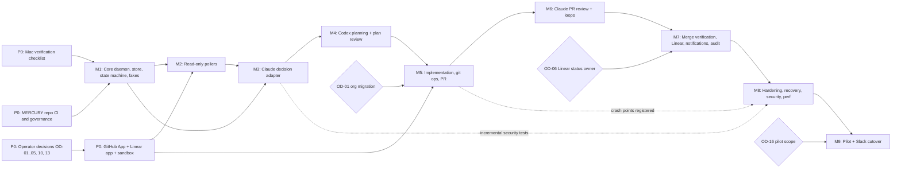

# Agent F report: Technical Program Manager (Phase 2)

| | |
|---|---|
| **Agent** | F, Technical Program Manager (requirements, delivery planning, dependencies) |
| **Date** | 2026-10-12 |
| **Deliverables** | [`planning/traceability.md`](../planning/traceability.md) (requirement IDs, RTM, DoR/DoD) · [`testing/verification-plan.md`](../testing/verification-plan.md) (test levels, environments, criteria, seed TC catalogue) · this report (roadmap and issue-breakdown **drafts**, Appendices A–E) |
| **Not created (by instruction)** | `planning/roadmap.md` and `planning/issue-breakdown.md`. They will be finalized from Appendices A–E in Phase 4. |
| **Inputs read** | `00-brief.md`, `03-design-baseline.md`, `01-discovery-local.md`, `01-discovery-integrations.md`, `02-discovery-agent-runtimes.md`, `02-discovery-platform.md`. No other Phase 2 outputs existed when this was written. |

---

## 1. Findings

1. **The brief turns into roughly 150 testable requirements.** The catalogue has 17 CON, 85 FR (5 of them "Won't"), 36 NFR, 12 OPS, plus 9 reserved SEC anchors for Agent E. Every requirement has a measurable pass/fail criterion, a verification method, an owning TDD section, at least one test case, and a milestone. The source coverage map (traceability §2) links every operating-model step (1–15), hard constraint, content area (A–J), quality gate and discovery pain point to requirement IDs.
2. **The four authority invariants are the program's core acceptance criteria.** They are written as constraints (CON-004…007) and tested as **properties** over generated event sequences (verification plan §5, invariants I1–I10), not only as examples. Each has a numeric gate: 0 counterexamples in 10,000 sequences, and 0 duplicate side effects in 1,000 crash-injection runs.
3. **Every discovery pain point now has a measurable requirement:**
   - The 14 h stall → NFR-003 (detect within the state timeout plus 2 polls).
   - Missed replies → FR-063 and NFR-005.
   - Human relays → TC-PIL-002 ("0 relays").
   - Duplicate or junk posts → FR-221 and NFR-001.
   - The token leaked by a test suite → OPS-004 (sandbox-only allow-list guard).
   - The environment split between cloud and Mac → CON-016.
   - "Evidence vs claims" → FR-064, FR-122 and FR-181.
4. **Three facts decide the schedule more than engineering effort does:**
   - **Operator decisions.** Identity (OD-02/03/04/05), whether to move to an organization (OD-01), and the sandbox (OD-13) all gate Phase 0 or M5.
   - **Phase 0 results.** Whether Codex can commit in a worktree, whether a LaunchAgent can read the Keychain, and whether the monotonic clock pauses during sleep could each force design changes.
   - **Operator review bandwidth.** Every MERCURY PR needs the human to approve and merge, which is the program's throughput limit.
5. **Governance can only be tested in a real sandbox.** No fake can prove that GitHub enforces CODEOWNERS, the last-push rule or stale-approval dismissal. TC-GOV-* therefore run against a sandbox repo with production-equivalent rules. Some steps need the operator in the loop (ⓗ), unless a second human test account is allowed (OD-13).
6. **The detective-only merge control is itself a requirement.** On personal-account repos, "only the human merges" can only be detected after the fact (CON-014). The RTM requires the governance report to state, per repo, whether the control is preventive or detective, so the gap stays visible rather than implied.

## 2. Recommended design (summary)

### 2.1 Requirements and traceability ([`planning/traceability.md`](../planning/traceability.md))

- **IDs.** Numeric IDs with banded ranges per area (traceability §1.1), e.g. FR-020–039 for authorization and NFR-050–059 for durability. They are permanent and never reused. SEC-001–099 is reserved for Agent E, in sub-ranges by brief §H topic. ADRs are cited with provisional keys `ADR-P01…P15`, which Agent A maps to final numbers in Phase 4.
- **MoSCoW is tied to delivery gates.** **M** means needed to exit the supervised pilot and cut over from Slack. **S** means within 30 days of cutover. **W** records explicit non-goals (dashboard, inbound webhooks, MERCURY merging, high availability, Linear-native agents).
- **RTM.** Each row runs requirement → TDD § + supporting doc → ADR key → TC IDs → milestone → status. Statuses follow `Draft → Baselined → Designed → Implemented → Verified`, and `Verified` needs an evidence link.
- **Consistency by construction.** The requirement tables, RTM and TC catalogue were generated from one data set. The generator checks that every cited TC exists, every TC covers at least one requirement, no ID is duplicated, and every ADR key exists. All four checks passed.
- **Definition of Ready (12 items) and Definition of Done (10 items)** for MERCURY implementation issues (traceability §10–11). They include a requirement and TC link, gating assumptions resolved, recovery semantics (dedup key and crash point), P50 ≤ 3 days, operator-merged PR, and evidence-linked RTM updates.

### 2.2 Verification ([`testing/verification-plan.md`](../testing/verification-plan.md))

- **Six environment tiers**, T0 in-process through T5 pilot, with an explicit rule: passing against fakes never verifies a requirement whose TC is defined at sandbox or real-Mac level.
- **Fakes** for Claude (SDK port and a fake CLI), Codex (a fake `codex` executable driven by a YAML scenario that also checks the coordinator's argv), GitHub (ETag, unknown-outcome writes, rate limits), Linear (`updatedAt` boundary cases), the clock (sleep gaps), the process spawner, and a fault-injecting proxy.
- **18 test levels** (L0 Phase 0 through L17 pilot), each with an ID range, scope, environment, entry criteria, numeric exit criteria and the requirements it covers. All 14 levels named in the brief are present.
- **Crash-injection harness.** A crash-point registry and an external-effect ledger drive the NFR-001 gate: 0 duplicates in 1,000 runs, with every crash point hit at least 10 times.
- **Milestone test gates** and **pilot acceptance** in three stages: shadow, supervised and cutover.
- **162 seed test cases.** Agents C, D and E extend their own ranges later (verification plan §10).

### 2.3 Delivery plan (drafts)

Appendices A–E hold the drafts: milestones with exit criteria, a Mermaid dependency graph, epics → issues with complexity and P50/P90 estimates, the critical path, and risks.

**Headline estimate: about 109 engineer-days at P50 and about 145 at P90**, as focused effort. That is roughly 22 workdays per month of calendar time at one engineer-day per day. With agent-assisted implementation (Codex implements, Claude reviews, the operator approves) the calendar could be about half of that if operator review keeps up (ASM-F-10).

## 3. Alternatives considered

| Topic | Options | Chosen | Why |
|---|---|---|---|
| ID format | (a) `FR-AUTH-001` area-prefixed; (b) flat `FR-001` with banded ranges; (c) hierarchical `FR-3.2.1` | (b) | Matches the brief's `FR-xxx`, stays short in tables and commit trailers, and survives regrouping. Bands keep related IDs together. |
| Where requirement text lives | (a) Only in TDD §5; (b) traceability.md with TDD §5 summarizing; (c) a YAML data file with generated Markdown | (b), generated from a data source | The brief makes Agent F own `traceability.md`. Generating it kept the RTM consistent. **Suggestion:** in Phase 4, commit the data file (YAML) beside `traceability.md` so later edits stay consistent. The orchestrator decides. |
| SEC handling | (a) Draft SEC requirements myself; (b) reserve ranges with brief-derived scope only | (b) | My assignment says not to invent security controls. Reserving ranges avoids ID collisions and keeps the RTM complete. |
| MoSCoW anchor | (a) "MVP"; (b) pilot exit / cutover gate | (b) | MVP is ambiguous. Pilot exit is an observable event with criteria (TC-PIL-*). |
| Milestone order | (a) Baseline order (Claude adapter before Codex); (b) Codex-first; (c) thin end-to-end slice first | (a), with an end-to-end slice **on fakes** inside M1 | Authorization must exist before any Codex run (Inv. 1), so building the Claude decision path first keeps the invariant true at every milestone. The fake-driven slice in M1 still de-risks the full flow early. |
| Security testing timing | (a) All in M8; (b) incremental per milestone plus an M8 consolidation | (b) | Isolation flags (TC-SEC-001/006) must hold from the first real Claude call (M3), and env scrubbing and network denial from the first Codex run (M4/M5). |
| Pilot | (a) Big-bang switch; (b) shadow → supervised → cutover | (b) | Discovery shows a mature legacy workflow that must not double-drive issues (FR-300). Shadow mode measures eligibility agreement before any write. |
| Test realism | (a) Real services only; (b) fakes only; (c) fakes for logic, sandbox for platform truth, real Mac for OS truth | (c) | Real-only runs are slow, costly and non-deterministic. Fakes-only cannot prove GitHub governance or macOS behaviour. |

**Disagreements with or additions to the baseline:**

1. **Identity provisioning should be part of Phase 0, not later.** Discovery fact 3 makes separate agent identities a prerequisite for every write integration.
2. **Suggestion to Agent C:** add an explicit `MERGE_UNVERIFIED` state, or a BLOCKED reason, for merges that fail verification. FR-182 needs a non-COMPLETED landing state.
3. **M9 should be split into shadow, supervised and cutover stages.**

None of these changes the baseline vocabulary.

## 4. Tradeoffs

- **Many "Must" requirements (120 of 150).** This is deliberate for a system whose purpose is enforcing authority boundaries. The cost is less flexibility in scope. The relief valve is that many numeric thresholds are tunable defaults, while the requirement itself stays fixed.
- **Numeric thresholds before measurement.** Examples are p95 ≤ 120 s detection, ≤ 250 MB RSS, and fullfsync ≤ 50 ms. They are reasoned defaults, not measured values, so they may be retuned after TC-PERF and Phase 0. That requires an RTM change note, not silent edits.
- **Operator-in-the-loop governance tests** are realistic but slow and not CI-automatable unless OD-13 allows a second human test account.
- **Generated tables** guarantee consistency, but hand edits to `traceability.md` can drift from the data source unless the source is committed (see §3).
- **Effort estimates use focused engineer-days** and ignore operator wait time. Calendar time depends on how fast the operator reviews.

## 5. Risks

| ID | Risk | Likelihood | Impact | Mitigation | Owner |
|---|---|---|---|---|---|
| PR-01 | Operator decisions (OD-01/02/03/05/13) arrive late and block P0 and M5 | M | H | Batch all P0 decisions into one decision session with recommended defaults (§8). M1 needs none of them. | Operator / F |
| PR-02 | Phase 0 refutes a key assumption (Codex commit, LaunchAgent Keychain, sleep clock, `node:sqlite` API) | M | M–H | Run Phase 0 before M1 coding. Each assumption has a named fallback (ADR alternatives). The estimates carry a P90 buffer. | D / F |
| PR-03 | Agent CLI churn during the build (Codex release cadence; Claude `--bare` default change) | H | M | Pin exact versions (NFR-090). Contract tests gate upgrades (NFR-093). Refresh recorded fixtures per upgrade. | B |
| PR-04 | Governance on personal repos stays detective-only | H (unless OD-01) | H | CON-014 transparency, TC-GOV-004 alert ≤ 10 min, incident runbook (OPS-010). Recommend the org move. | E / Operator |
| PR-05 | FakeGitHub's protection model diverges from real GitHub, giving false confidence | M | H | Governance truth only from T3 (verification plan §2.2). The fake is explicitly "not an oracle". | F |
| PR-06 | Bootstrapping paradox: MERCURY is built using the Slack workflow it replaces, so identity confusion continues until M9 | H | M | Use the new GitHub App for the MERCURY repo's own automation as early as P0. Keep legacy scripts away from MERCURY's repo. | Operator |
| PR-07 | Operator review bandwidth is the throughput bottleneck | H | M | Small PRs (DoR R10), batched review windows, clear PR template. Prioritize critical-path issues. | F |
| PR-08 | Real-agent test cost overruns | L | L | Per-suite budget caps (verification plan §2.4). | F |
| PR-09 | Linear agent and API features change (coding sessions, rate limits) | M | M | FR-005 detection; recorded contract fixtures; rate budget ≤ 20%. | B |
| PR-10 | Scope creep (dashboard, Slack-style chat, HA) | M | M | FR-900…904 "Won't" list; DoR R1 requires a requirement ID. | F |
| PR-11 | A laptop that sleeps often lowers pilot health and latency metrics | M | L–M | Metrics are defined over awake and logged-in time. OD-14 sets the power policy. | D |
| PR-12 | Estimates are wrong because the Mac is unobserved | M | M | Re-estimate after Phase 0 (Appendix C). | F |

## 6. Assumptions

These are the traceability §9 items plus planning assumptions:

| ID | Assumption |
|---|---|
| ASM-F-01 | The latency defaults (60 s Linear poll, ≤ 60 s GitHub poll on active PRs) fit the rate budgets |
| ASM-F-02 | A sandbox Linear team can be created on the current workspace plan |
| ASM-F-03 | A GitHub App can be installed on personal-account repos with the discovery G2 permission set |
| ASM-F-04 | Node's monotonic clock pauses during sleep on the operator's Mac |
| ASM-F-05 | Fullfsync commit latency is ≤ ~50 ms |
| ASM-F-06 | Governance tests needing a human approval are operator-in-the-loop |
| ASM-F-07 | macOS CI runners are available to the public MERCURY repo |
| ASM-F-08 | Fake executables can be injected for tests |
| ASM-F-09 | Power loss can be simulated with a fault filesystem |
| ASM-F-10 | Implementation is agent-assisted (Codex implements, Claude reviews) under the existing workflow until M9, so 1 engineer-day of effort can take less than 1 calendar day if the operator reviews promptly |
| ASM-F-11 | One operator, available ≤ 1 business day for decisions and ≤ 2 business days for PR reviews |
| ASM-F-12 | MERCURY's own repository (`project-mercury`) gets the same governance as target repos in P0 |

## 7. Dependencies (on other agents and decisions)

| On | What I need | Used in |
|---|---|---|
| **A** (architecture, ADRs) | Final ADR numbers for ADR-P01…P15; confirmation of the tech stack (Node LTS/TS, SQLite) | Traceability §5, RTM ADR column |
| **B** (integrations) | Poll intervals and rate budgets; GitHub App and Linear app permission sets; options for Linear status ownership; recording procedure for agent fixtures | NFR-040/041/081, OPS-002, FR-183, TC-CON-003…008 |
| **C** (components, state machine, protocols) | Final state names and transition table (the TC-SM oracle); port names; schema list and versions; crash-point registry; the `MERGE_UNVERIFIED` question | FR-080…084, FR-061, verification plan §2.2/§5/§6 |
| **D** (macOS, recovery) | Phase 0 checklist commands; LaunchAgent parameters (ExitTimeOut, ThrottleInterval); wake-detection method; backup and restore procedure | OPS-001, NFR-002/024, FR-282, NFR-022 |
| **E** (security) | All SEC-* statements in reserved ranges; TC-SEC-009+ and the TC-PI corpus; protected-path list (FR-124); severity threshold (FR-161); redaction patterns (NFR-062) | Traceability §4, verification plan L12/L14 |
| **Operator** | OD-01…OD-16 (traceability §8, options in §8 below) | P0, M4, M5, M7, M9 gates |

## 8. Unresolved questions (operator decisions)

Each decision lists its options and my recommendation for the operator. Only the operator decides.

| ID | Question | Options | Recommendation | Needed by |
|---|---|---|---|---|
| OD-01 | Move repos to a GitHub organization? | (a) Stay personal: merge-actor control is detective only. (b) Free org (public repos): "Restrict updates" or a merge queue lets only the operator merge. | (b) for target repos before the pilot. (a) is acceptable for sandbox and M1–M6. | Before M5 |
| OD-02 | GitHub agent identity | (a) GitHub App; (b) machine user with a classic PAT | (a): 1 h tokens, Checks API access, cannot be a code owner | P0 |
| OD-03 | Claude auth for unattended runs | (a) Console API key via `apiKeyHelper` (works with `--bare`); (b) subscription `setup-token` | (a), given the SDK policy note and `--bare` compatibility | P0 |
| OD-04 | Codex auth and billing | (a) `CODEX_API_KEY`; (b) ChatGPT login (`auth.json`) | (a) avoids refresh races (TC-P0-014) | P0 |
| OD-05 | Linear identity | (a) OAuth `actor=app`; (b) team-scoped personal API key | (a): non-human attribution | P0 |
| OD-06 | Who owns Linear `In Review`/`Done` | (a) Disable the integration's PR automations; (b) non-closing magic words, with MERCURY setting Done after verification; (c) the integration owns Done and MERCURY only verifies | (b): Done only after verified merge | Before M7 |
| OD-07 | Concurrency defaults | e.g. Codex 1 global, Claude 2, 1 per repo | Start at 1/2/1 for the pilot | M1 (default) |
| OD-08 | Cycle limits and budgets | plan 3, PR review 3, CI fix 2; per-task USD cap | As proposed; set a cap after shadow-mode cost data | M4 |
| OD-09 | Codex network access | (a) never; coordinator installs dependencies; (b) allowlisted domains | (a) | M5 |
| OD-10 | Eligibility signal | (a) `Todo` only; (b) `Todo` plus an opt-in label | (b): explicit opt-in during coexistence | M2 |
| OD-11 | Plan auto-approval scope | (a) all issues; (b) operator gate for `Security` / size-L issues | (b) during the pilot | M4 |
| OD-12 | Escalation response channel | (a) local CLI only; (b) also verified-author GitHub comments | (a) first; (b) only if iPhone-only response is needed | M7 |
| OD-13 | Sandbox names; second human test account | — | Create `mercury-sandbox` and Linear team `MSB`; decide whether a test-human account is acceptable | P0 |
| OD-14 | Mac power policy | desktop always-on vs laptop | Hold an idle-sleep assertion only while runs are active | M8 |
| OD-15 | Retention | audit ≥ 1 y, logs 90 d | As proposed | M8 |
| OD-16 | Pilot scope and Slack shutdown date | — | 5 non-Security S/M issues; Slack off 2 weeks after supervised exit | M9 |

**Questions for other agents:**

- **To C:** is the state set final enough to be the TC-SM oracle? Is a "merge unverified" state needed?
- **To E:** is the SEC sub-range split acceptable? What is the target size of the prompt-injection corpus (I assumed ≥ 50 cases)?
- **To D:** can the Phase 0 checklist be fully read-only, apart from the throwaway test LaunchAgent?
- **To B:** is ≤ 20% of hourly rate limits achievable at the latency targets?

## 9. Supporting evidence

| Claim | Evidence |
|---|---|
| The operating model, constraints and areas A–J are the requirement sources | `00-brief.md` (all sections), traceability §2 |
| Pain points (14 h stall, missed replies, relays, duplicate posts, leaked token, environment split, evidence vs claims) | `01-discovery-integrations.md` "Failure patterns" 1–8; baseline discovery fact 12 |
| Linear `Todo` is used as the queue; coding sessions are a second start path | `01-discovery-integrations.md` Linear §"Existing agent activity"; `02-discovery-platform.md` §3 |
| Personal repo means merge restriction is org-only; CODEOWNERS and last-push rules make human approval non-forgeable | `02-discovery-platform.md` §1.1–1.4, G3–G7 |
| Codex likely cannot commit in a sandboxed worktree; no whole-run timeouts; Claude runs repo hooks under `-p` | `02-discovery-agent-runtimes.md` §1 items 6–9, §2.6, §3.2 |
| LaunchAgent only while logged in; sleep suspends processes; TCC; SQLite fullfsync; `node:sqlite` status | `02-discovery-platform.md` §4–5, M1–M7, P1–P4 |
| Rate budgets (5,000/h; 304 free; Linear 2,500–5,000/h) | `02-discovery-platform.md` §2–3 |
| Mac unobserved; Phase 0 required | `01-discovery-local.md` |
| RTM consistency | Generator checks run on 2026-10-12: 0 unknown TCs, 0 unreferenced TCs, 0 duplicate IDs, 0 unknown ADR keys |

## 10. Confidence level

| Recommendation | Confidence | Why |
|---|---|---|
| Requirement catalogue covers the brief | **High** | Every brief item is mapped in traceability §2, and the generator confirms each requirement has tests and a milestone |
| Invariant-as-property and crash-injection verification approach | **High** | A standard technique, matched to the invariants the brief states |
| Numeric NFR thresholds | **Medium** | Grounded in discovery (rate limits, launchd defaults) but not measured on the Mac |
| Test-environment strategy (fakes, sandbox, real Mac) | **High** for the structure; **Medium** for sandbox automation | Depends on OD-13 and the human-account question |
| Milestone sequence and dependencies | **Medium-High** | Follows from the invariants and identity prerequisites; may shift after Phase 0 |
| Effort estimates | **Low-Medium** | Unobserved environment, agent-assisted throughput unknown, operator review bandwidth unknown. Re-estimate at P0 exit. |
| SEC ranges | **Medium** | Pending Agent E's structure |

---

## Appendix A: Draft milestones (for `planning/roadmap.md`)

| Milestone | Goal | Key deliverables | Exit criteria (all required) | Depends on |
|---|---|---|---|---|
| **P0** Environment verification and identity setup | Turn assumptions into facts; create non-human identities and the sandbox | Phase 0 report (TC-P0-001…015); GitHub App (sandbox + MERCURY repo installs); Linear app; sandbox repo and team with production-equivalent governance; MERCURY repo CI, protections, secret scan, ID lint; decisions OD-01…05, 10, 13 recorded | 0 Open checks gating M1; identity inventory shows no human credentials in automation; TC-OPS-009/010 green | Operator availability |
| **M1** Skeleton daemon, store and state machine with fakes | Deterministic core that enforces invariants with no external I/O | Config and logging; SQLite store (2 drivers, migrations, pragmas); state machine and audit; queue, outbox and leases; process supervisor; scheduler; daemon lifecycle and dev LaunchAgent; CLI; fakes framework and scenario runner; property tests; crash harness v1 | M1 gate in verification plan §7: TC-SM-001…011, core TC-UNIT, TC-INT-003/004/005/010/012/013, TC-CONC-001/004, TC-REC-001 (≥ 200 runs) with 0 violations | P0 (M1 needs only the Mac-runtime checks) |
| **M2** Linear and GitHub read-only pollers | See the real world without changing it | GitHub App token minting; REST client with ETag and rate limits; Linear GraphQL cursor poller; PR, check and review poller; eligibility, mapping, blocker and foreign-delegation evaluator; shadow status | M2 gate: 0 missed of 100 sandbox updates; 0 writes; health shows poll lag | M1, P0 identities |
| **M3** Claude decision adapter | Triage and authorization decisions as versioned records | Agent SDK adapter (isolation profile, budgets, deadlines, classification); triage and authorization schemas and prompts; authorization store, spawn gate, revocation, spec-hash drift; isolation tests | M3 gate: 0 Codex spawns without authorization; TC-SEC-001/006 pass with the real binary | M1 (M2 for real input; fakes otherwise) |
| **M4** Codex planning and plan review | Plan → review → revise → approve loop bound to hashes | Codex exec adapter (argv, JSONL, env scrub, CODEX_HOME layout); planning worktrees (read-only); plan artifacts; plan review and approval records; cycle limits and escalation | M4 gate: 0 implementation spawns with stale approval; 3-cycle limit escalates once | M3 |
| **M5** Implementation, git operations, PR | Approved plans become PRs authored by the App identity | Implementation runs and progress; test runner and dependency-install step; diff guard; coordinator commit and push; idempotent PR with template and reviewer request; read-only governance check | M5 gate: 0 duplicate PRs; agent APPROVE cannot satisfy protection (TC-GOV-001…003); no merge code path | M4, OD-01 (for the governance test variant), OD-09 |
| **M6** Claude PR review and revision loops | Independent review, security review, bounded loops | PR and security review schemas and calls; posting COMMENT/REQUEST_CHANGES; PR and CI-fix loops; head-SHA invalidation | M6 gate: bot never APPROVEs; loops bounded | M5 |
| **M7** Merge verification, Linear updates, notifications, audit | Close the loop and make it observable | Merge verification and security alert; Linear projection and comments (app actor); notification service (dedup, retry); `mercury audit`; worktree cleanup; live-agent sandbox smoke | M7 gate: audit 10/10; ≤ 1 notification per event; non-operator merge alerted ≤ 10 min | M6, OD-06, OD-12 |
| **M8** Hardening, recovery, security, performance | Prove it on the real Mac under failure | Full crash-injection (1,000 runs); sleep, reboot and launchd tests; full prompt-injection corpus; security boundary on the Mac; perf soak and rate budget; install/upgrade/uninstall; backups; runbooks | M8 gate: all L7–L16 exit criteria | M7 (security and recovery tests start earlier, incrementally) |
| **M9** Pilot on `network_monitor` and Slack cutover | Replace Slack for real work | Shadow (≥ 5 days); coexistence label and legacy exclusions; supervised pilot (≥ 5 issues, concurrency 1); cutover and Slack decommission | TC-PIL-001…004 | M8, OD-16 |

## Appendix B: Draft dependency graph

**Critical path (P50, effort days):** P0 (6) → M1 (25) → M3 (9) → M4 (9) → M5 (12) → M6 (6) → M7 (10) → M8 (16) → M9 (6), about **99 days on path**.

- **M2 (10)** runs in parallel with M3. M3 can work against FakeLinear and FakeGitHub, but must finish before M3's exit, because M3's gate uses real triage input from the sandbox.
- **Inside M1**, the path is store → state machine → queue/outbox → fakes/scenario runner → property and crash tests. The CLI, scheduler and supervisor can proceed in parallel.
- **Off-path work that can absorb slack:** M1-8 CLI, M7-4 audit CLI, M8-6 operations packaging, M2-6 contract fixtures.

## Appendix C: Draft epics → issues → subtasks with estimates

Sizes: **S** ≤ 1 day, **M** 2–3 days, **L** 3–5 days (an L must be split before Ready if P50 > 3). Estimates are focused engineer-days as P50 / P90. "Req" lists the main requirement IDs (full mapping in the RTM).

### E0: Phase 0 (P0)

| Issue | Subtasks | Size | P50/P90 | Req |
|---|---|---|---|---|
| P0-1 Mac verification checklist | macOS/power/FileVault; LaunchAgent probe; Keychain from LaunchAgent; Claude and Codex versions and auth; Codex commit in worktree; sleep clock; `node:sqlite`; TCC paths; config leakage; Codex schema failure; concurrent CODEX_HOME | M | 2 / 3 | OPS-001, CON-015 |
| P0-2 Inventory `network_monitor` legacy workflow (read-only) | scripts, AGENTS.md, protections, Linear automations, coding-session settings | S | 0.5 / 1 | FR-300, OPS-008 |
| P0-3 Operator decision session | OD-01…05, 07, 10, 13 with recorded rationale | S | 0.5 / 1 (calendar risk) | §8 |
| P0-4 Identities | GitHub App (permissions per B), sandbox and MERCURY installs, PEM in Keychain; Linear app (`actor=app`) | M | 1 / 2 | OPS-002, CON-008 |
| P0-5 Sandbox | repo with CI and flaky toggle; rulesets and CODEOWNERS; Linear team `MSB`; integration hookup; reset script; allow-list | M | 1 / 2 | OPS-004 |
| P0-6 MERCURY repo bootstrap | CI (macOS runner), lint/typecheck, secret scan, ID lint, CODEOWNERS and protections | S | 1 / 1.5 | CON-017, OPS-003 |
| **Subtotal** | | | **6 / 10.5** | |

### E1: Core daemon (M1)

| Issue | Subtasks | Size | P50/P90 | Req |
|---|---|---|---|---|
| M1-1 Project skeleton, config, logging | config schema and validator; structured logger with redaction hook; error taxonomy | M | 2 / 3 | NFR-072, NFR-062 |
| M1-2 Store | DB interface; `node:sqlite` and `better-sqlite3` drivers; pragmas self-check; migrations and backup; integrity checks | L | 3 / 5 | NFR-050…052, NFR-023, NFR-091 |
| M1-3 State machine and audit | transition table as data; guards; atomic evidence; replay | L | 3 / 5 | FR-080…084, FR-261 |
| M1-4 Queue, outbox and leases | inbox/outbox; dedup keys; leases; effect ledger hooks | L | 3 / 5 | FR-040, FR-043, FR-063 |
| M1-5 Process supervisor | detached spawn; pid/pgid/start-time records; kill ladder; orphan reaper | M | 2 / 4 | FR-044, FR-281 |
| M1-6 Scheduler and limits | priority queue; global, per-type and per-repo limits; starvation bound | M | 2 / 3 | FR-041, FR-042 |
| M1-7 Daemon lifecycle | single-instance lock; SIGTERM checkpoint; wake detection; dev LaunchAgent plist | M | 2 / 3 | FR-048, FR-082, NFR-024 |
| M1-8 Operator CLI v1 | IPC; status, show, cancel, pause, resume, health | M | 2 / 3 | FR-049, FR-240, NFR-071 |
| M1-9 Fakes and scenario runner | FakeClock; FakeSpawner; fake binaries; FakeGitHub/FakeLinear stubs; YAML scenarios | L | 3 / 5 | NFR-100, NFR-101 |
| M1-10 Property tests and crash harness v1 | invariant checker I1–I10; fast-check models; crash-point registry; 200-run job | L | 3 / 5 | NFR-001, TC-SM-004 |
| **Subtotal** | | | **25 / 41** | |

### E2: Read-only pollers (M2)

| Issue | Subtasks | Size | P50/P90 | Req |
|---|---|---|---|---|
| M2-1 GitHub client | App JWT and installation token; ETag cache; rate-limit and retry-after; FakeGitHub parity | M | 2 / 4 | NFR-081, NFR-005 |
| M2-2 Linear client and poller | GraphQL client; `updatedAt` cursor with overlap; dedupe | M | 2 / 3 | FR-001 |
| M2-3 PR, check and review poller | tracked-PR set; head-SHA tracking | M | 2 / 3 | NFR-041 |
| M2-4 Eligibility evaluator | rules; repo mapping; blockers; foreign delegation | M | 2 / 3 | FR-002…005 |
| M2-5 Shadow status | `mercury status --shadow`; health lag fields | S | 1 / 2 | NFR-071 |
| M2-6 Contract fixtures | record GitHub and Linear responses from sandbox | S | 1 / 2 | TC-CON-006/007 |
| **Subtotal** | | | **10 / 17** | |

### E3: Claude decision adapter (M3)

| Issue | Subtasks | Size | P50/P90 | Req |
|---|---|---|---|---|
| M3-1 Agent SDK adapter | isolation options; env; budgets; deadline; result classification; CLI `--bare` fallback | L | 3 / 5 | FR-062, NFR-083, SEC-030 |
| M3-2 Triage and authorization schemas and prompts | schemas; prompt templates; golden fixtures | M | 2 / 3 | FR-020 |
| M3-3 Authorization records and gate | immutable rows; hashing; spawn gate; revocation; spec drift | M | 2 / 4 | FR-021…024 |
| M3-4 Isolation and injection guard tests | planted hooks and `.mcp.json`; tool denial audit; PI guard with fakes | M | 2 / 3 | SEC-030, SEC-040 |
| **Subtotal** | | | **9 / 15** | |

### E4: Codex planning (M4)

| Issue | Subtasks | Size | P50/P90 | Req |
|---|---|---|---|---|
| M4-1 Codex exec adapter | argv builder; JSONL parser; env scrub; per-task CODEX_HOME; resume | L | 3 / 5 | FR-100, CON-016 |
| M4-2 Worktree manager | create from base SHA; naming; read-only planning use | M | 2 / 3 | FR-120 |
| M4-3 Plan review loop | plan artifacts; review schema; approval binding; cycle limits; escalation | M | 3 / 4 | FR-101…106 |
| M4-4 Codex fixtures and failure sims | recorded JSONL; FakeCodex fault modes | S | 1 / 2 | TC-CON-004/005, TC-AFS-003/004 |
| **Subtotal** | | | **9 / 14** | |

### E5: Implementation and PR (M5)

| Issue | Subtasks | Size | P50/P90 | Req |
|---|---|---|---|---|
| M5-1 Implementation run | workspace-write; progress events; stall detection | M | 2 / 3 | FR-121, FR-125 |
| M5-2 Test runner and dependency install | test-results artifact; lockfile install step | M | 2 / 4 | FR-122, FR-123 |
| M5-3 Diff guard | scope compare; protected paths (from E) | M | 2 / 3 | FR-124 |
| M5-4 Git operations | commit with trailers; push via App token (credential helper); idempotent push | M | 2 / 4 | FR-140, FR-141 |
| M5-5 PR creation | lookup-then-create; template; reviewer request | M | 2 / 3 | FR-142, FR-143 |
| M5-6 Governance check and GOV tests | read-only ruleset and protection check; drift alert; TC-GOV-001…003/005/007/008 | M | 2 / 3 | OPS-003, CON-007 |
| **Subtotal** | | | **12 / 20** | |

### E6: PR review (M6)

| Issue | Subtasks | Size | P50/P90 | Req |
|---|---|---|---|---|
| M6-1 PR and security review calls | schemas; inputs (diff, plan, conditions); verdict binding to SHA | M | 2 / 3 | FR-160, FR-161 |
| M6-2 Post reviews | COMMENT/REQUEST_CHANGES; static no-APPROVE check | S | 1 / 2 | FR-162 |
| M6-3 Loops | PR revision loop; CI-fix loop; head invalidation | M | 3 / 4 | FR-144, FR-163, FR-165 |
| **Subtotal** | | | **6 / 9** | |

### E7: Merge, Linear, notifications, audit (M7)

| Issue | Subtasks | Size | P50/P90 | Req |
|---|---|---|---|---|
| M7-1 Merge verification | predicate; security alert; landing state | M | 2 / 3 | FR-181, FR-182 |
| M7-2 Linear projection | state mapping; app-actor comments; idempotent writes | M | 2 / 4 | FR-183, FR-200…202 |
| M7-3 Notifications | classes; dedup; persistence and retry; channels | M | 2 / 3 | FR-220…223 |
| M7-4 Audit CLI | 10-question report; pilot metrics report | M | 2 / 3 | FR-260 |
| M7-5 Cleanup | safe worktree and branch removal | S | 1 / 2 | FR-184 |
| M7-6 Live sandbox smoke | one real issue end-to-end with real agents | S | 1 / 2 | TC-SBX-* |
| **Subtotal** | | | **10 / 17** | |

### E8: Hardening (M8)

| Issue | Subtasks | Size | P50/P90 | Req |
|---|---|---|---|---|
| M8-1 Crash-injection at scale and fixes | 1,000-run nightly; power-loss layer | L | 3 / 6 | NFR-001, NFR-020 |
| M8-2 Real-Mac recovery | sleep, reboot, launchd, SIGTERM tests and fixes | L | 3 / 5 | NFR-002, NFR-021, NFR-024 |
| M8-3 Prompt-injection corpus | run E's corpus with real agents; fixes | L | 3 / 6 | SEC-040 |
| M8-4 Security boundary on Mac | network denial; file access; listeners | M | 2 / 4 | SEC-030, CON-002 |
| M8-5 Performance and budgets | 24 h soak; rate budget; disk caps | M | 2 / 3 | NFR-040…044, NFR-080…082 |
| M8-6 Operations packaging | install/upgrade/uninstall; backups; runbooks; retention | M | 3 / 5 | NFR-070, NFR-073, OPS-005…011 |
| **Subtotal** | | | **16 / 29** | |

### E9: Pilot and cutover (M9)

| Issue | Subtasks | Size | P50/P90 | Req |
|---|---|---|---|---|
| M9-1 Shadow mode | dry-run decisions; agreement report (≥ 5 calendar days) | S | 1 / 2 | OPS-008 |
| M9-2 Coexistence | opt-in label; exclude legacy scripts for labelled issues | S | 1 / 2 | FR-300 |
| M9-3 Supervised pilot | ≥ 5 issues; daily review of metrics (2–3 calendar weeks) | M | 3 / 5 | TC-PIL-002 |
| M9-4 Cutover | disable Slack paths; revoke token; 2-week watch | S | 1 / 2 | FR-301, OPS-009 |
| **Subtotal** | | | **6 / 11** | |

**Totals:**

- **P50 is about 109 engineer-days.**
- The simple sum of P90s is 183. That is an overestimate, because it assumes every issue overruns at once.
- Treating the epics as partly correlated gives a planning **P90 of about 145 engineer-days**. For independent epics the root-sum-square of the (P90 − P50) deltas is about 30 days; adding a correlation allowance gives roughly 140–150.
- Calendar time at one engineer-day per workday: about 5 months at P50 and 7 months at P90. With agent-assisted throughput (ASM-F-10), the target is about 3 months at P50 if operator PR review keeps pace.
- **Re-estimate at P0 exit.**

## Appendix D: Blockers and phase exit criteria summary

| Phase | Hard blockers | Exit criteria (summary; full gates in verification plan §7) |
|---|---|---|
| P0 | OD-02/03/04/05/13; operator time on the Mac | Phase 0 report; identities; sandbox; MERCURY repo governance |
| M1 | None external | Invariant properties, plus crash harness with 0 violations |
| M2 | P0 identities | 0 missed updates; 0 writes |
| M3 | Claude auth (OD-03) | 0 unauthorized spawns; isolation tests pass |
| M4 | Codex auth (OD-04); OD-08/11 defaults | 0 stale-approval spawns |
| M5 | OD-01 (governance variant); OD-09 | 0 duplicate PRs; governance tests pass |
| M6 | — | No bot APPROVE; bounded loops |
| M7 | OD-06, OD-12 | Audit 10/10; merge verification and alert |
| M8 | Agent E corpus; OD-14/15 | L7–L16 exit criteria on the real Mac |
| M9 | OD-16; M8 exit | TC-PIL-001…004 |

## Appendix E: Program-level assumptions and blockers to watch

- **Phase 0 re-plan point.** If TC-P0-006 shows Codex *can* commit, ADR-P06 still stands (least privilege), so there is no schedule change. If TC-P0-003 shows the Keychain is unreadable from the LaunchAgent, add about 2–4 days to M1-7 for the fallback design.
- **ID baselining.** Phase 4 must freeze requirement IDs before any implementation issue is created. After that, DoR R1 enforces the link from issues to requirements.
