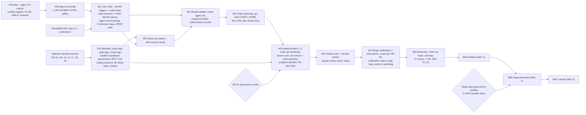

# Phase 3 Review F: Requirements Coverage and Delivery Feasibility

| | |
|---|---|
| **Reviewer** | Agent F, Technical Program Manager |
| **Phase** | 3, cross-agent review |
| **Date** | 2026-10-12 |
| **Focus** | Does every brief item have concrete design in at least one document? Can the requirement ID schemes be reconciled? Does the roadmap reflect the dependencies the other agents defined? What is the consolidated, deduplicated list of operator decisions? |
| **Scope** | Design only. This file is the only file written. |

---

## 1. Scope and method

**Read in full:**
- `reviews/00-brief.md` and `reviews/03-design-baseline.md`.
- All six Phase 2 reports (`10`–`15`).
- `planning/traceability.md` §1–§5 and §7–§11 (my own document).
- `testing/verification-plan.md` §1–§7 (my own document).

**Read by section (Grep plus targeted reads), for every document in my focus:**
- `architecture/overview.md`: §5.4, §6, §7.1, §10, §12–§17.
- `architecture/state-machine.md`: §1–§7 in full, plus the §8–§11 headings.
- `architecture/components.md`: §4.15–§4.17, §5.5, §6 (DDL audit chain, `record_mac`), §9.1, §10 headings.
- `architecture/decisions/ADR-*`: headings, and the ADR-005, ADR-008, ADR-009, ADR-010 and ADR-012 decision text.
- `protocols/messages.md` §5.1, §6, §7; `protocols/schemas/` (file list, envelope fields, the `output.plan_review` criteria).
- `integrations/github.md` §4, §6, §9 and the Part B headings; `integrations/linear.md` §6; `integrations/claude.md` §3.1–§3.2; `integrations/codex.md` §5.
- `operations/macos-service.md` §2, §7, §16, §17; `operations/recovery.md` §6 plus headings.
- `security/threat-model.md` §5.1 (every SEC row), §8.1–§8.2, §10, §11.

**Method:**
1. I built a coverage matrix: brief item → design location(s) → status.
   - **Covered**: concrete, implementable detail exists.
   - **Partial**: the item is addressed, but detail is missing or two documents conflict.
   - **Missing**: no document designs it.
2. I diffed every requirement-like ID family (CON/FR/NFR/OPS, NFR-xxx-nn, REL-nn, SEC-nnn, I1–I20, ASM-*, OD/OQ) against `traceability.md`.
3. I re-derived the roadmap dependencies from C's DDL and guards, D's Phase 0 and runtime design, and E's §11 requirements on other agents. I compared them with my Phase 2 draft (report Appendix A–C).
4. I grepped `docs/mercury/` for secret-shaped strings (GitHub, Anthropic, Linear and Slack token patterns). There were 0 hits.

I did not run anything against any external system.

---

## 2. Summary verdict

**Coverage: substantially complete, but not yet consistent.**
- Of 126 brief items in the matrix (§3.1–§3.6), **97 are Covered, 27 Partial, 2 Missing**.
- Both Missing items belong to later phases by design: TDD §32 sign-off, and the separate `planning/roadmap.md` / `issue-breakdown.md` files.
- No brief requirement is unaddressed.
- Every one of the 14 message schemas, all 18 baseline states (17 kept, plus `DISCOVERED` moved to the issue level), all 7 notification events, all 10 audit questions and all 14 test types has a design home.
- All 6 required Mermaid diagram types exist.

**Two problems block baselining requirements in Phase 4:**

1. **SEC-201 (separate agent uid) is a MUST with no design behind it.** It is the single **Critical** item.
   - No component, process, layout, ADR or roadmap item implements it.
   - It is not a small add-on. Under a separate uid the coordinator cannot signal, sweep or adopt agent processes without a privileged helper. It cannot place worktrees under its own `0700` home, and it must hand model keys across uids.
   - It changes C §8, D §3/§7/§9 and my roadmap.
2. **Requirement and test IDs collide across agents.**
   - My `SEC-001…099` reservation vs E's `SEC-100…905`.
   - My verification-plan invariants `I1–I10` vs C's `I1–I20`, which use the **same labels with different meanings**.
   - A's `NFR-LAT/REL/AUD/…` and D's `REL-01…15` have targets that disagree with mine in 11 places.

   All of this can be reconciled (§6 proposes the scheme), but the RTM cannot be baselined until it is.

**Delivery feasibility: feasible, but my draft roadmap is stale.**
- It predates the other designs. It misses the agent uid, review snapshots, `mercury/policy`, the audit anchor, the drift monitor credential, the watchdog, `runwrap` adoption and holds.
- It also places security pre-push controls too late.
- The revised plan (§7) adds about 23 P50 engineer-days: **about 132 P50 / about 175 P90**, up from 109 / 145.
- Phase 0 roughly doubles, because of about 120 assumptions across six registers.

**Counts:**

| Severity | Count |
|---|---|
| Critical | 1 |
| High | 12 |
| Medium | 19 |
| Low | 5 |
| **Total** | **37** |

---

## 3. Coverage matrix

Legend:
- **C** Covered · **P** Partial · **M** Missing.
- Short names: OV `architecture/overview.md`; SM `architecture/state-machine.md`; CP `architecture/components.md`; MSG `protocols/messages.md`; SCH `protocols/schemas/`; CL/CX/LN/GH `integrations/{claude,codex,linear,github}.md`; MS `operations/macos-service.md`; RC `operations/recovery.md`; TM `security/threat-model.md`; TR `planning/traceability.md`; VP `testing/verification-plan.md`.

### 3.1 Operating model (brief steps 1–15)

| # | Brief item | Design location(s) | Status | Note |
|---|---|---|---|---|
| 1 | Claude is the primary orchestrator | OV §8.1, ADR-004, CL §1–§3 | P | Reinterpreted as "decision authority, coordinator holds the loop". Sound, but needs operator confirmation (OD-17) |
| 2 | Claude evaluates and prioritizes eligible issues | LN §4, CL §3 (`triage`), CP §4.17 `TriageService`, SCH `output.triage_proposal` | C | Auto-triage on or off is open (OD-25) |
| 3 | Claude explicitly authorizes each task (versioned record) | OV §8.3–8.5, ADR-011, SM T02, CP §6.4 triggers (I18), SCH `task.authorization` | C | — |
| 4 | Continuously running coordinator | OV §6, MS §3–§6, ADR-010 | C | — |
| 5 | Codex produces a plan | CX §3.1, SM T05–T06, SCH `output.codex_plan`, `plan` | C | — |
| 6 | Claude reviews the plan | CL §3–§4, SCH `output.plan_review` (9 criteria, V4 "exactly once") | C | — |
| 7 | Auto-approve or request revisions | SM T09–T13, §9; MSG §5.1 | C | Revision instruction source is disputed (Known disagreement 7, §4) |
| 8 | Implement in isolated worktrees | CX §3.3, CP §9, MS §7.1 | P | The worktree root differs across 5 documents (Known disagreement 4) |
| 9 | Run tests; prepare PR | CX §9–§10 (coordinator commits, L2 tests), SM T20–T22, GH §5 | C | Deliberately deviates from the brief ("Codex prepares PR" → the coordinator does). Justified by B and E; TDD §13 must state it |
| 10 | Claude independently reviews the PR (functionality, maintainability, security, spec) | CL §3, SCH `output.code_review`, `output.security_review`, SM T23–T26 | P | Whether the security review runs on every PR is disputed (RF-13). The review-input mechanism is disputed (RF-05) |
| 11 | Failed reviews → actionable revision → Codex | SM T27–T30, CX §3.4, SCH `revision.request` | C | — |
| 12 | Notify the human via GitHub (and Linear) | CP §4.15 kinds, GH §6 (draft → ready + review request), LN §7.2 | P | No single channel matrix (RF-21) |
| 13 | Only the human approves and merges protected branches | TM §5.2 proof, SEC-100/104/109, GH §9, ADR-008 | P | "Human approves" is preventive. "Human merges" depends on the mode (G-ORG/G-SPLIT/G-DETECT, OD-01) |
| 14 | Coordinator verifies the merge and updates Linear | SM §8.5, T34/T35, GH §8, SEC-905, LN §6 | P | Who owns Linear `Done` is disputed (RF-08) |
| 15 | Unfinished tasks recover after restart | RC §3–§5, SM §10, CP §10.6, MS §3.3 | C | — |

### 3.2 Hard constraints and authority invariants

| Constraint | Design location(s) | Status | Note |
|---|---|---|---|
| A Linear status change never starts work alone | SM I17, §3.7 "events that are not transitions"; SEC-302; LN §4 | C | — |
| Claude authorization required; versioned record | SM I3, I18; CP §6.4; ADR-011 | C | — |
| Codex cannot run unapproved work | SM I4, §8.2; SEC-306; CP §10.4 | C | — |
| Human approval enforced by GitHub, not prompts; no impersonation | TM §5.2, SEC-100…112, GH §9.1, SM I9 | P | `mercury/policy` is required by E but missing from B's ruleset (RF-07) |
| No assumption of work while asleep | SM I20, §7.2; MS §8 | P | My FR-282 still names the refuted clock method (RF-15) |
| Plan revision invalidates approval unless re-approved | SM I5, §8.2; SEC-306 | C | — |
| Bounded revision cycles with escalation | SM §9, SEC-315 | P | The bounds differ (RF-14) |
| No secrets in docs | TR CON-010; grep found 0 hits | C | — |
| No public inbound access | ADR-007, GH §11, MS §11.6 (watchdog without inbound) | C | — |
| Design only | All reports | C | — |
| Separate agent identities (discovery fact 3) | ADR-008, GH §2, LN §2, SEC-801 | C | Covers service identities. The OS-level identity (agent uid) is **Missing** (RF-01) |

### 3.3 Content areas A–J (every listed sub-item)

**A. Orchestration**

| Item | Location | Status |
|---|---|---|
| Authorization authority | OV §8, ADR-011, SM T02/I18 | C |
| Scheduling/dispatch | CP §7.1–§7.4 (derived queue, claim protocol) | P: queue model disputed (Known disagreement 2) |
| Concurrency limits | OV §6, CP §7.3, MS §10.1 | C |
| Dependency resolution | SM §8.4, CP §7.5, LN §3 | C |
| Status | CP §5.5 `mercury status` | C |
| Failure detection | SM §7, CP §8.4, MS §10.3, RC §2 | C |
| Cancel/resume | SM G1, T36–T38, §6.3, §8.6 | C |
| Duplicate-execution prevention | SM I1/I2/I11/I12, RC §3 | C |
| Multi-process coordination | SM I16, CP §5.1, MS §3.4 | C |
| Versioned authorization records | ADR-011, CP §6.3 `authorizations` + trigger chain | C |

**B. Communication**

| Item | Location | Status |
|---|---|---|
| Evaluation of JSON / local queues / SQLite events / CLI / MCP / filesystem / IPC / HTTP | OV §7.1 (all 8 options), CP §5.1 (IPC choice) | C |
| Schema: task authorization | `task.authorization.schema.json` | C |
| Schema: task assignment | `task.assignment.schema.json` | C |
| Schema: implementation plan | `plan.schema.json`, `output.codex_plan` | C |
| Schema: plan review | `plan.review.schema.json`, `output.plan_review` | C |
| Schema: plan approval | `plan.approval.schema.json` | C |
| Schema: plan revision request | `plan.revision_request.schema.json` | C |
| Schema: implementation progress | `implementation.progress.schema.json` | C |
| Schema: test results | `test.results.schema.json` | C |
| Schema: PR creation | `pr.created.schema.json` | C |
| Schema: code review | `code.review.schema.json`, `output.code_review` | C |
| Schema: security findings | `security.findings.schema.json`, `output.security_review` | C |
| Schema: revision requests | `revision.request.schema.json`, `output.revision_request` | C |
| Schema: completion event | `task.completed.schema.json` | C |
| Schema: failure event | `task.failed.schema.json` | C |
| Envelope: correlation, schema version, timestamps, issue, repo, execution, dedup IDs | `envelope.schema.json` (required: `schema`, `schema_version`, `message_id`, `correlation_id`, `causation_id`, `dedup_key`, `occurred_at`, `recorded_at`, `issue`, `repo`, `task_id`, `run_id`, `actor`, …) | C |
| Versioning rules | MSG §6 V-1…V-7 | P: my FR-065 ("accept N and N−1 minor") differs from V-2 ("validate with the recorded version"). Align FR-065 to V-2 |
| Failure-triage contract | MSG §7 "not defined in v1" | P: depends on OD-29 |

**C. State machine**

| Item | Location | Status |
|---|---|---|
| All 18 brief states | SM §1.2: 17 kept; `DISCOVERED` → `linear_issues.mercury_status` | P: justified, but no FR covers issue-level discovery (RF-22) |
| Valid transitions, guards, initiator, evidence, persistent changes | SM §3 (T01–T40, G1–G6), §8 | C |
| Retry limits, timeouts | SM §7.1, §7.3 | C |
| Recovery semantics | SM §10, RC §4 | C |
| Terminal states | SM I8, §1.1 | C |
| Full transition table and Mermaid | SM §2–§3 | C |
| `BLOCKED` vs holds | SM §5–§6 | P: Known disagreement 1 |

**D. Claude plan approval**

| Item | Location | Status |
|---|---|---|
| 9 criteria | `output.plan_review` `criteria` enum, minItems/maxItems 9, plus V4 "each exactly once" | C |
| Machine-readable results | SCH, MSG §5.1 | C |
| Explicit approval conditions | `approval_conditions[]`; CL §4 (fed to PR review) | C |
| Maximum revision cycles | SM §9 | P: RF-14 |
| Escalation | SM T13, §6.1 | C |

**E. GitHub PR workflow**

| Item | Location | Status |
|---|---|---|
| Branch/worktree naming | GH §4.1, CP §9.1, MS §7.1 | P: RF-29 |
| Commit conventions | GH §4.2 | P: trailer sets differ (RF-28) |
| PR template | GH §5.1 | C |
| Linear linking | GH §4.1, LN §6 | P: RF-08 |
| Checks | GH §7, SM T21–T22 | C |
| Claude code review | CL §3, GH §6 | C |
| Claude security review | CL §3, TM SEC-314 | P: RF-13 |
| Review persistence | Artifacts plus `pr_reviews` (CP §6) | C |
| Revision loops | SM §9 | C |
| Required human approval | SEC-100/104, GH §9.1 | C |
| Merge verification | SM §8.5, GH §8, SEC-905 | P: latency 5 vs 10 min, and auto-pause (RF-27) |
| Post-merge Linear updates | LN §6–§7 | P: RF-08 |
| Branch protection, rulesets | GH §9.1–§9.2, SEC-100 | P: RF-07 |
| Token privileges | GH §2.1, SEC-101, TM §6.2 | P: `administration:read` conflict (RF-11) |
| Service identities | ADR-008, GH §2, LN §2 | C |
| Separation of duties | TM §6, SEC-110 (SHOULD) | C |

**F. Local execution**

| Item | Location | Status |
|---|---|---|
| launchd | MS §4–§5, ADR-010 | C |
| Login-session behaviour | MS §6 | C |
| Supervision | MS §3, CP §8 | P: cross-uid supervision is missing (RF-01, RF-26) |
| Graceful shutdown | MS §12 | C |
| Crash recovery | RC §4 | C |
| DB integrity | MS §14, NFR-052 | C |
| Durable checkpoints | RC §3 journal, SM `MERGED` checkpoint | C |
| Retry after connectivity loss | MS §8.5, SM holds `network_down` | C |
| Orphaned agent processes | CP §8.3, MS §3, RC T-REC-05 | P: RF-26 |
| Safe worktree cleanup | CP §9.5, SEC-406 | C |
| Restart after incomplete tasks | SM §10, CP §8.6 | C |

**G. Human notifications**

| Event | Location | Status |
|---|---|---|
| Repeated plan-review failure | CP §4.15 `repeated_review_failure`, SM §6.1 | C |
| Decisions needing human judgement | `decision_needed` | C |
| Security escalation | `security_escalation`, SEC-901 | C |
| Unrecoverable failures | `unrecoverable_failure` | C |
| PR ready for approval | `pr_ready_for_approval`, GH §6 | C |
| CI failures needing intervention | `ci_intervention_needed` | C |
| Merge completion | `merge_completed` | C |
| Avoiding duplicates and low-value alerts | CP §4.15 dedup key, SM §6.2 reminders, NFR-NOT-01/02 | C |
| Channel per event (GitHub mention / Linear / ops issue / local) | CP §4.15 ("B and D decide"), MS §11.4, SEC-901 | **P** (RF-21) |

**H. Security**

| Item | Location | Status |
|---|---|---|
| AuthN/authZ | SEC-1xx | C |
| Agent identity | SEC-1xx, SEC-801 | C |
| Least privilege | SEC-101, TM §6 | C |
| Credential management | MS §9, SEC-5xx | C |
| Secret redaction | CP §4.16, SEC-501 | P: RF-17 |
| Filesystem protections | MS §7.2, TM §8.1, SEC-405 | P: RF-01, Known disagreement 4 |
| Command execution restrictions | SEC-203/208, CX §6 | C |
| Tool permission boundaries | CL §2.1, SEC-204 | C |
| Prompt-injection defences | TM §7, SEC-301…315 | C |
| Repo content trust | SEC-209, SEC-205 | P: RF-05 |
| Malicious Linear comments | LN §10, SEC-302 | C |
| Malicious PR content | SEC-309/313 | C |
| Human approval enforcement | TM §5.2 | C |
| Audit integrity | SEC-601…605, CP §4.16 | P: anchor missing (RF-10) |
| Supply chain | SEC-701…707 | C |
| Dependency security | SEC-702/703 | C |
| Software-enforced vs policy-enforced controls | TM §5.1 SW/GH/OS/POL tags | C |

**I. Observability and audit: the 10 questions**

| Question | Location | Status |
|---|---|---|
| Which Linear issue started the task | `tasks.issue_id`, SM T01 evidence | C |
| Which Claude authorization permitted Codex | `runs.authorization_*` (I3) | C |
| Which plan version was approved | `plan_approvals` (I4/I5) | C |
| Which Codex run produced the code | `Mercury-Run` trailer, `runs` | C |
| Which tests ran, with results | `test.results` artifact | C |
| Which commits and PR | `pull_requests`, trailers | C |
| What Claude reviewed | `pr_reviews` + `files_reviewed[]` (SEC-303) + review-input hash | P: depends on RF-05 |
| Which security findings | `security.findings` | C |
| Who approved the merge | `merge_verifications`, `github_reviews` | C |
| What happened after a failure or restart | RC §4 recovery report, audit log | C |
| Log structure | MS §11.1 | C |
| Correlation | Envelope, MS §11.1 | C |
| Retention | NFR-061, NFR-AUD-04, SEC-606, CP §4.16 | **P** (RF-17) |
| Redaction | SEC-501 | C |

`task.trace` is said to answer all 10 questions, but no per-question query mapping exists yet (RF-35).

**J. Testing: the 14 required types**

| Test type | Verification-plan level |
|---|---|
| Unit | L1 |
| Integration | L4 |
| State-machine | L2 |
| Contract | L3 |
| E2E | L5 |
| GitHub/Linear integration | L6 |
| Agent failure simulation | L7 |
| Network interruption | L8 |
| Mac restart recovery | L9 |
| Duplicate events | L10 |
| Concurrency | L11 |
| Security boundary | L12 |
| Unauthorized merge attempts | L13 |
| Prompt-injection resistance | L14 |

All 14 are **C** in VP §3. The test IDs of C (SMT/DBT/CT/RT), D (T-REC-01…08) and E (SEC-T-*, SAC-*) are not yet merged into VP: **P** (RF-03, §6).

### 3.4 TDD sections 1–32: source document per section

| § | Section | Primary sources | Status | Gap |
|---|---|---|---|---|
| 1 | Executive Summary | OV §1, §3 | C | Synthesis |
| 2 | Problem Statement | `01-discovery-integrations` failure patterns, OV §1 | C | — |
| 3 | Goals and Non-Goals | TR FR-900…904, OV §1 | P | No explicit goals list. Derive one from CON + pilot exit |
| 4 | Existing System Assessment | Discovery 01/02, ADR-012 M0 | P | Legacy scripts not yet read (ADR-012 M0 is Phase 0 work) |
| 5 | Requirements | TR §3 | P | ID reconciliation (§6) |
| 6 | Architecture Principles | OV §4 | C | — |
| 7 | Architecture Overview | OV §2–§5 | C | — |
| 8 | Component Design | CP | C | — |
| 9 | Agent Responsibilities and Authority | OV §8, GH §18, TM §6 | C | — |
| 10 | Agent Communication Protocol | OV §7, MSG | C | — |
| 11 | State Machine and Workflow Lifecycle | SM | P | Holds vs `BLOCKED`; `DISCOVERED` mapping text |
| 12 | Linear Integration Design | LN | P | `Done` ownership |
| 13 | Codex Execution Design | CX | P | `CODEX_HOME` scope (RF-06); agent uid |
| 14 | Claude Review and Approval Design | CL, SM §8–§9 | P | Review snapshot (RF-05); security-review frequency |
| 15 | GitHub Integration and Merge Governance | GH, ADR-008, TM §5.2 | P | Governance modes; `mercury/policy` |
| 16 | Data Model and Persistence | CP §6 | P | `anchors` table missing; queue model |
| 17 | API and Message Contracts | MSG, SCH, CP §5 | C | — |
| 18 | macOS Runtime and Service Management | MS | P | Agent uid |
| 19 | Security Architecture and Threat Model | TM | C | `security-review.md` is due in Phase 5 |
| 20 | Reliability and Failure Recovery | RC | C | — |
| 21 | Logging, Monitoring and Auditability | MS §11, CP §4.16, SEC-6xx | P | Retention; channel matrix |
| 22 | Testing and Verification | VP | P | Merge C/D/E test IDs and SAC gates |
| 23 | Performance and Resource Management | MS §10, OV §10 NFR-RES/COST, CL §3.1 budgets | P | No throughput or cost model (RF-32) |
| 24 | Deployment and Upgrade Strategy | MS §13, RC RB-07/08 | C | — |
| 25 | Alternatives and Tradeoffs | OV §11, §14; reports | C | — |
| 26 | ADRs | ADR-001…012 | P | 6 ADRs missing (RF-25) |
| 27 | Implementation Roadmap | F report App. A–B | P | Stale (§7) |
| 28 | Issue Breakdown and Dependencies | F report App. C | P | Stale (§7) |
| 29 | Requirements Traceability Matrix | TR §6 | P | SEC TBD rows; TBD design pointers |
| 30 | Risks, Assumptions, Open Questions | Six registers | P | No consolidated register (RF-23, RF-33) |
| 31 | Subagent Review Findings | `reviews/2x-*` | P | In progress (Phase 3) |
| 32 | Final Validation and Sign-Off | — | **M** | Phase 5 by design |

`planning/roadmap.md` and `planning/issue-breakdown.md` are also **M**: they are deferred to Phase 4 by instruction.

**Mermaid diagram coverage** (all present):

| Diagram type | Location |
|---|---|
| Architecture | OV §5.1, TM §3.1 |
| Task workflows | SM §2 |
| Agent message sequences | GH §12.1–12.4 |
| Data relationships | CP §6.2 ER |
| State transitions | SM §2.1–2.2 |
| Failure recovery | RC §4.1 |

### 3.5 Quality gates

| Gate | Evidence | Status |
|---|---|---|
| Every subagent delivered or limitation recorded | 6 reports. `security-review.md`, `roadmap.md` and `issue-breakdown.md` are deferred by plan | C |
| All major interfaces contracted | Schemas, control API (CP §5), ports (CP §4) | P: gaps are the `agent-exec`/`runwrap` argv grammar, the `mercury/policy` status contract, the anchor-write contract and the failure-triage contract |
| Deterministic lifecycle | SM transition table as data, I7/I19, FR-084 | C |
| Every transition has authorization rules | SM Initiator column + I19 | C |
| Persistence and recovery specified | CP §6, RC | C |
| Communication versioned and traceable | MSG §2, §6 | C |
| Claude authorization before development | I3, I18, triggers | C |
| Codex cannot run unapproved work | I4, SEC-306 | C |
| Human approval via GitHub permissions | TM §5.2 | P: merge actor depends on OD-01 |
| Security independently reviewed | TM (Phase 2); Phase 5 review pending | P (as planned) |
| Failure scenarios documented | RC §5 (21 FMs), SM §10 | C |
| Measurable verification criteria | VP §3, TR §3 | P: conflicting thresholds (RF-04) |
| Roadmap reflects dependencies | F App. A–B | **P** (§7) |
| Incremental implementability | Milestones M1–M9 with gates | C |
| Assumptions and open decisions documented | ASM-A/B/C/D/E/F; OD/OQ lists | P: fragmented (§5, RF-23) |

### 3.6 Totals

| Matrix | C | P | M |
|---|---|---|---|
| Operating model (15) | 8 | 7 | 0 |
| Hard constraints (11) | 8 | 3 | 0 |
| Content areas A–J (incl. sub-items; 70) | 58 | 12 | 0 |
| TDD sections (32) | 13 | 18 | 1 |
| Quality gates (15) | 10 | 5 | 0 |
| Planning files (2) | 0 | 0 | 1 |
| **Total** (rounded, 126 distinct items after removing overlaps) | **97** | **27** | **2** |

---

## 4. Findings

| ID | Sev | Type | Location(s) | Finding | Recommended resolution | Owner |
|---|---|---|---|---|---|---|
| RF-01 | **Critical** | missing-requirement | TM SEC-201, §8.1–§8.2, D-SEC-1; MS §3, §7, §9; CP §8; OV §5.3; CX §5 ("strongest option"); F roadmap | **SEC-201 (MUST: agents under a separate macOS uid) has no implementing design.** Effects: • No wrapper or broker design, and no group or directory modes. • No `apiKeyHelper` hand-off across uids. • No ADR (A-SEC-2), and no roadmap or Phase 0 item. • D's layout (`~/Library/Mercury`, `0700` operator) is unreachable by an agent uid. • E's own §8.1 places the work root in `/Users/Shared/mercury`. Until this is resolved, E rates R-03 (agent reads the operator's credentials) Critical, and the GitHub-enforced boundary falls if an agent can read the operator's `gh` token. | Phase 4 must decide (OD-18) and then: (a) A writes an ADR "Agent process isolation via separate uid". (b) D designs `_mercuryagent`, the group `mercury-agents`, a root-owned `agent-exec` wrapper with a fixed argv grammar, sudoers vs launchd broker, the work-root location and modes, and the key hand-off. (c) C merges `runwrap` with `agent-exec`. (d) F adds Phase 0 probes (ASM-E-04 canaries, SEC-T-20) and makes the agent uid an entry gate for the first real-agent run on non-sandbox content (M3). | D (design), A (ADR), C, F |
| RF-02 | High | contradiction | TR §1.1, §4 (SEC-001…099 reserved); TM §5.1 (SEC-100…905); F report App. C (cites SEC-030/040/050); VP L12–L14 | **Two SEC numbering schemes.** E's IDs are already cited by C (SEC-303/305/306/308) and B. Mine are cited in the RTM, TC links and roadmap, and none of them exists in TM. | Adopt E's numbers. Retire my reserved anchors with the mapping in §6.2. Import all 77 SEC rows (MUST = release-blocking, F-SEC-1) into the RTM. | F |
| RF-03 | High | contradiction | VP §5 (I1–I10); SM §4 (I1–I20) | **The same invariant labels mean different things.** VP I1 is "Codex only with authorization" (SM I3). SM I1 is "one non-terminal task per issue". Tests, traces and reviews citing "I1" will be misread. VP's property suite also omits SM I1, I6, I11–I14, I16, I18 and I19. | Rename SM's to `INV-01…20` (C keeps ownership) and VP's to `PROP-nn`, each referencing INV and CON IDs (§6.3). Extend the L2 property suite to every dynamically checkable INV. Map DBT-* to TC-INT. | F, C |
| RF-04 | High | contradiction | OV §10; MS §2; TR NFR-*; TM §10.1 | **11 NFR targets disagree across A, D, E and F.** The table in §6.4 lists them, e.g.: • restart ≤ 30 s (F) vs ≤ 45 s (D) vs ≤ 60 s (A); • `ThrottleInterval` 10 s (A) vs 30 s (D); • non-operator merge alert ≤ 5 min (A, E) vs ≤ 10 min (F); • drift detection ≤ 60 min (E) vs ≤ 24 h (F); • idle RSS 200 vs 250 MB; • GitHub budget 30 % vs 20 %; • availability 99.5 % vs 99 %. | Use the §6.4 resolution column. As a rule, take the value of the document that owns the mechanism (D for launchd and recovery timing, E for security detection) and keep one requirement ID. | F with A, D, E |
| RF-05 | High | contradiction / security | CL §3.2, CP §9.1/§9.4 (detached `git worktree` review checkouts); TM SEC-205, §3 alternatives | **What Claude reviews.** B and C give Claude a detached worktree at `head_sha`. E requires a coordinator-built snapshot from `git ls-tree`/`cat-file`, with symlinks and submodules as placeholders and read-only modes. The reason is that worktrees bring `.gitattributes`, hooks and symlinks into the reviewer's view. This determines audit question 7 ("what Claude reviewed"). | Adopt E's snapshot (SEC-205) for reference and review inputs. Record `snapshot_tree_sha` in the review binding. C and B update CP §9.4 and CL §3.2. TC-SEC test SEC-T-24 is the gate. | B, C |
| RF-06 | High | contradiction | CX §5 (per-**task** `CODEX_HOME`, needed for `exec resume`); CP §9.1 (per task); MS §7.1 (per-**run** `runs/<run_id>/codex_home`); TM SEC-203 (per run) | **`CODEX_HOME` scope.** Plan and implementation revisions resume a Codex thread (CX §3.2, §3.4), which needs that thread's session files. A per-run home breaks resume. | Per-task home, created by the coordinator, writable by the agent uid (or group), with config regenerated and hash-checked before every run (keeps SEC-203's intent). Archive the sessions at task end. Update MS §7.1 and SEC-203 wording. | B, D, E |
| RF-07 | High | missing-requirement | TM SEC-100, SEC-309/310, SEC-904, §7.5; GH §6, §9.1; SM T22–T26 | **The required `mercury/policy` status is not in B's ruleset or posting design.** B posts only a check run named `MERCURY / claude-review`; E specifies commit statuses `mercury/policy` and `mercury/claude-review`. Without `mercury/policy`, a protected-path escalation cannot physically block the merge, which is E's core claim in §7.5. | B adds `mercury/policy` (deterministic pre-checks, operator acknowledgement through the local CLI) to the GH §6 posting flow and the §9.1 required checks. Settle one naming and mechanism (check run vs status; App-pinned `integration_id`). SM adds a guard and event for the acknowledgement. | B, E, C |
| RF-08 | High | contradiction | LN §6 (integration owns In Review/Done); OV §17 OD-A-03 (coordinator closes); TR OD-06 (b) (MERCURY after verification); SM §1.2 and T34 (MERCURY sets `Done`); TR FR-120 (branch name contains the issue ID) | **Who sets Linear `Done`: three positions plus a requirement that forces one.** B shows that branch names containing `jam-n` are closing links, so FR-120 effectively forces "integration owns Done". SM T34 assumes MERCURY writes `Done`. | Operator decision OD-06 (recommendation in §5). Then align SM T34, LN §6 and FR-120. If MERCURY owns `Done`, FR-120 must drop the issue ID from the branch name and use `Part of` linking. | Operator, B, C, F |
| RF-09 | High | missing (roadmap) | F report App. A/C (M5 lists only the diff guard); TM SEC-205, 209, 309, 310, 312, 401–403, 502, 904 | **Security controls that must exist before the first push or review are not scheduled.** They are: hardened git, git-config allowlist, tree checks, pre-push secret scan, instruction-file integrity, the snapshot builder, the pre-check pipeline and `mercury/policy`, and the SEC-904 re-check before the review request. My M5 has only "diff guard". | Revised roadmap (§7): snapshot builder in M3; SEC-209 in M4; git hardening, secret scan, pre-checks, `mercury/policy`, SEC-904 and the SEC-102 endpoint allowlist in M5, **as exit gates before the first sandbox push**. | F |
| RF-10 | High | missing-requirement / contradiction | TM SEC-604, §8.5; CP §6.3 (no `anchors` table); OV §12, ADR-008, B ALT-B-9 (machine users rejected) | **Off-host audit anchoring (MUST) has no table, credential or schedule.** E proposes "a fine-grained PAT owned by a machine identity". A and B rejected machine users (G-3, ALT-B-9), and CON-008 forbids human credentials. | C adds `anchors(seq, hash, target, written_at, remote_ref)`. The anchor credential is a second GitHub App, `mercury-audit`, with `contents:write` on one private anchor repo only (OD-20). F schedules it in M7 with SAC-08 as the gate. | C, E, B |
| RF-11 | High | contradiction | TM SEC-101 ("never `administration`"), SEC-108 (drift monitor ≤ 60 min), ASM-E-03 (`administration:read`); TR OPS-003 (daily, ≤ 24 h); GH §2.1 | **The drift monitor needs a permission that SEC-101 forbids, and its frequency differs.** Reading rulesets and branch protection needs `administration:read`. | Clarify SEC-101 as "no `administration:write`". Hold `administration:read` only in the separate read-only `mercury-audit` App (not in the push App). Use SEC-108's ≤ 60 min. Update OPS-003 and NFR. Phase 0 verifies ASM-E-03. | E, B, F |
| RF-12 | High | infeasible (as designed) | CP §8.2–§8.5, MS §3.2–§3.3 (signal `-pgid`, `ps` identity, cwd orphan sweep, adoption); TM SEC-201 | **Cross-uid process control.** Once agents run under another uid, the coordinator (operator uid, not root) cannot `kill(-pgid)` them, cannot reliably read their cwd for the orphan sweep, and may not be able to adopt them. The kill ladder, SEC-704 rlimits and orphan reaping all need a privileged helper. | Part of RF-01: the `agent-exec` broker exposes `spawn`, `signal(run_id, sig)`, `status(run_id)` and `sweep()`. Its records are keyed by `run_id`, with pgid and start time verified. Update C §8 and D §3, and the TC-REC-005 and TC-AFS tests. | D, C |
| RF-13 | Medium | contradiction | CL §3 (security review mandatory every PR); SM T23–T25; TR FR-161; TM SEC-314 (MUST only with the `Security` label or an escalation), E report Q5 | **How often the security review runs.** | Every PR, as a separate run (OD-23). It is cheap relative to the human bottleneck, and SEC-309's pre-checks feed it. E updates SEC-314. | E |
| RF-14 | Medium | contradiction | SM §9 (N/M/K/H = 3/3/3/5); TR FR-144 and OD-08 (CI fix 2); TM SEC-315 (3/3, "identical findings count double"); OV OD-A-05 | **Revision bounds differ, and SEC-315's double-count rule is not in SM.** | SM §9 is the single source: 3/3/3/5, plus the double-count rule if E keeps it. FR-144 changes to 3. OD-08 records the defaults. | C, F, E |
| RF-15 | Medium | contradiction | TR FR-282 ("wall vs monotonic clock gap"), ASM-F-04; OV ASM-A-04; CP §4.17 `HealthMonitor` (wall vs monotonic); D report finding 1, MS §8.2 (libuv uses `mach_continuous_time`; detect sleep by tick gap) | **Refuted sleep-detection method still in requirements.** C's credit-cap design works either way; the requirement text and two assumptions do not. | Reword FR-282 as "detect wake (event-loop tick gap, confirmed by `kern.waketime`)". Retire ASM-F-04 and ASM-A-04 as Refuted. C updates the §4.17 wording. | F, A, C |
| RF-16 | Medium | contradiction | TR FR-024 (→ `AWAITING_AUTHORIZATION`); SM §5 (`spec_changed` hold); OV §9.3 C1 (`BLOCKED` with auto-resume); TM SEC-307 (`AWAITING_AUTHORIZATION` or `BLOCKED`, plus a human notice) | **Spec drift is handled four different ways.** | Adopt SM's hold plus a Claude re-authorization run. Post one non-mention Linear comment recording the drift. Escalate (`BLOCKED`) only if Claude does not re-authorize. Amend FR-024 and SEC-307. | F, E, A |
| RF-17 | Medium | contradiction / security | CP §4.16 (raw `stdout.jsonl` unredacted 14 d); TM SEC-505 ("JSONL stored only after redaction"), SEC-606 (debug 30 d, transcripts 90 d); TR NFR-061 (logs ≥ 90 d); OV NFR-AUD-04 | **Unredacted local agent logs, and four retention schedules.** | E decides whether raw logs may exist. Recommendation: no raw persistence beyond run completion, with a redacted copy only (OD-15). Then publish one retention table in NFR-061. | E, C, F |
| RF-18 | Medium | contradiction | ADR-012 and OV §13 (M0–M4: shadow 2 weeks with ≥ 90 % agreement, pilot 10 tasks, cutover 30 days); VP §7 and TR OD-16 (shadow ≥ 5 working days, ≥ 5 issues, 2 weeks) | **Pilot criteria differ, and milestone labels collide.** A's migration stages M1–M4 reuse my milestone names M1–M9 with different meanings. | Rename A's stages `MIG-0…MIG-4` and map them into M9a/b/c. Resolve the durations through OD-16 (recommendation in §5). | A, F |
| RF-19 | Medium | contradiction | RC §6 T-REC-06 ("tasks whose authorization is missing go back to awaiting authorization"); SM §6.1 `reauthorization_required` (`BLOCKED`); OV §9.3 C10 | **Behaviour after a DB restore.** | Follow SM (`BLOCKED(reauthorization_required)` → `mercury request reauth`). D updates T-REC-06. | D |
| RF-20 | Medium | missing-requirement | MS §2 REL-04, 07, 09, 10, 15; OV §10 NFR-SEC-02, NFR-NOT-02, NFR-COST-01, NFR-MNT-01, NFR-LAT-02; MS §11.6 watchdog | **Measurable targets from A and D that have no F ID.** The GitHub Actions dead man's switch is not in the roadmap. | Add them as new NFRs (§6.4). Add the watchdog to M7 and the doctor check to M8. | F |
| RF-21 | Medium | ambiguous-contract | CP §4.15 ("Agent B and D decide final mapping"); MS §11.4 (ops-alert GitHub issue); TM SEC-901 (GitHub issue **and** Linear); GH §6; LN §7.2 | **No single notification channel matrix (kind × pre-PR / with-PR / global → channel).** Duplicates and misses (the brief §G concern) cannot be tested without it. | C owns one matrix in CP §4.15: kind → channel(s) → dedup key → reminder cadence. B and D review it. TC-DUP-005 and SEC-T-90 test against it. | C (with B, D, E) |
| RF-22 | Medium | missing-requirement | SM §1 (`DISCOVERED` → `linear_issues.mercury_status`); TR §3 | **Issue-level discovery has no requirement**, and the brief's `Discovered` state needs a visible mapping. | Add FR-007: "the coordinator records each observed eligible issue with `mercury_status ∈ {discovered, ineligible(reason), shortlisted, task}`, visible in `mercury status --issues`". TDD §11 includes SM §1's rename table. | F, C |
| RF-23 | Medium | unverifiable-assumption | ASM-A-01…11, ASM-B-01…54, ASM-C-01…18, ASM-D-01…28, ASM-E-01…15, ASM-F-01…12; VP TC-P0-001…015 | **About 120 assumptions in six registers with duplicates and no common closure tracking.** Examples of the same question appearing in several registers: • clock during sleep: ASM-A-04, ASM-C-02, ASM-D-14, ASM-F-04; • Codex commit inside the sandbox: ASM-B-19, D E5, TC-P0-006; • Keychain access from the LaunchAgent: ASM-A-02, ASM-D-09; • concurrent `CODEX_HOME`: ASM-A-05, ASM-B-18, D E6. My TC-P0 has only 15 checks, and P0 was estimated at 6 days. | One Phase 0 register (`P0-nnn`), owned by D for Mac items and by F for closure tracking. Each check lists its aliased ASM IDs, gating milestone, owner, pass criterion and result. Re-estimate P0 at 10–14 d (§7). | F, D |
| RF-24 | Medium | infeasible (schedule) | F report App. C | **Estimate is stale.** Scope added by A–E is not costed: the agent uid broker, snapshot builder, pre-checks and policy status, drift monitor with a second App, anchoring, watchdog, `runwrap` adoption, holds and grants, merge-mode variants and SAC gates. | Re-baseline to about 132 P50 / about 175 P90 engineer-days (§7.3). Re-estimate at P0 exit. | F |
| RF-25 | Medium | missing-requirement | OV §15 (ADR-001…012); TR §5 (ADR-P12, P14, P15); TM A-SEC-1/2 | **Missing ADRs:** notifications channel policy (P12), filesystem and work-root layout (P15), separate agent uid (A-SEC-2), merge-actor modes G-ORG/G-SPLIT/G-DETECT (A-SEC-1; ADR-008 covers only G-1/G-2), holds vs `BLOCKED` with `DISCOVERED` at issue level, audit integrity (chain + anchor + HMAC), review snapshot plus coordinator-owned L2 tests. | A drafts ADR-013…019 (§6.5) in Phase 4. ADR-005 §6 absorbs P14. | A |
| RF-26 | Medium | contradiction / security | SM T19 (protected-path write or secret hit → `BLOCKED(security_policy_violation)`, resume only with `--discard-worktree-changes`); TM SEC-310 and §7.5 (protected-path change → push allowed, `mercury/policy=failure` until operator acknowledgement); authorization `dependency_changes_allowed ∈ {false,"escalate"}` | **A legitimate lockfile or manifest change is impossible under SM**, which only offers discarding the changes. E designs an acknowledgement path. Secret hits are a different case: E (SEC-502) and C agree on block-before-push. | Split T19: a secret, symlink or forbidden event blocks (as designed). A protected-path change within the authorization's `escalate` allowance proceeds to push with `mercury/policy=failure` plus an operator `mercury ack-policy` that sets success. Outside the allowance it stays blocked. | C, E |
| RF-27 | Medium | contradiction | SM T35 (`BLOCKED` + notification); TM SEC-905, SEC-902 (SECURITY incident + **auto-pause dispatch**); TR FR-182, CON-014 (10 min); OV NFR-SEC-03, SAC-10 (5 min); B report (`integrity_alert` flag) | **Merge-verification response and latency differ.** This is Known disagreement 12. | One behaviour: `BLOCKED(merge_verification_failed)` + SECURITY notification + automatic `operator_pause` hold on that repo (scope `repo`), within ≤ 5 min awake. FR-182 drops the `MERGE_UNVERIFIED` wording. `integrity_alert` is the block reason itself, not a separate flag. | C, E, F |
| RF-28 | Medium | ambiguous-contract | GH §4.2 trailers (`Mercury-Task`, `Mercury-Run`, `Mercury-Authorization`, `Mercury-Plan`, `Linear-Issue`); TM SEC-111 (`Mercury-Task`, `Mercury-Run`, `Mercury-Plan-Sha256`); TR FR-141 | **Three trailer sets.** | Adopt GH §4.2 as the superset and give `Mercury-Plan` the full sha256. SEC-111 and FR-141 reference GH §4.2. | B, E, F |
| RF-29 | Low | ambiguous-contract | GH §4.1 (worktree `~/Developer/mercury-worktrees/<owner>__<repo>/<task_id>/`); CP §9.1 (`<issue-lower>-<ulid8>`); MS §7.1 (`<task-short>-<slug>`, e.g. `JAM-204-wifi-retry`) | **Worktree directory naming.** | D decides as part of the layout (Known disagreement 4). | D |
| RF-30 | Low | contradiction | VP L14 (≥ 50 cases, detection ≥ 80 % Should); TM SAC-04 (≥ 60 variants by GA, ≥ 95 %, 0 invariant violations) | **Prompt-injection corpus size and thresholds.** | Adopt SAC-04. | F |
| RF-31 | Medium | ambiguous-contract | TR FR-240, FR-260, NFR-071 (`health`, `audit <task\|issue\|pr>`, `retry`); CP §5.5 (`doctor`, `trace`, `audit verify`, `unpause`); SM §5 hold table ("cleared by `mercury resume`"); RC RB-04 | **CLI verbs differ.** SM itself conflicts with CP: CP's `resume` acts on `BLOCKED`, `unpause` on holds. | CP §5.5 is the single source. F, SM and D reference it. | C, F, D |
| RF-32 | Medium | missing-requirement | OV NFR-COST-01; CL §3.1 (per-type budgets); MS §10 | **TDD §23 has no throughput or cost model** (tasks per day at concurrency 1, agent minutes and tokens per task, daily spend cap, API budget at N tasks). | B provides per-decision cost and time from CL §3.1, D provides host capacity, and F assembles the model and adds an NFR for the daily spend cap (OD-08). | F, B, D |
| RF-33 | Medium | missing-requirement | RA-*, R-B-*, R-C-*, D risk table, R-01…26, PR-01…12 | **No consolidated risk register for TDD §30.** | F builds `RISK-nn` with aliases, owner and mitigation link in Phase 4. | F |
| RF-34 | Medium | missing (roadmap) | TM F-SEC-2, SEC-100/104/105/804/806; MS §15.2 (target repo needs ≥ 1 required check plus G3 before dispatch) | **Governance for target repos and the SEC-T-16 suite are not gated before the first real task.** My P0 covers only the sandbox and the MERCURY repo. | P0: sandbox + MERCURY repo governance, SEC-T-16 on the sandbox, Linear coding sessions disabled, Slack token rotation confirmed. M9 entry gate: `network_monitor` governance verified by SEC-T-10 and the drift monitor green. | F, Operator |
| RF-35 | Low | ambiguous-contract | CP §5.4 `task.trace`; TR FR-260 | **The 10 audit questions lack a query mapping** (question → tables and columns → artifact). | C adds a 10-row table to CP §5.4. It is the oracle for TC-E2E-010. | C |
| RF-36 | Low | other | TR §5 ADR-P keys; OV §15 | **Provisional ADR keys are still cited.** | Apply the mapping in §6.5 and retire ADR-Pnn. | F |
| RF-37 | Low | ambiguous-contract | ADR-005 (implementation "resume or fresh, B decides"); CX §3.3 (fresh thread) | **ADR-005 is not updated to B's decision.** | A amends ADR-005. | A |

Counts: Critical 1 (RF-01); High 12 (RF-02…RF-12); Medium 19; Low 5.

---

## 5. Positions on the known disagreements

**1. `BLOCKED` with auto-resume (A) vs holds separate from states (C).**
- **Recommendation:** C's model. `BLOCKED` means "a person must act". Holds cover machine and auto-resolving conditions.
- **Justification:**
  - It keeps the transition table small and preserves the resume point.
  - It avoids the Slack-era noise: A's auto-resuming `BLOCKED` would send "blocked" notifications that need no action.
  - Requirements stay testable: hold kinds are enumerable and `mercury status` shows both.
- **Required follow-up:**
  - A adapts OV §9.3 C1/C3/C5.
  - My FR-024 and FR-047 are reworded (RF-16).
  - Holds get one requirement: FR-050, "holds block new work only, never change state; each hold kind has a defined setter, clearer and notification policy".

**2. `jobs` table (A) vs a queue derived from task state (C).**
- **Recommendation:** C's derived queue for task work.
- **Justification:**
  - One source of truth.
  - The claim transaction already re-checks version, holds and guards.
  - It satisfies FR-040 identically.
- **Caveat:** global periodic work does not derive from task state: polls, the drift monitor, anchoring, backups, the integrity check and heartbeats. C should state that these run from `TimerService` with persisted `next_due_at` rows (one small `timers` table or `schema_meta` keys), so they survive restarts and sleep. A renames `claimDueJobs` in OV §6.

**3. HMAC optional (A, C) vs required (E); hash-chain anchoring table missing.**
- **Recommendation:**
  - Hash chain: MUST (already in C's DDL).
  - Off-host anchor: MUST (add the table and the second App: RF-10).
  - HMAC: SHOULD, keeping C's nullable `record_mac` column.
- **Justification:** E's own SEC-603 text says HMAC does not defend against a same-uid attacker, because the key is in the same Keychain.
  - Under SEC-201 agents cannot write the DB at all (`0600`, operator uid).
  - Without SEC-201 an agent can read the key.
  - Either way HMAC's marginal value is small. The anchor gives real, off-host tamper evidence.
- **Disagreement remains:** E may hold its MUST. If so, the TDD records the dissent and the operator decides (part of OD-20).

**4. Filesystem layout: Application Support (B) vs `~/Library/Mercury` (D) vs `~/MercuryWork` (A, C), plus `~/Developer/mercury-worktrees` (B GH §4.1) and `/Users/Shared/mercury` (E §8.1).**
- **Recommendation:** D owns the layout and decides it **after** OD-18.
  - State (DB, artifacts, config, run records): `~/Library/Application Support/Mercury` (operator uid, `0700`). All five documents agree on this.
  - Work root (mirrors, worktrees, snapshots, per-task `CODEX_HOME`): a single configurable `MERCURY_WORK`, space-free.
    - Default `/Users/Shared/mercury` (`0750`, group `mercury-agents`) if agents get their own uid.
    - Otherwise `~/Library/Mercury` (`0700`).
- **Justification:** spaces break build scripts (ASM-D-12). A separate uid cannot traverse the operator's `0700` `~/Library`. One variable removes the five-way drift. B, C and A replace their paths with references to MS §7.

**5. Separate macOS agent user (E SEC-201 MUST) vs designs assuming same-user process groups (C, D).**
- **Recommendation:**
  - Adopt SEC-201 for **agents**.
  - The coordinator stays a LaunchAgent under the operator's uid. Login Keychain and FileVault reasoning stay as D designed.
  - Answer to OD-C-07: the uid **complements** process groups. Process groups are still created, but by the root-owned `agent-exec` broker, which also performs signalling and sweeps (RF-12).
  - Interim: Seatbelt deny-read plus canaries, allowed **only** for runs against the sandbox repo, until P0 proves the uid design.
- **Justification:** E's single-control-failure analysis shows the credential read path is the only route that defeats the GitHub boundary. Codex and Claude file tools read most of `$HOME` by default (ASM-E-15).

**6. Merge governance: G-1/G-2 (A) vs G-ORG/G-SPLIT/G-DETECT (E) vs B's detect-after.**
- **Recommendation:** use E's vocabulary everywhere. G-1 = G-DETECT, G-2 = G-ORG, B's detect-after = G-DETECT, and G-SPLIT is new.
  - **G-ORG** for target repos before the supervised pilot (M9b) and before any unattended overnight operation.
  - **G-DETECT** with written risk acceptance for the sandbox and M1–M8.
  - **G-SPLIT** only if Phase 0 verifies ASM-E-01/02/07 **and** the operator wants to stay personal.
- **Justification:** all four agents (A, B, E, F) independently prefer the org. G-SPLIT's deploy key bypasses `workflows` gating (ASM-E-07) and adds a second credential to rotate.
- **Required follow-up:** B's required `claude-review` check plus E's `mercury/policy` are mandatory in every mode (RF-07).

**7. `revision_request` as a separate Claude decision (B) vs verbatim forwarding (C).**
- **Recommendation:** C's hybrid, which B's alignment already accepts.
  - Findings from Claude reviews are forwarded verbatim, with no extra run.
  - CI and test failures, operator review comments and merge conflicts go through a Claude `revision_request` run.
- **Additional requirement:** verbatim findings can quote attacker-controlled text (diff, issue). Forwarded findings must be wrapped in SEC-301 provenance tags (`source="claude:review:<rev_id>"`) in the Codex prompt, and must pass the SEC-313 allowlist. Add this to CX §4.

**8. Linear status ownership (B: MERCURY → In Progress; integration → In Review/Done) vs A's OD on who closes.**
- **Recommendation for OD-06:** MERCURY owns `Done` after verified merge (`mercury_owns_all`), **conditional** on Phase 0 confirming ASM-A-07 ("Part of" links the PR without closing).
  - If ASM-A-07 fails, fall back to B's default (the integration owns `Done`) plus a verification comment and the `mercury:needs-human` label on failure.
  - B's In Progress / In Review split is fine in both modes.
- **Justification:**
  - Brief step 14 says the coordinator verifies and *then* updates Linear.
  - Under G-DETECT a non-operator merge would otherwise show `Done` in Linear before verification.
  - A and F already recommended this, and SM T34 assumes it.
- **Cost:** branch names lose the issue key, so FR-120 must change. That is acceptable, because the PR body still links the issue.

**9. Requirement ID schemes and ADR keys.** Resolved in §6: one registry in `traceability.md`, E's SEC numbers adopted, A's and D's targets absorbed as NFR rows with aliases, INV/PROP split, ADR-P keys retired.

**10. Re-attach vs re-run after a crash.**
- **Recommendation:** there is no real disagreement. C and D agree:
  - Claude runs (piped SDK) are re-run. Unrecorded verdicts were never authority, so a re-run is safe.
  - Codex runs and coordinator test runs are adopted.
- **What to settle is how success is judged on adoption:**
  - Use C's `runwrap` `exit.json`, which provides the real exit code and removes D's ASM-D-16 risk.
  - Merge `runwrap` with E's `agent-exec` wrapper (one binary).
  - D updates MS §3.3 and REL-04 accordingly.
- **Edge case:** D's REL-04 "≤ 1 Claude run lost per task" should be stated as a cost metric, not a correctness one.

**11. `DISCOVERED` removed as a task state (C) vs the brief.**
- **Recommendation:** accept.
- **Justification:** the brief allows renames with justification, and C's reason (task rows without authority would break I1/INV-01) is sound.
- **Required follow-up:**
  - FR-007 for issue-level discovery tracking (RF-22).
  - TDD §11 shows the brief-to-design state mapping table explicitly, so the Phase 5 validator can tick "all brief states accounted for".

**12. `MERGE_UNVERIFIED` and integrity-alert handling (B, F asked).**
- **Recommendation:** no new state. Use `BLOCKED(merge_verification_failed)` with:
  - a SECURITY notification;
  - an automatic repo-scoped `operator_pause` hold (SEC-902/905);
  - exits through `ack-merge` (T40) or re-verify.
- B's `integrity_alert` flag is the block reason; no separate column is needed.
- FR-182 is reworded.
- Latency: ≤ 5 min awake (RF-27).

---

## 6. Unified ID scheme (proposal for Phase 4)

### 6.1 Registry rules

1. **Requirements** are registered only in `planning/traceability.md`, with text in TDD §5.
   - Prefixes: `CON-`, `FR-`, `NFR-`, `OPS-` (F, numeric bands as in TR §1.1) and `SEC-nnn` (E).
   - E keeps SEC statement text in TM. The RTM row cites it. This keeps the single-source rule: E owns the statement, F owns the registration.
2. **Alias IDs** (`NFR-LAT-01`, `REL-07`, …) stay valid for one release through an alias table (TR §12, new). Other documents replace them with registered IDs in Phase 4.
3. **Design invariants:** `INV-01…20` (C's I1–I20, same order, C owns).
4. **Test properties:** `PROP-nn` (F owns), each citing INV and CON IDs.
5. **Tests:** `TC-<LEVEL>-nnn` is the only test ID scheme. Contributors' IDs become aliases (§6.3).
6. **Security acceptance criteria:** SAC-01…12 stay as gate IDs (E). VP §7 cites them as milestone gates (F-SEC-3).
7. **ADRs:** `ADR-001…` (A). `ADR-Pnn` is retired (§6.5).
8. **Assumptions:** `ASM-<agent>-nn` stay as IDs, but each is linked to a canonical Phase 0 check `P0-nnn` (D's P0-01…25 → P0-001…025; E1…E8 → P0-101…108; B, C, E and F items → P0-2xx/3xx/4xx/5xx).
9. **Operator decisions:** a single `OD-nn` list (§8 below; F's OD-01…16 keep their numbers, new ones start at OD-17).
10. **Risks:** `RISK-nn` in TDD §30, with aliases.
11. **Milestones:** `P0`, `M1…M9` (F). A's migration stages become `MIG-0…MIG-4`.
12. **Failure modes and runbooks** keep D's IDs: `FM-nn`, `RB-nn`.

### 6.2 SEC reconciliation

| F reserved anchor (retire) | Scope | Maps to E IDs |
|---|---|---|
| SEC-001 | Identity and authN | SEC-103, SEC-106, SEC-111, SEC-801 |
| SEC-010 | AuthZ and least privilege | SEC-101, SEC-107, SEC-110, SEC-805 |
| SEC-020 | Credentials and redaction | SEC-501…506 |
| SEC-030 | Execution isolation | SEC-201…211, SEC-401…406 |
| SEC-040 | Untrusted content / prompt injection | SEC-301…315, SEC-802 |
| SEC-050 | Human approval and merge governance | SEC-100, 102, 104, 105, 108, 109, 112, SEC-904/905 |
| SEC-060 | Audit integrity | SEC-601…606 |
| SEC-070 | Supply chain | SEC-701…707 |
| SEC-080 | Security review and escalation | SEC-309, 310, 314, SEC-803, SEC-806, SEC-901…903 |

Changes that follow from this:
- RTM rows that cite `SEC-0nn` are rewritten.
- VP L12–L14 "covers" columns are updated.
- My report's App. C `SEC-030/040` references become the E IDs.

### 6.3 Invariant and test ID reconciliation

| VP property (old label → new) | Meaning | Maps to C INV |
|---|---|---|
| I1 → PROP-01 | Codex only with a current authorization | INV-03 |
| I2 → PROP-02 | Implementation only with a matching approval | INV-04, INV-05 |
| I3 → PROP-03 | Linear observations alone never reach `AUTHORIZED` or later | INV-17 |
| I4 → PROP-04 | Never a merge or approve call | INV-09 |
| I5 → PROP-05 | ≤ 1 active run per task | INV-02 |
| I6 → PROP-06 | Terminal states absorbing; `COMPLETED` ⇒ verified | INV-08, + FR-083 |
| I7 → PROP-07 | Counters ≤ limit + grants; limit ⇒ `BLOCKED` + 1 escalation | INV-15 |
| I8 → PROP-08 | Every change audited with initiator and evidence | INV-07, INV-19 |
| I9 → PROP-09 | Sleep gap never causes `FAILED` | INV-20 |
| I10 → PROP-10 | Replay determinism | (FR-084; C to add as INV-21) |
| *new* PROP-11…17 | One active task per issue; review binding at head SHA; outbox in the same transaction; inbox at most once; append-only tables; worktree removal guard; only the DecisionRecorder writes authority | INV-01, 06, 11, 12, 13, 14, 18 |

Test-ID aliases:

| Contributor IDs | Map to |
|---|---|
| C SMT-* | TC-SM-1xx |
| C DBT-* | TC-INT-1xx (one positive and one negative per trigger) |
| C CT-* | TC-CON-1xx |
| C RT-* | TC-INT-2xx |
| D T-REC-01…08 | TC-REC-021…028 |
| E SEC-T-03…93 | TC-SEC-1xx (isolation, git, secrets, audit, supply chain), TC-GOV-1xx (SEC-T-10…16), TC-PI-1xx (SEC-T-30…39) |

### 6.4 NFR reconciliation (A, D and E targets into F IDs)

| Topic | A (OV §10) | D (MS §2) | E | F (TR) | Resolution |
|---|---|---|---|---|---|
| Restart after crash | NFR-REL-01 ≤ 60 s incl. throttle 10 s | REL-01 ready ≤ 45 s (throttle 30 s) | — | NFR-002 restart ≤ 30 s, healthy ≤ 60 s | **NFR-002:** ready ≤ 45 s, dispatching ≤ 60 s. Throttle 30 s (D owns the plist) |
| Reconcile after start or wake | NFR-REL-02 ≤ 2 min | REL-02 ≤ 3 min (≤ 50 tasks); REL-13 first poll ≤ 60 s | — | NFR-021 ≤ 120 s | **NFR-021:** first poll ≤ 60 s after network. **New NFR-025:** full reconcile ≤ 3 min |
| Duplicate side effects | NFR-REL-03/04 = 0, 1,000 kill points | REL-06 = 0; T-REC-01 100 seeds | — | NFR-001 = 0, 1,000 runs | **NFR-001:** 1,000 nightly runs (T-REC-01 raised to 1,000) |
| Durability | NFR-REL-05 | REL-03 | — | NFR-050 | Consistent; keep NFR-050 |
| Stall and deadline detection | NFR-REL-06 ≤ 2 ticks | REL-08 stall ≤ timeout + 60 s; REL-07 dead run ≤ 60 s | — | NFR-003 | **NFR-003** keeps the task-level bound; **new NFR-006:** dead run ≤ 60 s, stalled run ≤ stall timeout + 60 s |
| Lost agent work | — | REL-04 / REL-05 | — | — | **New NFR-026** (cost metric; Codex 0 lost on daemon crash) |
| Downtime awareness | — | REL-09 ≤ 75 min (watchdog) | — | FR-222 (summary after) | **New NFR-007:** ≤ 75 min while work is pending |
| Orphans | — | REL-10 = 0 | SEC-704 | FR-281 | Fold into the FR-281 criterion |
| Shutdown | — | REL-14 ≤ 20 s | — | NFR-024 (≤ ExitTimeOut) | NFR-024 internal budget 20 s, ExitTimeOut 45 s |
| Crash loop | — | REL-15 safe mode | — | — | **New NFR-027** |
| Backup RPO/RTO | — | REL-11 / REL-12 | — | NFR-022 | Consistent |
| Authorization → Codex start | NFR-LAT-01 p95 30 s / max 120 s | — | — | NFR-042 p95 30 s | NFR-042 + max 120 s |
| Approval → implementation start | NFR-LAT-02 | — | — | — | **New NFR-045** |
| Linear detection | NFR-LAT-03 p95 2 min | — | — | NFR-040 p95 120 s | Consistent |
| PR ready → review request | NFR-LAT-04 max 2 min | — | — | NFR-043 p95 5 min | **NFR-043:** p95 2 min, max 5 min |
| Merge → verified + Linear | NFR-LAT-05 p95 5 min | — | SAC-10 ≤ 5 min | NFR-044 p95 10 min | **NFR-044:** p95 5 min |
| Non-operator merge alert | NFR-SEC-03 5 min | — | SAC-10 5 min | CON-014 / TC-GOV-004 10 min | **5 min** (CON-014 updated) |
| Governance drift detection | — | — | SEC-108 / SAC-09 ≤ 60 min | OPS-003 ≤ 24 h | **≤ 60 min** |
| Agent env without GitHub/Linear credentials | NFR-SEC-02 = 0 | — | SEC-202 | — | Covered by SEC-202 (alias) |
| Notifications per happy-path task | NFR-NOT-02 ≤ 2 | — | — | — | **New NFR-063** |
| Idle footprint | NFR-RES-01 ≤ 200 MB, < 1 % CPU | — | — | NFR-080 ≤ 250 MB, ≤ 2 % | **NFR-080:** 250 MB / 2 % (laptop headroom; A's value as a stretch target) |
| GitHub API budget | NFR-RES-02 ≤ 30 % | — | SEC-705 mutation cap | NFR-081 ≤ 20 % | **NFR-081:** ≤ 20 % of reads; SEC-705 caps writes |
| Availability | NFR-AVL-01 ≥ 99.5 % | — | — | NFR-004 ≥ 99 % | **NFR-004:** 99 % in the pilot, 99.5 % at 30 days post-cutover |
| Self-test time | NFR-MNT-01 ≤ 15 s | — | — | — | **New NFR-095** |
| Cost cap | NFR-COST-01 | — | SEC-504 spend-limit projects | NFR-083 | **NFR-083** + new NFR-084 (daily spend cap, OD-08) |
| Retention | NFR-AUD-04 ≥ 1 y; transcripts 90 d | — | SEC-606 debug 30 d | NFR-061 logs 90 d | Per OD-15 (RF-17) |

### 6.5 ADR key mapping

| Provisional key | Final ADR |
|---|---|
| ADR-P01 runtime | ADR-001 |
| ADR-P02 store/queue | ADR-002 |
| ADR-P03 polling | ADR-007 |
| ADR-P04 identities | ADR-008 |
| ADR-P05 merge governance | ADR-008, plus **new ADR-016** (G-ORG/G-SPLIT/G-DETECT) |
| ADR-P06 coordinator owns git | ADR-006 |
| ADR-P07 Claude invocation | ADR-004 |
| ADR-P08 Codex invocation | ADR-005 |
| ADR-P09 LaunchAgent | ADR-010 |
| ADR-P10 Linear status ownership | ADR-009, plus a decision record for OD-06 |
| ADR-P11 authorization records | ADR-011 |
| ADR-P12 notifications | **new ADR-013** |
| ADR-P13 communication | ADR-003 |
| ADR-P14 dependency install | ADR-005 §6 (+ SEC-703) |
| ADR-P15 filesystem layout | **new ADR-014** |

Further new ADRs:
- **ADR-015:** separate agent uid and `agent-exec` broker.
- **ADR-017:** state model (holds vs `BLOCKED`; `DISCOVERED` at issue level).
- **ADR-018:** audit integrity (chain, anchor, HMAC position).
- **ADR-019:** review snapshot and coordinator-owned L2 tests.

---

## 7. Roadmap check and revision

### 7.1 Dependencies the other agents defined, checked against my draft

| Dependency (source) | In my draft? | Fix |
|---|---|---|
| Separate agent uid and wrapper before real agent runs (E SEC-201, F-SEC-2) | **No** | P0 probes; M1 `agent-exec` + `runwrap`; M3 entry gate for non-sandbox content |
| Non-human identities in Phase 0 (fact 3, E) | Yes (P0-4) | Add the second App `mercury-audit` (OD-20) |
| Governance setup before any agent execution; SEC-T-16 before the first real task (F-SEC-2) | Partly (sandbox only) | P0 runs SEC-T-16 on the sandbox. M9 entry requires target-repo governance (RF-34) |
| SQLite invariant triggers before dispatch (C §6.4, INV-01…20) | Implicit in M1-2/M1-3 | Make the DDL with all triggers and the audit chain an **M1 exit gate** (TC-INT DBT, positive and negative per trigger), before any dispatch code in M3/M4 |
| Holds, budget grants, control socket principals (C §5, §9) | No | M1-3, M1-8 |
| Snapshot builder before Claude reads repo content (SEC-205) | No | M3 (authorization and plan review use the base snapshot) |
| Instruction-file integrity before every Codex run (SEC-209) | No | M4 |
| Security pre-checks before PR/push (SEC-309/310/312/401–403/502/904, `mercury/policy`) | Diff guard only | M5 exit gates before the first sandbox push |
| Required `claude-review` check (B §6) | No | M6 |
| Drift monitor (SEC-108) with read-only credential | Read-only check, daily | M2 (read) + M5 (halt dispatch) |
| Audit anchor (SEC-604) | No | M7 |
| Watchdog workflow and heartbeat issue (D §11.6) | No | M7; doctor check in M8 |
| Per-task `CODEX_HOME`; Codex concurrency raised after E6 (D, B) | Partly | M4; E6 in P0 |
| Upgrade with expand/contract migrations (D §13) | M8-6 | Keep; NFR-023 reworded to D's model |
| Merge-mode variant tests (G-ORG / G-SPLIT / G-DETECT) | One variant | M5 per OD-01 |
| Org transfer before the supervised pilot (B, E, A) | OD-01 before M5 | Keep, plus an M9b entry gate |

### 7.2 Revised milestone graph

### 7.3 Effort deltas (P50 / P90 engineer-days)

| Milestone | Draft | Added scope | Revised |
|---|---|---|---|
| P0 | 6 / 10.5 | Unified register (about 90 checks), agent-uid probe, audit App, SEC-T-16 on the sandbox | **12 / 18** |
| M1 | 25 / 41 | `agent-exec` + `runwrap` merge, holds and grants, DBT per trigger | **29 / 47** |
| M2 | 10 / 17 | Drift-monitor read | **11 / 18** |
| M3 | 9 / 15 | Snapshot builder, agent-uid integration | **11 / 18** |
| M4 | 9 / 14 | SEC-209 | 9.5 / 15 |
| M5 | 12 / 20 | Git hardening, secret scan, pre-checks, `mercury/policy`, SEC-904 | **17 / 27** |
| M6 | 6 / 9 | Check run | 6.5 / 10 |
| M7 | 10 / 17 | Anchor, watchdog, notification matrix, auto-pause | **14 / 22** |
| M8 | 16 / 29 | SAC gates, corpus of 60 | 17 / 30 |
| M9 | 6 / 11 | Longer shadow and cutover (OD-16) are calendar time, not effort | 6 / 11 |
| **Total** | **109 / 145** (P90 correlated) | | **about 132 / about 175** |

The critical path grows from about 99 to about 120 days. P0 is now the largest schedule risk, because it depends on operator time on the Mac and on the OD-18 outcome.

---

## 8. Items needing operator decision (consolidated and deduplicated)

Each row lists all aliases from the agent reports. Defaults are my recommendation; only the operator decides. "Needed by" uses the revised milestones.

| OD | Decision | Aliases | Recommended default | Needed by |
|---|---|---|---|---|
| OD-01 | Merge-actor governance mode | OD-A-01, OQ-B-09, E Q1, SEC-109 | **G-ORG** for target repos before M9b and before any unattended operation. G-DETECT with written risk acceptance for the sandbox through M8. G-SPLIT only if P0 verifies ASM-E-01/02/07 | P0 (sandbox), M9b (targets) |
| OD-02 | GitHub agent identity | F OD-02 | GitHub App (no machine user) | P0 |
| OD-03 | Claude auth | OQ-B-01, OD-A-04 | Console API key in a dedicated workspace with a spend limit | P0 |
| OD-04 | Codex auth | OQ-B-03, OD-A-04 | `CODEX_API_KEY` from a dedicated project with a spend limit | P0 |
| OD-05 | Linear identity | F OD-05, SEC-801 | OAuth `actor=app` (client credentials; ASM-B-30). A team-scoped key is sandbox-only | P0 |
| OD-06 | Linear `Done` owner | OD-A-03, OQ-B-06 | MERCURY after verified merge, if P0 confirms ASM-A-07; else integration-owned plus a verification comment (§5 item 8) | M7 |
| OD-07 | Concurrency | F OD-07, D Q3 | Codex 1, Claude 2, 1 per repo. Codex 2 after P0 E6 passes | M1 |
| OD-08 | Revision bounds, expiry, budgets | OD-A-05, OD-C-02, SEC-315 | Plan 3, PR review 3, test/CI fix 3, human change requests 5. Authorization expiry 7 days. Per-decision caps per CL §3.1. Daily spend cap set after shadow data | M4 |
| OD-09 | Codex network; dependency lifecycle scripts | F OD-09, OQ-B-04, E Q4 | Codex never gets network. The coordinator installs with `--ignore-scripts` under the agent uid. Per-repo exceptions only through an ADR | M5 |
| OD-10 | Eligibility signal | OD-A-02 | `Todo`/`Backlog` + operator-added `mercury` label | M2 |
| OD-11 | Plan auto-approval scope | F OD-11 | Operator gate for `Security`-labelled or protected-path plans during the pilot | M4 |
| OD-12 | Escalation response channel | F OD-12 | Local CLI only | M7 |
| OD-13 | Sandbox names; second human test account | F OD-13 | `mercury-sandbox` + Linear `MSB`. Allow a test-human account only for TC-GOV automation | P0 |
| OD-14 | Power policy | F OD-14, D Q2 | `caffeinate -i` only while runs are active. Opt-in `-s` on AC for a desktop | M8 |
| OD-15 | Retention and raw logs | F OD-15, SEC-606, C §4.16 | Audit and artifacts ≥ 1 year. Redacted transcripts 90 days. Ops logs 90 days. **No persistence of raw unredacted agent output beyond run completion** | M7 |
| OD-16 | Pilot scope and Slack shutdown | F OD-16, ADR-012 | Shadow 10 working days (≥ 90 % agreement or explained). Supervised ≥ 10 tasks, the first 5 at concurrency 1. Cutover watch 30 days. Slack coordination off at cutover start | M9 |
| OD-17 | Meaning of "Claude is the primary orchestrator" = decision authority; the coordinator holds the loop | A Q1, RA-1 | Accept | P0 |
| OD-18 | Agents under a separate macOS uid | OQ-B-05, SEC-201, OD-C-07, E Q3 | Yes: `_mercuryagent` for agents. The coordinator stays a LaunchAgent under the operator's uid. Seatbelt-only interim on the sandbox only | P0 |
| OD-19 | Root-owned managed settings (Claude) and `requirements.toml` (Codex) | OQ-B-02, D-SEC-4 | Yes, with narrowly scoped keys. Note that this also affects the operator's interactive Claude | M3 |
| OD-20 | Read-only governance and anchor credential; HMAC position | E Q2, SEC-108, SEC-603/604 | Second App `mercury-audit`: `administration:read` on targets plus `contents:write` on one private anchor repo. HMAC SHOULD (§5 item 3) | P0 |
| OD-21 | Security findings on public PRs | OQ-B-07 | Withhold High/Critical detail. Post a generic line plus the local report ID | M6 |
| OD-22 | Require review-thread resolution | OQ-B-08, SEC-100 (SHOULD) | On | P0 (rulesets) |
| OD-23 | Security review on every PR, as a separate run | E Q5, A Q6 | Every PR, separate run | M6 |
| OD-24 | Public chain-head embed in PR comments | E Q6 | No for MVP; private anchor repo only | M7 |
| OD-25 | Automatic triage | OD-C-01 | On, debounced, shortlist-only (no authority). On in shadow mode | M3 |
| OD-26 | Do human review comments without `CHANGES_REQUESTED` start a revision? | OD-C-03, SEC-313 | No. Only operator `CHANGES_REQUESTED` reviews (with their comments). A `mercury:revise` label later | M6 |
| OD-27 | `BLOCKED` TTL before `FAILED` | OD-C-04 | 30 days, with reminders at 24 h, 72 h, then weekly | M1 |
| OD-28 | Operator merges before the Claude review | OD-C-05 | Verification failure → `BLOCKED` + `ack-merge`. The required check makes it rare | M7 |
| OD-29 | Claude failure-triage decision kind in v1 | OD-C-06, A R4 | Defer; failures escalate to the human | M3 |
| OD-30 | External liveness backstop | D Q1 | GitHub Actions watchdog only (GitHub Mobile alerts). Healthchecks off | M7 |
| OD-31 | Keychain `-T /usr/bin/security` ACL | D Q4 | Acceptable only together with OD-18; otherwise a signed helper | M1 |
| OD-32 | Delete remote branches of cancelled tasks | D Q6 | No (v1) | M7 |
| OD-33 | Re-authorize on every spec edit | A Q7 | Always; Claude sees the diff (`spec_changed` hold) | M3 |
| OD-34 | Model per decision type | B tradeoffs | Opus for all types in the pilot. Revisit triage after shadow cost data | M3 |
| OD-35 | Policy actions (not choices): 2FA; no plaintext classic PAT; Linear Coding sessions and agent triage automations off; Actions settings per SEC-105; confirm the leaked Slack token is rotated | SEC-105/106/804/806, E §7 | Do in P0, record evidence | P0 |

Deduplication note: the 52 raw items (A 5 + 2 questions, B 9, C 7, D 6, E 6 + operator list, F 16) reduce to 35. OD-35 is a checklist, not a decision.

---

## 9. Confidence

| Area | Confidence | Why |
|---|---|---|
| Coverage matrix | **High** for presence of design; **Medium** for "Covered" depth on items I checked only by section headings (CP §6 DDL details, GH Part B) | Every brief item was traced. Depth was sampled, not exhaustively verified |
| RF-01 / RF-12 (agent uid gap and cross-uid control) | **High** | Grep across all design docs finds no implementing design. POSIX signalling across uids needs privilege |
| ID reconciliation (§6) | **High** | Mechanical; all source IDs were enumerated |
| NFR resolutions (§6.4) | **Medium** | The choices follow the mechanism owner, but some are judgement calls (availability, RSS) |
| Positions on the 12 known disagreements | **Medium-High** | Most follow from the owning document's reasoning. OD-06 and HMAC remain genuinely contested |
| Revised estimate (about 132 / 175) | **Low-Medium** | Additive deltas on an already unvalidated base, and an unobserved Mac. Re-estimate at P0 exit |
| Operator decision consolidation | **High** | Every alias is listed. The defaults are recommendations only |
